# 硬件加速器体系结构与编程（ARCHITECTURE ET PROGRAMMATION D’ACCÉLÉRATEURS MATÉRIELS）

> 第 1 讲上篇：体系结构与编程模型 · [下篇：CUDA 编程入门](APM_Cours1_zh_part2.md)

*第 1 讲：体系结构与编程模型*

*Lecture 1 : Archirecture and programming models*

**教师：** Adrien Roussel · adrien.roussel@cea.fr

原课件：[APM_Cours1_en.pdf](APM_Cours1_en.pdf) · [原文提取稿](APM_Cours1.md)（对应 93 页旧版）

## 引言（Introduction）

### 主题：加速器（Theme : accelerators）

> - State-of-the-art
> - Accelerators architecture
> - Accelerators programming
> - Specific optimizations

- 技术现状
- 加速器体系结构
- 加速器编程
- 针对加速器的优化

### 预备知识（Prerequisites）

**先分清本讲研究的几个对象 / Repères de lecture :**

| 名词 | 含义，以及本讲会问的问题 | En français |
|---|---|---|
| 体系结构（architecture） | 计算单元、存储和互连怎样组织，以及软件怎样使用它们。例如 GPU 有哪些可供线程使用的资源 | Organisation des unités de calcul, mémoires et interconnexions |
| 编程模型（programming model） | 程序员用什么抽象表达计算、数据和同步。例如 CUDA 用 thread、block、grid 组织工作 | Abstractions utilisées pour exprimer calcul, données et synchronisation |
| 并行（parallelism） | 多份工作可以在同一时间推进；先判断这些工作之间有没有必须先后完成的依赖 | Travaux pouvant progresser en même temps, sous réserve des dépendances |
| 优化（optimisation） | 在满足结果要求的前提下，改变算法或实现以减少时间、数据流量等成本 | Réduire un coût en conservant les exigences sur le résultat |

比如给一百万个数分别加一，元素之间没有依赖，容易拆分；但如果第 i 步必须使用第 i−1 步刚得到的结果，就不能只靠增加线程数量得到同样的并行度。

Ajouter un à chaque élément offre des tâches indépendantes. Une récurrence où l’étape i attend le résultat de i−1 demande une autre organisation ; créer plus de threads ne supprime pas cette dépendance.

> - Basic notions in computer architecture
> - Imperative programming (especially C)
> - Notion in parallel programming

- 计算机体系结构基础
- 命令式编程，尤其是 C 语言
- 并行编程基础

### 课程概览（General outline）

> **Goal:**
>
> - Introduction to accelerators
> - Expertise in CUDA programming
>
> **Outline:**
>
> - Architecture
> - Porgramming models
> - Introduction to CUDA
>
> **Teachers:**
>
> - Julien Jaeger (julien.jaeger@cea.fr)
> - Thibaut Pepin (thibaut.pepin@cea.fr)
> - Cedric Chevalier (cedric.chevalier@cea.fr)
>
> **Lecture 1 outline:**
>
> - Overview of existing accelerators
> - Nvidia GPU architectures: Kepler, Volta, Ampere, Grace+Hopper
> - Overview of programming models for accelerators
> - NVIDIA CUDA (part 1)

**目标：**

- 了解加速器
- 掌握 CUDA 编程

**内容：**

- 体系结构
- 编程模型
- CUDA 入门

**教师署名：**

- Adrien Roussel · adrien.roussel@cea.fr：新版主封面（第 1 页）及另一张课程总纲（第 5 页）。
- Julien Jaeger · julien.jaeger@cea.fr、Patrick Carribault · patrick.carribault@cea.fr：新版 GPU 编程封面（第 2 页）及共用课程总纲（第 4 页）。

两张课程总纲的目标和内容大体相同，在此合并；署名按原页分别记录。

**第 1 讲提纲：**

- 现有加速器概览
- NVIDIA GPU 架构：Kepler、Volta、Ampere、Grace+Hopper
- 加速器编程模型概览
- NVIDIA CUDA（第一部分）

**为什么本课从 CUDA 学起？**

老师选择 CUDA，考虑的是课程能够使用的硬件、已有软件与工具，以及学生以后接触相关代码的机会。学会一套具体模型，也更容易理解其他加速器接口中的共同问题：由谁提交任务、数据放在哪里、怎样组织并行工作、什么时候可以使用结果。

老师还提醒，迁移一个维护多年的科学计算程序，需要开发、验证和人员培训。某种架构理论上更快，并不能让既有代码自动受益。先用 CUDA 把程序执行与数据流理解清楚，再学习可移植接口，更容易分辨哪些是共同概念、哪些是厂商特定细节。

CUDA 与 HIP 相似，但不意味着所有代码和优化都能直接通用。

**贯穿本讲的例子：两组测量值相加。** 假设两个传感器各给出一百万个数，要计算 `c[i] = a[i] + b[i]`。CPU 负责读取数据、分配空间和提交任务；GPU 可以让不同线程分别计算不同的 `c[i]`。学习架构，是为了理解这些线程在哪里执行、数据怎样到达计算单元；学习编程模型，是为了把这种分工写成程序。后面会沿用这个例子。

**Exemple fil conducteur : addition de deux séries de mesures.** Deux capteurs produisent chacun un million de valeurs ; on veut calculer `c[i] = a[i] + b[i]`. Le CPU lit les données, alloue la mémoire et soumet le travail. Le GPU peut confier chaque élément de C à un thread différent. L’architecture décrit les ressources et les chemins de données ; le modèle de programmation permet d’exprimer cette répartition.

## 加速器概览（OVERVIEW OF ACCELERATORS）

### 加速器（Accelerators）

### 定义（Definition:）

> - A distinct resource (located on the same chip as the main processor or not) designed for different objectives than the central processor.
> **In short:**
>
> - A processor dedicated to a special class of applications.
> - Allows for better performance in its domain of expertise.

- 一种独立的计算资源，可以与主处理器位于同一芯片上，也可以位于不同芯片上；其设计目标与中央处理器不同。
**简而言之：**

- 专门面向某一类应用的处理器。
- 在其擅长的领域提供更好的性能。

### 加速器的互连（Accelerators – Interconnection）

> - Accelerators are attached to the processor(s) via an interconnect link.
>
> **Behavior similar to a peripheral device:**
>
> - The central processor controls access.
> - It also executes the main part of the code.
>
> **Several types of interconnections:**
>
> - Off-chip accelerators
> - On-chip accelerators

- 加速器通过互连链路连接到处理器。

**工作方式类似于外设：**

- 中央处理器控制对加速器的访问。
- 中央处理器还负责执行程序的主体部分。

**互连形式包括：**

- **片外加速器（Off-chip）**：加速器与 CPU 位于不同芯片上，通过芯片之间的链路通信。例如：
  - 台式机中的独立显卡：CPU 通过 PCIe 向 GPU 提交计算任务，例如让 GPU 执行矩阵乘法。
  - PCIe FPGA 加速卡：CPU 将特定任务交给 FPGA，例如网络数据包处理或信号处理。
- **片上加速器（On-chip）**：加速器与 CPU 核心集成在同一芯片上，通过芯片内部的互连通信。例如：
  - 手机 SoC 中的 GPU：与 CPU 核心集成在同一芯片上，负责图形渲染，也可以执行并行计算。
  - 手机 SoC 中的 NPU：用于神经网络推理，例如图像识别。
  - SoC 中的专用视频编解码模块：负责视频编码、解码，减轻 CPU 的负担。

这里的“片上 / 片外”以 **CPU 所在的芯片**为参照；是否位于同一块主板上，并不是区分标准。片上集成也不自动意味着 CPU 与加速器之间无需同步或数据搬运，具体取决于内存体系和编程接口。

**Exemples — accélérateurs hors puce et sur puce :**

- **Hors puce :** une carte graphique dédiée ou une carte FPGA reliée au CPU par PCIe. Le GPU peut effectuer des produits matriciels ; le FPGA peut traiter des paquets réseau ou des signaux.
- **Sur puce :** le GPU, le NPU ou le moteur vidéo intégré dans un SoC de téléphone, avec les cœurs CPU. Ils servent respectivement au rendu ou au calcul parallèle, à l’inférence et au codage/décodage vidéo.

La référence est la puce qui contient les cœurs CPU, pas la carte mère. L’intégration sur une même puce ne supprime pas automatiquement les mouvements de données ni les besoins de synchronisation.

### 连接方式（Types of connections）

**互连、芯片与封装里的名词 / Vocabulaire de l’intégration :**

| 名词 | 在这里具体指什么 | En français |
|---|---|---|
| 互连（interconnect） | 让计算单元或芯片交换命令、地址和数据的硬件通路 | Liaison transportant commandes, adresses et données |
| PCIe | 主机连接显卡、网卡等设备的一种标准互连；不同代际、通道数和实现影响传输能力 | Interconnexion standard entre hôte et périphériques |
| 裸片（die） | 制造出来的一块半导体芯片本体 | Morceau de silicium contenant les circuits |
| 封装（package） | 承载、保护裸片并提供外部连接的组件；可以装一块或多块裸片 | Assemblage contenant un ou plusieurs dies |
| SoC | System on Chip，把 CPU、GPU、控制器等系统功能集成在芯片中 | Système intégrant plusieurs fonctions sur puce |
| NPU | Neural Processing Unit，针对神经网络运算设计的处理单元 | Unité spécialisée dans les réseaux neuronaux |
| FPGA | 可由配置改变逻辑连接和数据通路的硬件器件；适合定制流水线 | Circuit logique reconfigurable pour des traitements dédiés |

“同一主板”“同一封装”“同一裸片”是三个不同的物理范围。看图时先确定边框表示哪一层，再判断 CPU 与加速器的关系。

Carte mère, package et die désignent trois périmètres différents. Identifier le sens du cadre dans un schéma avant de conclure au type d’intégration.

> **Via the system bus:**
>
> **Advantages:**
>
> - Low cost
> - Easy integration
> **Drawbacks:**
>
> - Modest performance due to the generic nature of the bus
> - Suboptimal bandwidth and latency
>
> **Via the processor bus:**
>
> - Fast access
> - Possibility to share resources with the CPU
>
> - Complex integration
> - Dependency on the processor

**通过系统总线：**

- Nvidia GPGPU, Intel MIC

**优点：**

- 成本低
- 易于集成
**缺点：**

- 总线具有通用性，因此性能有限
- 带宽和延迟不够理想

**通过处理器总线：**

- IBM Cell, AMD APU, ARM Grace + Nvidia Hopper

**优点：**

- 访问速度快
- 可以与 CPU 共享资源

**缺点：**

- 集成复杂
- 依赖具体处理器

**连接位置与连接方式是两个问题。** 独立显卡通过 PCIe 接入，是片外加速器；SoC 内的 GPU 通过片内互连与 CPU 通信，是片上加速器。Grace 与 Hopper 则是不同芯片，通过 NVLink-C2C 紧密连接在同一模块中：连接很快，不代表 CPU 与 GPU 位于同一裸片。参见 [NVIDIA Grace Hopper 架构说明](https://developer.nvidia.com/blog/nvidia-grace-hopper-superchip-architecture-in-depth/)。

**Position et interconnexion sont deux questions distinctes.** Une carte GPU PCIe est hors puce ; un GPU intégré au SoC communique par une interconnexion interne. Grace et Hopper sont deux puces reliées par NVLink-C2C dans un même module : une liaison rapide ne signifie pas un même die. Voir la [description de NVIDIA](https://developer.nvidia.com/blog/nvidia-grace-hopper-superchip-architecture-in-depth/).

**什么时候值得把计算交给 GPU？**

**卸载（offload）**是主机把某一段计算交给加速器完成；**kernel** 是提交给 GPU 执行的入口函数，一次启动会让一组 GPU 线程运行它。**开销（overhead）**指准备、提交、同步等为完成任务所付出的成本。**延迟（latency）**关心一次请求要等多久，**吞吐量（throughput）**关心单位时间能完成多少工作，传输场景中的吞吐量通常用带宽表示。高吞吐硬件也可能有较长的单次延迟。

Le déport confie un calcul à l’accélérateur ; un kernel est une fonction d’entrée exécutée par un ensemble de threads GPU. Les surcoûts couvrent notamment préparation, lancement et synchronisation. La latence mesure l’attente d’une opération, le débit la quantité traitée par unité de temps : un grand débit ne garantit pas une faible latence.

老师用“任务只有很少几个线程”的提问提醒大家：GPU 计算部分很快，并不保证整个任务更快。对于本课采用的独立显存、显式传输流程，需要把输入送过去、启动 kernel、完成计算，再把需要的结果取回来。任务太小时，这些准备与传输可能比计算本身更耗时。

可以用下面的简单模型理解一次卸载的成本；这是便于分析的示意式，未考虑传输与计算重叠：

$$
T_{\text{GPU 整体}} \approx T_{\text{准备}} + T_{\text{传入}} + T_{\text{启动}} + T_{\text{计算}} + T_{\text{传出}}.
$$

应当把它与 CPU 完成同一任务的总时间比较。若输入已经在 GPU 上，或多个 kernel 连续使用同一批数据，就不一定要在每次计算前后重新传输。读互连参数时，带宽帮助判断搬运大量数据的成本，延迟帮助理解一次交互的起步成本。

因此，老师所说“问题太小就不划算”是一种性能判断思路，没有“少于 32 个元素就绝对不能用 GPU”的固定门槛。

**算例：kernel 快，整体仍可能慢。** 假设 CPU 完成任务需要 5 ms，GPU 的准备与启动共 0.2 ms、上传 3 ms、计算 1 ms、下载 2 ms，则 GPU 整体需要 6.2 ms。只比较计算会得到“快 5 倍”，比较完整任务却是 CPU 更快。这些数字是教学假设。若连续十步计算都复用设备数据，只在开头上传、最后下载，就可以分摊传输成本。

**Exemple chiffré :** supposons 5 ms sur CPU, contre 0,2 ms de préparation et lancement, 3 ms de copie vers le GPU, 1 ms de calcul et 2 ms de retour. Le total GPU est 6,2 ms, malgré un calcul cinq fois plus rapide. Ce sont des valeurs fictives. Dix étapes réutilisant les données sur le GPU peuvent amortir les copies en ne transférant qu’au début et à la fin.

**带宽与延迟的区别：** 假设有效带宽为 20 GB/s，传输 100 MB 的纯数据时间约为 `100 MB / 20 GB/s = 5 ms`，另有启动开销。传一个很小的数时，数据量虽小，启动这次通信的固定延迟仍可能占主导。

**Bande passante et latence :** à un débit effectif supposé de 20 Go/s, déplacer 100 Mo prend environ 5 ms pour les données seules, auxquels s’ajoutent les coûts fixes. Pour une très petite donnée, la latence de démarrage peut dominer.

### 加速器体系结构（Accelerator Architecture）

### 微架构（Microarchitecture:）

微架构是硬件实现的具体安排，例如怎样选择待执行指令、布置运算单元和管理缓存。**乱序执行**允许已准备好、且不违反依赖的后续指令先做，以减少等待；**分支预测**猜测条件分支会走哪条路，先准备或执行相应工作，猜错则需要恢复。这些机制有硬件成本。GPU 强调利用大量线程提供可执行工作，因此不能用“每个核心都像 CPU 核心一样工作”去推算速度。

La microarchitecture décrit l’organisation concrète des unités et du contrôle. L’exécution hors ordre avance des instructions prêtes en respectant les dépendances ; la prédiction de branchement anticipe un chemin et doit récupérer en cas d’erreur. Ces mécanismes ont un coût matériel ; le GPU mise notamment sur un grand nombre de threads disponibles.

> - Driven by the diversity of applications to be executed and the domain of expertise.
> - Simplification compared to CPUs
> - (out-of-order execution, branch prediction, etc.).
>
> **Exploited Parallelism:**
>
> - Generally fine-grained.
> - Most exploit a form of Single Instruction Multiple Data (SIMD).
> **But:**
>
> - Significant part of the work is left to the software stack and developers.

- 由待运行应用的多样性和目标领域决定。
- 相比 CPU，简化了部分机制
- 例如乱序执行、分支预测等。

**利用的并行性：**

- 通常是细粒度并行。
- 多数加速器采用某种单指令多数据（SIMD）形式。
**但需要注意：**

- 很大一部分工作需要由软件栈和开发者承担。

**细粒度并行的例子：** 给一幅图像的每个像素增加亮度，每个像素只需要少量运算，但像素之间基本独立，可以分给大量线程。相反，链表遍历必须先读当前节点才能知道下一个节点地址，很难直接拆成同样规则的大批独立操作。

**Exemple de parallélisme fin :** augmenter la luminosité d’une image demande peu d’opérations par pixel, mais offre beaucoup de pixels indépendants. Parcourir une liste chaînée impose au contraire de lire un nœud avant de connaître l’adresse du suivant ; le même découpage régulier n’est pas directement disponible.

**为什么理解架构会影响程序性能？**

老师把 GPU 概括为“许多较简单的计算单元”，重点是说明它依赖大量可并行的工作。程序员需要把问题拆成足够多的任务，并安排这些任务访问的数据，才能利用这些资源。照搬 CPU 程序的组织方式，即使结果正确，也可能让许多计算资源空闲。

课堂反复使用矩阵乘法作为例子：先写出能算对的版本，再逐步改进线程与数据的组织。每一步都要知道改变了什么、为什么能减少开销，而不能只凭核心数量推断程序速度。

不要把“CUDA 核心”当成与一个完整 CPU 核心一一等价的单位，也不要把“较简单”理解成 GPU 没有复杂的控制逻辑。这里需要记住的是：并行任务数量、数据访问方式和硬件资源之间要匹配。

### 加速器体系结构（Accelerator Architecture）

### 存储层次（Memory Hierarchy:）

**存储层次**是容量、访问成本和使用范围不同的多级存储组织。**寄存器**保存线程运算时直接使用的值；**缓存（cache）**保留最近或附近访问的数据副本，找到所需数据叫命中，找不到叫未命中；L1、L2 表示不同缓存层级。**显存**是 GPU 使用的大容量设备内存，HBM 是面向高带宽的堆叠式内存技术。**内存控制器**把读写请求转换为对内存器件的实际访问。

La hiérarchie mémoire associe capacité, coût d’accès et portée différents. Les registres portent les valeurs de calcul ; un cache conserve des copies et produit un succès ou un échec de recherche. L1 et L2 désignent des niveaux de cache. La mémoire GPU offre une grande capacité ; HBM est une technologie de mémoire empilée à haut débit. Le contrôleur mémoire pilote les accès aux composants mémoire.

> - Software-controlled memory (scratchpad memory).
> - Hardware-managed cache (like a general-purpose CPU).
> - Hardware interconnection between different compute processors.
> - High bandwidth between the accelerator and global memory.

- **由软件控制的存储器，如暂存存储器（scratchpad memory）。** 例如 CUDA 的共享内存：程序声明 `__shared__ float tile[256]`，让一个线程块合作把 256 个输入值从全局内存搬进 `tile`，同步后供块内线程反复使用。搬哪些数据、何时写入、何时同步，都由程序显式安排；不会因为声明了共享内存，输入就自动出现在里面。

  **Exemple — mémoire pilotée par le logiciel :** avec `__shared__ float tile[256]`, un bloc charge explicitement 256 valeurs depuis la mémoire globale, puis les réutilise après synchronisation. Le programme décide des données et des étapes ; la déclaration seule ne remplit pas `tile`.

- **由硬件管理的缓存，与通用 CPU 类似。** 例如 GPU 的 L1、L2 缓存：线程执行 `x = a[i]` 读取全局内存时，硬件按照该架构及指令的缓存规则处理访问；若所需数据已在相应缓存中，就可能不必再次从显存取回。程序通常不需要显式写“把 `a[i]` 复制进 L2”，也不能仅凭连续读了两次就保证第二次一定命中缓存。

  **Exemple — cache matériel :** lors de `x = a[i]`, le matériel applique les règles de cache de l’architecture et de l’instruction. Une donnée présente dans un cache approprié peut éviter une nouvelle lecture de la mémoire GPU. Le programme n’écrit généralement pas de copie explicite vers L2 ; deux lectures successives ne garantissent toutefois pas un succès de cache.

- **不同计算处理器之间的硬件互连。** 例如同一 GPU 内，多个 SM 通过片上互连访问共享的 L2 和内存控制器；这使不同 SM 都能读取全局数组 A，但不意味着它们默认共享各自的普通共享内存。若把范围扩展到多 GPU 系统，两块支持相应连接的 GPU 还可以通过 NVLink 通信，这是芯片之间的另一层互连。

  **Exemple — interconnexion :** dans un GPU, plusieurs SM accèdent au L2 et aux contrôleurs mémoire par le réseau interne. Ils peuvent lire le même tableau global A sans partager automatiquement leur mémoire partagée ordinaire. À une autre échelle, NVLink peut relier des GPU compatibles entre eux.

- **加速器与全局内存之间具有较高带宽。** 例如 Hopper GPU 与其 HBM 显存之间的宽接口，用来持续向大量线程供给数据。假设某 GPU 对一种连续访问达到 1 TB/s 的有效带宽，那么读完 1 GB 数据的纯数据时间约为 1 ms。这是教学假设，不是本机实测。这里讨论的是 GPU ↔ 显存，不能把这个带宽当成 CPU ↔ GPU 的 PCIe 传输带宽。

  **Exemple — bande passante vers la mémoire globale :** l’interface entre un GPU Hopper et sa HBM alimente de nombreux threads. À un débit effectif supposé de 1 To/s, lire 1 Go prend environ 1 ms pour les données seules. Cette hypothèse pédagogique concerne GPU ↔ mémoire GPU, pas le débit PCIe entre CPU et GPU.

**用矩阵乘法理解存储层次：** 大矩阵放在显存中；一个线程块可以合作把当前要用的小块矩阵放进共享内存，反复复用；某个线程正在累加的一个输出值通常可保存在寄存器中。缓存则由硬件管理，程序不必手写“将这条数据放入 L2”的普通复制步骤。共享内存中的协作读写需要适当同步。

**Exemple avec un produit matriciel :** les grandes matrices résident en mémoire GPU ; un bloc peut charger des tuiles en mémoire partagée pour les réutiliser ; l’accumulateur d’un thread peut rester dans un registre. Les caches sont gérés par le matériel. Les échanges entre threads via la mémoire partagée exigent une synchronisation adaptée.

### 小结（Summary:）

> - Interesting possibilities for high-performance computing.
> - But many aspects need to be managed manually.
> - This directly influences how accelerators are programmed.

- 为高性能计算提供了有吸引力的选择。
- 但许多方面需要手动管理。
- 这会直接影响加速器的编程方式。

### 加速器编程（Accelerator Programming）

> - View of an accelerator as a worker peripheral.
> - The main processor controls access to specialized computing resources:
> - Main processor (CPU): host
> - Accelerator: device
>
> **General Concepts:**
>
> - Data transfers
> - Execution of offloaded code in a different language
> - Manual execution management
> - Querying the accelerator for its status
> - Retrieving data back to the host

- 可以把加速器看作负责执行任务的外设。
- 主处理器控制对专用计算资源的访问：
- 主处理器（CPU）：主机（host）
- 加速器：设备（device）

**基本概念：**

- 数据传输
- 使用不同的语言执行卸载到设备的代码
- 手动管理执行过程
- 查询加速器状态
- 将数据取回主机

**CPU 发出命令以后，怎样知道 GPU 做完了？**

**host / device 是程序中的角色。** 本课中 host 指 CPU 侧的执行与内存环境，device 指 GPU 侧。**同步**是在指定范围内建立先后关系或等待完成；**异步调用**允许调用者在所提交工作完成之前拿回控制权。**依赖**是“后一步必须使用前一步的结果”等顺序要求。**轮询（polling）**是反复查询是否完成；等待通知或阻塞等待则不要求应用自己反复查询。

Host et device désignent ici les environnements CPU et GPU. Une synchronisation établit un ordre ou attend une fin dans une portée donnée. Un appel asynchrone peut rendre la main avant la fin du travail. Une dépendance impose un ordre ; le polling consiste à interroger répétitivement l’état. Une attente n’exige pas nécessairement ce polling applicatif.

老师把这一点与非阻塞 MPI 操作作类比：提交一个操作以后，还需要知道它什么时候完成，才能安全地使用结果。CPU 可以负责准备数据、安排 GPU 工作，并在适当的时候处理结果。

对异步 kernel 启动而言，主机端调用返回，不表示设备上的计算已经结束。可以先做与结果无关的工作；到必须读取结果或复用相关资源时，再通过适当的同步或完成状态检查确认依赖已经满足。

这里的“查询加速器”也不意味着必须不停地轮询，更不意味着每个 kernel 后都要等待整个设备。等待范围应当与实际依赖对应；具体的 stream、event 和同步 API 留到后续课程。参见 [NVIDIA 异步执行说明](https://docs.nvidia.com/cuda/cuda-programming-guide/02-basics/asynchronous-execution.html)。

### 加速器概览（Overview of Accelerators）

**异步协作的例子：** GPU 正在处理第 1 批图像时，CPU 可以准备与其独立的第 2 批输入；但 CPU 要显示第 1 批结果之前，必须确认对应计算及结果传输已经完成。CPU 做了别的工作，并不能证明 GPU 已完成。

**Exemple de coopération asynchrone :** pendant que le GPU traite un premier lot d’images, le CPU peut préparer un deuxième lot indépendant. Avant d’afficher le résultat du premier lot, il doit vérifier que le calcul et le transfert nécessaires sont terminés. Avoir occupé le CPU entre-temps ne prouve pas la fin du travail GPU.

### 专用加速器（Dedicated accelerators）

> - MIC or Xeon Phi (Intel)
> - Graphics processors
> - Reconfigurables architectures

- Cell (IBM)
- MIC 或 Xeon Phi（Intel）
- 图形处理器
- NVIDIA
- AMD/ATI
- 可重构架构
- FPGA

### CELL 处理器（IBM）（CELL processor (IBM)）

**用任务区分加速器：** GPU 可以让大量线程执行同一段图像滤波代码；FPGA 可以配置为固定的数据处理流水线，让数据经过一连串电路阶段。前者主要编写线程执行的程序，后者还涉及硬件结构的配置。不能仅凭“都能并行”就认为两者采用相同的编程方式。

**流水线（pipeline）**把处理分成多个阶段。比如数据依次经过“读取 → 乘系数 → 相加 → 写出”；第一份数据进入相加阶段时，第二份可以正在乘法阶段。流水线提高的是连续多份数据的处理能力，不意味着一份数据可以跳过中间步骤。**可重构**则表示可改变硬件逻辑及其连接，以构造这样的处理路径。

Un pipeline découpe le traitement en étapes qui peuvent travailler sur des données différentes au même moment. Il améliore le débit d’une série sans supprimer les étapes d’une donnée. Reconfigurer signifie modifier la logique et ses connexions pour construire un chemin de traitement adapté.

**Comparer par les tâches :** un GPU peut exécuter un filtre d’image avec de nombreux threads ; un FPGA peut être configuré en pipeline de traitement, où les données traversent plusieurs étages matériels. Programmer les threads et configurer une structure matérielle sont deux démarches différentes, même si les deux exploitent du parallélisme.

> - Developed jointly by IBM, Sony, and Toshiba (2005+).
>
> **8 64-bit floating-point cores:**
> - Called Synergistic Processor Elements (SPEs).
> - One master 64-bit PowerPC processor capable of executing two threads.
> - SPEs can process 128-bit operands, decomposed into four 32-bit words (SIMD).
> - MIC & Xeon Phi (Intel)
>
> **Accelerator proposed by Intel:**
>
> - Many-Integrated Core (MIC).
>
> **Architecture:**
>
> - x86 cores
> - Hyperthreading support
> - Cache coherence
> - First version: KNF (2010)
> - Latest version: KNL (2013) & KNM (2017)

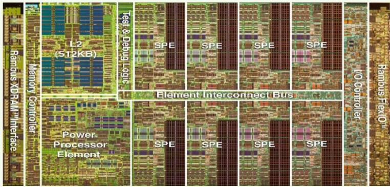

*图：CELL 芯片中的处理单元与互连。*

- 由 IBM、Sony 和 Toshiba 联合开发（2005 年起）。

**8 个 64 位浮点计算核心：**
- 称为协同处理单元（Synergistic Processor Element，SPE）。
- 一个能够执行两个线程的 64 位 PowerPC 主处理器。
- SPE 可以处理 128 位操作数，将其分为四个 32 位字（SIMD）。
- MIC 与 Xeon Phi（Intel）

**Intel 提出的加速器：**

- 众核集成架构（Many-Integrated Core，MIC）。

**体系结构：**

- x86 核心
- 支持超线程
- 缓存一致性
- 第一版：KNF（2010）
- 课件所列最新版本：KNL（2013）与 KNM（2017）

### KNL

**128 位 SIMD 的直观例子：** 将四个 32 位数 `[1, 2, 3, 4]` 与 `[10, 20, 30, 40]` 打包，对应位置相加，得到 `[11, 22, 33, 44]`。这里的“四路”来自 `128 / 32 = 4`；若元素宽度变为 64 位，同样的 128 位只能容纳两个元素。向量位宽、元素精度与核心数量是不同概念。

**标量、向量与操作数：** 标量指单个数值；这里的向量把多个数值组成一组；操作数是指令参与运算的输入，例如加法的两个输入。SIMD 用同一条指令对多个数据位置做相同操作，因此“四路加法”是四组对应元素相加，不是把四个数先合成一个总和。

Un scalaire est une valeur ; un vecteur rassemble plusieurs valeurs ; les opérandes sont les entrées d’une opération. Une addition SIMD applique la même opération à plusieurs positions : elle ne réduit pas automatiquement les quatre éléments en une somme unique.

**Exemple SIMD sur 128 bits :** additionner les paquets de quatre valeurs de 32 bits `[1, 2, 3, 4]` et `[10, 20, 30, 40]` donne `[11, 22, 33, 44]`. Les quatre voies viennent de `128 / 32 = 4`. Avec des éléments de 64 bits, le même paquet ne contient que deux valeurs. Largeur vectorielle, précision et nombre de cœurs sont des notions distinctes.

### KNL 概览（KNL Overview）

**读 KNL 图之前 / Lire le schéma KNL :**

| 图中名词 | 作用与区别 | En français |
|---|---|---|
| x86 | 一类指令集，规定机器指令的含义；使用相同指令集不保证性能相同 | Famille de jeux d’instructions, distincte des performances |
| 超线程 | 一个物理核心保留多个逻辑线程的状态，让它们共享执行资源 | Plusieurs contextes de threads sur un cœur physique |
| 缓存一致性 | 协调多个缓存中同一地址的副本；仍需程序同步来表达先写后读 | Cohérence des copies, sans remplacer la synchronisation |
| Tile | 这里指重复的硬件模块，包含核心及缓存等；与后文矩阵的“小块数据”同名但含义不同 | Module matériel répété, pas une tuile de matrice |
| Mesh | 网格状片上互连，模块通过相邻连接交换数据 | Réseau interne maillé |
| VPU | Vector Processing Unit，对一组数据执行向量运算的单元 | Unité de calcul vectoriel |
| MCDRAM / DDR4 | 图中两类内存；前者侧重高带宽，后者提供较大容量 | Mémoire à haut débit et mémoire de plus grande capacité |
| 通道 / PCIe lane | 分别描述内存接口和 PCIe 链路的并行传输资源；这里不是 warp 的线程编号 | Ressources de liaison, sans rapport avec le lane ID d’un warp |
| I/O / DMI / Omni-Path | 输入输出、芯片组连接与节点间互连；用于不同范围的数据通信 | Entrées-sorties, liaison au chipset et réseau entre nœuds |

KNL 是历史处理器代号，图中的容量和峰值要按当时配置阅读；不要把“36 Tile”当作所有加速器的固定结构。术语核对可参见 [Intel 微架构优化手册的 KNL 部分](https://cdrdv2-public.intel.com/814199/356477-Optimization-Reference-Manual-V2-002.pdf)。

KNL désigne une génération historique : les nombres décrivent sa configuration, pas une structure universelle. Voir le chapitre KNL du [manuel Intel](https://cdrdv2-public.intel.com/814199/356477-Optimization-Reference-Manual-V2-002.pdf).

> - Chip: 36 Tiles interconnected by 2D Mesh Tile: 2 Cores + 2 VPU/core + 1 MB L2
> - Memory: MCDRAM: 16 GB on-package; High BW DDR4: 6 channels @ 2400 up to 384 GB IO: 36 lanes PCle* Gen3. 4 lanes of DMI for chipset Node: 1-Socket only Fabric: Intel® Omni-Path Architecture on-package (not shown)
> - Vector Peak Perf: 3+TF DP and 6+TF SP Flops ~5X Higher BW Scalar Perf: ~3x over Knights Corner than DDR Streams Triad (GB/s): MCDRAM : 400+; DDR: 90+
> - Source Intel: All products, computer systems, dates and figures specified are preliminary based on current expectations, and are subject to change without notice, KNL data are preliminary based on current expectations and are subiect to change without notice. 1Binary Compatible with Intel Xeon processors using Haswell Instruction Set (except TSX). 2Bandwidth numbers are based on STREAM-like memory access pattern when MCDRAM used as flat memory. Results have been estimated based on internal Intel analysis and are provided for informational purposes only. Any difference in system hardware or software design or configuration may affect actual performance. *Other names and brands may be claimed as the property of others

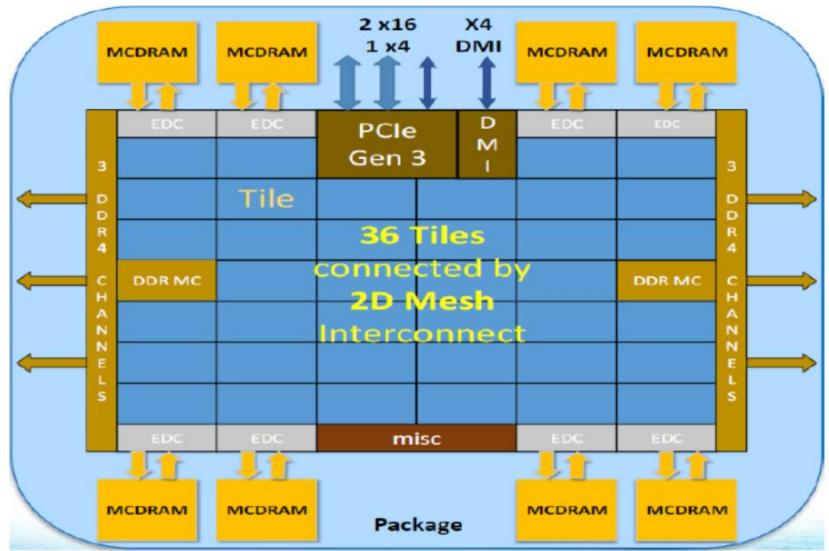

*图：KNL：Tile、MCDRAM 与外部接口。*

- 芯片：36 个 Tile 通过二维 Mesh 互连；每个 Tile 包含 2 个核心、每核心 2 个 VPU，以及 1 MB L2 缓存。
- 内存：封装内集成 16 GB 高带宽 MCDRAM；DDR4 提供 6 个 2400 速率通道，容量最高 384 GB。I/O：36 条 PCIe Gen3 通道，另有 4 条 DMI 通道连接芯片组。节点：仅支持单插槽。互连：封装内集成 Intel® Omni-Path Architecture（图中未示出）。
- 向量峰值性能：双精度超过 3 TFLOPS，单精度超过 6 TFLOPS。MCDRAM 带宽约为 DDR 的 5 倍；标量性能约为 Knights Corner 的 3 倍。STREAM Triad 带宽（GB/s）：MCDRAM 超过 400，DDR 超过 90。
- 来源 Intel：这里列出的产品、计算机系统、日期和数值均为基于当时预期的初步信息，可能变更，恕不另行通知；KNL 数据也属于初步数据。¹ 与采用 Haswell 指令集的 Intel Xeon 处理器二进制兼容，TSX 除外。² 带宽数值基于将 MCDRAM 用作平坦内存时类似 STREAM 的访问模式。结果根据 Intel 内部分析估算，仅供参考；系统硬件、软件设计或配置的差异可能影响实际性能。其他名称和品牌可能属于其各自所有者。

### 图形处理器（Graphics Processors）

> - Graphics cards initially for 2D and 3D display on screens:
> - Dedicated graphics processor(s).
>
> **Impressive computing capabilities:**
>
> - Optimized for image rendering (different objectives from generalpurpose processors).
> - Ideal for processing regular data.
>
> **Use for scientific computing:**
>
> - GPGPU (General Purpose Graphics Processing Unit).

- 显卡最初用于屏幕上的二维和三维显示：
- 配备专用图形处理器。

**很强的计算能力：**

- 针对图像渲染优化，设计目标与通用处理器不同。
- 适合处理规则的数据。

**用于科学计算：**

- GPGPU：通用 GPU 计算。

**从图形到科学计算：** 图形渲染需要对大量像素、顶点做相似运算；科学计算也有类似结构，例如给一百万个网格点分别更新温度。GPGPU 的意思是利用 GPU 的并行计算能力处理这些非图形任务，并不要求先把温度数据转换成一张要显示的图片。

**Du graphisme au calcul scientifique :** le rendu applique des opérations similaires à de nombreux pixels ou sommets. Une simulation peut faire de même pour mettre à jour la température d’un million de points. Le GPGPU utilise cette capacité pour des tâches non graphiques ; il n’exige pas de transformer les températures en une image à afficher.

### GPGPU

> **Graphics cards on a system bus:**
>
> - Interconnection on the motherboard.
> - Communications via the PCI-express port.
>
> **Possibility to connect multiple graphics cards:**
>
> - Multi-GPU programming.
> - Currently used in heterogeneous supercomputers.

**连接系统总线的显卡：**

- 通过主板上的互连连接。
- 通过 PCI Express 接口通信。

**可以连接多块显卡：**

- 多 GPU 编程。
- 用于异构超级计算机。

**多 GPU 的例子：** 将一幅大图的上半部分交给 GPU 0，下半部分交给 GPU 1。逐像素加亮时，两部分可以独立计算；若做需要上下相邻像素的滤波，两块 GPU 还需要取得分界线附近的数据。增加 GPU 数量，也会引入数据划分、通信和负载均衡问题。

**Exemple multi-GPU :** le GPU 0 traite la moitié supérieure d’une image, le GPU 1 la moitié inférieure. Une correction de luminosité par pixel est indépendante ; un filtre utilisant les pixels voisins demande aussi des données proches de la frontière. Ajouter des GPU impose donc de penser au découpage, aux échanges et à l’équilibrage du travail.

### NVIDIA Fermi 架构（2010）（Nvidia Fermi Architecture (2010)）

> - Nvidia Volta Architecture (2017)

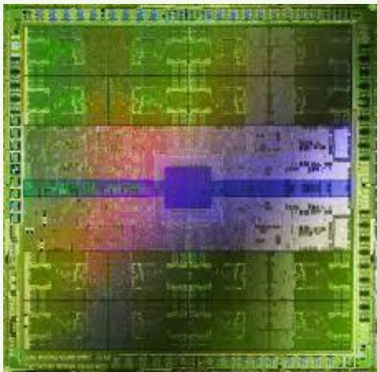

*图：Fermi 裸片布局。*

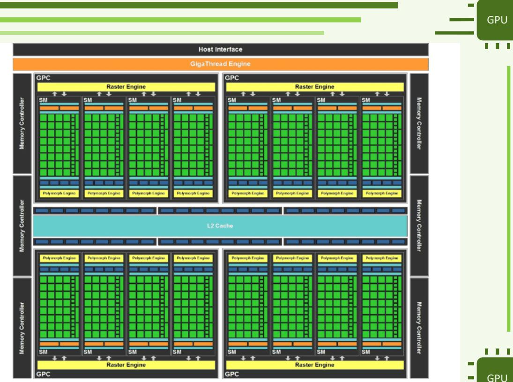

*图：Fermi 架构示意图。*

- NVIDIA Volta 架构（2017）

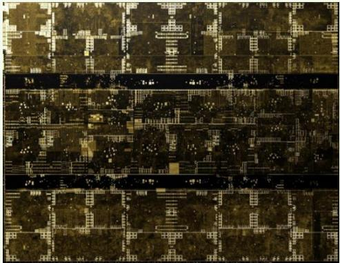

*图：Volta 裸片布局。*

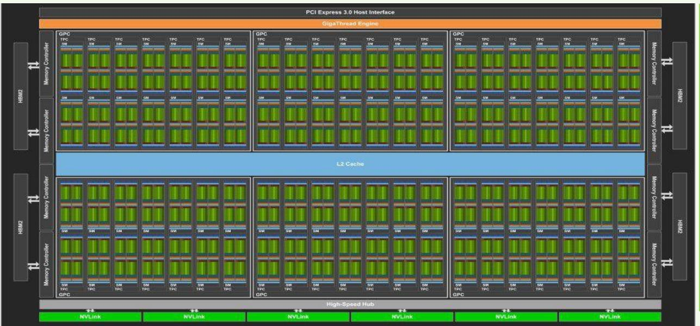

*图：Volta 计算单元与缓存布局。*

### ATI Cypress 架构（2009）（ATI Cypress Architecture (2009)）

> - Set of vector units: SIMD Engines.
> - Memory hierarchy: L2 Cache.
>
> **Peak performance:**
>
> - 2.72 TFlops SP
> - 0.54 TFlops DP

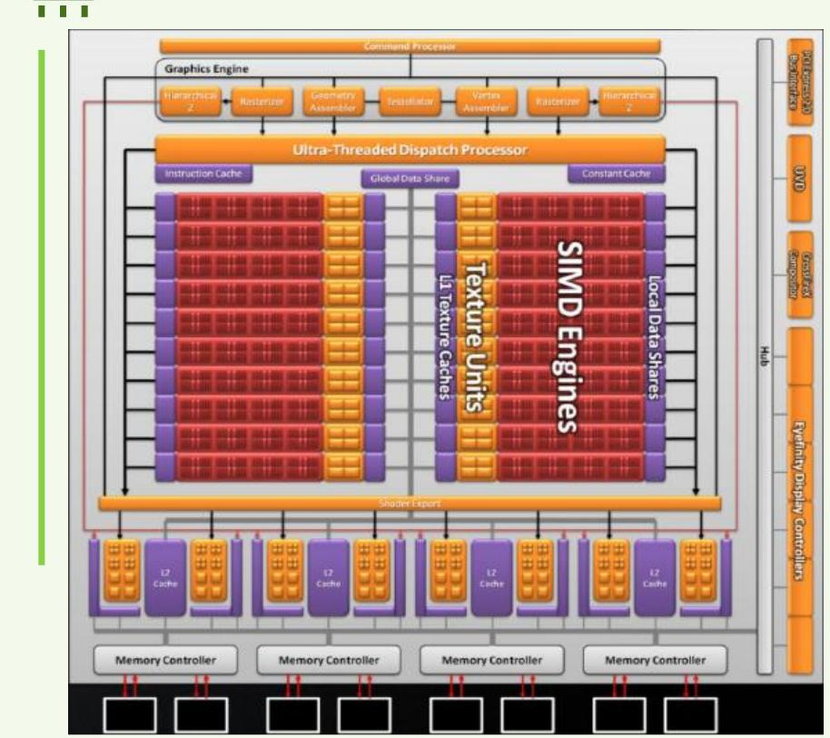

*图：ATI Cypress 的 SIMD Engine 与缓存。*

- 一组向量单元：SIMD Engine。
- 存储层次：L2 缓存。

**峰值性能：**

- 单精度：2.72 TFLOPS
- 双精度：0.54 TFLOPS

**怎样使用 SP / DP 峰值？** `float` 和 `double` 的计算不能直接套用同一项峰值。若算法要求双精度，应先看 DP 条目；即使采用 SP，程序也可能受数据搬运限制，达不到 SP 峰值。这里的数值是该历史架构的课件数据，不代表所有 GPU 都有相同的 SP/DP 比例。

**浮点数与性能单位：** 浮点格式用符号、指数和有效数字表示数值。SP / FP32 是常用的 32 位单精度，DP / FP64 是 64 位双精度；位数增加通常能表示更多有效数字，也会改变存储和硬件计算成本。FLOP 是一次浮点运算，FLOPS 是每秒浮点运算数；TFLOPS 是每秒 $10^{12}$ 次。计算 `a*b+c` 在常见性能口径中计两次运算，即使硬件用一条融合乘加指令完成。峰值表示特定条件下的理论能力，不能直接当作应用实测速度。

Un flottant encode signe, exposant et précision significative. FP32 et FP64 utilisent 32 et 64 bits. FLOP compte une opération ; FLOPS compte les opérations par seconde, avec $10^{12}$ pour le préfixe T. Une multiplication-addition compte généralement deux opérations même si elle utilise une instruction fusionnée. Un pic dépend de conditions précises et ne donne pas le débit d’une application.

**Lire les pics SP / DP :** un calcul en `float` et un calcul en `double` ne se comparent pas au même plafond. Une exigence de double précision conduit à examiner le pic DP ; même en SP, les transferts peuvent limiter le débit. Les chiffres de cette ancienne architecture ne définissent pas un rapport SP/DP universel.

### ATI Radeon Navi 架构（2019）（ATI Radeon Navi Architecture (2019)）

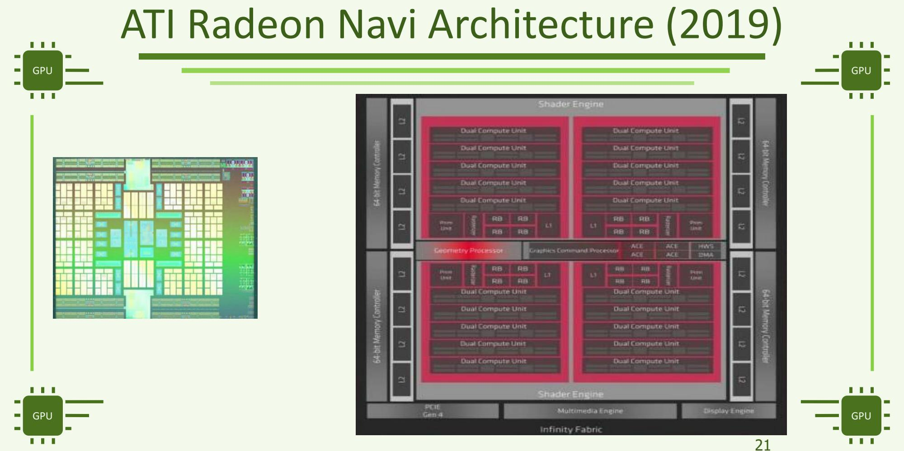

*图：ATI Radeon Navi 架构。*

### AMD Fusion Llano 架构（2011）（AMD Fusion Llano Architecture (2011)）

> - Nom de code de l’architecture d’AMD/ATI : Fusion
> - Design d’un APU (Accelerator Processing Unit)
>
> **Sur la même puce :**
>
> - Accélérateur de type GPU
> - Première génération disponible en 2011
> - Llano avec technologie Bulldozer ou Bobcat

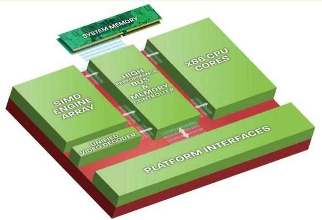

*图：AMD Fusion：CPU 与 GPU 集成示意。*

- AMD/ATI 架构代号：Fusion
- APU（课件展开为 Accelerator Processing Unit）的设计

**位于同一芯片上：**

- CPU
- GPU 类型的加速器
- 第一代于 2011 年推出
- 课件将 Llano 与 Bulldozer 或 Bobcat 技术并列提及
- http://fusion.amd.com

### AMD APU Picasso 架构（AMD APU Picasso Architecture）

### Ryzen-bridge（2019）（Ryzen-bridge 2019）

### AMD APU Picasso 架构（AMD APU Picasso Architecture）

### Ryzen-bridge（2019）（Ryzen-bridge 2019）

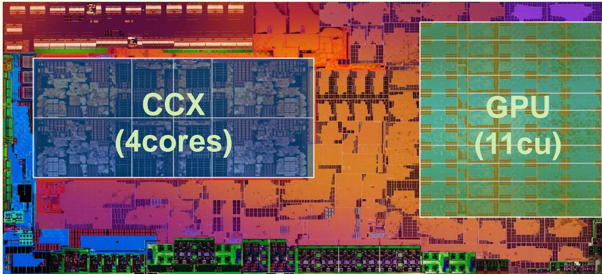

*图：Picasso：标注 CPU CCX 与 GPU 区域。*

**APU 与 CCX：** APU 在这里强调 CPU 与 GPU 功能的集成；CCX 是 AMD 图中一组 CPU 核心及相关缓存资源的组织名称。CPU 的 CCX、GPU 的 SM 和程序中的 block 分属不同概念，不能把图中名称都理解成“同一种核心”。Fermi、Kepler、Volta、Navi、Picasso 等则是架构或产品代号，用于标识不同设计世代。

APU souligne ici l’intégration CPU–GPU ; CCX nomme un regroupement de cœurs CPU et de caches chez AMD. CCX, SM et bloc CUDA désignent des objets différents. Les autres noms de générations servent à identifier des conceptions, pas une nouvelle opération à programmer.

**读集成架构图的例子：** 图中 CPU CCX 区域运行控制流程，GPU 区域执行图形或并行计算。同一芯片中的两块区域仍有不同的执行资源；把循环写在 CPU 函数里，不会因为芯片上有 GPU 就自动移到 GPU 上。还需要相应的库、编译器或卸载接口安排执行。

**Lire une architecture intégrée :** la zone CPU CCX exécute le contrôle, la zone GPU le graphisme ou le calcul parallèle. Ces ressources restent distinctes sur une même puce. Une boucle CPU n’est pas automatiquement exécutée sur le GPU : une bibliothèque, un compilateur ou une interface de déport doit organiser ce travail.

### AMD MI300 – Frontier (2023)

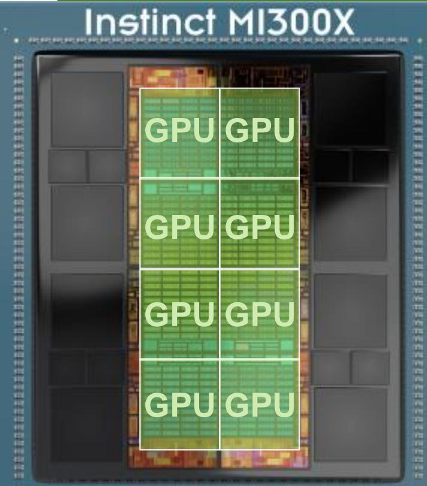

*图：MI300X：标注 GPU 计算区域。*

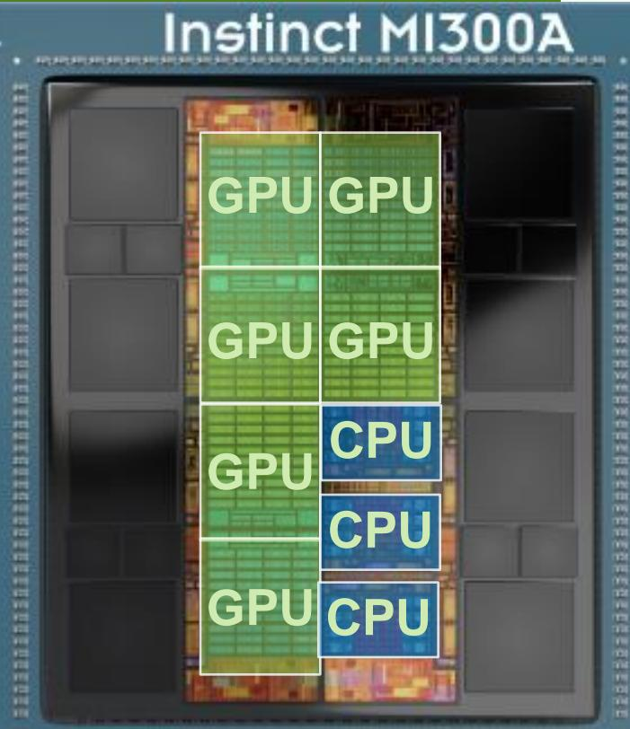

*图：MI300A：标注 CPU 与 GPU 区域。*

### Nvidia Grace+Hopper (2022)

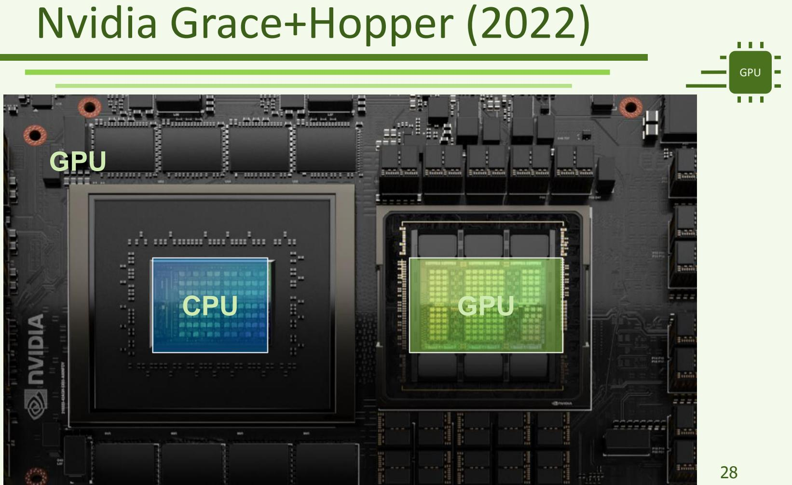

*图：Grace+Hopper：CPU 与 GPU 位置。*

### Top500 中加速器的演变（Evolution of accelerators in the Top500）

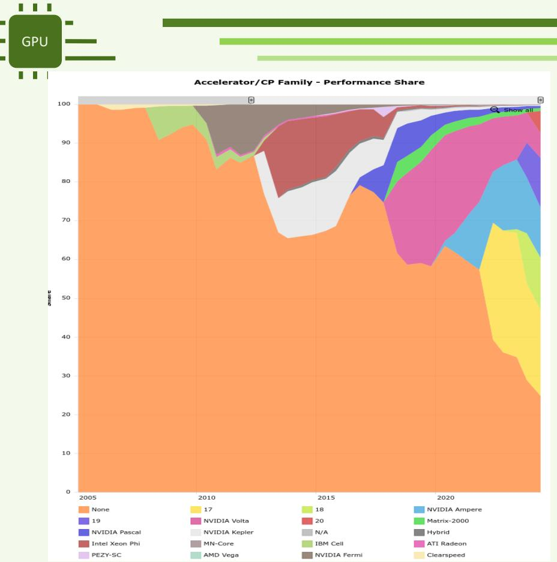

*图：Top500：包含无加速器系统的性能份额。*

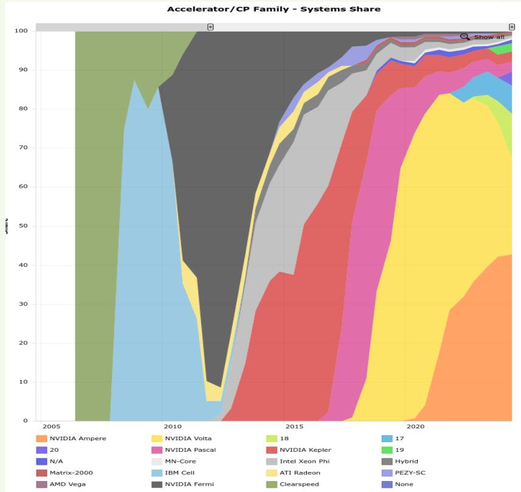

*图：Top500：加速器家族的性能份额。*

**读份额图先看分母：** 假设某类机器只有 10 台，每台贡献 10 个性能单位；另一类有 90 台，每台贡献 1 个单位。前者只占机器数量的 10%，却占性能的 `100 / 190 ≈ 52.6%`。因此“性能份额”不能读成“机器数量份额”，历史图也不能当作今天的排名。

**Vérifier le dénominateur :** imaginons 10 machines apportant chacune 10 unités de performance, et 90 autres apportant chacune une unité. La première famille représente 10 % des machines mais `100 / 190 ≈ 52,6 %` de la performance. Une part de performance n’est donc pas une part du nombre de systèmes ; une figure historique ne donne pas non plus le classement actuel.

## NVIDIA 显卡体系结构（NVIDIA GRAPHICS CARD ARCHITECTURE）

### NVIDIA GeForce 架构（NVIDIA GeForce Architecture）

### 基本组成单元（Basic Building Block:）

> - Very simple compute core.
> - Set of compute cores grouped in a stream multiprocessor.

- 非常简单的计算核心。
- 一组计算核心组成一个流式多处理器。

**把 SM 看成执行线程块的资源集合：** 一个线程块会在一个 SM 上执行，使用该 SM 的寄存器、共享内存和计算单元。SM 可以在资源允许时容纳多个线程块；一个含几千个块的 grid 也可以分批执行。程序中的线程总数可以远大于硬件计算单元数量，二者没有一一对应关系。参见 [CUDA 编程模型](https://docs.nvidia.com/cuda/cuda-programming-guide/01-introduction/programming-model.html)。

**Le SM comme ensemble de ressources :** un bloc s’exécute sur un SM et utilise ses registres, sa mémoire partagée et ses unités de calcul. Plusieurs blocs peuvent y résider si les ressources le permettent ; une grande grille peut avancer par vagues. Le nombre de threads du programme peut donc largement dépasser celui des unités de calcul. Voir le [modèle CUDA](https://docs.nvidia.com/cuda/cuda-programming-guide/01-introduction/programming-model.html).

### 为什么称为“流式”？（Why "stream"?）

**先建立软件与硬件的对应关系：** thread 是一次执行的私有状态和工作身份；block 是能使用块内同步、普通共享内存协作的一组线程；grid 是一次 kernel 启动产生的线程块集合。SM（Streaming Multiprocessor）则是真实硬件，包含调度和运算资源。把 256 个线程放进一个 block，并不等于申请 256 个完整 CPU 核心，也不意味着它们每个时钟周期都能同时完成一条指令。

Un thread porte un état et une identité de travail ; un bloc regroupe des threads coopérant ; une grille regroupe les blocs d’un lancement. Le SM est le matériel qui les exécute. Un bloc de 256 threads ne demande pas 256 cœurs CPU ni une exécution simultanée de tous à chaque cycle.

SM 名称里的 streaming 是历史架构用语；后文 CUDA **stream** 是提交操作的有序队列。两个词相关联的直觉都是连续工作，但它们不是同一个对象。

Le mot streaming dans SM ne désigne pas un stream CUDA : ce dernier est une file ordonnée d’opérations soumises par le programme.

> - Designed to operate on a continuous data stream.
> - Synchronous language on each multicore.

- 设计用于处理连续的数据流。
- 每个多核单元采用同步执行方式。

### 面向细粒度并行的设计（Design for Fine-Grained Parallelism）

### NVIDIA Kepler 架构（2012）（Nvidia Kepler Architecture (2012)）

### 15 个流式多处理器（SM）（15 Streaming Multiprocessors (SMs).）

> - Arrangement perpendicular to the shared L2 cache.

- 垂直于共享 L2 缓存排列。

### 图例（Legend:）

> - Green: Compute core (double precision unit in orange).
> - Orange: Scheduler and dispatcher.
> - Light blue: Register bank and L1 cache.

- 绿色：计算核心；双精度单元用橙色表示。
- 橙色：调度器和分派器。
- 浅蓝色：寄存器组和 L1 缓存。

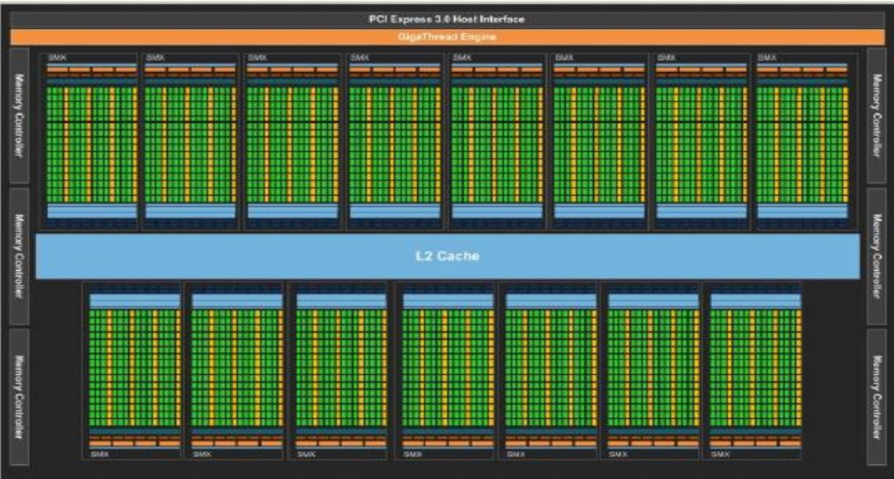

*图：Kepler：SMX 与共享 L2 缓存。*

### Kepler：流式多处理器（Kepler : Streaming Multiprocessor）

> - Streaming Multiprocessor (SMX).
>
> **192 CUDA-compatible cores:**
>
> - ALU unit.
> - Single-precision floating-point unit.
> - 64 double-precision floatingpoint units.
> - 32 special units (SFU).
> - 32 load/store units.

- 流式多处理器（SMX）。

**192 个支持 CUDA 的核心：**

- 算术逻辑单元（ALU）。
- 单精度浮点单元。
- 64 个双精度浮点单元。
- 32 个特殊函数单元（SFU）。
- 32 个加载／存储单元。

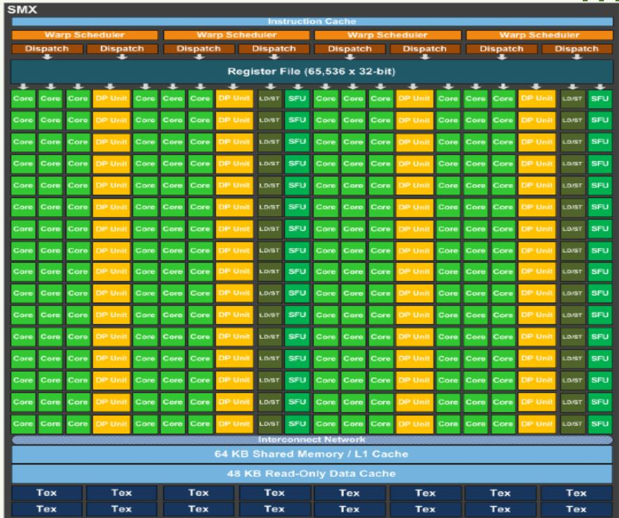

*图：Kepler SMX：调度器、计算单元与存储资源。*

**图中每个部件做什么 / Rôle des unités :**

| 部件 | 功能 | En français |
|---|---|---|
| ALU | 执行算术、比较或逻辑运算；具体支持哪些指令由单元设计决定 | Unité arithmétique et logique |
| FP32 / FP64 单元 | 执行相应精度的浮点运算 | Unités flottantes selon la précision |
| SFU | Special Function Unit，服务部分特殊数学运算；一个高级数学函数也可能需要多条指令 | Unité de certaines opérations mathématiques spéciales |
| Load / Store 单元 | 执行加载、存储相关指令；load 把数据读入供计算，store 把结果写回内存 | Chemin de chargement et de stockage |
| Register File | 寄存器集合，为线程保存输入、中间值和结果 | Ensemble des registres portant l’état des threads |
| Warp Scheduler | 从满足执行条件的 warp 中选择可发出的指令 | Sélection d’instructions de warps prêts |
| Instruction Dispatch Unit | 将选出的指令分派给对应执行流水线 | Envoi vers la chaîne d’exécution appropriée |

例如 `x = a[i] + 1` 在机器层面可能涉及地址计算、load、加法；它不是“一个 CUDA 核心从内存到计算全部独立完成”的完整小程序。

Une expression telle que `x = a[i] + 1` peut nécessiter calcul d’adresse, chargement et addition : plusieurs ressources interviennent.

### Kepler：流式多处理器（Kepler : Streaming Multiprocessor）

### SIMT 执行方式（SIMT execution type:）

> - Single-Instruction Multiple Thread.
> - Similar to SIMD.
> - Synchronous execution of compute cores.
>
> **Each SMX manages and executes compute threads in batches of 32:**
>
> - Notion of warp.
> - 4 warp schedulers per SMX.

- 单指令多线程（Single-Instruction Multiple Thread）。
- 与 SIMD 类似。
- 计算核心同步执行。

**每个 SMX 以 32 个线程为一组管理和执行计算线程：**

- 这一组称为 warp。
- 每个 SMX 有 4 个 warp 调度器。

**warp 和程序中的 `if` 有什么关系？**

**warp、lane、SIMT、mask：** warp 是块内按规则组成的 32 线程组；lane 是线程在该 warp 中的位置，编号 0–31。SIMT 表示用线程表达程序、由硬件把线程成组推进：代码相同，各线程的索引和数据可以不同。active mask 是标记当前哪些线程参与执行的位集合，某位为 0 表示该线程不参与当前路径的指令。它不是“给每颗独立小 CPU 拒收一封指令消息”。

Un warp regroupe 32 threads ; le lane est leur position 0–31 dans ce groupe. Le SIMT conserve des états individuels tout en exécutant des instructions en groupe. Le masque actif indique les participants de la voie courante ; une position inactive ne produit pas les effets de cette instruction.

例如 `if (lane < 16) x = a+b; else x = a*b;`，用 Kepler 的模型解释，假设先推进加法再推进乘法：

| 阶段 | lane 0–15 | lane 16–31 |
|---|---|---|
| 加法路径 | 活跃，更新各自的 x | 被屏蔽，不执行这次加法 |
| 乘法路径 | 被屏蔽，不执行这次乘法 | 活跃，更新各自的 x |
| 汇合后的公共代码 | 使用自己通过加法得到的 x | 使用自己通过乘法得到的 x |

这里的**分歧（divergence）**是同一 warp 内线程走不同路径，**重新汇合（reconvergence）**是回到共同执行位置。“另一组在等”是有用的直觉，但分支顺序不能依赖；Volta 以后的独立线程调度也更灵活。短条件还可能被编译成带谓词的指令，即逐线程条件决定指令是否生效，不能见到 `if` 就断定一定生成跳转。

La divergence sépare les chemins au sein du warp ; la reconvergence retrouve un point commun. L’ordre des branches n’est pas garanti. Volta ajoute une gestion plus souple des états de threads ; un petit `if` peut aussi devenir une instruction prédicatée plutôt qu’un branchement.

老师用条件分支解释 SIMT：同一 warp 的线程运行相同的 kernel，但条件可能由各自的数据决定。若部分线程满足条件、另一部分不满足，它们就可能走不同的执行路径。

以一个含 32 个线程的 warp 为例：

| 条件结果 | 如何理解 |
| --- | --- |
| 32 个线程都走同一分支 | 这个分支不会因为线程选择不同而发生 warp 内分歧 |
| 一部分走 `if`，另一部分走 `else` | 两条路径可能需要分别推进，各路径只对相应线程生效，计算资源利用率可能下降 |
| 最后一组只有部分线程对应有效数据 | 其余线程不应访问越界元素；有效工作不足以填满整个 warp |

因此要关注的是线程如何分组、分支是否一致及各路径的工作量，不能把课堂的简化说法写成“GPU 不能使用 `if`”。例如，检查 `i < N` 对保证数组访问正确仍然必要。不同架构的具体执行机制有所变化，也不能把 warp 理解成无需同步就能任意交换数据的一组线程。

**调度器数量也不等于线程容量。** 后面的 Kepler 图说明一个周期内如何选择 warp、分派指令；一个 SM 能驻留多少 warp 是另一项资源限制。

**把分歧代入具体索引：** 对 warp 内编号 0–31 的线程，`if (i % 2 == 0)` 会把偶数线程和奇数线程分到不同路径；`if (i < 32)` 则让这整个 warp 都进入同一路径。是否分歧取决于同一个 warp 内的条件结果，不能只看源代码里有没有 `if`。

**Exemple de divergence :** pour les threads d’indices 0 à 31 d’un même warp, `if (i % 2 == 0)` sépare les indices pairs et impairs. Avec `if (i < 32)`, tous prennent la même branche. La divergence dépend des résultats du test au sein du warp, et non de la seule présence d’un `if`.

参见 [NVIDIA SIMT 说明](https://docs.nvidia.com/cuda/cuda-programming-guide/02-basics/writing-cuda-kernels.html#basics-of-simt)及[硬件多线程说明](https://docs.nvidia.com/cuda/archive/13.0.0/cuda-c-programming-guide/index.html#hardware-multithreading)。

### Kepler：warp 调度器

*对应新版 PDF 第 38 页。*

**发射、完成和屏蔽不是同一阶段。** 发射（issue）是开始安排一条指令执行，完成要等它的运算或访存结果可用。Scheduler 选择可发出的工作，Dispatch Unit 把它送到相应流水线；active mask 规定哪些线程的执行有效。公开框图不足以确定屏蔽电路究竟只位于哪一个框中，也不能推断被屏蔽线程一定“先算完再丢掉结果”。[NVIDIA SIMT 说明](https://docs.nvidia.com/cuda/archive/13.0.0/cuda-c-programming-guide/index.html#simt-architecture)描述的是执行语义，需要与具体电路实现区分。

Émettre une instruction ne signifie pas qu’elle est terminée. Scheduler et dispatch organisent la sélection et l’envoi ; le masque définit les participants. Le schéma public ne localise pas à lui seul tout le mécanisme de masquage, et ne prouve pas que les résultats inactifs sont calculés puis jetés.

**调度器与分派单元：**

- 每个 SMX 有 4 个 warp 调度器；每个 warp 包含 32 个线程。
- 每个 SMX 有 8 个指令分派单元（Instruction Dispatch Unit），即每个 warp 调度器对应 2 个分派单元。

**四个调度器如何工作：**

1. 四个调度器各选择一个 warp，总共选择 4 个 warp。
2. 对于选中的 warp，每个周期可以调度其中两条相互独立的指令。

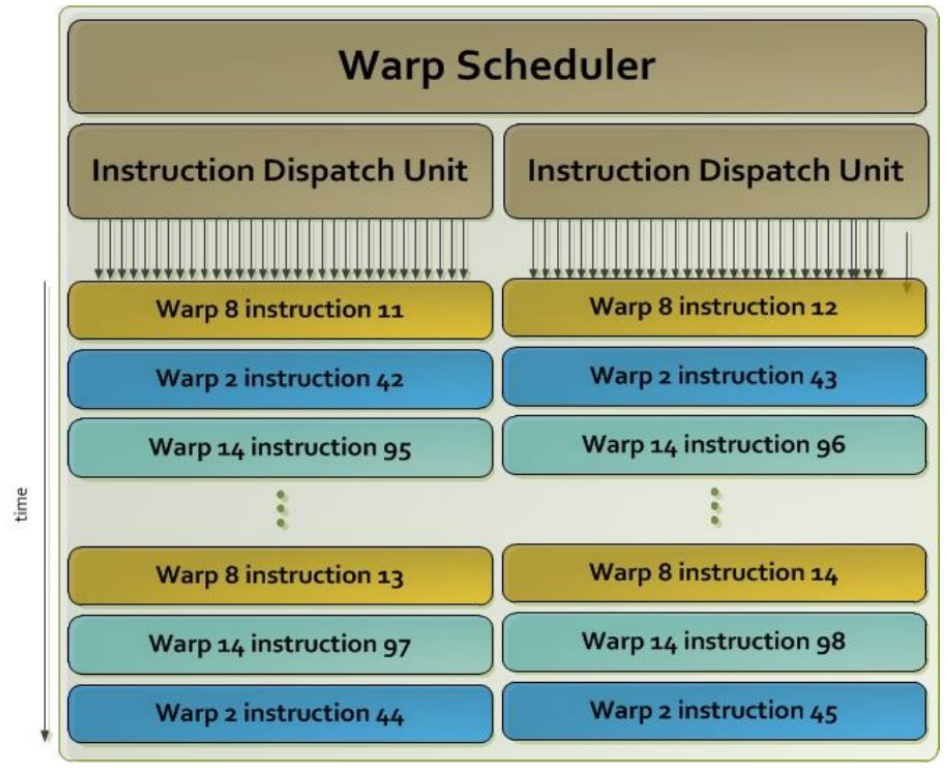

*图：新版 PDF 第 38 页右侧的调度示意图。图中展示一个 warp 调度器及其两个指令分派单元；时间沿向下的箭头推进，每一行是一对来自同一 warp 的指令，不同颜色代表不同 warp。*

**读图说明：** 图中的 Warp Scheduler 是 warp 调度器，Instruction Dispatch Unit 是指令分派单元。例如，第一行的 “Warp 8 instruction 11” 和 “Warp 8 instruction 12” 表示 warp 8 的第 11、12 条指令。这一行用于说明：当两条指令相互独立、满足调度条件时，可以由两个分派单元调度。后续行展示调度器选择其他 warp，以及再次选择之前的 warp。

> 理解提示：课件使用的是“可以”（may），不表示每个 warp 每周期必然执行两条指令。这里说明的是 Kepler 的结构，不能直接推广到所有 NVIDIA 架构。

**两条指令何时独立？** `x = a + b` 与 `y = c + d` 之间没有数据依赖；`x = a + b` 与 `y = x * c` 则有依赖，后者必须取得前者的结果。没有数据依赖只是允许并行分派的条件之一，还要满足指令类型和执行单元等约束。某个 warp 等待数据时，调度器可以选择其他已就绪的 warp 来隐藏部分等待时间。

**Deux instructions indépendantes :** `x = a + b` et `y = c + d` n’ont pas de dépendance de données ; `y = x * c` dépend en revanche du résultat de `x = a + b`. L’indépendance ne suffit pas à garantir une double émission : les types d’instructions et les ressources comptent aussi. Lorsqu’un warp attend une donnée, un autre warp prêt peut fournir du travail utile.

### Kepler：存储层次（Kepler: Memory Hierarchy）

> - Thread scheduled on a compute core on an SMX.
> - Memory access via load or store instruction.
>
> **Two possibilities:**
>
> - Access to shared memory: no cache.
> - Access to global device memory: passes through two levels of cache.
> - Physically, the same memory is used for L1 cache and shared memory:
> - Appearance of a read-only cache (48 KB).
>
> - 6 GPCs (Graphics Processing Clusters).
> - 7 TPCs (Texture Processing Clusters) per GPC.
> - 2 SMs per TPC.
> - Total: 2 * 7 * 6 = 84 SMs!
>
> - 5376 single-precision floating-point units (14 Tflops) and same amount of integer units.
> - 2688 double-precision floating-point units (7 Tflops).
> - 672 tensor cores (112 Tflops).
> - + 336 texture units.

- 线程被调度到某个 SMX 上的计算核心。
- 通过 load 或 store 指令访问内存。

**两种情况：**

- 访问共享内存：不经过缓存。
- 访问设备全局内存：经过两级缓存。
- 从物理实现看，L1 缓存与共享内存使用同一块存储资源：
- 引入了只读缓存（48 KB）。

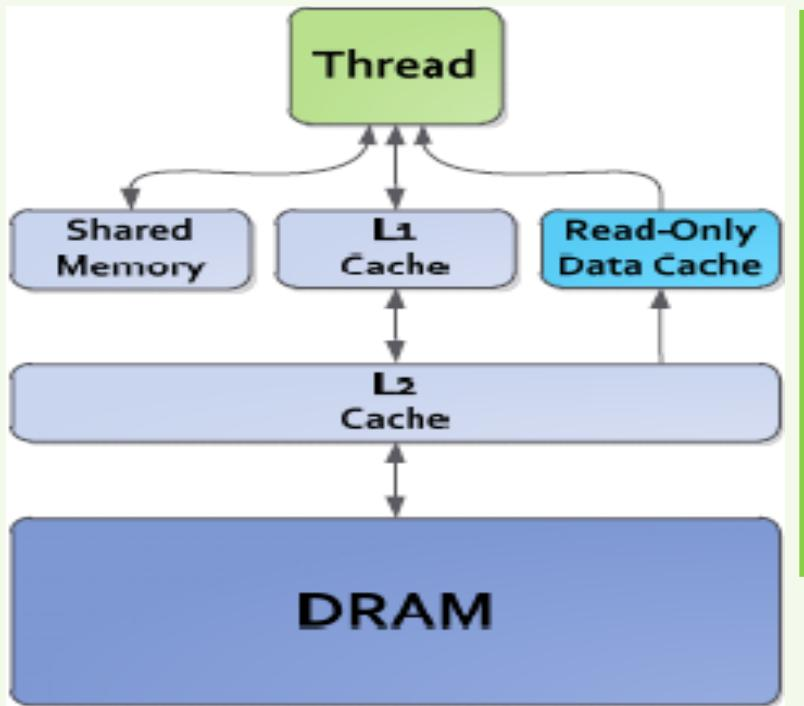

*图：Kepler 存储访问路径。*

**怎样阅读上面的存储层次图？**

老师希望大家沿着数据访问路径看图：SM 内有靠近计算单元的存储资源，多个 SM 共享更外层的 L2，显存则通过内存控制器访问。理解这些位置关系，是后面讨论数据复用和减少显存访问的基础。

这里必须区分两种机制：

- **缓存**由硬件按访问规则管理。访问全局内存时，能否命中相应缓存，会影响实际访问成本；具体路径还取决于架构和指令。
- **共享内存**是程序显式使用的存储空间。线程需要把数据写入其中，安排复用，并在协作访问时处理必要的同步。它不是一次全局内存读取会自动先去搜索的缓存。

所以，不能把图读成“每次读数据都会依次搜索共享内存、L1、L2、显存”。课件所说 L1 与共享内存使用同一块物理资源，也不表示二者具有相同的软件语义。

例如，一组线程反复使用同一批输入时，可以考虑先合作把数据放入共享内存再复用；是否值得这样做，还要比较搬运、同步和资源占用的成本。这里只建立概念，具体实现留到后续课程。

参见 [NVIDIA 共享内存说明](https://docs.nvidia.com/cuda/cuda-programming-guide/02-basics/writing-cuda-kernels.html#shared-memory)。

**复用的算例：** 假设一个块的 16 个线程都需要同样的 16 个输入值。各自从全局内存读取会产生 256 次源代码层面的读取；若合作加载到共享内存，只需要 16 次全局读取，再从共享内存复用。但缓存可能已经减少实际显存流量，新增同步也有成本，因此这不是“必然快 16 倍”的证明。对于每个输入只读一次的简单向量加法，共享内存通常没有这种复用收益。

**Exemple de réutilisation :** 16 threads utilisant chacun les mêmes 16 valeurs effectuent 256 lectures globales au niveau du code. Un chargement coopératif peut les remplacer par 16 lectures globales, puis des accès partagés. Cela ne prouve pas une accélération par 16 : les caches et le coût des synchronisations comptent. Une addition vectorielle lisant chaque entrée une seule fois n’offre pas cette même réutilisation.

### NVIDIA Volta（2017）

**从外到内读硬件层级：** 本图按 GPU → GPC → TPC → SM 逐级分组。GPC 是较大的硬件簇，TPC 是其内部的分组，SM 承担 CUDA 线程的执行。它们的数量和组成随型号变化；“processing block”在后面的 SM 图中指 SM 内部处理分区，不是程序启动的 CUDA thread block。图中的纹理单元处理图形采样等工作，也可能通过相关接口用于数据读取。

Lire GPU → GPC → TPC → SM comme une hiérarchie matérielle propre au modèle représenté. Un processing block interne au SM est une partition matérielle, distincte du thread block CUDA. Les unités de texture servent notamment à l’échantillonnage ; les nombres du dessin ne sont pas universels.

**局部性（locality）**描述访问的集中程度：很快再次使用同一数据叫时间局部性，连续使用相邻地址叫空间局部性。缓存希望利用这些规律；把数据保留在 GPU 上、在一块共享内存中重复使用，也是在主动组织局部性。

La localité temporelle réutilise rapidement une donnée ; la localité spatiale accède à des adresses proches. Caches et réutilisation explicite cherchent à profiter de ces motifs.

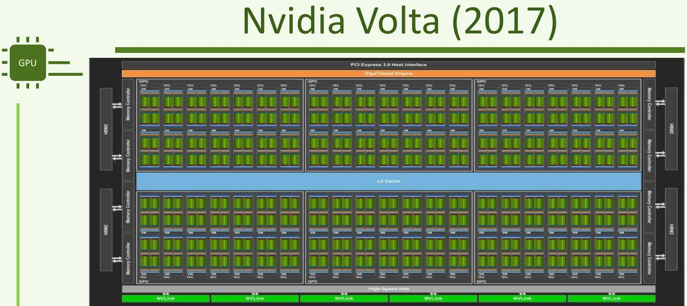

*图：Volta 架构总览。*

- 6 个图形处理簇（GPC）。
- 每个 GPC 有 7 个纹理处理簇（TPC）。
- 每个 TPC 有 2 个 SM。
- 总计：2 × 7 × 6 = 84 个 SM！

- 5376 个单精度浮点单元（14 TFLOPS），以及同样数量的整数单元。
- 2688 个双精度浮点单元（7 TFLOPS）。
- 672 个 Tensor Core（112 TFLOPS）。
- 另有 336 个纹理单元。

**自动管理数据后，传输成本还在吗？**

老师讲到架构演进时，强调了软件使用方式的变化：有些内存机制可以让系统代为管理 CPU、GPU 之间的数据可用性，减少应用显式编写复制操作的负担。

这里可以用统一内存理解其意图，但不能把它称为 CPU 与 GPU 之间多出来的一层普通缓存，也不能把“不写复制操作”推导成“没有数据移动”。实际系统可能通过迁移数据或远程访问来满足请求，具体方式取决于硬件、系统支持及访问模式。

例如，CPU 初始化数据后交给 GPU 连续使用，与 CPU、GPU 反复交替访问同一批数据，成本可能很不同。自动管理简化了接口，数据位置、局部性和同步仍然影响性能。机制解释参见 [NVIDIA 统一内存说明](https://docs.nvidia.com/cuda/cuda-programming-guide/02-basics/understanding-memory.html)。

### NVIDIA Ampere（2020）（Nvidia Ampere (2020)）

> - 8 GPCs (Graphics Processing Clusters).
> - 8 TPCs (Texture Processing Clusters) per GPC.
> - Total: 2 * 8 * 8 = 128 SMs!

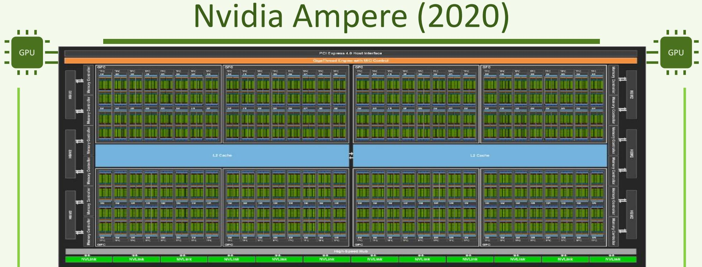

*图：Ampere 架构总览。*

- 8 个图形处理簇（GPC）。
- 每个 GPC 有 8 个纹理处理簇（TPC）。
- 每个 TPC 有 2 个 SM。
- 总计：2 × 8 × 8 = 128 个 SM！

### NVIDIA Ampere：SM 内部结构（Nvidia Ampere: SM view）

> - 4 processing blocks per SM.
> - 16 INT units: 8192 (21 Tops).
> - 16 single-precision floating-point units: 8192 (21 Tflops).
> - 8 double-precision floating-point units: 4096 (10 Tflops).
> - 1 tensor core (112 Tflops).
>
> - 9 TPCs (Texture Processing Clusters) per GPC.
> - Total: 2 * 9 * 8 = 144 SMs!

- 每个 SM 有 4 个处理分区。
- 每分区 16 个整数单元；总计 8192 个（21 TOPS）。
- 每分区 16 个单精度浮点单元；总计 8192 个（21 TFLOPS）。
- 每分区 8 个双精度浮点单元；总计 4096 个（10 TFLOPS）。
- 1 个 Tensor Core（课件标注 112 TFLOPS）。

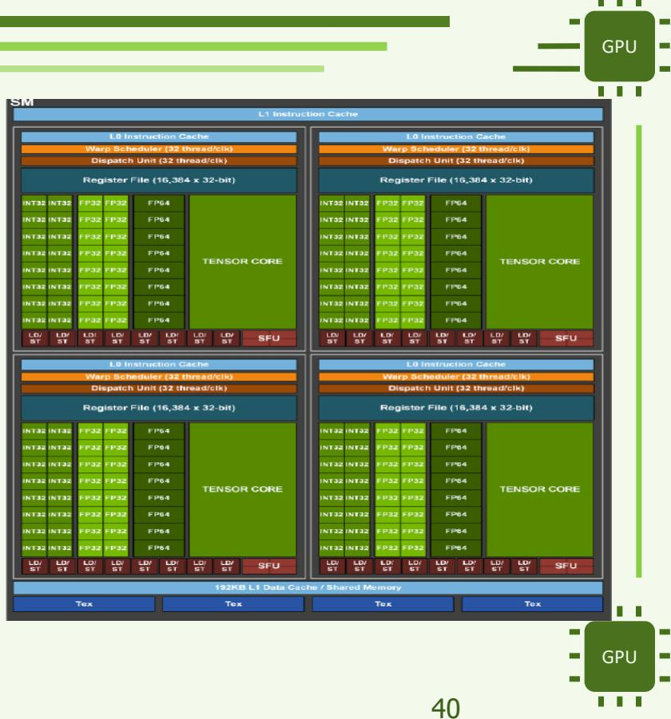

*图：Ampere SM 内部结构。*

**为什么 Tensor Core 的数字不能直接当作程序速度？**

**Tensor Core 的“矩阵乘加”在算什么？** 对矩阵块 A、B、C，计算可写为 `D = A×B + C`。某个输出元素需要把 A 的一行与 B 的一列逐项相乘、求和，再加上对应的 C。Tensor Core 提供这种成组运算的专用硬件路径；线程如何准备数据、使用哪种精度、选择什么指令或库，决定程序是否能用到它。它不是 C++ 中写了任意 `a*b+c` 就会自动使用的普通标量乘加单元。

Un produit matriciel accumulé calcule `D = A×B + C` : chaque sortie combine une ligne et une colonne, puis ajoute C. Les Tensor Cores accélèrent cette forme groupée avec des formats et chemins adaptés. Une expression scalaire quelconque `a*b+c` ne suffit pas à les utiliser.

老师指出，SM 内有针对不同工作设计的单元。看一张 GPU 的总性能数字之前，需要知道自己的计算能不能用到对应单元。

Tensor Core 用于加速矩阵乘加等特定计算，机器学习和科学计算都可能使用它。普通的向量逐元素加法，并不会因为在同一张卡上运行，就自动达到 Tensor Core 标注的峰值。实际利用这些单元还涉及运算形式、数据类型、实现或库所选择的路径。

阅读后面的 Hopper 性能表时，应分别看常规计算与 Tensor Core、不同精度对应的条目，再考虑应用本身的访存和其他开销。不要把不同精度的峰值直接相加，也不要把“没有使用 Tensor Core”量化成“一定浪费一半 GPU”。参见 [NVIDIA GPU 性能背景说明](https://docs.nvidia.com/deeplearning/performance/dl-performance-gpu-background/index.html)。

### NVIDIA Hopper：整体结构

**同一张卡上，两种计算的限制不同：** 算术强度是运算次数与数据传输字节数之比，用来描述搬一次数据能做多少计算。双精度向量加法每个元素读两个 `double`、写一个 `double`，按每个值 8 字节计算，共 24 字节，只做一次加法，算术强度约为 `1/24 FLOP/字节`，这里忽略缓存等影响。矩阵乘法则可以反复复用输入，在每次搬入数据后完成更多运算。这解释了为什么“显存带宽”和“计算峰值”都需要看。

L’intensité arithmétique rapporte le nombre d’opérations au volume de données transférées. Elle décrit la quantité de calcul obtenue pour chaque octet déplacé ; son interprétation dépend du niveau mémoire et de la réutilisation considérés.

**Deux calculs, deux contraintes :** une addition vectorielle en double précision lit deux valeurs de 8 octets et en écrit une, soit 24 octets pour une addition : environ `1/24 FLOP/octet`, en négligeant les effets de cache. Un produit matriciel peut réutiliser ses entrées et effectuer davantage d’opérations par donnée chargée. Il faut donc examiner à la fois la bande passante et le débit de calcul.

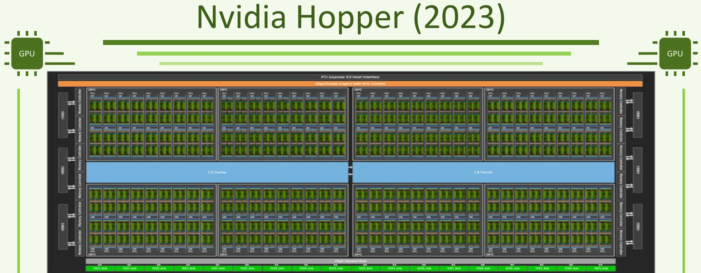

*图：Hopper 架构总览。*

- 8 个图形处理簇（GPC）。
- 每个 GPC 有 9 个纹理处理簇（TPC）。
- 每个 TPC 有 2 个 SM。
- 总计：2 × 9 × 8 = 144 个 SM！

### Hopper：SM 内部结构（Hopper : SM view）

> **4 × Processing Blocks:**
>
> - 16 INT32 units.
> - 32 single-precision units.
> - 16 double-precision units.
> - 8 load/store units.
> - 1 warp scheduler.
> - 1 dispatch unit.
> - Maximum 64 active warps.

**4 个处理分区，每个分区包含：**

- 16 个 INT32 单元。
- 32 个单精度单元。
- 16 个双精度单元。
- 8 个加载／存储单元。
- 1 个 warp 调度器。
- 1 个指令分派单元。
- 最多 64 个活跃 warp（原文列于此处）。

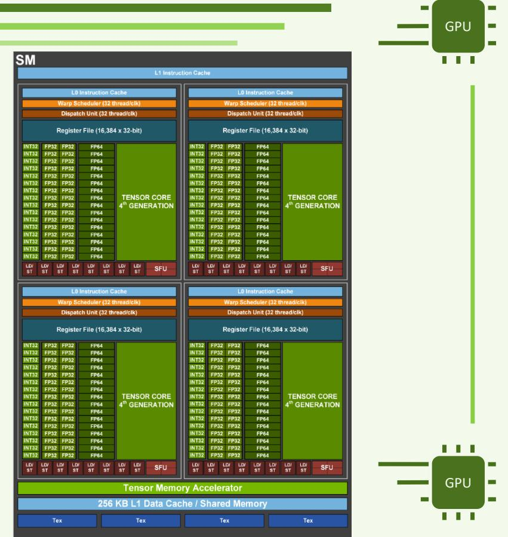

*图：Hopper SM 内部结构。*

**64 个 warp 是什么量级？** `64 × 32 = 2048` 个驻留线程，是 Hopper 每个 SM 的上限，不能对四个处理分区再各乘一次。若每块 256 个线程，则每块有 8 个 warp；只按 warp 上限算最多可容纳 8 块，但寄存器、共享内存等限制可能使实际数量更少。驻留表示执行状态被保留，不表示 2048 个线程同一周期都在做算术运算。参见 [CUDA 硬件限制表](https://docs.nvidia.com/cuda/cuda-programming-guide/05-appendices/compute-capabilities.html)。

**Que représentent 64 warps ?** `64 × 32 = 2048` threads résidents constitue une limite par SM Hopper, pas par partition. Un bloc de 256 threads contient 8 warps : la seule limite en warps autoriserait 8 blocs, mais les registres ou la mémoire partagée peuvent réduire ce nombre. Résident ne signifie pas que chaque thread exécute une opération arithmétique au même cycle. Voir les [limites matérielles CUDA](https://docs.nvidia.com/cuda/cuda-programming-guide/05-appendices/compute-capabilities.html).

### Hopper 性能（Hopper Performance）

**驻留、就绪、占用率：** 驻留 warp 已获得 SM 资源，可能正在等待；就绪 warp 的下一条指令满足依赖等条件，可以参与调度。占用率（occupancy）通常比较一个 SM 的驻留 warp 数与架构允许的最大值。例如最多 64 个 warp、实际驻留 32 个，比例为 50%；这不是 GPU 有一半时间忙，也不意味着性能必为峰值的一半。监控里的 GPU 利用率与 occupancy 不是同一个指标。

Résident signifie que les ressources sont allouées ; prêt signifie que l’instruction suivante peut être sélectionnée. L’occupation compare les warps résidents au maximum du SM. Un ratio de 32 sur 64 vaut 50 %, sans impliquer ni 50 % de temps actif ni 50 % du débit maximal.

> **"Classical" computing:**
> - FP32: 60 Tflops. FP64: 30 Tflops.
>
> **"AI" computing (tensor cores):**
> - FP64: 60 Tflops. TF32: 1 Pflops. FP16: 2 Pflops. FP8: 4 Pflops.
>
> **Difference between FP32 and TF32:**

**常规计算：**
- FP32：60 TFLOPS；FP64：30 TFLOPS。

**AI 计算（Tensor Core）：**
- FP64：60 TFLOPS；TF32：1 PFLOPS；FP16：2 PFLOPS；FP8：4 PFLOPS。

**性能表中的精度名字：** FP16、FP8 分别表示 16 位和 8 位浮点格式这一类数据表示，具体格式还会影响能表示多大的数及有效数字多少。TF32 是 Tensor Core 支持的一种计算精度；例如 FP32 数据可在矩阵乘法内部按 TF32 精度处理，因此不能把 TF32 峰值当作任意普通 `float` 代码都能达到的峰值。PFLOPS 中 P 表示 $10^{15}$，即 1 PFLOPS = 1000 TFLOPS。比较性能数字时，要同时看精度、运算类型与是否利用稀疏性；稀疏性指数据中大量为零、可以在受支持的模式下省去部分计算。参考 [NVIDIA GPU 性能背景说明](https://docs.nvidia.com/deeplearning/performance/dl-performance-gpu-background/index.html)。

FP16 et FP8 désignent des familles de formats sur 16 et 8 bits ; le format précis détermine plage et précision. TF32 correspond à une précision de calcul Tensor Core, notamment à partir de données FP32, pas au débit de toute expression `float`. Un PFLOPS vaut mille TFLOPS. Comparer aussi le type d’opération et la prise en compte de la parcimonie, c’est-à-dire de zéros permettant d’éviter certains calculs dans les motifs pris en charge.

**FP32 与 TF32 的区别：**

FP32 与 TF32 不能只当作“同样精度、速度不同”的两个选项。TF32 用于特定 Tensor Core 计算路径，保留与 FP32 相同的指数位数，但输入有效精度较低；典型矩阵乘法采用 FP32 累加。例如，一个需要严格检查误差的科学计算程序，不能因为 TF32 峰值高，就直接把 FP32 计算替换成 TF32。应同时验证误差要求与性能。参见 [NVIDIA 精度与性能说明](https://docs.nvidia.com/deeplearning/performance/dl-performance-gpu-background/index.html)。

**FP32 et TF32 :** le TF32 sert à certaines opérations Tensor Core. Il conserve la largeur d’exposant du FP32 mais réduit la précision des entrées ; les produits matriciels usuels accumulent en FP32. Remplacer une opération FP32 par une voie TF32 demande donc de vérifier l’erreur numérique autant que le temps de calcul. Voir les [explications de NVIDIA](https://docs.nvidia.com/deeplearning/performance/dl-performance-gpu-background/index.html).

### Grace-Hopper 超级芯片：未来的方向？（Grace-Hopper Superchip: The Future?）

> **"Grace" processor:**
>
> - ARM Neoverse V2 architecture.
> - 72 cores.
>
> **CPU and GPU on the same die to accelerate data transfers:**
>
> - 2x 450GB/s.
> - Native unified memory guaranteed by a memory coherence system (C2C).
>
> - Beware of NUMA effects!

**Grace 处理器：**

- ARM Neoverse V2 架构。
- 72 个核心。

**CPU 与 GPU 位于同一裸片（die）上，以加速数据传输〔原文如此；这里需区分裸片与封装，未据此作硬件结构结论〕：**

- 2 × 450 GB/s。
- 通过内存一致性系统（C2C）提供原生统一内存。

- 注意 NUMA 效应！

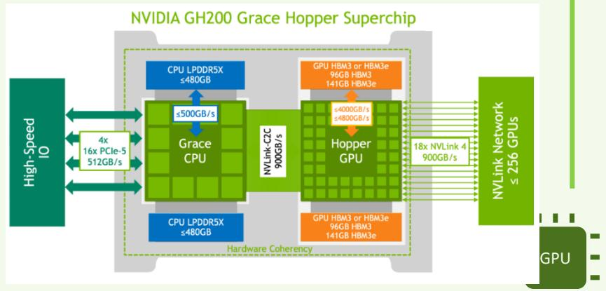

*图：GH200：CPU、GPU、内存与互连接口。*

**MI300A 与 Grace＋Hopper 的区别，要从内存看**

**这张图的三个关键词：** NUMA 是 Non-Uniform Memory Access，指访问不同位置的内存成本不一致；NVLink-C2C 中的 C2C 是 chip-to-chip，表示芯片之间的连接；LPDDR5X 是一类低功耗内存技术。**一致性（coherence）**协调同一地址的缓存副本，**同步（synchronization）**表达任务何时能使用结果；数据副本保持一致，也不能让一个尚未完成的计算提前完成。

NUMA désigne des coûts d’accès mémoire non uniformes ; C2C signifie chip-to-chip ; LPDDR5X est une technologie de mémoire à faible consommation. La cohérence coordonne les copies d’une adresse ; la synchronisation établit quand utiliser un résultat. La première ne termine pas un calcul à la place de la seconde.

老师在前面的 MI300A 图片和这里的 Grace＋Hopper 图片之间做了对比。重点不只是 CPU、GPU 放得多近，而是它们访问什么内存，以及软件怎样安排数据。

| 架构 | 内存组织 | 对程序的启示 |
| --- | --- | --- |
| MI300A | CPU 与 GPU 集成在同一封装中，共享统一的 HBM3 内存 | 可以减少独立内存副本之间的数据搬运，但仍需正确安排 CPU、GPU 对数据的读写顺序 |
| Grace＋Hopper | Grace 连接 LPDDR5X，Hopper 连接 HBM，二者通过一致性的 NVLink-C2C 互连 | 可以支持统一的访问模型，但数据实际位于哪一侧，仍会影响访问成本 |

上方课件“同一裸片”的表述不宜照字面理解为一整块相同的硅片；封装、裸片和内存区域是不同层次的概念。硬件提供内存一致性，也不等于程序可以省略任务之间的同步。例如 CPU 要读取 GPU 刚生成的结果，仍需确认相应计算已经完成。

资料：[AMD MI300A 架构说明](https://instinct.docs.amd.com/projects/system-acceptance/en/latest/gpus/mi300a.html)、[NVIDIA Grace Hopper 架构说明](https://developer.nvidia.com/blog/nvidia-grace-hopper-superchip-architecture-in-depth/)。

**NUMA 的具体含义：** 在 Grace＋Hopper 上，GPU 读取自身 HBM 中的数据，与经 C2C 读取 Grace 侧 LPDDR5X 中的数据，经过的路径不同。两个地址都能访问，不代表访问成本相同。若 GPU 要反复使用一个大数组，就应关注数组实际位于哪一侧；硬件一致性负责可见性规则，程序仍需保证 CPU 初始化完成后 GPU 才使用，GPU 写完后 CPU 才读取。

**Exemple NUMA :** le GPU accède à sa HBM et à la LPDDR5X de Grace par des chemins différents. Deux adresses accessibles n’impliquent pas le même coût. Pour un grand tableau réutilisé sur GPU, son emplacement compte. La cohérence matérielle ne remplace pas l’ordre requis : initialisation CPU avant utilisation GPU, puis fin de l’écriture GPU avant lecture CPU.

## 加速器编程模型（MODÈLES DE PROGRAMMATION POUR ACCÉLÉRATEURS）

### 编程模型（Programming Models）

### 专用语言（Dedicated Languages:）

> - Portable Languages:
> - X Low-level languages OpenCL.
> - Directives based: OpenMP, OpenACC.
>
> **4A High-Level Languages / DSLs:**

- Close To Metal (CTM), HIP/ROCm, CUDA.
- 可移植语言：
- 底层语言：OpenCL。
- 基于指令的方式：OpenMP、OpenACC。

**高级语言／领域专用语言（DSL）：**

- Kokkos, Legion, RAJA, SYCL

**为什么有这么多编程模型？**

**先分清语言、接口、库和工具链：** API 是程序可调用的接口约定，如 `cudaMalloc` 的参数与行为；库提供已经实现的函数；编译器把源代码转换成目标代码；工具链包含编译、链接等工具。后端（backend）是接口对某一类目标硬件的具体实现。DSL 是针对某个问题领域设计的表达方式。课件把多种方案放在一页比较，并不意味着它们全都是独立语言。

Une API définit des appels et leurs contrats ; une bibliothèque fournit des implémentations ; le compilateur produit le code cible. La chaîne d’outils regroupe compilation et édition de liens. Un backend implémente une interface pour une cible ; un DSL fournit des abstractions de domaine. Les éléments de cette diapositive n’ont donc pas tous la même nature.

**链接（linking）**把分别生成的目标代码与所需库中的函数实现连接起来，形成可执行文件或库；**二进制文件**指已生成的机器可用代码形式，与可阅读、修改的源代码不同。同一份源代码能针对多种设备重新构建，不等于已经生成的同一个二进制文件能到处运行。

L’édition de liens relie les objets compilés aux implémentations nécessaires pour produire un exécutable ou une bibliothèque. La portabilité du code source ne signifie donc pas qu’un même binaire fonctionne sur toutes les cibles.

例如 CUDA 提供 GPU 编程模型及工具生态；HIP 提供相近风格的 C++ GPU 编程接口，ROCm 是 AMD 的相关软件平台；OpenMP/OpenACC 用编译指令表达并行及卸载；Kokkos/RAJA 主要以 C++ 抽象表达并行工作；SYCL 是基于 C++ 的异构编程标准。读本讲时先关注“怎样表示数据和工作”，无需把每个名字都当成一门需要立即学会的新语言。

CUDA et HIP exposent une programmation GPU, ROCm est une plateforme logicielle ; OpenMP/OpenACC utilisent des directives ; Kokkos/RAJA offrent des abstractions C++ ; SYCL définit une programmation hétérogène fondée sur C++. Comparer d’abord les façons d’exprimer travail et données.

**OpenCL 和 Legion 在这张列表中的位置：** OpenCL 是面向 CPU、GPU 等异构设备的并行编程标准，包含协调主机与设备的 API 及设备程序的表达方式；Legion 则让程序声明任务以及它们读写哪些逻辑数据区域，由运行时据此分析依赖。后者的“逻辑区域”先描述哪些数据属于一组，不直接等同于某块物理显存。这也说明不同系统自动处理依赖的能力不同，不能把 Legion 的规则套用到普通 CUDA stream。参见 [OpenCL 规范概述](https://registry.khronos.org/OpenCL/specs/unified/refpages/man/html/intro.html)与 [Legion 编程模型](https://legion.stanford.edu/overview/index.html)。

OpenCL standardise la programmation parallèle de dispositifs hétérogènes, avec des API hôte et des programmes device. Legion décrit des tâches et leurs accès à des régions logiques pour permettre l’analyse des dépendances par le runtime. Ces régions décrivent des ensembles de données avant leur placement physique. Les garanties de dépendance d’un système ne se transposent pas automatiquement aux streams CUDA.

老师用一个维护了二十年的科学计算程序作例子：程序第一次迁移到 GPU 已经需要投入开发工作，如果下一台机器换了厂商，团队通常不希望再把整个应用重写一遍。可移植接口的价值，就是尽量降低这种重复开发的成本。

以课堂提到的 Kokkos 为例，可以把关系理解为：应用通过接口表达并行计算和数据组织，构建时选择适合目标机器的后端，再由对应工具链生成程序。更换目标机器仍可能需要重新构建、配置和调优，不是同一个二进制文件天然适用于所有 GPU。

老师还区分了两件事：**代码移植后可以编译、运行，与它在新机器上达到良好性能，是两个目标。** 即使转换工具帮助处理了 API 差异，线程组织、访存和资源使用仍可能需要调整。基于指令的方案便于逐步改造既有程序；更细致的优化则要看接口及其实现提供了哪些控制能力。

### ATI/AMD 编程（ATI/AMD Programming）

**同一个向量加法，编程模型改变了什么？** CUDA 中显式写 kernel、计算线程索引、配置 grid 和 block；OpenMP 可以用指令标记要卸载的循环及数据映射；Kokkos 则通过其并行接口表达索引范围与每个索引的工作，再选择执行后端。数学任务都可以是 `c[i] = a[i] + b[i]`，但程序员直接控制的层次不同。接口可移植，不等于某个配置在所有机器上都最快。

**Une même addition, plusieurs modèles :** CUDA expose le kernel, l’indice du thread et la configuration grille/bloc ; OpenMP annote une boucle et ses données ; Kokkos exprime une plage d’indices et le travail associé avec un backend choisi. L’opération mathématique reste `c[i] = a[i] + b[i]`, mais le niveau de contrôle change. La portabilité du code ne garantit pas celle du meilleur réglage.

### Close to Metal（CTM）／CAL/IL（Close to Metal (CTM) / CAL/IL:）

> - Very low level.
> - Rarely used now.
>
> - Provides a toolkit for writing GPU code and translating CUDA code to HIP.
>
> - Supports OpenCL and SYCL standards.
> - AMD/ATI is part of the consortium.
> - To be continued...

- 非常底层。
- 如今很少使用。

**HIP/ROCm:**

- 提供工具包，用于编写 GPU 代码，并将 CUDA 代码转换为 HIP。

**OpenCL/SYCL:**

- 支持 OpenCL 和 SYCL 标准。
- AMD/ATI 是相关联盟的成员。
- 后续课程继续介绍……

### 并行化指令（Directives de parallélisation）

这里的 **directive / `#pragma`** 是给编译器的标注，例如“把这个循环的迭代分给多线程”；它与 GPU 实际执行的机器指令不是同一层。**MPI** 是进程间消息通信接口，常用于不同节点协作；**OpenMP** 则提供线程并行及设备卸载等机制，所以一个应用可以同时使用 MPI 和 GPU 卸载。

Une directive `#pragma` guide le compilateur ; elle n’est pas une instruction machine GPU. MPI exprime des échanges entre processus, notamment entre nœuds ; OpenMP fournit du parallélisme et du déport. Ces approches peuvent coexister dans une application.

> - Proposal for directive-based programming:
> - Adding #pragma (C, C++) in sequential code.
> - Possibility to add these directives in already parallel code (MPI, OpenMP, etc.): depends on the model.
>
> **Proposed solutions:**
>
> - Portability depending on the accelerators.
> - Original (or even sequential) semantics can be preserved.
>
> - Often need to finish "by hand".
> - Sometimes limited scope.

- 基于指令的编程方案：
- 在顺序代码中加入 `#pragma`（C、C++）。
- 也可能在已经并行化的代码中加入这些指令，例如 MPI、OpenMP 程序；具体取决于编程模型。

**已有方案：**

- OpenACC
- OpenMP 4+

**优点：**

- 可移植性取决于加速器支持情况。
- 可以保留原有语义，甚至顺序执行语义。

**缺点：**

- 通常还需要手动完成一部分工作。
- 有时适用范围有限。

---

继续阅读：[下篇：CUDA 编程入门](APM_Cours1_zh_part2.md)。
