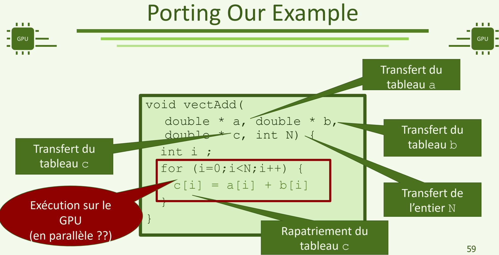
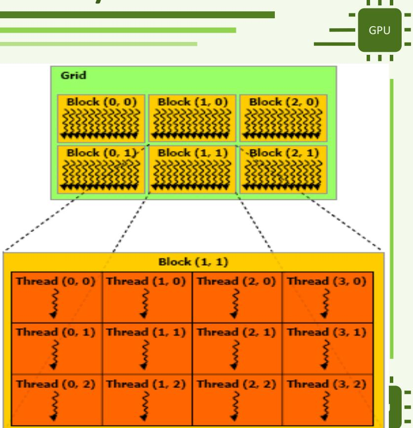
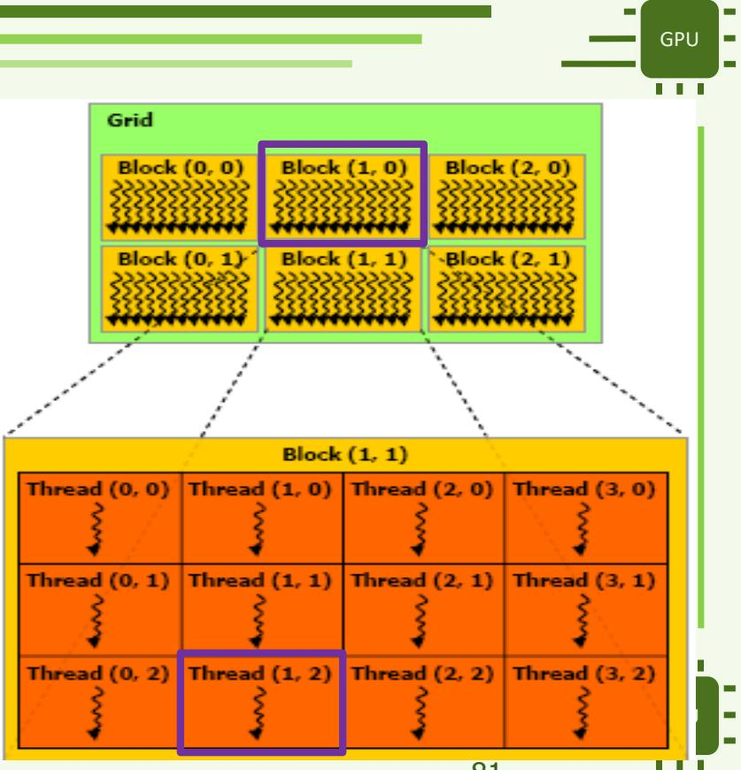

# 第 1 讲下篇：CUDA 编程入门

> [上篇：体系结构与编程模型](APM_Cours1_zh_part1.md) · 原课件：[APM_Cours1_en.pdf](APM_Cours1_en.pdf)

## NVIDIA CUDA

**指令方式的具体例子 / Exemple avec des directives :** 假设 `a`、`b`、`c` 是长度为 `N > 0` 的主机数组，且 C 的旧值不参与计算。下例用 OpenMP 表达输入上传、输出取回和并行循环。

On suppose trois tableaux hôtes de longueur `N > 0`. Les anciennes valeurs de C sont inutiles. Les clauses `map` décrivent les entrées et la sortie :

```c
#pragma omp target teams distribute parallel for \
    map(to: a[0:N], b[0:N]) map(from: c[0:N])
for (int i = 0; i < N; ++i) {
    c[i] = a[i] + b[i];
}
```

`target` 表达卸载区域，`teams distribute parallel for` 分配循环迭代。实际 GPU 执行还需要编译器和目标设备支持；存在这行指令或编译成功，都不能单独证明已经在 GPU 上执行。这里是语法与数据流示例，未作为 GPU 实测结果。参见 [OpenMP target 规范](https://www.openmp.org/spec-html/5.2/openmpse85.html)。

`target` définit la région déportée ; `teams distribute parallel for` répartit les itérations. L’exécution GPU exige un compilateur et une cible compatibles. La présence de la directive, ou une compilation réussie, ne prouve pas à elle seule ce placement. Il s’agit d’un exemple de syntaxe et de flux de données, pas d’une mesure GPU. Voir la [spécification OpenMP target](https://www.openmp.org/spec-html/5.2/openmpse85.html).

### 你认为……（According to you…）

**读 OpenMP 例子里的符号：** `a[0:N]` 在 `map` 中表示从下标 0 起的 N 个元素；`to` 表达输入数据映射，`from` 表达取回输出。`teams` 建立线程团队，`distribute` 在团队间分配循环迭代，`parallel for` 在线程间进一步分配；具体硬件映射由实现决定，不能直接把一个 team 等同于一颗 CUDA core。行末的 `\` 只是把预处理指令续到下一行。

Dans une clause `map`, `a[0:N]` décrit N éléments à partir de zéro. `to` et `from` décrivent les entrées et sorties. Les teams répartissent le travail à un niveau, puis `parallel for` entre threads ; la correspondance matérielle dépend de l’implémentation. Le caractère `\` prolonge la directive sur la ligne suivante.

> - What do you think we will find in a GPU program?
> - Which parts?
> - Which steps?

- GPU 程序中会有哪些内容？
- 包含哪些部分？
- 需要哪些步骤？

### 概览（Overview）

> - Two parts: host program and compute kernels.
> - Need to transfer data between hosts and devices.
> - Dedicated compilation chain due to compute kernels (different language).
> - Link with a runtime (user space) and a driver (kernel space).

- 两个部分：主机程序和计算内核。
- 需要在主机与设备之间传输数据。
- 计算内核使用不同的语言，因此需要专门的编译工具链。
- 与运行时库（用户空间）和驱动程序（内核空间）配合。

### 编程流程（Programming Scheme）

**Runtime、driver、kernel 三个词：** CUDA Runtime 是应用调用的运行时库，提供分配、复制和启动等功能；驱动连接应用所提交的 GPU 工作与设备管理；编译器则在构建阶段生成代码。GPU 的计算 kernel 指设备入口函数，操作系统的 kernel 指系统内核，两者不能因为都叫 kernel 就当作同一层。用户空间是普通应用运行的环境，内核空间是操作系统内核及相应驱动组件工作的环境；CUDA 驱动也有用户态接口。

Le runtime est une bibliothèque utilisée pendant l’exécution ; le driver assure l’interface avec la gestion du GPU ; le compilateur produit le code avant l’exécution. Un kernel de calcul GPU est distinct du noyau du système d’exploitation. Espace utilisateur et espace noyau désignent des niveaux du système, et le pilote CUDA expose aussi des interfaces utilisateur.

> 1. Initialization on host: memory allocation, reading inputs, etc.
> 2. Memory allocation on the GPU: manual management.
> 3. Transfer host → GPU.
> 4. Execution of a compute kernel: multiple kernels may be launched.
> 5. Transfer GPU → host.
> 6. Free GPU memory.
> 7. Free CPU memory.

1. 在主机上初始化：分配内存、读取输入等。
2. 在 GPU 上分配内存：需要手动管理。
3. 将数据从主机传到 GPU。
4. 执行计算内核：可以启动多个内核。
5. 将数据从 GPU 传回主机。
6. 释放 GPU 内存。
7. 释放 CPU 内存。

**把七步代入小数组：** 主机准备 `A = [1, 2, 3, 4]`、`B = [10, 20, 30, 40]`；设备为 A、B、C 各分配 4 个 `double` 的空间；上传 A、B；GPU 计算得到 `C = [11, 22, 33, 44]`；下载 C，再释放空间。每个数组占 `4 × 8 = 32` 字节。这个小例子便于核对数据流，实际不适合用来展示 GPU 的吞吐优势。

**Les sept étapes sur quatre valeurs :** le CPU prépare `A = [1, 2, 3, 4]` et `B = [10, 20, 30, 40]`. On alloue sur GPU trois tableaux de quatre `double`, on copie A et B, on calcule `C = [11, 22, 33, 44]`, puis on récupère C et libère la mémoire. Chaque tableau occupe `4 × 8 = 32` octets. Ce petit cas aide à vérifier le flux, sans illustrer un gain de débit GPU.

### 如何编译？（Comment compiler ?）

### 代码结构（Code Structure:）

> - Part for the host.
> - Part for the device.
> - In practice, these codes can be mixed in the same file.
> - Host Programming: C or C++.
> - Device Programming: CUDA (superset of C99 standard).
>
> **Compilation Chain: NVCC:**
>
> - As a programmer: use the nvcc compiler.
> - Do not hesitate to check the documentation provided with the SDK.

- 主机端部分。
- 设备端部分。
- 实际上，两部分代码可以写在同一个文件中。
- 主机端编程：C 或 C++。
- 设备端编程：CUDA；课件将其描述为 C99 标准的超集。

**编译工具链：NVCC**

- 对程序员而言，使用 nvcc 编译器。
- 可以查阅 SDK 随附的文档。

**一个源文件，为什么会生成 CPU 和 GPU 两部分程序？**

老师强调，主机代码与设备代码可以写在同一个文件里，但运行它们的是不同的计算实体。源文件放在一起，方便表达调用关系，并不意味着 CPU、GPU 执行同一套机器指令。

可以把构建和运行分成下面几个层次理解：

| 层次 | 主要作用 |
| --- | --- |
| 主机代码编译 | 生成在 CPU 上执行的控制流程、准备工作等代码 |
| 设备代码编译 | 为 GPU 上的 kernel 等设备函数生成相应代码 |
| NVCC 协调构建 | 处理主机与设备部分，调用所需工具；主机部分通常交给受支持的主机 C++ 编译器 |
| 运行时与驱动 | 程序运行时，提供内存管理、提交任务等支持，使主机能够控制设备工作 |

所以，NVCC 的编译工作与运行时提交 kernel 是不同阶段。不能把编译成功理解成计算已经在 GPU 上运行，也不能把 CUDA Runtime、用户态驱动接口和内核态驱动笼统视为同一个组件。这里先建立分工，详细调用层次留到后续课程。编译流程参见 [NVCC 官方说明](https://docs.nvidia.com/cuda/cuda-compiler-driver-nvcc/)。

## 一个贯穿本篇的例子：向量相加（Un exemple suivi : addition de vecteurs）

本篇统一计算 `c[i] = a[i] + b[i]`。阅读顺序是：先看 CPU 怎么做，再决定每个 GPU 线程负责哪个元素，随后写 kernel、配置线程，最后补齐内存管理和主机调用。原课件第 64–70、88–96 页的逐页演示在这里合并成同一个例子；需要对照原页时可查看[原文提取稿](APM_Cours1.md)。

Nous suivons une seule opération, `c[i] = a[i] + b[i]` : version CPU, répartition entre threads, kernel, lancement, puis gestion des données côté hôte. Les présentations progressives des pages 64–70 et 88–96 sont regroupées ici ; l’extraction originale reste disponible pour comparaison.

**先固定三个函数的职责 / Trois fonctions, trois rôles :**

| 函数 | 在哪里执行？ | 做什么？ | Rôle |
|---|---|---|---|
| `vectAddCPU` | CPU | 用 `for` 循环顺序计算，也作为结果核对的参考 | Version séquentielle de référence |
| `vectAddKernel` | GPU | 描述一个 GPU 线程负责的一次元素加法 | Travail d’un thread GPU |
| `vectAddGPU` | CPU | 分配设备内存、复制输入、启动 kernel、取回输出、释放内存 | Fonction hôte qui organise le travail GPU |

`vectAddGPU` 名称中的 GPU 表示“使用 GPU 完成任务”，它本身仍是普通主机函数。只有带 `__global__` 的 `vectAddKernel` 是这里的 kernel。

Le nom `vectAddGPU` signifie que la fonction utilise le GPU ; son propre code s’exécute sur CPU. Le kernel est la fonction `vectAddKernel`, déclarée avec `__global__`.

### 1. CPU 顺序版：一个线程遍历数组（Version CPU séquentielle）

> - Example: Adding 2 vectors.
> - Simple loop.
> - Apply the basic operation to each element.

这里的向量是一维数值数组。若 `a = [1, 2, 3, 4]`、`b = [10, 20, 30, 40]`，对应位置相加得到 `c = [11, 22, 33, 44]`。它不是把两个数组拼接，也不要求整个数组装进一个硬件向量寄存器。

Un vecteur est ici un tableau de nombres. On additionne les éléments de même indice : les deux tableaux de quatre valeurs donnent `[11, 22, 33, 44]`. Il ne s’agit ni de concaténation ni d’un tableau obligatoirement contenu dans un seul registre vectoriel.

```cpp
void vectAddCPU(const double *a, const double *b, double *c, int N) {
    for (int i = 0; i < N; ++i) {
        c[i] = a[i] + b[i];
    }
}
```

**把函数声明逐项读出来 / Lire la signature :**

| 代码 | 含义 | Sens |
|---|---|---|
| `void vectAddCPU(...)` | 不通过返回值交回数组，结果写入调用者提供的 `c` | Sortie écrite dans le tableau fourni |
| `const double *a`、`const double *b` | 指向输入元素；函数通过这些指针只读输入 | Pointeurs vers les entrées en lecture seule |
| `double *c` | 指向已有的可写输出空间 | Pointeur vers la sortie déjà allouée |
| `int N` | 数组元素数，按值传入 | Nombre d’éléments passé par valeur |
| `a[i]` | 下标从 0 开始，有效范围为 `0` 到 `N - 1` | Élément d’indice i, entre 0 et N−1 |

声明函数参数不会分配数组，指针也不自带数组长度。调用者必须提供至少 N 个元素的有效空间。`const` 限制通过该指针修改输入，不表示数据位于 CUDA constant memory。

Déclarer les paramètres n’alloue pas les tableaux ; les pointeurs ne contiennent pas leur longueur. L’appelant fournit les espaces valides. `const` interdit de modifier les éléments via ces pointeurs, sans les placer dans la mémoire constante CUDA.

### 2. 把循环迭代分给线程（Répartir les itérations entre threads）

CPU 版本由一个线程依次算完 `c[0]`、`c[1]` 等元素。GPU 版本采用“一线程一元素”：线程 0 算 `c[0]`，线程 1 算 `c[1]`，以此类推。

La version CPU parcourt tous les éléments avec un thread. Dans notre version GPU, chaque thread prend en charge un élément selon son indice.

| 全局线程索引 i | 该线程执行的工作 | 写入结果 |
|---:|---|---:|
| 0 | `c[0] = a[0] + b[0]` | 11 |
| 1 | `c[1] = a[1] + b[1]` | 22 |
| 2 | `c[2] = a[2] + b[2]` | 33 |
| 3 | `c[3] = a[3] + b[3]` | 44 |

每个线程执行同一份 kernel 代码，但它有自己的索引变量 `i`。线程们可以拿到相同的数组起始地址，再用不同的 `i` 访问不同元素；不是每个线程都从头执行一遍整个 CPU 循环。

Les threads exécutent le même code avec leur propre variable `i`. Ils partagent les valeurs des pointeurs de départ, puis accèdent à des éléments distincts. Chacun ne recommence pas toute la boucle CPU.

这种分配能成立，是因为各输出元素互不依赖。如果计算是 `a[i] = a[i - 1] + 1`，第 i 步需要前一步更新后的值，就不能直接照搬这种分配。CUDA 允许 kernel 内有循环；本例去掉循环，是因为选择了“一线程一元素”的分工。

Cette répartition fonctionne parce que les sorties sont indépendantes. Une récurrence telle que `a[i] = a[i - 1] + 1` demande l’ordre des mises à jour. Les boucles restent autorisées dans un kernel ; leur absence ici vient seulement du choix d’un élément par thread.

### 3. 一维线程编号：我负责哪个元素？（Indice global en une dimension）

本例只使用一维 grid 和一维 block。一个 grid 包含多个 block，每个 block 包含多个 thread；线程数量和硬件核心数量不是一一对应的。

Nous utilisons une grille et des blocs à une dimension. La grille contient des blocs, chaque bloc contient des threads. Le nombre de threads n’est pas le nombre de cœurs physiques.

| 内置变量 | 在本例中的含义 | Sens |
|---|---|---|
| `gridDim.x` | 整个 grid 有多少个 block | Nombre total de blocs |
| `blockDim.x` | 每个 block 有多少个 thread | Nombre de threads par bloc |
| `blockIdx.x` | 当前 block 的编号，从 0 开始 | Numéro du bloc courant |
| `threadIdx.x` | 当前线程在自己 block 内的编号，从 0 开始 | Numéro local du thread |

全局索引为 `i = blockIdx.x * blockDim.x + threadIdx.x`。乘法跳过前面的整块线程，再加上当前线程在块内的位置。

L’indice global est `i = blockIdx.x * blockDim.x + threadIdx.x` : on saute les blocs précédents, puis on ajoute la position locale.

例如每块有 256 个线程时：

| `blockIdx.x` | `threadIdx.x` | 算出的 i |
|---:|---:|---:|
| 0 | 0 | 0 |
| 0 | 255 | 255 |
| 1 | 0 | 256 |
| 1 | 7 | 263 |
| 3 | 231 | 999 |

因此不同 block 中的 `threadIdx.x = 0` 对应不同元素。若只写 `i = threadIdx.x`，所有 block 就会重复处理数组的前 256 个位置。

Le thread local zéro de chaque bloc désigne donc un élément global différent. Utiliser uniquement `threadIdx.x` ferait répéter les 256 premières positions à tous les blocs.

### 4. 写出 kernel：一个线程只处理自己的元素（Écrire le kernel）

```cpp
__global__ void vectAddKernel(const double *a, const double *b, double *c, int N) {
    int i = blockIdx.x * blockDim.x + threadIdx.x;
    if (i < N) {
        c[i] = a[i] + b[i];
    }
}
```

第一行的 `__global__` 声明 GPU kernel；函数体先算该线程的索引，再判断它是否对应有效数据，最后完成一次加法。`N` 是所有线程收到的同一个长度值，`i` 则由每个线程根据自己的坐标算出。

`__global__` déclare le kernel. Chaque thread calcule son indice, vérifie la borne puis effectue au plus une addition. Tous reçoivent la même valeur de N, mais calculent des indices différents à partir de leurs coordonnées.

如果 N = 4 而启动了 256 个线程，只有 i 为 0、1、2、3 的线程进入 `if`。其余线程执行边界判断后结束，不读写数组。这里没有块内协作、共享内存交换或数据依赖，因此不需要 `__syncthreads()`。

Avec N = 4 et 256 threads lancés, seuls les indices 0 à 3 effectuent l’addition. Les autres terminent après le test. Aucun échange entre threads n’étant nécessaire, ce kernel n’a pas besoin de `__syncthreads()`.

### 5. 启动 kernel：创建足够的线程（Configurer le lancement）

下面是主机函数中的启动片段，假设 `N > 0`，设备数组已经分配，输入也已上传：

Voici le fragment de lancement côté hôte, avec `N > 0`, les tableaux device alloués et les entrées déjà copiées :

```cpp
const int threadsPerBlock = 256;
const int blocksPerGrid = (N + threadsPerBlock - 1) / threadsPerBlock;
vectAddKernel<<<blocksPerGrid, threadsPerBlock>>>(d_a, d_b, d_c, N);
```

三重尖括号指定“多少块、每块多少线程”；圆括号传入数组地址和长度。传入 N 不会自动创建 N 个线程，启动线程也不会自动分配输入、输出数组。

Les chevrons donnent le nombre de blocs et de threads par bloc ; les parenthèses transmettent les adresses et N. Passer N ne crée pas automatiquement N threads, et lancer des threads n’alloue pas les tableaux.

**为什么向上取整？** N = 1000 时，整数除法 `1000 / 256` 只得到 3，覆盖 768 个元素；还需要一块处理剩下的 232 个。上面的公式得到 4 块，共 1024 个线程，索引 1000–1023 的 24 个线程由 `if (i < N)` 排除。

Pour N = 1000, trois blocs ne couvrent que 768 éléments. L’arrondi supérieur donne quatre blocs et 1024 threads ; les 24 indices supplémentaires sont exclus par `if (i < N)`.

| 数组长度 N | 每块线程数 | 块数 | 启动线程总数 | 执行加法的线程数 |
|---:|---:|---:|---:|---:|
| 4 | 256 | 1 | 256 | 4 |
| 256 | 256 | 1 | 256 | 256 |
| 1000 | 256 | 4 | 1024 | 1000 |

**覆盖所有数据和避免越界是两个要求。** 少启动线程时，边界检查不能补回漏算的元素；多启动线程时，要靠边界检查保护数组。256 是本例选用的块大小，不是所有 kernel 的固定要求或最优值。本例的 N 较小，索引使用 `int`；处理超大数组时，还需重新考虑整数范围与启动限制。

Il faut à la fois couvrir toutes les données et éviter les accès hors limites. Le test ne crée pas les threads manquants. Le choix de 256 threads appartient à cet exemple, sans être une règle optimale universelle. Pour de très grands tableaux, il faut aussi adapter les types d’indices et respecter les limites de lancement.

kernel 启动通常对主机异步：调用返回时，GPU 可能仍在计算。完整程序会在读取结果前检查执行完成。启动语义见 [NVIDIA CUDA kernel 说明](https://docs.nvidia.com/cuda/cuda-programming-guide/02-basics/writing-cuda-kernels.html)。

Le lancement est normalement asynchrone pour l’hôte : le GPU peut encore calculer après le retour de l’appel. Le programme complet vérifiera la fin de l’exécution avant d’utiliser le résultat.

### 6. 主机函数：把数据送到 GPU，再取回结果（Organiser les données côté hôte）

现在已经知道 kernel 怎样计算。接下来把主机函数 `vectAddGPU` 中的数据准备和收尾补齐。统一用 `h_` 表示主机数组、`d_` 表示设备数组；这些前缀只是命名约定，实际存储位置由分配方式决定。

Le kernel étant défini, nous préparons ses données dans `vectAddGPU`. Le préfixe `h_` désigne les tableaux hôtes, `d_` les tableaux device. Ce sont des conventions ; le placement réel dépend de l’allocation.



*图：向量加法移植到 GPU 时的数据传输。图中逐步出现的标注应按输入、输出的方向阅读。*

| 数据 | 设备上分配空间？ | 计算前上传？ | 计算后下载？ |
|---|---|---|---|
| A、B | 是 | 是，作为输入 | 不需要，主机已有输入 |
| C | 是 | 不需要，kernel 会写入每个有效元素 | 是，取回结果 |
| N | 不单独分配数组 | 作为 kernel 参数按值传入 | 不需要 |

这里 C 的旧值不参与运算。如果改成 `c[i] += a[i] + b[i]`，就必须先让设备端 C 具有正确初值。N 是标量参数，不需要额外创建 `d_N` 再复制。

A et B sont copiés vers le GPU ; C reçoit une allocation puis revient vers l’hôte. Ses anciennes valeurs sont inutiles pour une affectation, mais nécessaires pour une accumulation `+=`. N est un argument scalaire passé par valeur, sans allocation `d_N`.

以下小段按顺序来自同一个 `vectAddGPU` 函数。`checkCuda(...)` 是本例自定义的错误检查函数，接收 CUDA 返回状态，失败时打印原因并退出；它的定义、完整主机函数和 `main` 都在下一节。

Les fragments suivants proviennent, dans cet ordre, de la même fonction `vectAddGPU`. `checkCuda` est notre fonction de contrôle : elle vérifie l’état CUDA, affiche l’erreur et quitte en cas d’échec. Sa définition et le programme complet figurent dans la section suivante.

#### 6.1 声明指针并分配设备空间（Déclarer puis allouer）

```cpp
double *d_a = nullptr;
double *d_b = nullptr;
double *d_c = nullptr;
const size_t bytes = static_cast<size_t>(N) * sizeof(double);

checkCuda(cudaMalloc(reinterpret_cast<void **>(&d_a), bytes));
checkCuda(cudaMalloc(reinterpret_cast<void **>(&d_b), bytes));
checkCuda(cudaMalloc(reinterpret_cast<void **>(&d_c), bytes));
```

`d_a` 是主机代码中的指针变量，用于保存设备地址。`&d_a` 是这个变量的地址，`cudaMalloc` 通过它把分配结果写回。`void *` 表示通用指针，`void **` 是指向这种指针的指针；这里的类型转换适配接口，不会复制数组。

`d_a` est une variable hôte contenant une adresse device. `&d_a` permet à `cudaMalloc` d’écrire cette adresse dans la variable. `void *` est un pointeur générique ; `void **` pointe vers un tel pointeur. Le cast adapte le type attendu sans copier les données.

`sizeof(double)` 在本课环境中为 8 字节；N = 4 时每个数组分配 32 字节，N = 1000 时为 8000 字节。`size_t` 是表示内存大小的无符号整数类型，`static_cast<size_t>(N)` 在乘法前把 N 转成该类型；这里已约定 N 为正。`nullptr` 表示尚未指向有效对象。声明指针、分配空间、填入数据是三个步骤；`cudaMalloc` 不会自动清零这块空间。

Un `double` occupe ici 8 octets : 32 octets par tableau pour N = 4, 8000 pour N = 1000. `size_t` représente les tailles ; le cast convertit N avant la multiplication. `nullptr` est la valeur nulle du pointeur. Déclaration, allocation et initialisation sont distinctes ; l’allocation ne met pas automatiquement les données à zéro.

#### 6.2 上传两个输入（Copier les entrées）

```cpp
checkCuda(cudaMemcpy(d_a, h_a, bytes, cudaMemcpyHostToDevice));
checkCuda(cudaMemcpy(d_b, h_b, bytes, cudaMemcpyHostToDevice));
```

按“目标地址、源地址、字节数、方向”读取 `cudaMemcpy`。这里复制数组内容；仅传递一个指针值不会搬运数组。对于本例的普通设备分配，CPU 不能直接用 `d_a[0]` 读取设备元素，后续修改 `h_a[0]` 也不会自动修改设备副本。

Les arguments de `cudaMemcpy` sont destination, source, taille en octets et sens. On copie les éléments, pas seulement une adresse. Pour ces allocations device ordinaires, le CPU ne lit pas directement `d_a[0]` ; modifier ensuite `h_a[0]` ne modifie pas sa copie GPU.

#### 6.3 启动并检查 kernel（Lancer et contrôler le kernel）

```cpp
const int threadsPerBlock = 256;
const int blocksPerGrid = (N + threadsPerBlock - 1) / threadsPerBlock;
vectAddKernel<<<blocksPerGrid, threadsPerBlock>>>(d_a, d_b, d_c, N);
checkCuda(cudaGetLastError());
checkCuda(cudaDeviceSynchronize());
```

`cudaGetLastError()` 检查启动错误；`cudaDeviceSynchronize()` 等待执行结束，也可能报告运行中的错误。两次调用的返回状态都交给 `checkCuda(...)` 检查。主机调用的是设备地址 `d_a`、`d_b`、`d_c`，kernel 内对应的参数名称则为 `a`、`b`、`c`；参数改名不会改变所指向的内存。

`cudaGetLastError` contrôle le lancement ; `cudaDeviceSynchronize` attend la fin et peut signaler une erreur d’exécution. Chaque retour est vérifié par `checkCuda`. Les adresses `d_a`, `d_b`, `d_c` deviennent les paramètres `a`, `b`, `c` du kernel sans changer de mémoire.

#### 6.4 下载输出并释放设备空间（Récupérer puis libérer）

```cpp
checkCuda(cudaMemcpy(h_c, d_c, bytes, cudaMemcpyDeviceToHost));
checkCuda(cudaFree(d_a));
checkCuda(cudaFree(d_b));
checkCuda(cudaFree(d_c));
```

四元素例子中，复制成功返回后 `h_c` 才包含 `[11, 22, 33, 44]`。上一步的显式设备同步用于清楚区分启动错误和执行错误；在本例同一默认流中，后续的阻塞式 D→H 复制本身也会等待所需结果，不能据此认为每个 kernel 后都必须额外设备同步。

Après le retour réussi de la copie, `h_c` contient les quatre résultats. L’attente explicite précédente distingue lancement et exécution pour l’apprentissage. Dans ce même stream par défaut, la copie bloquante D→H attend aussi les résultats nécessaires ; un appel supplémentaire à la synchronisation device n’est pas obligatoire après tout kernel.

`cudaFree` 释放设备数组，不释放主机数组。设备指针变量离开 C++ 作用域，也不会自动释放它所指向的分配；这就是为什么要明确安排资源的生命周期。这里先等待并取回结果，再释放空间，下次调用重新分配。

`cudaFree` libère les tableaux device, pas les tableaux hôtes. La fin de portée d’un pointeur C++ ne libère pas automatiquement son allocation CUDA. Ici, on termine les accès et récupère les résultats avant la libération ; un nouvel appel réalise de nouvelles allocations.

### 7. 完整程序：把前面的步骤连起来（Programme complet）

把下面整个代码块保存为 `vect_add.cu`。前面的局部代码用于讲解，复制本节即可得到同一套函数的完整程序；不要把各节重复展示的函数定义再拼进去。

Enregistrer tout ce bloc dans `vect_add.cu`. Il contient toutes les fonctions nécessaires ; les extraits précédents servent à l’explication et ne doivent pas être ajoutés une seconde fois.

主机执行顺序为 `main → vectAddCPU（参考结果）→ vectAddGPU（组织 GPU 工作）`。`vectAddGPU` 通过 `<<<...>>>` 启动 `vectAddKernel`；GPU 计算完以后，主机取回输出并逐元素核对。

Sur CPU, `main` calcule d’abord la référence avec `vectAddCPU`, puis appelle `vectAddGPU`. Cette dernière lance `vectAddKernel` avec `<<<...>>>`, récupère la sortie et rend la main pour la comparaison.

```cpp
#include <cuda_runtime.h>
#include <cstdio>
#include <cstdlib>

void checkCuda(cudaError_t status) {
    if (status != cudaSuccess) {
        std::fprintf(stderr, "CUDA: %s\n", cudaGetErrorString(status));
        std::exit(EXIT_FAILURE);
    }
}

void vectAddCPU(const double *a, const double *b, double *c, int N) {
    for (int i = 0; i < N; ++i) {
        c[i] = a[i] + b[i];
    }
}

__global__ void vectAddKernel(const double *a, const double *b, double *c, int N) {
    int i = blockIdx.x * blockDim.x + threadIdx.x;
    if (i < N) {
        c[i] = a[i] + b[i];
    }
}

void vectAddGPU(const double *h_a, const double *h_b, double *h_c, int N) {
    if (N <= 0) {
        return;
    }

    // 1. Allocate the three device arrays.
    double *d_a = nullptr;
    double *d_b = nullptr;
    double *d_c = nullptr;
    const size_t bytes = static_cast<size_t>(N) * sizeof(double);
    checkCuda(cudaMalloc(reinterpret_cast<void **>(&d_a), bytes));
    checkCuda(cudaMalloc(reinterpret_cast<void **>(&d_b), bytes));
    checkCuda(cudaMalloc(reinterpret_cast<void **>(&d_c), bytes));

    // 2. Copy inputs from host to device.
    checkCuda(cudaMemcpy(d_a, h_a, bytes, cudaMemcpyHostToDevice));
    checkCuda(cudaMemcpy(d_b, h_b, bytes, cudaMemcpyHostToDevice));

    // 3. Launch the kernel and check its execution.
    const int threadsPerBlock = 256;
    const int blocksPerGrid = (N + threadsPerBlock - 1) / threadsPerBlock;
    vectAddKernel<<<blocksPerGrid, threadsPerBlock>>>(d_a, d_b, d_c, N);
    checkCuda(cudaGetLastError());
    checkCuda(cudaDeviceSynchronize());

    // 4. Copy the output back, then release device memory.
    checkCuda(cudaMemcpy(h_c, d_c, bytes, cudaMemcpyDeviceToHost));
    checkCuda(cudaFree(d_a));
    checkCuda(cudaFree(d_b));
    checkCuda(cudaFree(d_c));
}

int main() {
    constexpr int N = 4;
    double h_a[N];
    double h_b[N];
    double h_c[N] = {};
    double reference[N] = {};

    for (int i = 0; i < N; ++i) {
        h_a[i] = i + 1;
        h_b[i] = 10 * (i + 1);
    }

    vectAddCPU(h_a, h_b, reference, N);
    vectAddGPU(h_a, h_b, h_c, N);

    bool correct = true;
    for (int i = 0; i < N; ++i) {
        std::printf("%.0f%s", h_c[i], i + 1 == N ? "\n" : " ");
        correct = correct && (h_c[i] == reference[i]);
    }
    std::printf("Verification: %s\n", correct ? "PASS" : "FAIL");
    return correct ? EXIT_SUCCESS : EXIT_FAILURE;
}
```

**新出现的 C++ 写法 / Syntaxe C++ :**

| 写法 | 含义 | Sens |
|---|---|---|
| `#include <cuda_runtime.h>` | 引入 CUDA Runtime 的声明 | Déclarations de l’API Runtime |
| `constexpr int N = 4` | 在编译时确定本例数组长度 | Taille connue à la compilation |
| `double h_c[N] = {}` | 把主机输出数组初始化为零 | Initialisation à zéro du tableau hôte |
| `checkCuda(...)` | 本程序自定义的检查函数；CUDA 调用失败就打印错误并结束程序 | Fonction de contrôle définie ici |
| `cudaError_t` / `cudaSuccess` | 错误状态类型／成功状态值 | Type d’état et valeur de succès |
| `correct && (...)` | 只有之前和当前的检查都通过时才保持为真 | Conjonction des vérifications |
| `condition ? A : B` | 条件为真选 A，否则选 B | Choix selon une condition |

`std::` 表示 C++ 标准库中的名字；`EXIT_SUCCESS`、`EXIT_FAILURE` 是主机程序交给操作系统的退出状态。本例的检查函数遇错就退出，适用于这个独立教学程序；需要持续运行的应用还应设计错误恢复和资源清理。

`std::` qualifie les noms de la bibliothèque standard ; les valeurs `EXIT_*` décrivent la fin du processus hôte. Le contrôle d’erreur arrête ici ce programme autonome ; une application persistante demande une stratégie de récupération et de nettoyage adaptée.

在 CUDA 工具链和受支持 GPU 可用的环境中编译、运行：

Compiler et exécuter avec une chaîne CUDA et un GPU compatible :

```bash
nvcc -std=c++17 vect_add.cu -o vect_add
./vect_add
```

预期输出 / Sortie attendue :

```text
11 22 33 44
Verification: PASS
```

N = 4 时分配的每个设备数组占 32 字节，启动 1 个 block、256 个线程，只有前 4 个线程写结果。把 `N` 改为 1000 后，初始化循环会准备 1000 个输入，启动配置自动变成 4 个 block；核对循环也会检查全部 1000 个结果。这里的小整数可以精确表示，使用直接相等比较；一般浮点算法应按问题选择误差容限。四元素运行用于理解流程，不用于证明 GPU 比 CPU 快。

Avec N = 4, chaque tableau device occupe 32 octets et seuls quatre threads écrivent. Passer N à 1000 étend l’initialisation, lance quatre blocs et vérifie les 1000 résultats. Ces petits entiers permettent une comparaison exacte ; des calculs flottants généraux demandent des tolérances. Ce cas pédagogique n’est pas une démonstration de gain de performance.

## 扩展一：二维线程编号（Extension : indices en deux dimensions）

前面的向量程序始终使用一维 grid 和 block，已经完整结束。下面单独解释课件的二维图：它帮助理解多维编号，不改变前面的 `vectAddKernel`。如果把启动配置改成二维，索引公式也要按所处理的数据布局重新设计。

Le programme vectoriel précédent reste entièrement en une dimension. Les figures suivantes expliquent séparément les coordonnées 2D ; elles ne modifient pas son kernel. Un lancement 2D exige une formule d’indice adaptée aux données.

> - How to Know the Identifier of a Thread?
> - This is related to the organization of threads within the CUDA execution model.
> - CUDA defines the concepts of blocks and grids to hierarchically organize threads:
> - A grid contains blocks.
> - A block contains threads.
> - Both grids and blocks can have 1 to 3 dimensions (logical representation, not physical).
> - In Practice ?

- 如何得知线程的标识？
- 这与 CUDA 执行模型中的线程组织方式有关。
- CUDA 使用线程块（block）和网格（grid）对线程进行分层组织：
- 一个网格包含多个线程块。
- 一个线程块包含多个线程。
- 网格和线程块都可以是一维、二维或三维的；这是逻辑表示，不是物理排列。
- 实际如何使用？

**维度的例子：** 一维线程布局适合向量索引 i；二维布局适合图像坐标 `(x, y)`；三维布局适合体素坐标 `(x, y, z)`。例如 `dim3 block(16, 16)` 表示每块 256 个线程，不是 16 个线程，也不是硬件上必须排成正方形的 256 个核心。

**Exemples de dimensions :** 1D convient à un vecteur, 2D aux pixels `(x, y)`, 3D aux voxels `(x, y, z)`. `dim3 block(16, 16)` décrit 256 threads par bloc, et non 16 threads ni un carré physique de 256 cœurs.

### 二维示例配置（Configuration en deux dimensions）

> - A grid with blocks organized in 2D
> - 6 blocks with threads also in 2D
> - 6 blocks in the grid with 12 threads per block
> -  72 threads in total
> - How to find a thread index ?
> - 2D array linearization

- 网格中的线程块按二维排列。
- 6 个线程块，每个块内的线程也按二维排列。
- 网格共有 6 个线程块，每块有 12 个线程。
- 因此总共 72 个线程。
- 如何求线程索引？
- 将二维数组线性化。



*图：二维网格与线程块的组织。*

### 二维坐标与尺寸（Coordonnées et dimensions）

> - gridDim : Contains the number of blocks in each dim
> - blockIdx : Contains the coordinates of the block in the grid for the three dimensions
> - blockDim : Contains the number of threads in each dim
> - threadIdx : Contains the coordinates of the thread in its block for the three dimensions
>
> **The type of these variables is a CUDA specific type:**
>
> - It has three fileds : {x, y, z} for values on each dimension
>
> **Threads hierarchy**

- `gridDim`：各维度的线程块数量。
- `blockIdx`：当前线程块在网格三个维度上的坐标。
- `blockDim`：各维度的线程数量。
- `threadIdx`：当前线程在所属线程块三个维度上的坐标。

**逐项代入一个线程：** 启动 `grid = (3, 2)`、`block = (4, 3)` 时，对第 `(1, 0)` 块中的第 `(1, 2)` 个线程，`gridDim.x = 3`、`gridDim.y = 2` 表示整张网格；`blockDim.x = 4`、`blockDim.y = 3` 表示每块的大小；`blockIdx = (1, 0)` 表示“我在哪一块”；`threadIdx = (1, 2)` 表示“我在块内哪里”。大小与坐标不可混淆，坐标从 0 开始。

**Exemple pour chaque variable :** avec une grille `(3, 2)` et des blocs `(4, 3)`, le thread choisi a `blockIdx = (1, 0)` et `threadIdx = (1, 2)`. `gridDim` donne le nombre de blocs selon chaque axe ; `blockDim` donne les dimensions d’un bloc ; les deux indices localisent ce bloc et ce thread à partir de zéro. Une dimension est une taille, pas une coordonnée.

这些内置变量均可通过 `.x`、`.y`、`.z` 访问相应分量。`threadIdx/blockIdx` 表示坐标，`blockDim/gridDim` 表示尺寸；具体类型见下文说明。

Ces variables exposent les composantes `.x`, `.y`, `.z`. Les indices décrivent des coordonnées, les dimensions des tailles ; leurs types sont précisés ci-dessous.

### 计算所选线程的索引（Let’s compute the index of the chosen thread）

**线性化（linearization）**是把多维坐标变成一维编号。对宽度 W 的紧密行主序数组，先完整存第 0 行，再存第 1 行，所以 `(x,y)` 对应 `y*W+x`。例如 W=4，前两行为 `[0,1,2,3]` 和 `[4,5,6,7]`。线性编号的乘法是在跳过前面的整行；若数组行末有 padding，则地址跨度要按实际布局另算。

Linéariser transforme des coordonnées en indice. En rangement contigu par lignes de largeur W, `(x,y)` donne `y*W+x` : on saute y lignes avant d’avancer de x éléments. Un remplissage en fin de ligne impose de tenir compte du pas réel plutôt que de la seule largeur utile.

`dim3` 是用于配置维度的类型，未写出的维度默认为 1；内核中的 `blockDim/gridDim` 使用它。`threadIdx/blockIdx` 则是带 x、y、z 分量的 `uint3`。字段相似不代表四个内置变量的类型完全一样。

`dim3` configure des dimensions, avec 1 pour les composantes omises ; `blockDim/gridDim` l’utilisent. Les indices `threadIdx/blockIdx` sont des `uint3`. Les champs communs ne rendent pas ces types identiques.

> - BlockIdx.x = 1 ; BlockIdx.y = 0
> - GridDim.x = 3 ; GridDim.y = 2
>
> **Threads hierarchy**
> - Let’s compute the index of the chosen thread

下面保留逐步演示的完整计算：先求线程块编号，再求块内线程编号，最后合成为全局编号。

本例的网格大小为 `gridDim = (3, 2)`，每个线程块的大小为 `blockDim = (4, 3)`。所选线程位于线程块 `blockIdx = (1, 0)` 内，其块内坐标为 `threadIdx = (1, 2)`。

按先 x 后 y 的顺序线性化：

| 步骤 | 计算方法 | 本例结果 |
|---|---|---:|
| 线程块的线性编号 | `blockIdx.y × gridDim.x + blockIdx.x` | `0 × 3 + 1 = 1` |
| 每个线程块的线程数 | `blockDim.x × blockDim.y` | `4 × 3 = 12` |
| 线程在块内的线性编号 | `threadIdx.y × blockDim.x + threadIdx.x` | `2 × 4 + 1 = 9` |
| 按线程块顺序排列的全局线程编号 | 线程块编号 × 每块线程数 + 块内线程编号 | `1 × 12 + 9 = 21` |



*图：所选线程在网格与线程块中的位置。*

**21 不是所有布局下的数组下标。** 上面的编号先把每个块的线程排在一起。若这张网格覆盖一张宽 `3 × 4 = 12` 的图像，同一线程的像素坐标是 `x = 1×4+1 = 5`、`y = 0×3+2 = 2`，按行存储的下标为 `y×12+x = 29`。21 和 29 分别来自“按块编号”和“按图像行编号”，要按数据布局选择公式。

**21 n’est pas un indice universel de tableau.** La formule précédente range les threads bloc par bloc. Pour une image de largeur 12, le même thread correspond au pixel `(x, y) = (5, 2)`, d’indice ligne par ligne `2×12+5 = 29`. L’indice 21 et l’indice 29 décrivent deux ordres différents : il faut choisir selon la disposition des données.

## 扩展二：线程块簇（Extension : clusters de blocs）

线程块簇是进阶内容；前面的向量加法不需要它，启动语句也不用增加簇参数。这里保留课件主题并说明其适用范围。

Les clusters sont une extension avancée, inutile pour cette addition vectorielle. Aucun paramètre de cluster ne doit être ajouté à son lancement.

> - Blackwell introduced a new level
> - Between GRID and BLOCK
> - Not possible to integrate that into <<<Dg, Db>>>
> - Compatibility issue
> -  compile-time kernel attribute
> -  or use cudaLaunchKernelEx

- 课件称 Blackwell 引入了一个新层级。
- 线程块簇（thread block cluster）
- 位于网格与线程块之间
- 无法直接纳入 `<<<Dg, Db>>>` 形式
- 存在兼容性问题
- 因此使用编译期内核属性
- `cluster_dims__(X,Y,Z)`〔原文如此〕
- 或者使用 `cudaLaunchKernelEx`

**线程块簇的例子与校正：** 假设一个 grid 有 8 个块，指定每簇 2 个块，就得到 4 个簇；每块若有 128 个线程，总线程数仍是 `8×128 = 1024`。簇给这些块提供受支持的协作方式，不会凭空增加线程。该机制从 Hopper（计算能力 9.0）就已引入，课件把它写成 Blackwell 新增并不准确。编译期属性的拼写是 `__cluster_dims__(X,Y,Z)`；指定了该属性时，仍可以通过 `<<<grid, block>>>` 启动，也可用 `cudaLaunchKernelEx` 在运行时指定簇配置。参见 [NVIDIA 线程块簇说明](https://docs.nvidia.com/cuda/cuda-programming-guide/02-basics/writing-cuda-kernels.html#thread-block-clusters)。

**Exemple de clusters et correction :** une grille de 8 blocs, groupés par 2, forme 4 clusters. Avec 128 threads par bloc, le total reste 1024. Les clusters ajoutent des possibilités de coopération, pas des threads. Introduits avec Hopper, capacité de calcul 9.0, ils ne sont pas une nouveauté Blackwell. L’attribut s’écrit `__cluster_dims__(X,Y,Z)` ; une configuration fixée par cet attribut autorise encore le lancement `<<<grid, block>>>`. `cudaLaunchKernelEx` permet une configuration à l’exécution. Voir la [documentation NVIDIA](https://docs.nvidia.com/cuda/cuda-programming-guide/02-basics/writing-cuda-kernels.html#thread-block-clusters).

**计算能力（compute capability）**是 NVIDIA 用来标识一组硬件功能与限制的版本号，例如 9.0；它不是“每秒能计算多少次”的速度单位。线程块簇把少数 block 组织成支持指定协作方式的组；使用它仍需满足设备支持及启动约束，普通 `__syncthreads()` 的范围也不会自动扩大成整个簇。

La compute capability identifie des fonctions et limites matérielles, pas un débit. Un cluster regroupe des blocs avec des mécanismes de coopération spécifiques ; il n’élargit pas automatiquement la portée de `__syncthreads()`.
