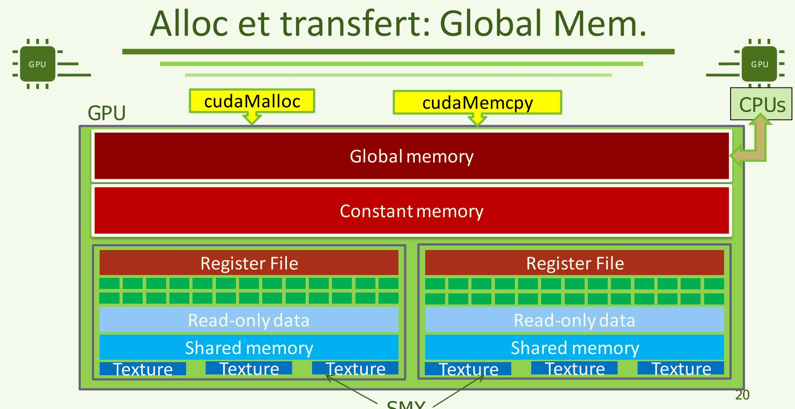

# 硬件加速器体系结构与编程（ARCHITECTURE ET PROGRAMMATION D’ACCÉLÉRATEURS MATÉRIELS）

> 第 2 讲上篇：函数、数据类型与内存管理 · [下篇：访存、异步执行与性能](APM_Cours2_zh_part2.md)

*第 2 讲：进阶 CUDA*

*Lecture 2 : Advanced CUDA*

**教师：** Adrien Roussel · adrien.roussel@cea.fr

原课件：[APM_Cours2.pdf](APM_Cours2.pdf) · [原文提取稿](APM_Cours2.md)

本讲沿用 Cours1 的向量加法，再扩展到二维图像和分批处理：先弄清函数在哪执行、数据放在哪里，再学习怎样让复制与计算正确衔接，最后检查结果、错误和时间。下面的新增例子是讲义补充；假设数字用于推演，代码未作为 GPU 实测结果。

Cette séance reprend l’addition vectorielle, puis passe aux images 2D et au traitement par lots : lieu d’exécution, emplacement des données, ordre des opérations et vérification. Les exemples ajoutés servent à expliquer ces notions ; les valeurs supposées et les fragments de code ne sont pas des mesures GPU.

## 概览（Overview）

### 编程语言（Programming languages）

> - Keywords
> - Available functions
> - Examples
> - Kernel optimisations
> - Multi-GPUs
> - CUDA programming

- 关键字
- 可用函数
- 示例
- 内核优化
- 多 GPU
- CUDA 编程

### 计算内核（Noyau de calcul）

> - Basé sur la norme C99
> - Quelques restrictions
> - Quelques ajouts

- 以 C99 标准为基础
- 存在一些限制
- 增加了一些扩展

### 扩展（Extensions）

**“扩展”扩展了什么？** 普通 C/C++ 函数声明给出参数和返回值，CUDA 还要表达函数在哪个处理器执行、变量位于哪类存储、线程怎样协作。属性（attribute）给声明增加语义；类型（type）规定值的表示与允许的操作；内置变量由 CUDA 提供当前线程的执行信息。课件的 C99 描述带有历史背景，这里的 `.cu` 示例按 CUDA C++ 理解。

CUDA ajoute notamment le lieu d’exécution, l’espace mémoire et la coopération à la syntaxe habituelle. Un attribut qualifie une déclaration ; un type décrit une valeur et ses opérations ; les variables intégrées donnent le contexte du thread. La formulation C99 est historique ; ces exemples `.cu` se lisent en CUDA C++.

> - Mots clés
> - Variables définies par défaut
> - Fonctions

- 关键字
- 预定义变量
- 函数

### 参阅《CUDA C Programming Guide》附录 B（Voir l’appendice B de la documentation CUDA C Programming Guide）

### 基本内核（Noyau de base）

### 内核的基本语法（Syntaxe de base pour un noyau）

> - Fonction qui ne renvoie rien (retour de type void)
> - Attribut définissant la fonction comme s’exécutant sur le device
> - Arguments en entrée

- 不返回值的函数，返回类型为 `void`
- 使用函数属性，声明该函数在设备上执行
  - `__global__`
- 输入参数

### 示例（Exemple）

```cpp
__global__ void vecAddKernel(double *a, double *b, double *c, int N) {
    int i;
    i = blockIdx.x * blockDim.x + threadIdx.x;
    if (i < N) {
        c[i] = a[i] + b[i];
    }
}
```

### 扩展：关键字（Extensions – Mots clés）

> - Définition de nouveaux mots clés
> - Catégories
> - Attributs de fonctions
> - Attributs de variables
> - Types
> - Ensemble de variables définies par défaut
> - Utilisant les nouveaux types de données

- 定义了新的关键字
- 分类
- 函数属性
- 变量属性
- 类型
- 一组预定义变量
- 使用新的数据类型

**这三类扩展分别是什么？** `__global__` 标记一个 kernel；`threadIdx.x` 告诉当前线程在块内的 x 坐标；`__syncthreads()` 让同一块的线程在一个协作点同步。它们分别是函数属性、预定义变量和同步函数，不能互相替代。上面的 `void` 表示 kernel 不通过函数返回值把结果交回 CPU；结果写入参数 `c` 指向的设备数组，再由主机按需要取回。

**这里的 `__syncthreads()` 是 block 范围。** 若一块有 256 个线程，就涉及该块的 8 个 warp；它不是仅同步当前 warp。屏障（barrier）是参与者必须共同到达的阶段边界：先到的线程等待，待其他参与者到达才能越过。只协调同一 warp 内指定线程时可用 `__syncwarp(mask)`，两者范围不同。详细代码见[下篇同步部分](APM_Cours2_zh_part2.md)。

`__syncthreads()` porte sur le bloc : 256 threads représentent huit warps. Une barrière impose un point de rendez-vous collectif. `__syncwarp(mask)` ne couvre que les participants indiqués dans un warp ; les portées ne sont pas interchangeables.

**Trois extensions, trois rôles :** `__global__` qualifie un kernel ; `threadIdx.x` donne la coordonnée locale du thread ; `__syncthreads()` synchronise les threads d’un bloc. Le retour `void` n’interdit pas de produire un résultat : celui-ci est écrit dans le tableau GPU désigné par `c`, puis récupéré par l’hôte si nécessaire.

### 函数属性（Attributs de fonction）

> - Mot clé à ajouter dans la déclaration et la définition de la fonction
> - Ajout entre le type de retour et le nom de la fonction
> - Fonction s’exécutant sur le device et appelable depuis l’hôte
> - Fonction dédiée sur l’hôte ou le device (combinable)
> - Par défaut, équivalent à `__host__`

- 在函数声明和定义中添加关键字
- 添加在返回类型与函数名之间
- 在设备上执行、可以从主机调用的函数
  - `__global__`
- 专门用于主机或设备的函数属性，可以组合使用
  - `__host__`
  - `__device__`
- 默认等同于 `__host__`

**同一个辅助函数怎样在两端复用**

老师用 `min` 举例：如果 CPU 与 GPU 都需要同一段计算逻辑，可以使用 `__host__ __device__`，避免维护两份函数体。编译器分别为两端生成适用的版本，函数体也必须满足相应端的限制。

`__device__` 辅助函数由设备代码普通调用，不会因此启动一个新内核；本课从主机发起的内核调用使用 `__global__` 和 `<<<...>>>`。内核返回类型为 `void`，计算结果通常写到传入指针所指向的内存中，再由主机在完成同步后读取。双重属性也不意味着一次调用会同时在 CPU 和 GPU 执行。

### 函数限制（Restrictions des fonctions）

**把属性代入函数 / Exemple d’attributs :**

```cpp
__host__ __device__ int smaller(int a, int b) {
    return a < b ? a : b;
}

__global__ void clampValues(int *a, int N) {
    int i = blockIdx.x * blockDim.x + threadIdx.x;
    if (i < N) {
        a[i] = smaller(a[i], 100);
    }
}
```

- **`__host__`：** CPU 可以普通调用 `smaller(7, 3)`，得到 3；默认普通函数只有主机版本。
- **`__device__`：** GPU kernel 可以调用辅助函数；上面的双重属性让 `smaller` 也有设备版本。
- **`__global__`：** 主机用 `clampValues<<<blocks, threads>>>(d_a, N)` 提交一批线程。辅助函数的普通调用不等于再次启动这批线程。

**En français :** `__host__` permet l’appel CPU, `__device__` l’appel depuis le code GPU, et leur combinaison génère deux versions de `smaller`. Le kernel `__global__` est lancé avec une configuration ; son appel à `smaller` reste un appel de fonction dans chaque thread concerné.

本节限制列表保留课件措辞，其中函数地址、静态存储等规则不能当作所有 CUDA 版本和所有声明位置的统一禁令；实际限制应查对应工具链的[函数属性说明](https://docs.nvidia.com/cuda/archive/13.0.0/cuda-c-programming-guide/index.html#function-execution-space-specifiers)。

La liste historique doit être lue avec son contexte : les règles sur les adresses de fonctions et le stockage statique dépendent de la déclaration et de l’outil utilisé. Voir les [attributs de fonctions CUDA](https://docs.nvidia.com/cuda/archive/13.0.0/cuda-c-programming-guide/index.html#function-execution-space-specifiers).

### 声明为 `__global__` 的函数（Fonction déclarée `__global__`）

> - Type de retour void
> - Appel avec un contexte d’exécution (nombre de blocs, nombre de threads par bloc, …)
> - Appel asynchrone
> - Impossible de capturer son pointeur
> - Fonction s’exécutant sur le device
> - Pas de variable statique
> - Pas de nombre d’arguments variable
> - Récursion restreinte (uniquement pour les fonctions déclarées device

- 返回类型为 `void`
- 调用时需要指定执行配置，如线程块数、每块线程数等
- 异步调用
- 课件称无法获取其函数指针
- 在设备上执行的函数
- 不允许静态变量
- 不允许可变数量的参数
- 递归受限，仅适用于声明为 device 的函数〔原文此处括号未闭合〕

### 数据类型（Type de données）

**限制列表中的名词 / Termes des restrictions :**

| 名词 | 原本表达的能力 | Sens |
|---|---|---|
| 函数指针 | 用一个值指向可调用函数，再通过它间接调用；需遵守执行端和 API 规则 | Référence à une fonction pour appel indirect |
| 静态局部变量 | 其存储不会随着每次普通函数调用结束而立即消失；与普通自动局部变量不同 | Stockage persistant au-delà d’un appel |
| 可变参数 | 如 `printf` 的 `...`，允许传入数量不固定的实参 | Nombre variable d’arguments |
| 递归 | 函数直接或间接调用自己，需要保存每层调用状态 | Fonction se rappelant avec plusieurs états d’appel |

这些词描述程序能力，不是 GPU 上几种新的内存名字。遇到限制时要同时看它针对哪一种函数、哪个编译目标及调用方式，不能从一张历史课件概括出全部 CUDA C++ 规则。

Ces termes décrivent des capacités du langage. Une restriction doit être reliée au type de fonction, à la cible et au mode d’appel concernés.

### 新增类型（Nouveau types）

> - Vecteur
> - Entiers multi-dimensions
> - Vecteurs
> - Type de base + nombre de données
> - Exemple : int2, float4
> - Besoin de respecter les règles d’alignements
> - Fonctions associées pour construire un tel type
> - Exemple : int2 make_int2(int $\textrm { x } ,$ int y);
>
> **Exemple ajouté — PDF, p. 8 :** [CUDA Pro Tip: Increase Performance with Vectorized Memory Access](https://developer.nvidia.com/blog/cuda-pro-tip-increase-performance-with-vectorized-memory-access/).

- 向量
- 多维整数
- 向量类型
- 基本类型加元素数量
- 例如：`int2`、`float4`
- 需要遵守对齐规则
- 提供相应的构造函数
- 例如：int2 make_int2(int $\textrm { x } ,$ int y);

**新版课件参考示例（第 8 页）：** [CUDA Pro Tip: Increase Performance with Vectorized Memory Access（通过向量化访存提高性能）](https://developer.nvidia.com/blog/cuda-pro-tip-increase-performance-with-vectorized-memory-access/)。

**向量类型会改变每个线程处理的数据量**

`float4` 把四个 `float` 分量放在一个对象中。若原来每线程处理一个元素，改为每线程处理四个元素，就要同步调整索引、工作量和末尾不足四个元素的处理；仅修改类型名称并不够。

这种类型有助于表达成组访存，但不保证所有计算都会变成一条向量指令。是否生成合适的加载／存储，还取决于地址对齐、实际使用的分量以及编译结果。

### 数据类型（续）（Type de données (suite)）

**`int2`、`float4` 的具体内容 / Valeurs concrètes :**

```cpp
int2 pixel = make_int2(12, 7);
float4 rgba = make_float4(0.2f, 0.4f, 0.6f, 1.0f);
```

`pixel.x = 12`、`pixel.y = 7` 可以表示像素坐标；`rgba.x/y/z/w` 可以表示颜色的四个分量。这是一个线程持有的几个值，不是自动创建 2 个或 4 个线程。假设有 10 个标量，按四个一组只形成 2 个完整组，还剩 2 个元素要单独处理；也不能把任意偏移后的地址都强转为满足对齐要求的 `float4 *`。

`pixel` peut représenter une position et `rgba` quatre composantes de couleur. Un objet à quatre composantes ne crée pas quatre threads. Dix scalaires donnent deux groupes complets de quatre et un reste de deux ; un décalage arbitraire d’adresse ne garantit pas non plus l’alignement exigé par `float4`.

### 三维整数类型（Entiers 3 dimensions）

**地址对齐（alignment）是什么意思？** 若类型要求 16 字节对齐，起始地址就必须是 16 的整数倍。例如地址 4096 符合，4100 不符合。CUDA 的 `float4` 有 16 字节对齐要求；一个对齐的 `float *p` 向后偏移一个 `float` 得到 `p+1`，只增加 4 字节，未必仍满足 `float4` 对齐。强制转换指针类型不会替你移动地址或补齐边界。**分量（component）**则是 `float4` 对象内的 x、y、z、w 四个字段。

Un alignement de 16 octets exige une adresse multiple de 16 : 4096 convient, 4100 non. Décaler un `float *` d’un élément ajoute quatre octets ; un cast en `float4 *` ne répare pas cet alignement. Les composantes x, y, z, w sont les champs d’un même objet. Voir les [types vectoriels CUDA](https://docs.nvidia.com/cuda/archive/13.0.0/cuda-c-programming-guide/index.html#vector-types).

> - Equivalent au type de vecteur uint3
> - Accès aux composantes par les champs x, y et z
> - Par défault, initialisé à 1
> - Type de données utilisées pour les coordonnées et dimensions de la grille, des blocs et des threads CUDA.

- dim3
- 等价于向量类型 `uint3`
- 通过字段 `x`、`y` 和 `z` 访问各分量
- 默认初始化为 1
- 用于表示 CUDA 网格、线程块和线程的坐标与维度。

### 示例（Exemple）

```text
dim3 a ;
```

```text
a.x = 4 ;
```

**`dim3` 的默认值例子：** `dim3 block(16, 8)` 得到 `(16, 8, 1)`，每块 128 个线程；`dim3 grid(4)` 得到 `(4, 1, 1)`，共 4 个块；`dim3 a; a.x = 4;` 也得到 `(4, 1, 1)`。没有显式给出的维度为 1，不是 0。严格来说，`threadIdx`、`blockIdx` 是 `uint3`，`blockDim`、`gridDim` 是 `dim3`；都有 x、y、z 字段，但不能因此说它们的类型完全相同。

**Exemple `dim3` :** `block(16, 8)` vaut `(16, 8, 1)`, soit 128 threads ; `grid(4)` vaut `(4, 1, 1)`. Les dimensions omises valent 1. `threadIdx` et `blockIdx` sont des `uint3`, tandis que `blockDim` et `gridDim` sont des `dim3` : les mêmes champs ne signifient pas exactement le même type.

## 内存管理（GESTION DE LA MÉMOIRE）

### GPU 的存储层次（Hiérarchie mémoire d’un GPU:）

> **résumé**
> **Les GPUs Nvidias actuels ont une hiérarchie mémoire complexe**
> - Plusieurs mémoires….
> - … avec des systèmes d’accès différents…
> - … avec des localités d’accès différentes…
> - … manipulées de façon distinctes…
> - … la plupart du temps directement par l’utilisateur
>
> **Hiérarchie mémoire d’un GPU Mémoire de texture**
>
> **Hiérarchie mémoire d’un GPU Ensemble de Registres**
> - Global memory
> - Constant memory
> - Register File
> - Read-only data
> - Shared memory
> - Texture
>
> **Hiérarchie mémoire**
> **Vision par entité de calcul**
> - Thread
> - Accès mémoire local
> - Banc de registres privé
> - Bloc
> - Shared memory privé
> - Grille
> - Mémoire globale
>
> - Alloc et transfert: Global Mem.
> - CPUs

GPU 包含多种存储资源，其访问机制、作用范围和管理方式不同。原课件逐步叠加全局内存、常量内存、共享内存、纹理、只读数据和寄存器；这里保留完整图。



*图：GPU 存储层次与全局内存分配、传输。*

从计算实体的角度看：

**“能访问”与“物理上在哪里”要分开。** 地址空间规定哪些代码可引用哪类地址，以及访问的作用范围；物理存储则是寄存器、片上存储阵列或显存中的实际位置。线程私有的 local memory 可能位于显存中；global memory 的一次读取也可能命中片上缓存。名字中的 local/global 首先描述编程语义，不能直接翻译成“离线程近／远”。

Un espace mémoire définit la portée et les règles d’accès ; le stockage physique désigne le support réel. Une donnée locale privée peut résider en mémoire GPU, tandis qu’un accès global peut être servi par un cache sur puce. Local/global ne mesurent pas simplement la distance physique.

| 计算实体 | 对应的存储资源 |
|---|---|
| 线程 | 私有寄存器与局部内存 |
| 线程块 | 块内线程共享的共享内存 |
| 网格中的线程 | 可访问设备全局内存 |


*图：单个线程与局部内存。*


*图：线程块与共享内存。*

全局内存的分配与主机／设备传输分别通过 `cudaMalloc`、`cudaMemcpy` 等接口完成。

**从“谁能访问”理解存储层次**

寄存器保存单个线程的私有状态；普通 `__shared__` 数组由一个线程块内的线程共同使用；全局内存用来保存跨块使用的数据和内核输出。要把共享内存中的结果交回主机，通常先由线程写到全局内存，再进行设备到主机复制。

同一 SM 可以同时驻留多个线程块，只要资源允许；各块仍各有一份共享内存，不能因为落在同一 SM 就直接访问另一块的普通共享数组。网格与线程块是程序的逻辑组织，SM 是执行它们的硬件资源，二者并非一一对应。这里按课件的普通线程块模型讨论。

### GPU 上的基本内存分配（Allocation de base sur le GPU）

**每一种存储放什么？/ Exemples de placement :**

| 类型 | 一个具体用途 | Exemple en français |
|---|---|---|
| 寄存器 | 每个线程独立累加自己的 `sum`，编译器可将它放入寄存器 | Accumulateur privé `sum` d’un thread |
| 局部内存（local memory） | 寄存器放不下而溢出的私有值，或某些不能放进寄存器的线程私有数组 | Valeurs privées déversées ou tableaux privés non placés en registres |
| 全局内存 | `cudaMalloc` 分配的完整图像，供不同块读取，保存最终结果 | Image complète et sortie accessibles aux blocs |
| 共享内存 | 一个块合作加载图像小块，随后复用邻域像素 | Tuile d’image chargée et réutilisée par un bloc |
| 常量内存 | 大量线程读取同一组小型滤波系数 | Petits coefficients de filtre lus par de nombreux threads |
| 只读数据访问路径 | kernel 只读取输入图像，具体缓存路径由架构和指令决定 | Image d’entrée en lecture seule, chemin de cache dépendant de la cible |
| 纹理访问 | 用纹理对象读取图像，按配置处理坐标、寻址及过滤 | Lecture par objet texture avec adressage et filtrage configurés |

“局部内存”指线程私有的地址空间，不等于片上快速存储；它位于设备内存中，并可受缓存影响。也不能给每个变量加一个名字就保证其物理位置：寄存器放置由编译器决定，共享内存则需要显式声明与协作。参见 [CUDA 存储层次](https://docs.nvidia.com/cuda/archive/13.0.0/cuda-c-programming-guide/index.html#device-memory-accesses)。

La mémoire « locale » est privée au thread, mais ne signifie pas mémoire rapide sur puce : elle réside en mémoire du device et peut être mise en cache. Le compilateur décide du placement en registres ; la mémoire partagée demande une déclaration et une coopération explicites. Voir les [espaces mémoire CUDA](https://docs.nvidia.com/cuda/archive/13.0.0/cuda-c-programming-guide/index.html#device-memory-accesses).

> - Alloue de la mémoire sur le dévice
> - Alloue size octets, dans la mémoire globale du device
> - X Donne l’adresse du pointeur ptr
> - Le runtime CUDA s’occupe de l’allocation et récupère l’adresse de la zone mémoire
> - L’adresse est renvoyée et stockée dans ptr
> - L’adresse n’est pas utilisable sur le host!!!
> - Donne l’adresse du pointeur ptr
> - VAV L’adresse est renvoyée et stockée dans ptr

- host device__ cudaError_t cudaMalloc (void ** ptr, size_t size)
- 在设备上分配内存
- 在设备全局内存中分配 `size` 字节
- 传入用于接收地址的指针 `ptr`
- CUDA 运行时负责分配内存并获取该内存区域的地址
- 将分配得到的地址返回并存入 `ptr` 指向的位置
- 这个地址不能直接在主机端解引用！

### GPU 上的高级内存分配（Allocation avancée sur le GPU）

**`cudaMalloc` 的两个参数与返回值 / Deux paramètres et un résultat :**

```cpp
double *d_a = nullptr;
size_t bytes = 1000 * sizeof(double);
cudaError_t status = cudaMalloc(reinterpret_cast<void **>(&d_a), bytes);
```

这里申请 8000 字节，`&d_a` 让 API 修改主机变量 `d_a`、把分配地址写给它，`status` 则报告是否成功。`d_a` 原本只是指针变量，不是已经分配的 1000 个数。空间分配成功也不代表内容已初始化；还要复制或由 kernel 写入，使用后配对 `cudaFree(d_a)`。后续教学片段省略的返回值检查，应在实际程序中补齐。

On demande 8000 octets. `&d_a` permet à l’API d’écrire l’adresse dans la variable hôte ; `status` indique le succès ou l’échec. Déclarer le pointeur ne réserve pas le tableau ; allouer ne l’initialise pas. Il faut ensuite écrire les données et libérer avec `cudaFree`. Les exemples courts omettent parfois les contrôles de retour, à ajouter au programme réel.

> - Alloue de la mémoire 2D sur le device
> - Alloue au moins width x height
> - Les allocations mémoires subissent des contraintes d’alignement
> - Peut avoir un impact sur les allocations 2D et 3D
> - Chaque ligne doit être correctement alignée
> - Possible qu’un padding en fin de ligne soit nécessaire
> - La taille réelle d’une ligne (width+padding) est renvoyée dans la variable pitch

- host__ cudaError_t cudaMallocPitch (void ** ptr, size_t * pitch, size_t width, size_t height)
- 在设备上分配二维内存
- 至少分配 `width × height` 字节
- 内存分配需要满足对齐约束
- 这可能影响二维和三维内存分配
- 每一行都必须正确对齐
- 可能需要在行末添加填充
- 一行实际占用的字节数，即宽度加填充，通过变量 `pitch` 返回

**pitch 是一整行的跨度**

**width、pitch、padding 分别量哪里？** width 是一行有效数据的宽度；pitch 是相邻两行起点的距离；padding 是为布局要求补在行末、不属于有效图像的空间。可把一行看成 `[有效像素][填充]`。按字节计量时 `pitch = widthBytes + paddingBytes`；它们不能都叫“数组宽度”。

La largeur utile compte les données ; le pitch mesure la distance entre débuts de lignes ; le padding est l’espace supplémentaire. En octets, `pitch = widthBytes + paddingBytes`. Ce sont trois quantités distinctes.

**解引用（dereference）**是按地址访问数据，例如 `*p` 或 `p[i]`；只保存、打印一个地址值不算解引用。做指针加法时，`float *p` 的 `p+1` 前进一个 float，`char *q` 的 `q+1` 前进一个字节，因此按 pitch 寻址时先转换为字节指针，再恢复元素类型。

Déréférencer lit ou écrit la donnée désignée. L’arithmétique d’un pointeur avance par éléments : un `float *` avance de la taille d’un float, un `char *` d’un octet. Le calcul de pitch utilise donc d’abord une adresse en octets.

二维数组的有效行宽与相邻两行起始地址的距离可能不同。`cudaMallocPitch` 的 `width` 用字节表示，`height` 用行数表示；返回的 `pitch` 包含有效数据和行末填充。

假设每行 100 个 `float`，有效行宽是 400 字节；若返回 `pitch = 512`，第二行从基址后 512 字节开始，不能按 400 字节寻址。第 `r` 行先用字节指针加上 `r * pitch`，再转换为元素指针。二维复制时，源、目标各自使用自己的 pitch，而复制宽度仍是有效的 400 字节。512 只是示例，不能假定所有分配都返回这个值，也不能把 pitch 当作填充量本身。

### GPU 上的高级内存分配（Allocation avancée sur le GPU）

### host cudaError_t cudaMalloc3D ( struct cudaPitchPtr * pitchedDevPtr,

**pitch 寻址算例 / Exemple d’adressage :** 对上面的 100 列图像，若 pitch 为 512 字节，像素 `(r=2, c=3)` 距基址 `2×512 + 3×4 = 1036` 字节。误用 `2×400 + 3×4` 会落在 812 字节处，读错位置。`pitch - widthBytes = 112` 才是每行的填充。

Pour le pixel `(2, 3)`, le décalage correct est `2×512 + 3×4 = 1036` octets. Utiliser la largeur utile 400 à la place du pitch donne 812, donc une mauvaise adresse. Le remplissage par ligne vaut 112 octets, pas 512.

### Struct cudaExtent extent)

> - Spécifie le minimum d’octets à allouer
> - La structure cudaExtent contient trois champs
> - Alloue au minimum depth x height x width octets

- 指定至少需要分配的字节数
- 结构体 `cudaExtent` 包含三个字段
- size_t depth
- size_t height
- size_t width
- 至少分配 `depth × height × width` 字节

### GPU 上的高级内存分配（Allocation avancée sur le GPU）

> - Récupère l’adresse de la mémoire allouée sur le device
> - Plus quelques infos stockée dans la structure liées aux contraintes d’alignement
> - size_t size et size_t ysize : correspondent aux champs width et height de la structure extent passée à l’allocation
> - size_t pitch : la taille réelle de la zone mémoire allouée (avec le padding nécessaire dans chaque dimension)

- host cudaError_t cudaMalloc3D ( struct cudaPitchPtr * pitchedDevPtr,
- 获取设备上已分配内存的地址
- 结构体中还保存一些与对齐约束有关的信息
- `size_t size` 和 `size_t ysize`：课件称其对应分配时传入的 `extent` 结构体中的 `width` 和 `height` 字段〔字段名按原文保留〕
- `size_t pitch`：课件用来描述包含必要填充后的实际分配跨度〔使用时需核对 API 中 pitch 的具体含义〕
- struct cudaExtent extent)

### GPU 上的基本内存复制（Copie de base sur le GPU）

**三维体数据的例子 / Exemple de volume 3D :**

**结构体（struct）**把几个相关字段放在一个对象中。`cudaExtent` 描述要申请多大：对这里的线性三维分配，width 为字节，height 为行数，depth 为层数。`cudaPitchedPtr` 描述申请结果怎样布局：ptr 是起点，pitch 是行跨度，xsize/ysize 记录逻辑宽、高。保存这份描述信息不等于又复制了一份三维数据。

Une structure rassemble plusieurs champs. `cudaExtent` décrit la demande : largeur en octets, nombre de lignes et de plans pour cette allocation. `cudaPitchedPtr` décrit adresse et pas du résultat. Copier ce descripteur ne copie pas le volume de données.

```cpp
cudaExtent extent = make_cudaExtent(100 * sizeof(float), 50, 20);
cudaPitchedPtr volume = {};
cudaMalloc3D(&volume, extent);
size_t rowBytes = volume.pitch;
size_t sliceBytes = volume.pitch * volume.ysize;
```

这里是 100 列、50 行、20 层，每层有效数据 20000 字节，总有效数据 400000 字节；实际分配可能有填充。对于这个分配，`pitch` 是一行跨度，不是整个体积大小；`sliceBytes` 才是相邻两层的跨度。设备端访问 `(x,y,z)` 时，可先将 `volume.ptr` 视为字节指针，加上 `z*sliceBytes + y*rowBytes`，再转换为 `float *` 并取第 x 个元素。正式类型是 `cudaPitchedPtr`，字段为 `ptr/pitch/xsize/ysize`，上面原提取稿的名称不完整。用完释放 `volume.ptr`。

Le volume contient 100 colonnes, 50 lignes et 20 plans, soit 400000 octets utiles. `pitch` est le pas d’une ligne ; `pitch * ysize` donne ici le pas d’un plan. Le type correct est `cudaPitchedPtr`, avec les champs `ptr`, `pitch`, `xsize`, `ysize`. L’adressage se fait en octets jusqu’à la ligne, puis en éléments pour x ; la libération porte sur `volume.ptr`.

> - Copie count octets de la mémoire pointée par src vers la mémoire pointée par dst

- _host__ cudaError_t cudaMemcpy
- (void * dst, const void * src,
- size_t count, enum cudaMemcpyKind kind)
- 从 `src` 指向的内存向 `dst` 指向的内存复制 `count` 字节

### GPU 上的基本内存复制（Copie de base sur le GPU）

> - Kind permet de données la direction de la copie

- host__ cudaError_t cudaMemcpy
- (void * dst, const void * src,
- size_t count, enum cudaMemcpyKind kind)
- 从 `src` 指向的内存向 `dst` 指向的内存复制 `count` 字节
- `kind` 指定复制方向
- cudaMemcpyHostToDevice
- cudaMemcpyDeviceToHost
- cudaMemcpyHostToHost
- cudaMemcpyDeviceToDevice
- cudaMemcpy(d_a, h_a, ( sizeof(int) * 1024), cudaMemcpyHostToDevice);

**四种方向各举一例 / Exemples des quatre directions :**

**`src`、`dst`、`count`、`kind`：** 分别是 source 源地址、destination 目标地址、字节数和方向枚举。枚举（enum）是一组有名字的可选值，例如 `cudaMemcpyHostToDevice`，它不表示长度。`cudaMemcpy` 按字节复制，不会把 `float` 数值转换为 `double` 数值；数据类型不同还需单独的转换操作。

`src` et `dst` désignent les adresses source et destination ; `count` compte les octets ; `kind` choisit une valeur d’énumération. La copie conserve les octets, sans convertir automatiquement les valeurs entre `float` et `double`.

| 方向 | 例子 | Exemple |
|---|---|---|
| `HostToDevice` | 把 CPU 读入的图像上传到 GPU | Charger l’image CPU sur GPU |
| `DeviceToHost` | 把 GPU 算好的图像取回 CPU 保存 | Récupérer la sortie pour l’enregistrer |
| `DeviceToDevice` | 将 GPU 中的原始数组备份到另一个设备数组 | Copier entre deux tableaux du device |
| `HostToHost` | 在两块主机内存之间复制 | Copier entre deux zones hôtes |

对 `int` 大小为 4 字节的 1024 个整数，复制长度为 4096 字节。方向不替你判断源、目标容量，也不能把任意 CPU 指针当成 GPU 指针来用。

Avec des entiers de 4 octets, 1024 éléments demandent 4096 octets. Le sens de copie ne garantit ni la capacité des zones, ni la validité des pointeurs pour ce sens.

```text
Copie avancée sur le GPU
__host__ cudaError_t cudaMemcpy2D
(void * dst, size_t dpitch,
const void * src, size_t spitch,
size_t width, size_t height,
enum cudaMemcpyKind kind)
• Copie width x height octets de la mémoire pointée par src vers la mémoire pointée par dst
```

### GPU 上的高级内存复制（Copie avancée sur le GPU）

> - Copie width x height octets de la mémoire pointée par src vers la mémoire pointée par dst
> - Permet de spécifier le padding pour les deux zones mémoires, source et destination
> - Compatible avec les zones mémoires allouées avec cudaMallocPitch

```c
__host__ cudaError_t cudaMemcpy2D (void * dst, size_t dpitch, const void * src, size_t spitch, size_t width, size_t height, enum cudaMemcpyKind kind)
```

- 从 `src` 指向的内存向 `dst` 指向的内存复制 `width × height` 字节
- 可以分别指定源内存区域与目标内存区域的行跨度，以处理填充
- 与 `cudaMallocPitch` 分配的内存区域兼容
- cudaMemcpy2D(d_a, pitch, h_a, ( sizeof(int) * 64), ( sizeof(int) * 64), 16, cudaMemcpyostToDevice);

**二维复制的参数例子：** 对主机紧密排列的 100 列、50 行 `float` 图像，源跨度为 400 字节，设备跨度假设为 512：`cudaMemcpy2D(d_img, 512, h_img, 400, 400, 50, cudaMemcpyHostToDevice)`。每行从源复制有效的 400 字节，再按各自跨度进入下一行；不会把填充也当作图像复制。512 必须来自实际分配返回值，这里只是代入演示。原提取稿中的 `cudaMemcpyostToDevice` 应为 `cudaMemcpyHostToDevice`。

**Exemple de copie 2D :** une image hôte contiguë de 100 `float` par ligne a un pas de 400 octets. Avec un pitch GPU supposé de 512, on copie 400 octets sur chacune des 50 lignes en utilisant les deux pas distincts. En pratique, employer le pitch retourné par l’allocation. La constante correcte est `cudaMemcpyHostToDevice`.

$$
\begin{array}{c} \text {Copie avancée sur le GPU} \\ \hline \text {GPU} \\ \hline \text {\_host\_cudaError\_t cudaMemcpy3D (const struct} \\ \text {\_cudaMemcpy3DParms * p)} \end{array}
$$

### GPU 上的高级内存复制（Copie avancée sur le GPU）

- host__ cudaError_t cudaMemcpy3D (const struct cudaMemcpy3DParms * p)
- struct cudaArray *srcArray;
- struct cudaPos srcPos
- (size_t x, size_t y, size_t z)
- struct cudaPitchedPtr srcPtr;
- struct cudaArray *dstArray;
- X struct cudaPos dstPos;
- struct cudaPitchedPtr dstPtr;
- struct cudaExtent extent;
- enum cudaMemcpyKind kind;

### 二维代码示例（Exemple code 2D）

**三维复制描述符怎么读？** `cudaMemcpy3DParms` 把一组复制参数收在结构体中：源、目标的存储描述，双方的起始位置 `srcPos/dstPos`，复制范围 `extent`，以及方向 `kind`。起始位置回答“从哪里开始”，extent 回答“复制多大”，并不要求复制整个已分配体积。`srcArray/dstArray` 与 `srcPtr/dstPtr` 对应不同存储表示，不能把所有字段随意同时设置；涉及 CUDA array 时还需核对 x 方向使用的单位。

Le descripteur `cudaMemcpy3DParms` regroupe stockage source et destination, positions de départ, étendue et sens. Une position n’est pas une taille, et on peut copier un sous-volume. Les champs array et pointeur correspondent à des représentations différentes ; les unités doivent suivre le contrat de l’API utilisée.

**每个像素加一 / Ajouter un à chaque pixel :** 下面修复原提取代码中的 `Int` 拼写、缺失括号和资源释放，保留“一块处理一行”的教学映射，并把宽、高分别传入。为突出 pitch，片段省略 CUDA 返回值检查，实际使用应逐项检查；没有进行 GPU 编译运行。

Cette version corrige les fautes d’extraction et libère les allocations. Un bloc traite une ligne ; largeur et hauteur sont explicites. Les contrôles des retours CUDA sont omis pour isoler l’adressage et restent à ajouter ; pas de compilation ni d’exécution GPU ici.

```cpp
#include <cuda_runtime.h>
#include <cstdio>
#include <cstdlib>

__global__ void plus_one(int *a, int width, int height, size_t pitch) {
    int y = blockIdx.x;
    int x = threadIdx.x;
    if (x < width && y < height) {
        int *row = reinterpret_cast<int *>(reinterpret_cast<char *>(a) + y * pitch);
        row[x] += 1;
    }
}

int main() {
    const int width = 64, height = 16;
    const size_t widthBytes = width * sizeof(int);
    int *h_a = static_cast<int *>(std::malloc(widthBytes * height));
    if (h_a == nullptr) {
        return EXIT_FAILURE;
    }
    for (int i = 0; i < width * height; ++i) {
        h_a[i] = 10;
    }
    int *d_a = nullptr;
    size_t pitch;
    cudaMallocPitch(reinterpret_cast<void **>(&d_a), &pitch, widthBytes, height);
    cudaMemcpy2D(d_a, pitch, h_a, widthBytes, widthBytes, height, cudaMemcpyHostToDevice);
    plus_one<<<height, width>>>(d_a, width, height, pitch);
    cudaMemcpy2D(h_a, widthBytes, d_a, pitch, widthBytes, height, cudaMemcpyDeviceToHost);
    bool correct = true;
    for (int i = 0; i < width * height; ++i) {
        correct = correct && (h_a[i] == 11);
    }
    std::printf("%s\n", correct ? "OK" : "Mismatch");
    cudaFree(d_a);
    std::free(h_a);
    return correct ? EXIT_SUCCESS : EXIT_FAILURE;
}
```

例如第 3 块、第 5 个线程处理主机布局中的 `h_a[3*64+5]`，设备端却必须先按 `3*pitch` 找到行首。成功运行的预期是 1024 个元素全变成 11，打印 `OK`。这里的每行宽度只有 64，适合本例；不能把任意大图宽度直接当作一个线程块的大小。

Le bloc 3, thread 5, correspond à `h_a[3*64+5]`, mais utilise `3*pitch` pour trouver sa ligne GPU. La sortie attendue est `OK`, avec 1024 valeurs égales à 11. Une image de largeur arbitraire ne tient pas nécessairement dans un seul bloc par ligne.

### 其他高级函数（Autres fonctions avancées）

### 分配（Allocation）

- cudaMallocArray
- cudaMalloc3DArray

### 复制（Copie）

- cudaMemcpyToArray
- cudaMemcpy2DToArray
- cudaMemcpyFromArray
- cudaMemcpy2DFromArray
- cudaMemcpyArrayToArray
- cudaMemcpy2DArrayToArray

**CUDA array 的用途：** 若图像要通过纹理对象读取，可以分配 `cudaArray`，再把主机图像复制进去。它不是 C 的 `float *`，不能对它直接写 `array[y*width+x]`。上面列出的是课件接口，其中部分旧接口在现代工具链中已弃用；这里先区分线性／带 pitch 的内存与 CUDA array，不把这些名称当作必须逐个使用的流程。

**纹理对象（texture object）**把数据资源和读取规则组合起来。采样是“在某个坐标取值”，寻址规则决定超出范围的坐标怎样处理，过滤规则决定是否按配置组合邻近值。例如图像缩放可能需要在两个像素之间取值，这与直接读取整数下标 `a[i]` 的语义不同。纹理不是“所有只读数组”的别名。

Un objet texture associe ressource et règles de lecture : coordonnées, traitement des limites et filtrage. Échantillonner entre deux pixels peut combiner des valeurs voisines selon la configuration ; cela diffère de la lecture directe `a[i]`. Toute donnée en lecture seule n’est pas automatiquement une texture.

**Exemple de CUDA array :** une image destinée à un objet texture peut être placée dans un `cudaArray`. Ce n’est pas un pointeur C indexable par `array[y*width+x]`. La liste contient aussi d’anciennes interfaces ; elle illustre des catégories, pas une suite d’appels obligatoire. Voir la [référence de gestion mémoire](https://docs.nvidia.com/cuda/cuda-runtime-api/group__CUDART__MEMORY.html).

### 自动内存管理（统一内存）（Gestion automatique de la mémoire (mémoire unifiée)）

### CUDA 6.0 引入（Introduit avec CUDA 6.0）

> - Vue unifiée de la mémoire entre host et devices
> - Un seul pointeur est utilisée pour la mémoire sur le host ou sur le(s) GPU(s)
> - Les transferts sont réalisés automatiquement en fonction de l’utilisation des données sur le host ou sur un device

- 在主机与设备之间提供统一的内存视图
- 主机与一个或多个 GPU 使用同一个指针
- 根据主机或设备对数据的使用情况自动进行传输

### 自动内存管理（统一内存）（Gestion automatique de la mémoire (mémoire unifiée)）

### 申请自动管理内存的两种方式（Deux façons pour demander de la mémoire gérée automatiquement）

> - Memory can be accessed from any devices
> - Memory cannot be accessed from any devices
> - managed__ attribut devant le nom des variables

- host__ cudaMallocManaged( void** devPtr, size_t size, unsigned int flags)
- cudaMemAttachGlobal
- 任意设备均可访问这块内存
- cudaMemAttachHost
- 课件描述为设备均不能访问〔这里说明的是该标志对应的初始关联状态〕
- 在变量声明中使用 `managed` 属性〔原文省略了下划线〕

**统一指针省去显式搬运，仍需管理依赖**

**虚拟地址、物理位置、页与迁移：** 程序使用的指针通常是虚拟地址，硬件和系统通过映射找到实际存储。页（page）是系统管理映射和部分数据移动的粒度，不是数组的一行。迁移（migration）把数据移到另一处存储；远程访问（remote access）则让处理器通过互连读取另一侧的数据。统一内存使双方可以按支持的规则访问同一分配，不等于双方拥有同一组物理寄存器或每次都走同样的通路。

Une adresse virtuelle est traduite vers un stockage réel. Une page est une unité de gestion, pas une ligne de tableau. Migrer déplace les données ; accéder à distance utilise une liaison vers leur emplacement. Une allocation gérée commune n’impose ni le même stockage local ni le même coût d’accès partout.

还要区分**统一虚拟寻址（UVA）**与**统一内存（Unified Memory）**：前者统一地址识别范围，不会自动把普通 `cudaMalloc` 指针变成 CPU 可直接读写的数组；后者包含对受管理分配的可访问性和数据位置管理。用哪个 API 分配仍然重要。

L’adressage virtuel unifié (UVA) et la mémoire unifiée ne sont pas synonymes. L’UVA n’autorise pas à lui seul le CPU à déréférencer une allocation `cudaMalloc` ordinaire ; une allocation gérée possède un contrat d’accès distinct.

老师强调统一内存让程序更容易表达，但数据在哪里、何时被访问，仍然影响性能。使用 `cudaMallocManaged` 后，同一指针可以供主机和设备使用；CPU 要读取内核刚写出的结果，仍需先确认内核完成。

`cudaMemAttachGlobal` 与 `cudaMemAttachHost` 描述关联／访问规则，不宜理解为“指定最初物理分配到 GPU 或 CPU”。底层迁移与访问机制依赖平台。统一内存不自动消除 CPU 与 GPU 对同一数据的竞争，也不保证每次访问都没有传输开销。

### 统一内存：示例（Mémoire unifiée: Exemple）

> - Default flag: cudaMemAttachGlobal
>
> - Attribut managed

- cudaMallocManaged
- 默认标志：`cudaMemAttachGlobal`

```c
__global__ void AplusB(int *ret, int a, int b) {
    ret[threadIdx.x] = a + b + threadIdx.x;
}

int main() {
    int *ret;
    cudaMallocManaged(&ret, 1000 * sizeof(int));
    AplusB<<<1, 1000>>>(ret, 10, 100);
    cudaDeviceSynchronize();
    cudaFree(ret);
}
```

**同一个指针具体意味着什么？** `ret` 可作为 GPU kernel 的参数；kernel 完成并同步后，CPU 也可以读取 `ret[0]`。本例预期 `ret[0] = 110`、`ret[999] = 1109`，若要打印，应在释放前、同步成功后读取。这里只用一个指针，不需要另建 `h_ret/d_ret`；但这不证明底层没有迁移、远程访问或缓存流量。上面修复了启动括号，并补上结束前的同步与释放。

**Un seul pointeur :** `ret` est transmis au GPU, puis peut être lu par le CPU après synchronisation réussie et avant sa libération. Les valeurs attendues sont 110 et 1109 aux indices 0 et 999. Un pointeur commun évite deux noms de tableaux, sans supprimer nécessairement les mouvements de données ou les accès distants.

- `managed` 属性
- device managed int ret[1000]; global void AplusB(int a, int b){ ret[threadIdx.x] = a + b + threadIdx.x;
- int main() { ÀplùsB<<< 1, 1000 >>>(10, 100); cudaDeviceSynchronize() ;

### 自动内存管理（统一内存）（Gestion automatique de la mémoire (mémoire unifiée)）

> - Introduit avec CUDA 6.0

- CUDA 6.0 引入
- 在主机与设备之间提供统一的内存视图
- 主机与一个或多个 GPU 使用同一个指针
- 根据主机或设备对数据的使用情况自动进行传输

### 自动内存管理（统一内存，续）（Gestion automatique de la mémoire (mémoire）

> - /!\ Attention aux problèmes de performances en cas de pingpong CPU-GPU
>
> - Mémoire unifiée Perf issue example

- CUDA 6.0 引入
- 在主机与设备之间提供统一的内存视图
- 主机与一个或多个 GPU 使用同一个指针
- 根据主机或设备对数据的使用情况自动进行传输
- 注意 CPU 与 GPU 之间反复迁移数据造成的性能问题！

**ping-pong 的例子：** GPU 把整个数组加一，CPU 又把整个数组乘二，如此交替 2000 次。在采用按页迁移的系统上，数据可能反复迁移；在支持一致性远程访问的平台上，也仍可能产生昂贵的数据流量。重点是“谁反复访问同一批数据”，不能一律说每次都复制整个数组。

**Exemple de ping-pong :** le GPU ajoute un à tout le tableau, puis le CPU multiplie tout par deux, 2000 fois. Selon la plateforme, cela peut entraîner des migrations de pages ou des accès distants coûteux. Il faut examiner les accès réels, sans supposer une copie intégrale à chaque étape.

**先检查算法能否重排：** 对初值 x，先加一再乘二得到 `2x+2`，先乘二再加一得到 `2x+1`。因此把 2000 次交替执行改成“全部 kernel 完成后再全部 function”可能改变结果，不能只因时间更短就当作等价优化。

**Vérifier avant de regrouper :** `(x+1)×2 = 2x+2`, mais `x×2+1 = 2x+1`. Regrouper tous les appels GPU puis tous les appels CPU peut changer l’algorithme. Un temps inférieur ne prouve pas une optimisation correcte.

```c
cudaMallocManaged(&a, 100000*sizeof(int));
for (i = 0; i < 100000; i++) a[i] = i;
gettimeofday(&start1, NULL);
for (j = 0; j < 2000; j++) {
    kernel<<<100, 1000>>>(a);
    cudaDeviceSynchronize();
    function(a);
}
gettimeofday(&stop1, NULL);

gettimeofday(&start2, NULL);
for (j = 0; j < 2000; j++) {
    kernel<<<100, 1000>>>(a);
    cudaDeviceSynchronize();
}
for (j = 0; j < 2000; j++) {
    function(a);
}
gettimeofday(&stop2, NULL);
```

- 统一内存性能问题示例

### 示例（Exemple:）

> - Réalise 2000 fois l’invocation de kernel et function pour update le meme tableau _host__ void function(int * a)
>
> **Exemple:**
>
> - Réalise 2000 fois l’invocation de kernel et function pour update le meme tableau
> - Ping-pong: 2000 fois kernel + function

- 重复调用 `kernel` 和 `function` 2000 次，更新同一个数组：`_host__ void function(int * a)`
- int i; for(i=0; i< 100000; i++)
- 统一内存性能问题示例

**示例：**

- 重复调用 `kernel` 和 `function` 2000 次，更新同一个数组
- 交替执行：重复 2000 次“kernel + function”
- _host__ void function(int * a)

```text
int i;
for(i=0; i< 100000; i++)
```

```c
cudaMallocManaged(&a, 100000*sizeof(int));
for (i = 0; i < 100000; i++) a[i] = i;

gettimeofday(&start1, NULL);
for (j = 0; j < 2000; j++) {
    kernel<<<100, 1000>>>(a);
    cudaDeviceSynchronize();
    function(a);
}
gettimeofday(&stop1, NULL);

gettimeofday(&start2, NULL);
for (j = 0; j < 2000; j++) {
    kernel<<<100, 1000>>>(a);
    cudaDeviceSynchronize();
}
for (j = 0; j < 2000; j++) {
    function(a);
}
gettimeofday(&stop2, NULL);
```

### 统一内存性能问题示例（Mémoire unifiée Perf issue example）

### 示例（Exemple:）

> - Grouped : 2000 fois kernel puis 2000 fois function
> - Temps mesurés:

**怎样公平比较这两段代码？** 两种方案分别从相同的数组初值开始，完成相同数学任务，再比较输出和完整时间。还要说明首次访问、分配、同步是否计时。例如只统计 kernel 的 GPU 时间，会漏掉 CPU 的 `function(a)` 和两端访问带来的等待。下面“测得的时间”来自课件语境，未给数值的地方不能当作我们已经测量过。

**计时名词：** 端到端时间覆盖输入准备到所需结果可用的整个过程；kernel 时间只覆盖约定的设备计算区间。预热（warm-up）是正式统计前先运行若干次，以免把初始化等一次性成本混入稳态结果；但若研究首次调用，就必须保留这些成本。课件的 `gettimeofday` 读的是主机时间，并不会自动等待 GPU，也不是 GPU event。

Le temps de bout en bout va de la préparation au résultat utilisable ; le temps kernel couvre le calcul choisi. L’échauffement vise un régime stabilisé, alors qu’une mesure de premier appel doit conserver les coûts initiaux. `gettimeofday` lit une horloge hôte, sans attendre le GPU automatiquement.

**Comparer équitablement :** partir séparément des mêmes valeurs, conserver le même calcul et vérifier les sorties avant les temps. Préciser si allocation, premier accès et synchronisations sont inclus. Le seul temps GPU des kernels exclut la fonction CPU et certaines attentes. Une mention « temps mesurés » sans valeurs ne constitue pas une mesure réalisée pour cette version du cours.

- 重复调用 `kernel` 和 `function` 2000 次，更新同一个数组
- 交替执行：重复 2000 次“kernel + function”
- 分组执行：先执行 2000 次 `kernel`，再执行 2000 次 `function`
- 测得的时间：
- _host__ void function(int * a)
- int i; for(i=0; i< 100000; i++)

```c
cudaMallocManaged(&a, 100000*sizeof(int));
for (i = 0; i < 100000; i++) a[i] = i;

gettimeofday(&start1, NULL);
for (j = 0; j < 2000; j++) {
    kernel<<<100, 1000>>>(a);
    cudaDeviceSynchronize();
    function(a);
}
gettimeofday(&stop1, NULL);

gettimeofday(&start2, NULL);
for (j = 0; j < 2000; j++) {
    kernel<<<100, 1000>>>(a);
    cudaDeviceSynchronize();
}
for (j = 0; j < 2000; j++) {
    function(a);
}
gettimeofday(&stop2, NULL);
```

```c
cudaMallocManaged(&a, 100000*sizeof(int));
for (i = 0; i < 100000; i++) a[i] = i;
gettimeofday(&start1, NULL);
for (j = 0; j < 2000; j++) {
    kernel<<<100, 1000>>>(a);
    cudaDeviceSynchronize();
    function(a);
}
gettimeofday(&stop1, NULL);

gettimeofday(&start2, NULL);
for (j = 0; j < 2000; j++) {
    kernel<<<100, 1000>>>(a);
    cudaDeviceSynchronize();
}
for (j = 0; j < 2000; j++) {
    function(a);
}
```

### 统一内存性能问题示例（Mémoire unifiée Perf issue example）

### 示例

- 重复调用 `kernel` 和 `function` 2000 次，更新同一个数组
- 交替执行：重复 2000 次“kernel + function”
- 分组执行：先执行 2000 次 `kernel`，再执行 2000 次 `function`
- 测得的时间：
- _global__ void kernel(int * a)
- _host__ void function(int * a)
- int i; for(i=0; i< 100000; i++)
- a[i]++;

**为什么 CPU、GPU 交替访问可能很慢**

课件比较两种顺序：重复“GPU 更新 → CPU 更新”，以及先集中执行 GPU 更新，再集中执行 CPU 更新。前一种顺序可能让同一批数据反复迁移；后一种让数据在同一端被连续复用，更容易摊薄搬运成本。

这个比较揭示的是访问顺序的影响，不能把任意程序都重排成后一种。如果 CPU 每轮产生的数据正是下一轮 GPU 的输入，就必须保留依赖。课件中的耗时属于该实验，不代表统一内存固定慢多少倍；`cudaDeviceSynchronize()` 的作用是等待完成，也不能简单等同于“执行一次数据复制”。


---

继续阅读：[下篇：访存、异步执行与性能](APM_Cours2_zh_part2.md)。
