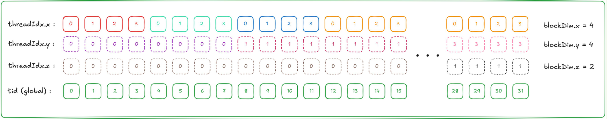
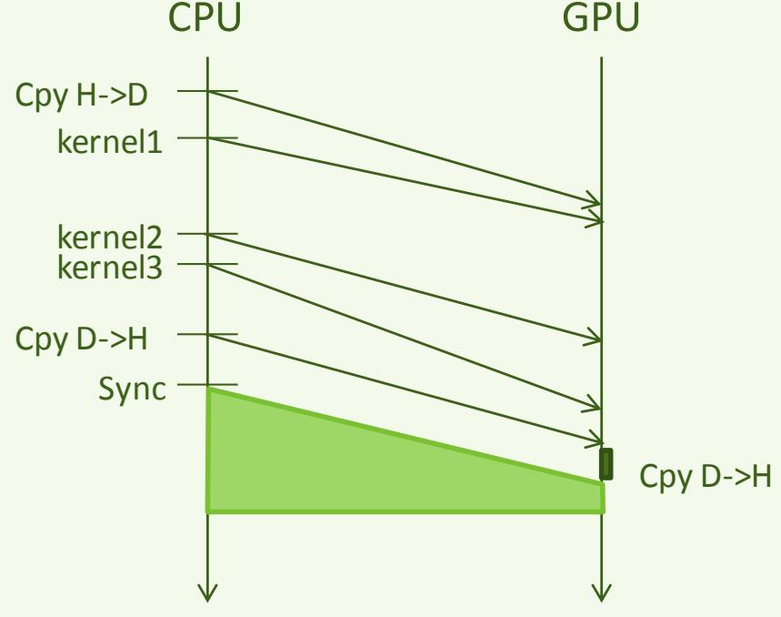
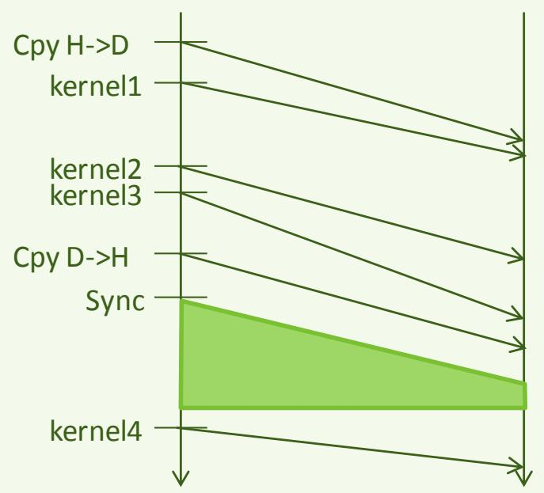

# 第 2 讲下篇：访存、异步执行与性能

> [上篇：函数、数据类型与内存管理](APM_Cours2_zh_part1.md) · [原课件](APM_Cours2.pdf) · [原文提取稿](APM_Cours2.md)

本篇接着讨论数据怎样被线程访问，再学习流、同步、原子操作、计时与优化。中法文补充沿用上篇约定，局部代码示例不代表完整程序或 GPU 实测。

Cette partie poursuit avec les accès mémoire, les streams, la synchronisation, les atomiques et la mesure. Les fragments illustratifs ne constituent pas tous des programmes complets et ne sont pas des résultats mesurés sur GPU.

## 访存与设备变量（Accès mémoire et variables device）

### 内存访问（Accès mémoire）

> - Exécution synchrone dans un warp
> - Un thread exécutant un chargement mémoire ralenti les autres
> - Plusieurs accès mémoire simultanées peuvent être sérialisés
> - Plus l’accès est long, plus il nous faudra de threads pour recouvrir cet accès
> - Optimisations possibles
> - Eviter les conflits de bancs

- 一个 warp 内同步执行
- 某个线程执行内存加载时，其他线程也可能受到拖累
- 多个同时发出的内存访问可能被串行处理
- 访问延迟越长，就需要越多线程来隐藏延迟
- 可采用的优化
- 合并访存（load coalescing）
- 避免存储体冲突（bank conflict）

**这里的“等待”具体在等什么？** 例如 `float x = a[i]; float y = x * 2;`，第二步需要第一步读回的 `x`，形成数据依赖；数据还没回来，就不能用它计算 `y`。**访存延迟**是请求发出到所需数据可用的时间；**带宽**是单位时间能传输多少字节。公路能同时容纳很多车，并不意味着每辆车的行程都很短，这两个指标要分开理解。

课件的“warp 内同步执行”描述 SIMT 执行方式，不能据此认为线程通过共享内存交流时天然已经完成同步。程序仍须使用适当的同步原语来建立先写后读的关系，后文会区分 `__syncwarp()` 和 `__syncthreads()`。

**Latence, bande passante et dépendance :** dans `x = a[i]; y = x * 2;`, le calcul de `y` dépend du retour de `x`. La latence mesure ce délai ; la bande passante mesure les octets transférés par unité de temps. L’exécution SIMT ne remplace pas une synchronisation explicite lorsque les threads échangent des données en mémoire partagée.

### 合并访存（Load coalescing）

**隐藏延迟不等于加快一次读取：** warp A 等待全局内存数据时，调度器若能找到已就绪的 warp B，就可以先发出 B 的指令。A 的这次读取没有因此变短，只是 SM 的部分等待被其他工作填上。若所有 warp 都在等同一种资源，或寄存器、共享内存用量太大而只能驻留很少 warp，就可能仍然空等。

**Masquer une latence :** pendant que le warp A attend une donnée, un warp B prêt peut fournir des instructions. L’accès de A n’est pas raccourci ; du travail utile occupe une partie de l’attente. Sans warp prêt, ou avec trop peu de warps résidents à cause des ressources, ce recouvrement ne suffit plus.

> - Accès à la mémoire globale
> - Accès concurrent émis par les threads d’un même warp
> - Tous les threads d’un même warp exécute la même instruction au même instant
> - Les requêtes sont sérialisés par paquets de 128 octets (taille de la ligne de cache)
> - Optimisation si ces accès sont contigus !

- 访问全局内存
- 同一 warp 内的线程并发发出访问请求
- 同一 warp 内的所有线程在同一时刻执行同一条指令
- 课件按每组 128 字节，即缓存行大小，描述请求的串行处理
- 访问地址连续时可以得到优化！

**指令、请求、事务和缓存行不是同一个单位：**

| 术语 | 在这次读取中指什么 |
|---|---|
| 加载指令（load） | 程序要求把内存中的值读入线程可使用的寄存器；同一条 warp 指令中，各活跃线程可以提供不同地址 |
| 线程的访问请求 | 例如 lane 0 要 `a[0]`，lane 1 要 `a[1]`；这是各线程需要哪些字节 |
| 合并访存（coalescing） | 访存硬件把同一个 warp、同一条访存指令的这些地址需求汇总，用尽可能少的事务服务；它没有把数组重新排序 |
| 访问段与内存事务 | 访问段是地址空间中固定大小的一段；覆盖的段数帮助估计服务请求的事务数量。事务粒度和缓存层次有关，不能把一个线程等同于一笔显存事务 |
| 缓存行（cache line） | 缓存存放、标记数据的单位；某些缓存行又分成更小的 sector。因此课件中的 128 字节缓存行与下面的 32 字节访问段可以同时出现 |

**步长（stride）**说明相邻线程或相邻循环迭代的访问地址相差多少。`a[lane]` 的元素步长是 1，对 `float` 而言字节步长是 4；`a[32 * lane]` 的元素步长是 32，字节步长是 128。判断访存时要说明步长的单位。

**Instruction, requête et transaction :** une instruction de chargement fournit une adresse par thread actif. Le matériel mémoire regroupe les requêtes d’un même warp pour cette instruction ; il ne réorganise pas le tableau. Une ligne de cache est une unité de stockage du cache et peut contenir plusieurs secteurs. Le nombre de transactions dépend des adresses, de la granularité et des caches. Le *stride* est l’écart entre adresses : 1 élément vaut ici 4 octets pour un `float`.

### 合并访存：warp 内的线程编号（Load coalescing — Numérotation des threads dans un warp）

**同一条加载指令，地址如何不同？** 假设 32 个线程各读一个 4 字节 `float`，基址按 128 字节对齐，按计算能力 6.0 及以后常用的 32 字节访问段来数：

| 第 lane 个线程读取 | 这一个 warp 覆盖的地址 | 所需 32 字节段数 |
|---|---|---:|
| `a[lane]` | 偏移 0、4、8、…、124 字节 | 4 |
| `a[lane + 1]` | 偏移 4、8、…、128 字节 | 5 |
| `a[32 * lane]` | 偏移 0、128、256、… 字节 | 32 |

第三种不是多读了有效元素，而是把 32 个所需值散布在很多访问段中。这里数的是这一条指令需要覆盖的段，不能直接当作实际 HBM 流量或运行时间倍数：缓存、复用和架构仍有影响。参见 [NVIDIA 合并访存算例](https://docs.nvidia.com/cuda/cuda-c-best-practices-guide/index.html#coalesced-access-to-global-memory)。

**Exemple d’adresses :** avec 32 `float` et une base alignée, `a[lane]` couvre quatre segments de 32 octets ; le décalage `a[lane+1]` en couvre cinq ; `a[32*lane]` en couvre 32. Le nombre d’éléments utiles est identique. Ces segments ne donnent pas directement le trafic HBM ni un facteur de ralentissement, car les caches et la réutilisation interviennent.

> *Ajout du PDF 2026, p. 53.*
>
> - Un warp est un groupe de 32 threads.
> - Plusieurs « warp schedulers » par SM.
>   - Un warp scheduler est capable d’exécuter jusqu’à 2 instructions simultanément.
> - Le warp scheduler peut charger jusqu’à 128 B en une seule transaction.
>   - Si tous les threads du warp accèdent à des données contiguës, les accès seront coalescés, c’est-à-dire que le nombre de chargements mémoire sera réduit.
>   - Sinon, le warp scheduler fera autant de chargements par paquet de 32 B que nécessaire.

*新版课件新增内容，第 53 页。*



- 一个 warp 包含 32 个线程。
- 一个 SM 中有多个 warp scheduler。
  - 课件称一个 warp scheduler 最多可同时执行两条指令。
- 课件用一次事务最多加载 128 字节来解释访存合并。
  - 同一 warp 的线程访问连续数据时，访存请求可以合并，从而减少内存加载事务。
  - 对分散访问，课件按所需的 32 字节数据块解释额外的加载。

**读图说明：** 图中 `blockDim = (4, 4, 2)`，共有 32 个线程。块内线性编号为 `threadIdx.x + 4 * threadIdx.y + 16 * threadIdx.z`，因此 x 先变化，再是 y、z。例如 `(3, 1, 0)` 对应编号 7，`(0, 0, 1)` 对应编号 16。图中的 `tid (global)` 标签实际展示了这个块内的线性编号，没有包含 `blockIdx` 项。

上述“两条指令”“128 字节”“32 字节”是课件的描述；调度器发射能力和访存事务粒度随架构与访问类型而变，不是所有 GPU 的固定规则。

**线程编号为什么会影响访存效率**

老师把合并访存与第一讲的编号规则联系起来：块内线程按 x 最快变化的顺序线性化，相邻的线性编号组成 warp。因此，设计二维数组访问时，要观察同一 warp 在同一条访存指令中访问的地址。

对行主序矩阵，令相邻线程读取同一行的相邻列，地址通常更紧凑；若相邻线程跨行读取同一列，地址间隔会变成一整行。后者可能需要更多内存事务。课件的“128 字节”是解释用的粒度，实际事务取决于架构、访问宽度与对齐，不能据此断言一个 warp 的加载永远只产生一笔事务。

### 合并访存与共享内存（Load coalescing et mémoire shared）

> - Utilisation de la mémoire shared
>
> - Nécessite de déclarer des buffers résidant dans la mémoire shared
> - Transferts des données en début de noyau
> - Mise à jour de la mémoire globale à la fin du noyau
> - Optimisation : profiter de ce premier transferts (global  shared) pour faire des accès contigus aux données
> - Même si toutes les données ne sont pas nécessaires !
> - Attention aux conflits de bancs

- 使用共享内存

- 需要声明驻留在共享内存中的缓冲区
- 在内核开始时传入数据
- 在内核结束时更新全局内存
- 优化：利用最初从全局内存到共享内存的传输，实现连续地址访问
- 即使并非所有数据都需要用到，也可以考虑这样做！
- 注意存储体冲突

**先协作搬入，再重复使用**

共享内存的收益来自块内协作：线程先以合适的全局访问模式装入一块数据，再反复使用，减少重复访问全局内存。只把数据搬入共享内存却不复用，可能增加搬运和同步成本。

全局内存的合并访存与共享内存的 bank conflict 是两个问题。共享内存冲突要看同一次访问中各线程的地址如何映射到 bank；不能只靠“地址对齐”判断是否有冲突。

### 变量属性（1）（Attributs de variables (1)）

**bank 到底是什么？** 共享内存内部被分成多个可并行服务访问的存储体（bank），可以想成多个服务窗口。这里的一个 **32 位字（word）**是 4 字节，恰好能装一个 `float`。在下面采用的常见 32-bank、连续 32 位字交错映射模型中，bank 编号可写为 `字地址 % 32`，其中字地址是字节地址除以 4 后取整。连续的 32 个 `float` 因而依次落在 32 个 bank。

**bank conflict 是资源冲突，数据竞争是正确性问题。** 两个线程读取同一 bank 的不同位置，可能需要分批服务，即使读出的值完全正确，也会影响效率。两个线程没有适当同步就访问同一个位置，且至少一个在写，则可能发生数据竞争，程序结果没有正确保证。前者通常靠改变地址布局解决，后者要靠分工、同步或原子操作解决。

**Banc et conflit :** les bancs sont des subdivisions de la mémoire partagée capables de servir des accès en parallèle. Un mot de 32 bits vaut 4 octets. Dans le modèle utilisé ici, le numéro de banc est l’adresse en mots modulo 32. Un conflit de bancs concerne le débit de service ; une course de données concerne des accès concurrents non synchronisés à une même donnée, dont au moins une écriture, et menace la correction du programme.

**共享内存的 bank conflict 具体例子：** 对通常按连续 32 位字映射到 32 个 bank 的共享内存，以 `float` 为例，同一 warp 读 `tile[lane]` 会分散到不同 bank；读 `tile[32*lane]` 会落到同一 bank 的不同地址，可能被拆开服务。若所有线程读同一个地址，则是可广播的情况，不能按“相同 bank”就判定为 32 路冲突。

**Exemple de conflits de bancs :** pour 32 bancs avec des mots de 32 bits, `tile[lane]` répartit les accès à des `float` entre les bancs. `tile[32*lane]` vise des adresses distinctes d’un même banc. Une lecture de la même adresse par tous les threads peut au contraire être diffusée : même banc ne suffit pas à conclure à un conflit.

矩阵转置中可用 `__shared__ float tile[32][33]` 给每行增加一个元素的填充，使按列访问的相邻线程不再总以 32 个字为间隔。这与全局内存的 pitch 都涉及填充，但解决的问题不同：这里改变的是共享内存的 bank 映射。不能因此给所有数组都盲目加一列。

具体算一下：一行 32 个元素时，`tile[lane][0]` 的字偏移是 `32 * lane`，对 32 取余全为 0；一行 33 个元素时，字偏移变成 `33 * lane`，对 32 取余依次是 0、1、…、31。数组基址只会整体平移 bank 编号，不改变这里是否冲突的结论。**广播（broadcast）**则是一次读出某个值，再供多个需要该值的线程使用。

Dans le premier cas, `(32 * lane) % 32` vaut toujours zéro ; avec le remplissage, `(33 * lane) % 32` vaut `lane`. L’adresse de base décale les numéros de bancs sans changer ce raisonnement. Une diffusion (*broadcast*) fournit une même valeur lue à plusieurs threads.

Dans une transposition, `__shared__ float tile[32][33]` modifie le pas des lignes et peut supprimer ce conflit lors des lectures par colonne. Ce remplissage agit sur les bancs de mémoire partagée, pas sur le pitch global. Il faut analyser le motif d’accès avant d’ajouter une colonne. Voir les [exemples de mémoire partagée NVIDIA](https://docs.nvidia.com/cuda/cuda-c-best-practices-guide/index.html#shared-memory-and-memory-banks).

### 驻留在设备上的变量（Variable résidente sur le device）

> - Par défault dans la mémoire globale, accessible par tous les threads, pendant toute la durée de l’application
> - Variable résidente dans la mémoire constante
> - Durée de vie de l’application
> - Ne peut pas être défini sur le device

- `device`〔原文省略下划线〕
- 默认位于全局内存中，所有线程均可访问，生命周期覆盖整个应用
- 驻留在常量内存中的变量
- `constant`〔原文省略下划线〕
- 生命周期覆盖整个应用
- 不能在设备端定义〔按课件原文表述〕

**读变量声明时，同时问三个问题：** 哪些线程能访问它？它的存储从什么时候存在到什么时候？谁可以修改它？这分别对应可访问范围、生命周期和读写权限。`__device__`、`__constant__`、`__shared__` 是声明变量属性的限定符；其中变量上的 `__device__` 与函数上的 `__device__` 用途不同，前者说明设备变量，后者说明函数在设备端执行。

这里的**符号（symbol）**是编译、链接后可被程序按名字识别的对象，例如下文的 `filter`。`cudaMemcpyToSymbol` 的含义是“把数据复制到这个具名设备对象”，不是复制名称字符串。课件关于常量的表述应结合例子理解：可以在源码中声明 `__constant__` 对象，由主机在恰当时机更新；kernel 读取它，不能像普通全局数组一样在 kernel 中赋值更新它。

**Lire une déclaration :** il faut distinguer les threads autorisés à accéder à l’objet, sa durée de vie et ses droits de lecture/écriture. Les qualificatifs de variable précisent ces propriétés. Un symbole est un objet identifié par son nom après compilation et édition de liens. `cudaMemcpyToSymbol` copie des données vers cet objet. Un objet `__constant__` est déclaré dans le code, mis à jour depuis l’hôte et lu par les kernels ; ceux-ci ne peuvent pas l’écrire comme un tableau global ordinaire.

**常量内存与纹理访问需要区分**

`__constant__` 声明与 `cudaMemcpyToSymbol` 更新对应的是常量符号；纹理访问使用自己的资源绑定和读取接口。它们可能都涉及只读访问和缓存，但不能把两者当作同一机制，也不能把 SM 内的缓存等同于全部数据的物理存储位置。

### 变量属性（2）（Attributs de variables (2)）

**全局符号与常量符号的例子 / Symboles globaux et constants :**

```cpp
__device__ int deviceCount;
__constant__ float filter[3];
```

`deviceCount` 是设备全局变量，可由适当的设备代码更新；多个线程一起更新还需要正确的原子操作或分工。`filter` 可以存小滤波器：主机先准备 `float h_filter[3] = {0.25f, 0.5f, 0.25f};`，再调用 `cudaMemcpyToSymbol(filter, h_filter, sizeof(h_filter))`。当一个 warp 同时读取相同系数时适合常量缓存的广播；各线程读很多不同地址时，不能保证同样收益。

`deviceCount` est un état global GPU ; les mises à jour concurrentes doivent être organisées ou atomiques. `filter` reçoit trois coefficients via `cudaMemcpyToSymbol`. La lecture d’un même coefficient par un warp profite de la diffusion ; des adresses différentes par thread n’offrent pas nécessairement le même avantage.

### 共享内存中的变量（Variable dans la mémoire shared）

> - Partagée entre tous les threads d’un même bloc
> - Une copie par bloc
> - Durée de vie du bloc

- `shared`〔原文省略下划线〕
- 同一线程块内的所有线程共享
- 每个线程块有一份副本
- 生命周期与线程块一致

### 默认情况下，设备函数中声明的变量存储在寄存器中（Par défaut une variable déclarée sur le device est stockée dans un registre）

**“每块一份”代入实例：** 声明 `__shared__ float tile[256]`，启动 10 个块，就逻辑上有 10 份独立的 tile；块 0 的 `tile[0]` 与块 1 的 `tile[0]` 不是同一个值。块退出后，不能靠下次启动的同名数组保留内容。函数内普通变量 `float sum` 属于单个线程，编译器常能把它放进寄存器，但数组或资源压力可能使其进入局部内存。

**Une copie par bloc :** dix blocs avec `__shared__ float tile[256]` disposent de dix tableaux distincts. Le même nom et le même indice ne désignent pas les mêmes données entre blocs, ni une valeur persistante au lancement suivant. Un `float sum` ordinaire est privé au thread ; son placement effectif dépend du compilateur et des ressources.

### volatile 变量（Variable volatile）

> - Synchronisation des données communes accédées de façon concurrente
> - Exemple d’accès concurrents
>
> - Que vaut result[tid] ?
>
> - Par contre, si déclaré volatile, alors ok (ou alors mettre une barrière mémoire - memory fence)
> - Mais cela ne garantie pas l’ordre d’exécution

- 对并发访问的公共数据进行同步
- 并发访问示例

```cpp
// myArray is an array of non-zero integers
// located in global or shared memory
__global__ void MyKernel(int *result) {
    int tid = threadIdx.x;
    int ref1 = myArray[tid] * 1;
    myArray[tid + 1] = 2;
    int ref2 = myArray[tid] * 1;
    result[tid] = ref1 * ref2;
}
```

- `result[tid]` 的值是多少？

```text
✿ myArray[tid] est dans un registre, donc ref1==ref2
```

- 课件称声明为 `volatile` 后即可，或加入内存栅栏（memory fence）〔译注：volatile 不是完整的线程同步机制〕
- 但这并不能保证执行顺序

**volatile 不能修复这里的数据竞争**

先区分课件中混在一起的几个概念：

| 概念 | 要回答的问题 | 本例中的含义 |
|---|---|---|
| 并发访问 | 多个线程的工作是否可能重叠或交错？ | 线程 0 写元素 1 时，线程 1 也可能在读它 |
| 执行顺序 | 是否保证某一步先于另一线程的某一步？ | 必须先完成旧值读取，再允许相邻线程覆盖 |
| 内存可见性 | 同步之后，读线程是否能观察到约定的写入？ | 写入新值后，其他线程不能继续把旧值当成这一阶段的结果 |
| 原子性 | 一次操作是否会被其他冲突操作从中间穿插？ | 原子加法把“读出、加一、写回”作为一个不可分割的更新 |

这里的“可见”是程序的读写语义，不要求每次交流都把值送回显存芯片。`volatile` 对编译器处理这些访问施加限制，但不建立上述跨线程的先后关系。**未定义行为**则表示语言或编程模型不保证结果，不能理解成“只是在旧值与新值之间随机选一个”。

**Quatre questions distinctes :** la concurrence décrit le chevauchement possible des travaux ; l’ordre précise quelle opération doit précéder une autre ; la visibilité permet de lire les écritures attendues après synchronisation ; l’atomicité rend une mise à jour indivisible vis-à-vis des accès atomiques concurrents. La visibilité n’impose pas un aller-retour systématique en DRAM. `volatile` n’établit pas l’ordre entre threads. Un comportement indéfini ne se réduit pas à un choix aléatoire entre deux valeurs prévues.

课堂用相邻线程读写数组来解释可见性，但“加上 `volatile` 就能得到正确值”不能作为编程规则。上例中，一个线程读 `myArray[tid]`，另一个线程可能正写这个位置，缺少执行顺序约束，因而不能给出一个可靠的固定结果。

`volatile` 不提供线程间同步或原子性，内存栅栏本身也不会让其他线程等待。如果算法要求所有线程先读取旧值、然后更新、最后读取新值，应明确划分阶段，并在适当作用域内同步；跨块时还需另外设计协调方式。不能用打印结果恰好正确来证明它没有竞争。

核对依据：[CUDA 对 volatile 的限制](https://docs.nvidia.com/cuda/archive/13.0.0/cuda-c-programming-guide/index.html#volatile-qualifier)。

**把竞争代入两个线程：** 线程 0 写 `myArray[1] = 2`，线程 1 同时把 `myArray[1]` 读到 `ref1/ref2`。没有同步时，不能承诺它读到旧值还是 2；对非原子的冲突访问，也不能只列举几个碰巧观察到的结果当作完整语义。若仅在同一块中讨论，可让所有线程依次完成“读取旧值 → 块同步 → 写入互不冲突的位置 → 块同步 → 读取新值”，并确保边界有效、所有需要参与的线程都到达同步点。原示例的 `tid+1` 还要求数组长度足够。

**Deux threads en concurrence :** le thread 0 écrit l’élément 1, que le thread 1 lit. Sans synchronisation, aucune valeur fixe n’est promise. Pour un algorithme limité à un bloc, on peut séparer lecture initiale, écriture et relecture par des barrières collectives, avec des accès valides et des écritures non conflictuelles. `tid+1` impose aussi une borne correcte.

### 变量限制（Restrictions des variables）

> - Gestion dynamique des variables shared
>
> - Besoin de gérer à la main l’allocation des données si on décide d’utiliser la mémoire shared de façon dynamique Respect des règles d’alignements

- 动态管理共享内存变量

```c
extern __shared__ char array[];
__device__ void func() {
    short *array0 = (short*)array;
    float *array1 = (float*)&array[128];
    int *array2 = (int*)&array[64];
}
```

- 如果动态使用共享内存，需要手动管理其中的数据布局，并遵守对齐规则

**动态共享内存的大小在哪里给？** `extern __shared__ float tile[];` 的长度由启动时第三个配置参数给出：`kernel<<<blocks, 256, 256*sizeof(float)>>>(...)` 为每个块提供 1024 字节。第三个参数用字节，第二个参数用线程数。若把同一空间切成多个数组，需要分别算偏移、长度和对齐；不能让两段意外重叠，原提取稿的偏移本身也没有给出各段长度。

**Taille dynamique :** le troisième paramètre de lancement donne des octets de mémoire partagée par bloc. `256*sizeof(float)` fournit 1024 octets, pas 1024 threads. Découper cet espace en plusieurs tableaux demande de vérifier les longueurs, les décalages, l’alignement et l’absence de chevauchement.

**为什么写 `extern` 和空的 `[]`？** 在这种 CUDA 声明里，数组的存储大小由启动配置提供，源码没有写死元素个数。动态指“可在不同次启动时给不同大小”，并不是线程执行到这行才调用一次 `malloc`，也不是每个线程各自得到一份。该次启动中的每个块各有这一大小的动态共享空间，块内线程通过同一份空间协作。声明本身不会把其中的值初始化为零。

**Sens de `extern __shared__ T a[]` :** la taille vient de la configuration de lancement. Elle peut varier entre lancements ; il ne s’agit ni d’un `malloc` exécuté par chaque thread, ni d’une copie privée par thread. Chaque bloc reçoit son propre espace partagé de cette taille, dont le contenu n’est pas automatiquement initialisé à zéro.

### 寄存器分配（Allocation de registres）

> - Chaque noyau de calcul a besoin d’utiliser plusieurs registres
> - En fonction des instructions présentes dans le noyau VA Transformations/optimisations du compilateur
> - X Allocation de registres
> - Mais
> - Le nombre de registres est limité
> - Les registres sont partagés entre les threads s’exécutant sur un même Streaming Multiprocessor
> - Relation avec le nombre de threads ?

- 每个计算内核都需要使用多个寄存器
- 使用量取决于内核中的指令，以及编译器进行的变换和优化
- 寄存器分配
- 但需要注意
- 寄存器数量有限
- 同一流式多处理器上执行的线程共享寄存器资源
- 这与线程数有什么关系？

### 寄存器分配（Allocation de registres）

> - Option pour définir une borne au compilateur
> - Attribut pour donner une indication sur le nombre maximum de threads et de blocs

- 可以通过选项向编译器指定寄存器数量上限
- maxrregcount=N
- 通过属性向编译器提供最大线程数和线程块数量的提示

```cpp
__global__ void __launch_bounds__(256, 2) MyKernel(float *a, int N) {
    int i = blockIdx.x * blockDim.x + threadIdx.x;
    if (i < N) {
        a[i] += 1.0f;
    }
}
```

这个具体声明要求启动的块大小不超过 256；参数 2 是编译器进行寄存器预算时的提示，不保证运行时一定驻留两块。它不指定 grid 的块数，也不让编译器自动把一次 `<<<blocks, 512>>>` 改成合法配置。

Cette déclaration fixe une borne de 256 threads par bloc. Le paramètre 2 guide le budget du compilateur sans garantir deux blocs résidents à l’exécution. Ni la grille ni une configuration invalide de lancement ne sont corrigées automatiquement.

**寄存器用量与驻留线程数之间的取舍**

**寄存器分配是编译器的哪项工作？** 编译器要决定计算过程中的中间值放在哪里。例如在 `x = a[i]; y = x + 1; z = x * y;` 中，算完 `y` 后还要用 `x`，所以这两个值要同时保留。一个值从产生到最后一次使用的这段范围称为**活跃区间（live range）**；很多值的活跃区间重叠，会增加寄存器压力。源码变量个数不等于最终寄存器个数：有的值被消去，有的寄存器在不同阶段被复用。

**寄存器溢出（spill）**是寄存器放不下时，把部分值放入线程私有的局部内存，需要时再加载；它不是整数或浮点数超出表示范围的“数值溢出”。局部内存逻辑上只属于该线程，但通常由设备内存体系提供，可能产生额外的访存。减少寄存器也可能迫使编译器重新计算某些值，因此不能只追求较低的寄存器数字。

**Allocation et débordement de registres :** le compilateur place les valeurs intermédiaires selon leurs périodes d’utilisation. Des intervalles de vie qui se chevauchent augmentent la pression sur les registres ; le nombre de variables source ne donne pas leur nombre final. Un *spill* place temporairement une valeur en mémoire locale privée au thread et peut ajouter des chargements et stockages. Il ne s’agit pas d’un dépassement de capacité numérique. Une limite trop basse peut aussi entraîner des recalculs.

SM 的寄存器总量有限。每个线程占用更多寄存器时，同一 SM 可能容纳更少的线程或线程块，隐藏延迟的能力也可能受到影响。因此，老师把寄存器用量与并行度一起讨论。

`__launch_bounds__(maxThreadsPerBlock, minBlocksPerMultiprocessor)` 给出最大块大小及期望的最少驻留块数，编译器据此调整寄存器使用；参数不是寄存器数量。直接限制寄存器可用 `--maxrregcount=N`，但压得过低可能导致溢出到局部内存，或增加指令数。驻留率高也不保证运行更快，应结合资源用量与实测时间判断。

核对依据：[CUDA Launch Bounds](https://docs.nvidia.com/cuda/archive/13.0.0/cuda-c-programming-guide/index.html#launch-bounds)。

## 异步执行（ASYNCHRONISME）

**寄存器容量算例：** 假设某 SM 有 65536 个 32 位寄存器，每块 256 个线程。若每线程用 32 个寄存器，每块需 8192 个，只按寄存器容量算可放 8 块；若每线程用 64 个，每块需 16384 个，只可放 4 块。真实驻留块数还受寄存器分配粒度、共享内存、线程和块数量上限约束，不能只用这个除法确定。这里的“共享资源”指共享容量，不是线程可以读取彼此的私有寄存器。

**Exemple de budget :** avec 65536 registres de 32 bits et 256 threads par bloc, 32 registres par thread consomment 8192 registres par bloc, contre 16384 à 64 registres par thread. La capacité seule donne 8 ou 4 blocs, mais les autres limites et granularités peuvent réduire ce nombre. Partager une capacité ne permet pas de lire directement les registres privés d’un autre thread.

### CUDA 中的异步执行（Exécution asynchrone en CUDA）

### CUDA 内核是异步的（Les kernels CUDA sont asynchrones）

> - Au retour de l’invocation d’un kernel, celui-ci n’a pas forcément déjà été exécuté
> - Lors de l’invocation de kernel, celui-ci n’est pas lancé immédiatement
> - C’est comme si on avait donné « l’ordre » au GPU d’exécuter le kernel
> - Le kernel peut être exécuté plus tard
> - Pour s’assurer de l’exécution du kernel, il faut synchroniser le device

- 内核调用返回时，内核不一定已经执行完毕
- 调用内核时，它不一定立即开始执行
- 可以理解为向 GPU 发出了执行内核的命令
- 内核可能稍后才执行
- 要确认内核已经执行完毕，需要进行设备同步

**提交完成、执行完成与并发是三件事**

**先确定“相对于谁异步”。** 这里观察的是调用 CUDA API 的 CPU 线程：它把任务交给 CUDA 后，能否先往下执行？**提交（submit）**就是发出一项待执行的工作；任务可能排队，因此提交完成不等于工作完成。**stream（流）**是组织 GPU 工作顺序的逻辑任务序列，既不是一条 CPU 线程，也不是专门分配给它的一个 SM。

| 说法 | 实际保证或描述的事情 |
|---|---|
| 对主机异步 | CPU 调用返回时，所提交的 GPU 工作可以还没完成 |
| 同一 stream 内有序 | 后续相关任务遵守这条 stream 的先后关系，例如计算使用前一步复制好的输入 |
| 两条 stream 可以并发 | 两组工作有机会在执行期间重叠；是否真的重叠取决于依赖、资源与硬件能力 |
| CPU 阻塞等待 | CPU 的这次同步调用尚不返回，直到它等待的工作完成 |

**Soumission, stream et blocage :** une soumission confie un travail à CUDA, éventuellement mis en attente. Un stream est une séquence logique ordonnée, ni un thread CPU ni un SM réservé. Un appel asynchrone peut rendre la main avant la fin du travail GPU. Plusieurs streams autorisent un recouvrement lorsque les dépendances, les ressources et le matériel le permettent ; ils ne le garantissent pas. Un appel bloquant retient le thread CPU appelant jusqu’à la condition attendue.

启动内核后，主机通常可以继续做其他工作，这只说明提交对主机是异步的。同一流中的任务仍按顺序执行：例如“复制输入 → 内核 A → 内核 B → 复制输出”，可以连续提交，不必在每两步之间让 CPU 等待。

顺序来自流的语义，不是运行时自动分析指针并推断数据依赖。跨流的先写后读需要显式建立依赖。主机侧 `cudaDeviceSynchronize()` 等待当前设备此前提交的工作完成，不是插入内核内部的全网格线程屏障；只关心一条流或一个阶段时，可以等待对应的流或事件。

### 全局同步（Synchronisation globale）

**异步返回的时间线：** CPU 在 t=0 提交 kernel，假设 t=0.02 ms 调用已返回，而 GPU 在 t=2 ms 才完成计算。CPU 在 t=0.03 ms 做一项无关计算是允许的；此时读取 kernel 输出却可能过早。“调用返回”和“结果可用”不能用同一个时间点表示，这些数字只是教学假设。

**Chronologie fictive :** lancement à t=0, retour CPU à 0,02 ms, fin GPU à 2 ms. Le CPU peut faire un travail indépendant à 0,03 ms, mais le résultat GPU n’est pas encore prêt. Retour de l’appel et disponibilité du résultat sont deux événements distincts.

> - Attend que les opérations sur le device soient terminées
> - Si appelée depuis le host, alors synchronise le host et le device
> - En fonction du flag de synchronisation mis en place pour ce device

- host device cudaDeviceSynchronize();
- 等待设备上的操作完成
- 从主机调用时，使主机与设备同步
- 具体行为与该设备设置的同步标志有关

这里的 **flag（标志选项）**是传给运行时的配置值。例如等待设备时，CPU 可以采用轮询或由系统挂起等待等策略；这影响 CPU 怎样等待，不会把 `cudaDeviceSynchronize()` 变成 kernel 中的线程块屏障。还要注意：“主机与设备同步”在这里是主机等工作结束，不是让它们从此按同一个时钟逐条执行。

Un *flag* est une option de configuration. Les options d’attente peuvent modifier la façon dont le CPU attend, par interrogation ou suspension, sans transformer l’appel en barrière à l’intérieur du kernel. Synchroniser ici signifie attendre la fin des travaux, pas exécuter ensuite CPU et GPU au même rythme.

### 异步复制（Copie asynchrone）

> - Possibilité de faire des copies asynchrone
> - Permet d’éviter les synchronisations host / device pour les copies de données

- 可以执行异步复制
- Y host cudaMemcpyAsync
- host cudaMemcpyPitchAsync
- host cudaMemcpy3DAsync
- 避免数据复制时立即进行主机与设备同步

### 异步复制（Copie asynchrone）

> - /!\ Nécessaire de synchroniser la copie device -> host avant d’afficher/utiliser le host buffer

- 可以执行异步复制
- host cudaMemcpyAsync
- host cudaMemcpyPitchAsync
- host cudaMemcpy3DAsync
- 避免数据复制时立即进行主机与设备同步
- 在显示或使用主机缓冲区之前，必须确认设备到主机的复制已经完成！
- cudaMemcpyAsync(h_a, d_a, ( sizeof(int) * 1024), cudaMemcpyDeviceToHost);cudaDeviceSynchronize(日
- for(i=0; i<1024; i++)
- printf("[%d]", h_a[i]);

**复制接口也要写对：** 二维异步复制叫 `cudaMemcpy2DAsync`；课件提取的 `cudaMemcpyPitchAsync` 应按此校正，源、目标 pitch 都必须传对。

**Nom de l’API :** utiliser `cudaMemcpy2DAsync`, avec les deux pas appropriés, pour la copie 2D asynchrone.

### 异步执行（Asynchronisme）

> - Par défault certaines fonctions rendent la main au programme hôte
> - Exécution de kernel
> - Copies device vers device
> - Initialisation de la mémoire
> - Possibilité d’attendre la fin de l’exécution à un instant donné cudaDeviceSynchronize();
> - Appels consécutifs à notre noyau vecAdd
> - Si les vecteurs sont différents ?
> - S’il existe une dépendance RAW dans notre calcul ?

- 默认情况下，某些函数会先将控制权交还主机程序
- 内核执行
- 设备到设备的复制
- 内存初始化
- 可以在需要时调用 `cudaDeviceSynchronize();` 等待执行完成
- 连续调用向量加法内核 `vecAdd`
- 如果各次调用操作的是不同向量呢？
- 如果计算中存在先写后读（RAW）依赖呢？

### 异步执行（Asynchronisme）

> - Pas besoin de synchronisation globale en cas de dépendances entre des kernels appelés consécutivement
> - Même si la main est rendue à l’hôte, la sémantique reste séquentielle
> - Les noyaux de calcul sont exécutés dans l’ordre
> - La gestion des dépendances est implicites

- 连续调用的内核之间存在依赖时，不一定需要全局同步〔本段按同一流内顺序执行的情境理解〕
- 即使控制权已交还主机，执行语义仍然保持顺序
- 计算内核按顺序执行
- 依赖关系得到隐式处理

### 异步提交与同步等待：一个完整过程（Asynchronisme）

**RAW 是 Read After Write 的缩写，即“写后读”依赖。** B 要读取 A 产生的数据，所以 A 的写入必须先完成并对 B 可见。这里字母描述的是同一份数据的访问关系；“两个 kernel 调用了同一个函数”本身并不构成依赖，而不同函数访问同一个中间数组也可能有依赖。判断能否重叠执行，要画出谁生产哪份数据、谁消费它。

**RAW, Read After Write :** B consomme une donnée produite par A ; l’écriture de A doit donc précéder la lecture de B et lui être visible. La dépendance vient des données effectivement partagées, pas du fait que les kernels portent le même nom. Deux fonctions différentes peuvent dépendre du même tableau intermédiaire.

**RAW 依赖的具体例子：** kernel A 写 `tmp[i] = a[i] + b[i]`，kernel B 读 `tmp[i]` 计算 `c[i] = 2*tmp[i]`。在同一 stream 中先提交 A 再提交 B，就建立了所需顺序，无需在两次提交之间让 CPU 全局等待。如果 A、B 在不同 stream，仅仅由 CPU 先后调用还不足以建立依赖，需要事件等机制。

**Exemple RAW :** A produit `tmp[i]`, B le lit pour calculer `c[i]`. Dans le même stream, soumettre A puis B impose cet ordre sans attente CPU entre les deux. Dans deux streams distincts, l’ordre des appels CPU ne suffit pas : une dépendance explicite, par exemple un événement, est nécessaire.

> - cudaMemcpyAsync(d_a, h_a, (sizeof(int)* (1024)), cudaMemcpyHostToDevice);
> - kernel1<<<16, 64>>>(d_a, size); kernel2<<<32, 32>>>(d_a, size); kernel3<<<64, 16>>>(d_a, size);
> - cudaMemcpyAsync(h_a, d_a, (sizeof(int) * (1024)), cudaMemcpyDeviceToHost) ;
> - cudaDeviceSynchronize();
> - kernel4<<<8, 128>>>(d_a, size);
>
> - kernel1<<<16, 64>>>(d a, size); kernel2<<<32, 32>>>(d_a, size); kernel3<<<64, 16>>>(d_a, size);
> - kernel1<<<16, 64>>>(d_a, size); kernel2<<<32, 32>>>(d_a, size); kernel3<<<64, 16>>>(d a, size);
> - Cpy H->D
>
> - kernel1<<<16, 64>>>(d a, size); kernel2<<<32, 32>>>(d_a, size); kernel3<<<64, 16>>>(d a, size);
> - Cpy H->D kernel1
>
> - kernel1<<<16, 64>>>(d_a, size); kernel2<<<32, 32>>>(d a, size); kernel3<<<64, 16>>>(d_a, size);

课件将同一个例子拆成多页动画。下面合并重复的调用序列，保留“等待完成”和“继续提交”两张关键时间线。

1. 主机提交 H→D 数据复制。
2. 在同一流中依次提交 `kernel1`、`kernel2`、`kernel3`。
3. 提交 D→H 数据复制。
4. 调用 `cudaDeviceSynchronize()`，主机等待前面的设备工作完成。
5. 同步返回后，再提交 `kernel4`。

> 这是原示例的调用顺序摘要，不是可直接运行的完整程序；原始调用片段见[原文提取稿](APM_Cours2.md)。



*图：CPU 等待 GPU 完成：绿色区域表示同步等待。*



*图：同步完成后，CPU 继续提交 kernel4。*

**异步复制期间，缓冲区仍在被使用**

**缓冲区（buffer）就是暂存一批数据的内存区域。** 它不是特殊的数据类型：`h_a` 指向的主机数组可以是输入缓冲区，`d_a` 指向的设备数组可以是计算缓冲区。H→D 是 host 到 device，D→H 是相反方向。异步调用返回后，传输设备可能仍在读取源区域或写入目标区域，所以“函数返回”不表示这些区域已经无人使用。

**什么叫页锁定（pinned / page-locked）？** 操作系统按“页”管理主机内存，程序用虚拟地址访问它。普通可分页内存的虚拟地址可以保持不变，而对应物理页的状态由操作系统管理；“可分页”不意味着此刻数据一定已经在磁盘上。页锁定让相关物理页在传输所需期间保持驻留，便于 DMA 使用。**DMA（直接内存访问）**指由传输硬件搬运数据，CPU 负责设置任务，无须逐个元素执行读写循环；GPU 的复制引擎是承担这类传输的硬件单元。

“锁页”也不等于给数据加了互斥锁：其他 CPU 线程依然可能改写这些地址，所以应用仍要遵守源、目标缓冲区的使用期限。

**Buffer, pages épinglées et DMA :** un buffer est une zone mémoire contenant temporairement des données ; H→D signifie hôte vers device. Après le retour d’un appel asynchrone, le matériel peut encore utiliser cette zone. La mémoire épinglée maintient les pages physiques résidentes pour permettre les transferts DMA, réalisés par le matériel sans boucle CPU élément par élément. Une mémoire paginable n’est pas nécessairement sur disque. Épingler des pages ne verrouille pas les données contre les écritures d’autres threads.

老师强调用 `cudaMallocHost` 分配页锁定主机内存，以支持高效的主机／设备异步传输。`Async` 后缀本身不保证一次调用一定立即返回，也不保证复制必然与计算重叠；使用可分页内存时，运行时可能需要中转或同步。

H→D 复制完成前不要修改或释放源主机缓冲区；D→H 复制完成前不要读取或复用目标缓冲区。可在复制后记录事件，并等待事件完成后再使用该缓冲区。页锁定解决内存传输条件，等待完成解决缓冲区的使用时机。

核对依据：[CUDA API 同步行为](https://docs.nvidia.com/cuda/cuda-runtime-api/api-sync-behavior.html)。

**谁还在使用缓冲区？/ Qui utilise encore le buffer ?**

| 阶段 | 允许的主机操作 | Action hôte |
|---|---|---|
| H→D 复制未完成 | 保留源输入，不改写、不释放它 | Conserver l’entrée sans la modifier |
| kernel 未完成 | 可以做无关 CPU 工作；不能假定结果可读 | Travail CPU indépendant possible |
| D→H 复制未完成 | 不能消费或覆盖目标结果缓冲区 | Ne pas utiliser ni écraser la sortie |
| 对应复制完成 | 可以读取结果或复用相关缓冲区 | Lire ou réutiliser le buffer concerné |

**页锁定分配的例子 / Allocation épinglée :** `cudaMallocHost(reinterpret_cast<void **>(&h_a), bytes)` 分配主机缓冲区，用完调用 `cudaFreeHost(h_a)`，不是 `cudaFree(h_a)`。页锁定支持可预测的异步传输条件，但过量分配会挤占操作系统可分页内存。它不意味着 CPU、GPU 可以同时无同步地改写同一份数据。

Une allocation `cudaMallocHost` se libère avec `cudaFreeHost`. Elle facilite les transferts asynchrones, sans résoudre les dépendances de données ; une quantité excessive réduit la mémoire disponible pour la pagination du système.

### 异步执行与主机内存（Asynchronisme – mémoire host）

> - Problème: entre l’appel à cudaMemcpyAsync et la réalisation de la copie, l’adresse physique sur le host peut changer
> - En raison de la séparation espace d’adressage virtuelle / espace d’adressage physique
> - Besoin d’un fonction pour fixer l’adresse physique de l’host pour les copies async.

- 问题：从调用 `cudaMemcpyAsync` 到实际复制之间，主机内存对应的物理地址可能变化
- 这是因为虚拟地址空间与物理地址空间分离
- 异步复制需要通过相应函数固定主机内存的物理页
- cudaMallocHost

### 异步执行（Asynchronisme）

> - Comment obtenir du vrai asynchronisme ?

- 连续调用的内核之间存在依赖时，不一定需要全局同步〔本段按同一流内顺序执行的情境理解〕
- 即使控制权已交还主机，执行语义仍然保持顺序
- 计算内核按顺序执行
- 依赖关系得到隐式处理
- 如何实现真正的异步执行？

这页的“真正异步”是在追问**能否让两项工作在时间上重叠**，例如复制下一批输入时计算当前批。前面“调用对 CPU 异步”和这里“GPU 工作彼此重叠”是两个层次：即使 GPU 按顺序做完所有任务，CPU 提交仍然可以是异步的。

Ici, « vrai asynchronisme » vise surtout le recouvrement de travaux, par exemple copier le lot suivant pendant le calcul du lot courant. C’est une question différente du retour asynchrone de l’appel CPU, qui reste possible même lorsque les travaux GPU s’exécutent séquentiellement.

### 高级异步执行（Asynchronisme avancé）

> - Motivations :
> - Pouvoir transférer des données pendant l’exécution d’un kernel
> - Pouvoir exécuter plusieurs noyaux de calculs
> - Si la carte graphique le permet (Fermi)
> - S’il n’y a pas de dépendances entre les noyaux

- 目的：
- 在内核执行期间传输数据
- 同时执行多个计算内核
- 前提是显卡支持，例如 Fermi
- 并且内核之间没有依赖

### 解决办法：使用流（stream）（Solution : streaming）

### 高级异步执行（Asynchronisme avancé）

> - Déclaration d’un ou plusieurs streams
> - Chaque interaction avec le device se fait sur un stream en particulier
> - Le driver sait alors ce qui peut être parallélisé ou non

- 声明一个或多个流
- 每次与设备的交互都提交到某个特定流中
- 驱动据此判断哪些工作可以并行执行

```cpp
cudaMemcpyAsync(d_c, c, N * sizeof(double), cudaMemcpyHostToDevice, stream[0]);
my_kernel<<<Dg, Db, 0, stream[0]>>> (arg1, arg2, arg3);
```

### 高级异步执行

- 声明一个或多个流
- 每次与设备的交互都提交到某个特定流中
- 驱动据此判断哪些工作可以并行执行

```cpp
cudaMemcpyAsync(d_c, c, N * sizeof(double), cudaMemcpyHostToDevice, stream[0]);
my_kernel<<<Dg, Db, 0, stream[1]>>> (arg1, arg2, arg3);
```

### 高级异步执行（Asynchronisme avancé）

### 流的数据类型（Structure stream）

- cudaStream_t

`cudaStream_t` 是**句柄（handle）**类型：程序拿着它标识一条由 CUDA 管理的流，不需要直接操作流的内部结构。`cudaStream_t stream;` 只声明变量，`cudaStreamCreate(&stream)` 才创建流并把句柄写回变量。`stream[0]`、`stream[1]` 表示句柄数组中的两个元素，不是 GPU 的第 0、1 个 warp。

启动配置 `<<<Dg, Db, 0, stream[0]>>>` 中，`Dg` 是网格尺寸，`Db` 是块尺寸，第三项 `0` 表示每块额外申请 0 字节动态共享内存，第四项选择流。这几个位置不是同一种参数，不能把第三项的 `0` 理解成流编号。

`cudaStream_t` est un type de *handle*, une référence à une ressource gérée par CUDA. Déclarer la variable ne crée pas la ressource ; `cudaStreamCreate(&stream)` écrit le handle créé dans cette variable. Dans le lancement, les quatre positions indiquent grille, bloc, octets de mémoire partagée dynamique et stream. Les indices d’un tableau de handles ne désignent pas des warps.

**不传 stream 参数的调用去了哪里？** 它们使用默认流。CUDA 有传统默认流和每个主机线程各自的默认流两种模式，其与其他流之间的隐式同步规则不同。传统默认流可能引入额外依赖；也不能据此省略任意两条显式流之间的数据依赖。分析例子时先确认采用哪种模式，跨流依赖仍按程序需要明确表达。参见 [CUDA 默认流说明](https://docs.nvidia.com/cuda/archive/13.0.0/cuda-c-programming-guide/index.html#default-stream)。

Sans argument stream, l’opération utilise le stream par défaut. Les modes legacy et per-thread diffèrent notamment par leurs synchronisations implicites avec d’autres streams. Il faut identifier le mode employé ; cela ne dispense pas d’exprimer les dépendances nécessaires entre deux streams explicites.

### 创建流（Creation d’un stream）

- cudaStream_t stream;
- cudaStreamCreate(&stream);

### 销毁流（Destruction d’un stream）

- cudaStreamDestroy(stream);

### 同步流（Synchronization d’un stream）

- cudaStreamSynchronize(stream);
- cudaStreamWaitEvent(stream, event, flag)

**流是一条任务队列，不绑定某一个 SM**

一条流中的内核可以使用多个 SM。多条流表达可以独立推进的工作，但是否实际重叠还取决于资源余量、复制引擎、硬件能力和依赖关系。老师用“各占一半资源”帮助理解，并不能直接拿监控工具里的两个利用率百分比相加，判断能否并发。

上面的跨流示意中，如果内核使用刚复制的 `d_c`，就必须建立复制完成到内核启动的依赖，例如在复制流中记录事件，再让计算流调用 `cudaStreamWaitEvent`。原片段里的 `cudaMemCpy(..., stream)` 不是正确的运行时 API 拼写；上面已修正为 `cudaMemcpyAsync(..., stream)`，但第二段仍故意展示缺少跨流依赖的情况。

**跨流“先复制、后计算”的正确顺序 / Dépendance entre deux streams :** 假设 `sCopy`、`sCompute` 已创建，`h_a` 为页锁定输入，`consume` 读取 `d_a`：

**event（事件）是什么？** 可以把它看成记录在某条流中的完成标记。创建事件只是准备这个标记对象；`cudaEventRecord(ready, sCopy)` 才把标记放到复制之后。事件完成说明记录时排在它前面的相关工作已完成，不包含后来才提交的任务。它不是“立刻在 CPU 上记一下当前时间”，也不会自动调用某段回调函数。

下面的 `cudaEventDisableTiming` 表示只用这个事件建立依赖，不采集计时信息；因此不能拿它去算耗时。`cudaStreamWaitEvent` 的最后一个 `0` 是默认标志参数，不是等待 0 秒。参见 [CUDA 事件接口](https://docs.nvidia.com/cuda/cuda-runtime-api/group__CUDART__EVENT.html)。

**Événement :** c’est un repère d’achèvement enregistré dans un stream. Sa création prépare l’objet ; son enregistrement capture les travaux qui le précèdent, pas les soumissions ultérieures. Il ne déclenche pas automatiquement une fonction de rappel. `cudaEventDisableTiming` désactive les données de chronométrage pour un événement utilisé comme dépendance ; le dernier zéro de `cudaStreamWaitEvent` est une option, pas une durée.

```cpp
cudaEvent_t ready;
cudaEventCreateWithFlags(&ready, cudaEventDisableTiming);
cudaMemcpyAsync(d_a, h_a, bytes, cudaMemcpyHostToDevice, sCopy);
cudaEventRecord(ready, sCopy);
cudaStreamWaitEvent(sCompute, ready, 0);
consume<<<blocks, threads, 0, sCompute>>>(d_a, N);
cudaStreamSynchronize(sCompute);
cudaEventDestroy(ready);
```

事件记录排在复制之后；计算流等待该事件，再运行 kernel。`cudaStreamWaitEvent` 给设备队列建立依赖，通常不让 CPU 当场等待；`cudaStreamSynchronize` 才在这里让主机等待该流完成。输入缓冲区要保留到复制完成，设备数组要保留到 kernel 完成。例子结束后，流和各分配仍需由持有者释放。

L’événement est enregistré après la copie, puis attendu par le stream de calcul. `cudaStreamWaitEvent` ajoute une dépendance côté device ; `cudaStreamSynchronize` attend côté CPU. Les buffers doivent rester valides jusqu’à la fin de leurs utilisations ; leur propriétaire libère ensuite streams et allocations.

**重叠的时间算例：** 每批上传假设 2 ms、计算 5 ms、下载 2 ms，同一队列处理两批约需 18 ms。若不同批次的数据独立、硬件及缓冲区允许，可以把下一批上传或上一批下载与当前批计算部分重叠；收益要画实际时间线判断，不能用“用了两个 stream”直接推出快两倍。

**Exemple de recouvrement :** deux lots de 2 ms de copie entrante, 5 ms de calcul et 2 ms de retour coûtent 18 ms en série. Des lots indépendants peuvent se recouvrir si le matériel et les buffers le permettent. Deux streams ne garantissent pas une accélération par deux.

### 线程块内同步（Synchronisation dans un bloc）

### void syncthreads();〔原文省略下划线〕

> - Synchronisation entre tous les threads d’un même bloc
> - Permet également une synchronisation des données
> - Attention au flot de contrôle !

- 同一线程块内的所有线程同步
- 同时实现相关内存访问的同步
- 注意控制流！

**共享内存装入后为什么需要屏障**

**`__syncthreads()` 的范围是一个 block，包含这个 block 中的所有 warp。** 例如每块 256 个线程，也就是 8 个 warp：即使 warp 0 的 32 个线程已经到达屏障，它们也不能因此越过屏障使用 warp 7 尚未写好的数据。要等块内应参与的线程都到达，并保证此前相关内存访问对块内线程可见，才能继续。这里假设这些线程都没有提前退出。

| 操作 | 谁调用、谁等待 | 用它解决什么 |
|---|---|---|
| `__syncwarp(mask)` | GPU 上同一个 warp 中由 mask 指定的线程参与 | 这些线程通过内存交换数据时，建立所需的同步与内存顺序 |
| `__syncthreads()` | GPU 上同一个 block 的线程参与，包括不同 warp | 块内协作的阶段切换，如所有线程写完共享数组后再读取 |
| `__threadfence()` | 某个 GPU 线程调用；不要求其他线程集合等待 | 在设备作用域内约束调用线程的内存操作顺序；单独使用不能代替完整的线程间通信协议 |
| `cudaStreamSynchronize(s)` | CPU 调用并等待 | 让 CPU 确认流 `s` 中此前工作已完成 |
| `cudaDeviceSynchronize()` | CPU 调用并等待 | 让 CPU 确认当前设备上此前提交的工作已完成 |

`__syncwarp(mask)` 的 mask 是一份**参与名单**：第 k 位为 1 表示 lane k 需要参与。调用线程自身的位必须为 1，名单中尚未退出的线程须执行对应调用并使用相同 mask。默认 `0xffffffff` 的 32 位全为 1，通常用于整个 warp；不能在只有部分线程进入的分支里随意使用这个默认名单。它与某条分支指令此刻的活跃掩码不是可随意混用的概念。更早架构还有额外限制，见 [CUDA 同步函数约定](https://docs.nvidia.com/cuda/archive/13.0.0/cuda-c-programming-guide/index.html#synchronization-functions)。

**Portée des synchronisations :** avec 256 threads par bloc, `__syncthreads()` réunit les huit warps, pas seulement les 32 threads du warp courant. `__syncwarp(mask)` réunit les participants indiqués par le masque dans un seul warp, avec le même masque aux appels correspondants. Un fence ordonne les accès du thread appelant sans réunir les autres threads. Les fonctions `cudaStreamSynchronize` et `cudaDeviceSynchronize` font attendre le CPU jusqu’à l’achèvement des travaux concernés.

让每个线程装入一部分共享数组后，某线程可能已经装完，而邻居还未写入。若马上读取邻居负责的数据，就可能使用未准备好的值。典型步骤是“协作装入 → `__syncthreads()` → 共同计算”；若还要覆盖同一缓冲区，也需确认其他线程已读完旧数据。

这个屏障的作用域是线程块。不要把它放进仅部分线程会进入的分支；边界线程可以跳过越界的加载或计算，但仍应按一致的控制流程参与块内屏障。

**控制流（control flow）**就是程序沿哪些 `if`、循环和 `return` 路径执行。屏障需要匹配到同一轮协作阶段：不能让一部分仍在运行的线程跳过屏障，也不能让不同线程在循环中执行不同次数的块屏障。“等齐”也不代表之后所有 warp 每一拍都同时执行下一条指令，调度器仍然按可执行情况安排它们。

Le *flot de contrôle* est le chemin pris à travers conditions, boucles et retours. Les barrières doivent correspondre aux mêmes étapes de coopération, notamment à chaque itération. Après leur franchissement, les warps restent ordonnancés par le matériel ; une barrière n’impose pas une exécution simultanée cycle par cycle.

### 对于支持计算能力 2.0 的显卡（Pour les cartes compatibles 2.0）

**共享数组的安全分阶段例子 / Coopération par étapes :** 以下 kernel 要求每块恰好 256 个线程。越界线程填 0，但也参与屏障；本例只演示块内邻居，不连接相邻两个块。

```cpp
__global__ void neighborSum(const float *a, float *out, int N) {
    __shared__ float tile[256];
    int t = threadIdx.x;
    int i = blockIdx.x * blockDim.x + t;
    tile[t] = i < N ? a[i] : 0.0f;
    __syncthreads();
    if (i < N) {
        out[i] = tile[t] + tile[(t + 1) % 256];
    }
}
```

如果线程 0 要读线程 1 写入的 `tile[1]`，屏障保证这次读取位于块内装入阶段之后。把屏障放进 `if (i < N)` 会让最后一个不满块中的线程参与不一致，不应这样组织。`volatile` 不能代替这个阶段边界。

Avec exactement 256 threads par bloc, chaque thread initialise un élément, puis la barrière précède les lectures des voisins. Les threads hors données écrivent zéro et participent aussi. Le voisinage reste interne au bloc ; placer la barrière seulement sous `if (i < N)` introduirait une participation divergente.

上例还有两个常见写法：`条件 ? A : B` 是条件表达式，条件为真取 A，否则取 B，所以越界线程会写 0 而不读取越界的 `a[i]`；`%` 是取余，`(255 + 1) % 256` 等于 0，因此最后一个线程读取的是块内第一个元素，而不是下一个块的元素。这里定义的是块内环形邻居，是否符合实际问题需要另行判断。

Dans cet exemple, `condition ? A : B` choisit une seule des deux expressions : un thread hors bornes n’évalue donc pas `a[i]`. Le modulo `%` ramène l’indice 256 à zéro ; le voisinage est circulaire à l’intérieur du bloc, ce qui constitue un choix d’algorithme à vérifier pour le problème traité.

- int syncthreads_count(int predicate);
- int syncthreads_and(int predicate);
- int syncthreads_or(int predicate);

**三个屏障变体的例子：** 假设块内 256 个线程中有 200 个满足 `i < N`，则 `__syncthreads_count(i < N)` 返回 200，`__syncthreads_and(i < N)` 返回 0，`__syncthreads_or(i < N)` 返回非零，表示真。它们完成块内同步并归并各线程的布尔条件；函数名都有双下划线，也同样要求正确的集体参与。

**Trois variantes :** avec 200 prédicats vrais sur 256 threads, les résultats sont respectivement 200, 0 et une valeur non nulle pour `__syncthreads_count`, `__syncthreads_and`, `__syncthreads_or`. Ce sont des barrières collectives avec réduction du prédicat, pas de simples tests locaux.

**predicate（谓词）**在这里就是一个判断条件，每个线程分别计算自己的真假，例如 `i < N`。**归约（reduction）**是把许多输入按某种规则合成一个结果：count 数真值有几个，and 判断是否全真，or 判断是否至少一个为真。每个参与线程都得到这个块的汇总结果，而不是只得到自己的条件值；对数值求和、求最大值也是归约。

Un *prédicat* est une condition évaluée par chaque thread. Une *réduction* combine plusieurs entrées en un résultat : nombre de conditions vraies, toutes vraies ou au moins une vraie. Chaque participant reçoit le résultat collectif du bloc. La somme et le maximum sont d’autres exemples de réduction.

## 其他功能（AUTRES FONCTIONNALITÉS）

### 数学运算（Mathématiques）

> - Ensemble de fonctions mathématiques optimisées pour GPU
> - Ex: sin(float), cos(double), …
> - Option de compilation pour utiliser les fonctions optimisées
> - Seulement pour les calculs simple précisions

- 提供一组针对 GPU 优化的数学函数
- 例如：`sin(float)`、`cos(double)` 等
- 可通过编译选项启用快速数学函数
- -use_fast_math
- 仅用于单精度计算

**数学函数怎么选？** 单精度输入可用 `sinf(x)`，双精度输入可用 `sin(x)`；不能只看函数名字相似就忽略输入类型。`--use_fast_math` 会改变部分数学运算的精度与浮点处理方式，不是“对任何程序都无副作用的加速开关”。例如计算接近零的两项之差，较小的近似误差也可能在相减后变得明显。比较开启前后的时间时，也要检查误差是否满足问题要求。

**Choisir une fonction mathématique :** `sinf` traite le cas simple précision, `sin` le cas double. `--use_fast_math` modifie certains compromis de précision et de traitement flottant. Une différence de valeurs proches peut amplifier l’effet relatif d’une approximation ; comparer le temps et l’erreur, pas seulement le temps.

**检查误差具体检查什么？** 以参考值 `r = 0.001`、结果 `x = 0.0011` 为例，绝对误差 `|x-r|` 为 `0.0001`，相对误差 `|x-r|/|r|` 为 10%。绝对差看着小，相对于参考结果却不小。常用检查形式为 `|x-r| <= atol + rtol*|r|`，其中 `atol` 是允许的绝对误差，`rtol` 是允许的相对误差；参考值接近零时绝对项尤其有用。容差应按算法和数据范围选择，不能把一个固定阈值用于所有问题。

**Erreur absolue et relative :** avec une référence de 0,001 et un résultat de 0,0011, l’écart absolu est 0,0001 mais l’écart relatif atteint 10 %. Un test combinant tolérances absolue et relative évite notamment de diviser par une référence nulle. Les tolérances doivent venir des besoins du calcul, pas d’un seuil universel.

### 原子操作（Opérations atomiques）

### 保证原子性的指令（Instructions assurants une atomicité）

> - Ex : int atomicAdd(int* address, int val);

- 例如：`int atomicAdd(int* address, int val);`

### 可用函数（Fonctions disponibles）

> - Opérations : atomicAdd, atomicSub
> - Echange : atomicExch
> - Min/Max : atomicMin
> - Incrément/Décrément : atomicInc
> - CAS, …

- 算术操作：`atomicAdd`、`atomicSub`
- 交换：`atomicExch`
- 最小值／最大值：课件列出 `atomicMin`
- 自增／自减：课件列出 `atomicInc`
- 比较并交换（CAS）等

### 限制（Restrictions）

**每种原子操作做什么？/ Exemples :**

| 操作 | 例子与含义 | Exemple |
|---|---|---|
| `atomicAdd(p, 1)` | 多线程给同一计数器加一，返回更新前的值 | Compteur ou réservation d’un indice |
| `atomicSub(p, 1)` | 原子减一 | Décrément d’un compteur |
| `atomicExch(p, v)` | 写入 v，并返回旧值 | Échange d’une valeur |
| `atomicMin(p, v)` / `atomicMax(p, v)` | 用候选值更新共享的最小值／最大值 | Minimum ou maximum partagé |
| `atomicInc(p, limit)` | 对支持的无符号整数按指定上限回绕，并非普通无限自增 | Incrément borné avec retour à zéro |
| `atomicCAS(p, expected, desired)` | 旧值等于 expected 时才写 desired，始终返回旧值 | Comparaison puis échange atomique |

**普通 `++` 为什么会丢计数？** 假设初值为 0，两个线程都读到 0、各自算出 1、再分别写回，结果可能只有 1。`atomicAdd(counter, 1)` 保证这个读—改—写操作不可被同一地址的竞争更新插开；两个线程结束后得到 2，但谁先取得旧值 0 不确定。

**Pourquoi `++` peut perdre une mise à jour :** deux threads peuvent lire 0 puis écrire chacun 1. Avec `atomicAdd`, les deux mises à jour du compteur sont atomiques et donnent 2 après leur fin ; l’ordre entre threads reste indéterminé. Un compteur initialement nul doit avoir été initialisé avant ces appels.

> **Fonctionne sur:**
>
> - les entiers, flottants,
> - 16-bits, 32-bits, 64-bits
> - Depends de la compute capability

**适用类型：**

- 整数、浮点数
- 16 位、32 位、64 位
- 具体支持情况取决于计算能力（compute capability）

**原子操作的瓶颈来自争用**

**争用（contention）**表示多个执行者同时需要同一个有限资源；这里的资源是某个待更新的内存位置。**热点（hot spot）**就是请求特别集中的位置。假设 1024 个线程都要累计到 `sum`：直接做法产生 1024 次针对它的原子更新；若分成 4 个块，每块先正确地归约自己的 256 个值，再由一个线程更新全局 `sum`，全局原子更新可减少到 4 次。块内归约仍有计算、访存与同步成本，要把这些成本一起算进去。

**Contention et point chaud :** de nombreux threads demandent la même ressource, ici une adresse à mettre à jour. Pour 1024 valeurs réparties en quatre blocs, une réduction locale par bloc peut ramener de 1024 à 4 le nombre d’additions atomiques sur la somme globale. Le coût de ces réductions locales reste à prendre en compte.

若大量线程都对同一个地址执行 `atomicAdd`，这个热点会限制吞吐量。可考虑先在块内汇总，再由少量线程更新全局结果，以减少争用。

这是算法上的优化方向，不是说一个原子操作会把整个 GPU 串行化。分组求和改变浮点加法顺序时，也可能改变舍入结果；是否允许这种差异，要看计算要求。

### 打印（Print）

**原子性不等于整个流程同步：** 对计数器的 `atomicAdd` 只保护该次更新；不能据此假定另一块的普通数组写入都已完成。若用原子变量发布数据，需要相应内存顺序与作用域设计。统计例子中，可以初始化计数器为 0，kernel 对满足条件的元素计数，等 kernel 完成后主机再读取结果。

**Atomicité et synchronisation :** protéger un compteur ne termine pas les écritures ordinaires des autres blocs. Un protocole de publication exige un ordre mémoire et une portée adaptés. Pour un simple comptage, initialiser à zéro, compter sur GPU puis attendre le kernel avant la lecture CPU évite de confondre ces étapes.

**CAS 的返回值为什么是旧值？** `CAS` 是 Compare And Swap，比较并交换。若 `*p` 为 5，执行 `atomicCAS(p, 5, 9)` 会返回 5，并把 `*p` 改成 9；若原来为 7，则返回 7，保持 7。调用者用“返回的旧值是否等于 expected”判断这次交换是否成功，不能把返回值直接当作成功／失败的布尔值。原子性只覆盖这个指定操作，不能让后续几行普通代码也自动成为原子操作。

**Retour de CAS :** si la valeur vaut 5, `atomicCAS(p, 5, 9)` renvoie 5 et écrit 9 ; si elle vaut 7, l’appel renvoie 7 sans la modifier. Le succès se teste en comparant l’ancienne valeur à la valeur attendue, pas en interprétant directement ce retour comme un booléen. Les instructions suivantes ne deviennent pas atomiques pour autant.

### 格式化输出（Sortie formattée）

> - Cartes supportant les capacités 2.0
> - Fonction par thread
> - Format final fait sur l’hôte

- int printf(const char *format[, arg, ...]);
- 支持计算能力 2.0 的显卡
- 每个线程分别调用
- 最终格式化在主机端完成

### 计时与程序跟踪（Timing et suivi du programme）

**打印的例子：** `if (blockIdx.x == 0 && threadIdx.x == 0) printf("N=%d\n", N);` 只让一个线程打印。若 1024 个线程都调用 `printf`，不应期待按索引从 0 到 1023 输出；大量打印还会扰动执行时间，有限缓冲区也可能造成输出缺失。调试时限制线程数，测性能时移除打印，并等待相应工作完成后观察输出。

**Exemple d’affichage :** limiter `printf` au bloc 0, thread 0 évite 1024 messages. Les messages des threads n’ont pas un ordre croissant garanti ; l’affichage perturbe aussi la mesure et utilise un buffer limité. Retirer ces appels lors du chronométrage et attendre la fin du travail pour observer la sortie.

这里 `&&` 表示两个条件都为真才打印；`"N=%d\n"` 是格式字符串，`%d` 的位置用整数 `N` 填入，`\n` 表示换行。**格式化**就是把数字等参数转换成最终可读文本；从 kernel 调用 `printf` 并不代表屏幕会在那一刻立即出现这一行。

`&&` exige que les deux conditions soient vraies. Dans la chaîne de format, `%d` représente l’entier à afficher et `\n` un saut de ligne. Le formatage transforme les arguments en texte lisible ; l’appel GPU ne signifie pas que la ligne apparaît immédiatement à l’écran.

> - Mesure de temps (profiling)
> - Utilisation des évenements définis par CUDA
> - Type principal : cudaEvent_t

- 测量时间，进行性能分析
- 使用 CUDA 定义的事件
- 主要类型：`cudaEvent_t`

**计时、跟踪和性能分析分别看到什么？** 计时回答“这一段用了多久”；**跟踪（trace）**记录事件的时间线，帮助看出复制、kernel、CPU 等待的先后及重叠；**性能分析（profiling）**进一步观察资源使用和执行统计，帮助判断时间花在哪里。例如，总时间变长本身不能证明是访存问题；时间线发现长时间等待复制、再结合数据传输量，才能缩小原因范围。

Le chronométrage donne une durée ; une *trace* replace copies, kernels et attentes sur une chronologie ; le *profiling* examine aussi l’utilisation des ressources et les statistiques d’exécution. Une durée élevée seule ne prouve pas un problème mémoire : il faut relier le temps observé aux activités réellement exécutées.

### 创建（Création）

> - Activation
> - Attente de l’activation des évênements

- cudaEventCreate(cudaEvent_t * e)
- 记录事件
- cudaEventRecord(cudaEvent_t e, cudaStream_t s)
- 等待事件完成
- cudaEventSynchronize(cudaEvent_t e);

### 计算经过的时间（Calcul du temps passé）

> - Signature entièrement visible dans le PDF 2026, p. 95.

- `cudaEventElapsedTime(float *ms, cudaEvent_t start, cudaEvent_t stop);`
- 计算开始事件与结束事件之间的时间，结果通过 `ms` 返回，单位为毫秒。新版第 95 页已完整显示此签名。

**测到的究竟是提交时间还是执行时间**

CPU 在内核启动语句前后立即读时钟，通常只量到了提交相关开销。老师建议把开始、结束事件记录到执行目标工作的流中，等待结束事件完成，再调用 `cudaEventElapsedTime(&ms, start, stop)`，写入 `ms` 的时间单位是毫秒。

这里要区分函数的**返回值**和**输出参数**：该 API 的返回值是 `cudaError_t`，报告成功或失败；耗时则通过指针 `&ms` 写回变量。`cudaSuccess` 不是 0 毫秒。单位换算为 `1 s = 1000 ms`、`1 ms = 1000 μs`，不能把打印出来的毫秒数直接当秒代入吞吐量公式。

La valeur de retour est un code `cudaError_t`, tandis que la durée est écrite dans `ms` par le pointeur fourni. `cudaSuccess` ne signifie pas une durée nulle. Les conversions sont `1 s = 1000 ms` et `1 ms = 1000 μs`.


事件之间放了哪些操作，就测量那一段流上的时间间隔；若想测整个应用的耗时，可用 CPU 时钟，但结束读数之前要等待所测工作完成。计时前还应明确是否包含数据传输、首次初始化和预热，避免把不同测量范围混在一起。

### 错误处理（Gestion des erreurs）

**测量一个 kernel 的事件序列 / Chronométrer un kernel :** 假设 `s` 已创建且有效，以下是顺序示意；事件使用默认的计时功能创建：

```cpp
cudaEvent_t start, stop;
cudaEventCreate(&start);
cudaEventCreate(&stop);
cudaEventRecord(start, s);
my_kernel<<<blocks, threads, 0, s>>>(d_a, N);
cudaEventRecord(stop, s);
cudaEventSynchronize(stop);
float ms = 0.0f;
cudaEventElapsedTime(&ms, start, stop);
cudaEventDestroy(start);
cudaEventDestroy(stop);
```

这里不包含事件之外的上传、下载与 CPU 准备。多流中其他工作可能争用资源，影响这段时间；不能把一条流中的事件间隔当作所有流的总工作量。若只是 CPU 围住启动语句计时，得到的很可能主要是提交时间。

Les copies et préparations hors des événements sont exclues. D’autres streams peuvent affecter la durée par contention ; cet intervalle n’est pas la somme de leurs travaux. Le chronométrage CPU autour du seul lancement mesure surtout sa soumission.

> - X En CUDA, (presque) toutes les fonctions retournent un code d’erreur
> - Retour d’un type cudaError_t
> - Si tout se passe bien, il s’agit alors de cudaSuccess
> - Sinon, il est possible d’obtenir une description
> - Pour les fonctions ne retournant pas une telle info (par exemple, un appel à un kernel)
> - Appel à cudaGetLastError()
> - Retourne un type cudaError_t

- CUDA 中几乎所有函数都会返回错误码
- 返回类型为 `cudaError_t`
- 执行成功时返回 `cudaSuccess`
- 否则可以获取错误描述
- const char * cudaGetErrorString (cudaError_t error);
- 对于不返回此类信息的操作，例如内核调用
- 调用 `cudaGetLastError()`
- 其返回类型为 `cudaError_t`

### 调试（Debugging）

### 如何调试代码？（Comment débugger un code ?）

**工具对应哪类问题？** 编译带行号信息的程序后，可用 `compute-sanitizer --tool memcheck ./programme` 检查越界和未对齐访问；`--tool racecheck` 检查共享内存访问冲突；`--tool synccheck` 检查同步原语使用。racecheck 不是所有全局内存数据竞争的完整检测器，任何单次检查通过也不等于算法已被证明正确。这些是可执行的检查方式说明，本次没有实际运行它们。参见 [Compute Sanitizer 官方说明](https://docs.nvidia.com/compute-sanitizer/ComputeSanitizer/index.html)。

**Quel outil pour quel problème ?** `memcheck` recherche les accès hors limites ou mal alignés ; `racecheck` cible les risques d’accès à la mémoire partagée ; `synccheck` vérifie les synchronisations. Un passage réussi ne prouve pas la correction de tout l’algorithme ; ces outils n’ont pas été exécutés pour ce complément.

> - Utilisation de printf directement possible mais pas infaillible
> - Ajout de synchronisation
> - Vérifier le retour de chaque fonction CUDA
> - Récupérer les cudaError aussi pour les kernels

- 可以直接使用 `printf`，但它并非万无一失
- 加入同步操作
- 检查每个 CUDA 函数的返回值
- 对内核也要获取 CUDA 错误信息

**启动失败与运行途中出错要分别检查**

**调试（debugging）**是定位程序为什么偏离预期；定位时要区分三个层次。编译错误是源码无法生成目标程序，例如缺分号；启动或执行错误是 CUDA 报告配置无效、访问非法地址等；算法错误则可能完全不报 CUDA 错误，例如本想计算 `a[i] + b[i]`，却合法地读成 `b[0]`。因此“所有 API 都返回成功”仍需配合输出核对。

`cudaGetLastError()` 是查询错误状态，不是等待 kernel 完成。GPU 后来发生的错误可能要到同步等后续调用时才被报告，这就是“异步错误”的含义；不能简单认为报错所在的那一行就是最初出错的位置。

**Trois niveaux d’erreur :** une erreur de compilation empêche la génération du programme ; une erreur de lancement ou d’exécution est signalée par CUDA ; une erreur d’algorithme peut produire un résultat faux sans aucun échec d’API. `cudaGetLastError()` consulte un état sans attendre la fin du kernel. Une erreur asynchrone peut être rapportée par un appel ultérieur, loin de sa cause initiale.

CUDA API 的错误码如果被忽略，程序可能继续运行，却没有产生预期结果。老师用块大小超限举例：配置不合法时，内核可能根本没有启动。

普通 API 调用检查其 `cudaError_t` 返回值；`<<<...>>>` 启动后检查 `cudaGetLastError()`，并检查后续同步调用的返回值以捕获异步执行错误。前一项成功不能证明内核已经正确执行完。调试时可在可疑内核后增加同步帮助定位，但正式计时应重新确认这些等待是否属于原本流程。

`printf` 也会改变执行时序并增加开销，适合有限地观察数据，不能充当同步机制或作为性能测量的基础。

### 优化（Optimisation）

**错误检查的最小例子 / Contrôles minimaux :** 假设前面的 API 结果都已检查，kernel 调用后还要区分提交与执行：

```cpp
my_kernel<<<blocks, threads>>>(d_a, N);
cudaError_t launchStatus = cudaGetLastError();
if (launchStatus != cudaSuccess) {
    std::fprintf(stderr, "Launch: %s\n", cudaGetErrorString(launchStatus));
}
cudaError_t runStatus = cudaDeviceSynchronize();
if (runStatus != cudaSuccess) {
    std::fprintf(stderr, "Execution: %s\n", cudaGetErrorString(runStatus));
}
```

非法块大小可能在启动检查时报错；非法内存访问可能在后续同步时才报告。同步也可能报告此前其他任务的错误，所以调试时应缩小范围、从第一个失败调用开始查。检查失败后不应继续当作正常结果使用输出；上面仅演示错误报告，`std::fprintf` 需要 `<cstdio>`。

Une taille de bloc invalide peut échouer au lancement ; un accès mémoire invalide peut être signalé plus tard. La synchronisation peut aussi rapporter une erreur d’un travail précédent : isoler le premier échec. Le fragment illustre le diagnostic ; ne pas consommer une sortie comme valide après une erreur.

代码中的 `cudaGetErrorString(...)` 把错误码转换成可读描述；`%s` 用于插入这段字符串。`stderr` 是标准错误输出流，让诊断信息与程序的正常结果输出分开。这里只打印错误以展示检查位置，实际程序还应结束当前失败流程或进行明确的恢复处理。

`cudaGetErrorString` transforme le code en description textuelle, insérée par `%s`. `stderr` est le flux standard d’erreur, distinct de la sortie normale. Afficher l’erreur sert au diagnostic ; le programme réel doit aussi arrêter le chemin défaillant ou appliquer une récupération prévue.

### 高优先级（Priorité haute）

> - Penser parallèle
> - Minimiser les transferts hote/device
> - Nombre de blocs au moins égal au nombre de SM
> - Et nombre de threads au moins égal eu nombre de coeurs
> - Accès coalescés à la mémoire globale
> - Eviter de multiplier les chemins d’exécution dans le code

- 从并行角度思考
- 尽量减少主机与设备之间的数据传输
- 线程块数量至少达到 SM 数量
- 线程数量至少达到计算核心数量
- 对全局内存使用合并访存
- 使用共享内存
- 避免代码出现过多不同的执行路径

**先让工作和数据组织适合 GPU**

**瓶颈（bottleneck）**是当前限制完成速度的主要环节。计算受限表示算术处理能力较紧张；带宽受限表示搬运大量数据的速度较紧张；延迟受限则可能是依赖链或等待没有被足够的独立工作隐藏。小任务也可能主要花在启动等固定开销上。“用了 GPU”或“利用率很高”不能单独判断是哪一种。

以单精度向量加法为例，每个输出在算法层面读取两个 4 字节数、写出一个 4 字节数，完成一次加法，因此有 12 字节的必要读写和 1 FLOP。**算术强度（arithmetic intensity）**是每搬运一字节做多少算术工作，这个简单估算为 `1/12 FLOP/byte`，解释了为什么这里应该先关注访存。它不是实际显存流量测量；缓存、数据复用和事务粒度都会影响硬件观察到的流量。

**Goulot d’étranglement et intensité arithmétique :** la limite peut venir du calcul, du débit mémoire, de dépendances non masquées ou de coûts fixes de lancement. Pour une addition vectorielle de `float`, le comptage algorithmique donne deux lectures et une écriture, soit 12 octets pour une addition : l’intensité vaut alors `1/12 FLOP/octet`. Cela motive l’étude des accès mémoire sans constituer une mesure du trafic DRAM réel.

老师的优先顺序是：提供足够的并行工作，减少主机／设备来回搬运，再整理同一 warp 的访问模式。块数太少会让部分 SM 无事可做；有足够任务时，更多块可为调度提供余量。

“块数至少等于 SM 数”是利用整卡的起点，不是最佳配置公式。每块线程数取 32 的倍数通常是合理起点，但并非所有内核的正确性要求；块也不是越小越好，还要考虑寄存器、共享内存、驻留块上限与任务规模。保留必要的边界判断，重点检查同一 warp 是否频繁走不同分支，而不是机械删除所有 `if`。

### 中低优先级（Priorité moyenne/basse）

**把优化条目变成具体动作 / Actions concrètes :**

| 条目 | 先看什么、怎样改 | Exemple d’action |
|---|---|---|
| 并行任务不足 | 仅一个块却有几十个 SM 时，先检查是否能把独立数据拆成更多块 | Répartir les données indépendantes entre davantage de blocs |
| 传输过多 | 多轮迭代复用 A 时，尽量保留设备副本，只取回真正需要的输出 | Conserver les données GPU entre étapes |
| 全局访问分散 | 对行主序图像，让相邻线程尽量处理相邻列 | Faire varier x avec les colonnes contiguës |
| 重复读输入 | 矩阵或邻域计算能复用小块时，再考虑共享内存 | Réutiliser une tuile plutôt que la recharger |
| 分支分歧 | 比较偶数／奇数分路与整 warp 一致分路；保留必要边界检查 | Examiner les chemins au sein d’un warp |
| bank conflict | 转置时检查 `tile[32][32]` 的列访问是否需要填充 | Adapter le pas de la tuile si nécessaire |
| 寄存器过多 | 看编译资源报告及局部内存访问，比较配置后的时间 | Mesurer ressources et temps après modification |
| 数学函数 | 误差要求允许时，再比较快速数学选项 | Valider la précision avant de retenir le gain |

例如原来总时间 10 ms，其中传输 8 ms、计算 2 ms，即使把计算加速到 1 ms，总时间也只是 9 ms；若能避免其中 6 ms 的重复传输，则可降到 4 ms。数字是假设，用来决定先优化哪一部分。每次只改一个主要因素，先核对输出，再用相同计时范围比较，避免把准备成本排除后误报收益。

Sur un total fictif de 10 ms comprenant 8 ms de transferts et 2 ms de calcul, diviser le calcul par deux ne donne que 9 ms au total. Supprimer 6 ms de copies inutiles donne 4 ms. Identifier le poste dominant, modifier un facteur, vérifier le résultat puis comparer à périmètre constant. Les priorités de la diapositive ne remplacent pas cette mesure.

> - Eviter les conflits de banc de la mémoire shared
> - Avoir un grand nombre de threads par blocs (multiple de 32)
> - Utilisation des fonctions mathématiques optimisées

- 避免共享内存的存储体冲突
- 每个线程块使用较多线程，数量取 32 的倍数
- 使用经过优化的数学函数
