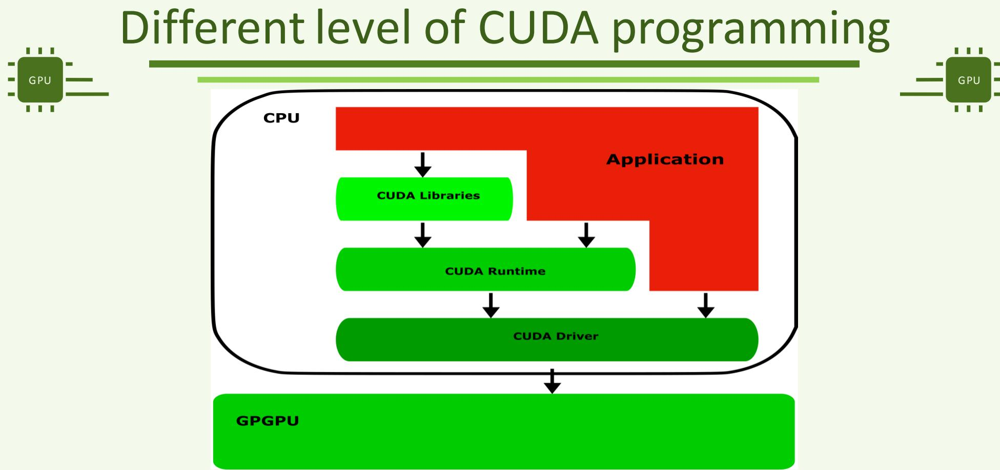
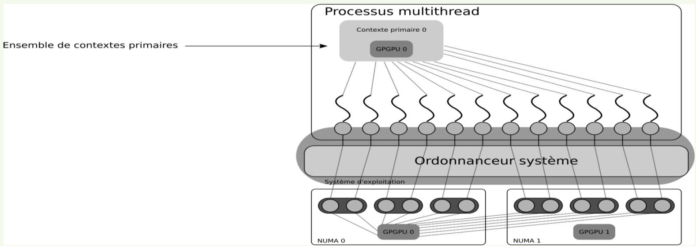
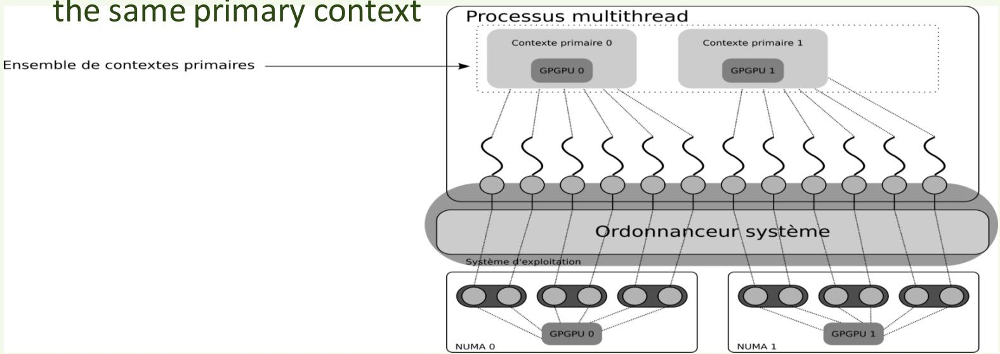
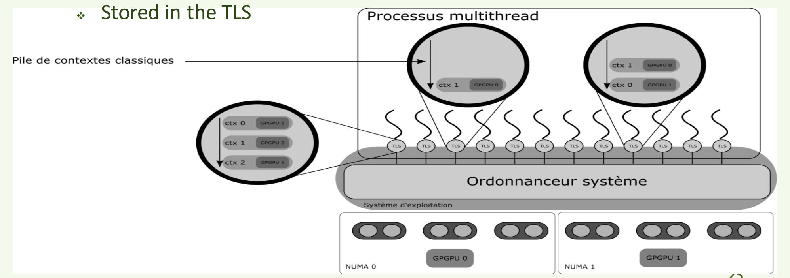
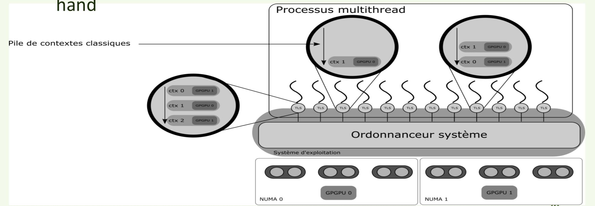
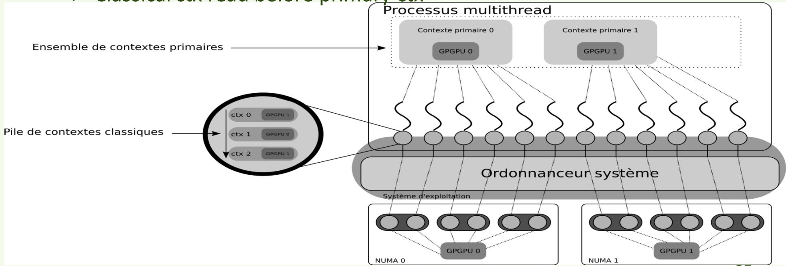
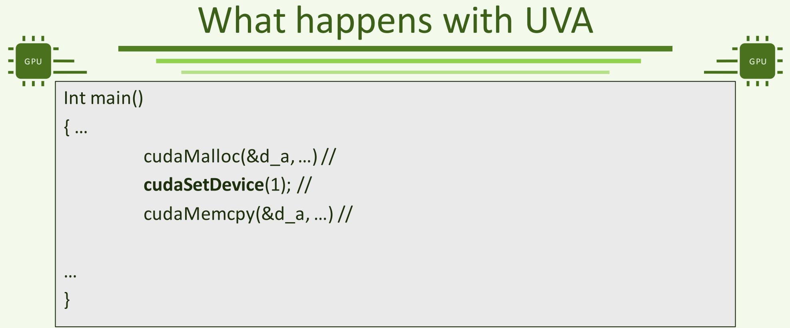

# 第 3 讲上篇：CUDA API、上下文与地址空间

*第 3 讲：CUDA API 与多 GPU 编程*

*Lecture 3 : CUDA APIs - Multi-GPUs programming*

**教师：** Julien Jaeger · julien.jaeger@cea.fr

> [下篇：多 GPU 分工、MPI 与 NCCL](APM_Cours3_zh_part2.md) · [原课件](APM_Cours3.pdf) · [原文提取稿](APM_Cours3.md)

## 第 3 讲提纲（Lecture 3 outline）

> - CUDA several APIs
> - What is a CUDA context ?
> - Multi-GPUs programming

- CUDA 的不同 API
- 什么是 CUDA 上下文？
- 多 GPU 编程

## CUDA 的不同 API

**本讲接着前两讲解决什么问题？** 前面用一块 GPU 做向量加法；现在假设同一个程序还调用了一个 GPU 数学库，并且机器有两块 GPU。每次分配和启动到底属于哪块卡？库和应用是否共用资源？在别的 CPU 线程里调用 CUDA，会不会沿用同一个选择？API、上下文和设备编号就是回答这些问题的三个概念。

**Point de départ :** après l’addition sur un GPU, imaginons une application qui utilise aussi une bibliothèque GPU sur une machine à deux cartes. À quel GPU appartiennent les allocations et les lancements ? Quels états sont partagés avec la bibliothèque ? Que voit un autre thread CPU ? API, contexte et numéro de device permettent de répondre à ces questions.



*图：应用、CUDA 库、运行时与驱动的调用层次。*

- CUDA 的不同 API
- 运行时 API（Runtime API）
- 驱动 API（Driver API）
- 什么是 CUDA 上下文？
- 多 GPU 编程

### 运行时 API（1）（Runtime API(1)）

> - It is the API used by the end-user
> - All examples in the slides and in the hands-ons so far are done with the Runtime API
> - Prefix used in function names: « cuda »
> - This API provides the basic functions for CUDA programming

- 面向最终用户的 API
- 到目前为止，课件和上机实验中的所有示例都使用运行时 API
- 函数名使用 `cuda` 前缀
- 提供 CUDA 编程的基本函数
- cudaMalloc, cudaFree, cudaMemcpy, …

### 运行时 API（2）（Runtime API (2)）

> - High-level API
> - Abstraction level is high
> - Most CUDA internals are hidden from the end-user and cannot be tampered with
> - Runtime API
> - X Driver API

- 高层 API
- 抽象层次较高
- 大多数 CUDA 内部细节对最终用户隐藏，无法直接干预

**“抽象层次高”是什么意思？** 调用 `cudaMalloc` 时，程序员主要提供大小和接收地址的变量，运行时替你处理一部分设备执行环境的建立与使用。Driver API 把上下文、代码模块、函数句柄等控制显式交给调用者；使用它不意味着同一个加法 kernel 天然更快，而是多了管理职责和控制能力。

Un niveau d’abstraction élevé masque une partie de la gestion de l’environnement d’exécution. L’API Driver expose davantage le contexte, les modules et les handles de fonctions. Elle donne plus de contrôle, sans rendre automatiquement un même calcul plus rapide.

### 驱动 API（1）（Driver API(1)）

> - Low-level API
> - It is the API used by experts and library developpers
> - Requires a higher level of expertise and knowledge to be used
> - Allows isolating CUDA development in a library from other CUDA development done in other parts of the program
> - Especially from end-user developments

- 底层 API
- 面向专家和库开发者
- 使用时需要更深入的专业知识
- 可以将库内部的 CUDA 开发与程序其他部分的 CUDA 开发隔离
- 尤其是与最终用户编写的代码隔离

### 驱动 API（2）（Driver API (2)）

> - Prefix used in function names: « cu »
> - This API provides similar functionnalities than the Runtime API
> - With additional details
> - cudaMalloc  cuMemAlloc
> - cudaMemcpy  cuMemcpyDtoH cuMemcpyHtoD cuMemcpyHtoH cuMemcpyDtoD

- 函数名使用 `cu` 前缀
- 提供与运行时 API 类似的功能
- 但需要处理更多细节
- `cudaMalloc` → `cuMemAlloc`
- `cudaMemcpy` → `cuMemcpyDtoH`、`cuMemcpyHtoD`、`cuMemcpyHtoH`、`cuMemcpyDtoD`〔名称按课件保留〕

**按同一项工作比较两种接口 / Comparer une même opération :**

| 工作 | Runtime API | Driver API | 需要理解的区别 |
|---|---|---|---|
| 选择执行环境 | 常用 `cudaSetDevice` | 显式管理 `CUcontext` 及其关联设备 | 设备编号与上下文句柄不是同一类对象 |
| 分配设备数组 | `cudaMalloc` | `cuMemAlloc` | 后者使用 `CUdeviceptr` 表示设备地址，不能只改函数前缀而不改类型 |
| 上传／下载 | `cudaMemcpy` 加方向参数 | `cuMemcpyHtoD`、`cuMemcpyDtoH` 等 | H 是 host，D 是 device，方向写进了函数名 |
| 启动计算 | 本课使用 `kernel<<<...>>>(...)` | 常用 `cuLaunchKernel` | Driver 路径先取得代码模块和函数句柄 |

**模块（module）**是载入设备执行环境的一组已编译设备代码；**函数句柄（function handle）**标识其中要启动的 kernel。句柄可以理解成运行时管理某个对象的引用，不是该对象的数据副本。Runtime 和 Driver 是 CUDA 的两个接口层，并不表示有两块不同 GPU。

Un module contient du code device chargé ; un handle de fonction identifie le kernel à lancer dans ce module. Un handle référence un objet géré sans copier cet objet. Les deux API exposent deux niveaux de gestion du même environnement CUDA. Les types et contrats doivent être adaptés, pas seulement les noms de fonctions.

课件列出的 `cuMemcpyHtoH` 不应当作常规 Driver API 使用；纯主机内存复制可用 C/C++ 的 `memcpy` 等操作。以上接口的参数和类型以 [CUDA Driver 内存接口](https://docs.nvidia.com/cuda/archive/13.0.0/cuda-driver-api/group__CUDA__MEM.html)为准。后文保留历史课件用语，遇到版本差异会在对应段落说明。

La mention `cuMemcpyHtoH` de la diapositive ne constitue pas une API Driver usuelle à employer ; une copie entre mémoires hôtes peut utiliser `memcpy`. Les signatures et types doivent suivre la documentation de la version utilisée.

## CUDA 上下文（CUDA CONTEXTS）

**先分清本讲的“线程”。** 这里说“某个线程选择 GPU、压入上下文”时，通常指调用 CUDA API 的 **CPU 主机线程**。它和 kernel 中的 GPU thread 不同。**进程（process）**是操作系统管理的一次程序运行；同一进程内可以有多个 CPU 线程，通常共享主机地址空间。MPI 通常创建多个进程，OpenMP 常在一个进程内创建多个线程。

Dans la gestion des contextes, le mot thread désigne généralement le **thread CPU appelant**, pas un thread du kernel. Un processus est une instance de programme gérée par le système ; plusieurs threads d’un processus partagent habituellement sa mémoire hôte. MPI emploie généralement plusieurs processus, OpenMP plusieurs threads dans un processus.

**上下文（context）**是 CUDA 管理一套设备执行状态和资源的环境，与一个设备关联。它包含或关联设备分配、代码模块、stream、event 等对象。**当前上下文（current context）**则是某个 CPU 线程此刻选择使用的环境：上下文对象可以一直存在，线程也可以切换当前选择。切换环境不会自动把原来的数组搬到另一块 GPU。

Un contexte regroupe un état d’exécution CUDA et des ressources associés à un device : allocations, modules, streams, événements. Le contexte courant est celui qu’un thread CPU choisit actuellement. L’objet peut continuer d’exister après un changement de ce choix ; changer de contexte ne migre pas automatiquement les tableaux.

### 上下文（1）（Lecture 3 outline）

> - Les différentes APIs pour CUDA
> - Contexte Primaire
> - Contexte « classique »
>
> **Contexts (1)**
> - CUDA internal structure attached to a GPU
> - Each time a operation requiring a GPU is realised, the CUDA runtime « look up » in this structure which one is the concerned GPU
> - Created when a user asked to be « attached » to a GPU
> - If a context doesn’t aready exist

- 与某个 GPU 关联的 CUDA 内部结构
- 每次执行需要 GPU 的操作时，CUDA 运行时都会查阅该结构，确定操作涉及哪个 GPU
- 当用户请求关联某个 GPU 时创建
- 前提是对应上下文尚不存在

### 上下文（2）（Contexts (2)）

> - Encapsulates all objects related to having a functionnal CUDA program, such as:
> - All memory allocation with its own address space.
> - Thus, only compute agents (e.g., threads) sharing the same context can share the same GPU address space
> - CUDA streams
> - CUDA events

- 封装 CUDA 程序运行所需的相关对象，例如：
- 独立地址空间中的所有内存分配
- 因此，只有共享同一上下文的计算实体，例如线程，才能共享同一 GPU 地址空间
- CUDA 流
- CUDA 事件

**地址空间为什么属于上下文？** 指针数值需要结合有效的映射和访问权限，才能表示可用内存。课件的“只有共享上下文才能共享地址空间”强调默认隔离，不能理解成不同上下文或进程永远不能交换数据：peer access、IPC 等显式机制另有规则。仅把指针整数抄给另一个执行环境，不等于建立这些访问条件。

Une valeur de pointeur ne suffit pas : il faut une correspondance et des droits d’accès valides. L’isolation décrite par la diapositive est le cas de base ; des mécanismes explicites tels que peer access ou IPC ont leurs propres règles. Copier un nombre représentant une adresse ne crée pas ces droits.

### 上下文（3）（Contexts (3)）

> - Two types of contexts
> - Primary and « classical »
> - Depending on which level API is used
> - Primary: by default through the Runtime API
> - « classical »: historic one, through the Driver API

- 两类上下文
- 主上下文与传统上下文
- 与使用的 API 层次有关
- 主上下文：运行时 API 默认使用
- 传统上下文：历史上最早的形式，通过驱动 API 管理

### 主上下文（1）（CUDA several APIs）

> - Primary context
> - « classical » context
> **Primary Contexte (1)**
> - Most recent context in CUDA hisory
> - Available since CUDA 4.0
> - Context shared between all the threads targeting the same GPU
> - Data written by a specific thread in GPU global memory can be read by any other threads associated to the same GPU
> - A new primary context is created each time the a thread is associated to a never-targeted-before GPU
> - E.g., if any context associated to this GPU is already present in the « stack » of created context

- CUDA 历史上较晚引入的上下文类型
- 从 CUDA 4.0 开始提供
- 面向同一 GPU 的线程共享该上下文〔本段语境为同一进程内〕
- 某个线程写入 GPU 全局内存的数据，可以被关联到同一 GPU、共享该上下文的其他线程读取
- 当线程首次关联到一个此前尚未使用的 GPU 时，创建新的主上下文
- 原文随后提到：已创建上下文的“栈”中是否已有与该 GPU 关联的上下文〔该句与前句衔接不清，保留其检查意图〕

> 同一进程中，每个 GPU 对应一个主上下文；面向该 GPU 的线程可以共享它。



*图：一个进程中的线程使用同一 GPU 主上下文。*

### 主上下文（3）（Primary Contexte (3)）

> - Several threads in the same OS process can be associated to different GPUs through different primary contexts

- 同一操作系统进程中的多个线程，可以通过不同主上下文关联到不同 GPU

### 主上下文（4）（Primary Contexte (4)）

> - Threads sharing the same primary context also share the same address space on the GPU
> - A buffer allocated by a thread can be used by ano other thread using the same primary context Processus multithread
> - Ensemble de contextes primaires

- 共享同一主上下文的线程，也共享 GPU 上的同一地址空间
- 某个线程分配的缓冲区，可以被使用同一主上下文的其他线程使用。图示：多线程进程
- 主上下文集合

**把共享关系代入两个 CPU 线程：** 在同一进程中，T0、T1 都使用 GPU 0 的主上下文。T0 分配了设备数组 p，T1 在正确取得 p 后也可以向同一数组提交计算；它们没有各自得到一份数组副本。如果 T1 改为选择 GPU 1，p 不会随之迁移为 GPU 1 的本地分配。

| 对象 | 共享到什么范围？ | 不自动提供什么？ |
|---|---|---|
| GPU 0 的主上下文 | 本进程中选择它的 CPU 线程 | 不等于别的进程的 GPU 0 主上下文 |
| 同一上下文中的设备分配 | 持有有效地址、满足访问规则的代码 | 不自动安排不同 stream 的先写后读 |
| 某 CPU 线程的当前选择 | 该 CPU 线程自己的调用状态 | 不自动改掉另一个 CPU 线程的当前选择 |

共享资源还需要明确顺序：先让 T0 的分配结果安全地发布给 T1，再让消费输入的 GPU 工作等输入准备完成。前者涉及 CPU 线程间同步，后者可涉及 CUDA stream/event；“共享同一上下文”本身不完成这些同步。

**Deux threads CPU :** T0 et T1 peuvent utiliser la même allocation dans le contexte primaire du GPU 0, après transmission correcte du pointeur. Le choix du GPU 1 par T1 ne migre pas cette allocation. Le contexte primaire est partagé dans le processus, tandis que le choix courant appartient au thread. Publier le pointeur côté CPU et ordonner les travaux GPU restent deux synchronisations à organiser. Voir [l’interaction Runtime/Driver](https://docs.nvidia.com/cuda/archive/13.0.0/cuda-runtime-api/group__CUDART__DRIVER.html).



*图：同一进程使用两个 GPU 的主上下文。*

### 传统上下文（1）（« Classical » context (1)）

> - First historic context in CUDA API
> - Default context before CUDA 4.0
> - Contexte privé à chaque thread
> - Création d’un nouveau contexte à l’appel de cuCtxCreate(…)
> - Peu importe le contenu des piles de contextes « classiques » ou primaires.
> - Dans les versions récentes de CUDA, seules les contextes primaires sont disponibles

- CUDA API 历史上最早的上下文
- CUDA 4.0 之前的默认上下文
- 每个线程私有的上下文〔按课件表述〕
- 调用 `cuCtxCreate(…)` 时创建新上下文
- 不论传统上下文栈或主上下文集合中已经有哪些内容
- 课件称较新 CUDA 版本只提供主上下文。〔译注：这与本讲后面 Driver API 显式创建上下文的内容矛盾，Driver API 仍提供 `cuCtxCreate`。〕

**“传统上下文”在这里按显式创建的非主上下文理解。** `cuCtxCreate` 仍然可以创建它，不能把整段讲义读成一个已经删除的功能。“每个线程私有”也需要限定：每个 CPU 线程有自己的当前上下文状态，但上下文对象并非永久绑定创建它的线程；程序可以按 API 规则在其他线程中使用它。把“当前选择属于谁”与“资源对象能由谁使用”分开，后面的 push/pop 才容易理解。

Le contexte « classique » désigne ici un contexte non primaire créé explicitement. Cette fonctionnalité existe toujours. L’état courant est propre au thread CPU, mais l’objet contexte n’est pas irrévocablement attaché au thread créateur ; il peut être utilisé depuis d’autres threads selon les règles de l’API. Voir [la gestion des contextes Driver](https://docs.nvidia.com/cuda/archive/13.0.0/cuda-driver-api/group__CUDA__CTX.html).

### 传统上下文（2）（« Classical » context (2)）

> - One stack of « classical » context per thread
> - Stored in the TLS
> - Pile de contextes classiques
>
> - Ordonnanceur système

- 每个线程有一个传统上下文栈
- 保存在 TLS（线程局部存储）中
- 传统上下文栈

**TLS 与栈各自解决什么问题？** TLS 是 thread-local storage，即每个操作系统线程各自保存的一份状态；T0 修改自己的当前上下文，不会把 T1 的当前选择一起改掉。栈采用后进先出：已有 A 时再 push B，顶部 B 成为当前；pop B 后又回到 A。pop 移除的是本线程栈上的那一层关联，不是释放 B 的显存。

Le TLS est un stockage propre à chaque thread du système. Une pile suit l’ordre dernier entré, premier sorti : empiler B au-dessus de A rend B courant, puis dépiler B retrouve A. Dépiler retire une association dans cette pile, sans libérer les allocations du contexte B.



*图：线程局部存储中的传统上下文栈。*

- 系统调度器
- GPGPU 0
- GPGPU 1
- NUMA 1

### 传统上下文（3）（« Classical » context (3)）

> - Issue with user threads: context stack needs to be handled by hand
> - Processus multithread
>
> - Système d'exploitation

- 用户级线程带来的问题：需要手动管理上下文栈
- 多线程进程
- 传统上下文栈



*图：用户级线程与上下文栈的管理。*

**为什么用户级线程会让问题变复杂？** 用户级任务或协程由程序自己的调度器安排，可能在不同操作系统线程上恢复。例如任务先在 T0 上选了 GPU 0，暂停后改在 T1 上继续；T1 的 TLS 里可能仍选着 GPU 1。任务记得“自己要用 GPU 0”，不代表操作系统线程的 CUDA 状态自动跟着迁移，任务运行时需要明确恢复相应状态。

Une tâche ou coroutine gérée par l’application peut reprendre sur un autre thread système. Si elle passe de T0, associé au GPU 0, à T1, associé au GPU 1, le TLS de T1 n’est pas automatiquement remplacé par celui de T0. Le runtime de tâches doit préserver ou rétablir les associations nécessaires.

图中的 NUMA 表示不同 CPU／内存位置的访问成本不同；这里首先要弄清“哪个 CPU 线程管理哪个上下文”，再讨论 CPU、GPU 和内存距离对性能的影响。操作系统调度器安排 CPU 线程，CUDA 的 warp scheduler 安排 GPU warp，二者不是图中的同一个调度层。

NUMA décrit des coûts d’accès différents selon la position des processeurs et mémoires. L’ordonnanceur système place les threads CPU ; le warp scheduler ordonnance les warps GPU. Ces deux niveaux ne doivent pas être confondus.

- 系统调度器
- 操作系统
- GPGPU 0
- GPGPU 1
- NUMA 0
- NUMA 1

### 传统上下文（4）（« Classical » context (4)）

> - Priority over primary context
> - Classical ctx read before primary ctx

- 优先于主上下文
- 先检查传统上下文，再检查主上下文〔本段沿用课件模型〕
- 传统上下文栈



*图：主上下文与传统上下文栈并存。*

**把“优先”改读成“当前是谁”。** 对本讲讨论的普通 Runtime 调用，如果本 CPU 线程已经有一个有效的非主上下文当前化，许多 Runtime 操作会使用它；并不是每次调用都扫描全部历史上下文，再挑一个优先级最高的 GPU。显式调用 `cudaSetDevice` 又有自己的设备选择语义，不能用这句“传统优先”覆盖所有 API 的行为。

La « priorité » signifie surtout que de nombreux appels Runtime utilisent le contexte Driver déjà courant dans le thread. Ils ne parcourent pas tous les contextes historiques pour choisir un GPU. Un appel explicite à `cudaSetDevice` suit ses propres règles de sélection.

## 多 GPU 编程（MULTI-GPUS PROGRAMMING）

- 第 3 讲提纲

### 在 CUDA 中选择 GPU（CUDA several APIs）

> - Selecting which GPU to use in CUDA
> - UVA
> - MPI+CUDA
> - OpenMP + CUDA
> - NCCL
>
> **GPU selection in CUDA**
> - Two possible ways to select on which GPU the next functions will be executed:
> - Runtime API: cudaSetDevice(…)
> - Driver API: cuCreateCtx(…)

- 可以通过两种方式选择后续函数使用哪个 GPU：
- 运行时 API：`cudaSetDevice(…)`
- 驱动 API：创建时使用 `cuCtxCreate(…)`；选择已有上下文时可用 `cuCtxSetCurrent` 或 push/pop。原课件的 `cuCreateCtx` 是名称颠倒。

### 运行时 API：cudaSetDevice（API Runtime: cudaSetDevice）

> - Set device to be used for GPU executions.

- 原型：`cudaError_t cudaSetDevice(int device);`
- 设置后续 GPU 执行所使用的设备。

### 参数（Parameters）

> - Device on which the active host thread should execute the device code.

- device
- 当前主机线程应在哪个设备上执行设备代码。

**两块卡上的分配分别属于谁？** 以下是调用顺序片段，前提是当前进程可见至少两块 GPU；为突出归属关系，片段省略了错误处理，实际程序须检查每次调用。

Voici un fragment de séquence supposant au moins deux GPU visibles. Les contrôles d’erreur sont omis ici pour montrer l’appartenance des allocations ; ils sont nécessaires dans le programme réel.

```cpp
double *d_a = nullptr;
double *d_b = nullptr;
size_t bytes = 1000 * sizeof(double);

cudaSetDevice(0);
cudaMalloc(reinterpret_cast<void **>(&d_a), bytes);
cudaSetDevice(1);
cudaMalloc(reinterpret_cast<void **>(&d_b), bytes);

// After all work using these allocations has completed:
cudaSetDevice(0);
cudaFree(d_a);
cudaSetDevice(1);
cudaFree(d_b);
```

选到 GPU 1 后，`d_a` 仍指向 GPU 0 上的原分配；`d_b` 才是 GPU 1 上的新分配。这里先按归属切回设备再释放，便于读清资源生命周期。GPU 编号从 0 开始，`cudaSetDevice(1)` 选择的是当前进程可见的第二个设备。

Après le choix du GPU 1, `d_a` reste l’allocation du GPU 0 ; `d_b` est celle du GPU 1. Le retour au device propriétaire rend la libération explicite. L’indice 1 désigne le deuxième device visible dans ce processus, pas nécessairement la deuxième carte physique du serveur.

### cudaSetDevice：细节（1）（cudaSetDevice: details (1)）

> - cudaSetDevice checks if a context is already associated with the required GPU
> - If a « classical » context stack exists
> - If yes, checks if a context attached to the required GPU exists
> - If yes, select it by putting it at the top of the stack
> - If not, creates a new classical context attached to the device
> - If not, checks if a primary context attached to the required GPU exists
> - If yes, the context is chosen
> - If not, creates an appropriate primary context
>
> **cudaSetDevice checks if a context is already associated with the required GPU**

**这一页的栈搜索流程不能直接当作 CUDA 13 的实现规则。** 按 CUDA 13.0 的接口约定，`cudaSetDevice(device)` 初始化指定设备的主上下文，并把它设为调用 CPU 线程的当前上下文。可按下面的顺序理解：确认设备编号有效 → 使目标设备的主上下文可用 → 后续相关调用使用这个选择。它不负责迁移旧分配，也不意味着其他 CPU 线程同时切换。

Le parcours de pile de cette diapositive ne décrit pas directement le contrat CUDA 13.0. `cudaSetDevice` initialise le contexte primaire du device demandé et le rend courant dans le thread appelant. Ce choix ne migre pas les allocations existantes et ne modifie pas automatiquement les autres threads. Voir [l’interopérabilité Runtime/Driver de CUDA 13.0](https://docs.nvidia.com/cuda/archive/13.0.0/cuda-runtime-api/group__CUDART__DRIVER.html).

### cudaSetDevice：细节（2）（cudaSetDevice: details (2)）

> - Priority over primary contexts
> - « Classical » contexts are checked and chosen before primary context

- 这两句属于课件原有的优先级描述；编程时应区分“Runtime 操作使用当前上下文”和“显式调用 `cudaSetDevice` 选择目标设备”，按上一段的版本化接口语义处理。

Il faut distinguer l’utilisation du contexte courant par une opération Runtime et la sélection explicite effectuée par `cudaSetDevice` ; la phrase de priorité ne remplace pas ce contrat.

### cudaSetDevice：细节（3）（cudaSetDevice: details (3)）

> - What if the required device doesn’t exist ?
> - E.g., a user give 3 to the cudaSetDevice function with only two devices present on the node ?
> - No error nor segfault
> - The following CUDA functions will be executed on the default device (device 0)

- 如果请求的设备不存在，会怎样？
- 例如，节点只有两个设备，却向 `cudaSetDevice` 传入 3？
- 课件称不会报错，也不会发生段错误
- 课件称后续 CUDA 函数会在默认设备，即设备 0 上执行。〔译注：这两条是课件原有说法，不能作为程序错误处理的依据；应检查 API 返回值。〕

**设备不存在会报告错误。** 若只有两个可见设备，合法编号为 0、1；`cudaSetDevice(3)` 会遇到无效设备错误，不能依赖“自动退回 GPU 0”。没有发生 CPU 段错误，只能说明进程未以这种方式崩溃，不说明 CUDA 调用成功。检查返回的 `cudaError_t` 是否为 `cudaSuccess`，失败时停止依赖这个选择的后续操作。参见 [设备管理 API](https://docs.nvidia.com/cuda/archive/13.0.0/cuda-runtime-api/group__CUDART__DEVICE.html)。

Avec deux devices visibles, seuls 0 et 1 sont valides. Un indice invalide produit une erreur ; l’absence de segmentation fault ne signifie pas que l’appel a réussi. Il faut vérifier `cudaError_t` et ne pas supposer un repli automatique sur le GPU 0.

### 运行时 API：cudaGetDeviceCount（Runtime API: cudaGetDeviceCount）

> - Returns the number of compute-capable devices.

- Prototype : `cudaError_t cudaGetDeviceCount(int *count);`

- 返回支持计算的设备数量。

### 参数（Parameters）

> - Returns the number of devices with compute capability greater or equal to 2.0

- `count`
- 课件描述为返回计算能力大于或等于 2.0 的设备数量〔此版本条件按原文保留〕

**先检查设备数量，再取余。** `count` 是输出参数，函数返回值是错误状态。若没有可用设备，`worker % count` 会除以零；版本和驱动条件也可能让设备枚举失败。下面的函数供一个非负编号的 CPU 工作线程调用，返回是否成功选择 GPU：

`count` reçoit le nombre de devices ; le retour de la fonction reste un état d’erreur. Il faut traiter l’absence de GPU avant le modulo. Cette fonction choisit un device pour un worker CPU d’indice non négatif :

```cpp
#include <cuda_runtime.h>
#include <cstdio>

bool selectGpuForWorker(int worker) {
    int count = 0;
    cudaError_t status = cudaGetDeviceCount(&count);
    if (status != cudaSuccess || count == 0 || worker < 0) {
        std::fprintf(stderr, "No usable GPU or invalid worker index.\n");
        return false;
    }
    int device = worker % count;
    status = cudaSetDevice(device);
    if (status != cudaSuccess) {
        std::fprintf(stderr, "%s\n", cudaGetErrorString(status));
        return false;
    }
    return true;
}
```

例如 3 个 GPU、worker = 5，`5 % 3 = 2`，选择设备 2。取余只决定设备归属，不会自动把输入数组分成三份，也不会让两个被分到同一 GPU 的工作线程互不干扰。完整分工见下篇。

Avec trois GPU, le worker 5 choisit le device 2. Le modulo attribue un device ; il ne découpe ni les données ni les ressources de cette carte. La répartition complète est étudiée dans la deuxième partie.

### 驱动 API：cuCtxCreate（API Driver: cuCtxCreate）

**课件中的三参数原型：** `CUresult cuCtxCreate(CUcontext *pctx, unsigned int flags, CUdevice dev);`

**版本差异：** CUDA 13.0 的接口增加了创建参数指针，普通上下文可写 `cuCtxCreate(&ctx, nullptr, 0, dev)`。本文新增的显式创建示例采用这一形式；用旧工具链时，应按对应头文件调整，不能混合两种参数列表。

CUDA 13.0 ajoute un pointeur de paramètres de création. Pour un contexte ordinaire, les exemples ajoutés utilisent `cuCtxCreate(&ctx, nullptr, 0, dev)` ; un ancien toolkit demande sa propre signature.

> - Create a CUDA context.
> - This new context is « pushed » a the top of the stack of the calling thread

- 创建 CUDA 上下文。
- 新上下文被压入调用线程的上下文栈栈顶

### 参数（Parameters）

> - Pctx: Returned context handle of the new context
> - Flags: Context creation flags
> - Dev: Device to create context on

- `pctx`：返回新上下文的句柄
- `flags`：上下文创建标志
- `dev`：要为哪个设备创建上下文

### 驱动 API：cuCtxPopCurrent（API Driver: cuCtxPopCurrent）

> - Pops the current CUDA context from the current CPU thread.

- CUresult cuCtxPopCurrent (CUcontext *pctx)
- 从当前 CPU 线程的上下文栈中弹出当前 CUDA 上下文。

### 参数（Parameters）

> - Returned new context handle

- `pctx`
- 返回**刚被弹出的上下文**句柄；恢复后位于栈顶的上下文需要另用 `cuCtxGetCurrent` 查询。

`cuCtxPopCurrent(&popped)` écrit le contexte retiré dans `popped`, pas le nouveau sommet de pile. Utiliser `cuCtxGetCurrent` pour interroger le contexte devenu courant.

### 驱动 API：cuCtxPushCurrent（API Driver: cuCtxPushCurrent）

> - Pushes a context on the current CPU thread.
> - Parameters
> - Context to push

- CUresult cuCtxPushCurrent (CUcontext ctx)
- 将一个上下文压入当前 CPU 线程的上下文栈。
- 参数
- `ctx`
- 要压栈的上下文

### 用一个例子看清 push、pop 和 current（Suivre la pile pas à pas）

下面使用同一 GPU 上的 A、B 两个显式上下文，仅用于观察栈；实际应用没有隔离需求时通常优先复用主上下文。程序采用 CUDA 13.0 的 `cuCtxCreate` 原型，`checkDriver` 是自定义错误检查函数。

Cet exemple crée A et B sur le même GPU pour observer la pile. Sans besoin d’isolation, une application réutilise généralement le contexte primaire. Le code utilise la signature CUDA 13.0 ; `checkDriver` est une fonction de contrôle définie ici.

```cpp
#include <cuda.h>
#include <cstdio>
#include <cstdlib>

void checkDriver(CUresult status) {
    if (status != CUDA_SUCCESS) {
        const char *message = nullptr;
        cuGetErrorString(status, &message);
        std::fprintf(stderr, "%s\n", message ? message : "CUDA Driver error");
        std::exit(EXIT_FAILURE);
    }
}

int main() {
    checkDriver(cuInit(0));
    CUdevice device;
    checkDriver(cuDeviceGet(&device, 0));
    CUcontext a, b, popped, current;

    checkDriver(cuCtxCreate(&a, nullptr, 0, device));
    checkDriver(cuCtxCreate(&b, nullptr, 0, device));
    checkDriver(cuCtxPopCurrent(&popped));
    checkDriver(cuCtxGetCurrent(&current));
    bool first = popped == b && current == a;

    checkDriver(cuCtxPushCurrent(b));
    checkDriver(cuCtxGetCurrent(&current));
    bool second = current == b;

    checkDriver(cuCtxPopCurrent(&popped));
    checkDriver(cuCtxDestroy(b));
    checkDriver(cuCtxDestroy(a));
    std::printf("Context stack: %s\n", first && second ? "PASS" : "FAIL");
    return first && second ? EXIT_SUCCESS : EXIT_FAILURE;
}
```

| 操作后 | 栈，从底到顶 | 当前上下文 | 关键区别 |
|---|---|---|---|
| 创建 A | A | A | 新建对象并将其设为当前 |
| 创建 B | A → B | B | A 仍存在，但暂时不是当前 |
| pop | A | A | `popped` 得到 B，B 仍存在 |
| push B | A → B | B | 复用 B，不是再创建第三个对象 |
| pop、destroy B | A | A | B 此时真正被销毁 |
| destroy A | 空 | 无 | 本例创建的资源全部结束 |

`cuInit(0)` 初始化 Driver API；`cuDeviceGet` 把设备序号转换为 `CUdevice` 句柄。`cuCtxGetCurrent` 只查询，不改变栈。特别注意：第一次 pop 后，返回的是 B，而当前变成 A；将这两个值混淆，就会把后续工作放到错误环境中。

`cuInit` initialise l’API Driver et `cuDeviceGet` fournit le handle du device. La lecture du contexte courant ne modifie pas la pile. Après le premier pop, la valeur retournée est B, tandis que le courant est A. Le push réutilise B ; seul destroy termine sa durée de vie.

将这一完整代码块保存为 `context_stack.cpp` 后，可用普通 C++ 编译器配合 CUDA 头文件和 Driver 库编译；它没有 kernel，不要求用 NVCC。示例命令：

Ce programme ne contient aucun kernel ; un compilateur C++ avec les en-têtes CUDA et la bibliothèque Driver suffit :

```bash
g++ -std=c++17 context_stack.cpp -I/usr/local/cuda/include -lcuda -o context_stack
./context_stack
```

### cuCtxCreate：细节（cuCtxCreate: details）

> - cuCtxCreate creates a new context for the required GPU
> - with no regards to the current content of the context stack
> - Thus, it is possible to have several “classical” contexts attached to the same GPU in the stack
> - A call to cudaSetDevice will select the first encountered context attached to the required GPU

- `cuCtxCreate` 为目标 GPU 创建一个新上下文
- 不考虑当前上下文栈中已有的内容
- 因此，栈中可能有多个与同一 GPU 关联的传统上下文
- 课件称调用 `cudaSetDevice` 会选择首先遇到的、与目标 GPU 关联的上下文

最后一句仍属于前面已校正的历史模型。需要选择已有显式上下文 B 时，程序应保存 B 的句柄并使用相应的 current/push 接口；不要指望 `cudaSetDevice` 替你在多个同设备上下文中找出 B。同一设备上的多个上下文通常还会增加状态管理和资源开销，创建数量不是并行度指标。

La dernière phrase reprend le modèle historique déjà corrigé. Pour retrouver un contexte explicite B, conserver son handle et utiliser les opérations current/push appropriées. Multiplier les contextes d’un même device ajoute de la gestion et des coûts ; ce nombre ne mesure pas le parallélisme utile.

### 驱动 API：其他函数（Driver API: Other fonctions）

> - Returns the CUDA context bound to the calling CPU thread.
> - This context isn’t « popped » and remain at the top of the stack

- CUresult cuCtxGetCurrent (CUcontext *pctx)
- 返回绑定到调用 CPU 线程的 CUDA 上下文。
- 不会弹出该上下文；它仍位于栈顶

### 驱动 API：其他函数（Driver API: Other fonctions）

> - Returns the device ID for the current context.
>
> - Binds the specified CUDA context to the calling CPU thread.
> - In fact, realize a sort of « swap » context : pop the head of the stack, then push ctx at the head)
>
> - « Classical » context fine-grain management (1)
>
> - How to avoid creating several « classical » contexts attached to the same GPU :
> - Check “by hand” the classical context stack
> - Before creating a new context, “pop” all context from the stack to check them
> - At each step, a call to cuCtxGetDevice() will return the device ID of the current context at the head

- CUresult cuCtxGetCurrent (CUcontext *pctx)
- 返回绑定到调用 CPU 线程的 CUDA 上下文。
- CUresult cuCtxGetDevice (CUdevice *device)
- 返回当前上下文对应的设备 ID。
- CUresult cuCtxSetCurrent (CUcontext ctx)
- 将指定 CUDA 上下文绑定到调用 CPU 线程。
- 可以理解为一种上下文替换：弹出栈顶，再将 `ctx` 放到栈顶〔课件中的类比〕

- 传统上下文的细粒度管理（1）

- 如何避免为同一 GPU 创建多个传统上下文：
- 手动检查传统上下文栈
- 创建新上下文前，依次弹出栈内上下文进行检查
- 每一步调用 `cuCtxGetDevice()`，获取当前栈顶上下文对应的设备 ID

### 传统上下文的细粒度管理（2）（« Classical » context fine-grain management (2)）

> - If it is the asked GPU, “pop” it, then “push” back all the other poped context, then pop the required one at the head
> - If you don’t find the asked GPU, then call cuCtxCreate
> - Or let the Runtime API handle it through cudaSetDevice
> - Create a first “classical context” for your thread
> - Then, each subsequent call to cudaSetDevice will check the « classical » context stack a corresponding context, or will create a new « classical context » fitting the requirement

- 如果找到目标 GPU 对应的上下文，先将其弹出，再依次压回其他已弹出的上下文，最后把目标上下文放到栈顶〔原文最后一步写作 pop，按此段操作意图译为放回栈顶〕
- 如果没有找到目标 GPU，则调用 `cuCtxCreate`
- 也可以通过 `cudaSetDevice` 交给运行时 API 处理〔沿用课件说法〕
- 先为线程创建一个传统上下文
- 课件称此后每次调用 `cudaSetDevice`，都会在传统上下文栈中查找匹配项，或者创建符合要求的新传统上下文

**比逐个拆栈更清楚的管理方式：** 若应用确实需要多个显式上下文，创建时记录“设备 → 上下文句柄 → 由谁释放”的表；临时调用某个库时，可成对使用 push/pop，使调用前的环境得到恢复。若直接使用 `cuCtxSetCurrent` 替换当前值，就先保存旧值，结束后显式恢复，不能把它当成自动保留旧顶层的 push。

| 操作 | 资源对象发生什么？ | 当前选择发生什么？ |
|---|---|---|
| `cuCtxCreate` | 创建非主上下文 | 新对象成为当前 |
| `cuCtxPushCurrent` / `cuCtxPopCurrent` | 对象继续存在 | 临时覆盖／恢复栈上的选择 |
| `cuCtxGetCurrent` / `cuCtxGetDevice` | 不创建、不销毁 | 只查询当前上下文／其设备 |
| `cuCtxSetCurrent` | 使用已有对象 | 替换当前关联；需要时自行保存恢复旧值 |
| `cuCtxDestroy` | 销毁显式创建的上下文及其相关资源 | 不能再继续使用已失效的对象 |

Pour des contextes explicites, conserver une table device–contexte–propriétaire évite de démonter la pile pour retrouver un objet. Un couple push/pop restaure l’environnement précédent. Avec `cuCtxSetCurrent`, sauvegarder puis restaurer explicitement l’ancien courant si nécessaire. Création, sélection, interrogation et destruction sont des opérations distinctes.

主上下文则使用另一组生命周期接口，例如 Driver 侧的 `cuDevicePrimaryCtxRetain` / `cuDevicePrimaryCtxRelease`。retain 取得使用引用，不会自动 push；release 要与自己取得的引用配对。`cudaDeviceReset` 会影响本进程该设备主上下文中的其他使用者，不应作为一个库“只清理自己数组”的替代品。参见 [主上下文管理](https://docs.nvidia.com/cuda/archive/13.0.0/cuda-driver-api/group__CUDA__PRIMARY__CTX.html)。

Le contexte primaire a ses propres opérations retain/release. Retain n’effectue pas de push ; les références acquises doivent être libérées correctement. Réinitialiser le primaire peut affecter d’autres utilisateurs du même processus : ce n’est pas un moyen de libérer uniquement les tableaux appartenant à une bibliothèque.
- 第 3 讲提纲
- 什么是 CUDA 上下文？
- 多 GPU 编程
- 在 CUDA 中选择要使用的 GPU
- UVA
- MPI+CUDA
- OpenMP + CUDA
- NCCL

### 同一地址值为什么还要看所属环境？（Interpréter une adresse）

原课件用多页重复代码提出这个问题：在 GPU 0 分配数组后切换到 GPU 1，原指针还能怎样使用？这里把讨论合并，避免把省略参数的 `cudaMemcpy(&d_a, ...)` 当成可编译代码。

Les pages répétées posent une seule question : que devient une allocation du GPU 0 après sélection du GPU 1 ? Nous regroupons l’explication ; les appels incomplets de l’extraction ne sont pas du code à recopier.

**先区分地址值与数据。** `d_a` 保存数组起始地址，`&d_a` 是主机上这个指针变量自己的地址。分配 API 用 `&d_a` 写回新地址；复制数组元素时，源或目标参数通常使用 `d_a`。这两种写法不能机械替换。

`d_a` contient l’adresse des éléments ; `&d_a` désigne la variable pointeur sur l’hôte. L’allocation écrit l’adresse obtenue via `&d_a`, tandis que la copie des éléments utilise `d_a` comme adresse source ou destination.

在独立地址空间的模型中，假设 GPU 0 和 GPU 1 都出现数值 `0x1000`，这两个数值可能表示不同位置，就像不同城市都有“1 号楼”。必须知道地址属于哪个环境。这个例子只说明命名问题，不代表某次真实分配会返回该数值。

Dans des espaces distincts, une même valeur fictive comme `0x1000` peut désigner des emplacements différents. Le contexte d’interprétation est alors nécessaire, comme pour des numéros de rue dans des villes différentes. Ce n’est pas une prédiction des adresses réellement allouées.

### UVA：统一虚拟寻址（UVA: Unified Virtual Addressing）

> - UVA arrived withCUDA 4.0
> - UVA is a unified virtual addressing
> - Memories of the host and the different GPUs are independent et have different address spaces
> - UVA present all these memories in the same address space
> - Each with its own address boundaries
> - Thus, host or devices can correctly understand memory addresses coming from other devices
> - It can kno from which device this address come from

- UVA 随 CUDA 4.0 引入
- UVA 即统一虚拟寻址
- 主机与不同 GPU 的内存彼此独立，原本具有不同地址空间
- UVA 将这些内存呈现在同一个虚拟地址空间中
- 每一部分占据各自的地址范围
- 因此，主机或设备能够正确识别来自其他设备的内存地址
- 可以判断某个地址属于哪个设备

**UVA 统一的是地址识别方式。** 在支持该机制的同一进程中，主机和设备分配可纳入统一的虚拟地址管理，让 CUDA 根据指针判断其内存属性。这不把两块 GPU 的物理显存合成一块同速内存，也不保证 GPU 1 可以直接解引用 GPU 0 的每个指针。

| 概念 | 解决的问题 | 不能仅凭它推断的事情 |
|---|---|---|
| UVA | 怎样识别一个地址属于哪类分配／哪个设备 | 任意处理器都可直接读写该地址 |
| Unified Memory | 对受管理分配协调可访问性和数据位置 | 数据一直在同一位置，或访问代价处处相同 |
| Peer access（对等访问） | 在支持的设备对之间建立直接访问条件 | 所有 GPU 对、所有拓扑都支持同样能力 |
| 数据复制 | 把数据内容搬到目标位置 | 仅仅切换当前设备就已经完成了复制 |

**Trois mécanismes distincts :** l’UVA aide à identifier les allocations dans un espace virtuel commun au processus ; Unified Memory gère des allocations avec leurs règles d’accès et de placement ; peer access autorise certains accès entre devices compatibles. Aucun de ces noms ne signifie que toutes les mémoires physiques ont fusionné ni qu’un changement de device copie les données. Voir [l’adressage unifié CUDA](https://docs.nvidia.com/cuda/archive/13.0.0/cuda-driver-api/group__CUDA__UNIFIED.html).



*图：UVA 示例：切换设备后仍使用原设备地址。*

### UVA 下怎样复制？（Copier avec UVA）

> - It is possible to copy data to, or from, a GPU different than the one we are currently attached to
> - No need to specify the direction of the copy anymore

这两句话需要放在支持 UVA 的条件下理解。`cudaMemcpyDefault` 让运行时根据源、目标指针推断传输方向；**源地址、目标地址和字节数仍由程序指定**。它也不负责决定“这个算法应把哪一半数据交给 GPU 1”。

Avec UVA, `cudaMemcpyDefault` déduit le sens du transfert à partir des deux pointeurs. Le programme fournit toujours la source, la destination et le nombre d’octets ; il reste également responsable de la répartition des données entre GPU.

下面是一个**需要两块可见 GPU、支持 UVA 的操作片段**。为突出指针与当前设备的关系，省略返回值检查；实际程序必须检查每个 CUDA 调用是否成功。

```cpp
double h_input[4] = {1.0, 2.0, 3.0, 4.0};
double h_output[4] = {};
double *d_a = nullptr;
size_t bytes = sizeof(h_input);

cudaSetDevice(0);
cudaMalloc(reinterpret_cast<void **>(&d_a), bytes);

cudaSetDevice(1);
cudaMemcpy(d_a, h_input, bytes, cudaMemcpyDefault);
cudaMemcpy(h_output, d_a, bytes, cudaMemcpyDefault);

cudaSetDevice(0);
cudaFree(d_a);
```

逐步看这段代码：

1. `cudaMalloc` 时当前设备为 GPU 0，因此数组位于 GPU 0。
2. `cudaSetDevice(1)` 改变后续调用的当前设备，`d_a` 的地址值和分配归属没有改变。
3. 第一次复制识别出“主机 → GPU 0”；第二次识别出“GPU 0 → 主机”。目标位置由指针表示，并不会因当前选择 GPU 1 就改写为 GPU 1 的数组。
4. 这里使用的是同步 `cudaMemcpy`；复制回主机后，预期 `h_output` 为 `{1, 2, 3, 4}`。清理时切回分配所属设备，使资源关系一目了然。

L’allocation appartient au GPU 0. Sélectionner le GPU 1 ne la déplace pas : les deux copies visent encore l’adresse du GPU 0, d’abord depuis l’hôte puis vers l’hôte. La copie synchrone vers l’hôte permet ensuite de lire `{1, 2, 3, 4}`. Nous revenons au device propriétaire pour libérer son allocation.

**能识别一个地址，与 kernel 能直接访问它，是两件事。** 如果在 GPU 1 上启动 kernel 并传入 GPU 0 的 `d_a`，还要满足设备之间的访问条件。对于本讲普通 `cudaMalloc` 的跨 GPU 直接访问，通常先用 `cudaDeviceCanAccessPeer` 查询设备对的能力，再在访问方当前设备上启用所需方向的 peer access。0 → 1 与 1 → 0 是两个方向。即便可访问，PCIe/NVLink 等连接也会影响代价；不能把远端显存当成等速的本地显存。

Identifier l’adresse ne suffit pas à autoriser son déréférencement par un kernel d’un autre GPU. Pour les allocations ordinaires de ce cours, vérifier la capacité de peer access puis activer la direction nécessaire côté accédant. L’autorisation et le coût dépendent des devices et de leur interconnexion. Voir [UVA et accès entre devices](https://docs.nvidia.com/cuda/archive/13.0.0/cuda-driver-api/group__CUDA__UNIFIED.html).

### 读完上篇，应能区分什么？（Repères pour la suite）

| 问题 | 应检查的对象 |
|---|---|
| 这次 CPU 调用面向哪个 GPU？ | 调用线程的当前设备／上下文 |
| 这个数组存在哪里？ | 创建分配时的设备与分配类型 |
| 地址能否被识别、能否被访问？ | 地址属性与访问权限，二者分别检查 |
| 数据是否已经准备好？ | 产生数据的操作及其同步／完成条件 |
| 谁负责释放资源？ | 创建方与约定的生命周期 |

Avant d’organiser plusieurs GPU, distinguer le device courant du thread CPU, la propriété des allocations, leur accessibilité, l’achèvement des opérations et la responsabilité de libération. La partie suivante applique ces distinctions aux processus MPI et aux threads OpenMP.

→ [继续下篇：多 GPU 分工、MPI 与 NCCL](APM_Cours3_zh_part2.md)
