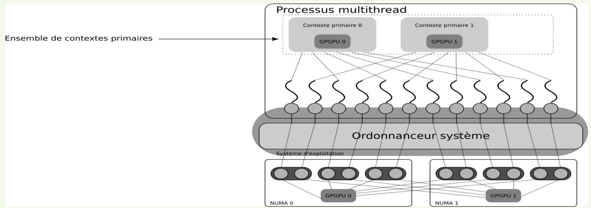
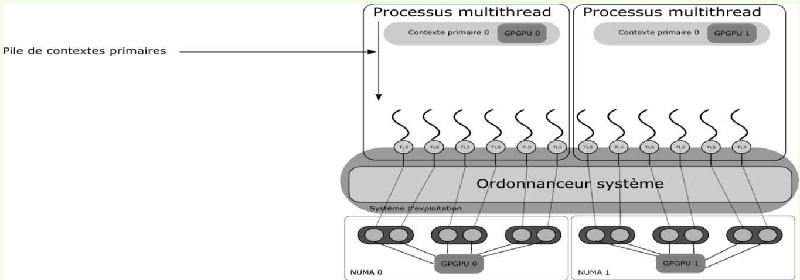
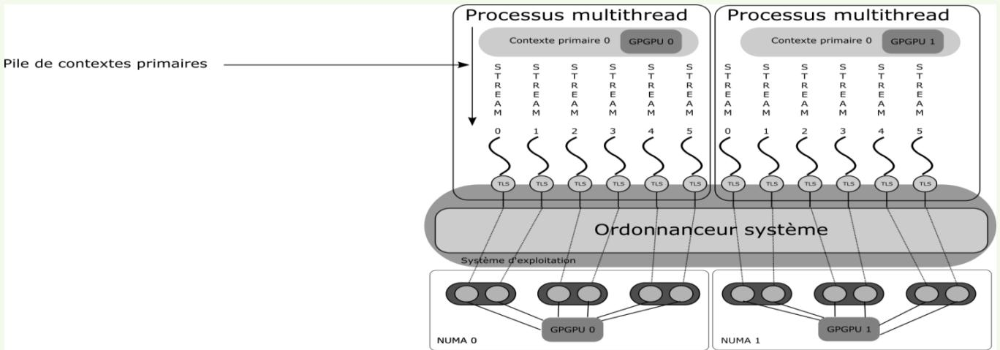

# 第 3 讲下篇：多 GPU 分工、MPI 与 NCCL

> [上篇：CUDA API、上下文与地址空间](APM_Cours3_zh_part1.md) · [原课件](APM_Cours3.pdf) · [原文提取稿](APM_Cours3.md)

本篇先讨论怎样把 CPU 线程或 MPI 进程分配给 GPU，再学习 GPU 之间如何用 NCCL 协作。设备选择、数据拆分和通信是三个需要分别安排的步骤。

Cette partie traite de l’affectation des threads et processus aux GPU, puis de leur coopération avec NCCL. Choisir un device, répartir les données et organiser les communications sont trois étapes distinctes.

## 1. 先分清进程编号与 GPU 编号（Rangs et devices）

一个 MPI 程序通常启动多个**进程**，每个进程有自己的主机地址空间。`rank` 是进程在某个 communicator 中的编号；communicator 规定了“哪些进程一起通信，以及它们怎样编号”。`MPI_COMM_WORLD` 包括本次 MPI 作业的全部进程。同一进程在不同 communicator 中可以有不同 rank。

Un programme MPI comporte généralement plusieurs processus, avec des espaces mémoire hôtes distincts. Un communicateur définit un groupe de participants et leur numérotation. Le rang dépend donc du communicateur : un processus peut avoir un rang global et un autre rang dans un sous-groupe.

### 从课件的四种写法看设备选择

下表合并原课件 MPI+CUDA（1）—（4）的逐步代码。先假定在**同一节点**上运行，所有进程看到同一组 GPU，而且可见设备的顺序相同。

| 写法 | 4 个进程、2 块 GPU 时发生什么？ | 需要补上的条件 |
|---|---|---|
| 不调用 `cudaSetDevice` | 一般都先使用默认设备 0 | 不会自动按进程数分配 GPU |
| 每个进程都 `cudaSetDevice(1)` | 四个进程都选择 GPU 1 | “每进程调用一次”不等于“选择不同设备” |
| `cudaSetDevice(rank)` | rank 0、1 有效；rank 2、3 越界 | rank 必须在本进程可见设备编号范围内 |
| `cudaSetDevice(rank % count)` | 0、2 → GPU 0；1、3 → GPU 1 | `count > 0`；这是轮转分配，可能让进程共享 GPU |

Le tableau suppose une même liste de devices visible par tous les processus du nœud. Sans sélection explicite, ils peuvent viser le même device par défaut. Utiliser le rang directement exige qu’il soit valide ; le modulo répartit les processus cycliquement mais autorise plusieurs processus par GPU.

**多节点时，再区分三种编号。** 假设两个节点各有两块 GPU、各运行两个进程：

| 节点 | 全局 MPI rank | 节点内 rank | 选用的本地 CUDA device |
|---|---:|---:|---:|
| A | 0 | 0 | 0 |
| A | 1 | 1 | 1 |
| B | 2 | 0 | 0 |
| B | 3 | 1 | 1 |

B 节点上的进程不能因为全局 rank 是 3 就选择 `cudaSetDevice(3)`，因为该节点只看得到设备 0、1。`MPI_Comm_split_type(..., MPI_COMM_TYPE_SHARED, ...)` 可以构造共享内存域内的 communicator，通常用于得到节点内 rank；它本身不分配 GPU，也不建立 GPU 共享内存。

Sur deux nœuds à deux GPU, les rangs globaux 2 et 3 utilisent encore les devices locaux 0 et 1 du second nœud. `MPI_COMM_TYPE_SHARED` regroupe les processus capables de partager une région mémoire hôte ; on s’en sert couramment pour calculer un rang local, sans que cet appel attribue des GPU. Voir [MPI_Comm_split_type](https://docs.open-mpi.org/en/main/man-openmpi/man3/MPI_Comm_split_type.3.html).

还要看启动环境如何设置 `CUDA_VISIBLE_DEVICES`：如果调度器给每个进程单独暴露一块不同的 GPU，那么它们各自调用 `cudaSetDevice(0)` 就可能已经对应不同物理 GPU。相反，如果所有进程都只看见**同一块** GPU，选择 0 仍会冲突。设备编号是当前进程可见列表中的序号，不能单凭数字 0 判断是否用了同一块物理设备。

Si le lanceur expose un GPU distinct à chaque processus, le device local 0 peut représenter une carte physique différente dans chacun d’eux. Si tous voient la même carte, ils la partagent. Il faut connaître cette politique de visibilité avant de choisir une formule d’affectation.

### 轮转分配 GPU（1）（Round-Robin GPU affectation (1)）

> - Maximize spreading of MPI processes on all the GPUs available
> - Don’t necessarily optimize GPUs occupation
> - Each MPI may have a different compute load to give to the GPU.
> - MPI processes may not be attached to the closest GPUs
> - Numa effects may have impact

`device = worker % count` 只按数量轮流安排。例如两个 GPU 收到的任务耗时分别为 `{10, 10}` 和 `{1, 1}`，两边都有两个任务，但总工作量是 20 对 2。把任务数量分匀，并不等于负载均衡。

NUMA 表示不同 CPU 与不同内存位置之间的访问成本可能不同。GPU 也连接到特定 PCIe 根节点等硬件路径：进程绑在哪个 CPU、数据在哪一侧主机内存、GPU 靠近哪个 CPU，都会影响传输代价。编号取模不会检查这些拓扑关系，也不保证 GPU 利用率最大。

Le modulo équilibre un nombre de tâches, pas leur durée : deux tâches de 10 unités représentent plus de travail que deux tâches de 1 unité. La proximité du CPU, de la mémoire hôte et du GPU influence aussi les transferts ; une affectation numérique ignore cette topologie NUMA/PCIe.

### 轮转分配 GPU（2）：同一 GPU 不等于共享数组

> - MPI processes attached to the same GPU don’t share the same address space
> - CUDA context are opaque objects
> - Thread-based MPI: just need to use primary contexts

“Opaque object”即**不透明对象**：应用保存 API 给出的句柄，却不能靠复制内部字节来克隆一个可用对象。把某个进程中的 `CUcontext` 或裸设备指针值广播出去，不会在另一个进程中自动得到同一资源的有效访问权。

这也不等于“进程间 GPU 数据完全不能共享”。可以通过显式的 CUDA IPC 等机制共享支持的分配，或使用 MPI/NCCL 传输数据；这些机制都有自己的创建、导出／导入与生命周期约束。课件最后一句只适用于参与者确实是**同一进程中的线程**且使用同设备主上下文的情况。普通 MPI 进程不会因选择同一 GPU 就共用同一个主上下文。

Un handle opaque n’est pas un objet que l’on peut cloner en diffusant ses octets. Des processus visant le même GPU gardent leurs propres ressources ; le partage exige un mécanisme explicite, par exemple CUDA IPC pour des allocations compatibles, ou une communication de données. Des threads du même processus peuvent en revanche utiliser le même contexte primaire du device. Voir [CUDA IPC](https://docs.nvidia.com/cuda/archive/13.0.0/cuda-runtime-api/group__CUDART__DEVICE.html).

### OpenMP + CUDA：每个 CPU 线程自己选择设备

OpenMP 的 parallel 区域创建一组 CPU 线程，它们处于同一个进程中。下面这个完整辅助函数只打印分配关系；`workers` 必须为正。变量声明在 parallel 区域内，因此每个线程有自己的 `worker`、`device` 和 `status`。

```cpp
#include <cuda_runtime.h>
#include <omp.h>
#include <cstdio>

void describeGpuAssignment(int workers) {
    if (workers <= 0) {
        return;
    }
    int count = 0;
    cudaError_t status = cudaGetDeviceCount(&count);
    if (status != cudaSuccess || count == 0) {
        std::fprintf(stderr, "No usable GPU.\n");
        return;
    }

    #pragma omp parallel num_threads(workers)
    {
        int worker = omp_get_thread_num();
        int device = worker % count;
        cudaError_t status = cudaSetDevice(device);
        #pragma omp critical
        {
            std::printf("CPU thread %d -> device %d: %s\n",
                        worker, device, cudaGetErrorString(status));
        }
    }
}
```

`critical` 只让主机上的打印一次由一个线程执行，避免输出混在一起；它不是 GPU 同步。线程数也可能受 OpenMP 运行环境约束。当前设备选择属于调用它的 CPU 线程，所以应在线程实际执行 CUDA 工作的位置选择设备，不能只在进入 parallel 之前由主线程选择一次。

La région OpenMP contient plusieurs threads CPU du même processus. Chaque thread choisit son device ; les variables locales à la région lui appartiennent. La section `critical` sérialise seulement l’affichage sur le CPU. Elle n’attend aucun kernel et ne remplace pas la sélection de device dans chaque thread.

| 两个线程都使用 GPU 0 时 | 资源关系 | 仍需要程序处理的事 |
|---|---|---|
| 都用 `cudaSetDevice(0)`，采用主上下文 | 使用同进程、同设备的主上下文 | 将指针交给另一个线程，并正确安排读写先后 |
| 分别显式创建上下文 A、B | A 与 B 是不同环境 | 在 A 中分配的资源不能因“同一 GPU”就在 B 中任意使用 |
| 同一线程先创建 A，再创建 B | B 成为当前上下文 | 若要继续操作 A 的资源，应恢复 A，不能重复创建来“找回” A |

Deux threads utilisant le primaire du même GPU peuvent partager des allocations, à condition de transmettre les pointeurs et de synchroniser les usages. Deux créations explicites produisent deux contextes distincts. Recréer un contexte ne retrouve pas une allocation ancienne : il faut réutiliser le contexte qui la possède.

### 轮转分配 GPU（3）（Round-Robin GPU affectation (3)）

> - We have the same issues with threads+CUDA than with MPI+CUDA
> - Don’t maximize GPU occupation
> - GPUs associated to thread are not necessarily the closest ones
> - Threads attached to the same GPU doesn’t necessarily share the same address space
> - Depending of which contextsare used

- 线程与 CUDA 的组合，也会遇到与 MPI + CUDA 类似的问题
- 无法保证充分利用 GPU
- 分配给线程的 GPU 不一定是最近的 GPU
- 关联到同一 GPU 的线程也不一定共享地址空间
- 这取决于使用的上下文

### 轮转分配 GPU（4）（Round-Robin GPU affectation (4)）

> - Contexte primaire 0
> - Contexte primaire 1

- 主上下文集合
- 多线程进程
- 主上下文 0
- GPGPU 0
- 主上下文 1
- GPGPU 1



*图：多个线程与 GPU 主上下文的对应关系。*

图中的操作系统调度器决定 CPU 线程在哪些 CPU 核心上运行；它与 GPU 内部挑选 warp 指令的调度器不同。多个 CPU 线程指向同一主上下文，表示它们能操作同一资源环境，不表示这些线程提交的 kernel 已经自动并行执行。

Le scheduler du système place les threads sur les cœurs CPU. Il ne s’agit pas du scheduler de warps du GPU. Partager un primaire rend les ressources communes aux threads concernés ; cela ne prouve pas que leurs kernels s’exécuteront simultanément.

## 2. MPI + OpenMP + CUDA：怎样组织一台多 GPU 节点？

> - 1 MPI process/GPU available
> - All threads in one MPI process can share the same address space on the GPU
> - Possible to alloc+memcpy before the OpenMP parallel region, then each thread launches its kernel on the data

一种清楚的组织方式是：每个 GPU 对应一个 MPI 进程；进程内部用 OpenMP 线程准备数据或提交工作；每个线程在同一设备上使用自己的 stream。这样“跨进程交换数据”和“进程内共享分配”的边界比较明确，但是否性能最好仍要测量。

Une organisation courante associe un processus MPI à chaque GPU, puis plusieurs threads CPU et éventuellement plusieurs streams à ce processus. Les allocations peuvent être partagées à l’intérieur du processus ; les échanges entre processus restent explicites. C’est une structure de départ, pas une garantie de performance optimale.



*图：每个 GPU 对应一个 MPI 进程。*

**共享数组以后，还要分工。** 例如一个进程在 GPU 上分配了 1 000 个元素，两个 CPU 线程可以分别提交处理 `[0, 500)` 和 `[500, 1000)` 的工作。两个区间不重叠，才避免了对同一输出元素的写入竞争。如果两个线程都处理整段数组，共享上下文不会替它们消除竞争。

Partager le pointeur ne répartit pas le travail. Deux threads peuvent traiter les intervalles disjoints `[0, 500)` et `[500, 1000)` ; s’ils écrivent tous deux le même élément sans coordination, le contexte partagé n’empêche pas une course aux données.

### stream：工作队列，以及队列之间的关系

> - Need to use streams to avoid this dependency: associate one stream per threads
> - Be careful to the number of streams available in your GPU: 16 or 128, depending on the GPU

**stream 是 CUDA 工作的有序队列。** 同一个 stream 中先提交 A，再提交 B，B 的执行遵守该队列的先后约束。不同 stream 可表达互相独立的工作，但是否重叠执行，还取决于硬件能力、资源占用和其他同步约束。

课件的“同一进程所有 CUDA 调用都串行”过于笼统。应区分 CPU 提交 API 的行为、默认流的同步语义，以及 GPU 上操作的执行顺序。尤其是 legacy 默认流可能带来跨流同步；这里显式创建 `cudaStreamNonBlocking` 流，避免与 legacy 默认流形成这种隐式同步。

Un stream ordonne les opérations qui lui sont soumises. Des streams distincts peuvent exprimer des travaux indépendants, mais leur exécution simultanée dépend des ressources et des dépendances. La sérialisation n’est pas une propriété générale de tous les appels CUDA d’un processus. Les streams créés avec `cudaStreamNonBlocking` évitent la synchronisation implicite avec le stream par défaut legacy.

**16、128 不能当作“最多能创建的 stream 数”。** 软件队列数量、设备可同时驻留的 kernel 数、复制引擎数，以及最终观察到的并发度是不同概念。普通 `cudaMalloc(void **, size_t)` 没有 stream 参数，原稿的 `cudaMalloc(..., omprank % 16)` 是错误调用；`cudaMallocAsync` 则是另一个具有流顺序语义的 API，不能只在旧调用后加一个整数来替代。

Les nombres 16 ou 128 ne définissent pas un nombre universel de streams créables. Nombre de files, kernels résidents et moteurs de copie sont des limites différentes. `cudaMalloc` ne prend pas de stream ; `cudaMallocAsync` est une autre API avec ses propres règles. Voir [les opérations de stream](https://docs.nvidia.com/cuda/archive/13.0.0/cuda-runtime-api/group__CUDART__STREAM.html) et [l’allocation asynchrone](https://docs.nvidia.com/cuda/archive/13.0.0/cuda-runtime-api/group__CUDART__MEMORY__POOLS.html).

### 一个可检查的分工例子：分段清零

下面给出完整辅助函数。调用前，`d_c` 已在本进程 `device` 的主上下文中分配至少 `N` 个 `double`，且此前对这段数组的操作已完成。函数把输出分成互不重叠的区间，各 CPU 线程分别创建流、提交清零、等待和释放流。它只演示资源与顺序，不宣称这种写法比一次清零更快。

```cpp
#include <cuda_runtime.h>
#include <omp.h>
#include <cstdio>
#include <cstdlib>

void checkCuda(cudaError_t status) {
    if (status != cudaSuccess) {
        std::fprintf(stderr, "%s\n", cudaGetErrorString(status));
        std::exit(EXIT_FAILURE);
    }
}

void zeroInParallel(double *d_c, int N, int device, int workers) {
    if (N <= 0 || workers <= 0) {
        return;
    }
    #pragma omp parallel num_threads(workers)
    {
        int t = omp_get_thread_num();
        int team = omp_get_num_threads();
        size_t begin = static_cast<size_t>(N) * t / team;
        size_t end = static_cast<size_t>(N) * (t + 1) / team;

        checkCuda(cudaSetDevice(device));
        cudaStream_t stream;
        checkCuda(cudaStreamCreateWithFlags(&stream, cudaStreamNonBlocking));
        if (begin < end) {
            checkCuda(cudaMemsetAsync(d_c + begin, 0,
                                     (end - begin) * sizeof(double), stream));
        }
        checkCuda(cudaStreamSynchronize(stream));
        checkCuda(cudaStreamDestroy(stream));
    }
}
```

以 `N = 10`、实际线程数 `team = 3` 为例，公式得到 `[0, 3)`、`[3, 6)`、`[6, 10)`，每个元素恰好清零一次。`cudaMemsetAsync` 的大小参数以**字节**计；全零字节表示这里 `double` 的 `0.0`。在真实计算中，可以把清零换成处理同一区间的 kernel，并把 `stream` 放在 `<<<blocks, threads, 0, stream>>>` 的第四个位置。

Pour 10 éléments et 3 threads effectifs, les intervalles sont `[0, 3)`, `[3, 6)` et `[6, 10)`. La taille de `cudaMemsetAsync` est en octets ; zéro convient à la représentation de `0.0` utilisée ici. Un kernel peut être soumis à la même file via le quatrième paramètre de lancement.

`cudaStreamSynchronize` 等待的是该 GPU 流中的工作。OpenMP parallel 末尾的隐式 barrier 等待 CPU 线程离开区域；如果删掉流等待，单凭 CPU barrier 不能推出 GPU 工作已经完成。本例函数返回时能使用结果，原因是每个线程都显式等完了自己的流。

La barrière OpenMP attend les threads CPU ; elle ne constitue pas à elle seule une attente du GPU. Ici, les résultats sont prêts au retour de la fonction parce que chaque thread a synchronisé son stream avant de quitter la région.



*图：每个 GPU 对应一个 MPI 进程，并为线程分配流。*

### 混用 MPI 和 OpenMP 时，谁调用 MPI？

用 `MPI_Init_thread` 请求所需支持级别，并检查返回的 `provided` 是否满足要求：

| 级别 | 程序允许怎样使用 MPI？ |
|---|---|
| `MPI_THREAD_SINGLE` | 进程只执行一个线程 |
| `MPI_THREAD_FUNNELED` | 进程可多线程，但只有初始化 MPI 的那个线程调用 MPI |
| `MPI_THREAD_SERIALIZED` | 多个线程可调用 MPI，但程序保证同一时刻只有一个进入 MPI |
| `MPI_THREAD_MULTIPLE` | 多个线程可以并发调用 MPI，仍须遵守通信匹配等规则 |

本例若嵌入 MPI 程序，并把 MPI 调用都放在初始化线程、OpenMP parallel 区域之外，`FUNNELED` 就符合该用法。不能因出现 OpenMP 就直接认定必须 `MULTIPLE`。用户级任务若迁移到别的 CPU 线程，还要重新考虑 CUDA 的当前上下文状态。

Demander le niveau adapté avec `MPI_Init_thread`, puis vérifier `provided`. Si seul le thread ayant initialisé MPI appelle MPI, et que les autres threads ne font que du CUDA, `FUNNELED` convient. `MULTIPLE` devient pertinent pour des appels MPI concurrents par plusieurs threads. Voir [les niveaux de support MPI](https://docs.open-mpi.org/en/main/man-openmpi/man3/MPI_Init_thread.3.html).

### MPI + OpenMP + CUDA（6）（MPI+OpenMP+CUDA (6)）

> - For best performances, it is better to take into account the position of the GPUs to attach MPI processes closest to each GPU and avoid NUMA effects
> - It may be not possible to completely avoid NUMA effects
> - Example: 2 sockets, with both GPUs attached to the same socket

- 为获得较好性能，应考虑 GPU 的位置，将 MPI 进程绑定到靠近对应 GPU 的 CPU，以减少 NUMA 效应
- 可能无法完全避免 NUMA 效应
- 例如：两个 CPU 插槽，但两块 GPU 都连接到同一个插槽

### MPI + OpenMP + CUDA（7）（MPI+OpenMP+CUDA (7)）

> - /!\ The best placement MPI processes/Threads for GPU usage may not be the best performance for CPUs.
> - /!\ External libraries may manupulate GPUs/CUDA contexts and « break » your optimal placement.
> - WA NCCL

- 注意：最利于 GPU 使用的 MPI 进程／线程布局，不一定能获得最佳 CPU 性能。
- 注意：外部库可能操作 GPU 或 CUDA 上下文，从而破坏原先优化好的绑定关系。
例如两个 CPU 插槽而两块 GPU 都接在插槽 0，把所有进程挤到插槽 0 可能减少 GPU 传输距离，却让 CPU 计算争抢同一组核心；分散到两个插槽又可能增加远端传输。需要一起考虑 CPU 计算、主机内存位置和 GPU 数据传输。库调用前后若依赖特定当前设备，也应明确保存／恢复约定。

Si les deux GPU sont proches du socket 0, y concentrer tous les processus peut améliorer les transferts mais saturer ses cœurs CPU. Répartir les processus peut produire le compromis inverse. Le bon placement dépend de l’ensemble du travail, et les bibliothèques doivent respecter les conventions de contexte courant.

## 3. NCCL：让各 GPU 的数组一起参加通信

> - NCCL (« Nickel »): Nvidia Collectvice Communications Library
> - Goal: allows point-to-point and collective communications between multiple GPUs on the same node

NCCL 是 NVIDIA Collective Communications Library，常读作 “Nickel”。它围绕 GPU 缓冲区提供通信操作。**点对点通信**明确指定发送方和接收方；**集合通信**要求某个通信组的全部成员共同参加，例如把每块 GPU 的局部结果相加。

NCCL organise les communications de buffers GPU. Une opération point à point relie des participants précis ; une collective engage l’ensemble des membres d’un communicateur, par exemple pour sommer leurs résultats locaux.

它也支持跨节点通信。课件举的 InfiniBand 是一种网络路径，不是唯一选择；结尾还会解释以太网、RoCE 与 Socket。MPI 可以负责启动进程、交换初始化信息，NCCL 负责 GPU 数组的集合操作。NCCL 不会代替作业调度器启动这些进程。

Sur plusieurs nœuds, MPI peut lancer ou coordonner les processus et distribuer les informations initiales ; NCCL effectue ensuite les opérations sur les tableaux GPU. InfiniBand est un transport possible, pas l’unique réseau utilisable. NCCL ne remplace pas le lanceur de processus.

### 通信组、rank 和 communicator

> - A « clique » regroups the GPUs concerned by a collective (not necessarily all)
> - A communicator is initialized for each GPU in the « clique »

课件中的 clique 指本次 NCCL 通信组。假设一台机器有四块 GPU，但只让设备 1 和 3 通信，可建立：

| NCCL rank | CUDA device | 本地句柄 |
|---:|---:|---|
| 0 | 1 | `comms[0]` |
| 1 | 3 | `comms[1]` |

这里 `root = 0` 指 **NCCL rank 0，即设备 1**，不是机器上的设备 0。每个 `ncclComm_t` 是某个 rank 在本地的句柄，初始化时关联到确定的 CUDA device。后续不能靠改 `cudaSetDevice` 把这个句柄变成另一块 GPU 的 communicator。

Le rang NCCL et le numéro de device sont deux numérotations. Avec la correspondance ci-dessus, la racine 0 désigne le device 1. Chaque handle local reste associé au rang et au device choisis lors de sa création.

在本讲的常规用法中，同一 NCCL 通信组的不同 rank 应对应不同 CUDA device。前面 MPI 的轮转分配允许多个进程共享一块 GPU，但**不能直接把这种超额分配照搬成同一个 NCCL 组的多个 rank**。参见 [NCCL 通信器的建立](https://docs.nvidia.com/deeplearning/nccl/user-guide/docs/usage/communicators.html)。

Dans l’usage étudié ici, attribuer un device distinct à chaque rang du même groupe NCCL. Une affectation MPI où plusieurs processus se partagent une carte n’est donc pas directement une affectation valide pour ces rangs NCCL.

### 两种初始化入口（Deux modes d’initialisation）

```cpp
ncclResult_t ncclCommInitRank(ncclComm_t *comm, int nranks,
                             ncclUniqueId id, int rank);

ncclResult_t ncclCommInitAll(ncclComm_t *comms, int ndev,
                            const int *devlist);
```

| 入口 | 适合的组织方式 | 程序需要提供什么？ |
|---|---|---|
| `ncclCommInitRank` | 多进程，或多个线程各管理一个 rank | 所有参与者使用相同 `id`、相同 `nranks`，并使用唯一的 `rank`；先选择自己的设备 |
| `ncclCommInitAll` | 单个进程管理若干 GPU | 长度为 `ndev` 的句柄数组和设备列表；列表顺序定义 rank 顺序 |

`ncclUniqueId` 是大家建立**同一通信组**时使用的会合标识，可以复制给其他进程；`ncclComm_t` 是初始化后各参与者自己的句柄，不能通过广播它来完成初始化。这与上篇“句柄不是资源本体”的区别一致。

`ncclUniqueId` est une information à distribuer pour rejoindre le même groupe ; `ncclComm_t` est un handle local créé ensuite. Diffuser l’ID permet l’initialisation, diffuser un handle ne la remplace pas. `InitRank` convient aux processus/threads distincts ; `InitAll` crée les handles de plusieurs devices dans un seul processus. Voir [les signatures NCCL](https://docs.nvidia.com/deeplearning/nccl/user-guide/docs/api/comms.html).

`InitRank` 的常用顺序是：一个参与者调用 `ncclGetUniqueId` → 通过已有 CPU 通信渠道（例如 `MPI_Bcast`）分发 ID → 各参与者选择自己的 device → 各自调用 `ncclCommInitRank`。不能先用尚未初始化的 NCCL 通信器广播它自己的初始化 ID。

Pour `InitRank`, un participant produit l’ID, un canal CPU existant le distribue, puis chaque participant sélectionne son device et initialise son handle. La communication servant à distribuer l’ID doit déjà fonctionner avant cette initialisation.

### 初始化时怎样选择参与者？

若 MPI 作业有 8 个进程，而 NCCL 只使用其中 4 个进程所管理的 GPU，就要为这 4 个参与者安排连续的 NCCL rank `0…3`。不能把不连续的全局 MPI rank `0, 2, 4, 6` 直接作为 `nranks = 4` 时的 NCCL rank。可以先创建只含参与者的 MPI 子通信器，再用它分发 ID，并取得连续编号。

Si quatre processus parmi huit participent, leurs rangs NCCL doivent être `0…3`, même si leurs rangs MPI globaux sont `0, 2, 4, 6`. Un sous-communicateur MPI permet de distribuer l’ID aux seuls participants et d’obtenir cette numérotation.

课件中“`ncclCommInitRank` 的参数是 GPU ID”容易误导。准确地说：**最后一个参数是 NCCL rank；它所关联的 CUDA device 由初始化前的 `cudaSetDevice` 确定。** `ncclCommInitAll` 的设备列表则直接给出这种映射。例如 `devlist = {1, 3}` 时，数组 `comms[0]` 对应 device 1，`comms[1]` 对应 device 3。两个 handle 都属于调用 `InitAll` 的那个进程，不能把数组广播给其他进程使用。

Le dernier argument de `InitRank` est le rang NCCL, tandis que le device est celui sélectionné avant l’appel. Pour `InitAll`, la liste `{1, 3}` associe les rangs 0 et 1 aux devices 1 et 3. Les handles obtenus restent locaux au processus créateur.

### 一个线程管理多块 GPU：为什么需要 group？

`ncclCommInitRank` 可能等待其他参与者也进入初始化。假设一个 CPU 线程先为 rank 0 调用初始化，等它返回后才去调用 rank 1：第一次调用可能正在等第二次调用发生，而同一线程被第一次调用阻塞，就无法继续。

解决方式有三种：让不同进程分别调用；让不同 CPU 线程分别调用；或由同一线程把这些初始化调用放入 `ncclGroupStart()` 与 `ncclGroupEnd()` 之间。单进程的 `ncclCommInitAll` 已为这种整体初始化提供了方便入口。实际通信若也由一个线程逐个驱动多个 GPU，同样应使用 group。

Un premier appel peut attendre un autre rang que le même thread n’a pas encore lancé. On utilise donc des processus/threads distincts, ou un groupe d’appels pour piloter plusieurs devices depuis un seul thread. `InitAll` fournit directement l’initialisation globale dans un processus. Voir [les appels groupés NCCL](https://docs.nvidia.com/deeplearning/nccl/user-guide/docs/usage/groups.html).

## 4. 集合通信：各 GPU 的数组怎样变成结果？

> - Collectives communication functions have very similar prototypes to MPI collectives
> - All the nccl collectives are asynchronous

“每个 GPU 调用”是课件的简写：CPU 代码为每个 GPU 的 rank 提交一次操作。调用之间需要匹配通信器、操作、元素数量、数据类型和必要时的 root；各 rank 的指针地址当然可以不同。所有参与者还要以一致顺序提交相应集合操作，不能一边先 AllReduce，另一边先 Broadcast。

NCCL 的数据操作进入指定 CUDA stream。**API 返回不等于 GPU 结果已可读**；有些调用还可能在主机端协调等待，因而“GPU 异步执行”也不意味着“CPU 调用永不阻塞”。同一流中后续计算可以按顺序使用结果；CPU 要读回结果时，则需要相应复制与完成等待。

Le CPU soumet l’opération pour chaque rang GPU. Les types, tailles, opérations et ordres doivent correspondre ; les adresses locales peuvent différer. Le retour de l’API ne prouve pas que les résultats GPU sont prêts. L’ordre du stream ou une attente explicite établit le moment où ils peuvent être consommés.

### AllReduce：按相同下标归约，然后每人拿到一份

“Reduce／归约”表示用某种运算合并多份数据，例如求和、最大值或最小值。“All”表示所有参与者得到归约结果。下面用同一个例子贯穿后文：

| NCCL rank | 输入数组 | `ncclSum` 的 AllReduce 结果 |
|---:|---|---|
| 0 | `[1, 10]` | `[6, 60]` |
| 1 | `[2, 20]` | `[6, 60]` |
| 2 | `[3, 30]` | `[6, 60]` |

第一列元素相加为 `1 + 2 + 3 = 6`，第二列为 `10 + 20 + 30 = 60`。**`count = 2`，因为每个 rank 提供两个元素。** 结果仍有两个元素，并没有把六个数全部加成一个数，也没有按 rank 拼成六个元素。

Avec les entrées `[1,10]`, `[2,20]` et `[3,30]`, l’AllReduce par somme donne `[6,60]` à chaque rang. `count = 2` compte les éléments de chaque tableau. La réduction combine les mêmes indices ; elle ne concatène pas les tableaux et ne réduit pas automatiquement tout le tableau à un scalaire.

下面使用 API 的正式类型，替换原课件的简化签名和 `sendoff` 拼写：

```cpp
ncclResult_t ncclAllReduce(
    const void *sendbuff, void *recvbuff, size_t count,
    ncclDataType_t datatype, ncclRedOp_t op,
    ncclComm_t comm, cudaStream_t stream);

int MPI_Allreduce(
    const void *sendbuf, void *recvbuf, int count,
    MPI_Datatype datatype, MPI_Op op, MPI_Comm comm);
```

| 参数 | 本例取值或含义 |
|---|---|
| `sendbuff` / `recvbuff` | 当前 rank 的设备输入／输出数组地址 |
| `count` | 2 个元素；若是 `double`，缓冲区占 `2 * sizeof(double)` 字节 |
| `datatype` | `ncclDouble`，与实际元素类型一致 |
| `op` | `ncclSum`，逐元素求和 |
| `comm` | 这个 GPU rank 的本地通信器句柄 |
| `stream` | 此设备上提交通信操作的工作队列 |

传设备数组用 `d_input`，不用 `&d_input`；后者是主机指针变量自身的地址。NCCL AllReduce 可令输入输出为同一缓冲区，这称为 **in-place／原地操作**，完成后原输入被结果覆盖。本讲完整示例采用两个缓冲区，以便看清输入输出；如果改成同一分配，只能释放一次。

Les paramètres de buffers contiennent les adresses des éléments sur le device, pas les adresses des variables pointeurs de l’hôte. Un AllReduce en place réutilise le même buffer et écrase l’entrée ; deux variables désignant cette même allocation ne justifient qu’une seule libération. Voir [ncclAllReduce](https://docs.nvidia.com/deeplearning/nccl/user-guide/docs/api/colls.html#ncclallreduce).

MPI 的阻塞 `MPI_Allreduce` 返回后，本进程的接收缓冲区可用；NCCL 把完成条件与 CUDA stream 联系起来。至于 MPI 能否直接接受设备指针，需要实现支持 CUDA-aware MPI，不能仅凭函数名相似就把主机数组换成设备指针。MPI 的接口参见 [MPI_Allreduce](https://docs.open-mpi.org/en/main/man-openmpi/man3/MPI_Allreduce.3.html)。

Le `MPI_Allreduce` bloquant rend le buffer reçu utilisable localement au retour ; NCCL utilise la progression du stream CUDA. Passer directement un pointeur GPU à MPI exige par ailleurs un support CUDA-aware approprié de l’implémentation.

## 5. 完整示例：每个 MPI 进程管理一个 GPU

原课件把初始化、参与者选择与集合调用拆在多页不完整代码中。这里把它们合成一个程序，数据仍为 rank `r` 的 `[r + 1, 10 × (r + 1)]`。两个 rank 时各自得到 `[3, 30]`；三个 rank 时各自得到 `[6, 60]`。

**本示例的设备映射约定：** 同一节点上的所有 MPI 进程看到同一份、同顺序的 GPU 列表；节点内进程数不超过可见 GPU 数。用节点内 rank 选择 device，保证本节点一进程一 GPU。若调度器已给每个进程单独暴露不同的一块 GPU，应按那种部署方式选择本进程的 device 0，而不是直接照搬这里的映射检查。

Le programme réunit les étapes précédentes. Il suppose une liste identique de GPU visibles pour tous les processus d’un même nœud et au plus un processus par device. Le rang local choisit le device ; le rang MPI global sert de rang NCCL. Une visibilité restreinte à un GPU distinct par processus demande une autre sélection locale, généralement le device 0.

将下列代码保存为 `nccl_mpi_sum.cpp`。这是独立程序，不需要前文的辅助函数。错误检查函数遇到失败时终止整个 MPI 作业，避免只有一个进程退出而其他参与者继续等待。

```cpp
#include <mpi.h>
#include <cuda_runtime.h>
#include <nccl.h>
#include <cstdio>
#include <cstdlib>

void fail(const char *api, const char *message) {
    std::fprintf(stderr, "%s: %s\n", api, message);
    MPI_Abort(MPI_COMM_WORLD, EXIT_FAILURE);
    std::exit(EXIT_FAILURE);
}

void checkMpi(int status) {
    if (status != MPI_SUCCESS) {
        char message[MPI_MAX_ERROR_STRING];
        int length = 0;
        MPI_Error_string(status, message, &length);
        fail("MPI", message);
    }
}

void checkCuda(cudaError_t status) {
    if (status != cudaSuccess) {
        fail("CUDA", cudaGetErrorString(status));
    }
}

void checkNccl(ncclResult_t status) {
    if (status != ncclSuccess) {
        fail("NCCL", ncclGetErrorString(status));
    }
}

int main(int argc, char **argv) {
    if (MPI_Init(&argc, &argv) != MPI_SUCCESS) {
        return EXIT_FAILURE;
    }
    int rank = 0, nranks = 0;
    checkMpi(MPI_Comm_rank(MPI_COMM_WORLD, &rank));
    checkMpi(MPI_Comm_size(MPI_COMM_WORLD, &nranks));

    // 1. Choose a different local GPU for each process on this node.
    MPI_Comm localComm;
    checkMpi(MPI_Comm_split_type(MPI_COMM_WORLD, MPI_COMM_TYPE_SHARED,
                                rank, MPI_INFO_NULL, &localComm));
    int localRank = 0, localSize = 0, deviceCount = 0;
    checkMpi(MPI_Comm_rank(localComm, &localRank));
    checkMpi(MPI_Comm_size(localComm, &localSize));
    checkCuda(cudaGetDeviceCount(&deviceCount));
    if (localSize > deviceCount) {
        fail("mapping", "Need one distinct visible GPU per local MPI rank.");
    }
    checkCuda(cudaSetDevice(localRank));

    // 2. Distribute one ID on the CPU, then create one local NCCL handle.
    ncclUniqueId id;
    if (rank == 0) {
        checkNccl(ncclGetUniqueId(&id));
    }
    checkMpi(MPI_Bcast(&id, static_cast<int>(sizeof(id)), MPI_BYTE,
                      0, MPI_COMM_WORLD));
    ncclComm_t comm;
    checkNccl(ncclCommInitRank(&comm, nranks, id, rank));

    // 3. Prepare this rank's two input values on its GPU.
    constexpr size_t count = 2;
    const size_t bytes = count * sizeof(double);
    double h_input[count] = {rank + 1.0, 10.0 * (rank + 1.0)};
    double h_output[count] = {};
    double *d_input = nullptr, *d_output = nullptr;
    checkCuda(cudaMalloc(reinterpret_cast<void **>(&d_input), bytes));
    checkCuda(cudaMalloc(reinterpret_cast<void **>(&d_output), bytes));
    checkCuda(cudaMemcpy(d_input, h_input, bytes, cudaMemcpyHostToDevice));
    cudaStream_t stream;
    checkCuda(cudaStreamCreateWithFlags(&stream, cudaStreamNonBlocking));

    // 4. Every rank submits the same collective to its own stream.
    checkNccl(ncclAllReduce(d_input, d_output, count, ncclDouble,
                           ncclSum, comm, stream));
    checkCuda(cudaStreamSynchronize(stream));
    checkCuda(cudaMemcpy(h_output, d_output, bytes, cudaMemcpyDeviceToHost));

    // 5. Check the GPU result, then combine the pass/fail flags on the CPU.
    double expected = nranks * (nranks + 1.0) / 2.0;
    int localOk = (h_output[0] == expected && h_output[1] == 10.0 * expected);
    int allOk = 0;
    checkMpi(MPI_Allreduce(&localOk, &allOk, 1, MPI_INT,
                          MPI_MIN, MPI_COMM_WORLD));
    std::printf("rank %d, local device %d: [%.0f, %.0f]\n",
                rank, localRank, h_output[0], h_output[1]);
    if (rank == 0) {
        std::printf("All ranks: %s\n", allOk ? "PASS" : "FAIL");
    }

    // 6. The stream is finished, so the communication resources can be freed.
    checkNccl(ncclCommDestroy(comm));
    checkCuda(cudaStreamDestroy(stream));
    checkCuda(cudaFree(d_output));
    checkCuda(cudaFree(d_input));
    checkMpi(MPI_Comm_free(&localComm));
    int finalizeStatus = MPI_Finalize();
    return allOk && finalizeStatus == MPI_SUCCESS ? EXIT_SUCCESS : EXIT_FAILURE;
}
```

安装 MPI、CUDA Runtime 和 NCCL 开发环境后，可按实际路径编译。示例只调用主机端 API，没有自定义 CUDA kernel，因此可使用 MPI 的 C++ 编译包装器：

```bash
mpicxx -std=c++17 nccl_mpi_sum.cpp -I/usr/local/cuda/include \
    -L/usr/local/cuda/lib64 -lcudart -lnccl -o nccl_mpi_sum
mpirun -np 2 ./nccl_mpi_sum
```

该启动示例要求本机有两块可用 GPU，且满足前述可见性约定；集群上按集群的作业分配与 MPI 启动方式运行。动态库若不在默认搜索路径中，还需使用安装环境提供的库搜索配置。

Ce code ne définit aucun kernel : le compilateur C++ associé à MPI suffit avec les bibliothèques CUDA Runtime et NCCL. La commande à deux processus exige deux GPU disponibles selon la convention de visibilité annoncée ; sur un cluster, utiliser son mode d’allocation et de lancement habituel.

读代码时重点追踪以下关系：

- `localRank` 负责本节点选设备，`rank` 负责在全体参与者中编号。两者在第二个节点起通常不相等。
- `MPI_Bcast` 传的是主机上的初始化 ID，类型为 `MPI_BYTE`，所以这里的计数是 `sizeof(id)` 个字节。
- `ncclAllReduce` 传的是 GPU 数组，计数是 2 个 `ncclDouble` 元素。不要把上一步的字节数习惯照搬过来。
- 先等 stream 完成，再读回、验证、销毁通信器和释放缓冲区。`MPI_Finalize` 不代替 CUDA 流等待。
- 末尾的 `MPI_Allreduce` 只合并 CPU 上的成功标志；真正的数组求和已经由 NCCL 在前面完成。

À suivre dans le programme : le rang local sélectionne le device ; le rang global identifie le participant NCCL. MPI diffuse les octets de l’ID sur le CPU, NCCL réduit deux éléments sur le GPU. La synchronisation du stream précède la lecture et la libération. L’Allreduce MPI final ne réduit que les indicateurs de validation, pas les tableaux GPU.

本例只在小规模、整数值可被 `double` 精确表示的输入上使用直接相等检查。一般浮点数据的并行归约可能改变加法顺序，验证时应采用适当误差范围。这里检查 API 返回值与正常执行结果；生产程序的通信故障恢复还需要额外的异步错误与超时处理。

L’égalité exacte convient à ces petites valeurs entières représentables en `double`. Des données flottantes générales demandent une tolérance, car l’ordre des additions peut changer. L’exemple vérifie le chemin normal ; la reprise après panne réseau nécessite une gestion supplémentaire.

## 6. 对照：单个 CPU 线程管理两块 GPU

这种组织方式不需要 MPI。`ncclCommInitAll` 一次建立两个本地句柄，随后每个 GPU 有自己的数组和 stream。下面是**生命周期片段**，不是另一份 `main`：假定至少可见设备 0、1，已包含 CUDA/NCCL 头文件，且每个 API 返回值都将在实际程序中检查；这里省略检查包装，便于看清 group 的位置。

```cpp
const int ndev = 2;
int devices[ndev] = {0, 1};
ncclComm_t comms[ndev];
cudaStream_t streams[ndev];
double *buffers[ndev] = {};
double inputs[ndev][2] = {{1.0, 10.0}, {2.0, 20.0}};
double outputs[ndev][2] = {};

ncclCommInitAll(comms, ndev, devices);
for (int r = 0; r < ndev; ++r) {
    cudaSetDevice(devices[r]);
    cudaMalloc(reinterpret_cast<void **>(&buffers[r]), sizeof(inputs[r]));
    cudaMemcpy(buffers[r], inputs[r], sizeof(inputs[r]), cudaMemcpyHostToDevice);
    cudaStreamCreateWithFlags(&streams[r], cudaStreamNonBlocking);
}

ncclGroupStart();
for (int r = 0; r < ndev; ++r) {
    cudaSetDevice(devices[r]);
    ncclAllReduce(buffers[r], buffers[r], 2, ncclDouble,
                  ncclSum, comms[r], streams[r]);
}
ncclGroupEnd();

for (int r = 0; r < ndev; ++r) {
    cudaSetDevice(devices[r]);
    cudaStreamSynchronize(streams[r]);
    cudaMemcpy(outputs[r], buffers[r], sizeof(outputs[r]), cudaMemcpyDeviceToHost);
    ncclCommDestroy(comms[r]);
    cudaStreamDestroy(streams[r]);
    cudaFree(buffers[r]);
}
```

两个输出均应为 `[3, 30]`。这里输入输出使用同一 GPU 缓冲区，演示原地 AllReduce。`ncclGroupEnd` 结束这一批调用的主机提交，不意味着 GPU 数据操作全部完成；`cudaStreamSynchronize` 必须放在 group 结束之后，不能塞进前面的 group 循环里。

Les deux résultats attendus sont `[3,30]`. Chaque réduction est en place, donc chaque allocation est libérée une seule fois. La fin du groupe organise la soumission ; l’attente du stream vient après `ncclGroupEnd`, avant de lire ou libérer les résultats.

若改成两个 OpenMP 线程各管理一个 rank，则每个线程只能提交自己对应的 communicator/stream，并保持各次 collective 的顺序一致。不能让每个线程都再执行一遍“遍历所有 GPU”的循环，否则会重复提交。

Avec un thread OpenMP par rang, chaque thread soumet uniquement les opérations de son propre handle et stream, dans un ordre cohérent. Faire parcourir tous les devices par chaque thread dupliquerait les collectives.

## 7. 其他通信操作与底层网络

### 课件的 NCCL 2.19.3 功能表，怎样理解？

原课件以 NCCL 2.19.3 为版本背景。以下保留它讲授的五种集合操作，但把名称补成可手算的例子；这不是当前 NCCL 所有 API 的完整清单。

Le support présente NCCL 2.19.3. Nous détaillons les cinq collectives de cette version du cours, sans prétendre dresser la liste exhaustive des API actuelles.

| 操作 | 用三个 rank 的例子理解结果 | 每个 rank 的缓冲区大小 |
|---|---|---|
| Broadcast | root 0 有 `[1,10]`，完成后所有 rank 都有 `[1,10]` | 各接收 2 个元素 |
| Reduce，求和到 root 0 | 输入为 `[1,10]`、`[2,20]`、`[3,30]`；仅 root 0 得到 `[6,60]` | 各输入 2 个；root 接收 2 个 |
| AllReduce，求和 | 同上，但所有 rank 都得到 `[6,60]` | 各输入 2 个、输出 2 个 |
| AllGather | 把三份输入按 rank 顺序拼成 `[1,10,2,20,3,30]`，每人一份 | 各输入 2 个、输出 6 个 |
| ReduceScatter，求和 | 若输入扩为 `[1,10,100]`、`[2,20,200]`、`[3,30,300]`，先得到 `[6,60,600]`；rank 0、1、2 分别得到 `[6]`、`[60]`、`[600]` | 各输入 3 个、各输出 1 个 |

**最容易混淆的是归约与收集。** 归约会做运算，把多个相同下标的数合成一个数；收集只把各 rank 的数据排列在一起。Reduce 与 AllReduce 的主要区别是哪些参与者拿到有效结果。即使 Reduce 只在 root 产生结果，其他 rank 也必须参加调用。

Réduire combine les valeurs de même indice ; rassembler les conserve et les juxtapose. Reduce ne donne le résultat qu’à la racine, AllReduce à tous. Tous les rangs participent aussi au Reduce, même si seule la racine reçoit le résultat.

`ncclAllGather` 的参数是每个 rank 的 `sendcount`，输出需要 `nranks × sendcount` 个元素；`ncclReduceScatter` 的参数是每个 rank 的 `recvcount`，输入需要 `nranks × recvcount` 个元素。上表中分别传 2 和 1，而不是把总输入、总输出大小随意代入。参见 [集合操作图解](https://docs.nvidia.com/deeplearning/nccl/user-guide/docs/usage/collectives.html) 和 [各函数的计数参数](https://docs.nvidia.com/deeplearning/nccl/user-guide/docs/api/colls.html)。

Pour AllGather, le paramètre compte les éléments envoyés par rang ; pour ReduceScatter, il compte ceux reçus par rang. Les tailles totales s’obtiennent en multipliant par le nombre de rangs. Dans le tableau, ces paramètres valent respectivement 2 et 1.

### 点对点通信：发送与接收怎样配对？

`ncclSend` 指定把本 rank 的缓冲区发给哪个 peer；`ncclRecv` 指定从哪个 peer 接收。peer 仍是 **NCCL rank**。发送与对应接收的元素数量、类型和通信组必须匹配，接收缓冲区也要足够大。

`ncclSend` désigne le rang destinataire, `ncclRecv` le rang source. Ces peers sont des rangs NCCL ; les opérations correspondantes doivent s’accorder sur le groupe, la taille et le type.

例如 rank 0 和 rank 1 交换各自的两元素数组，两边都需要发送和接收。应把必须同时推进的 send/recv 放进 group，避免彼此等待而无法提交另一半操作。下面是**每个 rank 各执行一次的调用片段**，假定恰好两个 rank，`d_send`、`d_recv`、`comm` 和 `stream` 已在该 rank 的设备上准备好；返回值检查同实际程序其他调用一样需要补上。

```cpp
int peer = 1 - rank;
ncclGroupStart();
ncclSend(d_send, 2, ncclDouble, peer, comm, stream);
ncclRecv(d_recv, 2, ncclDouble, peer, comm, stream);
ncclGroupEnd();
cudaStreamSynchronize(stream);
```

若 rank 0 发 `[1,10]`，rank 1 发 `[2,20]`，完成后 rank 0 收到 `[2,20]`，rank 1 收到 `[1,10]`。使用不同发送、接收缓冲区，确保接收不会提前覆盖尚需发送的数据。

Avec les envois `[1,10]` et `[2,20]`, chacun reçoit le tableau de l’autre. Des buffers distincts évitent d’écraser des données encore nécessaires à l’envoi. Voir [les communications point à point](https://docs.nvidia.com/deeplearning/nccl/user-guide/docs/usage/p2p.html).

原课件还列出 Scatter、Gather、All-to-all 和 Neighbor exchange。它们描述数据交换的形状：一份大数组按块分给多人；多人分别交给一个接收方；每人向每个其他人发不同的数据块；或只向相邻分区交换边界。课件版本可用成组的 send/recv 表达这些形状，不能据此断言所有后续版本都没有对应的高级 API。

Scatter distribue des blocs depuis une racine ; Gather fait l’inverse ; All-to-all échange des blocs entre toutes les paires ; Neighbor exchange échange avec les voisins d’un découpage. Le cours les exprime avec send/recv groupés. Cela ne décrit pas les limites de toutes les versions ultérieures.

### 主要特性：把名称放回实际路径里

> - Single-node and multi-nodes
> - Host-side API
> - Asynchronous/non-blocking interface
> - Multi-thread, multi-process support
> - In-place and out-of-place operation
> - Automatic Topology Detection
> - NVLink & PCIe/QPI*support
> - InfiniBand verbs, libfabric, RoCE and IP Socket internode communication

这些条目分属不同层次。Host-side API 表示由 CPU 代码调用；并不表示数组必须先复制回 CPU 才能参加通信。In-place 表示结果覆盖原缓冲区，out-of-place 表示输入输出分别存放。异步与多线程用法的完成条件和匹配要求，仍按前面的 stream 与 communicator 规则处理。

API côté hôte signifie que le CPU appelle la bibliothèque, pas que toutes les données doivent transiter par un tableau CPU. En place signifie réutiliser le buffer d’entrée ; hors place signifie employer un buffer de sortie distinct. Les règles de progression et de correspondance des appels restent nécessaires.

| 名词 | 它在通信路径中表示什么？ |
|---|---|
| PCIe | 连接 GPU、网卡、CPU 等设备的互连；路径可能经过交换器或不同 CPU 根节点 |
| NVLink | NVIDIA 的高速互连；能否用于某对 GPU，取决于机器是否具有相应连接 |
| QPI | 课件所举的 Intel CPU 插槽间互连；用于说明某些数据路径还可能跨 CPU 插槽 |
| InfiniBand / verbs | InfiniBand 是网络技术；verbs 是操作相应 RDMA 能力的接口体系 |
| RDMA | 远程直接内存访问：在受支持的硬件与注册机制下，由网卡参与远端内存传输，减少 CPU 介入数据搬运 |
| RoCE | 在以太网上提供 RDMA 的一种方式，需要相应网卡与网络配置 |
| IP Socket | 通过 IP 网络的套接字通信路径；它与 InfiniBand/RoCE 的路径和开销不同 |
| libfabric | 面向网络传输的软件接口库；例如可通过 OFI NCCL 插件衔接，不是另一种物理网线 |

PCIe, NVLink et les liens entre sockets décrivent des interconnexions locales ; InfiniBand et RoCE concernent notamment les communications réseau avec RDMA. Les sockets IP fournissent une autre voie de transport. `libfabric` est une interface logicielle, utilisable via un plugin tel qu’OFI NCCL, et non un type de câble.

“自动检测拓扑”表示 NCCL 会根据所见硬件连接组织通信；它不能修复程序选错设备、错误的 CPU 绑定或网络配置，也不能把没有 NVLink 的机器变成有 NVLink。支持一种传输路径，与实际运行时选择并成功使用该路径，也要分别看待。参见 [NCCL 支持的互连](https://docs.nvidia.com/deeplearning/nccl/user-guide/docs/overview.html)、[网络条件](https://docs.nvidia.com/deeplearning/nccl/user-guide/docs/troubleshooting/networking_troubleshooting.html) 和 [OFI NCCL 插件](https://github.com/aws/aws-ofi-nccl)。

La détection de topologie aide à choisir une organisation de communication parmi les connexions disponibles. Elle ne corrige ni une mauvaise affectation de devices, ni un placement CPU défavorable, ni un réseau mal configuré. Supporter un transport ne prouve pas qu’une exécution donnée l’utilise.

### 把本讲连成一次程序执行

```text
启动 MPI 进程，或进入 OpenMP 并行区域
  → 确定每个参与者选择哪个本地 GPU
  → 在正确的当前设备上创建数组与 stream
  → 建立 NCCL rank、device 与 communicator 的对应关系
  → 按一致顺序提交相匹配的通信操作
  → 用 stream 顺序或显式等待确认结果可以使用
  → 完成最后一次使用后，再销毁通信器、流与数组
```

这个流程里，GPU 编号解决“在哪块设备上”，上下文解决“使用哪个资源环境”，stream 解决“按什么顺序执行”，communicator 和 rank 解决“谁和谁通信”。它们各自回答不同问题，不能用一个编号代替全部关系。

Dans ce déroulement, le device indique où agir, le contexte définit l’environnement des ressources, le stream ordonne les opérations, et le communicateur avec les rangs définit les participants. Ces notions répondent à des questions différentes.

→ [返回上篇：CUDA API、上下文与地址空间](APM_Cours3_zh_part1.md)
