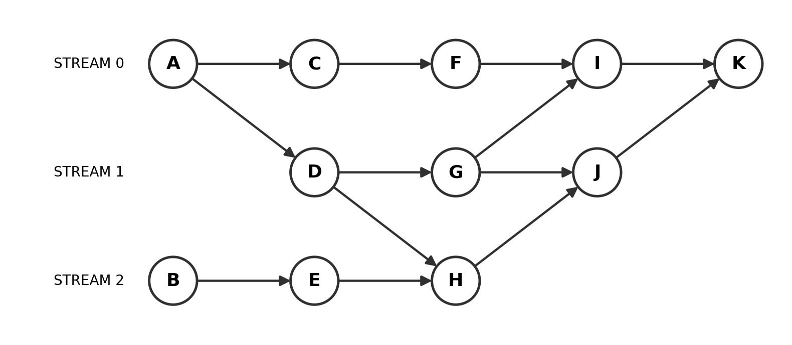

# APM 2025-2026 : Contrôle Continu 1 / 连续考核 1

**Durée indiquée sur le sujet : 3 heures.** Enseignant : Julien Jaeger. Toutes les réponses doivent être justifiées ; la qualité de la rédaction est prise en compte. Le sujet comporte 11 questions ; aucun barème n’est visible sur les quatre photos.

**原卷注明时长：3 小时。** 教师：Julien Jaeger。所有答案必须解释理由，书面表达质量计入评价。全卷共 11 题，四张照片中没有看到分值。

Le texte français est suivi de sa traduction chinoise, et chaque énoncé de sa correction. Les identifiants, dimensions, décalages de pointeurs et appels CUDA du sujet sont conservés, même lorsqu’ils semblent incorrects ; les corrections sont présentées séparément sous chaque question.

法语原文后紧接中文译文，每道题后紧接参考解析。原题中的标识符、尺寸、指针偏移与 CUDA 调用照原样保留，即使其中有错；修正代码单独放在对应题目的解析中。

Les corrections proposées sont des explications rédigées pour la révision ; ce ne sont pas des réponses officielles de l’enseignant.

以下解析为自行推导、供复习使用，并非教师官方答案。

## I Questions de cours / 课程知识题

### Q.1 cudaMallocHost, cudaMalloc et malloc / cudaMallocHost、cudaMalloc 与 malloc

#### Énoncé / 题目

Que fait la fonction cudaMallocHost ? Quelles sont les différences avec la fonction cudaMalloc ? et la fonction malloc ?

`cudaMallocHost` 做什么？它与 `cudaMalloc`、`malloc` 有什么区别？

#### Correction / 参考解析

**Question :** expliquer les allocations et leurs différences.

**题意：**解释三种分配函数的用途和差别。

| Fonction / 函数 | Emplacement et propriété usuels / 分配的主要位置与性质 | Libération / 释放方式 |
|---|---|---|
| `malloc(bytes)` | Mémoire hôte ordinaire, généralement pageable, destinée au CPU / 普通主机内存，通常可分页；适合 CPU 使用 | `free(ptr)` |
| `cudaMallocHost(&ptr, bytes)` | Mémoire hôte verrouillée en pages, ou pinned, utilisable pour les transferts CUDA / 主机页锁定内存，即 pinned memory；用于 CUDA 传输等 | `cudaFreeHost(ptr)` |
| `cudaMalloc(&ptr, bytes)` | Mémoire device du GPU dans le modèle étudié / 本题采用的模型中是 GPU 设备内存 | `cudaFree(ptr)` |

`cudaMallocHost` écrit le résultat dans la variable pointeur du demandeur, d’où `&ptr` ; la taille est en octets. L’allocation n’initialise pas son contenu. La mémoire pinned convient aux transferts H2D/D2H asynchrones et évite le staging habituellement nécessaire avec la mémoire pageable. Elle permet d’envisager un recouvrement avec le calcul, sans garantir un gain dans tout programme.

`cudaMallocHost` 把分配结果写入调用者传入的指针变量，因此传 `&ptr`；大小单位是字节。它不初始化内容。页锁定内存适合与异步 H2D/D2H 传输配合，能避免普通 pageable 内存所需的中间暂存，提供传输与计算重叠的条件；不保证任何程序都会变快。

**Lien avec Q.7 :** l’accès direct d’un kernel à une allocation hôte dépend du mapping et des capacités du dispositif. La mémoire pinned n’est pas universellement inaccessible au GPU ; elle ne se confond pas non plus avec une allocation managed par `cudaMallocManaged`. Q.7 détaille cette distinction. Verrouiller une quantité excessive de mémoire peut aussi pénaliser le système.

**与 Q.7 的联系：**主机内存是否能由 kernel 直接访问，需要看映射和设备能力。不能把 pinned memory 一概认定为不可被 GPU 访问；也不能把它当成 `cudaMallocManaged` 分配的统一内存。这一点在 Q.7 单独讨论。资源有限时，过量锁页也可能影响系统。

**Réponse courte :** `cudaMallocHost` alloue une mémoire hôte verrouillée en pages, adaptée aux transferts CUDA asynchrones. `cudaMalloc` alloue une mémoire device, tandis que `malloc` alloue une mémoire hôte ordinaire. Les fonctions de libération correspondantes sont `cudaFreeHost`, `cudaFree` et `free`.

**简答：**`cudaMallocHost` 分配适合 CUDA 异步传输的主机页锁定内存；`cudaMalloc` 分配设备内存，`malloc` 分配普通主机内存。对应的释放函数分别是 `cudaFreeHost`、`cudaFree` 和 `free`。

Révision : sections 2.4 et 2.11.

复习讲义对应第 2.4、2.11 节。

### Q.2 Accès coalescé / 什么是合并访存

#### Énoncé / 题目

Que signifie faire un accès coalescé à la mémoire ?

什么是合并访存（accès coalescé）？

#### Correction / 参考解析

**Question :** définir un accès coalescé.

**题意：**解释 accès coalescé 的含义。

Lorsque les adresses de mémoire globale demandées par les threads actifs d’un warp sont proches et correctement alignées, le matériel peut généralement les servir avec peu de transactions. Un motif favorable classique associe les lanes voisines aux éléments voisins :

同一 warp 中活跃线程对 global memory 的访问，如果落在邻近、适当对齐的地址区域，硬件通常能够用较少的内存事务服务这些访问。常见有利模式是相邻 lane 访问相邻数组元素：

```cpp
int i = blockIdx.x * blockDim.x + threadIdx.x;
value = a[i];
```

Un accès `a[i * stride]` pour un grand `stride` disperse les adresses sur davantage de segments. Le nombre exact de transactions dépend aussi du type, de l’alignement, des threads actifs et de l’architecture : 32 threads n’impliquent pas systématiquement une transaction unique. La coalescence concerne les adresses d’un warp et n’est pas une synchronisation.

若访问变成 `a[i * stride]` 且 `stride` 很大，访问会分散到更多内存段。确切事务数还取决于类型大小、对齐、活跃线程和架构，不能无条件写成“32 个线程一定只产生一次事务”。合并访存是 warp 地址模式的性质，不等于线程间同步。

**Réponse courte :** Un accès coalescé regroupe les accès mémoire des threads d’un warp en un petit nombre de transactions. Des threads voisins accédant à des éléments contigus et correctement alignés favorisent cette propriété.

**简答：**合并访存把同一 warp 内线程的内存访问合并为少量内存事务。相邻线程访问连续且适当对齐的元素，有利于实现合并访存。

Révision : section 2.7.

复习讲义对应第 2.7 节。

### Q.3 Indice global : blocs 3D et grille 2D / 三维 block、二维 grid 的全局编号

#### Énoncé / 题目

Exprimer le calcul de l’indice global d’un thread CUDA en considérant que les blocs sont définis en 3D avec des tailles de BLOCK_X, BLOCK_Y et BLOCK_Z, et que la grille est définie en 2D avec des tailles de GRID_X et GRID_Y.

线程块为三维，大小分别为 `BLOCK_X`、`BLOCK_Y`、`BLOCK_Z`；网格为二维，大小分别为 `GRID_X`、`GRID_Y`。写出一个 CUDA 线程的全局索引计算式。

#### Correction / 参考解析

**Question :** construire un numéro unique en annonçant la convention.

**题意：**写出统一线程编号，明确展平约定。

On fait varier x le plus vite, puis y, puis z. On numérote d’abord les blocs, puis on range consécutivement tous les threads de chaque bloc :

采用 x 维最快、然后 y、最后 z 的顺序；先给 block 编号，再把每个 block 的所有线程连续排列：

$$
\begin{aligned}
b&=\mathrm{blockIdx.x}+\mathrm{GRID\_X}\,\mathrm{blockIdx.y},\\
t&=\mathrm{threadIdx.x}+\mathrm{BLOCK\_X}
   (\mathrm{threadIdx.y}+\mathrm{BLOCK\_Y}\,\mathrm{threadIdx.z}),\\
B&=\mathrm{BLOCK\_X}\,\mathrm{BLOCK\_Y}\,\mathrm{BLOCK\_Z},\\
g&=bB+t.
\end{aligned}
$$

```cpp
size_t block_id = (size_t)blockIdx.y * gridDim.x + blockIdx.x;
size_t threads_per_block = (size_t)blockDim.x * blockDim.y * blockDim.z;
size_t local_id = threadIdx.x + (size_t)blockDim.x *
                 (threadIdx.y + (size_t)blockDim.y * threadIdx.z);
size_t global_id = block_id * threads_per_block + local_id;
```

`GRID_Y` fixe le nombre total de blocs et la borne supérieure, sans devoir figurer séparément dans la formule du bloc courant. Le total vaut `GRID_X*GRID_Y*B`, et les indices vont de 0 à ce total moins 1. La grille étant 2D, aucun terme `blockIdx.z` n’est ajouté.

`GRID_Y` 决定总块数和编号上界，不必单独出现在当前 block 的展平式中。总线程数为 `GRID_X*GRID_Y*B`，编号范围为 `0` 到总线程数减 1。网格是二维，因此不加入 `blockIdx.z` 项。

Exemple : `grid=(3,2)`, `block=(4,2,2)`, `blockIdx=(1,1)`, `threadIdx=(2,1,1)` donnent `b=4`, `B=16`, `t=14`, `g=78`. L’adresse d’un tableau spatial 3D demanderait une autre linéarisation des coordonnées des données.

例如 `grid=(3,2)`、`block=(4,2,2)`、`blockIdx=(1,1)`、`threadIdx=(2,1,1)`，得到 `b=4`、`B=16`、`t=14`、`g=78`。如果题目要求三维数组地址，则需另按数据坐标展平；那不是这里的按块编号。

Révision : sections 1.10, 1.11 et 4.2.

复习讲义对应第 1.10、1.11、4.2 节。

### Q.4 Attribut de données inexistant / 哪个不是 CUDA 数据属性

#### Énoncé / 题目

Lequel de ces mots clés n’est pas un attribut de données dans l’API CUDA.

下列哪个关键字不是 CUDA API 中的数据属性？

1. `__device__`
2. `__shared__`
3. `__local__`
4. `__constant__`

#### Correction / 参考解析

**Réponse : proposition 3, `__local__`.**

**答案：第 3 项 `__local__`。**

CUDA possède un espace de mémoire locale, mais pas l’attribut de déclaration C/C++ `__local__` proposé ici. Les variables privées ordinaires peuvent être placées en registres ou en mémoire locale selon leur usage et le compilateur.

CUDA 有 local memory 这个存储空间，但没有这里列出的 C/C++ 数据声明属性 `__local__`。普通线程私有变量可位于寄存器或 local memory，由编译器和具体使用方式决定。

`__device__` peut qualifier une variable device aussi bien qu’une fonction device : son usage fréquent pour des fonctions ne le rend pas incorrect dans cette liste. `__shared__` et `__constant__` qualifient les variables des espaces correspondants. Ne pas confondre avec `__local` en OpenCL.

`__device__` 可以用于设备变量声明，也可以作为设备函数属性；不能因为它常见于函数就选它。`__shared__` 用于共享内存变量，`__constant__` 用于常量存储空间中的变量。不要与 OpenCL 的 `__local` 混淆。

Révision : sections 2.1 et 2.3.

复习讲义对应第 2.1、2.3 节。

### Q.5 Équivalent OpenACC d’une région de données OpenMP / OpenMP 数据区域对应的 OpenACC 指令

#### Énoncé / 题目

Quel est l’équivalent en OpenAcc du pragma OpenMP `#pragma omp target data map(to :a[0 :8])` ?

OpenMP 指令 `#pragma omp target data map(to :a[0 :8])` 对应的 OpenACC 写法是什么？

#### Correction / 参考解析

**Réponse :**

**答案：**

```c
#pragma acc data copyin(a[0:8])
{
    /* Region using a on the accelerator. */
}
```

La région structurée `target data map(to: a[0:8])` correspond ici à une région OpenACC `data copyin`. Dans le cas usuel d’un dispositif séparé, sans mapping préexistant, les données sont créées et copiées à l’entrée, sans rapatriement des modifications à la sortie. `0:8` signifie huit éléments à partir de l’indice zéro.

原题的 `target data map(to: a[0:8])` 对应结构化 OpenACC `data copyin` 区域。在通常的独立设备、没有既有映射的情形下，进入区域时建立数据并复制输入，离开时不把修改后的数据回传。`0:8` 表示从下标 0 开始的 8 个元素。

Une région `data` gère les données, sans effectuer elle-même un calcul parallèle ; une directive de calcul reste nécessaire à l’intérieur. `enter data copyin` introduit une durée de vie non structurée et ne constitue pas un remplacement identique sans explication.

单独的 `data` 区域管理数据，本身不执行并行计算；区域内仍需相应计算指令。`enter data copyin` 属于另一种非结构化生命周期，不能不加说明就替换本题的结构化区域。

Référence : [guide officiel OpenACC](https://www.openacc.org/sites/default/files/inline-files/openacc-guide.pdf). La section 3.13 du dossier général traite OpenMP Target ; cette réponse ajoute la correspondance OpenACC.

参考：[OpenACC 官方编程指南](https://www.openacc.org/sites/default/files/inline-files/openacc-guide.pdf)。完整复习讲义第 3.13 节讲 OpenMP Target；本题补充其 OpenACC 对应写法。

## II Succession de kernels / 多个 kernel 的先后依赖

Nous considérons onze kernels, s’exécutant et se succédant sur trois streams différents du même GPU, selon le graphe en Figure 1. Les flèches entre les kernels représentent les dépendances de données (par exemple, A produit des données utilisées par C et D).

同一个 GPU 上的 11 个 kernel 在 3 个不同 stream 中执行，依赖关系如图 1。箭头代表数据依赖，例如 A 产生的数据被 C 和 D 使用。



*Figure 1. Graphe redessiné à partir de la page 2.*

*图 1：按原卷第 2 页重绘的依赖图。*

### Q.6 Dépendances nécessaires avec des événements / 用 events 建立所需依赖

#### Énoncé / 题目

Donner le code des appels de kernels avec les synchronisations minimales nécessaires pour avoir un comportement sûr du programme, et obtenir le bon résultat.

写出各 kernel 的调用代码，加入保证程序安全并得到正确结果所需的最少同步。

#### Correction / 参考解析

**Question :** soumettre les onze kernels sur trois streams et synchroniser seulement ce que demande le graphe.

**题意：**在 3 个 stream 中调用 11 个 kernel，只加入依赖图要求的同步。

L’ordre dans un même stream est déjà assuré :

同一 stream 已保证提交顺序：

- `s[0]` : A → C → F → I → K.

  `s[0]`：A → C → F → I → K。
- `s[1]` : D → G → J.

  `s[1]`：D → G → J。
- `s[2]` : B → E → H.

  `s[2]`：B → E → H。

Il reste cinq dépendances entre streams : **A → D, D → H, G → I, H → J, J → K**. L’ordre des appels CPU ne prouve pas un ordre d’achèvement GPU entre streams distincts.

还需保证 5 条跨 stream 依赖：**A → D、D → H、G → I、H → J、J → K**。不能用 CPU 的调用先后推定不同 stream 中的 GPU 完成先后。

Le code suivant montre uniquement les soumissions et synchronisations. Il suppose les kernels, leurs arguments et configurations définis, ainsi que le succès des API. Dans une copie, `A<<<...>>>(...)` peut représenter les arguments correspondants ; ils sont uniformément omis ici.

以下代码只展示提交与同步，假设 kernel 定义、参数、网格及 block 大小已给出，所有 API 调用成功。实际答题可以用 `A<<<...>>>(...)` 表示相应 kernel 的参数；这里统一省略参数。

```cpp
cudaStream_t s[3];
for (int i = 0; i < 3; ++i)
    cudaStreamCreateWithFlags(&s[i], cudaStreamNonBlocking);
cudaEvent_t eA, eD, eG, eH, eJ;
cudaEventCreateWithFlags(&eA, cudaEventDisableTiming);
cudaEventCreateWithFlags(&eD, cudaEventDisableTiming);
cudaEventCreateWithFlags(&eG, cudaEventDisableTiming);
cudaEventCreateWithFlags(&eH, cudaEventDisableTiming);
cudaEventCreateWithFlags(&eJ, cudaEventDisableTiming);

A<<<grid, block, 0, s[0]>>>();
cudaEventRecord(eA, s[0]);
B<<<grid, block, 0, s[2]>>>();
C<<<grid, block, 0, s[0]>>>();
F<<<grid, block, 0, s[0]>>>();

cudaStreamWaitEvent(s[1], eA, 0);
D<<<grid, block, 0, s[1]>>>();
cudaEventRecord(eD, s[1]);
G<<<grid, block, 0, s[1]>>>();
cudaEventRecord(eG, s[1]);

E<<<grid, block, 0, s[2]>>>();
cudaStreamWaitEvent(s[2], eD, 0);
H<<<grid, block, 0, s[2]>>>();
cudaEventRecord(eH, s[2]);

cudaStreamWaitEvent(s[0], eG, 0);
I<<<grid, block, 0, s[0]>>>();
cudaStreamWaitEvent(s[1], eH, 0);
J<<<grid, block, 0, s[1]>>>();
cudaEventRecord(eJ, s[1]);
cudaStreamWaitEvent(s[0], eJ, 0);
K<<<grid, block, 0, s[0]>>>();

// Before the CPU consumes results or resources are released:
cudaStreamSynchronize(s[0]);
for (int i = 0; i < 3; ++i) cudaStreamDestroy(s[i]);
cudaEventDestroy(eA);
cudaEventDestroy(eD);
cudaEventDestroy(eG);
cudaEventDestroy(eH);
cudaEventDestroy(eJ);
```

**Pourquoi ces attentes ?** Elles précèdent le consommateur : D attend A, H attend D, I attend G, J attend H et K attend J. Chaque événement est enregistré après son producteur. Dans cet exemple, chaque record est soumis par le CPU avant le wait associé, évitant d’attendre un événement non encore enregistré. `cudaStreamWaitEvent` ajoute une dépendance aux files GPU, sans arrêter le CPU à chaque arête.

**为何是这些等待？**屏障放在消费者之前：D 等 A，H 等 D，I 等 G，J 等 H，K 等 J。每个生产者之后记录 event；本例中相关 record 均先于 wait 在主机端提交，避免等待一个尚未记录的 event。`cudaStreamWaitEvent` 给 GPU 队列添加依赖，不要求 CPU 为每条边停住。

**Sens du minimum :** en conservant les possibilités de parallélisme du graphe, sans ordre global supplémentaire, aucune des cinq arêtes inter-stream n’est déductible des autres. Avec un événement après chaque producteur et une attente avant chaque consommateur, cinq waits les couvrent exactement. Réduire seulement le nombre d’appels d’attente côté hôte en sérialisant davantage peut ajouter des dépendances absentes du sujet.

**“最少”的边界：**在保留图中并行机会、不增加额外全局顺序的前提下，这 5 条跨流边不能由其他边推出。用每个生产者完成后记录 event、消费者等待的写法时，5 次 wait 恰好覆盖它们。只比较主机同步调用数，可以把更多工作串行化后少写几次等待，但会添加图中没有要求的依赖。

K succède à tous les autres nœuds. Attendre sa fin dans `s[0]` couvre donc tous les kernels du graphe ; une synchronisation globale après chaque producteur est inutile. Des copies ou utilisateurs de résultats extérieurs au graphe demanderaient une analyse supplémentaire.

K 是所有节点的后继，所以本例最后等待 `s[0]` 的 K 完成，即覆盖了图中所有 kernel。不必为每条边调用 `cudaDeviceSynchronize()`。如果还有图外的任务、复制或其他输出使用者，需另外判断其完成条件。

Références : [événements NVIDIA](https://docs.nvidia.com/cuda/cuda-runtime-api/group__CUDART__EVENT.html), [attente d’événement dans un stream](https://docs.nvidia.com/cuda/cuda-runtime-api/group__CUDART__STREAM.html). Révision : sections 2.11 et 4.13.

参考：[NVIDIA events](https://docs.nvidia.com/cuda/cuda-runtime-api/group__CUDART__EVENT.html)、[stream 等待 event](https://docs.nvidia.com/cuda/cuda-runtime-api/group__CUDART__STREAM.html)。复习讲义对应第 2.11、4.13 节。

## III Safe/Unsafe / 安全性判断

Dites si les sections de codes CUDA suivantes risquent de provoquer des erreurs ou des comportements non-déterministes lors de leurs exécutions.

判断以下 CUDA 代码片段是否可能导致错误或非确定性行为，并说明理由。

Les fonctions kernel, certaines déclarations périphériques et le contrôle complet des erreurs ne sont pas fournis. On suppose `N>0`, des tailles sans débordement arithmétique, des lancements valides et des kernels limités aux zones annoncées. L’absence de leur corps ne permet pas d’inventer les résultats. Les fragments originaux sont conservés dans l’énoncé de chaque question ci-dessous.

这些代码片段没有给出 kernel 函数体、完整错误处理与所有外围声明。以下按 `N>0`、尺寸乘法不溢出、合法 launch、kernel 只访问约定区间进行分析；不能凭省略的函数体编造结果。原题程序完整保留在下方各题的题目部分。

### Q.7 tmp est un pointeur hôte pinned : réponse conditionnelle / tmp 是 pinned host 指针：需条件化判断

#### Énoncé / 题目

code :

代码如下：

```cpp
cudaStream_t stream[1];
cudaStreamCreate(&stream[0]);
int *htab, *dtab, *tmp;
int size = N*sizeof(int);
cudaMalloc((void**)&dtab, 2*size);
cudaMallocHost((void**)&tmp, size);
cudaMallocHost((void**)&htab, size);
memset(htab, 0, size);
cudaMemcpyAsync(dtab, htab, size, cudaMemcpyHostToDevice, stream[0]);
kernel<<<grid, block, 0, stream[0]>>>(dtab, tmp, N);
cudaMemcpyAsync(htab, dtab, size, cudaMemcpyDeviceToHost, stream[0]);
cudaStreamSynchronize(stream[0]); for(i=0; i<N; i++)
    printf("%d", htab[i]);
```

#### Correction / 参考解析

**Question :** un stream enchaîne H2D, kernel, D2H et attente, puis le CPU affiche. Le kernel reçoit aussi `tmp`, alloué par `cudaMallocHost`.

**题意：**一个 stream 中依次执行 H2D、kernel、D2H、同步，然后打印。kernel 额外收到由 `cudaMallocHost` 得到的 `tmp`。

**Ordre déjà établi :** toutes les opérations utilisent `stream[0]` et le `cudaStreamSynchronize` suit le D2H. L’affichage attend donc bien la copie. Il ne manque pas ici une attente D2H.

**已成立的顺序：**所有操作都在 `stream[0]`；D2H 后的 `cudaStreamSynchronize(stream[0])` 保证打印前复制已完成。这里没有“少了 D2H 等待”的问题。

**À vérifier :** l’accessibilité device de `tmp` et son initialisation. Dans un modèle pédagogique simplifié à mémoires séparées, passer directement un pointeur hôte peut conduire à « unsafe ». Ce n’est pas une conclusion universelle : sur un dispositif supportant UVA, NVIDIA prévoit l’accès direct aux allocations ordinaires `cudaMallocHost` par le même pointeur.

**真正需要检查：**`tmp` 的设备可访问性和初始化。传统分离内存的简化教学模型中，直接传主机指针给 kernel 往往被判为 unsafe；但这不是所有 CUDA 环境下的结论。在支持 UVA 的设备上，官方文档规定普通 `cudaMallocHost` 分配可直接由设备通过同值指针访问。

**La photo seule ne permet donc ni de conclure inconditionnellement unsafe, ni de prouver safe.** Si cet accès est supporté, si le kernel écrit correctement son espace de travail avant de le lire et reste dans les bornes, l’ordre des opérations est sûr. Si le kernel lit `tmp` non initialisé ou si l’environnement interdit l’accès direct, il est incorrect. Une réponse argumentée doit annoncer cette hypothèse.

因此，**仅凭照片不能无条件判 unsafe，也不能证明 safe**：若设备支持相应访问，kernel 只把 `tmp` 当作已正确写入的工作区，且访问不越界，此片段的队列顺序是安全的；若 kernel 读取未初始化 `tmp`，或环境不允许直接访问该 host pointer，则不安全。把假设写出来，比只圈 safe/unsafe 更完整。

**Correction portable :** pour un espace de travail device, allouer avec `cudaMalloc` et initialiser avant toute lecture. Pour de la mémoire hôte mappée, vérifier explicitement la capacité et le pointeur device valide, puis ordonner les accès CPU/GPU.

**可移植的修正思路：**若 `tmp` 用作设备工作区，用 `cudaMalloc` 分配并在读取前初始化；若要用映射主机内存，则明确确认设备能力与有效设备指针，并维持 CPU/GPU 间的访问顺序。

```cpp
int *d_tmp = nullptr;
size_t bytes = (size_t)N * sizeof(int);
cudaMalloc((void **)&d_tmp, bytes);
// Only needed if the kernel reads the initial scratch values:
cudaMemsetAsync(d_tmp, 0, bytes, stream[0]);
kernel<<<grid, block, 0, stream[0]>>>(dtab, d_tmp, N);
// Queue the D2H copy, wait for the stream, then cudaFree(d_tmp).
```

Cet extrait remplace l’allocation de `tmp` et l’argument du kernel ; il n’ajoute pas un second calcul au programme original.

这段代码替换原 `tmp` 的分配和 kernel 参数；不是在原 kernel 之外再启动一次计算。

Référence : [mapping automatique des allocations hôte dans UVA](https://docs.nvidia.com/cuda/cuda-runtime-api/group__CUDART__UNIFIED.html). Révision : sections 2.11 et 3.5.

参考：[NVIDIA Unified Addressing 的主机内存自动映射](https://docs.nvidia.com/cuda/cuda-runtime-api/group__CUDART__UNIFIED.html)。复习讲义对应第 2.11、3.5 节。

### Q.8 Octets utilisés comme déplacement de pointeur int / 把字节数用于 int 指针偏移

#### Énoncé / 题目

code :

代码如下：

```cpp
cudaStream_t stream[3];
cudaStreamCreate(&stream[0]); cudaStreamCreate(&stream[1]);
cudaStreamCreate(&stream[2]);
int *htab, *dtab;
int size = N*sizeof(int);
cudaMalloc((void**)&dtab, 6*size);
cudaMallocHost((void**)&htab, 7*size);
memset(htab, 0, 7*size);
cudaMemcpyAsync(dtab, htab, size, cudaMemcpyHostToDevice, stream[0]);
cudaMemcpyAsync(dtab + size, htab + size, 2*size,
                cudaMemcpyHostToDevice, stream[1]);
cudaMemcpyAsync(dtab + 3*size, htab + 3*size, 3*size,
                cudaMemcpyHostToDevice, stream[2]);
kernel<<<grid0, block0, 0, stream[0]>>>(dtab, N);
kernel<<<grid1, block1, 0, stream[1]>>>(dtab + size, 2*N);
kernel<<<grid2, block2, 0, stream[2]>>>(dtab + 3*size, 3*N);
cudaMemcpyAsync(htab, dtab, size, cudaMemcpyDeviceToHost, stream[0]);
cudaStreamSynchronize(stream[0]);
cudaMemcpyAsync(htab + size, dtab + size, 2*size,
                cudaMemcpyDeviceToHost, stream[1]);
cudaStreamSynchronize(stream[1]);
cudaMemcpyAsync(htab + 3*size, dtab + 3*size, 3*size,
                cudaMemcpyDeviceToHost, stream[2]);
cudaStreamSynchronize(stream[2]); for(i=0; i<7*N; i++)
    printf("%d", htab[i]);
```

#### Correction / 参考解析

**Conclusion : unsafe. Le problème principal est l’unité du déplacement.**

**结论：原片段不安全。核心问题是偏移单位。**

`size=N*sizeof(int)` est en octets, mais `dtab + size` avance de `size` éléments int. Avec l’exemple usuel CUDA `sizeof(int)=4` :

`size=N*sizeof(int)` 是字节数，但 `dtab + size` 表示前进 `size` 个 int，而不是前进 `size` 个字节。以 CUDA 常见的 `sizeof(int)=4` 为例：

| Opération / 操作 | Intervalle d’éléments attendu / 预期元素区间 | Intervalle réel du code / 原代码实际元素区间 |
|---|---|---|
| stream 0, N éléments / stream 0，N 个元素 | `[0,N)` | `[0,N)` |
| stream 1, 2N éléments / stream 1，2N 个元素 | `[N,3N)` | `[4N,6N)` |
| stream 2, 3N éléments / stream 2，3N 个元素 | `[3N,6N)` | `[12N,15N)` |

L’allocation device contient `6N` int et celle de l’hôte `7N` int : la troisième zone déborde. La deuxième reste ici dans l’allocation, mais ne correspond pas au deuxième segment contigu attendu. Il faut corriger **les pointeurs des copies et des kernels**, pas seulement les tailles de transfert.

`dtab` 只有 `6N` 个 int，`htab` 只有 `7N` 个 int，第三段明显越界。第二段在该例中虽仍位于分配内，却不是题意中的连续第二段。仅更改复制长度不够，**复制和 kernel 参数中的指针偏移都要改**。

```cpp
size_t bytes = (size_t)N * sizeof(int);
cudaMemcpyAsync(dtab, htab, bytes,
                cudaMemcpyHostToDevice, stream[0]);
cudaMemcpyAsync(dtab + N, htab + N, 2 * bytes,
                cudaMemcpyHostToDevice, stream[1]);
cudaMemcpyAsync(dtab + 3 * N, htab + 3 * N, 3 * bytes,
                cudaMemcpyHostToDevice, stream[2]);
kernel<<<grid0, block0, 0, stream[0]>>>(dtab, N);
kernel<<<grid1, block1, 0, stream[1]>>>(dtab + N, 2 * N);
kernel<<<grid2, block2, 0, stream[2]>>>(dtab + 3 * N, 3 * N);
cudaMemcpyAsync(htab, dtab, bytes,
                cudaMemcpyDeviceToHost, stream[0]);
cudaMemcpyAsync(htab + N, dtab + N, 2 * bytes,
                cudaMemcpyDeviceToHost, stream[1]);
cudaMemcpyAsync(htab + 3 * N, dtab + 3 * N, 3 * bytes,
                cudaMemcpyDeviceToHost, stream[2]);
for (int s = 0; s < 3; ++s) cudaStreamSynchronize(stream[s]);
```

Conserver les allocations et le memset du sujet ; remplacer ses copies, lancements et attentes par ce fragment. Les zones sont disjointes, donc aucun événement inter-stream n’est requis. Le sujet attend déjà chaque D2H dans son stream : dire qu’il n’attend que le troisième stream serait incorrect. Regrouper les attentes à la fin clarifie simplement le code.

保留原题中分配与清零即可；本段替换复制、launch 和等待。三个分段互不相交，不需要跨 stream 事件。原题自身已经在每个对应 D2H 之后同步；不能误判为“只等了第三个 stream”。把等待集中到最后，主要是让结构更清楚。

L’affichage de `7N` éléments ne dépasse pas le buffer hôte alloué à cette taille. Toutefois, seuls les `6N` premiers représentent les résultats GPU ; les `N` derniers conservent zéro. Afficher `6N` éléments si seuls les résultats sont souhaités.

最后打印 `7N` 个元素不导致 host 越界，因为 host 已分配 `7N`；但只有前 `6N` 个是 GPU 结果，最后 `N` 个仍为初始零值。如果只想输出结果，应打印 `6N` 个。

Révision : sections 2.4 et 4.13.

复习讲义对应第 2.4、4.13 节。

### Q.9 Ordre du stream par défaut et disponibilité pour le CPU / 默认 stream 保证 GPU 顺序，不保证 CPU 已可用

#### Énoncé / 题目

code :

代码如下：

```cpp
int *htab, *dtab;
int size = N*sizeof(int);
cudaMalloc((void**)&dtab, 2*size);
cudaMallocHost((void**)&htab, size);
cudaMemcpyAsync(dtab, htab, size, cudaMemcpyHostToDevice);
kernel<<<grid, block>>>(dtab, N);
cudaMemcpyAsync(htab, dtab, size, cudaMemcpyDeviceToHost);
for(i=0; i<N-1; i++)
    htab[i] = htab[i+1];
htab[N-1] = 0;
```

#### Correction / 参考解析

**Conclusion : unsafe, avec attente hôte manquante et entrée non initialisée.**

**结论：不安全，有缺少主机等待和未初始化输入两个问题。**

Dans l’interface CUDA C++, l’argument stream omis des deux `cudaMemcpyAsync` vaut zéro. Le kernel utilise aussi ce stream par défaut : l’ordre GPU H2D → kernel → D2H est assuré.

两个 `cudaMemcpyAsync` 省略 stream 参数，在 CUDA C++ 接口中默认使用 stream 0；kernel 也在该默认 stream，所以 H2D → kernel → D2H 的 GPU 顺序成立。

La copie D2H asynchrone vers le buffer pinned ne garantit pas la disponibilité des données au retour de l’appel. Le CPU lit et modifie immédiatement `htab`, avec un risque de conflit avec la copie en cours. De plus, le buffer n’est pas initialisé avant H2D : un kernel lisant ces valeurs ne reçoit pas une entrée définie.

但 pinned host buffer 的 D2H 异步复制不保证调用返回时数据已可由 CPU 使用。CPU 随后立刻读取并写入 `htab`，可能与仍在进行的传输冲突。`htab` 还未初始化就用作 H2D 输入，若 kernel 读取输入，则结果不可依赖。

Initialiser l’entrée, soumettre H2D, kernel et D2H, puis attendre avant le décalage CPU. On peut attendre le stream par défaut correspondant, ou employer explicitement le même stream pour toutes les opérations.

修正顺序：先初始化 host 数据；提交 H2D、kernel、D2H；在 CPU 左移数组之前等待完成。可以等待相应默认 stream，或者更清楚地全部使用一个显式 stream。

```cpp
// Initialize htab before the H2D copy.
memset(htab, 0, size);
cudaMemcpyAsync(dtab, htab, size, cudaMemcpyHostToDevice);
kernel<<<grid, block>>>(dtab, N);
cudaMemcpyAsync(htab, dtab, size, cudaMemcpyDeviceToHost);
cudaStreamSynchronize(0);
for (int i = 0; i < N - 1; ++i) htab[i] = htab[i + 1];
htab[N - 1] = 0;
```

Ce fragment remplace la séquence concernée et place l’initialisation avant H2D. Si une autre partie du programme fournit déjà la bonne entrée, la conserver au lieu de la remettre à zéro. Les règles particulières du stream par défaut ne remplacent pas l’attente du D2H par le CPU.

本段替换原题复制之后的相关操作，并把初始化移到 H2D 之前。若已确定其他地方写入了正确输入，可保留该输入而不清零。默认 stream 的特殊 GPU 排序规则不能当作 CPU 等待 D2H 的替代。

Référence : [comportement de synchronisation des API NVIDIA](https://docs.nvidia.com/cuda/cuda-runtime-api/api-sync-behavior.html). Révision : sections 2.11 et 4.13.

参考：[NVIDIA API 同步行为](https://docs.nvidia.com/cuda/cuda-runtime-api/api-sync-behavior.html)。复习讲义对应第 2.11、4.13 节。

### Q.10 Deux erreurs indépendantes : bornes et dépendances inter-stream / 两类独立错误：越界与跨流数据竞争

#### Énoncé / 题目

code :

代码如下：

```cpp
cudaStream_t stream[2];
cudaStreamCreate(&stream[0]); cudaStreamCreate(&stream[1]);
int *htab, *dtab;
int sz_in_bytes = N*sizeof(int);
cudaMalloc((void**)&dtab, 2*sz_in_bytes);
cudaMallocHost((void**)&htab, 2*sz_in_bytes);
memset(htab, 0, 2*sz_in_bytes);
cudaMemcpyAsync(dtab, htab, sz_in_bytes,
                cudaMemcpyHostToDevice, stream[0]);
cudaMemcpyAsync(dtab + sz_in_bytes, htab + sz_in_bytes, sz_in_bytes,
                cudaMemcpyHostToDevice, stream[1]);
kernel<<<grid, block, 0, stream[0]>>>(dtab + sz_in_bytes, N);
kernel<<<grid, block, 0, stream[1]>>>(dtab, N);
cudaMemcpyAsync(htab, dtab, sz_in_bytes,
                cudaMemcpyDeviceToHost, stream[0]);
cudaStreamSynchronize(stream[0]);
cudaMemcpyAsync(htab + sz_in_bytes, dtab + sz_in_bytes, sz_in_bytes,
                cudaMemcpyDeviceToHost, stream[1]);
cudaStreamSynchronize(stream[1]);
for(i=0; i<2*N; i++)
    printf("%d", htab[i]);
```

#### Correction / 参考解析

**Conclusion : unsafe. Corriger les déplacements ne suffit pas.**

**结论：不安全。即使修正偏移，仍需修复流间依赖。**

**Première erreur : unité des pointeurs.**`sz_in_bytes` est en octets, tandis que `dtab + sz_in_bytes` avance en int. Pour des int de 4 octets, le deuxième segment commence à l’élément `4N`, au-delà de l’allocation de `2N` éléments. Utiliser `dtab+N` et `htab+N`.

**第一类：指针单位。**`sz_in_bytes` 是字节数，`dtab + sz_in_bytes` 在 `int*` 上前进了过多元素。若 int 为 4 字节，第二段从元素 `4N` 开始，已经超过仅 `2N` 元素的分配。改为 `dtab+N` 和 `htab+N`。

**Deuxième erreur : les kernels traitent la zone de l’autre stream.** Après correction des pointeurs, on conserve sinon :

**第二类：kernel 与数据段所属 stream 交叉。**修正指针后，原结构仍是：

- stream 0 : H2D première zone → kernel deuxième zone → D2H première zone.

  stream 0：复制第一段 → 计算第二段 → 回传第一段。
- stream 1 : H2D deuxième zone → kernel première zone → D2H deuxième zone.

  stream 1：复制第二段 → 计算第一段 → 回传第二段。

Le kernel de la première zone, dans stream 1, dépend du H2D du stream 0 ; son D2H dans stream 0 dépend du kernel du stream 1. La deuxième zone présente les dépendances symétriques, non exprimées dans le code.

第一段 kernel 在 stream 1，却依赖 stream 0 的 H2D；第一段 D2H 在 stream 0，却需要等 stream 1 的 kernel。第二段同样存在交叉。这些边没有显式建立。

Le premier `cudaStreamSynchronize(stream[0])` est situé **après** le D2H de la première zone. Attendre des opérations déjà soumises ne les réordonne pas rétroactivement pour corriger leur dépendance avec stream 1. Les attentes finales n’effacent pas une course déjà survenue. Un résultat correct dans un essai ne prouve pas la sûreté.

原题中的第一次 `cudaStreamSynchronize(stream[0])` 位于第一段 D2H **之后**，只能等待已经提交的操作结束，不能倒过来让那次 D2H 正确等待 stream 1 的生产者。最后两次等待也无法撤销已经发生的竞争。一次实验碰巧输出正确，不构成安全证明。

**Correction directe : un stream prend en charge toute la chaîne d’une même zone.**

**更直接的修正：让每个 stream 负责同一段的完整流水线。**

```cpp
size_t bytes = (size_t)N * sizeof(int);
for (int s = 0; s < 2; ++s) {
    size_t offset = (size_t)s * N;
    cudaMemcpyAsync(dtab + offset, htab + offset, bytes,
                    cudaMemcpyHostToDevice, stream[s]);
    kernel<<<grid, block, 0, stream[s]>>>(dtab + offset, N);
    cudaMemcpyAsync(htab + offset, dtab + offset, bytes,
                    cudaMemcpyDeviceToHost, stream[s]);
}
for (int s = 0; s < 2; ++s) cudaStreamSynchronize(stream[s]);
for (int i = 0; i < 2 * N; ++i) printf("%d", htab[i]);
```

Conserver les allocations de `2N` et le memset du sujet ; remplacer les copies, kernels et attentes. Si la répartition croisée doit être conservée, enregistrer des événements après chaque producteur et les attendre avant les consommateurs correspondants. Garder un stream par zone simplifie la preuve.

保留原题的 `2N` 分配和 host 清零，本段替换复制、launch 和等待。若必须保留交叉分工，需在各生产者后记录 event，并在对应消费者前等待；统一每段的负责 stream 更容易证明正确。

Révision : sections 2.11 et 4.13.

复习讲义对应第 2.11、4.13 节。

## IV Réduction somme en CUDA / CUDA 求和归约

Une réduction somme consiste à additionner toutes les valeurs d’un tableau. Une écriture séquentielle pourrait être la suivante :

求和归约把数组所有元素相加，串行版本可以写成：

```cpp
float sum = 0;
for (int i = 0; i < ntot; i++)
    sum += tab[i];
```

On désire une implémentation CUDA, avec `tab` déjà sur le GPU : une réduction dans chaque bloc produit un tableau de sommes partielles, puis une seconde réduction de ce tableau produit la somme totale.

`tab` 已位于 GPU 上。分两阶段实现：先在每个块内归约，得到长度等于块数的部分和数组；再归约部分和数组，得到总和。

### Q.11 Réduction partagée et deux lancements / 共享内存归约和两次调用

#### Énoncé / 题目

Implémenter le kernel `reduce_kernel(float *in, float *out)` permettant de faire les sommes partielles par bloc. `in` est le tableau de valeurs à réduire dimensionné au nombre total de threads dans la grille, et `out` le tableau de valeurs réduites par bloc, dimensionné au nombre de bloc.

实现 `reduce_kernel(float *in, float *out)`，计算每个线程块的部分和。`in` 的长度等于网格中启动的线程总数；`out` 存放每个线程块的部分和，长度等于线程块数。

Donner les deux invocations successives de cette fonction permettant de faire d’abord la somme partielle par bloc, puis la somme totale à partir des sommes partielles.

给出该 kernel 的两次连续调用：第一次计算块内部分和，第二次对部分和归约，得到总和。

Pour simplifier, nous considérons que le nombre de blocs et de threads par blocs sont des puissances de 2, et que la taille du tableau initiale est égale au nombre de threads.

为简化问题，假设线程块数和每块线程数均为 2 的幂，原数组长度等于总线程数。

#### Correction / 参考解析

**Question :** les données sont déjà sur le GPU. Un thread lit un élément, un bloc calcule une somme partielle, puis un second kernel réduit ces sommes.

**题意：**原数据已在 GPU，每个线程读取一个元素，先求每块部分和，再归约部分和。

La première phase utilise `G` blocs de `B` threads, avec `N=G*B` et `G`, `B` puissances de deux. Chaque thread écrit son entrée en mémoire partagée ; les étapes successives combinent les valeurs avec les pas `B/2, B/4, ..., 1`.

设第一阶段 `G` 个块、每块 `B` 个线程，`N=G*B`；`G`、`B` 均为 2 的幂。每个线程把自己的值写入 shared memory，随后按 `B/2, B/4, ..., 1` 的步长两两相加。

```cpp
__global__ void reduce_kernel(float *in, float *out)
{
    extern __shared__ float partial[];
    unsigned int t = threadIdx.x;
    size_t i = (size_t)blockIdx.x * blockDim.x + t;
    partial[t] = in[i];
    __syncthreads();

    for (unsigned int stride = blockDim.x / 2;
         stride > 0; stride /= 2) {
        if (t < stride)
            partial[t] += partial[t + stride];
        __syncthreads();
    }
    if (t == 0) out[blockIdx.x] = partial[0];
}
```

La barrière est hors du `if (t < stride)` afin que tous les threads du bloc la rencontrent. Chaque étape dépend de la précédente ; ses barrières ne se suppriment pas arbitrairement. Chaque bloc écrit une case distincte, sans addition atomique inter-bloc.

屏障放在 `if (t < stride)` 外面，保证整个 block 的线程都能到达。每个 stride 的读取依赖上一轮结果，因此不能随意删掉屏障。每个 block 只写自己的输出位置，不需要跨 block 原子加。

```cpp
// tab is already allocated and initialized on the GPU.
// G and B are positive powers of two and N == G * B.
// Both B and G must fit the device's per-block resource limits.
float *block_sums = nullptr;
float *total = nullptr;
cudaMalloc((void **)&block_sums, (size_t)G * sizeof(float));
cudaMalloc((void **)&total, sizeof(float));

reduce_kernel<<<G, B, (size_t)B * sizeof(float)>>>(tab, block_sums);
cudaGetLastError();
reduce_kernel<<<1, G, (size_t)G * sizeof(float)>>>(block_sums, total);
cudaGetLastError();

float host_sum = 0.0f;
cudaMemcpy(&host_sum, total, sizeof(float), cudaMemcpyDeviceToHost);
cudaFree(total);
cudaFree(block_sums);
```

Le troisième paramètre du lancement est la taille, en octets, de mémoire partagée dynamique par bloc. Le deuxième kernel utilise un bloc de `G` threads pour les `G` sommes partielles. Les deux lancements dans le même stream sont ordonnés : aucune synchronisation CPU intermédiaire n’est nécessaire. Le D2H synchrone final rend la somme disponible à son retour. Un vrai programme doit vérifier les erreurs des API et des lancements ; les fragments constituent ici une réponse écrite.

第三个 launch 参数是每块动态 shared memory 的字节数。第二次 launch 使用 1 个块、`G` 个线程，读取 `G` 个部分和并输出一个总和。两次 launch 在同一 stream 中，第二个 kernel 自然等第一个完成；CPU 中间不必加 `cudaDeviceSynchronize()`。最终同步 D2H 在返回后提供总和。真实程序须检查每次 API 与 launch 的返回/错误状态；以上片段为书面答案。

**Condition matérielle implicite :** une puissance de deux ne garantit pas qu’un bloc de `G` threads soit légal. `G` et `B` doivent respecter les limites de threads et de mémoire partagée du dispositif. Si `G` est trop grand, employer plusieurs niveaux ou modifier la deuxième phase pour faire accumuler plusieurs sommes partielles par thread. Le lancement `<<<1,G>>>` ne convient pas sans limite à toute taille de tableau.

**题目隐含的资源条件：**“块数是 2 的幂”不能保证 `G` 个线程能放进一个合法 block。以上两次调用还要求 `G`、`B` 均满足设备线程数和 shared memory 限制。如果第一阶段块数过大，应多级归约；或改变第二阶段设计，让单块线程各自先累加多个部分和。不能无条件用 `<<<1,G>>>` 覆盖任意数据规模。

**Exemple :** `N=16`, `G=4`, `B=4`, entrée `1...16`. La première phase produit `[10,26,42,58]`, puis la seconde donne `136`. Le changement d’ordre des additions flottantes n’assure pas l’égalité bit à bit avec une somme séquentielle ; vérifier les valeurs finies et une tolérance absolue/relative appropriée.

**小例子：**`N=16`、`G=4`、`B=4`，输入为 `1...16`。第一阶段得到 `[10,26,42,58]`，第二阶段得到 `136`。浮点加法顺序改变后，通常不保证与串行累加逐位相同；验证应使用有限值检查与合适的绝对/相对误差容限。

## V Adapter la préparation à ce sujet / 用这张卷调整复习顺序

Types de questions posées dans ce sujet. La durée de trois heures est celle du sujet 2025-2026.

以下是这份试卷考过的题型。3 小时是 2025-2026 原卷的时长。

| Travail prioritaire / 先练什么 | Questions / 对应原题 | Entrée de révision / 已有复习入口 |
|---|---|---|
| Emplacement des données, pinned et mapped / 数据位置、pinned 与 mapped 的差别 | Q1, Q7 / Q1、Q7 | Sections 2.4, 2.11 et 3.5 / 第 2.4、2.11、3.5 节 |
| Coalescence et linéarisation des threads / 合并访存与线程展平 | Q2, Q3 / Q2、Q3 | Sections 1.10, 1.11, 2.7 et 4.2 / 第 1.10、1.11、2.7、4.2 节 |
| Attributs CUDA et directives / CUDA 属性与指令对应 | Q4, Q5 / Q4、Q5 | Sections 2.1, 2.3 et 3.13 ; Q5 ci-dessus / 第 2.1、2.3、3.13 节及本文 Q5 |
| Dessiner les dépendances et utiliser les events / 画依赖、用 events 排序 | Q6 | Sections 2.11 et 4.13 ; Q6 ci-dessus / 第 2.11、4.13 节及本文 Q6 |
| Vérifier unités, intervalles et disponibilité / 逐行审查字节、元素、区间、完成时机 | Q7-Q10 | Partie III ; justifier plutôt que mémoriser les verdicts / 本文 III；不要只背判断结论 |
| Réduction arborescente en mémoire partagée / shared memory 树形归约 | Q11 | Partie IV / 本文 IV |

Pour s’entraîner, lire d’abord l’énoncé français de chaque question sans consulter sa traduction ni sa correction. Pour chaque fragment, poser quatre questions : où réside le pointeur ? Quelles sont les unités de la taille et du déplacement ? Le consommateur attend-il son producteur ? Quand le CPU peut-il lire le résultat ? Réécrire enfin Q6 et Q11 en justifiant chaque dépendance et chaque barrière.

建议先只看每题的法语题目，独立作答后再看译文和解析，再按四个问题审查每段代码：指针属于哪种内存？长度和偏移分别是什么单位？生产者完成后消费者才会执行吗？CPU 什么时候可以读取结果？最后手写一次 Q6 和 Q11，把每条依赖和每次屏障的原因说清楚。

## Sources et fichiers / 来源与文件

Les quatre photos originales sont conservées ; leurs empreintes SHA-256 sont enregistrées dans `source_manifest.json`. Le graphe de la partie II a été redessiné à partir de la page 2.

保留四张原卷照片，SHA-256 校验值记录在 `source_manifest.json` 中。第二部分的依赖图按原卷第 2 页重绘。

- Photos originales / 原卷照片：[1](%E7%B2%98%E8%B4%B4%E7%9A%84%E5%9B%BE%E5%83%8F.png) · [2](%E7%B2%98%E8%B4%B4%E7%9A%84%E5%9B%BE%E5%83%8F%20%282%29.png) · [3](%E7%B2%98%E8%B4%B4%E7%9A%84%E5%9B%BE%E5%83%8F%20%283%29.png) · [4](%E7%B2%98%E8%B4%B4%E7%9A%84%E5%9B%BE%E5%83%8F%20%284%29.png) · [PDF](output/pdf/APM_CC1_2025_Photos.pdf)

- Graphe des dépendances / 依赖图：[PNG](Images/kernel_dependencies.png) · [SVG](Images/kernel_dependencies.svg)

- Version PDF bilingue / 双语 PDF：[APM CC1 2025](output/pdf/APM_CC1_2025.pdf)

- Dossier général de révision / 完整复习讲义：[Français](../Revision_Partiel/APM_Revision_fr.md) · [中文](../Revision_Partiel/APM_Revision_zh.md)

Depuis ce dossier, exporter le document avec `python3 tools/build_documents.py` et lancer les vérifications avec `python3 tools/verify_exam.py`. Les vérifications de graphe, d’indices et du modèle CPU ne constituent pas une exécution CUDA sur GPU.

在本目录运行 `python3 tools/build_documents.py` 导出 PDF，运行 `python3 tools/verify_exam.py` 检查文档、原图校验值和已有逻辑验证。依赖图、索引与 CPU 模型检查不等于在 GPU 上执行过 CUDA 程序。

[Retour au cours APM / 返回 APM](../README.md)
