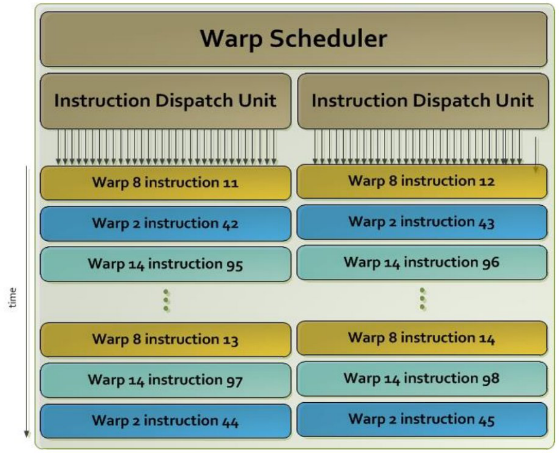
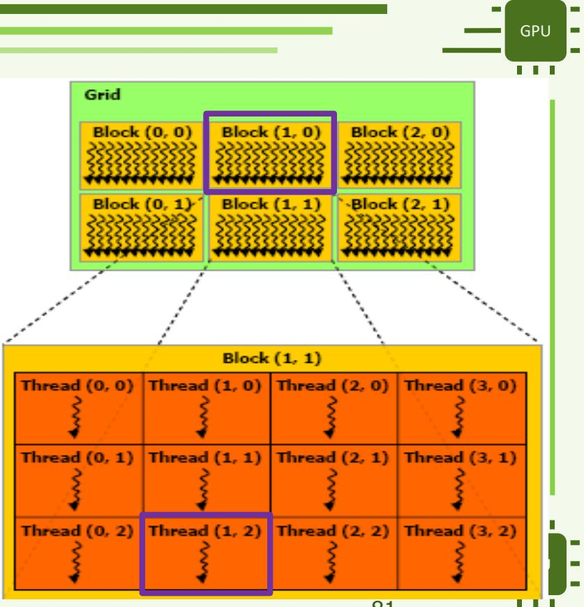

# APM : Révision du DST

Cours, exercices corrigés et autoévaluation · 22 octobre 2026

## 0 Périmètre de révision et documents

### 0.1 Séances prévues avant le contrôle

Le calendrier photographié en cours indique un **DST le matin du 22 octobre 2026**. Les séances ci-dessous déterminent l'ordre de révision. Ce calendrier ne précise pas un programme exhaustif du contrôle, sa durée, la forme des questions ou les documents autorisés.

| Date | Matin | Après-midi |
|---|---|---|
| 2026-09-25 | CM1 : architecture GPU et premier code CUDA | TD1 : grille et compréhension du code CUDA |
| 2026-09-29 | CM2 : hiérarchie mémoire et API CUDA | TD2 : approximation de π par Monte Carlo multithread |
| 2026-10-09 | CM3 : Driver API, multi-GPU et OpenMP Target | TP1 : DGEMM |
| 2026-10-22 | DST | TP2 : DGEMM optimisé, accès coalescés et mémoire partagée |
| 2026-11-05 | TP3 : calcul d'occupation GPU, 1D Tiling ; TP noté | Répartition non précisée davantage |

**Parcours principal :** comprendre les notions et le déroulement d'un programme des CM1-CM3, puis refaire les questions Q1-Q9 du TD1, Q1-Q6 du TD2 et Q1-Q12 du TP1 de cette année. La partie OpenMP Target du CM3 est complétée à partir du calendrier et de l'exemple local disponible.

**Entraînement complémentaire :** les anciens exercices sur DGEMM en mémoire partagée, les streams et les fonctions de distance 3D permettent de réutiliser ces méthodes. Les TP consacrés à l'optimisation de DGEMM et au calcul d'occupation sont programmés après le DST ; leurs implémentations détaillées ne sont donc pas la première priorité. Les concepts de mémoire partagée, de coalescence, de warp et d'occupation déjà abordés au CM2 restent à réviser.

Voir la [photo du calendrier](Images/calendrier_cours_2026.jpg). Les chapitres 1-3 regroupent les cours, le chapitre 4 conserve les numéros des exercices, et le chapitre 5 sert à s'entraîner sans consulter les réponses. Les deux langues suivent la même numérotation ; le code, les variables, les formules et les valeurs se correspondent.

### 0.2 Documents utiles et correspondance

| Document | Version et utilisation | Partie du dossier |
|---|---|---|
| [Diapositives CM1](../CM/APM_Cours1_en.pdf) | Version de 96 pages, avec le complément sur les ordonnanceurs Kepler | Chapitre 1 |
| [Cours CM1 en chinois](../CM/APM_Cours1_zh.md) | Explications de séance intégrées ; l'ancienne extraction franco-anglaise correspond à 93 pages | Explications et vérification du chapitre 1 |
| [Diapositives CM2](../CM/APM_Cours2.pdf) et [cours chinois](../CM/APM_Cours2_zh.md) | PDF actuel de 98 pages, numérotation des warps et chronométrage par événements | Chapitre 2 |
| [Diapositives CM3](../CM/APM_Cours3.pdf) et [cours chinois](../CM/APM_Cours3_zh.md) | 101 pages ; certaines descriptions d'API nécessitent une qualification historique | Chapitre 3 |
| [Énoncé TD1](../TD1%20%20APM/td1.pdf) et [réponses existantes](../TD1%20%20APM/td1.md) | 2026-2027, Q1-Q9 | Exercices de l'année, chapitre 4 |
| [Énoncé TD2](../TD2/TD2/SUJET/td2.pdf) et [code CPU](../TD2/TD2/CODE/pi.c) | 2026-2027, Monte Carlo, Q1-Q6 | Exercices de l'année, chapitre 4 |
| [Énoncé TP1](../TP1/SUJET/tp1.pdf), [réponses françaises](../TP1/SUJET/tp1.md), [réponses chinoises](../TP1/SUJET/tp1_zh.md) | 2026-2027, compilation et DGEMM en mémoire globale, Q1-Q12 | Exercices de l'année, chapitre 4 |
| [Exemple OpenMP Target](../cmexos/ompgpuecAdd.c) | Addition vectorielle, map et vérification du lieu d'exécution | OpenMP Target, chapitre 3 |
| [Ancien corrigé TP1](../TDTP2025/TP/tp1_correction.pdf) | En-tête 2024-2025, optimisation avec mémoire partagée | Compléments, chapitre 4 |
| [Ancien sujet TP2](../TDTP2025/TP/tp2_sujet_2025-2026.pdf) et [ancien corrigé](../TDTP2025/TP/tp2_correction.pdf) | Sujet 2025-2026 et corrigé 2024-2025 : documents d'années différentes | Complément streams, chapitre 4 |
| [Ancien sujet TD](../TDTP2025/TD/td2.pdf) | 2025-2026, fonction de distance 3D, différent du TD2 Monte Carlo actuel | Complément SDF, chapitre 4 |

Les diapositives originales, les traductions existantes, les programmes et les archives de mesures restent à leur emplacement. Ce dossier regroupe les diapositives répétées, réorganise les thèmes pour la révision et rapproche chaque question de son explication. Les liens permettent de retrouver la formulation originale, les figures complètes ou les journaux de mesures. Les transcriptions de séance éclairent le contexte ; leurs nombres oraux ne servent pas de spécifications précises.

### 0.3 Utiliser les deux versions

Une première lecture en chinois permet de comprendre le déroulement des calculs et de retrouver les termes français. À la deuxième lecture, partir directement de l'énoncé français, écrire les indices, les formules et les déplacements de données sur papier, puis vérifier la réponse. Le chapitre 5 permet enfin de vérifier que l'on sait expliquer les raisons d'un choix.

Pour rédiger une réponse CUDA, préciser successivement le travail d'un thread, le passage des coordonnées aux indices, l'emplacement des données CPU/GPU, les dépendances entre opérations, puis la vérification du résultat et le périmètre du chronométrage. Lorsqu'un énoncé fixe un stockage matriciel, un nombre de threads ou une caractéristique matérielle, utiliser cette hypothèse. Une valeur donnée pour une génération de GPU ne constitue pas une constante universelle.

Les remarques signalées comme explications ou corrections lèvent une omission, une différence de version ou une erreur manifeste du support. Les nouveaux exemples de code ne sont pas accompagnés d'une affirmation d'exécution GPU dans cette préparation.

## 1. Architectures et premiers programmes CUDA

Ce chapitre rassemble les notions du CM1 nécessaires pour expliquer un accélérateur, lire une architecture NVIDIA et écrire un premier kernel. La référence principale est le [CM1 de 96 pages](../CM/APM_Cours1_en.pdf). Les chiffres d'architecture ci-dessous sont les exemples du cours, pas une fiche des GPU actuellement disponibles.

### 1.1. Pourquoi utiliser un accélérateur ?

Un **accélérateur** est une ressource de calcul conçue pour une classe de travaux particulière. Il peut être séparé du processeur principal ou intégré avec lui. Son intérêt vient du compromis matériel choisi : consacrer davantage de ressources au calcul adapté à son domaine, au prix d'une moindre généralité.

Le CPU convient à la conduite générale du programme, au contrôle complexe et aux tâches peu parallèles. Un GPU recherche surtout un débit élevé en faisant progresser de nombreux threads. Une boucle contenant beaucoup d'opérations indépendantes sur des tableaux est donc un bon point de départ pour comprendre le calcul GPU.

Cela ne suffit pas à garantir une accélération. Pour un appel isolé avec des transferts explicites, on peut décomposer le temps ainsi :

$$
T_{GPU}=T_{init}+T_{H\to D}+T_{kernel}+T_{D\to H}.
$$

Ici, le temps d'initialisation regroupe les préparations retenues dans la mesure, par exemple les allocations. Cette égalité est un modèle pédagogique sans recouvrement entre les phases. Elle montre pourquoi un kernel rapide peut donner un programme complet lent. Réutiliser des données déjà présentes sur le GPU peut éviter des transferts répétés.

**Question type.** Une boucle est parallélisable : faut-il nécessairement l'envoyer au GPU ? **Réponse.** Il faut aussi considérer la taille du travail, le coût des transferts, les dépendances, la régularité des accès et le temps total de l'application.

### 1.2. Familles d'accélérateurs et interconnexions

| Ressource | Idée essentielle | Point à retenir |
| --- | --- | --- |
| CPU | Traitement général et contrôle du programme | Le programme hôte organise le travail |
| GPU | Nombreux threads et calcul sur des données régulières | Exposer assez de parallélisme et organiser les accès mémoire |
| MIC / Xeon Phi | De nombreux cœurs x86, avec multithreading et cohérence des caches | Exemple historique d'une autre approche du calcul fortement parallèle |
| Cell | Un processeur maître et des unités spécialisées SPE | Exemple historique de répartition explicite du travail |
| FPGA | Logique reconfigurable | La structure matérielle peut être adaptée à un traitement ; le CM1 le cite sans détailler sa programmation |

Le cours oppose deux tendances de connexion. Une carte raccordée au bus système, par exemple PCIe, est relativement facile à intégrer mais les communications ont un coût. Une intégration plus étroite avec le processeur permet des liens et des partages de ressources adaptés, au prix d'une intégration plus complexe.

**Ne pas confondre proximité et coût nul.** Un CPU et un GPU proches physiquement peuvent encore accéder à des régions mémoire différentes. Une interface cohérente ne supprime ni les effets de localisation des données ni le besoin d'attendre la fin d'un calcul avant d'en utiliser les résultats.

### 1.3. Du GPU au thread : les niveaux à distinguer

Un GPU NVIDIA contient plusieurs **SM** (*Streaming Multiprocessors*). Un SM possède des unités de calcul, des ordonnanceurs et des ressources mémoire. Les threads d'un bloc exécutent leur travail sur un même SM dans le modèle de base étudié ici ; un SM peut accueillir plusieurs blocs si ses ressources le permettent.

Un **thread** est une instance logique du kernel. Un **cœur CUDA** est une unité matérielle de calcul. Il n'existe donc pas une correspondance permanente « un thread = un cœur ». Le nombre de threads lancés peut largement dépasser le nombre d'unités de calcul, et les blocs peuvent être exécutés en plusieurs vagues.

Un **warp** regroupe 32 threads d'un même bloc. Pour un bloc multidimensionnel, les threads sont regroupés selon leur numéro local linéaire, avec `x` variant le plus vite. Le modèle **SIMT** présente des threads distincts au programmeur, tout en exécutant leurs instructions par groupes.

Si des threads d'un même warp suivent des branches différentes, les chemins concernés peuvent devoir progresser séparément avec des ensembles de threads actifs différents. Il faut donc distinguer la correction d'un `if` de son coût : `if (i < N)` reste nécessaire pour protéger les accès aux limites.

**À éviter :** affirmer que le GPU ne peut pas exécuter de branchement, que tous les threads de la grille travaillent simultanément, ou que les threads d'un warp peuvent communiquer sans respecter les règles de synchronisation.

### 1.4. Kepler : lire l'exemple du cours

Les pages 35-39 présentent un exemple Kepler : 15 SMX, avec 192 unités FP32, 64 unités FP64, 32 SFU et 32 unités de chargement/stockage par SMX. Ces nombres décrivent la figure du cours et ne sont pas des constantes du modèle CUDA.

Le point ajouté dans la version de 96 pages concerne l'ordonnancement :

- 4 ordonnanceurs de warps par SMX ;
- 8 unités de dispatch, soit 2 par ordonnanceur ;
- chaque ordonnanceur choisit un warp ;
- deux instructions indépendantes de ce warp **peuvent** être dispatchées dans un cycle si les conditions le permettent.



*Figure 1. Extrait de la page 38 : un ordonnanceur et ses deux unités de dispatch. Une paire d'instructions peut provenir du même warp ; les couleurs distinguent les warps sélectionnés au fil du temps.*

« Deux instructions possibles » ne signifie pas « deux instructions toujours exécutées ». Une dépendance entre instructions ou une ressource indisponible peut empêcher ce débit. Le nombre d'ordonnanceurs ne donne pas non plus le nombre maximal de warps résidents.

La hiérarchie mémoire distingue les caches, gérés par le matériel, et la mémoire partagée, explicitement utilisée par le programme. Même lorsqu'ils partagent des ressources physiques, L1 et mémoire partagée n'ont pas la même fonction logicielle. Une lecture de mémoire globale ne cherche pas automatiquement ses données dans une variable `__shared__`.

### 1.5. Volta, Ampere, Hopper et intégration CPU-GPU

Les schémas suivants du CM1 illustrent une organisation hiérarchique : **GPC → TPC → SM**. On peut calculer un nombre de SM à partir d'un schéma, à condition de préciser que l'on décrit ce schéma.

| Figure du cours | Calcul des SM représentés | Idée à apprendre |
| --- | --- | --- |
| Volta, page 40 | `6 × 7 × 2 = 84` | Plusieurs niveaux de regroupement et apparition des Tensor Cores dans la présentation |
| Ampere, pages 42-43 | `8 × 8 × 2 = 128` | Un SM comporte plusieurs sous-ensembles de traitement |
| Hopper, pages 44-45 | `8 × 9 × 2 = 144` | Des unités distinctes réalisent différents types d'opérations |

Ces valeurs ne donnent pas automatiquement le nombre de SM actifs d'une carte commercialisée. De même, les performances maximales affichées page 46 dépendent du type d'opération et de la précision. On ne peut pas additionner des pics FP32, FP64 et Tensor Core pour obtenir la performance d'un programme.

La page 46 compare aussi les formats : FP32 possède 8 bits d'exposant et 23 bits de fraction ; TF32 conserve 8 bits d'exposant avec 10 bits de fraction ; FP16 utilise 5 bits d'exposant et 10 bits de fraction. Il faut distinguer l'étendue des valeurs représentables de leur précision. Les valeurs en bits ici n'incluent pas le bit de signe.

Pour Grace-Hopper, retenir surtout l'association d'un CPU et d'un GPU par une interconnexion cohérente. Le support chinois contient une mise au point : proximité dans un assemblage, même puce de silicium et partage d'une même région mémoire sont des notions différentes. La localisation mémoire et les effets NUMA restent pertinents ; ne pas apprendre littéralement la formule « même die » de la page 47.

### 1.6. Choisir un modèle de programmation

| Approche | Exemples du CM1 | Travail exprimé par le programmeur |
| --- | --- | --- |
| Programmation explicite du GPU | CUDA, HIP | Kernels, organisation des threads et gestion des données |
| Interface portable de bas niveau | OpenCL | Calcul et ressources selon une interface commune |
| Directives | OpenMP Target, OpenACC | Régions à déporter, boucles parallèles et transferts |
| Abstractions de plus haut niveau | Kokkos, RAJA, SYCL | Calcul exprimé via une bibliothèque ou une abstraction et traduit vers une cible |

Avec CUDA, le programmeur écrit le travail d'un thread puis choisit la grille et les blocs. Avec une approche à directives, il annote des régions ou des boucles ; le compilateur prend en charge une partie de leur mise en œuvre sur la cible. Le CM3 développe OpenMP Target séparément.

**Trois objectifs distincts :** compiler sur une nouvelle machine, obtenir un résultat correct et y atteindre de bonnes performances. Une interface portable aide au premier objectif ; elle ne garantit pas à elle seule les deux autres. Les dépendances entre itérations et les déplacements de données doivent rester compris.

### 1.7. Le rôle du host et du device

Le **host** est la partie exécutée sur le CPU. Le **device** est l'accélérateur. Dans les premiers exemples du cours, le host prépare les entrées, alloue la mémoire du device, transfère les données, lance le kernel puis récupère les résultats.

| Étape | Ressource / opération | Pourquoi ? |
| --- | --- | --- |
| 1 | Tableaux hôtes initialisés | Fournir les entrées et recevoir la sortie |
| 2 | `cudaMalloc` | Créer les tableaux dans la mémoire du device |
| 3 | `cudaMemcpyHostToDevice` | Transférer les entrées nécessaires au calcul |
| 4 | `kernel<<<grid, block>>>(...)` | Demander l'exécution du kernel |
| 5 | Attente appropriée puis copie vers le host | Ne lire qu'un résultat terminé |
| 6 | `cudaFree` puis libération côté host | Fermer le cycle de vie des ressources |

Un pointeur `d_a` est une variable du programme hôte contenant l'adresse d'une allocation du device dans cet exemple. Copier la valeur du pointeur n'est pas copier les éléments du tableau. Un paramètre scalaire, comme `N`, est transmis avec les arguments du kernel ; un tableau nécessite que ses éléments soient accessibles au device.

Dans `c[i] = a[i] + b[i]`, l'ancienne valeur de `c[i]` n'est pas lue : il faut allouer `d_c`, mais il est inutile de copier le tableau `c` vers le GPU avant le calcul. Cette conclusion changerait pour `c[i] += a[i]`.

### 1.8. Grille, blocs et coordonnées

La grille contient des blocs, et chaque bloc contient des threads. Les dimensions `x`, `y`, `z` sont une organisation logique choisie au lancement ; elles ne représentent pas une direction physique imposée dans le GPU.

| Nom | Signification | Exemple |
| --- | --- | --- |
| `gridDim` | Nombre de blocs selon chaque dimension | `(3, 2, 1)` |
| `blockIdx` | Coordonnées du bloc courant | `(1, 0, 0)` |
| `blockDim` | Nombre de threads du bloc selon chaque dimension | `(4, 3, 1)` |
| `threadIdx` | Coordonnées du thread dans son bloc | `(1, 2, 0)` |

Les coordonnées commencent à zéro. Ainsi, `0 <= threadIdx.x < blockDim.x`. Le programme hôte utilise couramment `dim3` pour construire les dimensions de lancement ; les composantes non indiquées à sa construction valent 1.

```cpp
dim3 grid(3, 2);
dim3 block(4, 3);
my_kernel<<<grid, block>>>(/* arguments */);
```

Ce lancement crée `3 × 2 = 6` blocs, `4 × 3 = 12` threads par bloc et `6 × 12 = 72` threads au total. Il ne promet pas que les 72 threads exécutent la même instruction au même instant.

### 1.9. Une dimension : couvrir exactement le domaine utile

Avec une grille et des blocs à une dimension, le numéro global usuel est :

$$
i=\texttt{blockIdx.x}\times\texttt{blockDim.x}+\texttt{threadIdx.x}.
$$

Pour un tableau de `N` éléments et `B` threads par bloc, on lance suffisamment de blocs pour couvrir le tableau :

$$
G=\left\lceil\frac{N}{B}\right\rceil,
\qquad G=(N+B-1)/B\quad(N>0,\ B>0).
$$

La seconde expression utilise une division entière. Exemple : `N = 1000`, `B = 256`, donc `G = 4`. Le lancement crée 1024 threads ; 1000 traitent une valeur, et les 24 derniers ne doivent pas accéder au tableau. Le test est **`i < N`**, pas `i <= N`. Pour `N = 0`, on évite le lancement dans l'exemple donné plus bas.

Le contrôle des bornes empêche un accès en trop ; il ne répare pas un nombre insuffisant de threads. Avec seulement 3 blocs de 256 threads, les éléments 768 à 999 ne seraient pas calculés.

### 1.10. Deux dimensions : deux numérotations différentes

Le CM1 déroule l'exemple `grid = (3, 2)`, `block = (4, 3)`, `blockIdx = (1, 0)`, `threadIdx = (1, 2)`. Pour numéroter les threads **bloc par bloc**, avec `x` variant le plus vite :

$$
b=\texttt{blockIdx.y}\times\texttt{gridDim.x}+\texttt{blockIdx.x}=1,
$$
$$
t=\texttt{threadIdx.y}\times\texttt{blockDim.x}+\texttt{threadIdx.x}=9,
$$
$$
T=\texttt{blockDim.x}\times\texttt{blockDim.y}=12,
\qquad g=bT+t=21.
$$



*Figure 2. Exemple du CM1, pages 77-84 : combiner le numéro du bloc et celui du thread. Le titre de l’agrandissement indique « Block (1,1) », mais la grille sélectionne (1,0) : les calculs suivent le bloc (1,0).*

Pour traiter une matrice en associant `x` aux colonnes et `y` aux lignes, on calcule plutôt les coordonnées des données :

$$
\begin{aligned}
x&=\texttt{blockIdx.x}\times\texttt{blockDim.x}+\texttt{threadIdx.x}=5,\\
y&=\texttt{blockIdx.y}\times\texttt{blockDim.y}+\texttt{threadIdx.y}=2.
\end{aligned}
$$

Dans une matrice stockée par lignes de largeur `W = 12`, l'élément correspondant est `p = y × W + x = 29`. **21 et 29 ne répondent pas à la même question** : le premier est une numérotation par blocs, le second est une adresse linéaire selon l'organisation de la matrice. Il faut annoncer la convention avant de calculer.

### 1.11. Généralisation à trois dimensions

Pour une numérotation par blocs avec `x` le plus rapide, puis `y`, puis `z` :

```cpp
int block_id = (blockIdx.z * gridDim.y + blockIdx.y)
               * gridDim.x + blockIdx.x;
int thread_id = (threadIdx.z * blockDim.y + threadIdx.y)
                * blockDim.x + threadIdx.x;
int threads_per_block = blockDim.x * blockDim.y * blockDim.z;
int global_id = block_id * threads_per_block + thread_id;
```

La multiplication par une dimension signifie : sauter tous les éléments déjà parcourus dans les dimensions plus rapides. Ces expressions supposent de petites dimensions permettant de rester dans la capacité d'un `int` ; pour de grands domaines, il faut aussi choisir un type entier suffisamment large.

Vérification rapide : `grid = (2, 3, 2)`, `block = (4, 2, 2)`, `blockIdx = (1, 2, 1)`, `threadIdx = (3, 1, 1)`. On obtient `block_id = 11`, `thread_id = 15`, `threads_per_block = 16`, `global_id = 191`. Il y a 192 threads au total : le dernier numéro est donc bien 191.

### 1.12. Addition de vecteurs : suivre tout le trajet des données

Le fragment ci-dessous exprime le cycle complet d'une opération, avec `a`, `b`, `c` déjà alloués côté host. Il adapte le CM1 en calculant la taille de grille et en conservant un nom unique pour le kernel. Pour garder le trajet des données visible, la gestion détaillée des erreurs CUDA est omise ; ce fragment ne constitue pas un compte rendu d'exécution GPU.

```cpp
#include <cuda_runtime.h>
#include <cstddef>

__global__ void vecAddKernel(const double *a, const double *b,
                             double *c, int N)
{
    std::size_t i = std::size_t(blockIdx.x) * blockDim.x + threadIdx.x;
    if (i < std::size_t(N)) {
        c[i] = a[i] + b[i];
    }
}

void vector_add(const double *a, const double *b, double *c, int N)
{
    if (N <= 0) {
        return;
    }
    std::size_t bytes = std::size_t(N) * sizeof(double);
    double *d_a = nullptr;
    double *d_b = nullptr;
    double *d_c = nullptr;

    cudaMalloc((void **)&d_a, bytes);
    cudaMalloc((void **)&d_b, bytes);
    cudaMalloc((void **)&d_c, bytes);
    cudaMemcpy(d_a, a, bytes, cudaMemcpyHostToDevice);
    cudaMemcpy(d_b, b, bytes, cudaMemcpyHostToDevice);

    int B = 256;
    int G = N / B + (N % B != 0);
    vecAddKernel<<<G, B>>>(d_a, d_b, d_c, N);
    cudaMemcpy(c, d_c, bytes, cudaMemcpyDeviceToHost);

    cudaFree(d_a);
    cudaFree(d_b);
    cudaFree(d_c);
}
```

Le calcul de `G` évite ici l'addition `N + B - 1` et son éventuel dépassement de capacité. La copie bloquante vers le host, placée après le kernel dans le même flux par défaut, permet d'utiliser les résultats après son retour réussi. Dans un programme réel, vérifier chaque appel CUDA et les erreurs de lancement et d'exécution avant de conclure que le résultat est valide.

`__global__` déclare le kernel exécuté sur le device. Les chevrons `<<<G, B>>>` indiquent la configuration de lancement ; un appel ordinaire `vecAddKernel(...)` ne remplace pas cette syntaxe. Un fichier CUDA est normalement confié à `nvcc`, qui organise la compilation des parties host et device.

### 1.13. Questions de contrôle et erreurs fréquentes

1. **Pourquoi chaque thread ne contient-il pas la boucle complète sur `N` ?** Dans cette décomposition, chaque thread traite son propre indice ; répéter toute la boucle dans tous les threads reproduirait le travail et provoquerait des écritures concurrentes.
2. **Un thread peut-il traiter plusieurs éléments ?** Oui. « Un thread par élément » est la décomposition de l'exemple, pas une obligation du langage ; un kernel peut contenir des boucles.
3. **`<<<32, 64>>>` suffit-il pour n'importe quel `N` ?** Non : ce lancement couvre 2048 indices avec la formule à un élément par thread. Il faut vérifier la couverture et les bornes.
4. **Un bloc de 48 threads contient combien de warps ?** Deux : un warp de 32 threads et un second dont 16 positions correspondent à des threads du bloc. Des threads de deux blocs différents ne sont pas réunis pour compléter ce warp.
5. **Pourquoi le tableau `c` n'est-il pas copié vers le GPU ?** Le kernel écrit tous les éléments utiles sans lire leur ancienne valeur. L'allocation reste indispensable.
6. **Les dimensions 2D imposent-elles un tableau 2D ?** Non. Le programmeur définit le lien entre coordonnées CUDA et données, puis vérifie que chaque donnée utile est traitée correctement.
7. **La grille garantit-elle l'ordre des blocs ?** Non. Ne pas faire dépendre la correction d'un ordre implicite d'exécution des blocs dans le modèle de base.

### 1.14. Repères dans les sources

| Notion | Pages du CM1 actuel |
| --- | --- |
| Accélérateurs, connexions, host/device | 8-19 ; exemples d'intégration 24-30 |
| Architecture NVIDIA et Kepler | 34-39, dont l'ajout de la page 38 |
| Volta, Ampere, Hopper, Grace-Hopper | 40-47 |
| Modèles de programmation | 49-52 |
| Cycle de vie des données et compilation | 55-70 |
| Threads, indices, lancement et programme | 71-96 |

La page 87 présente également le **thread block cluster**, un regroupement entre grille et blocs, avec des mécanismes de lancement supplémentaires. Le présent chapitre garde ce repère sans reprendre son attribution historique à Blackwell comme un fait vérifié. Les graphiques Top500 et les tableaux de pics servent de contexte historique et ne sont pas développés en données actuelles.

Pour reprendre les explications en détail : [CM1 actuel](../CM/APM_Cours1_en.pdf), [support chinois enrichi](../CM/APM_Cours1_zh.md), [ancienne extraction](../CM/APM_Cours1.md). L'ancienne extraction repose sur 93 pages et ne remplace pas le PDF actuel. Les exemples de calcul et les mises en garde de ce chapitre sont des reformulations pédagogiques ; ils ne constituent pas une liste officielle de questions d'examen.

## 2. CUDA avancé : mémoire, exécution et synchronisation

Source principale : [CM2, PDF de 98 pages](../CM/APM_Cours2.pdf), version du 29 septembre 2026. Les ajouts des pages 8 et 53 et la signature de la page 95 sont intégrés. Cette synthèse regroupe les animations successives ; les exemples réécrits servent à comprendre et n'ont pas été exécutés pour ce dossier.

### 2.1 Attributs de fonctions et structure d'un noyau

Source : CM2, p. 3-7.

| Déclaration | Lieu d'exécution | Usage dans le cours |
|---|---|---|
| `__host__` ou aucun attribut | CPU | Fonction appelée par le programme hôte |
| `__device__` | GPU | Fonction auxiliaire appelée par du code GPU |
| `__global__` | GPU | Noyau lancé depuis l'hôte avec `<<<...>>>` |
| `__host__ __device__` | CPU ou GPU | Deux versions compilées selon le lieu d'appel |

Un appel ordinaire à une fonction `__device__` ne lance pas une nouvelle grille. Un noyau `__global__` retourne `void` ; il produit ses résultats en écrivant dans les buffers transmis. Son lancement est asynchrone par rapport au CPU. Les restrictions historiques de la p. 7 doivent être lues dans le modèle de programmation utilisé en cours, sans en faire une liste universelle pour toutes les versions de CUDA.

```cpp
__global__ void vecAdd(const double *a, const double *b,
                       double *c, int n) {
    int i = blockIdx.x * blockDim.x + threadIdx.x;
    if (i < n) {
        c[i] = a[i] + b[i];
    }
}
```

Le test `i < n` protège le dernier bloc lorsque la taille du problème n'est pas un multiple de la taille du bloc. Il ne doit pas être supprimé simplement pour éviter un branchement.

### 2.2 Indices, types vectoriels et numérotation des warps

Source : CM2, p. 8-9 et p. 53, ajout de 2026.

| Objet | Signification |
|---|---|
| `threadIdx.x/y/z` | Coordonnées du thread dans son bloc |
| `blockIdx.x/y/z` | Coordonnées du bloc dans la grille |
| `blockDim.x/y/z` | Dimensions d'un bloc |
| `gridDim.x/y/z` | Dimensions de la grille |
| `dim3` | Type de dimensions dont les composantes omises valent 1 |
| `int2`, `float4`, `make_int2(x, y)` | Types vectoriels et fonction de construction |

L'ordre linéaire des threads d'un bloc fait varier `x` en premier, puis `y`, puis `z`. Un warp regroupe 32 indices linéaires consécutifs.

$$
t=x+D_x(y+D_y z),\qquad w=\lfloor t/32\rfloor,\qquad \ell=t\bmod32.
$$

Pour `blockDim = (4, 4, 2)`, on obtient `t = x + 4y + 16z` : `(3,1,0)` donne 7 et `(0,0,1)` donne 16. Le bloc comporte 32 threads, soit un warp. La mention « tid (global) » du schéma de la p. 53 représente ici un indice dans le bloc, sans terme `blockIdx` ; la formule permet de lever les ambiguïtés de ses coordonnées dessinées.

Les types vectoriels imposent des règles d'alignement. Écrire `float4` ne garantit ni une instruction arithmétique vectorielle ni un gain de temps ; il faut que l'accès, l'alignement et le code produit s'y prêtent. La p. 8 ajoute un exemple de lecture vectorisée.

### 2.3 Hiérarchie mémoire : portée et durée de vie

Source : CM2, p. 11-19 et 55-58.

| Espace | Visible par | Durée/usage à retenir |
|---|---|---|
| Registres | Un thread | Variables privées ; ressource limitée sur le SM |
| Mémoire locale | Un thread | Tableaux privés ou débordements de registres ; « locale » ne signifie pas mémoire rapide sur puce |
| Mémoire partagée, `__shared__` | Threads d'un même bloc | Une instance par bloc, jusqu'à la fin du bloc |
| Mémoire globale | Threads ayant accès à l'allocation | Grands tableaux ; allocation et libération explicites |
| Mémoire constante, `__constant__` | Lecture par le GPU | Données mises à jour depuis l'hôte ; lecture commune favorable |
| Texture / cache de lecture seule | Lectures selon le mécanisme utilisé | Chemin de lecture et règles spécifiques ; ne remplace pas la synchronisation |

Deux blocs résidant sur le même SM ne partagent pas automatiquement leur tableau `__shared__`. La grille et les blocs sont des objets logiciels ; un SM est une ressource matérielle. Une variable locale simple peut être placée dans un registre, mais cette localisation n'est pas garantie pour toutes les variables.

La mémoire constante est intéressante quand les threads d'un warp lisent la même adresse ; des adresses différentes peuvent réduire cet avantage. Les tailles de caches et leurs relations physiques avec la mémoire partagée dépendent de l'architecture.

### 2.4 Allocation et copies : taille en octets et propriété du pointeur

Source : CM2, p. 20-24 et 30-33.

```cpp
double *d_a = nullptr;
size_t bytes = n * sizeof(double);
cudaMalloc((void **)&d_a, bytes);
cudaMemcpy(d_a, h_a, bytes, cudaMemcpyHostToDevice);
cudaMemcpy(h_a, d_a, bytes, cudaMemcpyDeviceToHost);
cudaFree(d_a);
```

`cudaMalloc` reçoit l'adresse de la variable pointeur pour y écrire l'adresse de l'allocation. `cudaMemcpy` reçoit les adresses des données : `d_a`, et non `&d_a`. `count` est un nombre d'octets. Les quatre directions présentées sont `cudaMemcpyHostToDevice`, `cudaMemcpyDeviceToHost`, `cudaMemcpyHostToHost` et `cudaMemcpyDeviceToDevice`.

Dans le modèle de mémoire séparée du cours, un pointeur obtenu par `cudaMalloc` ne peut pas être déréférencé par une boucle CPU ordinaire. Conserver les données sur le GPU entre plusieurs calculs réduit les transferts inutiles.

### 2.5 Allocation 2D/3D et pitch

Source : CM2, p. 25-40.

`cudaMallocPitch(&ptr, &pitch, width, height)` alloue des lignes alignées. `width` est la largeur utile en octets ; `pitch` est la distance réelle en octets entre deux débuts de ligne, padding inclus. `height` compte les lignes. Le pitch n'est ni le nombre d'éléments ni la seule taille du padding.

```cpp
float *d_a = nullptr;
size_t pitch = 0;
size_t widthBytes = width * sizeof(float);
cudaMallocPitch((void **)&d_a, &pitch, widthBytes, height);
cudaMemcpy2D(d_a, pitch, h_a, widthBytes,
             widthBytes, height, cudaMemcpyHostToDevice);
```

Dans un noyau, l'adresse de la ligne `row` s'obtient en effectuant d'abord le décalage en octets :

```cpp
float *line = (float *)((char *)d_a + row * pitch);
float value = line[col];
```

Exemple : 100 `float` occupent 400 octets utiles. Si le pitch retourné vaut 512 octets, la ligne suivante commence à `base + 512`, et non `base + 400`. La valeur 512 est un exemple, pas une règle matérielle.

`cudaMemcpy2D` accepte un pitch source et un pitch destination distincts ; il copie seulement la largeur utile sur le nombre de lignes demandé. Pour la copie retour, le buffer hôte compact conserve son propre pitch de 400 octets dans cet exemple.

En 3D, `cudaMalloc3D` utilise `cudaExtent` et retourne un `cudaPitchedPtr` ; pour une allocation linéaire, la largeur est en octets. Le pas d'une tranche se déduit du pitch de ligne et de la hauteur stockée. `cudaMemcpy3D` regroupe positions, pointeurs ou tableaux CUDA, étendue et direction dans `cudaMemcpy3DParms`. Les `cudaArray` sont des objets spécialisés ; ils ne se manipulent pas comme un simple tableau C.

### 2.6 Mémoire unifiée et coût des migrations

Source : CM2, p. 41-50.

La mémoire unifiée, introduite dans le cours avec CUDA 6.0, permet d'utiliser un même pointeur avec l'hôte et le GPU via `cudaMallocManaged` ou une variable `__managed__`. Le système gère l'accès et, selon la plateforme, les déplacements des données. Cela réduit la gestion manuelle, pas nécessairement le coût des transferts.

```cpp
int *a = nullptr;
cudaMallocManaged((void **)&a, n * sizeof(int));
kernel<<<grid, block>>>(a);
cudaDeviceSynchronize();
consume_on_cpu(a);
cudaFree(a);
```

`cudaMemAttachGlobal` et `cudaMemAttachHost` expriment des règles d'association et d'accès ; ils ne signifient pas simplement « allouer physiquement sur GPU » ou « allouer physiquement sur CPU ». Le CPU doit attendre la fin du calcul avant de lire son résultat.

Les p. 46-50 comparent une alternance répétée GPU → CPU sur le même tableau à des phases regroupées. Le ping-pong peut provoquer des migrations répétées. Regrouper les accès est intéressant uniquement si les dépendances du programme autorisent ce changement d'ordre ; si chaque étape CPU prépare l'entrée GPU suivante, on ne peut pas déplacer toutes les étapes CPU à la fin.

### 2.7 Coalescence des accès globaux

Source : CM2, p. 51-54 ; ajout sur la numérotation des threads p. 53.

Pour analyser un chargement, écrire l'adresse lue par chaque thread d'un même warp lors de la même instruction. Des adresses proches et bien alignées demandent généralement moins de transactions que des adresses dispersées. La contiguïté entre les accès successifs d'un seul thread ne suffit pas.

Pour une matrice en ordre des lignes :

$$
\operatorname{addr}(r,c)=\operatorname{base}+(rN+c)\,s.
$$

`N` est le nombre de colonnes et `s` la taille d'un élément. Si les threads voisins font varier `c`, l'écart vaut `s`. S'ils font varier `r`, l'écart vaut `Ns`. Le premier cas favorise la coalescence ; le second peut disperser les transactions.

Les p. 52-53 citent 128 octets, des paquets de 32 octets et jusqu'à deux instructions par ordonnanceur. Ce sont les indications de la diapositive, pas des constantes universelles pour tous les GPU. Le nombre exact de transactions dépend notamment de l'architecture, de la largeur d'accès et de l'alignement.

La mémoire partagée permet de charger une tuile avec des accès globaux coalescés, puis de réutiliser ou réorganiser les données dans le bloc. Charger des éléments supplémentaires peut être utile, mais doit se justifier par une réduction du coût total.

### 2.8 Mémoire partagée et conflits de banques

Source : CM2, p. 54-58 et 98. Le modèle de banques ci-dessous est une explication de révision, pas une nouvelle mesure du cours.

Un conflit se produit lorsque plusieurs accès d'une même opération doivent utiliser une même banque pour des adresses distinctes, ce qui peut sérialiser le service. Il faut distinguer ce problème de la coalescence en mémoire globale.

Sous l'hypothèse simplifiée de 32 banques et de mots de 4 octets :

$$
\operatorname{bank}(a)=\left\lfloor a/4\right\rfloor\bmod32.
$$

Pour `float tile[32][32]`, lire une colonne avec `tile[threadIdx.x][col]` donne un pas de 32 mots : toutes les adresses tombent sur la même banque dans ce modèle. Un padding `float tile[32][33]` change le pas et répartit ces accès. Les accès au même mot peuvent bénéficier d'une diffusion ; il ne faut pas les confondre avec des accès à des mots différents d'une banque.

La mémoire partagée dynamique se déclare avec `extern __shared__`. Sa taille est le troisième paramètre du lancement. Si plusieurs tableaux utilisent la même zone, leurs offsets doivent éviter tout chevauchement et respecter l'alignement de chaque type.

### 2.9 Registres, occupation et divergence

Source : CM2, p. 59-60 et 98. Les formules servent à expliciter les contraintes présentées.

Les registres d'un SM sont répartis entre ses threads résidents. Plus un thread consomme de registres, moins il peut rester de place pour d'autres blocs. La mémoire partagée par bloc, le nombre de threads et les limites matérielles de blocs/warps peuvent également limiter la résidence.

$$
\mathrm{occupancy}=W_{\mathrm{resident}}/W_{\max}.
$$

`W_resident` compte les warps résidents et `W_max` le maximum de warps résidents du SM. Un modèle simplifié donne une borne, avant prise en compte des granularités d'allocation :

$$
B_{\mathrm{resident}}\leq\min\left(B_{\max},\left\lfloor T_{\max}/T_b\right\rfloor,\left\lfloor R_{\mathrm{SM}}/(rT_b)\right\rfloor,\left\lfloor S_{\mathrm{SM}}/S_b\right\rfloor\right).
$$

`T_b` est le nombre de threads par bloc, `r` les registres par thread, `S_b` la mémoire partagée par bloc ; le terme partagé est omis si `S_b = 0`. Cette borne n'est pas un prédicteur complet du temps d'exécution.

`--maxrregcount=N` limite les registres ; `__launch_bounds__(maxThreadsPerBlock, minBlocksPerMultiprocessor)` informe le compilateur sur la configuration visée. Réduire excessivement les registres peut provoquer des débordements en mémoire locale. Une occupation supérieure ne garantit pas un noyau plus rapide.

La divergence concerne les chemins suivis par les threads d'un même warp. Des chemins différents peuvent diminuer l'utilisation des unités. Des warps différents peuvent suivre des branches différentes sans créer ce même phénomène. Le but est de réduire la divergence coûteuse, pas d'interdire tous les `if`.

### 2.10 Barrières, visibilité, `volatile` et opérations atomiques

Source : CM2, p. 57, 90 et 93.

| Outil | Garantie/usage | Ce qu'il ne remplace pas |
|---|---|---|
| `__syncthreads()` | Rendez-vous du bloc et visibilité des écritures globales/partagées précédentes concernées | Barrière de toute la grille |
| `__syncthreads_count/and/or` | Barrière avec résultat collectif sur un prédicat | Synchronisation entre blocs |
| `atomicAdd`, `atomicExch`, `atomicCAS`, etc. | Mise à jour atomique de la cible selon le type et la portée supportés | Ordre général de toutes les opérations mémoire |
| `volatile` | Contraintes sur les accès du compilateur | Atomicité, rendez-vous ou protocole de synchronisation |

Les threads d'un bloc doivent rencontrer les barrières selon un contrôle cohérent. Dans un traitement par tuiles, les threads hors limites peuvent charger zéro, puis participer à la même barrière que les autres. Une barrière placée uniquement dans `if (i < n)` devient incorrecte si ce test varie entre les threads du bloc.

**Précision sur la p. 57 :** qualifier un tableau de `volatile` ne répare pas une lecture/écriture concurrente sans synchronisation. Une fence ordonne certains accès mais n'attend pas à elle seule que tous les threads arrivent. Cette distinction est confirmée dans la [documentation NVIDIA sur `volatile`](https://docs.nvidia.com/cuda/cuda-programming-guide/05-appendices/cpp-language-support.html).

`a[i]++` comprend une lecture, une addition et une écriture ; plusieurs threads peuvent perdre des incréments. `atomicAdd(&a[i], 1)` protège cette mise à jour, mais une forte contention sur une adresse peut coûter cher. Réduire localement puis combiner moins de résultats atomiques est une piste, sous réserve de l'ordre d'arrondi acceptable en flottant. Les types et largeurs supportés dépendent de la compute capability.

### 2.11 Asynchronisme, streams et mémoire hôte verrouillée

Source : CM2, p. 62-89. Les p. 68-83 illustrent progressivement une seule chronologie.

Un lancement asynchrone rend la main au CPU avant la fin du travail GPU. Dans un même stream, les opérations restent ordonnées : copie d'entrée → noyau A → noyau B → copie de sortie. Cette propriété vient de l'ordre du stream ; CUDA n'analyse pas les pointeurs pour découvrir arbitrairement les dépendances entre streams.

| API | Usage |
|---|---|
| `cudaStreamCreate/Destroy` | Créer/libérer un stream |
| `cudaMemcpyAsync(..., stream)` | Soumettre une copie dans ce stream |
| `kernel<<<grid, block, sharedBytes, stream>>>(...)` | Soumettre un noyau dans ce stream |
| `cudaStreamSynchronize(stream)` | Attendre ce stream depuis le CPU |
| `cudaDeviceSynchronize()` | Attendre les travaux précédents du contexte courant sur ce GPU |
| `cudaStreamWaitEvent(stream, event, 0)` | Établir une dépendance dans un stream sans attente active du CPU |

Les streams distincts permettent le recouvrement de travaux indépendants si le matériel et les ressources le permettent. Deux streams ne garantissent pas deux noyaux simultanés. Le stream par défaut peut imposer des dépendances suivant son mode ; pour raisonner clairement, utiliser des streams explicites et nommer les dépendances.

```cpp
cudaMemcpyAsync(d_a, h_a, bytes, cudaMemcpyHostToDevice, copyStream);
cudaEventRecord(ready, copyStream);
cudaStreamWaitEvent(computeStream, ready, 0);
kernel<<<grid, block, 0, computeStream>>>(d_a);
```

Ce fragment suppose les streams, l'événement et les buffers déjà créés. Il corrige l'ambiguïté des p. 87-88 si le noyau consomme le buffer copié. L'API correcte est `cudaMemcpyAsync`, et l'équivalent 2D est `cudaMemcpy2DAsync` ; `cudaMemCpy` et `cudaMemcpyPitchAsync` ne sont pas les noms à recopier.

Pour les transferts hôte-GPU réellement asynchrones et leur recouvrement, utiliser une mémoire hôte page-locked, par exemple `cudaMallocHost` puis `cudaFreeHost`. La mémoire pageable peut entraîner une étape intermédiaire ou un blocage. Ne pas modifier/libérer la source H→D avant la fin de la copie ; ne pas lire/réutiliser la destination D→H avant sa fin. Le verrouillage des pages et l'attente de fin répondent à deux besoins différents.

### 2.12 Événements et mesure du temps

Source : CM2, p. 95 ; signature complète visible dans le PDF 2026.

```cpp
cudaEvent_t start, stop;
cudaEventCreate(&start);
cudaEventCreate(&stop);
cudaEventRecord(start, stream);
kernel<<<grid, block, 0, stream>>>(d_a);
cudaEventRecord(stop, stream);
cudaEventSynchronize(stop);
float milliseconds = 0.0f;
cudaEventElapsedTime(&milliseconds, start, stop);
cudaEventDestroy(start);
cudaEventDestroy(stop);
```

Les événements encadrent un intervalle dans le stream ; `cudaEventElapsedTime` écrit une durée en millisecondes. Attendre `stop` garantit que cet intervalle est terminé avant la lecture. Les appels ci-dessus constituent un schéma pédagogique, avec vérification des erreurs omise pour la lisibilité.

Un chronomètre CPU placé seulement autour de `<<<...>>>` mesure surtout la soumission. Pour mesurer tout le calcul depuis le CPU, attendre sa fin avant le second relevé. Toujours préciser le périmètre : noyau seul ou application, transferts inclus ou exclus, première initialisation et préchauffage inclus ou exclus. Aucun résultat de performance n'est produit par ce dossier.

### 2.13 Erreurs, fonctions mathématiques et débogage

Source : CM2, p. 92-97.

Vérifier le `cudaError_t` des fonctions CUDA et utiliser `cudaGetErrorString` pour le message. Après un lancement, `cudaGetLastError()` permet de détecter une erreur de lancement ; vérifier aussi la synchronisation suivante pour une erreur d'exécution asynchrone. Un lancement accepté ne prouve ni l'absence d'accès hors limites ni la justesse numérique.

`printf` sur GPU est exécuté par les threads qui atteignent l'instruction. Il peut produire beaucoup de sorties et perturber le temps mesuré. Une synchronisation ajoutée pour localiser une erreur doit être réévaluée avant le chronométrage final.

Les fonctions mathématiques optimisées et `--use_fast_math` peuvent améliorer certains calculs en simple précision, au prix de changements numériques. Ce drapeau ne signifie pas « toutes les opérations en double précision sont accélérées sans modification du résultat ».

### 2.14 Méthode de réponse et ordre des optimisations

Source : CM2, p. 98 ; application aux exercices dans la section 4.

1. Identifier le travail d'un thread et vérifier les limites des indices.
2. Réduire les transferts CPU-GPU et conserver les données réutilisées sur le GPU.
3. Fournir assez de blocs pour occuper les SM, sans transformer « au moins un bloc par SM » en formule d'optimalité.
4. Examiner les adresses d'un warp : coalescence globale puis éventuels conflits de banques.
5. Réutiliser les données avec la mémoire partagée si cela réduit le coût total ; placer les barrières nécessaires.
6. Examiner les registres, la mémoire partagée, l'occupation et les branches ; comparer ensuite des temps sur un périmètre identique.

Des blocs multiples de 32 constituent un point de départ fréquent. Leur taille ne se choisit pas uniquement à partir du nombre de cœurs. Le détail des optimisations DGEMM, du déroulage de boucles et du tiling reste dans les exercices concernés ; leur place dans le calendrier est précisée dans la section 4.

Pour expliquer une accélération, relier une modification à sa cause : moins d'octets transférés, moins de transactions, plus de réutilisation ou un meilleur recouvrement. Ne pas déduire un gain mesuré de la seule présence de `__shared__`, d'un stream supplémentaire ou d'une occupation plus élevée.

## 3. API CUDA, contextes et programmation multi-GPU

Source principale : [CM3, PDF de 101 pages](../CM/APM_Cours3.pdf). Les diapositives mélangent explications historiques et exemples schématiques ; les précisions identifiées ci-dessous servent à éviter d'apprendre un comportement incorrect. La dernière diapositive décrit NCCL 2.19.3, sans constituer un inventaire de toutes les versions ultérieures.

### 3.1 Runtime API et Driver API

Source : CM3, p. 4-10.

| Point | Runtime API | Driver API |
|---|---|---|
| Niveau | Plus haut niveau, utilisé dans les premiers exemples | Contrôle plus explicite, utile pour certaines bibliothèques |
| Préfixe | `cuda` | `cu` |
| Allocation | `cudaMalloc` | `cuMemAlloc` |
| Copie | `cudaMemcpy` et sa direction | Par exemple `cuMemcpyHtoD`, `cuMemcpyDtoH` |
| Contexte | Gestion habituelle par le runtime | Gestion explicite possible |
| Type de retour | `cudaError_t` | `CUresult` |

Les deux API donnent accès au même GPU. Le Driver API n'est pas une promesse d'accélération : son intérêt est le contrôle des ressources et de leur contexte. Mélanger les deux demande de vérifier quel contexte est courant et à quel contexte appartiennent les objets utilisés.

### 3.2 Ce que représente un contexte

Source : CM3, p. 13-25.

Un contexte organise l'état CUDA associé à un GPU : allocations usuelles, espace d'adressage, streams, événements et autres ressources. Pour raisonner sur un pointeur, il faut connaître son allocation et les droits d'accès, pas seulement le numéro du GPU.

| Situation | Partage à retenir dans le modèle du cours |
|---|---|
| Plusieurs threads CPU, même processus, même contexte primaire | Les allocations du contexte sont partageables entre ces threads |
| Un processus, plusieurs GPU | Un contexte primaire par GPU utilisé |
| Plusieurs processus MPI, même GPU | Les processus n'obtiennent pas automatiquement le même espace d'adressage |
| Deux contextes explicites sur un même GPU | Le même GPU physique ne rend pas leurs allocations automatiquement interchangeables |

Le contexte primaire, présenté comme disponible depuis CUDA 4.0, est partagé par les threads d'un même processus ciblant ce GPU. Le contexte courant est une notion liée au thread hôte ; deux threads peuvent avoir des GPU courants différents.

**Précision sur la p. 22 :** l'affirmation selon laquelle seuls les contextes primaires resteraient disponibles ne doit pas être mémorisée comme règle actuelle. Le Driver API fournit toujours `cuCtxCreate`. Un contexte explicite n'est pas non plus intrinsèquement « privé pour toujours » à un thread : son association peut être manipulée. Voir la [gestion des contextes NVIDIA](https://docs.nvidia.com/cuda/cuda-driver-api/group__CUDA__CTX.html).

### 3.3 Choisir le GPU et vérifier les erreurs

Source : CM3, p. 28-38.

`cudaGetDeviceCount(&count)` renseigne le nombre de GPU visibles au processus. `cudaSetDevice(device)` sélectionne le GPU pour le thread hôte appelant ; les allocations, streams, événements et lancements suivants doivent être associés au GPU voulu.

```cpp
int count = 0;
cudaError_t status = cudaGetDeviceCount(&count);
if (status != cudaSuccess || count == 0) {
    return 1;
}
int device = local_rank % count;
status = cudaSetDevice(device);
if (status != cudaSuccess) {
    return 1;
}
```

Ce fragment suppose `local_rank` déjà défini. Le modulo n'est valide que si `count > 0`. L'affectation doit respecter les GPU réellement attribués et visibles, pas une numérotation physique supposée.

**Correction de la p. 36 :** un numéro invalide peut produire `cudaErrorInvalidDevice` ; il ne faut pas attendre un retour silencieux vers le GPU 0. Les p. 31-35 décrivent aussi une recherche de contextes historiques qui ne doit pas servir de contrat général : la documentation décrit `cudaSetDevice` comme liant le contexte primaire choisi au thread appelant. Voir [NVIDIA, gestion des devices](https://docs.nvidia.com/cuda/cuda-runtime-api/group__CUDART__DEVICE.html).

Changer de GPU courant ne déplace pas une allocation existante et ne termine pas automatiquement les travaux déjà soumis à l'autre GPU.

### 3.4 Manipuler les contextes avec le Driver API

Source : CM3, p. 39-49.

| Fonction | Effet à comprendre |
|---|---|
| `cuCtxCreate` | Crée un nouveau contexte et le rend courant ; ne cherche pas à réutiliser une allocation existante |
| `cuCtxGetCurrent` | Consulte le contexte courant sans le retirer |
| `cuCtxGetDevice` | Obtient le GPU du contexte courant |
| `cuCtxPushCurrent` | Rend un contexte courant en l'empilant sur le thread appelant |
| `cuCtxPopCurrent` | Retire le contexte courant et renvoie le contexte retiré |
| `cuCtxSetCurrent` | Associe explicitement un contexte au thread appelant |
| `cuCtxDestroy` | Détruit un contexte explicitement créé lorsque ses ressources ne sont plus utilisées |

Exemple de raisonnement : le thread utilise A ; il empile B ; les opérations qui utilisent le contexte courant visent B ; il dépile B et retrouve A. Le pointeur renvoyé par `cuCtxPopCurrent` désigne B, pas A. Deux appels de création visant le même GPU peuvent créer deux contextes distincts.

La signature de création à trois paramètres des diapositives dépend de la version de l'API ; il faut utiliser la signature du toolkit compilant le programme. Pour l'examen, maîtriser les effets des opérations et la propriété des ressources est plus utile que recopier un fragment incomplet. Les précisions de ce paragraphe et du tableau sont cohérentes avec la [documentation Driver API](https://docs.nvidia.com/cuda/cuda-driver-api/group__CUDA__CTX.html).

### 3.5 UVA et mémoire unifiée : deux notions différentes

Source : CM3, p. 51-62 ; mémoire unifiée dans CM2, p. 41-50.

UVA, présenté comme introduit avec CUDA 4.0, organise les adresses de l'hôte et des GPU dans un espace virtuel unifié sur les systèmes compatibles. Une adresse peut ainsi être associée à son allocation et à son emplacement, même si le GPU courant change.

| Notion | Ce qu'elle apporte | Ce qu'elle n'implique pas |
|---|---|---|
| UVA | Reconnaissance unifiée des adresses | Toutes les mémoires physiquement fusionnées |
| `cudaMemcpyDefault` | Déduction de la direction à partir des pointeurs dans un environnement UVA | Suppression de la copie |
| Mémoire unifiée, `cudaMallocManaged` | Gestion des accès et déplacements pour une allocation partagée CPU/GPU | Absence de migrations, de concurrence ou de synchronisation |
| Accès pair-à-pair | Accès à la mémoire d'un autre GPU lorsque supporté et autorisé | Garantie universelle donnée par UVA seule |

Un pointeur reconnaissable n'est pas nécessairement directement déréférençable par n'importe quel processeur. Conserver séparément les questions « où est l'allocation ? », « qui peut y accéder ? » et « quand ses données sont-elles prêtes ? ».

Les fragments des p. 51-59 utilisent une écriture abrégée de `cudaMemcpy`. Dans un vrai appel, passer le pointeur de données `d_a`, pas l'adresse de la variable `&d_a`.

### 3.6 Accès P2P et transferts entre GPU

Complément de clarification lié à UVA ; cette procédure n'est pas développée comme telle dans CM3. Elle distingue l'identification d'une adresse et l'autorisation d'y accéder.

```cpp
int canAccess = 0;
cudaDeviceCanAccessPeer(&canAccess, 0, 1);
if (canAccess) {
    cudaSetDevice(0);
    cudaDeviceEnablePeerAccess(1, 0);
}
```

Ce fragment demande si GPU 0 peut accéder à GPU 1, puis active ce sens depuis GPU 0 ; il n'active pas automatiquement le sens inverse. Il suppose des identifiants valides et omet les contrôles d'erreurs pour montrer le mécanisme.

`cudaMemcpyPeer` ou `cudaMemcpyPeerAsync` expriment un transfert entre allocations de deux GPU. Le trajet efficace dépend de la topologie et des capacités disponibles. P2P ne signifie ni « la donnée est déjà arrivée » ni « tous les accès distants ont le coût d'un accès local ». Il faut encore ordonner production, copie et consommation. Référence : [NVIDIA, accès à la mémoire d'un device pair](https://docs.nvidia.com/cuda/cuda-runtime-api/group__CUDART__PEER.html).

### 3.7 MPI et affectation des GPU

Source : CM3, p. 64-69.

Si tous les processus utilisent le GPU par défaut, ils peuvent tous charger GPU 0. Faire le même `cudaSetDevice(1)` dans tous les processus ne répartit pas davantage le travail. Le cours propose une distribution cyclique :

$$
\operatorname{device}(r)=r\bmod N_{\mathrm{GPU}}.
$$

Sur un seul nœud, ce choix répartit les rangs entre les GPU visibles. En multi-nœud, raisonner avec le rang local au nœud et la visibilité des GPU attribués : le rang MPI global ne décrit pas à lui seul le placement local. Si chaque processus ne voit qu'un GPU qui lui a été réservé, ce GPU peut avoir l'indice local 0 dans chaque processus.

La distribution cyclique n'équilibre pas nécessairement le coût : les rangs peuvent avoir des volumes de calcul différents. Elle ne garantit pas non plus le meilleur placement NUMA entre CPU, mémoire hôte, GPU et interface réseau.

Les processus MPI ont des espaces d'adressage distincts. Envoyer la valeur brute d'un pointeur ou d'un handle de contexte ne partage pas l'allocation. Les échanges demandent un mécanisme prévu pour cela : communications, prise en charge de buffers GPU par une implémentation MPI adaptée, ou mécanisme interprocessus explicite. Ces possibilités n'impliquent pas que tout MPI accepte directement un pointeur GPU.

### 3.8 OpenMP côté hôte et partage du contexte primaire

Source : CM3, p. 71-75. Il s'agit ici de threads CPU OpenMP qui appellent CUDA ; l'offload OpenMP `target` est un autre mécanisme.

```cpp
#pragma omp parallel
{
    int tid = omp_get_thread_num();
    int device = tid % gpuCount;
    cudaSetDevice(device);
    cudaStream_t stream;
    cudaStreamCreate(&stream);
    kernel<<<grid, block, 0, stream>>>(buffers[device]);
    cudaStreamSynchronize(stream);
    cudaStreamDestroy(stream);
}
```

Ce schéma suppose `gpuCount > 0`, un buffer correct par GPU, et des travaux compatibles entre eux. Si plusieurs threads écrivent le même buffer, il faut répartir leurs régions ou ajouter une synchronisation ; partager le contexte ne rend pas les écritures concurrentes correctes.

Chaque thread hôte doit choisir son GPU avant ses appels CUDA. Des threads d'un même processus utilisant le même contexte primaire peuvent manipuler les mêmes allocations. Créer au contraire un contexte explicite indépendant à chaque passage peut rendre un pointeur précédent inutilisable dans le contexte courant.

Les streams ordonnent le travail GPU ; les mécanismes OpenMP ordonnent aussi les échanges et accès du côté CPU. Ces deux niveaux de synchronisation ne sont pas interchangeables.

### 3.9 MPI + OpenMP + CUDA : organisation et topologie

Source : CM3, p. 76-82.

Le cours présente un processus MPI par GPU, avec plusieurs threads hôtes et des streams, comme une organisation favorable au partage des allocations et au recouvrement. C'est un modèle de départ, pas une preuve que cette configuration maximise tous les programmes.

Les p. 78-80 doivent être lues avec précaution : les nombres 16 ou 128 ne sont pas une limite universelle du nombre de streams créables, et `cudaMalloc(..., stream)` n'est pas la signature de `cudaMalloc`. Dans les exemples étudiés, le stream se fournit au lancement du noyau ou à `cudaMemcpyAsync`.

Pour évaluer un placement, suivre le trajet des données : cœur CPU → mémoire NUMA → GPU → autre GPU ou réseau. Un GPU proche de certains cœurs peut être éloigné d'autres ; le meilleur placement GPU peut concurrencer le meilleur placement CPU. Une bibliothèque externe peut aussi modifier le device ou le contexte courant : ne pas supposer que cet état reste inchangé après tout appel.

### 3.10 NCCL : communicateurs, rangs et initialisation

Source : CM3, p. 84-92.

NCCL fournit des communications entre GPU. Une « clique » désigne ici les GPU participant à un communicateur ; elle peut ne couvrir qu'un sous-ensemble. Il faut distinguer trois numéros : rang MPI, identifiant CUDA local du device et rang dans le communicateur NCCL.

| Fonction | Organisation |
|---|---|
| `ncclGetUniqueId` | Crée l'identifiant commun à distribuer aux participants |
| `ncclCommInitRank` | Chaque participant initialise son rang, après avoir choisi son GPU |
| `ncclCommInitAll` | Un seul processus initialise un ensemble de GPU locaux à partir de `devList` |

Avec `devList = {0, 3, 1, 5}`, les rangs NCCL 0, 1, 2, 3 correspondent respectivement aux GPU locaux 0, 3, 1, 5. Le dernier argument de `ncclCommInitRank` est le rang NCCL unique dans `0..nranks-1`, pas nécessairement le numéro du GPU ; cela corrige l'ambiguïté de la p. 90.

Les participants utilisent le même identifiant. En MPI, un processus le crée puis le diffuse, par exemple avec `MPI_Bcast`. L'initialisation peut attendre les autres participants : les appels doivent être coordonnés, sur plusieurs threads/processus ou avec des appels groupés si un thread gère plusieurs GPU.

Dans le modèle étudié, un GPU ne doit pas représenter plusieurs rangs du même communicateur. Plusieurs threads associés au même GPU doivent donc désigner le participant qui réalise l'initialisation, conformément à la p. 90. Voir aussi [NCCL, création d'un communicateur](https://docs.nvidia.com/deeplearning/nccl/user-guide/docs/usage/communicators.html).

Ces distinctions, notamment la portée mono-processus de `ncclCommInitAll`, sont vérifiées dans la [documentation officielle des communicateurs NCCL](https://docs.nvidia.com/deeplearning/nccl/user-guide/docs/api/comms.html). Un handle créé dans un processus ne devient pas utilisable dans les autres en diffusant seulement sa valeur.

### 3.11 Collectives, AllReduce et exécution asynchrone

Source : CM3, p. 93-100.

| Opération | Résultat attendu |
|---|---|
| Broadcast | Une donnée du rang racine est envoyée à tous |
| Reduce | Les contributions sont combinées et le résultat est placé à la racine |
| AllReduce | Les contributions sont combinées et chaque participant reçoit le résultat |
| AllGather | Chaque participant reçoit les contributions de tous |
| ReduceScatter | Les contributions sont combinées puis le résultat est réparti par morceaux |

Pour une somme sur `P` participants, le résultat reçu par chacun est :

$$
y_j=\sum_{r=0}^{P-1}x_{r,j}.
$$

`ncclAllReduce(sendbuff, recvbuff, count, datatype, op, comm, stream)` utilise des buffers GPU ; `count` compte les éléments, pas les octets. Les participants doivent appeler des opérations compatibles, dans le même ordre collectif. Les pointeurs locaux peuvent être différents : « mêmes paramètres » ne veut pas dire « mêmes adresses numériques dans tous les processus ».

L'opération est soumise dans un stream. La fin de l'appel hôte ne suffit pas à autoriser la lecture immédiate du résultat par le CPU. Les dépendances du stream ou une attente appropriée doivent protéger le consommateur.

Quand un seul thread gère plusieurs GPU, le simple `for` des diapositives doit être complété par la sémantique de groupe :

```cpp
ncclGroupStart();
for (int i = 0; i < nLocalGPUs; ++i) {
    ncclAllReduce(send[i], recv[i], count, ncclFloat,
                  ncclSum, comms[i], streams[i]);
}
ncclGroupEnd();
```

Les communicateurs, buffers et streams sont supposés déjà initialisés. Attendre les streams après `ncclGroupEnd`, pas au milieu du groupe. Cette précision évite qu'un premier appel attende un autre participant encore non soumis ; voir [NCCL, appels groupés](https://docs.nvidia.com/deeplearning/nccl/user-guide/docs/usage/groups.html).

### 3.12 Points de vigilance pour le partiel

Source : CM3, notamment p. 22, 36, 78-80, 84, 90 et 101.

1. **Même GPU ne veut pas dire même contexte.** Vérifier processus, contexte courant et allocation.
2. **UVA ne veut pas dire mémoire unifiée.** Identifier séparément adressage, accès autorisé et mouvement des données.
3. **Même contexte ne veut pas dire absence de concurrence.** Les lectures/écritures ont encore besoin d'un ordre correct.
4. **Changer de device ne déplace pas les données.** Conserver les informations d'appartenance des buffers, streams et événements.
5. **Rang NCCL, rang MPI et device CUDA peuvent différer.** Faire un tableau explicite avant de corriger un programme.
6. **Asynchrone ne veut pas dire terminé.** Relier production, communication et consommation avec streams/événements/attentes.

La p. 84 présente InfiniBand pour le multi-nœud, tandis que la p. 101, explicitement consacrée à NCCL 2.19.3, mentionne aussi RoCE et les sockets IP. Il ne faut donc pas apprendre « NCCL multi-nœud nécessite obligatoirement InfiniBand ». Cette dernière page répertorie les collectives, les échanges point-à-point et des motifs pouvant être construits avec ces échanges ; elle ne signifie pas que chaque motif est une API collective distincte.

Les exemples du chapitre sont des supports de raisonnement, pas des programmes exécutés ni des mesures de scalabilité. Pour une question de performance, il faut aussi examiner quantité de données, fréquence des communications, déséquilibre du calcul et topologie.

### 3.13 OpenMP Target et addition vectorielle

Le calendrier du 9 octobre associe OpenMP Target au CM3. L'[exemple local](../cmexos/ompgpuecAdd.c) calcule `c[i] = a[i] + b[i]`. Le programmeur décrit une boucle et ses données ; le compilateur réalise le placement sur le dispositif et la distribution du travail.

```c
#pragma omp target teams distribute parallel for \
    map(to: a[0:N], b[0:N]) map(from: c[0:N])
for (int i = 0; i < N; ++i) {
    c[i] = a[i] + b[i];
}
```

`target` définit la région destinée au dispositif, `teams` crée des équipes, `distribute` répartit les itérations entre équipes et `parallel for` les répartit entre threads de chaque équipe. Cette composition ne fixe pas une correspondance portable exacte entre une équipe OpenMP et un bloc CUDA.

Dans cet exemple sans mapping préexistant, `map(to: ...)` rend les entrées disponibles sur le dispositif, et `map(from: ...)` rapatrie la sortie à la fin. `a[0:N]` désigne **N éléments à partir de l'indice 0**, pas une taille en octets. Pour `y[i] = alpha*x[i] + y[i]`, `y` est à la fois entrée et sortie : utiliser `map(tofrom: y[0:N])`.

Sans `nowait`, l'exécution poursuit après l'achèvement de cette région target. Une clause de mapping exprime les données à rendre disponibles ; dans un programme plus général, un mapping existant ou une mémoire partagée entre dispositifs peut éviter une copie physique supplémentaire.

Références : [modèle d'exécution OpenMP 5.2](https://www.openmp.org/spec-html/5.2/openmpse3.html), [construct distribute](https://www.openmp.org/spec-html/5.2/openmpse67.html), [carte de référence officielle](https://www.openmp.org/wp-content/uploads/OpenMPRefCard-5-2-web.pdf).

### 3.14 Compilation, repli sur CPU et pièges de lecture

Une compilation réussie et un résultat juste ne prouvent pas une exécution GPU. L'implémentation OpenMP peut exécuter une région target sur l'hôte lorsque le dispositif n'est pas disponible. Le code local interroge le lieu d'exécution à l'intérieur de la région :

```c
int on_host = 1;
#pragma omp target map(from: on_host)
{
    on_host = omp_is_initial_device();
}
```

`on_host != 0` indique le dispositif initial, donc l'hôte dans ce programme. Une valeur nulle indique un dispositif cible ; le type de ce dispositif dépend de l'environnement. Les options de compilation doivent configurer une cible offload disponible : ajouter seulement `-fopenmp` ne garantit pas la génération et l'utilisation de code GPU.

Pour plusieurs boucles successives utilisant les mêmes tableaux, un environnement `target data` peut maintenir les mappings entre les régions et éviter des transferts répétés. Il faut toujours identifier quelle région produit chaque donnée avant son utilisation.

**Question type.** Pourquoi `map(from: y[0:N])` est-il insuffisant pour une mise à jour AXPY ? Parce que le calcul utilise la valeur initiale de `y` ; sans mapping préexistant, il faut aussi la rendre disponible sur le dispositif. Pourquoi `#pragma omp parallel for` ne suffit-il pas pour exprimer un offload ? Parce qu'il répartit le travail entre threads dans l'environnement courant, sans créer à lui seul une région target.

Référence : [omp_is_initial_device](https://www.openmp.org/spec-html/5.0/openmpsu149.html). Le fragment illustre la sémantique ; aucune exécution GPU nouvelle n'est revendiquée ici.

## 4. Exercices corrigés et lecture de code

### 4.1. Parcours et correspondance avec les documents

Le planning fourni place le DST le **22 octobre au matin**, après CM1-CM3, TD1, TD2 et TP1. Les sections 4.2-4.8 constituent donc le parcours principal. Les sections 4.9-4.14 rassemblent les anciens exercices utiles pour approfondir ; elles ne sont pas présentées comme des questions obligatoires du DST. Le TP2 d’optimisation de GEMM est prévu après le DST, le 22 octobre après-midi.

| Document | Année portée par la source | Couverture dans cette section |
|---|---|---|
| [TD1 et réponses existantes](../TD1%20%20APM/td1.md) | 2026-2027 | Q.1-Q.9 : indexation, AXPY, émulation CPU |
| [TD2 Monte Carlo](../TD2/TD2/SUJET/td2.pdf) | 2026-2027 | Q.1-Q.6 : C, OpenMP, CUDA, cuRAND |
| [TP1 en français](../TP1/SUJET/tp1.md) | 2026-2027 | Q.1-Q.12 : compilation, GEMM, validation, mesure |
| [Ancien TP1 corrigé](../TDTP2025/TP/tp1_correction.pdf) | **2024-2025** | Compléments Q.13-Q.21 : modèle mémoire, coalescence, tuiles |
| [Ancien TD noté SDF](../TDTP2025/TD/td2.pdf) | 2025-2026 | Q.1-Q.7 : volume 3D, échantillonnage, projection |
| [TP2 streams : sujet](../TDTP2025/TP/tp2_sujet_2025-2026.pdf) / [corrigé](../TDTP2025/TP/tp2_correction.pdf) | Sujet 2025-2026, corrigé **2024-2025** | Q.1-Q.15 : transferts, dépendances, chronométrage |

Les réponses théoriques ci-dessous ont été recomposées à partir des fichiers. Les extraits de TD2, SDF, tuilage et streams sont des solutions pédagogiques, **sans nouvelle exécution GPU**. Les seuls temps repris sont ceux du TP1 déjà mesuré, identifiés en 4.8. Les extraits CUDA supposent les en-têtes adaptés et un contrôle des erreurs ; `CUDA_CHECK` est disponible dans le code du TP1.

### 4.2. TD1 Q.1-Q.5 : aplatir des indices

**Question.** Numéroter les blocs d’une grille 2D puis 3D, compter les threads d’un bloc 3D et construire un identifiant unique de thread.

**Réponse.** On choisit explicitement l’ordre **x le plus rapide, puis y, puis z**. Chaque dimension ajoute le nombre d’éléments contenus dans les lignes ou plans précédents.

```cpp
// Q.1: block in a 2D grid
unsigned int block2 = blockIdx.y * gridDim.x + blockIdx.x;
// Q.2: block in a 3D grid
unsigned int block3 = (blockIdx.z * gridDim.y + blockIdx.y)
                    * gridDim.x + blockIdx.x;
// Q.3: number of threads in a 3D block
unsigned int block_size = blockDim.x * blockDim.y * blockDim.z;
// Q.4: thread index within one block
unsigned int local = (threadIdx.z * blockDim.y + threadIdx.y)
                   * blockDim.x + threadIdx.x;
// Q.5: unique thread index, blocks stored consecutively
unsigned int global = block3 * block_size + local;
```

Pour `gridDim=(2,2,2)`, `blockDim=(4,2,2)`, `blockIdx=(1,0,1)` et `threadIdx=(2,1,0)`, on obtient `block3=5`, `block_size=16`, `local=6`, puis **`global=86`**.

Q.4 donne un indice **dans le bloc**, malgré l’expression « indice global » du sujet. Q.5 ne donne pas nécessairement l’adresse d’un tableau spatial 3D. Pour celui-ci, calculer d’abord `gx=blockIdx.x*blockDim.x+threadIdx.x`, et de même pour `gy,gz`, puis `gx + Nx*(gy + Ny*gz)`. Ne pas mélanger ces deux ordres.

**Contrôle sur papier.** Le premier indice vaut 0, le dernier vaut « nombre total − 1 ». Deux coordonnées différentes ne doivent pas produire le même indice. Pour de très grands volumes, passer en `size_t` avant les multiplications.

### 4.3. TD1 Q.6-Q.9 : lire le programme AXPY

Source effective : [tp1.cu](../TD1%20%20APM/tp1.cu). Le sujet mentionne `td2.cu`, absent du dossier ; les réponses portent sur le fichier réellement fourni.

**Q.6 - Où s’exécute chaque partie ?** `main`, les allocations, l’initialisation, les copies et l’instruction de lancement s’exécutent sur le CPU. Le corps de la fonction `__global__ kernel` s’exécute sur le GPU. Un appel à `cudaMalloc` est du code hôte qui alloue de la mémoire device.

**Q.7 - Que calcule le programme ?** Il effectue une opération AXPY :

$$
y_i\leftarrow 3.14x_i+y_i,
\qquad x_i=\frac1{i+1},\quad y_i^{(0)}=\frac{i-1}{i+1},
\qquad y_i=\frac{i+2.14}{i+1}.
$$

Ainsi `y[0]=2.14`. Le programme recopie le résultat puis libère les tableaux, sans l’afficher.

**Q.8 - Combien de blocs et de threads ?** Avec `N=1000` et 64 threads par bloc, il faut `ceil(1000/64)=16` blocs. Les **1024 threads lancés** comprennent **1000 threads utiles** et **24 threads hors limites**, éliminés par `if (i < N)`.

**Q.9 - Émuler sans CUDA.** Conserver deux ensembles de tableaux, les copies, une fonction kernel et les deux boucles bloc/thread. Voici le cœur de la solution ; le [programme CPU complet](../TD1%20%20APM/tp1_cpu.cpp) existe déjà.

```cpp
void kernel_cpu(const double *x, double *y, double alpha,
                int N, int block, int thread, int block_size) {
    int i = block * block_size + thread;
    if (i < N) y[i] = alpha * x[i] + y[i];
}
// d_x and d_y are separate CPU arrays; copy inputs into them first.
for (int block = 0; block < 16; ++block)
    for (int thread = 0; thread < 64; ++thread)
        kernel_cpu(d_x, d_y, 3.14, 1000, block, thread, 64);
// Copy d_y back into h_y, then release all four arrays.
```

Il s’agit d’une émulation **sémantique et séquentielle** de l’indexation et du flux des données ; elle ne reproduit ni les warps ni l’ordonnancement réel du GPU.

### 4.4. TD2 Q.1-Q.2 : Monte Carlo sur CPU

**Principe corrigé.** Tirer des points uniformes dans `[0,1] × [0,1]` et compter ceux pour lesquels `x*x+y*y<=1`. Le quart de disque a une aire `π/4`, le carré a une aire 1. La phrase initiale du sujet parlant d’un carré de côté 1 et d’un cercle centré de rayon 1 est géométriquement ambiguë ; l’algorithme utilise bien ce carré et ce quart de disque.

$$
\widehat\pi=4\frac{H}{T},\qquad
\operatorname{SE}(\widehat\pi)=4\sqrt{\frac{p(1-p)}T},\quad p=\frac\pi4.
$$

L’erreur statistique typique décroît comme `1/sqrt(T)` sous l’hypothèse de tirages indépendants. Multiplier le nombre de tirs par 100 réduit cette échelle d’erreur d’un facteur 10, pas 100.

**Q.1 - Version C séquentielle.** Le fichier [pi.c](../TD2/TD2/CODE/pi.c) contient déjà cette boucle. `10E7` signifie **100 000 000** tirs, pas dix millions.

```c
uint64_t hits = 0;
srand(2026);
for (uint64_t trial = 0; trial < trials; ++trial) {
    double x = rand() / (double)RAND_MAX;
    double y = rand() / (double)RAND_MAX;
    if (x * x + y * y <= 1.0) ++hits;
}
double pi = 4.0 * (double)hits / (double)trials;
```

**Q.2 - Version OpenMP demandée.** Chaque thread effectue `trials_per_thread` tirs, écrit une estimation dans sa case, puis le thread principal prend la moyenne. Il faut un état aléatoire **privé**, pas des appels concurrents à un générateur global partagé. Exemple pédagogique C/POSIX pour Linux (`stdlib.h`, `stdint.h`, `omp.h`) :

```c
int capacity = omp_get_max_threads(), used = 0;
double *partial = malloc((size_t)capacity * sizeof(*partial));
#pragma omp parallel shared(partial, used)
{
    int tid = omp_get_thread_num();
    unsigned int state = 2026u + 104729u * (unsigned int)tid;
    uint64_t hits = 0;
    #pragma omp single
    used = omp_get_num_threads();
    for (uint64_t trial = 0; trial < trials_per_thread; ++trial) {
        double x = rand_r(&state) / (double)RAND_MAX;
        double y = rand_r(&state) / (double)RAND_MAX;
        if (x*x + y*y <= 1.0) ++hits;
    }
    partial[tid] = 4.0 * hits / trials_per_thread;
}
double pi = 0.0;
for (int tid = 0; tid < used; ++tid) pi += partial[tid];
pi /= used;
free(partial);
```

`rand_r` est une solution pédagogique POSIX, pas une preuve de qualité ou d’indépendance statistique des flux. La fin de la région parallèle garantit que le tableau est rempli. La moyenne simple est correcte parce que tous les threads font le même nombre de tirs ; sinon, additionner les nombres de succès et de tirs, puis calculer `4*sum(hits)/sum(trials)`.

### 4.5. TD2 Q.3-Q.6 : Monte Carlo sur GPU

**Q.3 - Configuration.** `512` blocs de `256` threads donnent **131 072 threads**. Avec `R=TRIALS_PER_THREAD`, le nombre total de tirs est `131072*R`.

**Q.4 - Allocation.** Un `double` par thread nécessite `131072*8=1048576` octets, soit **1 MiB**. **Q.5 - Rapatriement.** La copie D2H se place après le lancement ; dans le même stream, elle permet ensuite le calcul CPU de la moyenne.

```cpp
const int blocks = 512, threads = 256;
const int count = blocks * threads;
size_t bytes = (size_t)count * sizeof(double);
double *d_partial;
double *h_partial = (double *)malloc(bytes);
CUDA_CHECK(cudaMalloc((void **)&d_partial, bytes));
monte_carlo<<<blocks, threads>>>(d_partial, trials_per_thread, 2026ULL);
CUDA_CHECK(cudaGetLastError());
CUDA_CHECK(cudaMemcpy(h_partial, d_partial, bytes, cudaMemcpyDeviceToHost));
double pi = 0.0;
for (int i = 0; i < count; ++i) pi += h_partial[i];
pi /= count;
CUDA_CHECK(cudaFree(d_partial));
free(h_partial);
```

**Q.6 - Kernel.** Un état cuRAND local par thread et une séquence identifiée par `tid` évitent de donner exactement les mêmes tirs à tous les threads. Définir le kernel avant le code de lancement :

```cpp
#include <curand_kernel.h>
__global__ void monte_carlo(double *partial, unsigned long long trials,
                            unsigned long long seed) {
    unsigned int tid = blockIdx.x * blockDim.x + threadIdx.x;
    curandStatePhilox4_32_10_t state;
    curand_init(seed, (unsigned long long)tid, 0ULL, &state);
    unsigned long long hits = 0;
    for (unsigned long long trial = 0; trial < trials; ++trial) {
        double x = curand_uniform_double(&state);
        double y = curand_uniform_double(&state);
        if (x*x + y*y <= 1.0) ++hits;
    }
    partial[tid] = 4.0 * (double)hits / (double)trials;
}
```

Exiger `trials>0`. Les API prennent un **pointeur d’état** ; le prototype donné dans le sujet est incomplet. `curand_init` retourne `void`, et les fonctions uniformes de cuRAND produisent des valeurs dans `(0,1]`. Cette convention discrète n’invalide pas le modèle du quart de disque. Avec des générateurs CPU et GPU différents, on ne demande pas l’égalité bit à bit des estimations de π : vérifier le compte total, la plage `[0,4]`, la reproductibilité à configuration fixée et le comportement statistique.

### 4.6. TP1 Q.1-Q.3 : chaîne de compilation

**Q.1 - Quels fichiers ?** `.ptx` : représentation intermédiaire textuelle du code GPU ; `.cubin` : code machine pour une cible GPU ; `.fatbin` : conteneur de PTX et/ou de cubins ; `.o` : objet côté hôte, avec le code GPU embarqué. `-c` arrête avant l’édition de liens.

```bash
mkdir -p CUDAIMG
nvcc --keep --keep-dir CUDAIMG -c tp1_check.cu
```

**Q.2 - Quelle partie devient PTX ?** Dans [tp1_check.cu](../TP1/CODE/Partie1/tp1_check.cu), le kernel `__global__ void kernel(int *v) { *v=1; }` devient un point d’entrée GPU. `main`, `printf`, allocations, copies et vérification restent côté hôte. Le lancement est traduit en code hôte qui demande l’exécution du kernel.

**Q.3 - Que signifie `_30` ?** Une cible `sm_30` ou `compute_30` signifie la compute capability **3.0**, pas CUDA 3.0 et pas 30 threads. `compute_*` désigne une cible virtuelle, `sm_*` une cible machine. Les noms réels dépendent du compilateur et des options. L’ancienne mesure GH200 a produit `sm_90`, donc une capacité 9.0 ; elle ne doit pas être décrite avec le suffixe historique `_30`.

### 4.7. TP1 Q.4-Q.10 : construire un GEMM correct

Le [code séquentiel](../TP1/CODE/Partie2/dgemm.c) calcule `C ← αAB + βC` avec des matrices `double` stockées par lignes : `(row,col)` correspond à `row*N+col`.

**Q.4-Q.5 - Allouer et copier.** Allouer trois tableaux contigus de `N*N` éléments. Copier aussi le **C initial**, car `βC` est lu : `cudaMalloc` n’initialise pas le contenu.

```cpp
size_t bytes = (size_t)N * N * sizeof(double);
double *d_A, *d_B, *d_C;
CUDA_CHECK(cudaMalloc((void **)&d_A, bytes));
CUDA_CHECK(cudaMalloc((void **)&d_B, bytes));
CUDA_CHECK(cudaMalloc((void **)&d_C, bytes));
CUDA_CHECK(cudaMemcpy(d_A, A, bytes, cudaMemcpyHostToDevice));
CUDA_CHECK(cudaMemcpy(d_B, B, bytes, cudaMemcpyHostToDevice));
CUDA_CHECK(cudaMemcpy(d_C, C, bytes, cudaMemcpyHostToDevice));
```

**Q.6 - Configuration.** Le sujet impose `block(32,32)` : 1024 threads, donc 32 warps par bloc. La grille arrondie vers le haut couvre également les tailles non multiples de 32 ; vérifier les limites matérielles et conserver le test de bornes.

```cpp
dim3 block(32, 32);
dim3 grid((N + 31) / 32, (N + 31) / 32);
```

**Q.7 - Kernel vide.** Définir une fonction qui ne modifie pas les matrices, puis la lancer depuis `main` :

```cpp
__global__ void empty_kernel() {}
// In main(), after grid and block have been defined:
empty_kernel<<<grid, block>>>();
```

**Q.8 - Résultat.** Après le kernel, effectuer la copie ci-dessous. Dans ce stream, elle attend le calcul précédent.

```cpp
CUDA_CHECK(cudaMemcpy(C, d_C, bytes, cudaMemcpyDeviceToHost));
```

**Q.9-Q.10 - Indices et calcul.** `x` parcourt les colonnes, `y` les lignes. Chaque thread calcule un unique élément ; la somme reste locale et utilise `double`.

```cpp
__global__ void dgemm_kernel(int N, double alpha, const double *A,
                             const double *B, double beta, double *C) {
    int row = blockIdx.y * blockDim.y + threadIdx.y;
    int col = blockIdx.x * blockDim.x + threadIdx.x;
    if (row >= N || col >= N) return;
    double sum = 0.0;
    for (int k = 0; k < N; ++k)
        sum += A[row*N+k] * B[k*N+col];
    C[row*N+col] = alpha * sum + beta * C[row*N+col];
}
// In main(), after allocations and copies:
dgemm_kernel<<<grid, block>>>(N, alpha, d_A, d_B, beta, d_C);
CUDA_CHECK(cudaGetLastError());
CUDA_CHECK(cudaMemcpy(C, d_C, bytes, cudaMemcpyDeviceToHost));
CUDA_CHECK(cudaFree(d_A));
CUDA_CHECK(cudaFree(d_B));
CUDA_CHECK(cudaFree(d_C));
```

Aucun `__syncthreads()` n’est nécessaire ici : aucune donnée intermédiaire n’est partagée entre threads. Avec l’initialisation fournie (`A[i,k]=i`, `B[k,j]=k`, `C=0`, `α=β=1`), le résultat attendu est `C[i,j]=i*N*(N-1)/2`. Cette formule permet une vérification indépendante de la boucle CPU.

### 4.8. TP1 Q.11-Q.12 : validation et performance

**Q.11 - Mesurer quoi ?** Distinguer le temps du kernel, le temps kernel + retour D2H et le temps complet incluant allocation et H2D. Le temps du simple appel de lancement ne mesure pas le calcul asynchrone. Pour le kernel, placer deux événements dans son stream :

```cpp
cudaEvent_t start, stop;
CUDA_CHECK(cudaEventCreate(&start));
CUDA_CHECK(cudaEventCreate(&stop));
CUDA_CHECK(cudaEventRecord(start));
dgemm_kernel<<<grid, block>>>(N, alpha, d_A, d_B, beta, d_C);
CUDA_CHECK(cudaGetLastError());
CUDA_CHECK(cudaEventRecord(stop));
CUDA_CHECK(cudaEventSynchronize(stop));
float kernel_ms;
CUDA_CHECK(cudaEventElapsedTime(&kernel_ms, start, stop));
CUDA_CHECK(cudaEventDestroy(start));
CUDA_CHECK(cudaEventDestroy(stop));
```

Pour kernel + D2H, mesurer sur l’hôte de juste avant le lancement à après la copie bloquante. Échauffer, répéter, prendre une statistique annoncée et restaurer C avant chaque essai : avec `β=1`, relancer sans restauration accumule le résultat. Vérifier les résultats avant d’interpréter les temps.

**Q.12 - Complexité et débit.** Il y a `N²` sorties et `N` itérations par sortie : travail total `Θ(N³)`, travail par thread `Θ(N)`. Une FMA compte pour deux FLOP. La convention dominante est :

$$
F\simeq2N^3,\qquad P_{\mathrm{GFLOP/s}}=\frac{2N^3}{t_{\mathrm{ms}}10^6},
\qquad S=\frac{t_{\mathrm{CPU}}}{t_{\mathrm{GPU}}}.
$$

Si l’on compte littéralement le code avec `αsum+βC`, on ajoute `3N²` opérations, avant simplifications du compilateur. Les copies ne sont pas des FLOP.

**Exemple historique vérifiable, pas une nouvelle mesure.** Le [journal](../TP1/RESULTS/romeo-738578/run.log) et les [mesures JSON](../TP1/RESULTS/romeo-738578/measurements.json) du **9 octobre 2026**, job ROMEO `738578`, décrivent un GH200, CUDA 12.9, FP64, `32×32` threads, une mise en chauffe puis cinq mesures. Le CPU de référence est une boucle naïve sur un seul cœur Grace. Le tableau donne les médianes de cinq essais ; la colonne kernel + D2H exclut allocations, initialisation et H2D initial. La restauration de C, la mise en chauffe et les vérifications restent hors mesure.

| N | CPU / ms | Kernel / ms | Kernel + D2H / ms | Kernel / GFLOP/s |
|---:|---:|---:|---:|---:|
| 256 | 11.966112 | 0.036736 | 0.055616 | 913.394 |
| 512 | 205.259776 | 0.093152 | 0.121568 | 2881.693 |
| 1024 | 1846.268896 | 0.577568 | 0.644448 | 3718.149 |

Ces chiffres ne mesurent ni un CPU BLAS optimisé ni les bénéfices de la mémoire partagée. À `N=1024`, l’accélération kernel par rapport à cette boucle est environ `3196.63`, et celle avec D2H `2864.89`. Les tests généraux à `N=1,31,32,33,65` avec C non nul figurent aussi dans les données ; ils complètent le cas d’initialisation très régulier du sujet. Voir le [programme complet](../TP1/CODE/Partie2/dgemm.cu).

### 4.9. Approfondissement - ancien TP1 Q.13-Q.16 : trafic et coalescence

Ces questions viennent du corrigé **2024-2025**. Sa numérotation diffère du TP1 actuel : son Q.12 porte sur le chronométrage, son Q.13 commence le modèle de performance. Les Q.1-Q.12 anciens reprennent les étapes de 4.6-4.8 ; un même numéro ne désigne pas forcément la même question.

**Q.13 - Borne idéale pour `C=AB`, FP32, N=4096.** Supposer chaque élément de A et B lu une fois et C écrit une fois. Cette version du problème ne lit pas de C initial.

$$
F=2N^3=137.438953472\times10^9\ \mathrm{FLOP},\qquad
V_r=8N^2=128\ \mathrm{MiB},\quad V_w=4N^2=64\ \mathrm{MiB}.
$$

$$
\begin{aligned}
V&=12N^2=192\ \mathrm{MiB}=201.326592\ \mathrm{MB},\\
t_{\mathrm{data}}&=V/BW,\qquad t_{\mathrm{compute}}=F/P_{\mathrm{peak}},\\
t&\ge\max(t_{\mathrm{data}},t_{\mathrm{compute}}).
\end{aligned}
$$

Le travail s’exprime en FLOP, pas en FLOP/s. $1\,\mathrm{MiB}=2^{20}$ octets, $1\,\mathrm{MB}=10^6$ octets. Le rapport `ρ=t_compute/t_data` compare deux bornes : `ρ>1` signifie que la borne calcul domine **dans ce modèle idéal**, pas que le kernel naïf mesuré est forcément limité par le calcul. Pour `β≠0`, ajouter la lecture du C initial au volume minimal.

**Q.14 - Comparaison au pic.** Calculer `P_mesuré=F/t`, puis `P_mesuré/P_crête`. La précision et les instructions doivent correspondre : un kernel FP64 scalaire ne se compare pas à un pic FP32 ou Tensor Core. Le rapport FP64/FP32 dépend du GPU ; il ne vaut pas systématiquement 1/2. Aucun nouveau débit n’est mesuré ici.

**Q.15 - Modèle de lignes de 128 B.** Pour `C=AB`, sans lecture du C initial, un thread lit N éléments de A, N de B et écrit un C. En FP64, le volume logique vaut `8(2N+1)` octets, soit **65544 octets** pour N=4096. Pour expliciter l’exercice, ignorer le partage de lignes entre threads et compter une écriture comme un transfert de ligne, sans allocation en écriture supplémentaire.

$$
V_{\mathrm{tout\ manque}}=N^2(2N+1)128\ \mathrm{B},\qquad
V_{\mathrm{localite\ ligne}}=N^2\left(\left\lceil\frac{N}{16}\right\rceil+N+1\right)128\ \mathrm{B}.
$$

Le second modèle exploite 16 doubles par ligne de A, mais suppose un manque par élément de la colonne de B. À N=4096, ces modèles donnent environ **16.002 TiB** et **8.502 TiB** ; une matrice occupe **128 MiB**. Ce sont des comptes pédagogiques, **pas un trafic DRAM observé** : coalescence, caches et réutilisation entre threads changent le résultat réel. Les chiffres de trafic du corrigé ancien ne sont pas cohérents avec son comptage ; le calcul est donc refait ici.

**Q.16 - Affectation coalescée.** Pour un warp à `row` fixe et `col` consécutif, à k fixé les threads lisent le même A et des B contigus, puis écrivent des C contigus. Prendre `col=blockIdx.x*T+threadIdx.x` et `row=blockIdx.y*T+threadIdx.y`. C’est déjà le choix du TP1 actuel. Avec un bloc 1D de `T*T` threads :

```cpp
int row = blockIdx.y * T + threadIdx.x / T;
int col = blockIdx.x * T + threadIdx.x % T;
```

Le `% T` porte sur `threadIdx.x`. La variante ancienne avec `threadIdx.y % T` est incorrecte pour un bloc 1D, où `threadIdx.y` vaut 0.

### 4.10. Approfondissement - ancien TP1 Q.17-Q.21 : tuiles partagées

**Q.17-Q.19 - Déclarer, charger, calculer.** Deux tuiles `T×T` de doubles occupent `2*T*T*8` octets partagés, soit **16 KiB pour T=32**. Un bloc produit une tuile de C. À chaque étape sur K, chaque thread charge un A et un B, puis réutilise les données chargées par les autres threads.

Pour compléter correctement Q.17-Q.19, il faut deux barrières : la première attend tous les chargements avant les lectures partagées ; la seconde empêche la tuile suivante d’écraser la précédente avant la fin de toutes ses lectures. Ce kernel gère aussi les tailles non multiples de T :

```cpp
template<int T>
__global__ void tiled_gemm(int N, const double *A, const double *B,
                            double *C, double alpha, double beta) {
    __shared__ double tile_A[T][T], tile_B[T][T];
    int tx = threadIdx.x, ty = threadIdx.y;
    int row = blockIdx.y * T + ty, col = blockIdx.x * T + tx;
    double sum = 0.0;
    for (int base = 0; base < N; base += T) {
        tile_A[ty][tx] = (row < N && base+tx < N)
                       ? A[row*N+base+tx] : 0.0;
        tile_B[ty][tx] = (base+ty < N && col < N)
                       ? B[(base+ty)*N+col] : 0.0;
        __syncthreads();
        for (int k = 0; k < T; ++k)
            sum += tile_A[ty][k] * tile_B[k][tx];
        __syncthreads();
    }
    if (row < N && col < N)
        C[row*N+col] = alpha * sum + beta * C[row*N+col];
}
```

Lancer avec `block(T,T)`. Tous les threads participent aux deux barrières, y compris ceux dont la sortie est hors limites : ils chargent zéro et n’écrivent pas C. Ne pas placer les barrières dans un `if (row<N && col<N)` divergent. Pour `C=AB`, prendre `alpha=1,beta=0` et fournir néanmoins un C initialisé, puisque ce code lit explicitement `beta*C`.

**Q.20 - Exécuter et vérifier le résultat.** Comparer la version tuilée à la version précédente et à une référence CPU avec les mêmes données et le même C initial. Tester une taille multiple de T et des frontières, par exemple `N=1,T-1,T,T+1,2*T+1`, avec valeurs positives et négatives et C non nul. Vérifier les valeurs finies et `abs(gpu-ref) <= atol + rtol*abs(ref)`, en choisissant la tolérance selon la précision, N et l’échelle des données. Une erreur variable d’un lancement à l’autre peut signaler les barrières manquantes ; vérifier aussi indices, zéros aux frontières et restauration de C. **Ce protocole est proposé, mais le kernel tuilé n’a pas été exécuté ici.**

**Q.21 - Gain FP32/FP64.** Mesurer les variantes avec les mêmes tailles, types, coefficients et périmètres, puis calculer `t_naïf/t_tuilé`. Le gain dépend des caches, débits arithmétiques, barrières et ressources par bloc. Les chiffres du corrigé concernent d’autres GPU ; **aucun gain du kernel ci-dessus n’a été mesuré dans cette préparation**.

### 4.11. Approfondissement - SDF Q.1-Q.5 : échantillonner un volume

Le TD noté **2025-2026** utilise une distance signée : négative à l’intérieur de l’objet, positive à l’extérieur. Il demande une couleur par point 3D, puis une projection 2D. Le template `Color`, `GetColor`, `PPMSave` cité dans le PDF n’est pas présent : les interfaces ci-dessous restent à adapter, ce n’est pas un programme complet prêt à compiler.

**Q.1 - Tableau contigu.** La figure utilise x rapide, puis y, puis z. Pour un cube de côté N :

```cpp
__host__ __device__ size_t index3(int x, int y, int z, int N) {
    return (size_t)x + (size_t)N * ((size_t)y + (size_t)N * z);
}
// PPMSave: color[index3(x, slice, z, N)]
```

**Q.2 - Allocation.** `count=(size_t)N*N*N`, `bytes=count*sizeof(Color)` ; utiliser `malloc(bytes)` sur l’hôte et `cudaMalloc(...,bytes)` sur le device. N=1000 donne **un milliard de couleurs** : 3 GB si `sizeof(Color)==3`, 4 GB si elle vaut 4. Vérifier la taille réelle, les échecs d’allocation et la mémoire disponible.

**Q.3 - Grille.** Un choix est `block(8,8,8)`, 512 threads, et `grid(125,125,125)` pour N=1000. Chaque thread gère un voxel ; conserver `x<N && y<N && z<N` pour les autres tailles. Cette configuration facilite le mapping, sans prétendre être optimale.

**Q.4 - Tranche Y=0.** Choisir explicitement `position(i)=-1+2*i/N`, donc l’intervalle `[-1,1[` ; la tranche est **slice=N/2=500**. Avec les deux bornes incluses, `-1+2*i/(N-1)`, les 1000 points ne contiennent pas exactement zéro : 499 et 500 encadrent Y=0. Énoncer la convention avant de choisir la tranche.

Copier le volume device vers l’hôte après l’échantillonnage, puis faire lire `(x,500,z)` par `PPMSave`. Garder le volume device pour la projection. Une copie de la seule tranche optimiserait le transfert, mais n’est pas nécessaire à la réponse.

**Q.5 - Couleurs.** Logique sous la convention de Q.4 :

```text
x = blockIdx.x * blockDim.x + threadIdx.x
y = blockIdx.y * blockDim.y + threadIdx.y
z = blockIdx.z * blockDim.z + threadIdx.z
if x < N and y < N and z < N:
    px = -1.0 + 2.0*x/N
    py = -1.0 + 2.0*y/N
    pz = -1.0 + 2.0*z/N
    color[index3(x,y,z,N)] = GetColor(px,py,pz)
```

### 4.12. Approfondissement - SDF Q.6-Q.7 : projeter sans course

**Q.6 - Grille.** Un thread prend une colonne `(x,z)` entière. Exemple : bloc 2D `block(32,8)`, grille `((N+31)/32,(N+7)/8)`. L’axe x CUDA couvre x, l’axe y CUDA couvre **z**. On lance environ N² threads, pas N³.

**Q.7 - Projection.** L’observateur est en `(0,+∞,0)`. Parcourir y croissant, remplacer la couleur chaque fois qu’elle est non noire : on garde la couleur visible au plus grand y. La borne est **y<N**, pas `y<=1000`.

```text
x = blockIdx.x * blockDim.x + threadIdx.x
z = blockIdx.y * blockDim.y + threadIdx.y
if x < N and z < N:
    last = Color(0,0,0)
    for y = 0, ..., N-1:
        current = color[index3(x,y,z,N)]
        if current.r != 0 or current.g != 0 or current.b != 0:
            last = current
    color[index3(x,0,z,N)] = last
```

Chaque thread écrit seulement la base de **sa colonne**, après l’avoir lue : ni atomique ni barrière entre threads. Ordonner échantillonnage puis projection dans un stream, ou par événement. Copier ensuite le résultat et afficher `slice=0`. Un thread par voxel écrivant simultanément dans `(x,0,z)` créerait une course.

### 4.13. Approfondissement - streams Q.1-Q.9 : découper et ordonner

Sujet **2025-2026**, corrigé **2024-2025**. Les programmes et `graph.pdf` cités ne sont pas présents. On reconstruit les principes ; la fonction exponentielle précise `func` ne peut pas être recopiée sans son source.

**Q.1 - Portage.** Calculer `i=blockIdx.x*blockDim.x+threadIdx.x`, tester `i<N`, puis appliquer `func` à l’élément i. Le kernel est `__global__`, la grille contient `(N+threads-1)/threads` blocs.

**Q.2-Q.4 - Streams.** Créer NSTREAMS streams et donner à chacun une portion distincte. Sans quatrième paramètre de lancement, le stream par défaut est utilisé. Son mode legacy ajoute des dépendances avec les streams bloquants ; le mode par thread a d’autres règles. Un lancement de kernel n’est pas pour autant bloquant pour le CPU : ordre GPU et retour de l’appel hôte sont deux notions différentes.

```cpp
cudaStream_t streams[NSTREAMS];
for (int s = 0; s < NSTREAMS; ++s)
    CUDA_CHECK(cudaStreamCreate(&streams[s]));
for (int s = 0; s < NSTREAMS; ++s) {
    size_t begin = (size_t)s * total / NSTREAMS;
    size_t end = (size_t)(s+1) * total / NSTREAMS;
    size_t count = end - begin;
    if (count == 0) continue;
    size_t bytes = count * sizeof(double);
    CUDA_CHECK(cudaMemcpyAsync(d_in+begin, h_in+begin, bytes,
                               cudaMemcpyHostToDevice, streams[s]));
    func_kernel<<<(count+255)/256, 256, 0, streams[s]>>>(
        d_in+begin, d_out+begin, count);
    CUDA_CHECK(cudaGetLastError());
    CUDA_CHECK(cudaMemcpyAsync(h_out+begin, d_out+begin, bytes,
                               cudaMemcpyDeviceToHost, streams[s]));
}
for (int s = 0; s < NSTREAMS; ++s)
    CUDA_CHECK(cudaStreamSynchronize(streams[s]));
// Check results, then release buffers after all their users have finished.
for (int s = 0; s < NSTREAMS; ++s)
    CUDA_CHECK(cudaStreamDestroy(streams[s]));
```

Les buffers sont alloués avant l’extrait ; définir `func_kernel` à partir du source manquant. Les bornes par quotient traitent aussi le reste si `total` n’est pas divisible par NSTREAMS.

**Q.5 - Faible gain ?** Plusieurs kernels ne garantissent pas le recouvrement : copies bloquantes, mémoire pageable, GPU saturé, petits morceaux et coût des lancements peuvent limiter le gain. Ne pas traiter le vecteur entier NSTREAMS fois, ce qui augmenterait le travail et pourrait créer des courses.

**Q.6-Q.7 - Copies et pinned.** `cudaMemcpyAsync` place la copie dans un stream. Pour permettre le recouvrement H2D/D2H usuel, allouer les buffers hôte avec `cudaMallocHost`, puis utiliser `cudaFreeHost`. Ne pas lire un résultat ou modifier une source avant la fin du transfert. Le matériel et les ressources disponibles conditionnent aussi le recouvrement.

**Q.8 - Synchronisme.** Kernel, `cudaMemcpyAsync`, `cudaEventRecord` sont normalement des soumissions asynchrones pour le CPU. `cudaDeviceSynchronize`, `cudaStreamSynchronize`, `cudaEventSynchronize` attendent leur périmètre. `cudaMemcpy` D2H rend les données disponibles avant le retour. Les allocations/libérations classiques peuvent introduire des synchronisations : les placer hors du pipeline. `cudaStreamDestroy` peut retourner avec du travail en vol ; ce n’est pas une attente de fin. La table binaire de l’ancien corrigé simplifie excessivement ces garanties.

**Q.9 - Graphe à deux streams.** Les flèches indiquent des contraintes, pas un temps mesuré :

```text
S0 : H2D [0,N[  --> K0 [0,N[  --> D2H [0,N[  ----+
                                                 +--> wait --> CPU check
S1 : H2D [N,2N[ --> K1 [N,2N[ --> D2H [N,2N[ ----+
```

Créations et allocations précèdent les soumissions. Une requête CPU précède l’opération GPU associée. Avec la notation du sujet, D2H $\Rightarrow$ fin de synchronisation. Les morceaux distincts n’imposent pas de dépendance entre les deux lignes ; le matériel peut pourtant les sérialiser.

### 4.14. Approfondissement - streams Q.10-Q.15 : mesurer la concurrence

**Q.10 - Programme.** Prendre `gettimeofday` avant les opérations mesurées, attendre tous les travaux après leur soumission, puis prendre le temps final. Sans attente, on mesure la soumission. Convertir `Δt=(sec_fin-sec_debut)+1e-6*(usec_fin-usec_debut)` et annoncer si allocations et transferts sont inclus. Hors contrainte du sujet, une horloge monotone évite les ajustements d’heure système.

**Q.11 - Tous les kernels seuls.** Effectuer les H2D, appeler `cudaDeviceSynchronize`, prendre t0, soumettre tous les kernels, appeler `cudaDeviceSynchronize`, prendre t1, puis effectuer les D2H. `t1-t0` est la durée globale de cette phase, pas la somme des durées individuelles.

**Q.12 - Inconvénient.** L’instrumentation sépare transferts et calcul en phases, supprimant leur recouvrement. Les kernels peuvent encore se recouvrir si tous sont soumis avant la seconde barrière ; toute concurrence ne disparaît donc pas nécessairement.

**Q.13 - Chaque kernel par horloge hôte.** Avec seulement `gettimeofday` et `cudaDeviceSynchronize`, isoler chaque kernel entre deux synchronisations. Les kernels deviennent successifs : la mesure modifie alors le comportement concurrent du programme.

**Q.14 - Événements.** Placer `start[s]` et `stop[s]` autour du kernel dans chaque stream s, attendre les événements finaux, calculer les durées. Ne pas les additionner pour obtenir la durée globale en présence de recouvrement. Pour mesurer l’enveloppe de tous les kernels à partir d’un début commun, utiliser un stream de coordination :

```text
Complete H2D before this kernel-only experiment.
Record global_start in coordination stream.
For every stream s:
    wait(global_start) in s
    record start[s] in s
    launch kernel[s] in s
    record stop[s] in s
For every stream s:
    wait(stop[s]) in coordination stream
Record global_stop in coordination stream.
Wait on global_stop at the host.
Elapsed(global_start,global_stop) = total kernel-phase duration.
Elapsed(start[s],stop[s]) = duration observed for kernel s.
```

Utiliser `cudaStreamWaitEvent` pour les attentes et `cudaEventElapsedTime` pour les durées. Le début commun ajoute une contrainte : annoncer une phase « kernels seuls ». Pour mesurer le pipeline réel, conserver son ordre et mesurer son temps complet séparément. Un kernel sous concurrence peut durer plus longtemps qu’un kernel isolé.

**Q.15 - GEMM multistream.** Découper A et C en paquets de lignes. Chaque stream transfère son A et son C initial si `β≠0`, calcule ses lignes, puis rapatrie son C. Tous les paquets utilisent **B entier** : le transférer une fois avant le pipeline et rendre cette disponibilité visible dans tous les streams. Adapter l’indice de ligne global ou passer des pointeurs décalés avec un nombre local de lignes ; conserver les gardes du kernel tuilé. Avec le kernel exact de 4.10, initialiser aussi C lorsque `beta=0`, ou modifier le calcul final pour qu’une branche `beta==0` écrive `alpha*sum` sans lire C ; sans cette adaptation, supprimer la copie de C laisserait une lecture de données non initialisées.

Comparer coalescence et tuilage à données et périmètres égaux. Accélérer les transferts ne garantit pas un gain lorsque le GPU est déjà saturé. Les chiffres P5000 du corrigé ne prédisent pas un résultat GH200. Aucun gain multistream n’a été exécuté ou confirmé ici.

**À refaire au tableau.** Parcours principal : indices, nombre de threads, répartition host/device, kernel avec bornes, C initial, rapport de surfaces pour π, chronométrage attendant le calcul et conversion ms/GFLOP/s. Approfondissement : deux barrières, dépendances de streams, projection SDF. Les performances et rendus absents des sources restent à mesurer, pas à inventer.

## 5 Autoévaluation et rédaction pour le contrôle

### 5.1 Dix questions à faire sans regarder les réponses

Ces questions ont été préparées à partir des documents locaux. Elles ne constituent ni un ancien sujet de contrôle ni une prévision du DST. Écrire les réponses avant de consulter la section suivante.

1. Expliquer les relations entre grille, bloc, warp et SM. Un warp peut-il contenir des threads de deux blocs ?
2. Pour `N=1000` et `64` threads par bloc, combien faut-il de blocs ? Combien de threads sont lancés et combien ne modifient aucune donnée ?
3. Avec `gridDim=(2,2,2)`, `blockDim=(4,2,2)`, `blockIdx=(1,0,1)` et `threadIdx=(2,1,0)`, calculer l'indice unique en numérotant d'abord les blocs, puis leurs threads avec x le plus rapide.
4. Pour des matrices par lignes `A[M,K] * B[K,N] = C[M,N]`, un thread calcule `(row,col)`. Quels éléments des tableaux doit-il lire et écrire ?
5. Pourquoi faut-il synchroniser après le chargement d'une tuile en mémoire partagée ? Pourquoi faut-il généralement aussi synchroniser avant de la remplacer ?
6. Pourquoi `if (i < N) { __syncthreads(); }` peut-il être incorrect ?
7. Quel accès favorise généralement la coalescence : `a[base + tid]` ou `a[base + tid * stride]`, pour un grand `stride` ? Préciser les limites de la réponse.
8. Distinguer la soumission d'un kernel asynchrone par le CPU, sa fin sur le GPU et la disponibilité du résultat pour le CPU. `cudaStreamDestroy` remplace-t-il une attente explicite ?
9. Avec `512` blocs de `256` threads pour Monte Carlo, combien de résultats partiels faut-il ? Quel problème pose une séquence aléatoire identique pour tous les threads ?
10. Écrire les mappings OpenMP Target de `y[i] += alpha*x[i]` et expliquer comment vérifier le lieu d'exécution.

### 5.2 Réponses et raisonnement

1. Une grille contient des blocs, composés de threads ; les indices linéaires des threads d'un bloc définissent les warps. Un SM est une unité matérielle d'exécution des blocs. Un warp ne traverse pas deux blocs ; les indices de blocs n'imposent pas leur ordre d'exécution.
2. `ceil(1000/64)=16` blocs, soit `16*64=1024` threads lancés. Le test de bornes empêche `24` threads de modifier les données.
3. L'indice du bloc vaut `5`, le bloc contient `16` threads et l'indice local vaut `6`, donc `5*16+6=86`. Ce numéro n'est pas l'adresse obtenue en linéarisant les coordonnées spatiales globales.
4. Utiliser les indices ci-dessous. `k` parcourt le produit scalaire et le test de sortie est `row<M && col<N`.

```cpp
sum += A[row * K + k] * B[k * N + col];
C[row * N + col] = sum;
```

5. La première synchronisation rend disponibles les données chargées par les autres threads ; la seconde empêche un thread rapide de remplacer une tuile encore lue par un thread plus lent. Supprimer une barrière exige de prouver l'absence de la dépendance correspondante.
6. Dans un bloc de bord, certains threads peuvent entrer dans la condition et d'autres non. Une barrière de bloc impose une arrivée cohérente des participants ; charger zéro pour les éléments hors limites et faire passer ces threads par les barrières est une solution courante.
7. Le premier motif rapproche les adresses accédées par les lanes voisines et réduit généralement les transactions nécessaires. Leur nombre exact dépend aussi de la taille des éléments, de l'alignement, des lanes actives et du matériel.
8. Le retour du lancement permet à l'hôte de continuer les soumissions ; le résultat n'est utilisable qu'après la fin des calculs et transferts dont il dépend. Une attente sur le bon stream/événement ou une copie synchronisante appropriée établit cet ordre. Détruire un stream ne remplace pas l'attente du résultat par l'hôte.
9. `512*256=131072` résultats. Avec des `double`, il faut `131072*8=1048576` octets, soit `1 MiB`. Des séquences identiques répètent les échantillons et n'apportent pas le gain attendu de tirages indépendants ; des numéros de sequence distincts constituent le traitement de base dans le code du cours.
10. Utiliser `map(to: x[0:N]) map(tofrom: y[0:N])`. Appeler `omp_is_initial_device()` dans la région target pour vérifier le lieu d'exécution ; un résultat correct ne prouve pas à lui seul le succès de l'offload GPU.

### 5.3 Formules et unités

| Quantité | Formule et condition |
|---|---|
| Nombre de blocs 1D, `N>0` | $G=\lceil N/B\rceil$ ; code entier positif `(N+B-1)/B`, attention au débordement des très grands entiers |
| Threads par bloc | $B_x B_y B_z$ |
| Indice linéaire dans un bloc | $t=t_x+B_x(t_y+B_y t_z)$ |
| Indice linéaire d'un bloc | $b=b_x+G_x(b_y+G_y b_z)$ |
| Numéro global par blocs | $g=b(B_xB_yB_z)+t$ |
| Tableau 2D par lignes | $\mathrm{index}=row\cdot N+col$, avec $N$ colonnes |
| Terme principal d'un GEMM carré | $F\simeq 2N^3$ FLOP ; les termes d'ordre inférieur de $\alpha AB+\beta C$ sont distincts |
| Débit du kernel en GFLOP/s | $F/(t_{ms}\cdot10^6)$ |
| Accélération | $S=T_{CPU}/T_{GPU}$, pour des travaux et périmètres comparables |
| Monte Carlo | $\widehat\pi=4H/T$, avec $H$ succès pour $T$ échantillons |

La taille en octets est le nombre d'éléments multiplié par `sizeof(type)`. `cudaEventElapsedTime` renvoie des millisecondes. Distinguer GB et GiB, ainsi que GFLOP/s et TFLOP/s. Avec des échantillons uniformes indépendants, l'erreur statistique typique de Monte Carlo diminue comme l'inverse de la racine du nombre total d'échantillons ; chaque augmentation de ce nombre ne garantit pas une estimation plus proche de la valeur réelle.

### 5.4 Formulations utiles à l'écrit

| But de la phrase | Formulation possible |
|---|---|
| Annoncer la convention de stockage | On suppose que les matrices sont stockées par lignes. |
| Définir le travail d'un thread | Chaque thread calcule un élément de la matrice résultat. |
| Justifier le test de bornes | Le test de bornes empêche les threads excédentaires d'accéder hors du tableau. |
| Expliquer une barrière de bloc | La barrière garantit que les données chargées par le bloc sont disponibles avant leur utilisation. |
| Délimiter un chronométrage | Le temps mesuré couvre uniquement le kernel ; il exclut les transferts et les allocations. |
| Qualifier un résultat de performance | Ce gain dépend de la taille du problème et de la configuration mesurée. |
| Expliquer la coalescence | Des threads voisins accèdent à des adresses voisines, ce qui favorise la coalescence. |
| Indiquer la disponibilité du résultat | L'hôte attend la fin du transfert avant de lire le résultat. |

Avant de rendre la copie : vérifier les bornes, les divisions entières, la cohérence entre lignes, colonnes et leading dimensions, l'arrivée des participants aux barrières, l'attente effective dans le chronométrage et la conservation de la valeur initiale d'une sortie lue puis modifiée.
