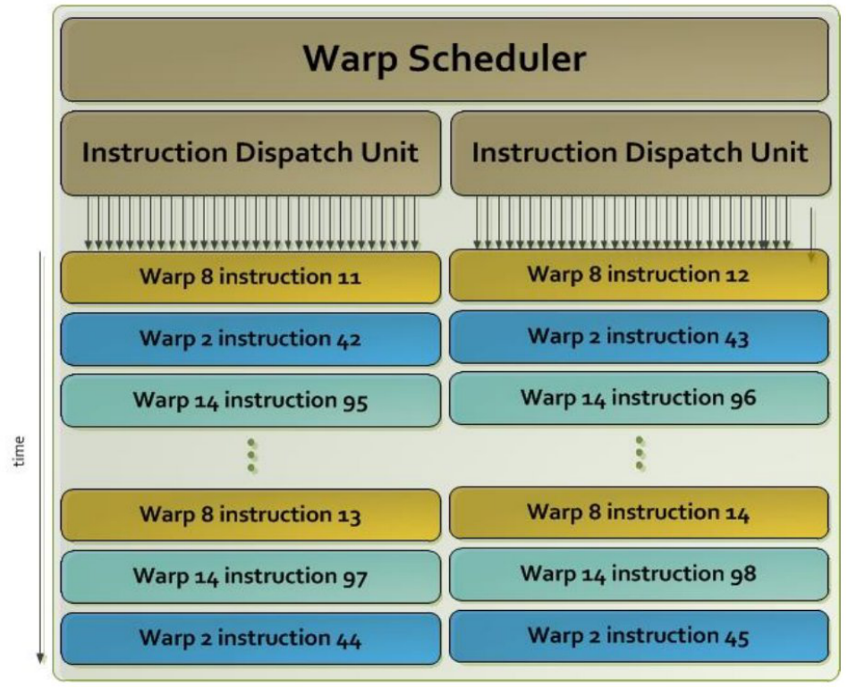
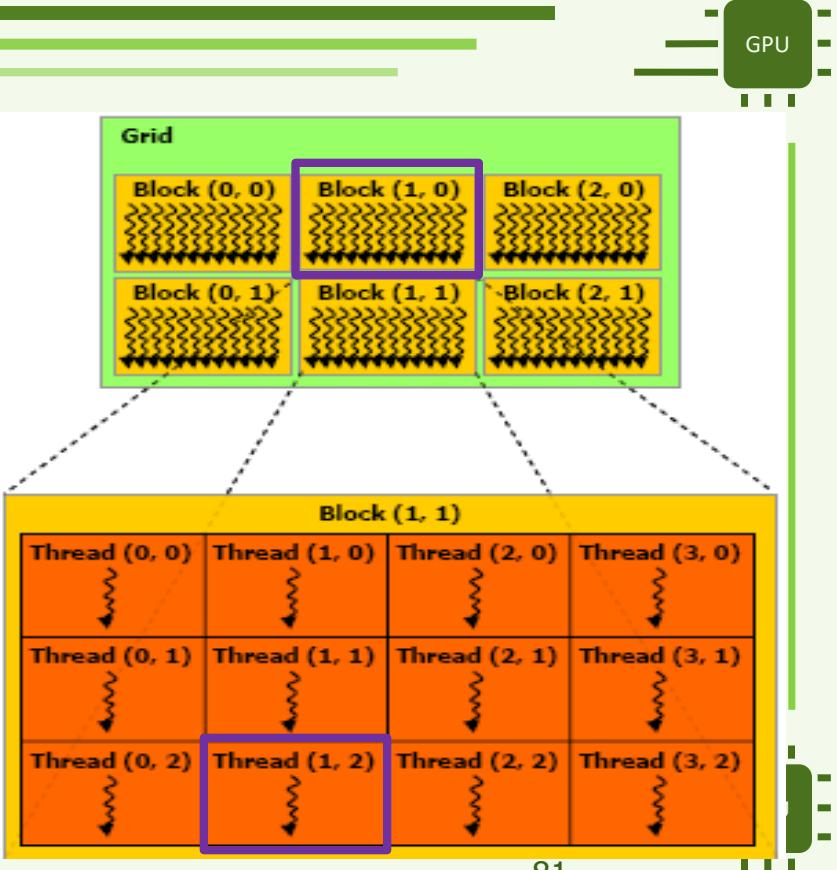

# APM 期中笔试复习讲义

课程整理、习题解答与考前自测 · 2026 年 10 月 22 日

## 0 复习范围与材料导航

### 0.1 先明确考试前已经安排了什么

课表写明：**2026 年 10 月 22 日上午为 DST 笔试**。考试前的课程与练习如下。课表没有说明考试范围、时长、题型和能否携带资料。

| 日期 | 上午 | 下午 |
|---|---|---|
| 2026-09-25 | CM1：GPU 架构与第一个 CUDA 程序 | TD1：网格与 CUDA 代码理解 |
| 2026-09-29 | CM2：内存层次与 CUDA API | TD2：多线程 Monte Carlo 求 π |
| 2026-10-09 | CM3：Driver API、多 GPU、OpenMP Target | TP1：DGEMM |
| 2026-10-22 | DST 笔试 | TP2：优化 DGEMM，合并访存与共享内存 |
| 2026-11-05 | TP3：GPU 占用率计算与 1D Tiling；计分 TP | 课表未进一步细分 |

**复习主线：**先掌握 CM1-CM3 的概念和程序执行过程，再独立完成本年 TD1 Q1-Q9、TD2 Q1-Q6、TP1 Q1-Q12。CM3 的 OpenMP Target 以课表示意和现有课堂示例补充。

**拓展练习：**往年共享内存 DGEMM、Streams 和 3D 距离函数题，适合训练相同的 CUDA 方法。优化 DGEMM 与占用率专项 TP 排在笔试之后，因此不应优先背诵旧题中的完整优化实现。但 CM2 已涉及的共享内存、合并访存、warp 和占用率概念仍属于已安排的课程内容。

课表照片见[课堂安排原图](Images/calendrier_cours_2026.jpg)。第 1-3 章整理课程，第 4 章按原题号整理练习，第 5 章用于闭卷自测。法语与中文版本使用相同编号；代码、变量名、公式和数值保持对应。

### 0.2 有用资料与本书对应位置

| 材料 | 版本与用途 | 对应位置 |
|---|---|---|
| [CM1 原课件](../CM/APM_Cours1_en.pdf) | 96 页新版，含 Kepler 调度器补充 | 第 1 章 |
| [CM1 中文讲义](../CM/APM_Cours1_zh_part1.md) | 含课堂讲解；原文提取稿对应 93 页旧版 | 第 1 章 |
| [CM2 原课件](../CM/APM_Cours2.pdf)及[中文讲义 · part1](../CM/APM_Cours2_zh_part1.md) / [part2](../CM/APM_Cours2_zh_part2.md) | 当前 PDF 为 98 页，含 warp 编号与事件计时内容 | 第 2 章 |
| [CM3 原课件](../CM/APM_Cours3.pdf)及[中文讲义 · part1](../CM/APM_Cours3_zh_part1.md) / [part2](../CM/APM_Cours3_zh_part2.md) | 101 页；部分 API 叙述有历史限定 | 第 3 章 |
| [TD1 原题](../TD1%20%20APM/td1.pdf)及[中法对照解答](../TD1%20%20APM/td1.md) | 2026-2027，Q1-Q9 | 第 4 章现年练习 |
| [TD2 原题](../TD2/TD2/SUJET/td2.pdf)、[中法对照解答](../TD2/TD2/SUJET/td2.md)及[CPU 代码](../TD2/TD2/CODE/pi.c) | 2026-2027，Monte Carlo，Q1-Q6 | 第 4 章现年练习 |
| [TP1 原题](../TP1/SUJET/tp1.pdf)、[中法对照解答](../TP1/SUJET/tp1_zh.md)、[法语版](../TP1/SUJET/tp1.md) | 2026-2027，编译与全局内存 DGEMM，Q1-Q12 | 第 4 章现年练习 |
| [OpenMP Target 示例](../cmexos/ompgpuecAdd.c) | 向量加法、map、设备执行位置检查 | 第 3 章 OpenMP Target |
| [旧 TP1 解答](../TDTP2025/TP/tp1_correction.pdf)及[中法对照](../TDTP2025/TP/tp1_correction.md) | 页眉为 2024-2025，含共享内存优化 | 第 4 章拓展练习 |
| [旧 TP2 题目](../TDTP2025/TP/tp2_sujet_2025-2026.pdf)、[旧解答](../TDTP2025/TP/tp2_correction.pdf)及[中法对照](../TDTP2025/TP/tp2.md) | 题目为 2025-2026，解答为 2024-2025，题目文字相同 | 第 4 章 Streams 拓展 |
| [旧 TD 题目](../TDTP2025/TD/td2.pdf)及[中法对照](../TDTP2025/TD/td2.md) | 2025-2026，3D 距离函数，区别于本年的 Monte Carlo TD2 | 第 4 章 SDF 拓展 |

### 0.3 怎样使用两种语言的版本

第一遍用中文理解执行过程，遇到术语再对照法语。第二遍直接读法语题意，在纸上写出公式、索引与数据流，然后检查题后答案。最后用第 5 章的自测检查能否说明“为什么”，而不只是记住函数名。

写 CUDA 答案时，依次回答五件事：每个线程负责什么；如何由块和线程坐标得到数据索引；哪些数据放在 CPU/GPU；哪些操作之间必须先后完成；怎样判断结果正确与时间测量范围。题目给出矩阵存储方式、线程数或硬件参数时，先采用题目条件，不能把某代 GPU 的示例数值当成通用常数。

## 1. 体系结构与第一个 CUDA 程序

本章对应 [CM1](../CM/APM_Cours1_en.pdf)：理解加速器、阅读 NVIDIA 架构图、编写第一个 kernel。下文架构数字均为课件中的示例，不是当前 GPU 的参数表。

### 1.1. 为什么使用加速器？

**加速器**是面向某类工作设计的计算资源，可以独立于主处理器，也可以与它集成。它的价值来自硬件取舍：把更多资源用于擅长的计算，同时牺牲一部分通用性。

CPU 适合组织程序整体流程、处理复杂控制和并行度不高的任务；GPU 主要通过推进大量线程获得较高吞吐量。因此，含有大量独立数组运算的循环，是理解 GPU 计算的合适起点。

可并行并不保证加速。对于使用显式数据传输的一次独立调用，可以把时间分解为：

$$
T_{GPU}=T_{init}+T_{H\to D}+T_{kernel}+T_{D\to H}.
$$

其中，初始化时间包括测量范围内的准备工作，例如内存分配。这个教学模型假设各阶段没有重叠。它说明：即使 kernel 很快，完整程序也可能较慢。重复使用已在 GPU 上的数据，可以减少反复传输。

**典型问题。** 一段循环能够并行，是否就应该放到 GPU 上？**回答。** 还要考虑工作规模、传输开销、数据依赖、访存规律，以及应用的总耗时。

### 1.2. 加速器类别与互连

| 计算资源 | 核心思路 | 应记住的内容 |
| --- | --- | --- |
| CPU | 通用计算和程序控制 | 主机程序负责组织工作 |
| GPU | 大量线程处理规律数据 | 需要提供足够并行度并组织好访存 |
| MIC / Xeon Phi | 大量 x86 核心，结合多线程与缓存一致性 | 体现另一种高度并行计算思路的历史实例 |
| Cell | 一个主处理器与多个专门的 SPE 单元 | 显式分配工作的历史实例 |
| FPGA | 可重构逻辑 | 可以按任务调整硬件结构；CM1 只列举类别，没有展开其编程 |

课件对比了两种连接趋势。通过 PCIe 等系统总线接入的加速卡较容易集成，但通信存在开销。与处理器更紧密地集成，可以提供针对性的互连和资源共享，同时也增加集成复杂度。

**距离近不等于成本为零。** 即使 CPU 和 GPU 在物理上靠得很近，也可能访问不同的内存区域。一致性接口不会消除数据位置带来的成本，也不会免除“先等计算完成，再使用结果”的要求。

### 1.3. 从 GPU 到线程：区分不同层次

NVIDIA GPU 包含多个 **SM**，即流式多处理器。SM 内有计算单元、调度器和存储资源。在本章讨论的基本模型中，一个线程块中的线程在同一 SM 上执行；资源允许时，一个 SM 可以容纳多个线程块。

**线程**是 kernel 的一个逻辑执行实例，**CUDA core** 是硬件计算单元，因此两者不存在固定的“一线程对应一个核心”关系。启动的线程数可以远大于计算单元数，线程块也可以分多批执行。

一个 **warp** 由同一线程块内的 32 个线程组成。对于多维线程块，按块内线性编号组织线程，其中 `x` 变化最快。**SIMT** 向程序员提供独立线程的视角，硬件则成组推进它们的指令。

若同一 warp 内的线程选择不同分支，相关路径可能需要分别推进，并使用不同的活动线程集合。因此要区分 `if` 是否正确与它的执行成本：边界处的 `if (i < N)` 仍然是保护访存所必需的。

**避免误解：** 不要认为 GPU 不能分支、整个网格的线程同时运行，或者同一 warp 的线程可以不遵守同步规则就任意交换数据。

### 1.4. Kepler：怎样阅读课件实例

第 35-39 页展示的 Kepler 实例包含 15 个 SMX，每个 SMX 有 192 个 FP32 单元、64 个 FP64 单元、32 个 SFU 和 32 个 load/store 单元。这些数字描述课件中的架构图，不是 CUDA 编程模型的固定常数。

96 页版本新增的重点是 warp 调度：

- 每个 SMX 有 4 个 warp 调度器；
- 有 8 个指令分派单元，即每个调度器对应 2 个；
- 每个调度器选择一个 warp；
- 当条件满足时，该 warp 的两条独立指令**可以**在一个周期内被分派。



*图 1：第 38 页局部图，展示一个调度器及其两个分派单元。一对指令可以来自同一个 warp；不同颜色表示随时间被选择的不同 warp。*

“可能分派两条”不等于“始终执行两条”。指令之间存在依赖，或相关资源不可用，都可能使这个吞吐量无法实现。调度器数量也不能直接推出最大驻留 warp 数。

存储层次中需要区分硬件管理的缓存与程序显式使用的共享内存。即使 L1 和共享内存使用部分相同的物理资源，二者的软件语义也不同。读取全局内存时，不会自动到 `__shared__` 变量中寻找数据。

### 1.5. Volta、Ampere、Hopper 与 CPU-GPU 集成

CM1 后续图示采用 **GPC → TPC → SM** 的层次组织。可以根据结构图计算 SM 数量，但必须说明这个计算针对的是图示结构。

| 课件结构图 | 图中 SM 数量的计算 | 应掌握的概念 |
| --- | --- | --- |
| Volta，第 40 页 | `6 × 7 × 2 = 84` | 多级组织方式，介绍中出现 Tensor Core |
| Ampere，第 42-43 页 | `8 × 8 × 2 = 128` | 一个 SM 内包含多个处理分区 |
| Hopper，第 44-45 页 | `8 × 9 × 2 = 144` | 不同类型的运算由不同单元执行 |

这些数值不自动等于某张实际销售显卡启用的 SM 数。同样，第 46 页的峰值性能取决于运算类型与精度，不能把 FP32、FP64 和 Tensor Core 的峰值相加，作为某个程序的性能。

第 46 页还比较了数值格式：FP32 有 8 位指数和 23 位小数部分；TF32 保留 8 位指数，使用 10 位小数部分；FP16 使用 5 位指数和 10 位小数部分。要区分可表示数值的范围与精度。这里列出的位数不包含符号位。

对于 Grace-Hopper，重点是 CPU 与 GPU 通过一致性互连组合。中文讲义已作技术澄清：集成在同一组件中、属于同一块硅裸片，以及共享同一片内存，是不同概念。数据位置与 NUMA 效应仍然重要；不应照字面背诵第 47 页“同一 die”的说法。

### 1.6. 怎样理解不同编程模型

| 方式 | CM1 中的例子 | 程序员主要表达什么 |
| --- | --- | --- |
| 显式 GPU 编程 | CUDA、HIP | kernel、线程组织和数据管理 |
| 可移植的底层接口 | OpenCL | 通过共同接口表达计算与资源 |
| 编译指令 | OpenMP Target、OpenACC | 卸载区域、并行循环和数据传输 |
| 更高层抽象 | Kokkos、RAJA、SYCL | 用库或抽象接口表达计算，再映射到目标设备 |

使用 CUDA 时，程序员描述一个线程的工作，并选择网格和线程块。使用编译指令时，程序员标注代码区域或循环，由编译器承担一部分目标设备实现工作。OpenMP Target 的具体用法见第 3 章。

**三个不同目标：** 在新机器上编译、得到正确结果、获得良好性能。可移植接口有助于第一个目标，但不会自动保证后两个目标。程序员仍然需要理解循环迭代之间的依赖与数据传输。

### 1.7. host 与 device 分别做什么

**host** 是 CPU 上执行的部分，**device** 是加速器。在课程最初的例子中，host 准备输入、分配 device 内存、传输数据、启动 kernel，最后取回结果。

| 步骤 | 资源或操作 | 为什么需要？ |
| --- | --- | --- |
| 1 | 已初始化的主机数组 | 提供输入并接收输出 |
| 2 | `cudaMalloc` | 在 device 内存中创建数组 |
| 3 | `cudaMemcpyHostToDevice` | 传输计算所需的输入 |
| 4 | `kernel<<<grid, block>>>(...)` | 请求执行 kernel |
| 5 | 适当等待后复制回 host | 确保读取的是已经完成的结果 |
| 6 | `cudaFree`，再释放主机资源 | 完成资源的整个生命周期 |

本例中的 `d_a` 是主机程序里的指针变量，其中存放 device 分配的地址。复制指针值不等于复制数组元素。`N` 这样的标量通过 kernel 参数传入；数组则必须使其中元素能被 device 访问。

在 `c[i] = a[i] + b[i]` 中，旧的 `c[i]` 没有被读取，所以必须分配 `d_c`，但无需在计算前把主机数组 `c` 复制过去。如果计算改成 `c[i] += a[i]`，这个结论就会改变。

### 1.8. 网格、线程块与坐标

网格中包含线程块，线程块中包含线程。`x`、`y`、`z` 是启动时选择的逻辑组织维度，不是 GPU 硬件规定的物理方向。

| 名称 | 含义 | 示例 |
| --- | --- | --- |
| `gridDim` | 每个维度上的线程块数量 | `(3, 2, 1)` |
| `blockIdx` | 当前线程块的坐标 | `(1, 0, 0)` |
| `blockDim` | 每个维度上的块内线程数量 | `(4, 3, 1)` |
| `threadIdx` | 当前线程在块内的坐标 | `(1, 2, 0)` |

坐标从零开始，例如 `0 <= threadIdx.x < blockDim.x`。主机代码通常用 `dim3` 构造启动维度，构造时省略的维度取值为 1。

```cpp
dim3 grid(3, 2);
dim3 block(4, 3);
my_kernel<<<grid, block>>>(/* arguments */);
```

这个启动配置产生 `3 × 2 = 6` 个线程块，每块 `4 × 3 = 12` 个线程，总共 `6 × 12 = 72` 个线程。它不保证 72 个线程在同一时刻执行同一条指令。

### 1.9. 一维索引：覆盖所有有效元素

网格和线程块均为一维时，常用的全局编号为：

$$
i=\texttt{blockIdx.x}\times\texttt{blockDim.x}+\texttt{threadIdx.x}.
$$

对于含 `N` 个元素的数组，若每块有 `B` 个线程，需要启动足以覆盖数组的线程块数：

$$
G=\left\lceil\frac{N}{B}\right\rceil,
\qquad G=(N+B-1)/B\quad(N>0,\ B>0).
$$

第二个表达式采用整数除法。例如 `N = 1000`、`B = 256`，则 `G = 4`。总共启动 1024 个线程，其中 1000 个处理元素，最后 24 个不能访问数组。判断条件是 **`i < N`**，不是 `i <= N`。后面的代码示例对 `N = 0` 直接跳过启动。

边界判断可以防止多访问元素，但不能补足没有启动的线程。如果只启动 3 个含 256 线程的块，元素 768 到 999 就不会被计算。

### 1.10. 二维索引：区分两种编号

CM1 逐步计算的例子为 `grid = (3, 2)`、`block = (4, 3)`、`blockIdx = (1, 0)`、`threadIdx = (1, 2)`。如果**逐块排列线程**，且 `x` 变化最快，则：

$$
b=\texttt{blockIdx.y}\times\texttt{gridDim.x}+\texttt{blockIdx.x}=1,
$$
$$
t=\texttt{threadIdx.y}\times\texttt{blockDim.x}+\texttt{threadIdx.x}=9,
$$
$$
T=\texttt{blockDim.x}\times\texttt{blockDim.y}=12,
\qquad g=bT+t=21.
$$



*图 2：CM1 第 77-84 页的例子。原图放大框标题写着 Block (1,1)，但上方网格选中的是 (1,0)；本例按选中的块 (1,0) 计算，再组合块编号与块内线程编号。*

如果要处理矩阵，并约定 `x` 对应列、`y` 对应行，则应先计算数据坐标：

$$
\begin{aligned}
x&=\texttt{blockIdx.x}\times\texttt{blockDim.x}+\texttt{threadIdx.x}=5,\\
y&=\texttt{blockIdx.y}\times\texttt{blockDim.y}+\texttt{threadIdx.y}=2.
\end{aligned}
$$

对于按行存储、宽度为 `W = 12` 的矩阵，对应元素的线性下标为 `p = y × W + x = 29`。**21 与 29 回答的是不同问题**：前者是逐块排列的线程编号，后者是由矩阵布局确定的线性地址。计算之前必须先说明采用哪种约定。

### 1.11. 推广到三维

如果仍按线程块排列，并规定 `x` 最快、`y` 次之、`z` 最慢：

```cpp
int block_id = (blockIdx.z * gridDim.y + blockIdx.y)
               * gridDim.x + blockIdx.x;
int thread_id = (threadIdx.z * blockDim.y + threadIdx.y)
                * blockDim.x + threadIdx.x;
int threads_per_block = blockDim.x * blockDim.y * blockDim.z;
int global_id = block_id * threads_per_block + thread_id;
```

乘以一个维度的长度，表示跳过更快维度上已经遍历的全部元素。这些表达式假设问题规模较小，结果能用 `int` 表示；对于大规模问题，还需要选择足够宽的整数类型。

快速检查：`grid = (2, 3, 2)`、`block = (4, 2, 2)`、`blockIdx = (1, 2, 1)`、`threadIdx = (3, 1, 1)`。可得 `block_id = 11`、`thread_id = 15`、`threads_per_block = 16`、`global_id = 191`。总共 192 个线程，最后一个编号确实是 191。

### 1.12. 向量相加：追踪完整数据流

下面的代码片段给出一次运算的完整生命周期，假设 host 已分配 `a`、`b`、`c`。它在 CM1 示例的基础上计算网格大小，并统一 kernel 名称。为了突出数据流，省略了详细的 CUDA 错误处理。

```cpp
#include <cuda_runtime.h>
#include <cstddef>

__global__ void vecAddKernel(const double *a, const double *b,
                             double *c, int N)
{
    std::size_t i = std::size_t(blockIdx.x) * blockDim.x + threadIdx.x;
    if (i < std::size_t(N)) {
        c[i] = a[i] + b[i];
    }
}

void vector_add(const double *a, const double *b, double *c, int N)
{
    if (N <= 0) {
        return;
    }
    std::size_t bytes = std::size_t(N) * sizeof(double);
    double *d_a = nullptr;
    double *d_b = nullptr;
    double *d_c = nullptr;

    cudaMalloc((void **)&d_a, bytes);
    cudaMalloc((void **)&d_b, bytes);
    cudaMalloc((void **)&d_c, bytes);
    cudaMemcpy(d_a, a, bytes, cudaMemcpyHostToDevice);
    cudaMemcpy(d_b, b, bytes, cudaMemcpyHostToDevice);

    int B = 256;
    int G = N / B + (N % B != 0);
    vecAddKernel<<<G, B>>>(d_a, d_b, d_c, N);
    cudaMemcpy(c, d_c, bytes, cudaMemcpyDeviceToHost);

    cudaFree(d_a);
    cudaFree(d_b);
    cudaFree(d_c);
}
```

这里 `G` 的计算避免了 `N + B - 1` 的加法及其潜在溢出。复制回主机的阻塞操作位于同一默认流中的 kernel 之后，成功返回后即可使用结果。实际程序应检查每次 CUDA 调用，以及启动和执行阶段的错误，再判断结果有效。

`__global__` 声明在 device 上执行的 kernel。`<<<G, B>>>` 给出启动配置，不能用普通的 `vecAddKernel(...)` 调用替代。CUDA 文件通常交给 `nvcc`，由它组织 host 与 device 两部分的编译。

### 1.13. 自测问题与常见错误

1. **为什么不让每个线程都保留完整的 `N` 次循环？** 在当前分工中，每个线程负责自己的下标；如果每个线程都执行整个循环，就会重复计算并产生并发写入。
2. **一个线程能处理多个元素吗？** 可以。“一个线程处理一个元素”只是这个例子的分工方式，不是语言限制；kernel 中可以有循环。
3. **`<<<32, 64>>>` 能处理任意 `N` 吗？** 不能。在每个线程处理一个元素的公式下，它覆盖 2048 个下标，需要检查覆盖范围与边界。
4. **一个含 48 个线程的块有几个 warp？** 两个：第一个包含 32 个线程，第二个只有 16 个位置对应块内线程。不同线程块的线程不会拼在一起补满这个 warp。
5. **为什么不用把数组 `c` 复制到 GPU？** kernel 会写入全部有效输出，而且不读取旧值。分配存储空间仍然必要。
6. **二维启动是否必须配合二维数组？** 不必。程序员定义 CUDA 坐标与数据的对应关系，再验证每个有效数据都被正确处理。
7. **网格是否规定线程块的执行顺序？** 不规定。在基本模型中，程序正确性不能依赖线程块之间隐含的执行次序。

### 1.14. 对应原始资料的位置

| 内容 | 新版 CM1 页码 |
| --- | --- |
| 加速器、互连、host/device | 8-19；集成实例见 24-30 |
| NVIDIA 架构与 Kepler | 34-39，包含新增第 38 页 |
| Volta、Ampere、Hopper、Grace-Hopper | 40-47 |
| 编程模型 | 49-52 |
| 数据生命周期与编译 | 55-70 |
| 线程、索引、启动与完整程序 | 71-96 |

第 87 页还提到了 **thread block cluster**，即网格和线程块之间的组织层级，以及对应的额外启动机制。

需要展开阅读时，可查看 [CM1 课件](../CM/APM_Cours1_en.pdf)和 [CM1 中文讲义](../CM/APM_Cours1_zh_part1.md)。

## 2. CUDA 进阶：内存、执行与同步

本章对应 [CM2](../CM/APM_Cours2.pdf)。

### 2.1 函数属性与内核结构（CM2 第 3-7 页）

| 声明 | 执行位置 | 本课中的用法 |
|---|---|---|
| `__host__` 或无属性 | CPU | 由主机程序调用的函数 |
| `__device__` | GPU | 由 GPU 代码调用的辅助函数 |
| `__global__` | GPU | 从主机通过 `<<<...>>>` 启动的内核 |
| `__host__ __device__` | CPU 或 GPU | 根据调用位置编译出两个版本 |

普通调用 `__device__` 函数不会启动新网格。`__global__` 内核返回 `void`，通常通过写入传入的缓冲区产生结果。内核启动相对于 CPU 是异步的。第 7 页的历史限制应放在课程使用的编程模型中理解，不应当成适用于所有 CUDA 版本的绝对清单。

```cpp
__global__ void vecAdd(const double *a, const double *b,
                       double *c, int n) {
    int i = blockIdx.x * blockDim.x + threadIdx.x;
    if (i < n) {
        c[i] = a[i] + b[i];
    }
}
```

当问题规模不是线程块大小的整数倍时，`i < n` 保护最后一个块的边界。不能仅仅为了消除分支就删掉它。

### 2.2 索引、向量类型与 warp 编号（CM2 第 8-9、53 页）

| 对象 | 含义 |
|---|---|
| `threadIdx.x/y/z` | 线程在线程块内的坐标 |
| `blockIdx.x/y/z` | 线程块在网格中的坐标 |
| `blockDim.x/y/z` | 一个线程块的尺寸 |
| `gridDim.x/y/z` | 网格的尺寸 |
| `dim3` | 维度类型，省略的分量默认为 1 |
| `int2`、`float4`、`make_int2(x, y)` | 向量类型及构造函数 |

块内线程的线性编号先改变 `x`，再改变 `y`，最后改变 `z`。一个 warp 包含 32 个连续的块内线性编号。

$$
t=x+D_x(y+D_y z),\qquad w=\lfloor t/32\rfloor,\qquad \ell=t\bmod32.
$$

当 `blockDim = (4, 4, 2)` 时，`t = x + 4y + 16z`：`(3,1,0)` 对应 7，`(0,0,1)` 对应 16。整个块有 32 个线程，即一个 warp。第 53 页图中标作“tid (global)”的实际上是块内编号，不包含 `blockIdx`；应以公式消除图上部分坐标绘制的歧义。

向量类型有对齐要求。写成 `float4` 不保证生成一条向量算术指令，也不保证更快；还要看访问方式、地址对齐和最终生成代码。第 8 页新增的是向量化访存示例。

### 2.3 内存层次：可见范围与生命周期（CM2 第 11-19、55-58 页）

| 空间 | 谁能访问 | 需要掌握的生命周期或用途 |
|---|---|---|
| 寄存器 | 一个线程 | 线程私有变量；SM 上的有限资源 |
| 局部内存 | 一个线程 | 私有数组或寄存器溢出；“局部”不等于快速的片上内存 |
| 共享内存 `__shared__` | 同一线程块中的线程 | 每块一份，在线程块结束时失效 |
| 全局内存 | 能访问该分配的线程 | 存放较大数组；通常显式分配和释放 |
| 常量内存 `__constant__` | GPU 读取 | 由主机更新；线程读取共同地址时有利 |
| 纹理／只读缓存 | 依所用机制执行读取 | 特定读取路径及规则；不能代替同步 |

两个线程块即使驻留在同一 SM，也不会自动共享各自的 `__shared__` 数组。网格和线程块是软件组织，SM 是硬件执行资源。简单的局部变量可能放入寄存器，但不能保证所有局部变量都在寄存器中。

同一 warp 读取同一个常量地址时，常量内存比较有利；读取不同地址可能削弱这种优势。缓存容量及缓存与共享内存的物理关系依赖具体架构。

### 2.4 分配与复制：字节数和指针归属（CM2 第 20-24、30-33 页）

```cpp
double *d_a = nullptr;
size_t bytes = n * sizeof(double);
cudaMalloc((void **)&d_a, bytes);
cudaMemcpy(d_a, h_a, bytes, cudaMemcpyHostToDevice);
cudaMemcpy(h_a, d_a, bytes, cudaMemcpyDeviceToHost);
cudaFree(d_a);
```

`cudaMalloc` 接收指针变量的地址，用来写回分配结果。`cudaMemcpy` 接收数据地址，应传 `d_a`，而不是 `&d_a`。`count` 表示字节数。课件列出的四个方向为 `cudaMemcpyHostToDevice`、`cudaMemcpyDeviceToHost`、`cudaMemcpyHostToHost` 和 `cudaMemcpyDeviceToDevice`。

在课程的独立显存模型中，普通 CPU 循环不能直接解引用 `cudaMalloc` 得到的设备指针。多个计算之间保留 GPU 上的数据，可以减少不必要的传输。

### 2.5 二维、三维分配与 pitch（CM2 第 25-40 页）

`cudaMallocPitch(&ptr, &pitch, width, height)` 分配按要求对齐的各行。`width` 是有效行宽，单位为字节；`pitch` 是相邻两行起点的实际字节距离，包括行末填充；`height` 是行数。pitch 既不是元素个数，也不是单独的填充量。

```cpp
float *d_a = nullptr;
size_t pitch = 0;
size_t widthBytes = width * sizeof(float);
cudaMallocPitch((void **)&d_a, &pitch, widthBytes, height);
cudaMemcpy2D(d_a, pitch, h_a, widthBytes,
             widthBytes, height, cudaMemcpyHostToDevice);
```

在内核中，第 `row` 行的地址应先按字节偏移计算：

```cpp
float *line = (float *)((char *)d_a + row * pitch);
float value = line[col];
```

例如，每行 100 个 `float` 的有效宽度为 400 字节。假设返回的 pitch 为 512 字节，下一行起点就是 `base + 512`，不能写成 `base + 400`。512 只是算例，不是硬件固定规则。

`cudaMemcpy2D` 的源和目标可以有不同 pitch，它只复制每行的有效宽度和指定行数。复制回紧凑主机数组时，本例主机端自己的 pitch 仍然是 400 字节。

三维分配 `cudaMalloc3D` 使用 `cudaExtent`，返回 `cudaPitchedPtr`；在线性分配情形中，宽度以字节为单位。层间距离由行 pitch 和保存的高度推得。`cudaMemcpy3D` 把位置、指针或 CUDA 数组、范围及复制方向封装进 `cudaMemcpy3DParms`。`cudaArray` 是专门的对象，不能当作普通 C 数组指针使用。

### 2.6 统一内存与迁移开销（CM2 第 41-50 页）

课件介绍的统一内存从 CUDA 6.0 引入，可通过 `cudaMallocManaged` 或 `__managed__` 变量让主机与 GPU 使用同一个指针。系统负责管理访问，并根据平台决定如何移动数据。这减少了手动管理，但不保证消除传输开销。

```cpp
int *a = nullptr;
cudaMallocManaged((void **)&a, n * sizeof(int));
kernel<<<grid, block>>>(a);
cudaDeviceSynchronize();
consume_on_cpu(a);
cudaFree(a);
```

`cudaMemAttachGlobal` 与 `cudaMemAttachHost` 表示关联和访问规则，不应简单理解为“物理分配在 GPU”或“物理分配在 CPU”。CPU 读取计算结果前仍要等待 GPU 完成。

第 46-50 页比较了在同一数组上反复交替 GPU → CPU，与把访问分成较大阶段的方式。来回访问可能产生反复迁移。只有程序依赖允许改变顺序时，才可以集中执行：如果每一轮 CPU 都为下一轮 GPU 产生输入，就不能把所有 CPU 操作挪到最后。

### 2.7 全局内存的合并访存（CM2 第 51-54 页）

分析一次加载时，应写出同一 warp 各线程执行同一条访存指令时访问的地址。地址紧凑且对齐合适，通常比地址分散需要更少事务。只有单个线程前后两次访问连续，还不足以判断合并访存。

对于按行存储的矩阵：

$$
\operatorname{addr}(r,c)=\operatorname{base}+(rN+c)\,s.
$$

`N` 是列数，`s` 是元素字节数。相邻线程改变 `c`，地址相差 `s`；相邻线程改变 `r`，地址相差 `Ns`。前者通常利于合并，后者可能让事务分散。

第 52-53 页提到 128 字节、32 字节分组，以及每个调度器最多同时执行两条指令。这些是该幻灯的表述，不能当成所有 GPU 的通用常数。精确事务数还依赖架构、访问宽度及地址对齐。

可以先通过合并的全局访存把数据块加载到共享内存，再在线程块中复用或重新排列。适当多加载一些元素有时有利，但要由总成本的降低来证明其合理性。

### 2.8 共享内存与存储体冲突（CM2 第 54-58、98 页）

当同一次操作中多个不同地址落在同一个 bank，服务可能被串行化，形成存储体冲突。它与全局内存的合并访存是两个不同问题。

在“32 个 bank、每个字为 4 字节”的简化假设下：

$$
\operatorname{bank}(a)=\left\lfloor a/4\right\rfloor\bmod32.
$$

对于 `float tile[32][32]`，用 `tile[threadIdx.x][col]` 读一列，地址间隔为 32 个字，在这个模型中全部映射到同一个 bank。改成带填充的 `float tile[32][33]` 会改变步长并分散这些访问。多个线程读同一个字可能使用广播，不能与“同一 bank 中不同字”的冲突混为一谈。

动态共享内存通过 `extern __shared__` 声明，大小在启动参数的第三项指定。如果多个数组共用一块区域，必须手动保证偏移不重叠，并满足各类型的对齐要求。

### 2.9 寄存器、驻留率与分支分歧（CM2 第 59-60、98 页）

SM 的寄存器由其驻留线程使用。每线程寄存器越多，能够同时驻留的块可能越少。每块共享内存、线程数，以及硬件允许的块数和 warp 数也都可能成为限制。

$$
\mathrm{occupancy}=W_{\mathrm{resident}}/W_{\max}.
$$

`W_resident` 表示驻留 warp 数，`W_max` 表示该 SM 允许的最大驻留 warp 数。忽略分配粒度时，可以用以下简化模型给出上界：

$$
B_{\mathrm{resident}}\leq\min\left(B_{\max},\left\lfloor T_{\max}/T_b\right\rfloor,\left\lfloor R_{\mathrm{SM}}/(rT_b)\right\rfloor,\left\lfloor S_{\mathrm{SM}}/S_b\right\rfloor\right).
$$

`T_b` 是每块线程数，`r` 是每线程寄存器数，`S_b` 是每块共享内存；当 `S_b = 0` 时省略共享内存这一项。这个上界并不是完整的运行时间预测器。

`--maxrregcount=N` 限制寄存器数量；`__launch_bounds__(maxThreadsPerBlock, minBlocksPerMultiprocessor)` 告知编译器目标启动配置。把寄存器压得太低，可能溢出到局部内存。更高驻留率不保证内核更快。

分支分歧关注同一 warp 内线程的执行路径。线程走不同路径时，可能降低计算单元利用率。不同 warp 分别走不同分支，并不是同一种分歧。目标是减少代价较高的分歧，而非禁止所有 `if`。

### 2.10 屏障、可见性、`volatile` 与原子操作（CM2 第 57、90、93 页）

| 工具 | 保证或用途 | 不能替代什么 |
|---|---|---|
| `__syncthreads()` | 块内线程会合，并保证相关先前全局／共享内存写入的可见性 | 全网格屏障 |
| `__syncthreads_count/and/or` | 屏障加上对谓词的集体结果 | 块间同步 |
| `atomicAdd`、`atomicExch`、`atomicCAS` 等 | 在支持的类型和作用域内，原子更新目标 | 所有内存操作的一般顺序保证 |
| `volatile` | 对编译器访存处理的约束 | 原子性、线程会合或同步协议 |

同一块的线程需要按一致的控制流程到达屏障。处理数据块时，越界线程可以加载零，再与其他线程一起参与屏障。若块内各线程对边界判断的结果不同，把屏障只放进 `if (i < n)` 就会出问题。

**第 57 页的澄清：** 给数组加 `volatile` 不能修复没有同步的并发读写。fence 可以约束一定范围内的访存顺序，但本身不等待所有线程到齐。这一区别也见 [NVIDIA 的 `volatile` 文档](https://docs.nvidia.com/cuda/cuda-programming-guide/05-appendices/cpp-language-support.html)。

`a[i]++` 包含读、加、写三步，多线程并发时可能丢失更新。`atomicAdd(&a[i], 1)` 保护这次更新，但大量线程争用同一地址可能代价较高。先局部归约再减少原子操作次数是一个方向，浮点计算还要考虑改变加法次序后的舍入差异。支持的类型和位宽依赖 compute capability。

### 2.11 异步执行、stream 与页锁定主机内存（CM2 第 62-89 页）

异步启动意味着 GPU 尚未完成工作时，CPU 已经可以继续。相同 stream 内仍保持操作顺序：输入复制 → 内核 A → 内核 B → 输出复制。顺序来自 stream 语义，CUDA 不会分析指针并自动发现任意跨流数据依赖。

| API | 用途 |
|---|---|
| `cudaStreamCreate/Destroy` | 创建和释放 stream |
| `cudaMemcpyAsync(..., stream)` | 向指定 stream 提交复制 |
| `kernel<<<grid, block, sharedBytes, stream>>>(...)` | 向指定 stream 提交内核 |
| `cudaStreamSynchronize(stream)` | CPU 等待该 stream |
| `cudaDeviceSynchronize()` | 等待当前 GPU 上当前上下文中此前提交的工作 |
| `cudaStreamWaitEvent(stream, event, 0)` | 在 stream 中建立依赖，不要求 CPU 主动等待 |

不同 stream 允许在硬件和资源支持时重叠独立工作。两个 stream 不保证两个内核一定同时运行。默认 stream 可能因具体模式引入额外依赖；清楚推理时应使用显式 stream，并写明依赖关系。

```cpp
cudaMemcpyAsync(d_a, h_a, bytes, cudaMemcpyHostToDevice, copyStream);
cudaEventRecord(ready, copyStream);
cudaStreamWaitEvent(computeStream, ready, 0);
kernel<<<grid, block, 0, computeStream>>>(d_a);
```

这段代码假设 stream、事件与缓冲区已经创建。如果内核使用刚复制的数据，它补足了第 87-88 页跨流示意缺少的依赖。正确 API 名为 `cudaMemcpyAsync`，对应的二维形式是 `cudaMemcpy2DAsync`；不能照抄 `cudaMemCpy` 或 `cudaMemcpyPitchAsync`。

要实现真正的主机-GPU 异步传输及重叠，应使用页锁定主机内存，例如通过 `cudaMallocHost` 分配、`cudaFreeHost` 释放。普通可分页内存可能引入中间拷贝或阻塞。H→D 完成前不能修改或释放源缓冲区；D→H 完成前不能读取或复用目标缓冲区。锁定内存页和等待操作完成，解决的是不同问题。

### 2.12 事件与计时（CM2 第 95 页）

```cpp
cudaEvent_t start, stop;
cudaEventCreate(&start);
cudaEventCreate(&stop);
cudaEventRecord(start, stream);
kernel<<<grid, block, 0, stream>>>(d_a);
cudaEventRecord(stop, stream);
cudaEventSynchronize(stop);
float milliseconds = 0.0f;
cudaEventElapsedTime(&milliseconds, start, stop);
cudaEventDestroy(start);
cudaEventDestroy(stop);
```

两个事件圈定 stream 上的一段时间，`cudaEventElapsedTime` 写回毫秒数。等待 `stop` 保证读取时间前这段工作已经完成。以上只是教学示意，为便于阅读省略了错误检查。

CPU 计时器如果只包围 `<<<...>>>`，主要测到的是提交时间。若要从 CPU 测量完整计算，结束读数前必须等待计算完成。始终写清测量范围：内核还是整个程序、是否包含传输、是否包含首次初始化和预热。本资料没有生成任何性能测量结果。

### 2.13 错误检查、数学函数与调试（CM2 第 92-97 页）

检查 CUDA 函数返回的 `cudaError_t`，通过 `cudaGetErrorString` 获取错误描述。内核启动后用 `cudaGetLastError()` 检查启动错误，还要检查后续同步调用，以发现异步执行错误。成功提交不代表没有越界，也不代表数值结果正确。

GPU 上的 `printf` 由到达该语句的各线程执行，可能产生大量输出并扰动计时。为了定位错误加入的同步，需要在最终测量前重新判断是否属于实际流程。

优化数学函数及 `--use_fast_math` 可以加速部分单精度运算，但会改变数值行为。它并不表示“所有双精度操作都能在结果不变的情况下变快”。

### 2.14 答题方法与优化顺序（CM2 第 98 页）

练习应用见第 4 节。

1. 明确一个线程负责什么，检查索引边界。
2. 减少 CPU-GPU 传输，把后续仍需使用的数据保留在 GPU。
3. 提供足够线程块来使用各个 SM，但不要把“每个 SM 至少一个块”当成最优配置公式。
4. 写出一个 warp 的访问地址，先看全局合并访存，再看共享内存的 bank conflict。
5. 在能减少总成本的情况下通过共享内存复用数据，并放置必要屏障。
6. 检查寄存器、共享内存、驻留率和分支，然后比较相同范围的执行时间。

每块线程数取 32 的倍数通常是合理起点，但不能只根据核心数决定块大小。DGEMM 的详细优化、循环展开和 tiling 留在对应练习部分；它们在课程日历中的位置见第 4 节。

解释加速时，要把具体修改连到原因：传输字节更少、内存事务更少、复用更多，或重叠更充分。不能仅凭使用了 `__shared__`、增加了 stream，或提高了驻留率，就宣称获得了实测加速。

## 3. CUDA API、上下文与多 GPU 编程

本章对应 [CM3](../CM/APM_Cours3.pdf)。课件最后一页讲的是 NCCL 2.19.3，不是后续所有版本的完整功能表。

### 3.1 Runtime API 与 Driver API（CM3 第 4-10 页）

| 比较项 | Runtime API | Driver API |
|---|---|---|
| 抽象层次 | 较高层，前面的课程示例主要使用它 | 控制更显式，可用于某些库开发 |
| 前缀 | `cuda` | `cu` |
| 分配 | `cudaMalloc` | `cuMemAlloc` |
| 复制 | `cudaMemcpy` 加复制方向 | 如 `cuMemcpyHtoD`、`cuMemcpyDtoH` |
| 上下文 | 通常由 runtime 管理 | 可以显式管理 |
| 返回类型 | `cudaError_t` | `CUresult` |

两套 API 都访问同一个 GPU。Driver API 不保证更快，它的价值是更明确地控制资源和上下文。混合使用时，需要检查当前上下文，以及所用对象属于哪个上下文。

### 3.2 上下文代表什么（CM3 第 13-25 页）

上下文组织某个 GPU 的 CUDA 状态，包括常见的内存分配、地址空间、stream、事件等资源。分析一个指针时，要知道其分配归属和访问权限，不能只看 GPU 编号。

| 情形 | 在课程模型中应掌握的共享关系 |
|---|---|
| 同一进程的多个 CPU 线程使用同一主上下文 | 这些线程可以共享该上下文中的分配 |
| 一个进程使用多个 GPU | 每个使用的 GPU 有对应主上下文 |
| 多个 MPI 进程使用同一 GPU | 不会自动获得同一个地址空间 |
| 同一 GPU 上有两个显式上下文 | GPU 物理上相同，不代表其中分配可以自动互换使用 |

课程把主上下文介绍为 CUDA 4.0 开始提供：同一进程中面向同一个 GPU 的线程共享它。当前上下文则与主机线程有关，两个线程可以各自使用不同的当前 GPU。

**第 22 页的澄清：** 不应把“较新版本只剩主上下文”记成现行规则。Driver API 仍然提供 `cuCtxCreate`。显式上下文也并非天然“永远只属于一个线程”，其线程关联可以操作。参见 [NVIDIA 上下文管理文档](https://docs.nvidia.com/cuda/cuda-driver-api/group__CUDA__CTX.html)。

### 3.3 选择 GPU 并检查错误（CM3 第 28-38 页）

`cudaGetDeviceCount(&count)` 返回当前进程可见的 GPU 数量。`cudaSetDevice(device)` 为调用它的主机线程选择 GPU，后续分配、stream、事件和内核启动都应关联到预期 GPU。

```cpp
int count = 0;
cudaError_t status = cudaGetDeviceCount(&count);
if (status != cudaSuccess || count == 0) {
    return 1;
}
int device = local_rank % count;
status = cudaSetDevice(device);
if (status != cudaSuccess) {
    return 1;
}
```

该片段假设已经定义 `local_rank`。只有 `count > 0` 时取模才有效。映射必须依据实际分配且对进程可见的 GPU，不能假定看得到所有物理设备编号。

**第 36 页的纠正：** 非法编号可能返回 `cudaErrorInvalidDevice`，不能期待系统默默改用 GPU 0。第 31-35 页还描述了历史上下文栈搜索，这不能作为通用契约：官方文档把 `cudaSetDevice` 描述为给当前调用线程绑定选定 GPU 的主上下文。参见 [NVIDIA 设备管理文档](https://docs.nvidia.com/cuda/cuda-runtime-api/group__CUDART__DEVICE.html)。

切换当前 GPU 不会迁移已经分配的数据，也不会自动等待另一个 GPU 上先前提交的工作完成。

### 3.4 使用 Driver API 操作上下文（CM3 第 39-49 页）

| 函数 | 需要理解的效果 |
|---|---|
| `cuCtxCreate` | 创建新上下文并使其成为当前上下文；不会查找并复用已有分配 |
| `cuCtxGetCurrent` | 查询当前上下文，不将其移除 |
| `cuCtxGetDevice` | 查询当前上下文对应的 GPU |
| `cuCtxPushCurrent` | 将上下文压入调用线程的栈，使其成为当前上下文 |
| `cuCtxPopCurrent` | 移除当前上下文，并返回被移除的上下文 |
| `cuCtxSetCurrent` | 为调用线程显式关联上下文 |
| `cuCtxDestroy` | 不再使用相关资源后，销毁显式创建的上下文 |

推理示例：线程起初使用 A，压入 B 后，依赖当前上下文的操作就使用 B；弹出 B 后恢复 A。`cuCtxPopCurrent` 写回的是 B 的句柄，不是 A。即使指定相同 GPU，两次创建也可能得到两个不同上下文。

幻灯中三个参数的创建函数签名有版本适用范围，编译时应以所用 toolkit 的签名为准。考试更应掌握操作效果和资源归属，而非复制不完整片段。本段和表格的澄清与 [Driver API 官方文档](https://docs.nvidia.com/cuda/cuda-driver-api/group__CUDA__CTX.html)一致。

### 3.5 UVA 与统一内存是两个概念（CM3 第 51-62 页）

统一内存见 CM2 第 41-50 页。

课程把 UVA 的引入时间列为 CUDA 4.0。在支持的平台上，它把主机和各 GPU 的地址放入统一虚拟地址布局。因此，即使当前 GPU 改变，也可以根据地址识别其对应分配和位置。

| 概念 | 提供什么 | 不意味着什么 |
|---|---|---|
| UVA | 统一识别地址 | 所有物理内存合并为一块 |
| `cudaMemcpyDefault` | 在 UVA 环境中根据指针推断复制方向 | 复制本身被消除 |
| 统一内存 `cudaMallocManaged` | 管理 CPU/GPU 共享分配的访问和数据移动 | 没有迁移、没有竞争或无需同步 |
| 点对点访问 | 支持且已授权时访问另一个 GPU 的内存 | 只要有 UVA 就一定能访问 |

地址能被识别，不代表任意处理器都能直接解引用。应分别回答：“分配在哪里？”“谁能访问？”“数据何时准备好？”

第 51-59 页的 `cudaMemcpy` 采用简写。真实调用应传数据指针 `d_a`，而不是指针变量本身的地址 `&d_a`。

### 3.6 P2P 访问与 GPU 间传输

这是与 UVA 相关的补充澄清，CM3 没有按以下流程详细展开。它用于区分地址识别与访问授权。

```cpp
int canAccess = 0;
cudaDeviceCanAccessPeer(&canAccess, 0, 1);
if (canAccess) {
    cudaSetDevice(0);
    cudaDeviceEnablePeerAccess(1, 0);
}
```

此片段先查询 GPU 0 是否能访问 GPU 1，然后从 GPU 0 激活这个方向；它不会自动激活反方向。片段假设设备编号有效，并为展示机制省略错误检查。

`cudaMemcpyPeer` 或 `cudaMemcpyPeerAsync` 表达两个 GPU 分配之间的数据复制，有效路径取决于拓扑和可用能力。P2P 不表示“数据已经到达”，也不保证远端访问与本地访问同样便宜。生产数据、复制数据和消费数据之间仍需建立顺序。参见 [NVIDIA 对等设备内存访问文档](https://docs.nvidia.com/cuda/cuda-runtime-api/group__CUDART__PEER.html)。

### 3.7 MPI 与 GPU 分配（CM3 第 64-69 页）

如果所有进程都使用默认 GPU，它们可能全部挤到 GPU 0。让所有进程执行同一个 `cudaSetDevice(1)`，也不会分散工作。课程提出轮转分配：

$$
\operatorname{device}(r)=r\bmod N_{\mathrm{GPU}}.
$$

在单节点上，它把各 rank 分配到可见 GPU。在多节点上，应结合节点内 local rank 和实际分配 GPU 的可见性推理；全局 MPI rank 本身不能完整说明节点内映射。如果每个进程只看得到分配给自己的一个 GPU，那么各进程中的设备本地编号都可能是 0。

轮转不保证负载均衡，因为不同 rank 的计算量可能不同。它也不保证 CPU、主机内存、GPU 和网络接口之间具有最佳 NUMA 位置关系。

MPI 进程具有独立地址空间。只发送一个指针数值或上下文句柄，不能共享实际分配。交换数据需要专门机制，例如通信、适配实现对 GPU buffer 的支持，或显式进程间共享机制。这不意味着任意 MPI 都能直接接收 GPU 指针。

### 3.8 主机端 OpenMP 与主上下文共享（CM3 第 71-75 页）

这里是 OpenMP 创建 CPU 线程，再调用 CUDA；OpenMP `target` 卸载是另一种机制。

```cpp
#pragma omp parallel
{
    int tid = omp_get_thread_num();
    int device = tid % gpuCount;
    cudaSetDevice(device);
    cudaStream_t stream;
    cudaStreamCreate(&stream);
    kernel<<<grid, block, 0, stream>>>(buffers[device]);
    cudaStreamSynchronize(stream);
    cudaStreamDestroy(stream);
}
```

这一示意假设 `gpuCount > 0`、每个 GPU 都有正确的 buffer，且各线程工作相互兼容。如果多个线程写同一个 buffer，需要划分区域或增加同步；共享上下文本身不能使并发写入正确。

每个主机线程应在发起 CUDA 操作前选择自己的 GPU。同一进程中使用同一个主上下文的线程，可以操作同一组分配。反之，如果每次都重新创建独立显式上下文，之前的指针可能无法在新的当前上下文中使用。

stream 组织 GPU 上的工作顺序，OpenMP 同步还负责 CPU 侧的交换和访问顺序。两个层次的同步不能互相替代。

### 3.9 MPI + OpenMP + CUDA：组织方式与拓扑（CM3 第 76-82 页）

课程给出“每个 GPU 一个 MPI 进程，进程中多个主机线程配合 stream”的组织方式，便于共享分配和重叠工作。它是一个起点，不是所有程序达到最高性能的证明。

第 78-80 页需要谨慎理解：16 或 128 不是所有 GPU 可创建 stream 数量的通用上限，`cudaMalloc(..., stream)` 也不是 `cudaMalloc` 的函数签名。在已讨论的示例中，stream 传给内核启动或 `cudaMemcpyAsync`。

分析映射时应沿着数据路径看：CPU 核 → NUMA 内存 → GPU → 其他 GPU 或网络。一个 GPU 对某些核心近，对另一些核心远；最适合 GPU 的位置可能与 CPU 的最佳位置冲突。外部库也可能修改当前 device 或上下文，不能假定调用任何库以后这些状态都保持不变。

### 3.10 NCCL：通信域、rank 与初始化（CM3 第 84-92 页）

NCCL 提供 GPU 间通信。这里的“clique”指参与一个通信域的 GPU 集合，可以只包含部分 GPU。必须区分三个编号：MPI rank、CUDA 设备本地编号，以及 NCCL 通信域内 rank。

| 函数 | 组织方式 |
|---|---|
| `ncclGetUniqueId` | 生成并分发给参与者的共同标识 |
| `ncclCommInitRank` | 每个参与者先选 GPU，再初始化自己的 rank |
| `ncclCommInitAll` | 单个进程按 `devList` 初始化一组本地 GPU |

若 `devList = {0, 3, 1, 5}`，NCCL rank 0、1、2、3 分别对应本地 GPU 0、3、1、5。`ncclCommInitRank` 的最后一个参数是在 `0..nranks-1` 内唯一的 NCCL rank，不一定是 GPU 编号；这澄清了第 90 页的歧义。

参与者使用相同标识。在 MPI 中，可以由一个进程创建，再通过 `MPI_Bcast` 等方式广播。初始化可能等待其他参与者，因此调用需要协调：由多个线程或进程参与；如果一个线程管理多个 GPU，则使用成组调用。

在本课使用的模型中，同一个 GPU 不应对应同一通信域中的多个 rank。因此，多个线程使用同一 GPU 时，应指定实际进行初始化的参与者，这也对应第 90 页的提醒。参见 [NCCL 通信域创建文档](https://docs.nvidia.com/deeplearning/nccl/user-guide/docs/usage/communicators.html)。

这些区别，特别是 `ncclCommInitAll` 的单进程适用范围，已与 [NCCL 通信域官方文档](https://docs.nvidia.com/deeplearning/nccl/user-guide/docs/api/comms.html)核对。在一个进程中创建的句柄，不会因为广播了它的数值就能在其他进程中使用。

### 3.11 集体通信、AllReduce 与异步执行（CM3 第 93-100 页）

| 操作 | 结果 |
|---|---|
| Broadcast | 根 rank 的数据发送给所有参与者 |
| Reduce | 合并各参与者的贡献，结果保存在根 rank |
| AllReduce | 合并各参与者的贡献，每个参与者都得到结果 |
| AllGather | 每个参与者都收集所有参与者的贡献 |
| ReduceScatter | 先合并，再把结果按块分配给参与者 |

对 `P` 个参与者做求和，每个参与者得到：

$$
y_j=\sum_{r=0}^{P-1}x_{r,j}.
$$

`ncclAllReduce(sendbuff, recvbuff, count, datatype, op, comm, stream)` 使用 GPU buffer，`count` 是元素数，不是字节数。参与者必须以一致的集体调用顺序，执行参数相容的操作。各自本地指针可以不同；“相同参数”不表示所有进程中的指针数值必须相同。

操作被提交到 stream。主机函数返回，并不代表 CPU 已经能立刻读取结果。应通过 stream 依赖或适当等待，保护后续消费者。

当单线程管理多个 GPU 时，幻灯中的普通 `for` 循环需要补上成组调用语义：

```cpp
ncclGroupStart();
for (int i = 0; i < nLocalGPUs; ++i) {
    ncclAllReduce(send[i], recv[i], count, ncclFloat,
                  ncclSum, comms[i], streams[i]);
}
ncclGroupEnd();
```

这里假设通信域、buffer 和 stream 都已初始化。应在 `ncclGroupEnd` 之后等待各 stream，不能在组中途等待。这样可避免第一项调用等待尚未提交的其他参与者。参见 [NCCL 成组调用文档](https://docs.nvidia.com/deeplearning/nccl/user-guide/docs/usage/groups.html)。

### 3.12 期中复习易错点（CM3 第 22、36、78-80、84、90、101 页）

1. **同一 GPU 不代表同一上下文。** 要检查进程、当前上下文和分配归属。
2. **UVA 不等于统一内存。** 地址识别、访问授权和数据移动要分别分析。
3. **同一上下文不代表没有竞争。** 读写仍需要正确顺序。
4. **切换 device 不会移动数据。** 必须保留 buffer、stream 和事件的归属信息。
5. **NCCL rank、MPI rank 和 CUDA device 可以不同。** 改错前先画出明确映射表。
6. **异步不代表完成。** 用 stream、事件和等待连接生产、通信与消费。

第 84 页用 InfiniBand 介绍多节点，而第 101 页明确列的是 NCCL 2.19.3，还提到了 RoCE 和 IP sockets。因此不能记成“NCCL 多节点必须使用 InfiniBand”。末页把集体通信、点对点交换及可由点对点构造的通信模式一起列出，不意味着每种模式都有一个独立的集体通信 API。

本章代码是推理材料，不是已执行程序，也不是扩展性测量结果。回答性能问题时，还要检查数据量、通信频率、计算不均衡及机器拓扑。

### 3.13 OpenMP Target 与向量加法

10 月 9 日的课表把 OpenMP Target 列入 CM3。[现有课堂示例](../cmexos/ompgpuecAdd.c)计算 `c[i] = a[i] + b[i]`。程序员描述循环和数据，由编译器实现目标设备上的执行与工作分配。

```c
#pragma omp target teams distribute parallel for \
    map(to: a[0:N], b[0:N]) map(from: c[0:N])
for (int i = 0; i < N; ++i) {
    c[i] = a[i] + b[i];
}
```

`target` 定义交给目标设备执行的区域，`teams` 建立线程团队，`distribute` 在团队之间分配循环迭代，`parallel for` 再把迭代分配给团队内的线程。不能把一个 OpenMP 团队与一个 CUDA block 的对应关系当成可移植保证。

在这个没有既有映射的例子中，`map(to: ...)` 让输入数据在设备上可用，`map(from: ...)` 在区域结束时取回输出。`a[0:N]` 表示**从下标 0 开始的 N 个元素**，不是字节数。如果计算 `y[i] = alpha*x[i] + y[i]`，`y` 同时是输入和输出，应使用 `map(tofrom: y[0:N])`。

未使用 `nowait` 时，程序在该 target 区域完成后继续执行。映射子句描述数据可用性；更一般的程序可能已有映射，或设备之间共享存储，因此不应把每个 map 都理解成必定新增一次物理复制。

参考：[OpenMP 5.2 执行模型](https://www.openmp.org/spec-html/5.2/openmpse3.html)、[distribute 构造](https://www.openmp.org/spec-html/5.2/openmpse67.html)、[官方速查卡](https://www.openmp.org/wp-content/uploads/OpenMPRefCard-5-2-web.pdf)。

### 3.14 编译、CPU 回退与代码阅读陷阱

编译通过且结果正确，不能单独证明 GPU 执行成功。目标设备不可用时，OpenMP 实现可能在主机上执行 target 区域。现有示例在区域内检查执行位置：

```c
int on_host = 1;
#pragma omp target map(from: on_host)
{
    on_host = omp_is_initial_device();
}
```

`on_host != 0` 表示初始设备，即本程序中的主机。零值表示目标设备，其具体类型由环境决定。编译选项必须配置可用的 offload 目标；只加 `-fopenmp` 不能保证生成并使用 GPU 代码。

如果连续几个循环使用同一批数组，可以用 `target data` 让映射跨区域保留，减少重复传输。无论怎样安排，仍需明确每个数据由哪个区域产生、何时才能使用。

**典型题。** AXPY 更新为何不能只写 `map(from: y[0:N])`？因为计算需要 `y` 的初值；在没有既有映射时，还必须把初值放到设备可用的位置。为何 `#pragma omp parallel for` 不足以表达 GPU offload？因为它在当前执行环境中分配线程工作，本身没有建立 target 区域。

参考：[omp_is_initial_device](https://www.openmp.org/spec-html/5.0/openmpsu149.html)。

## 4. 习题解答与代码阅读

### 4.1. 复习顺序与原文对应

提供的课表把 DST 安排在 **10 月 22 日上午**，此前已安排 CM1-CM3、TD1、TD2 和 TP1。因此，4.2-4.8 是本章的主要复习内容。4.9-4.14 是有参考价值的往年题，作为拓展练习。GEMM 优化的 TP2 安排在考试后的 10 月 22 日下午。

| 文档 | 原文件标注的学年 | 本章覆盖内容 |
|---|---|---|
| [TD1 及已有解答](../TD1%20%20APM/td1.md) | 2026-2027 | Q.1-Q.9：索引、AXPY、CPU 模拟 |
| [TD2 Monte Carlo](../TD2/TD2/SUJET/td2.pdf) | 2026-2027 | Q.1-Q.6：C、OpenMP、CUDA、cuRAND |
| [TP1 中文版](../TP1/SUJET/tp1_zh.md) | 2026-2027 | Q.1-Q.12：编译、GEMM、校验、计时 |
| [往年 TP1 解答](../TDTP2025/TP/tp1_correction.pdf) | **2024-2025** | 补充 Q.13-Q.21：访存模型、合并访问、分块 |
| [往年 SDF 计分 TD](../TDTP2025/TD/td2.pdf) | 2025-2026 | Q.1-Q.7：三维数组、采样、投影 |
| [TP2 streams 题目](../TDTP2025/TP/tp2_sujet_2025-2026.pdf) / [解答](../TDTP2025/TP/tp2_correction.pdf) | 题目 2025-2026，解答 **2024-2025** | Q.1-Q.15：传输、依赖、计时 |

CUDA 片段默认具备相应头文件及错误检查；`CUDA_CHECK` 可采用 TP1 代码中的定义。

### 4.2. TD1 Q.1-Q.5：展平多维索引

**题意：** 为二维、三维网格中的块编号，计算三维块的线程数，再得到线程的唯一编号。

**解答：** 明确采用 **x 维最快、y 次之、z 最慢** 的顺序。每增加一个维度，就计入此前完整行或完整平面中的元素数。

```cpp
// Q.1: block in a 2D grid
unsigned int block2 = blockIdx.y * gridDim.x + blockIdx.x;
// Q.2: block in a 3D grid
unsigned int block3 = (blockIdx.z * gridDim.y + blockIdx.y)
                    * gridDim.x + blockIdx.x;
// Q.3: number of threads in a 3D block
unsigned int block_size = blockDim.x * blockDim.y * blockDim.z;
// Q.4: thread index within one block
unsigned int local = (threadIdx.z * blockDim.y + threadIdx.y)
                   * blockDim.x + threadIdx.x;
// Q.5: unique thread index, blocks stored consecutively
unsigned int global = block3 * block_size + local;
```

取 `gridDim=(2,2,2)`、`blockDim=(4,2,2)`、`blockIdx=(1,0,1)`、`threadIdx=(2,1,0)`，得到 `block3=5`、`block_size=16`、`local=6`，因此 **`global=86`**。

虽然 Q.4 原文使用了“全局索引”，这里实际求的是**块内**线程编号。Q.5 的编号也不一定等于三维空间数组的地址。访问空间数组时，应先求 `gx=blockIdx.x*blockDim.x+threadIdx.x`，同理求 `gy,gz`，再使用 `gx + Nx*(gy + Ny*gz)`。两种排列方式不能混用。

**纸上检查方法：** 第一个编号应为 0，最后一个应为“总数 − 1”；不同坐标不能映射到同一编号。处理特别大的数组时，乘法之前应先转换为 `size_t`。

### 4.3. TD1 Q.6-Q.9：阅读 AXPY 程序

实际源码为 [tp1.cu](../TD1%20%20APM/tp1.cu)。题目提到的 `td2.cu` 不在目录中，以下按实际提供的代码作答。

**Q.6--各部分在哪里执行？** `main`、分配、初始化、复制和 kernel 启动语句由 CPU 执行。声明为 `__global__ kernel` 的函数体在 GPU 上执行。`cudaMalloc` 是主机侧调用，分配的是设备内存。

**Q.7--程序计算什么？** 程序执行 AXPY：

$$
y_i\leftarrow 3.14x_i+y_i,
\qquad x_i=\frac1{i+1},\quad y_i^{(0)}=\frac{i-1}{i+1},
\qquad y_i=\frac{i+2.14}{i+1}.
$$

因此 `y[0]=2.14`。程序把结果复制回来后释放数组，并没有打印结果。

**Q.8--块数和线程数是多少？** `N=1000`，每块 64 个线程，需要 `ceil(1000/64)=16` 个块。**启动 1024 个线程**，其中 **1000 个线程有效**，另外 **24 个线程越界**，由 `if (i < N)` 排除。

**Q.9--不用 CUDA 进行模拟。** 保留两组数组、数据复制、kernel 函数，以及块和线程的两层循环。下面是核心实现；目录中已有[完整 CPU 程序](../TD1%20%20APM/tp1_cpu.cpp)。

```cpp
void kernel_cpu(const double *x, double *y, double alpha,
                int N, int block, int thread, int block_size) {
    int i = block * block_size + thread;
    if (i < N) y[i] = alpha * x[i] + y[i];
}
// d_x and d_y are separate CPU arrays; copy inputs into them first.
for (int block = 0; block < 16; ++block)
    for (int thread = 0; thread < 64; ++thread)
        kernel_cpu(d_x, d_y, 3.14, 1000, block, thread, 64);
// Copy d_y back into h_y, then release all four arrays.
```

这是对索引和数据流的**串行语义模拟**，不模拟 warp 或 GPU 的实际调度行为。

### 4.4. TD2 Q.1-Q.2：CPU 上的 Monte Carlo

**修正后的原理：** 在 `[0,1] × [0,1]` 中均匀取点，统计满足 `x*x+y*y<=1` 的点。四分之一圆面积为 `π/4`，正方形面积为 1。题目开头“边长为 1 的正方形与同心、半径为 1 的圆”的表述存在几何歧义；算法实际使用这里的单位正方形和四分之一单位圆。

$$
\widehat\pi=4\frac{H}{T},\qquad
\operatorname{SE}(\widehat\pi)=4\sqrt{\frac{p(1-p)}T},\quad p=\frac\pi4.
$$

在独立采样假设下，典型统计误差按 `1/sqrt(T)` 缩小。采样数增加 100 倍，误差尺度约缩小 10 倍，而不是 100 倍。

**Q.1--串行 C 版本。** [pi.c](../TD2/TD2/CODE/pi.c) 已有这一循环。注意 `10E7` 表示 **100 000 000** 次采样，不是一千万次。

```c
uint64_t hits = 0;
srand(2026);
for (uint64_t trial = 0; trial < trials; ++trial) {
    double x = rand() / (double)RAND_MAX;
    double y = rand() / (double)RAND_MAX;
    if (x * x + y * y <= 1.0) ++hits;
}
double pi = 4.0 * (double)hits / (double)trials;
```

**Q.2--题目要求的 OpenMP 版本。** 每个线程进行 `trials_per_thread` 次采样，把估计值写入自己的数组元素，再由主线程求平均。随机数生成器的状态必须是**线程私有**的，不能让线程竞争同一个全局状态。下面给出适用于 Linux 的 C/POSIX 教学片段，需要 `stdlib.h`、`stdint.h`、`omp.h`：

```c
int capacity = omp_get_max_threads(), used = 0;
double *partial = malloc((size_t)capacity * sizeof(*partial));
#pragma omp parallel shared(partial, used)
{
    int tid = omp_get_thread_num();
    unsigned int state = 2026u + 104729u * (unsigned int)tid;
    uint64_t hits = 0;
    #pragma omp single
    used = omp_get_num_threads();
    for (uint64_t trial = 0; trial < trials_per_thread; ++trial) {
        double x = rand_r(&state) / (double)RAND_MAX;
        double y = rand_r(&state) / (double)RAND_MAX;
        if (x*x + y*y <= 1.0) ++hits;
    }
    partial[tid] = 4.0 * hits / trials_per_thread;
}
double pi = 0.0;
for (int tid = 0; tid < used; ++tid) pi += partial[tid];
pi /= used;
free(partial);
```

`rand_r` 是 POSIX 教学用法，不能据此证明随机序列的质量或统计独立性。并行区域结束时，所有线程已经完成写入。各线程采样数相同，所以可以直接平均；若采样数不同，应汇总命中数和总采样数，再计算 `4*sum(hits)/sum(trials)`。

### 4.5. TD2 Q.3-Q.6：GPU 上的 Monte Carlo

**Q.3--执行配置。** `512` 个块，每块 `256` 个线程，共 **131 072 个线程**。若 `R=TRIALS_PER_THREAD`，总采样数为 `131072*R`。

**Q.4--分配。** 每线程存一个 `double`，共 `131072*8=1048576` 字节，即 **1 MiB**。**Q.5--取回结果。** 在 kernel 启动后安排 D2H 复制；同一 stream 中的先后顺序保证随后可以在 CPU 求平均。

```cpp
const int blocks = 512, threads = 256;
const int count = blocks * threads;
size_t bytes = (size_t)count * sizeof(double);
double *d_partial;
double *h_partial = (double *)malloc(bytes);
CUDA_CHECK(cudaMalloc((void **)&d_partial, bytes));
monte_carlo<<<blocks, threads>>>(d_partial, trials_per_thread, 2026ULL);
CUDA_CHECK(cudaGetLastError());
CUDA_CHECK(cudaMemcpy(h_partial, d_partial, bytes, cudaMemcpyDeviceToHost));
double pi = 0.0;
for (int i = 0; i < count; ++i) pi += h_partial[i];
pi /= count;
CUDA_CHECK(cudaFree(d_partial));
free(h_partial);
```

**Q.6--kernel。** 每个线程使用局部 cuRAND 状态，以 `tid` 区分序列，避免所有线程生成完全相同的采样。下面的 kernel 应定义在启动代码之前：

```cpp
#include <curand_kernel.h>
__global__ void monte_carlo(double *partial, unsigned long long trials,
                            unsigned long long seed) {
    unsigned int tid = blockIdx.x * blockDim.x + threadIdx.x;
    curandStatePhilox4_32_10_t state;
    curand_init(seed, (unsigned long long)tid, 0ULL, &state);
    unsigned long long hits = 0;
    for (unsigned long long trial = 0; trial < trials; ++trial) {
        double x = curand_uniform_double(&state);
        double y = curand_uniform_double(&state);
        if (x*x + y*y <= 1.0) ++hits;
    }
    partial[tid] = 4.0 * (double)hits / (double)trials;
}
```

要求 `trials>0`。API 接收的是**状态指针**；原题给出的函数原型不完整。`curand_init` 的返回类型是 `void`，cuRAND 的均匀随机函数取值范围是 `(0,1]`。这种离散端点约定不改变四分之一圆的建模方法。CPU 和 GPU 若使用不同随机数生成器，不要求 π 估计值逐位相等；应检查采样总数、结果是否位于 `[0,4]`、固定配置下能否复现，以及统计误差的变化。

### 4.6. TP1 Q.1-Q.3：编译链

**Q.1--分别是什么文件？** `.ptx` 是 GPU 代码的文本中间表示；`.cubin` 是特定 GPU 目标的机器码；`.fatbin` 可以包含 PTX 和／或 cubin；`.o` 是主机侧目标文件，其中可嵌入 GPU 代码。`-c` 表示编译到目标文件，不完成可执行文件的链接。

```bash
mkdir -p CUDAIMG
nvcc --keep --keep-dir CUDAIMG -c tp1_check.cu
```

**Q.2--哪部分生成 PTX？** 在 [tp1_check.cu](../TP1/CODE/Partie1/tp1_check.cu) 中，`__global__ void kernel(int *v) { *v=1; }` 成为 GPU 入口。`main`、`printf`、分配、复制和校验留在主机端。启动语句被转换为请求执行 kernel 的主机代码。

**Q.3--`_30` 表示什么？** `sm_30` 或 `compute_30` 表示计算能力 **3.0**，不是 CUDA 3.0，也不是 30 个线程。`compute_*` 是虚拟目标，`sm_*` 是机器目标。实际文件名取决于编译器和选项。已有 GH200 实验生成的是 `sm_90`，即计算能力 9.0，不能把历史题目中的 `_30` 套在该实验上。

### 4.7. TP1 Q.4-Q.10：建立正确的 GEMM

[串行源码](../TP1/CODE/Partie2/dgemm.c) 计算 `C ← αAB + βC`，矩阵元素为 `double`，按行连续存储：`(row,col)` 对应 `row*N+col`。

**Q.4-Q.5--分配和复制。** 分配三个包含 `N*N` 个元素的连续数组。还要复制 **C 的初值**，因为公式会读取 `βC`；`cudaMalloc` 不负责初始化内容。

```cpp
size_t bytes = (size_t)N * N * sizeof(double);
double *d_A, *d_B, *d_C;
CUDA_CHECK(cudaMalloc((void **)&d_A, bytes));
CUDA_CHECK(cudaMalloc((void **)&d_B, bytes));
CUDA_CHECK(cudaMalloc((void **)&d_C, bytes));
CUDA_CHECK(cudaMemcpy(d_A, A, bytes, cudaMemcpyHostToDevice));
CUDA_CHECK(cudaMemcpy(d_B, B, bytes, cudaMemcpyHostToDevice));
CUDA_CHECK(cudaMemcpy(d_C, C, bytes, cudaMemcpyHostToDevice));
```

**Q.6--执行配置。** 题目指定 `block(32,32)`，每块 1024 个线程，即 32 个 warp。网格向上取整也能覆盖不是 32 倍数的尺寸；应检查设备限制并保留越界判断。

```cpp
dim3 block(32, 32);
dim3 grid((N + 31) / 32, (N + 31) / 32);
```

**Q.7：空 kernel。** 定义一个不修改矩阵的函数，再从 `main` 发起调用：

```cpp
__global__ void empty_kernel() {}
// In main(), after grid and block have been defined:
empty_kernel<<<grid, block>>>();
```

**Q.8：取回结果。** 在 kernel 后执行下面的复制。该 stream 内的复制会等待前面的计算。

```cpp
CUDA_CHECK(cudaMemcpy(C, d_C, bytes, cudaMemcpyDeviceToHost));
```

**Q.9-Q.10--索引与计算。** `x` 遍历列，`y` 遍历行。每个线程只计算一个输出元素；累加器是线程局部变量，类型采用 `double`。

```cpp
__global__ void dgemm_kernel(int N, double alpha, const double *A,
                             const double *B, double beta, double *C) {
    int row = blockIdx.y * blockDim.y + threadIdx.y;
    int col = blockIdx.x * blockDim.x + threadIdx.x;
    if (row >= N || col >= N) return;
    double sum = 0.0;
    for (int k = 0; k < N; ++k)
        sum += A[row*N+k] * B[k*N+col];
    C[row*N+col] = alpha * sum + beta * C[row*N+col];
}
// In main(), after allocations and copies:
dgemm_kernel<<<grid, block>>>(N, alpha, d_A, d_B, beta, d_C);
CUDA_CHECK(cudaGetLastError());
CUDA_CHECK(cudaMemcpy(C, d_C, bytes, cudaMemcpyDeviceToHost));
CUDA_CHECK(cudaFree(d_A));
CUDA_CHECK(cudaFree(d_B));
CUDA_CHECK(cudaFree(d_C));
```

这里不需要 `__syncthreads()`，因为线程间不共享中间计算结果。原程序初始化为 `A[i,k]=i`、`B[k,j]=k`、`C=0`、`α=β=1`，因此预期结果为 `C[i,j]=i*N*(N-1)/2`。这条解析式可用于独立于 CPU 循环的校验。

### 4.8. TP1 Q.11-Q.12：正确性与性能

**Q.11--测量什么？** 区分 kernel 时间、kernel 加 D2H 回传时间，以及包含分配和 H2D 的完整时间。只测量 kernel 启动调用，不能得到异步计算的执行时间。测量 kernel 时，在它所在的 stream 中插入两个事件：

```cpp
cudaEvent_t start, stop;
CUDA_CHECK(cudaEventCreate(&start));
CUDA_CHECK(cudaEventCreate(&stop));
CUDA_CHECK(cudaEventRecord(start));
dgemm_kernel<<<grid, block>>>(N, alpha, d_A, d_B, beta, d_C);
CUDA_CHECK(cudaGetLastError());
CUDA_CHECK(cudaEventRecord(stop));
CUDA_CHECK(cudaEventSynchronize(stop));
float kernel_ms;
CUDA_CHECK(cudaEventElapsedTime(&kernel_ms, start, stop));
CUDA_CHECK(cudaEventDestroy(start));
CUDA_CHECK(cudaEventDestroy(stop));
```

测量 kernel 加 D2H 时，用主机时钟从启动前测到阻塞复制完成后。应预热、重复测量、说明采用的统计量，并在每轮前恢复 C：`β=1` 时直接重复启动会不断累加结果。先检查正确性，再解释时间。

**Q.12--复杂度和吞吐率。** `N²` 个输出，每个输出执行 `N` 轮，所以总工作量为 `Θ(N³)`，每线程工作量为 `Θ(N)`。一条 FMA 按两个 FLOP 计数。常用主项计数为：

$$
F\simeq2N^3,\qquad P_{\mathrm{GFLOP/s}}=\frac{2N^3}{t_{\mathrm{ms}}10^6},
\qquad S=\frac{t_{\mathrm{CPU}}}{t_{\mathrm{GPU}}}.
$$

如果逐项计算源码中的 `αsum+βC`，编译器化简之前还应增加 `3N²` 次运算。内存复制不计为 FLOP。

**实测例子：** TP1 在 ROMEO 上的[日志](../TP1/RESULTS/romeo-738578/run.log)与[测量 JSON](../TP1/RESULTS/romeo-738578/measurements.json)记录：GH200、CUDA 12.9、FP64、`32×32` 线程块，预热一次后测量五次。CPU 基线是 Grace 单核上的朴素循环。表中为五次测量的中位数；kernel + D2H 列不含分配、初始化和最初的 H2D。恢复 C 初值、预热与校验均在计时区间之外。

| N | CPU / ms | Kernel / ms | Kernel + D2H / ms | Kernel / GFLOP/s |
|---:|---:|---:|---:|---:|
| 256 | 11.966112 | 0.036736 | 0.055616 | 913.394 |
| 512 | 205.259776 | 0.093152 | 0.121568 | 2881.693 |
| 1024 | 1846.268896 | 0.577568 | 0.644448 | 3718.149 |

这些数字没有测量优化 BLAS 的 CPU 性能，也没有测量共享内存优化收益。`N=1024` 时，相对该 CPU 循环的 kernel 加速比约为 `3196.63`，含 D2H 的加速比约为 `2864.89`。数据中另有 `N=1,31,32,33,65`、非零初始 C 的一般输入校验，可补充原题高度规则的初始化。实现见[完整程序](../TP1/CODE/Partie2/dgemm.cu)。

### 4.9. 拓展--往年 TP1 Q.13-Q.16：流量与合并访问

这些题来自 **2024-2025** 解答。题号不同于本年 TP1：往年 Q.12 是计时，Q.13 开始分析性能模型。往年 Q.1-Q.12 的基本步骤已经在 4.6-4.8 讲解，题号相同不代表问题相同。

**Q.13--`C=AB`、FP32、N=4096 的理想下界。** 假设 A、B 每个元素只读一次，C 每个元素只写一次。这个问题版本不读取 C 初值。

$$
F=2N^3=137.438953472\times10^9\ \mathrm{FLOP},\qquad
V_r=8N^2=128\ \mathrm{MiB},\quad V_w=4N^2=64\ \mathrm{MiB}.
$$

$$
\begin{aligned}
V&=12N^2=192\ \mathrm{MiB}=201.326592\ \mathrm{MB},\\
t_{\mathrm{data}}&=V/BW,\qquad t_{\mathrm{compute}}=F/P_{\mathrm{peak}},\\
t&\ge\max(t_{\mathrm{data}},t_{\mathrm{compute}}).
\end{aligned}
$$

工作量单位是 FLOP，不是 FLOP/s。$1\,\mathrm{MiB}=2^{20}$ 字节，$1\,\mathrm{MB}=10^6$ 字节。`ρ=t_compute/t_data` 比较两个下界：`ρ>1` 表示**在这个理想模型中**计算下界更大，不证明实际的朴素 kernel 一定受计算限制。若 `β≠0`，最小流量还要加入 C 初值的读取。

**Q.14--与峰值比较。** 先算 `P_实测=F/t`，再算 `P_实测/P_峰值`。精度和指令必须匹配：FP64 标量 kernel 不能直接与 FP32 或 Tensor Core 峰值比较。FP64/FP32 的比例依赖 GPU，不固定为 1/2。本章没有新增吞吐率测量。

**Q.15--128 B 缓存行模型。** 这里假设 `C=AB`，不读取 C 初值：一个线程读 A 的 N 个元素、B 的 N 个元素，再写一个 C。FP64 每线程逻辑数据量为 `8(2N+1)` 字节，N=4096 时是 **65544 字节**。为明确假设，忽略线程间缓存行共享，把一次写入算作一次缓存行传输，不额外计算写分配流量。

$$
V_{\mathrm{tout\ manque}}=N^2(2N+1)128\ \mathrm{B},\qquad
V_{\mathrm{localite\ ligne}}=N^2\left(\left\lceil\frac{N}{16}\right\rceil+N+1\right)128\ \mathrm{B}.
$$

第二个模型利用 A 的一条缓存行容纳 16 个 `double`，但假设 B 的一列每读取一个元素就缺失一次。N=4096 时，两种模型分别约为 **16.002 TiB**、**8.502 TiB**；单个矩阵只有 **128 MiB**。这些是教学模型下的计数，**不是观测到的 DRAM 流量**；合并访问、缓存和线程间复用会改变真实流量。旧解答的流量数字与其计数过程不一致，因此这里重新推算。

**Q.16--合并访问的映射。** 若 warp 内 `row` 相同、`col` 连续，固定 k 时线程读取同一个 A、连续的 B，再写连续的 C。采用 `col=blockIdx.x*T+threadIdx.x`、`row=blockIdx.y*T+threadIdx.y`。本年 TP1 已采用这个选择。若用含 `T*T` 个线程的一维块：

```cpp
int row = blockIdx.y * T + threadIdx.x / T;
int col = blockIdx.x * T + threadIdx.x % T;
```

`% T` 必须作用于 `threadIdx.x`。旧解答的 `threadIdx.y % T` 不适用于一维块，因为其中 `threadIdx.y` 恒为 0。

### 4.10. 拓展--往年 TP1 Q.17-Q.21：共享内存分块

**Q.17-Q.19--声明、加载、计算。** 两块 `T×T` 的 `double` tile 占用 `2*T*T*8` 字节共享内存，**T=32 时为 16 KiB**。一个块计算 C 的一个 tile。沿 K 维推进时，每个线程各加载一个 A、B 元素，再复用其他线程加载的数据。

为正确完成 Q.17-Q.19 的实现，需要两次屏障：第一次保证全部加载完成后再读取共享数据；第二次保证所有线程读完后，下一块数据才覆盖当前 tile。下面还处理 N 不是 T 倍数的情况：

```cpp
template<int T>
__global__ void tiled_gemm(int N, const double *A, const double *B,
                            double *C, double alpha, double beta) {
    __shared__ double tile_A[T][T], tile_B[T][T];
    int tx = threadIdx.x, ty = threadIdx.y;
    int row = blockIdx.y * T + ty, col = blockIdx.x * T + tx;
    double sum = 0.0;
    for (int base = 0; base < N; base += T) {
        tile_A[ty][tx] = (row < N && base+tx < N)
                       ? A[row*N+base+tx] : 0.0;
        tile_B[ty][tx] = (base+ty < N && col < N)
                       ? B[(base+ty)*N+col] : 0.0;
        __syncthreads();
        for (int k = 0; k < T; ++k)
            sum += tile_A[ty][k] * tile_B[k][tx];
        __syncthreads();
    }
    if (row < N && col < N)
        C[row*N+col] = alpha * sum + beta * C[row*N+col];
}
```

以 `block(T,T)` 启动。所有线程都参与两次屏障，输出越界的线程加载零，最后不写 C。不要把屏障放进按线程分歧的 `if (row<N && col<N)`。对 `C=AB` 可取 `alpha=1,beta=0`，但这段代码仍显式读取 `beta*C`，所以也应提供初始化后的 C。

**Q.20--运行并核对结果。** 使用相同输入及相同 C 初值，将分块版本与前一版本和 CPU 参考结果比较。既测 T 的倍数，也测边界尺寸，例如 `N=1,T-1,T,T+1,2*T+1`，并使用正负数和非零 C。检查结果是否有限，再验证 `abs(gpu-ref) <= atol + rtol*abs(ref)`；容限应根据精度、N 和数据尺度选择。如果不同运行的错误不稳定，可能是缺少屏障；同时排查索引、边界补零和 C 初值恢复。

**Q.21--FP32/FP64 的收益。** 在相同大小、类型、系数和计时范围下测量各版本，再计算 `t_朴素/t_分块`。收益取决于缓存、算术吞吐率、屏障和每块资源占用。旧解答的数字来自其他 GPU。

### 4.11. 拓展--SDF Q.1-Q.5：采样三维体积

**2025-2026** 计分 TD 使用符号距离：物体内部为负，外部为正。先为每个三维点生成颜色，再投影为二维图像。PDF 引用的 `Color`、`GetColor`、`PPMSave` 模板不在目录中，因此以下接口需按实际模板适配，不是直接可编译的完整程序。

**Q.1--连续数组。** 题图为 x 最快、y 次之、z 最慢。边长 N 的立方数组索引为：

```cpp
__host__ __device__ size_t index3(int x, int y, int z, int N) {
    return (size_t)x + (size_t)N * ((size_t)y + (size_t)N * z);
}
// PPMSave: color[index3(x, slice, z, N)]
```

**Q.2--分配。** `count=(size_t)N*N*N`，`bytes=count*sizeof(Color)`；主机用 `malloc(bytes)`，设备用 `cudaMalloc(...,bytes)`。N=1000 时有**十亿个颜色元素**：若 `sizeof(Color)==3`，占 3 GB；若为 4，占 4 GB。核实结构体大小、分配结果和可用内存。

**Q.3--网格。** 可以用 `block(8,8,8)`，每块 512 个线程，N=1000 时配 `grid(125,125,125)`。每线程负责一个体素；保留 `x<N && y<N && z<N` 以适应其他大小。这个配置便于坐标映射，不意味着性能最优。

**Q.4--Y=0 切片。** 明确采用 `position(i)=-1+2*i/N`，区间为 `[-1,1[`，则 **slice=N/2=500**。如果用 `-1+2*i/(N-1)` 包含两端点，1000 个点中没有精确的零，499、500 位于 Y=0 两侧。先说明采样约定，再选择切片。

采样后把设备体积复制回主机，让 `PPMSave` 读取 `(x,500,z)`。设备数据保留用于投影。只复制切片能减少传输量，但不是完成本题的必要条件。

**Q.5--颜色。** 按 Q.4 的约定实现如下逻辑：

```text
x = blockIdx.x * blockDim.x + threadIdx.x
y = blockIdx.y * blockDim.y + threadIdx.y
z = blockIdx.z * blockDim.z + threadIdx.z
if x < N and y < N and z < N:
    px = -1.0 + 2.0*x/N
    py = -1.0 + 2.0*y/N
    pz = -1.0 + 2.0*z/N
    color[index3(x,y,z,N)] = GetColor(px,py,pz)
```

### 4.12. 拓展--SDF Q.6-Q.7：无竞争的投影

**Q.6--网格。** 一个线程负责完整的一列 `(x,z)`。例如二维块 `block(32,8)`，网格 `((N+31)/32,(N+7)/8)`。CUDA x 轴映射空间 x，CUDA y 轴映射空间 **z**。线程数约为 N²，不是 N³。

**Q.7--投影。** 观察者在 `(0,+∞,0)`。按 y 递增遍历，每遇到非黑色就更新当前颜色，最终保留最大 y 处的可见颜色。循环边界为 **y<N**，不能写 `y<=1000`。

```text
x = blockIdx.x * blockDim.x + threadIdx.x
z = blockIdx.y * blockDim.y + threadIdx.y
if x < N and z < N:
    last = Color(0,0,0)
    for y = 0, ..., N-1:
        current = color[index3(x,y,z,N)]
        if current.r != 0 or current.g != 0 or current.b != 0:
            last = current
    color[index3(x,0,z,N)] = last
```

每线程读完后只写**自己那列**的底部，无需原子操作或线程间屏障。采样和投影应在同一 stream 依次执行，或用事件建立依赖。随后复制结果，以 `slice=0` 保存。让每体素一个线程并同时写 `(x,0,z)` 会造成竞争。

### 4.13. 拓展--streams Q.1-Q.9：切分数据并安排顺序

题目为 **2025-2026**，解答为 **2024-2025**。引用的程序及 `graph.pdf` 不在目录中。可以重建原理，但缺少 `func` 源码，不能假造其中指数函数的具体表达式。

**Q.1--移植。** 计算 `i=blockIdx.x*blockDim.x+threadIdx.x`，判断 `i<N`，然后对第 i 个元素执行 `func`。kernel 为 `__global__`，网格块数为 `(N+threads-1)/threads`。

**Q.2-Q.4--stream。** 创建 NSTREAMS 个 stream，各处理互不相交的一段数据。省略启动语句第四个参数时使用默认 stream。legacy 模式与阻塞 stream 建立隐式依赖，per-thread 模式规则不同。kernel 启动不会因此变成对 CPU 的阻塞调用：GPU 操作顺序和主机调用返回是两个不同问题。

```cpp
cudaStream_t streams[NSTREAMS];
for (int s = 0; s < NSTREAMS; ++s)
    CUDA_CHECK(cudaStreamCreate(&streams[s]));
for (int s = 0; s < NSTREAMS; ++s) {
    size_t begin = (size_t)s * total / NSTREAMS;
    size_t end = (size_t)(s+1) * total / NSTREAMS;
    size_t count = end - begin;
    if (count == 0) continue;
    size_t bytes = count * sizeof(double);
    CUDA_CHECK(cudaMemcpyAsync(d_in+begin, h_in+begin, bytes,
                               cudaMemcpyHostToDevice, streams[s]));
    func_kernel<<<(count+255)/256, 256, 0, streams[s]>>>(
        d_in+begin, d_out+begin, count);
    CUDA_CHECK(cudaGetLastError());
    CUDA_CHECK(cudaMemcpyAsync(h_out+begin, d_out+begin, bytes,
                               cudaMemcpyDeviceToHost, streams[s]));
}
for (int s = 0; s < NSTREAMS; ++s)
    CUDA_CHECK(cudaStreamSynchronize(streams[s]));
// Check results, then release buffers after all their users have finished.
for (int s = 0; s < NSTREAMS; ++s)
    CUDA_CHECK(cudaStreamDestroy(streams[s]));
```

片段之前应完成缓冲区分配；`func_kernel` 按缺失的原程序定义。用商计算分段起止位置，也能处理 `total` 不能被 NSTREAMS 整除的余数。

**Q.5--为什么收益可能很小？** 多个 kernel 不保证重叠：阻塞复制、可分页内存、GPU 饱和、分段过小或启动开销，都可能限制收益。不能让 NSTREAMS 个 kernel 各处理整个向量，否则会增加工作量，还可能造成竞争。

**Q.6-Q.7--异步复制与 pinned。** `cudaMemcpyAsync` 将复制排入 stream。为支持通常的 H2D/D2H 重叠，主机缓冲区用 `cudaMallocHost` 分配，以 `cudaFreeHost` 释放。传输结束前不能读取结果或改动源数据。实际重叠还受硬件和可用资源约束。

**Q.8--同步与异步。** kernel、`cudaMemcpyAsync`、`cudaEventRecord` 通常是相对 CPU 的异步提交。`cudaDeviceSynchronize`、`cudaStreamSynchronize`、`cudaEventSynchronize` 分别等待对应范围。D2H 的 `cudaMemcpy` 返回前会使主机数据可用。传统分配／释放可能引入同步，应放到流水循环之外。`cudaStreamDestroy` 可以在任务未完成时返回，不能当作等待结束。旧解答的二分类表并非完整 API 保证。

**Q.9--两个 stream 的依赖图。** 箭头是执行约束，不是测量时间：

```text
S0 : H2D [0,N[  --> K0 [0,N[  --> D2H [0,N[  ----+
                                                 +--> wait --> CPU check
S1 : H2D [N,2N[ --> K1 [N,2N[ --> D2H [N,2N[ ----+
```

创建和分配先于提交，CPU 请求先于对应 GPU 操作。按题目记号，D2H $\Rightarrow$ 同步结束。互不相交的分段没有跨行数据依赖，但硬件仍可能将操作串行执行。

### 4.14. 拓展--streams Q.10-Q.15：测量并发

**Q.10--程序时间。** 被测操作前调用 `gettimeofday`，提交后等待所有任务，再取结束时间。不等待只能测到提交。换算 `Δt=(sec_fin-sec_debut)+1e-6*(usec_fin-usec_debut)`，并说明是否含分配和传输。不受题目限定时，单调时钟可避免系统时间调整的影响。

**Q.11--所有 kernel 的总时间。** 先 H2D，调用 `cudaDeviceSynchronize`，记 t0，提交所有 kernel，调用 `cudaDeviceSynchronize`，记 t1，最后 D2H。`t1-t0` 是计算阶段的整体时长，不是各 kernel 时间之和。

**Q.12--代价。** 这种计时把传输和计算分为独立阶段，破坏两者的重叠。如果在第二次屏障前提交全部 kernel，它们仍可能相互重叠，因此不能说所有并发都必然消失。

**Q.13--主机时钟测单个 kernel。** 如果只有 `gettimeofday` 和 `cudaDeviceSynchronize`，需要用同步把每个 kernel 单独隔开。kernel 被依次执行，计时因此改变了程序的并发行为。

**Q.14--事件。** 每个 stream s 内用 `start[s]`、`stop[s]` 包围 kernel，等待结束事件后算各自时间。存在重叠时，不能把这些时间相加作为总时间。可用协调 stream，从共同起点测量所有 kernel 的整体范围：

```text
Complete H2D before this kernel-only experiment.
Record global_start in coordination stream.
For every stream s:
    wait(global_start) in s
    record start[s] in s
    launch kernel[s] in s
    record stop[s] in s
For every stream s:
    wait(stop[s]) in coordination stream
Record global_stop in coordination stream.
Wait on global_stop at the host.
Elapsed(global_start,global_stop) = total kernel-phase duration.
Elapsed(start[s],stop[s]) = duration observed for kernel s.
```

stream 间等待使用 `cudaStreamWaitEvent`，时长计算使用 `cudaEventElapsedTime`。共同起点增加了依赖约束，应明确这是“只测 kernel”的阶段。测真实流水线时保留原顺序，另测完整时间。并发时一个 kernel 也可能比单独运行时更慢。

**Q.15--多 stream GEMM。** 把 A、C 按行分包。每个 stream 传输自己的 A；`β≠0` 时也传输 C 初值；计算这些行，再回传 C。所有分包都需要**完整的 B**，因此在流水线前传一次 B，并保证所有 stream 等到它就绪。可使用全局行偏移，或传入偏移指针和局部行数；分块 kernel 仍要处理边界。若直接使用 4.10 的 kernel，`beta=0` 时也须初始化 C，或者把最终写入改成 `beta==0` 分支直接写 `alpha*sum`、不读取 C；没有这一修改就省略 C 的复制，会读取未初始化数据。

用相同输入和计时范围比较合并访问与分块版本。GPU 已饱和时，改善传输不保证加速。旧解答的 P5000 数字不能预测 GH200 的结果。

**应能纸上独立完成：** 主线包括索引、线程数、主机／设备代码分工、带边界判断的 kernel、C 初值、π 的面积比例、真正等待计算完成的计时，以及 ms/GFLOP/s 换算。拓展包括两次屏障、stream 依赖和 SDF 投影方向。

## 5 考前自测与法语作答

### 5.1 不看答案先做这十题

以下是根据课程内容编写的自测题，不是往年试卷。先写答案，再看下一节。

1. 用自己的话解释 grid、block、warp、SM 的关系。一个 warp 能否跨两个 block？
2. `N=1000`、每块 `64` 个线程，应启动几个块？实际启动多少线程，有多少线程不更新数据？
3. `gridDim=(2,2,2)`、`blockDim=(4,2,2)`、`blockIdx=(1,0,1)`、`threadIdx=(2,1,0)`。按块优先、块内 x 最快的规则，求唯一线程编号。
4. 行主序矩阵乘法 `A[M,K] * B[K,N] = C[M,N]` 中，线程负责 `(row,col)`，应访问哪些数组元素？
5. 为什么共享内存 tile 的装载后需要同步？下一轮覆盖 tile 前为什么通常也需要同步？
6. `if (i < N) { __syncthreads(); }` 为什么可能错误？
7. 哪种相邻线程访问通常更利于合并：`a[base + tid]` 还是 `a[base + tid * stride]`，其中 `stride` 很大？回答时说明限制条件。
8. 解释 CPU 提交异步 kernel、GPU 完成 kernel、CPU 可以使用输出这三个时刻的区别。一个 `cudaStreamDestroy` 能否代替显式等待？
9. Monte Carlo 的 `512` 个块、每块 `256` 个线程，共需多少个线程结果？每个线程都用完全相同的随机序列会有什么问题？
10. 对 `y[i] += alpha*x[i]` 写出 OpenMP Target 的输入输出映射，说明怎样确认是否在目标设备执行。

### 5.2 答案与检查步骤

1. grid 包含 blocks，block 包含 threads，block 内线程按线性编号组成 warps，SM 是执行线程块的硬件单元。同一 warp 不跨 block；线程块运行先后顺序不能由其编号推定。
2. `ceil(1000/64)=16` 个块，启动 `16*64=1024` 个线程，`24` 个线程被边界判断挡住。
3. 块编号 `5`，每块 `16` 个线程，块内编号 `6`，因此 `5*16+6=86`。这不是按整个空间坐标展平数组后得到的地址。
4. 使用下面的下标。`k` 是内积的循环变量，线程输出边界为 `row<M && col<N`。

```cpp
sum += A[row * K + k] * B[k * N + col];
C[row * N + col] = sum;
```

5. 第一次同步保证其他线程装载的 tile 已经可读；第二次同步防止较快线程用新 tile 覆盖较慢线程仍在使用的数据。只有证明不存在对应依赖时才能去掉某次同步。
6. 边缘块中部分线程可能进入条件、部分不进入。block 级屏障需要参与线程遵守统一到达条件；把越界线程处理成装入零值并让它们同样经过屏障，是共享内存 kernel 的常见写法。
7. 第一个模式通常使相邻 lanes 访问邻近地址，从而减少所需内存事务。具体事务数还取决于元素大小、对齐、活跃 lanes 和硬件，不能只凭源码写死字节数。
8. launch 返回仅说明主机可以继续提交；输出必须等依赖的计算与传输完成才可用。使用正确的 stream/event 等待或相应同步复制建立顺序。销毁 stream 不能代替主机等待其结果。
9. `512*256=131072` 个结果。使用 `double` 时需要 `131072*8=1048576` 字节，即 `1 MiB`。完全相同的随机序列使线程重复采样，不能获得预期的独立样本增益；不同 sequence 是课程代码中的基本处理。
10. 使用 `map(to: x[0:N]) map(tofrom: y[0:N])`。在 target 区域内调用 `omp_is_initial_device()` 检查执行位置；正确结果本身不足以证明 GPU offload 成功。

### 5.3 公式速查与单位

| 要计算的量 | 公式与条件 |
|---|---|
| 一维块数，`N>0` | $G=\lceil N/B\rceil$；正整数代码 `(N+B-1)/B`，注意极大整数溢出 |
| 块内线程数 | $B_x B_y B_z$ |
| 块内线性编号 | $t=t_x+B_x(t_y+B_y t_z)$ |
| 块的线性编号 | $b=b_x+G_x(b_y+G_y b_z)$ |
| 按块展开的全局编号 | $g=b(B_xB_yB_z)+t$ |
| 行主序二维数组 | $\mathrm{index}=row\cdot N+col$，$N$ 为列数 |
| 方阵 GEMM 主项 | $F\simeq 2N^3$ FLOP；完整 $\alpha AB+\beta C$ 的低阶项另计 |
| kernel GFLOP/s | $F/(t_{ms}\cdot10^6)$ |
| 加速比 | $S=T_{CPU}/T_{GPU}$，两者工作量与计时范围应可比较 |
| Monte Carlo | $\widehat\pi=4H/T$，$H$ 为命中数，$T$ 为总样本数 |

字节数先由元素个数乘 `sizeof(type)` 得到。`cudaEventElapsedTime` 的单位是毫秒。GB 和 GiB、GFLOP/s 和 TFLOP/s 不混用。对于独立均匀样本，Monte Carlo 的典型统计误差随总样本数的平方根反比缩小；这不保证每次加样本都更接近真实值。

### 5.4 法语书面答案常用表达

| 想表达的意思 | 可直接使用的法语句子 |
|---|---|
| 先说明存储约定 | On suppose que les matrices sont stockées par lignes. |
| 解释线程职责 | Chaque thread calcule un élément de la matrice résultat. |
| 解释边界判断 | Le test de bornes empêche les threads excédentaires d'accéder hors du tableau. |
| 解释块内屏障 | La barrière garantit que les données chargées par le bloc sont disponibles avant leur utilisation. |
| 区分计时范围 | Le temps mesuré couvre uniquement le kernel ; il exclut les transferts et les allocations. |
| 限定性能结论 | Ce gain dépend de la taille du problème et de la configuration mesurée. |
| 解释合并访存 | Des threads voisins accèdent à des adresses voisines, ce qui favorise la coalescence. |
| 说明结果可用时机 | L'hôte attend la fin du transfert avant de lire le résultat. |

交卷前检查：索引是否越界；整数除法是否意外截断；矩阵行列和 leading dimension 是否一致；屏障是否被所有应参与的线程到达；计时是否真的等到了完成；读改写输出是否保留了初值。
