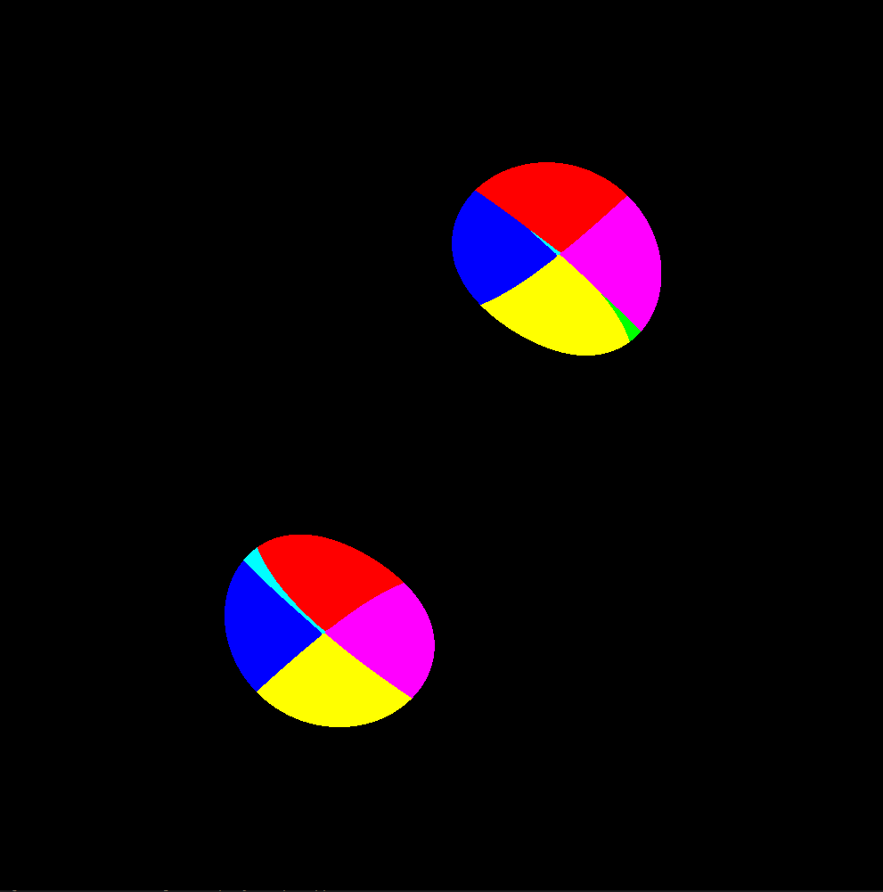

# 往年计分 TD：用距离函数可视化三维物体（TD noté – Visualisation d’un objet 3D par SDF, APM 2025-2026）

原题：[td2.pdf](td2.pdf) · 教师：julien.jaeger@cea.fr、thibaut.pepin@cea.fr

这是 2025–2026 学年的计分 TD，与本年的 Monte Carlo TD2 不同。题目引用的模板（`Color`、`GetColor`、`PPMSave`）不在本地目录中，下面的代码要按实际模板调整。

> Les objectifs de ce TD sont :
> - Configuration de grilles et blocs dépendant du problème posé
> - Écriture de kernels CUDA
> - Déplacement mémoire entre l’accélérateur et le processeur
> - Mapping de tableau multidimensionnel sur une unique zone mémoire contiguë

本次 TD 的目标：

- 根据问题配置网格和线程块
- 编写 CUDA kernel
- 在加速器与处理器之间搬运数据
- 把多维数组映射到一块连续内存上

## I 用 SDF 定义的物体的可视化（Visualisation d’objet défini par SDF）

### 1 问题描述（Description du problème）

> En visualisation, la méthode la plus utilisée pour représenter un objet consiste à construire la surface de cet objet en utilisant des triangles, puis à utiliser un algorithme pour projeter ces triangles sur l’écran, en respectant la profondeur. Une autre méthode de représentation fonctionne à partir d’une fonction décrivant pour chaque objet la distance entre un point dans l’espace et la surface de cet objet. La distance retournée sera négative si le point est à l’intérieur de la forme.
>
> Vous essaierez ici de visualiser un objet à partir de cette seconde méthode, la fonction de distance étant déjà implémentée dans le template à votre disposition. Cette visualisation s’effectuera en deux étapes représentées par différents kernels :
> - Échantillonner un espace en trois dimensions à l’aide de la fonction de distance. Ces échantillons seront répartis uniformément selon une grille comme présenté figure 1. Pour chaque échantillon, nous associerons une couleur qui dépendra de l’orientation du gradient du champ de distance, ou noir si l’échantillon est en dehors de la forme.
> - Nous disposons maintenant d’un tableau 3D de couleurs. Afin de projeter ces données pour les visualiser sur un support 2D (l’écran), nous imaginons un observateur situé aux coordonnées (0, +inf, 0) et ne percevant pas la perspective. Pour obtenir l’image finale, il suffit alors de parcourir le tableau de couleurs depuis la coordonnée y la plus petite vers la plus grande en conservant uniquement la couleur la plus récente rencontrée, différente du noir, comme présenté figure 2.

在可视化中，表示物体最常用的方法是用三角形构造物体表面，再用算法按深度把这些三角形投影到屏幕上。另一种表示方法基于一个函数：对每个物体，它给出空间中一点到物体表面的距离；点在形状内部时距离为负。

这里用第二种方法可视化一个物体，距离函数已在提供的模板中实现。可视化分两步，各由一个 kernel 完成：

- 用距离函数对三维空间采样。样本按图 1 所示的网格均匀分布。每个样本对应一种颜色，颜色取决于距离场梯度的方向；样本在形状外部时为黑色。
- 得到三维颜色数组后，为了把它投影到二维介质（屏幕）上显示，设想一个位于 (0, +inf, 0)、没有透视的观察者。要得到最终图像，只需沿 y 从小到大遍历颜色数组，只保留最近遇到的非黑色颜色，如图 2 所示。

图 1（三维空间中样本的分布）、图 2（三维数组到二维数组的无透视投影）和图 3（一维数组下标与三维位置的对应）见原题 PDF 第 2 页。图 3 的规律是 x 最快、y 其次、z 最慢：y=0 层的底行为 0、1、2，往上一行为 9、10、11；y=1 层对应位置为 3、4、5。

### 2 问题转化（Transposition du problème）

#### 2.1 内存分配（Allocation mémoire）

> Pour stocker les couleurs, vous utiliserez un tableau de taille 1000 × 1000 × 1000. La structure de couleur à utiliser vous est fournie dans le template de code (`Color`).

颜色存放在大小为 1000 × 1000 × 1000 的数组中，颜色结构体 `Color` 由代码模板提供。

##### Q.1 把三维颜色存入一维数组（Tableau 1D contigu）

> **Q.1 :** Afin de simplifier les transferts mémoire à effectuer, bien que vos couleurs soient organisées en 3D (chacune d’entre elles est liée à une position dans un espace 3D), vous utiliserez un tableau 1D pour les stocker. La figure 3 vous indique l’index dans le tableau à une dimension en fonction de leur position dans l’espace 3D. Écrivez une fonction renvoyant l’index à utiliser dans le tableau 1D à partir des index (x, y, z) que vous utiliseriez si vous utilisiez un tableau 3D (type `Color ***` : tableau de tableau de tableau).
>
> Pensez à remplir l’accès au tableau de couleur dans la fonction `PPMSave`. L’accès souhaité se situe à l’index (x, slice, z).

**题目：**为了简化内存传输，虽然颜色按三维组织（每个颜色对应三维空间中的一个位置），仍用一维数组存放。图 3 给出了三维位置对应的一维数组下标。写一个函数：输入使用三维数组（`Color ***`，数组的数组的数组）时的下标 (x, y, z)，返回一维数组中的下标。

别忘了在 `PPMSave` 函数中补全对颜色数组的访问，要访问的是下标 (x, slice, z)。

> **Réponse :** La figure utilise x rapide, puis y, puis z. Pour un cube de côté N :

**解答：**题图为 x 最快、y 次之、z 最慢。边长 N 的立方数组索引为：

```cpp
__host__ __device__ size_t index3(int x, int y, int z, int N) {
    return (size_t)x + (size_t)N * ((size_t)y + (size_t)N * z);
}
// PPMSave: color[index3(x, slice, z, N)]
```

##### Q.2 在主机和设备上分配数组（Allocation host et device）

> **Q.2 :** Allouez un tableau 1D de la bonne taille sur l’host, puis, en utilisant les fonctions du SDK CUDA, sur le device.

**题目：**在主机上分配大小合适的一维数组，再用 CUDA SDK 的函数在设备上分配。

> **Réponse :** `count=(size_t)N*N*N`, `bytes=count*sizeof(Color)` ; utiliser `malloc(bytes)` sur l’hôte et `cudaMalloc(...,bytes)` sur le device. N=1000 donne **un milliard de couleurs** : 3 GB si `sizeof(Color)==3`, 4 GB si elle vaut 4. Vérifier la taille réelle, les échecs d’allocation et la mémoire disponible.

**解答：**`count=(size_t)N*N*N`，`bytes=count*sizeof(Color)`；主机用 `malloc(bytes)`，设备用 `cudaMalloc(...,bytes)`。N=1000 时有**十亿个颜色元素**：若 `sizeof(Color)==3`，占 3 GB；若为 4，占 4 GB。核实结构体大小、分配结果和可用内存。

#### 2.2 采样（Échantillonnage）

> L’objet à visualiser est centré à la coordonnée (0, 0, 0) et on souhaite observer la partie de l’espace allant de (−1, −1, −1) à (1, 1, 1). Chaque thread s’occupera d’évaluer la fonction de distance (`GetDistance`) à une unique coordonnée.

要可视化的物体以 (0, 0, 0) 为中心，观察范围是从 (−1, −1, −1) 到 (1, 1, 1) 的空间。每个线程在一个坐标处计算距离函数（`GetDistance`）。

##### Q.3 采样的网格与线程块（Grille et blocs pour l’échantillonnage）

> **Q.3 :** Proposez une structure de grille et de bloc pour les threads CUDA afin de répartir l’espace à échantillonner parmi les threads. Justifiez votre choix.

**题目：**给出 CUDA 线程的网格和线程块结构，把要采样的空间分配给各线程，并说明理由。

> **Réponse :** Un choix est `block(8,8,8)`, 512 threads, et `grid(125,125,125)` pour N=1000. Chaque thread gère un voxel ; conserver `x<N && y<N && z<N` pour les autres tailles. Cette configuration facilite le mapping, sans prétendre être optimale.

**解答：**可以用 `block(8,8,8)`，每块 512 个线程，N=1000 时配 `grid(125,125,125)`。每线程负责一个体素；保留 `x<N && y<N && z<N` 以适应其他大小。这个配置便于坐标映射，不意味着性能最优。

##### Q.4 保存 Y=0 切片（Tranche Y=0）

> **Q.4 :** Les couleurs obtenues à la fin de l’exécution du kernel gérant l’échantillonnage doivent être laissées sur le device pour la prochaine étape. Cependant, afin de pouvoir évaluer si votre kernel est correct, effectuez une copie mémoire vers l’host et sauvegardez la tranche de votre tableau correspondant aux échantillons situés sur le plan XZ de l’espace intersectant Y=0. Utilisez pour cela la fonction `PPMSave` qui vous est fournie. Le paramètre `slice` de cette fonction correspond à l’index y qui reste constant pendant la lecture du tableau de couleurs.
>
> Attention, l’index y=0 dans le tableau 3D ne correspond pas aux valeurs échantillonnées sur le plan XZ de l’espace intersectant Y=0. Votre tableau 3D de côté 1000 contient des échantillons effectués dans un cube de l’espace 3D de côté 2 centré en (0, 0, 0). Vous devriez obtenir la même image que la figure 4.

**题目：**采样 kernel 执行结束时得到的颜色要留在设备上供下一步使用。但为了检查 kernel 是否正确，把数据复制到主机，并保存数组中对应 XZ 平面与 Y=0 相交处采样点的那一片。为此使用题目提供的 `PPMSave` 函数，它的参数 `slice` 是读取颜色数组时保持不变的 y 下标。

注意：三维数组中的下标 y=0 并不对应 Y=0 平面上的采样值。边长 1000 的三维数组存放的是在边长为 2、中心为 (0, 0, 0) 的立方体中取的样本。你应当得到与图 4 相同的图像。



*图 4：XZ 平面、Y=0 处物体的切片（Tranche de l’objet à visualiser, plan XZ, Y=0）。*

> **Réponse :** Choisir explicitement `position(i)=-1+2*i/N`, donc l’intervalle `[-1,1[` ; la tranche est **slice=N/2=500**. Avec les deux bornes incluses, `-1+2*i/(N-1)`, les 1000 points ne contiennent pas exactement zéro : 499 et 500 encadrent Y=0. Énoncer la convention avant de choisir la tranche.
>
> Copier le volume device vers l’hôte après l’échantillonnage, puis faire lire `(x,500,z)` par `PPMSave`. Garder le volume device pour la projection. Une copie de la seule tranche optimiserait le transfert, mais n’est pas nécessaire à la réponse.

**解答：**明确采用 `position(i)=-1+2*i/N`，区间为 `[-1,1[`，则 **slice=N/2=500**。如果用 `-1+2*i/(N-1)` 包含两端点，1000 个点中没有精确的零，499、500 位于 Y=0 两侧。先说明采样约定，再选择切片。

采样后把设备体积复制回主机，让 `PPMSave` 读取 `(x,500,z)`。设备数据保留用于投影。只复制切片能减少传输量，但不是完成本题的必要条件。

##### Q.5 编写采样 kernel（Kernel d’échantillonnage）

> **Q.5 :** Passons maintenant à l’écriture du kernel. Chaque thread devra déterminer une unique position dans l’espace où il devra échantillonner la fonction de distance. Vous utiliserez pour cela les bornes de l’espace à observer, la taille du tableau à remplir ainsi que les index et tailles des grid/bloc/thread CUDA. Pensez à centrer l’espace à observer sur (0, 0, 0) et n’oubliez pas l’organisation des données présentée figure 3. Une fois la position déterminée, utilisez la fonction `GetColor` pour obtenir la couleur et remplissez votre tableau de couleur au bon index. Cette fonction déterminera pour vous quelle couleur utiliser en fonction de l’orientation du gradient du champ de distance.

**题目：**现在编写 kernel。每个线程要确定空间中唯一的一个位置，在那里对距离函数采样。为此要用到观察空间的边界、要填的数组大小，以及 CUDA 网格、线程块、线程的下标和尺寸。记得让观察空间以 (0, 0, 0) 为中心，并遵循图 3 的数据组织。确定位置后，用 `GetColor` 得到颜色，填入颜色数组的正确下标处；`GetColor` 会根据距离场梯度的方向决定颜色。

> **Réponse :** Logique sous la convention de Q.4 :

**解答：**按 Q.4 的约定实现如下逻辑：

```text
x = blockIdx.x * blockDim.x + threadIdx.x
y = blockIdx.y * blockDim.y + threadIdx.y
z = blockIdx.z * blockDim.z + threadIdx.z
if x < N and y < N and z < N:
    px = -1.0 + 2.0*x/N
    py = -1.0 + 2.0*y/N
    pz = -1.0 + 2.0*z/N
    color[index3(x,y,z,N)] = GetColor(px,py,pz)
```

#### 2.3 投影（Projection）

> Chaque thread devra s’occuper d’une « colonne » de valeurs dans le tableau 3D de couleurs en fixant x et z et en faisant varier y. De la même manière que la partie précédente, une fois le kernel de projection exécuté, copiez le tableau de couleurs vers l’hôte et utilisez la fonction `PPMSave` pour obtenir le résultat final et révéler la forme que l’on cherche à visualiser.

每个线程负责三维颜色数组中的一“列”值：固定 x 和 z，让 y 变化。与前一部分一样，投影 kernel 执行后，把颜色数组复制到主机，用 `PPMSave` 得到最终结果，显示出要可视化的形状。

##### Q.6 投影的网格与线程块（Grille et blocs pour la projection）

> **Q.6 :** Commencez par proposer une structure de grille et de bloc pour les threads CUDA afin de répartir les colonnes de données parmi les threads pour effectuer la projection. Justifiez votre choix.

**题目：**先给出 CUDA 线程的网格和线程块结构，把数据列分配给各线程进行投影，并说明理由。

> **Réponse :** Un thread prend une colonne `(x,z)` entière. Exemple : bloc 2D `block(32,8)`, grille `((N+31)/32,(N+7)/8)`. L’axe x CUDA couvre x, l’axe y CUDA couvre **z**. On lance environ N² threads, pas N³.

**解答：**一个线程负责完整的一列 `(x,z)`。例如二维块 `block(32,8)`，网格 `((N+31)/32,(N+7)/8)`。CUDA x 轴映射空间 x，CUDA y 轴映射空间 **z**。线程数约为 N²，不是 N³。

##### Q.7 编写投影 kernel（Kernel de projection）

> **Q.7 :** Passons à l’écriture du kernel. Chaque thread devra déterminer les index (x, z) de la colonne du tableau de couleurs dont il s’occupera. Puis, chaque thread itérera depuis y = 0 vers y = 1000, et enregistrera à la base de la colonne (y=0) la dernière couleur rencontrée qui soit différente de noir (r=0, g=0, b=0).

**题目：**编写 kernel。每个线程确定自己负责的颜色数组列的下标 (x, z)，然后从 y = 0 迭代到 y = 1000，把遇到的最后一个非黑色（r=0, g=0, b=0 为黑色）颜色写到该列的底部（y=0）。

> **译注：**数组边长是 1000，y 的有效下标是 0–999，“迭代到 y = 1000”应理解为 `y < 1000`。

> **Réponse :** L’observateur est en `(0,+∞,0)`. Parcourir y croissant, remplacer la couleur chaque fois qu’elle est non noire : on garde la couleur visible au plus grand y. La borne est **y<N**, pas `y<=1000`.
>
> Chaque thread écrit seulement la base de **sa colonne**, après l’avoir lue : ni atomique ni barrière entre threads. Ordonner échantillonnage puis projection dans un stream, ou par événement. Copier ensuite le résultat et afficher `slice=0`. Un thread par voxel écrivant simultanément dans `(x,0,z)` créerait une course.

**解答：**观察者在 `(0,+∞,0)`。按 y 递增遍历，每遇到非黑色就更新当前颜色，最终保留最大 y 处的可见颜色。循环边界为 **y<N**，不能写 `y<=1000`。

每线程读完后只写**自己那列**的底部，无需原子操作或线程间屏障。采样和投影应在同一 stream 依次执行，或用事件建立依赖。随后复制结果，以 `slice=0` 保存。让每体素一个线程并同时写 `(x,0,z)` 会造成竞争。

```text
x = blockIdx.x * blockDim.x + threadIdx.x
z = blockIdx.y * blockDim.y + threadIdx.y
if x < N and z < N:
    last = Color(0,0,0)
    for y = 0, ..., N-1:
        current = color[index3(x,y,z,N)]
        if current.r != 0 or current.g != 0 or current.b != 0:
            last = current
    color[index3(x,0,z,N)] = last
```

## II 提交（Rendu）

> Vous enverrez un unique fichier contenant le code produit à l’adresse suivante : thibaut.pepin@cea.fr. Les réponses aux questions devront être en commentaire dans le code. Vous aurez jusqu’au 13 novembre à 23h59 pour rendre votre travail. 1 point sera soustrait par tranche de 10 minutes de retard.

把写好的代码放在一个文件里，发送到 thibaut.pepin@cea.fr。问题的答案写成代码中的注释。截止时间为 11 月 13 日 23:59，每迟交 10 分钟扣 1 分。
