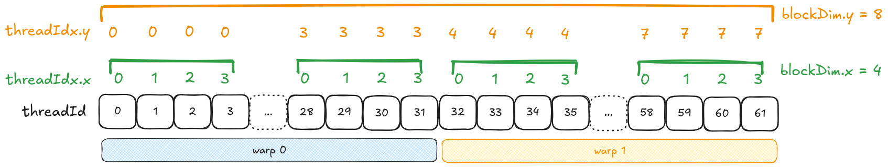
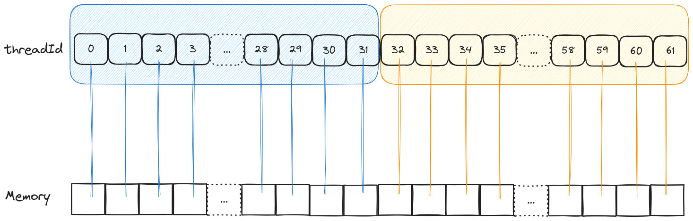
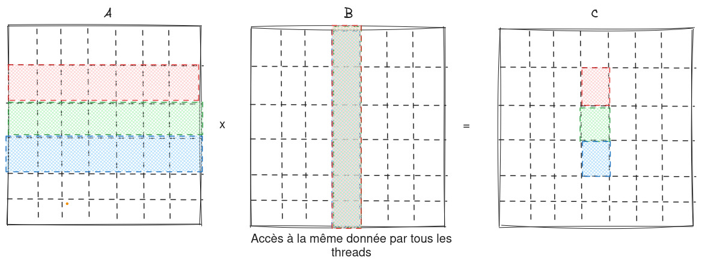
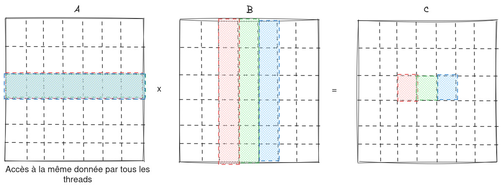
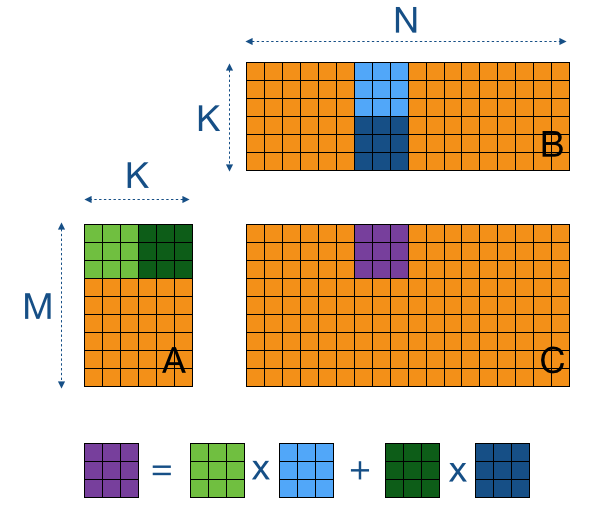
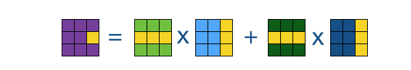
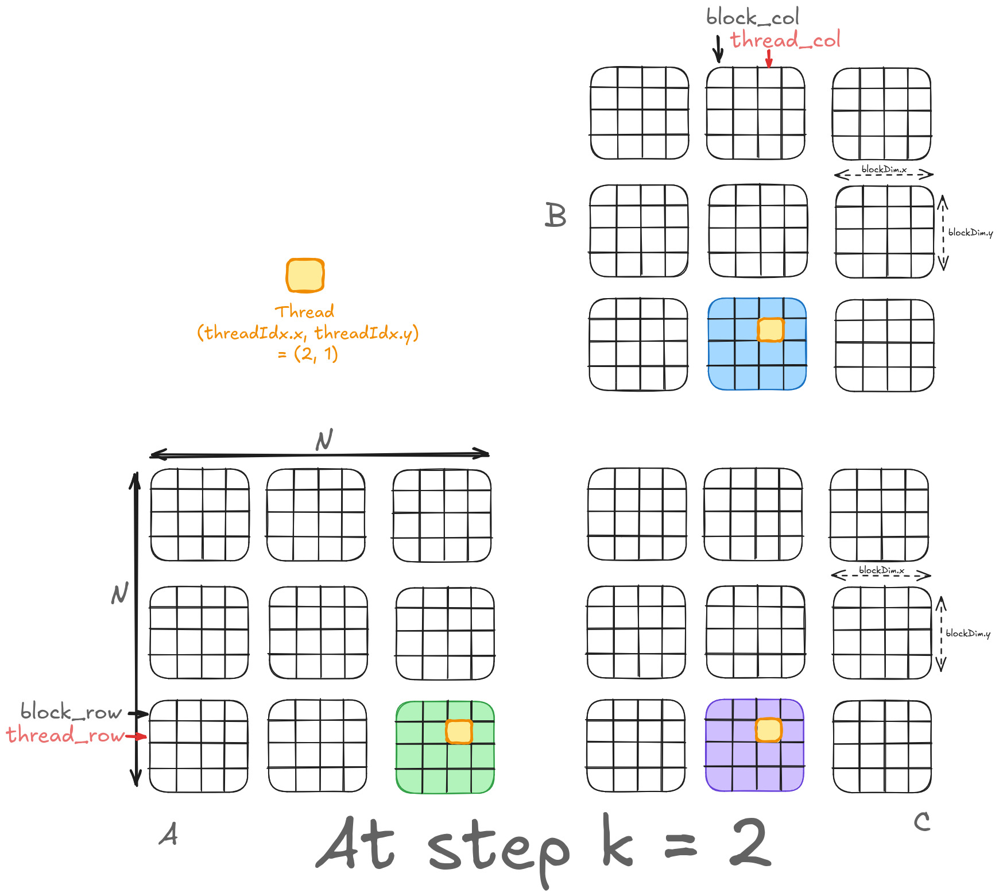

# 往年 TP1 解答：内存访问优化与共享内存（Optimisation des accès mémoire – APM 2024-2025）

原题与教师解答：[tp1_correction.pdf](tp1_correction.pdf) · 教师：julien.jaeger@cea.fr、lucas.vanlanker@cea.fr

题号与本年 TP1 不同：本年 Q.1–Q.12 只到全局内存版 GEMM，这里的 Q.13–Q.21 讲性能模型、合并访存和共享内存分块，对应 10 月 22 日下午 TP2 的内容。

> L’objectif de ce TP est de comprendre les différentes mémoires existantes d’un GPU et leur utilisation sur un calcul classique d’algèbre linéaire : le produit matriciel. Nous allons voir à travers cet exemple comment utiliser la mémoire globale, la mémoire partagée et la mémoire unifiée.
>
> Les objectifs de ce TP sont :
> - Maîtriser la chaîne de compilation CUDA
> - Compréhension du concept de global memory coalescing GPU
> - Optimisation des performances avec l’utilisation de la mémoire partagée
>
> Ce TP est à faire sur deux séances.

本实验通过线性代数中的经典计算——矩阵乘法，理解 GPU 上现有的各种内存及其用法，并借这个例子学习如何使用全局内存、共享内存和统一内存。

本实验的目标：

- 掌握 CUDA 编译流程
- 理解 GPU 全局内存合并访问（global memory coalescing）的概念
- 用共享内存优化性能

本实验分两次课完成。

## I 编译流程（Chaîne de compilation）

> Pour observer certaines étapes du processus de compilation, compiler le fichier `tp1_check.cu` avec la commande ci-dessous (il faudra avoir créé le répertoire `CUDAIMG` avant de lancer la commande). Des fichiers intermédiaires sont créés dans le répertoire `CUDAIMG`.

为了观察编译过程中的若干步骤，用下面的命令编译 `tp1_check.cu`（运行前要先创建 `CUDAIMG` 目录）。中间文件会生成在 `CUDAIMG` 目录中。

```bash
nvcc --keep --keep-dir CUDAIMG -c tp1_check.cu
```

### Q.1 识别 PTX 与 CUDA 二进制（PTX et binaire CUDA）

> **Q.1 :** Quel fichier correspond au PTX ? Lequel correspond au binaire CUDA ?

**题目：**哪个文件是 PTX？哪个是 CUDA 二进制文件？

> **Correction :** Le fichier `.ptx` correspond à l’assembleur PTX, le langage intermédiaire entre CUDA et le binaire CUBIN. Le fichier `...sm_xx.cubin` correspond à la traduction de cet assembleur en binaire CUDA (CUBIN).

**教师解答：**`.ptx` 文件是 PTX 汇编，即 CUDA 与 CUBIN 二进制之间的中间语言。`...sm_xx.cubin` 文件是把这份汇编翻译成的 CUDA 二进制（CUBIN）。

### Q.2 哪些源代码被编译成 PTX（Parties compilées en PTX）

> **Q.2 :** Quelles parties des sources de `tp1_check.cu` ont été conservées pour être compilées en PTX ? Remarque : vous pouvez lire ce paragraphe de la documentation CUDA pour en apprendre plus sur la chaîne de compilation CUDA.

**题目：**`tp1_check.cu` 的哪些源代码被保留下来编译成 PTX？提示：可以阅读 CUDA 文档的相应段落，进一步了解 CUDA 编译流程。

> **Correction :** Le compilateur nvcc sépare les parties host et device du code. Seule la partie device, donc les kernels, est traduite en assembleur PTX. Le reste du code est transmis au compilateur C/C++ de l’hôte (par exemple g++).

**教师解答：**nvcc 把代码分成主机端和设备端两部分。只有设备端部分，也就是各个 kernel，会被翻译成 PTX 汇编；其余代码交给主机的 C/C++ 编译器（例如 g++）。

### Q.3 `sm_xx` 后缀的含义（Suffixe `sm_xx`）

> **Q.3 :** À quoi correspond le suffixe `...sm_xx.cubin` (par exemple `sm_30` ou `sm_52`) des fichiers créés ?

**题目：**生成文件的后缀 `...sm_xx.cubin`（例如 `sm_30` 或 `sm_52`）表示什么？

> **Correction :** Le suffixe `_30` (ou `_52`) correspond à la compute capability : ici 3.0 (ou 5.2). La compute capability désigne l’ensemble des caractéristiques de l’architecture d’un cœur de calcul (SM = Streaming Multiprocessor). Chaque nouvelle version permet de supporter de nouvelles fonctionnalités.
>
> Par défaut, nvcc compile les sources pour une certaine compute capability en fonction de la version de nvcc. Par exemple, nvcc 12.3 compile par défaut pour une compute capability de 5.2. La valeur peut également être modifiée via l’option de compilation `-gencode=arch=compute_61,code=sm_61`, ou en version courte `-arch=sm_61`. Cf. la documentation de nvcc pour plus d’infos.

**教师解答：**后缀 `_30`（或 `_52`）表示计算能力（compute capability），这里是 3.0（或 5.2）。计算能力指一个计算核心（SM，流式多处理器）的体系结构特性集合，每个新版本都支持新的功能。

nvcc 默认按自身版本对应的某个计算能力编译，例如 nvcc 12.3 默认编译到计算能力 5.2。也可以用编译选项 `-gencode=arch=compute_61,code=sm_61` 修改，简写为 `-arch=sm_61`。详见 nvcc 文档。

## II 矩阵乘法（Multiplication matricielle）

> Le but de cette partie est d’implémenter une première version de multiplication de matrices sur GPU, appelée « General Matrix Multiplication » (GEMM).
>
> La mémoire globale est accessible depuis n’importe quel thread d’une grille sur un GPU. C’est la mémoire qui est allouée/libérée grâce aux fonctions `cudaMalloc` et `cudaFree`. Nous allons dans un premier temps utiliser cette mémoire pour écrire un premier kernel de produit matriciel.
>
> La multiplication de deux matrices est un problème qui se prête bien au système de fonctionnement du GPU. Pour vous aider, un code séquentiel écrit en C est à votre disposition, il s’agit du fichier `dgemm.c`. À partir d’ici, veillez à compléter ce programme afin de déporter les calculs de la multiplication des deux matrices sur un GPU. N’oubliez pas de changer l’extension du fichier (i.e. `.c` en `.cu`).
>
> Soient A, B et C trois matrices carrées de tailles N × N, la multiplication de la matrice A par la matrice B stockée dans C peut se définir par l’algorithme suivant :

这一部分要在 GPU 上实现第一版矩阵乘法，即通用矩阵乘法（GEMM）。

全局内存可以被 GPU 网格中的任何线程访问，用 `cudaMalloc`、`cudaFree` 分配和释放的就是这种内存。我们先用它写第一个矩阵乘法 kernel。

两个矩阵相乘很适合 GPU 的工作方式。为方便起见，题目提供了用 C 写的串行代码 `dgemm.c`。从这里开始，要补全这个程序，把两个矩阵的乘法计算移到 GPU 上。别忘了把文件扩展名从 `.c` 改为 `.cu`。

设 A、B、C 为三个 N × N 方阵，A 乘以 B、结果存入 C 的算法如下（Listing 1）：

```c
double A[N*N];
double B[N*N];
double C[N*N];

for (int i = 0; i < N; i++)
{
    for (int j = 0; j < N; j++)
    {
        double tmp = 0.0f
        for (int k = 0; k < N; k++)
        {
            tmp += A[i * N + k] * B[k * N + j];
        }
        C[i * N + j] = tmp;
    }
}
```

> **译注：**原清单第 9 行 `double tmp = 0.0f` 缺分号；对 `double` 宜写 `0.0`。

### 1 内存分配与数据传输（Allocation et transfert de données）

### Q.4 行主序还是列主序（Row-major ou column-major）

> **Q.4 :** Lisez l’introduction de la page Wikipédia « Row- and column-major order ». Quelle représentation avons-nous choisie dans l’extrait de code précédent ? Sauf mention contraire, nous utiliserons cette représentation dans la suite du TP.

**题目：**阅读维基百科“Row- and column-major order”词条的引言。上面的代码采用了哪种存储方式？如无特别说明，本实验后面都使用这种方式。

> **Correction :** Row-major. En C, C++ et CUDA, les matrices sont organisées par lignes contiguës dans la mémoire (dans d’autres langages, par exemple en Fortran, elles sont organisées par colonnes).
>
> Ainsi, nous faisons le choix de parcourir les matrices A et C en row-major pour profiter des effets de cache possibles. Par exemple, à l’itération 0 de la boucle k, quand le thread charge la valeur de `A[i * N]`, il charge une ligne de cache contenant non seulement `A[i * N]`, mais également les données qui lui sont contiguës en mémoire, donc `A[i * N + 1]`, `A[i * N + 2]`, etc., selon la taille de la ligne de cache. De cette manière, le chargement des valeurs de A sera plus rapide.
>
> À l’inverse, la matrice B est lue par colonne. Or sa représentation en mémoire est row-major, donc nous ne profiterons pas au mieux des effets de cache.

**教师解答：**行主序（row-major）。在 C、C++ 和 CUDA 中，矩阵按行连续存放（Fortran 等语言则按列存放）。

所以按行主序遍历 A 和 C，可以利用缓存。例如 k 循环第 0 次迭代时，线程读取 `A[i * N]`，载入的缓存行不仅含 `A[i * N]`，还含内存中与它相邻的 `A[i * N + 1]`、`A[i * N + 2]` 等（取决于缓存行大小），这样读取 A 的值会更快。

相反，B 是按列读取的，而它在内存中按行存放，因此不能充分利用缓存。

### Q.5 在 GPU 上分配三个向量（Allocation avec `cudaMalloc`）

> **Q.5 :** Dans un premier temps, à l’aide de la fonction `cudaMalloc`, allouer trois vecteurs de taille N × N sur le GPU : deux vecteurs en entrée pour les opérandes de la multiplication, et un troisième pour stocker le résultat final.
>
> Ici, nous représentons une matrice sous la forme d’un seul vecteur de taille N × N comme dans le listing 1. L’intérêt est de stocker les matrices de manière contiguë en mémoire et de ne pas avoir à faire des transferts de tableaux à outrance (par exemple un tableau par ligne si l’on stocke une matrice sous forme d’un vecteur de vecteurs).

**题目：**先用 `cudaMalloc` 在 GPU 上分配三个大小为 N × N 的向量：两个存放乘法的输入操作数，第三个存放最终结果。

这里像 Listing 1 那样，把矩阵表示成一个长度为 N × N 的向量。好处是矩阵在内存中连续存放，不必做大量数组传输（例如矩阵存成“向量的向量”时，每行都要单独传一次）。

> **Correction :** On déclare trois vecteurs `d_a`, `d_b` et `d_b` qu’on alloue dans la mémoire globale du GPU avec `cudaMalloc(&ptr, sizeof(double) * N * N)`.

**教师解答：**声明三个向量 `d_a`、`d_b`、`d_b`，用 `cudaMalloc(&ptr, sizeof(double) * N * N)` 在 GPU 全局内存中分配。

> **译注：**第三个向量应为 `d_c`，原文重复写成了 `d_b`。

### Q.6 把数据传到 GPU（Transfert vers le device）

> **Q.6 :** Les données étant maintenant allouées, transférez les données initialisées par l’hôte (i.e. Host) vers l’accélérateur (i.e. Device) en utilisant la fonction `cudaMemcpy`.

**题目：**数据已经分配好，用 `cudaMemcpy` 把主机（Host）初始化的数据传到加速器（Device）上。

> **Correction :** On transfère les matrices A et B vers `d_a` et `d_B` avec `cudaMemcpy(ptr, sizeof(double) * N * N, cudaMemcpyHostToDevice)`.

**教师解答：**用 `cudaMemcpy(ptr, sizeof(double) * N * N, cudaMemcpyHostToDevice)` 把矩阵 A、B 传到 `d_a`、`d_B`。

> **译注：**原文的调用漏了源指针。`cudaMemcpy` 的参数依次为目标、源、字节数、方向，应写 `cudaMemcpy(d_a, A, sizeof(double) * N * N, cudaMemcpyHostToDevice)`，B 同理；`d_B` 应与前文统一为 `d_b`。

### 2 kernel 配置（Configuration du kernel）

### Q.7 配置二维网格（Grille 2D de blocs 32×32）

> **Q.7 :** Avant de déporter du calcul sur l’accélérateur, il faut configurer la grille sur laquelle vont s’exécuter l’ensemble des threads CUDA. À l’aide des structures de type `dim3`, configurez une grille 2D contenant des blocs 2D de taille 32x32 (i.e. 1024 threads par bloc). Cette grille devra contenir suffisamment de threads afin que chacun d’entre eux puisse être en charge du calcul d’un élément de la matrice résultat.

**题目：**把计算移到加速器之前，要配置所有 CUDA 线程运行的网格。用 `dim3` 结构配置一个二维网格，其中的线程块是 32×32 的二维块（每块 1024 个线程）。网格中的线程要足够多，使每个线程负责计算结果矩阵的一个元素。

> **Correction :** Le bloc de taille 32x32 est déclaré par `dim3 blockSize(32, 32);`. Pour la grille 2D :

**教师解答：**32×32 的线程块用 `dim3 blockSize(32, 32);` 声明。二维网格如下：

```cpp
int nb_blocks = N / 32; // Nombre de blocs selon x et y
/* Si N n'est pas multiple de 32, il faut des blocs
   supplémentaires pour calculer tous les éléments de la matrice C */
if ((N % 32) > 0) nb_blocks++;
dim3 gridSize(nb_blocks, nb_blocks);
```

代码注释的意思：`nb_blocks` 是 x、y 方向各自的块数；N 不是 32 的倍数时要多加一个块，才能算出 C 的全部元素。

### Q.8 启动一个空 kernel（Kernel vide）

> **Q.8 :** L’heure est venue de faire s’exécuter le premier kernel sur un accélérateur de calcul. Écrire un premier kernel, pour l’instant vierge, sur la grille préalablement configurée à la question précédente.

**题目：**现在让第一个 kernel 在计算加速器上运行。在上一题配置的网格上，写一个暂时为空的 kernel。

> **Correction :** On déclare le kernel avec le mot-clé `__global__`, par exemple `__global__ void mat_mul() {}`. On le lance avec les paramètres de la question précédente : `mat_mul<<< gridSize, blockSize >>>();`

**教师解答：**用关键字 `__global__` 声明 kernel，例如 `__global__ void mat_mul() {}`，并用上一题的参数启动：`mat_mul<<< gridSize, blockSize >>>();`。

### Q.9 取回结果（Rapatriement du résultat）

> **Q.9 :** En l’état, le kernel s’exécute sur l’accélérateur de calcul mais ne retourne aucun résultat sur la partie hôte. À la suite de l’exécution du kernel, veiller à transférer le résultat qui nous intéresse pour le calcul de la multiplication matricielle.

**题目：**目前 kernel 在加速器上运行，但不向主机返回任何结果。kernel 执行完后，要把矩阵乘法需要的结果传回来。

> **Correction :** Utiliser à nouveau la fonction `cudaMemcpy` dans le sens DeviceToHost pour transférer les résultats de `d_c` vers C.

**教师解答：**再次使用 `cudaMemcpy`，方向为 DeviceToHost，把结果从 `d_c` 传到 C。

### 3 编写 kernel（Écriture du kernel）

### Q.10 计算行、列下标（Indices de ligne et de colonne）

> **Q.10 :** Dans le kernel, à partir des dimensions et des indices relatifs à la grille, calculez l’indice de la ligne et de la colonne de l’élément de C qu’il faudra manipuler. Ici, utilisez une grille 2D avec la dimension x pour les lignes et la dimension y pour les colonnes. Faites un schéma de votre grille de blocs sur un brouillon pour vous aider.

**题目：**在 kernel 中，根据网格的维度和下标，算出要处理的 C 元素的行号和列号。这里使用二维网格，x 维对应行，y 维对应列。可以在草稿纸上画出线程块网格帮助思考。

> **Correction :** Il y a au moins deux manières de procéder : soit on calcule directement deux indices globaux différents pour la ligne et la colonne (méthode 1) ; soit on calcule d’abord l’indice global du thread, puis on en déduit la ligne et la colonne (méthode 2).

**教师解答：**至少有两种做法：一是直接分别算出行、列两个全局下标（方法 1）；二是先算线程的全局编号，再推出行和列（方法 2）。

```cpp
// Méthode 1
int row = threadIdx.x + blockDim.x * blockId.x;
int col = threadIdx.y + blockDim.y * blockId.y;

// Méthode 2
int block_id = blockIdx.y * gridDim.x + blockIdx.x;
int tid_in_block = threadIdx.y * blocDim.x + threadIdx.x;
int tid = (blockDim.x * blockDim.y) * block_id + tid_in_block;
int row = tid % N; // Selon x
int col = tid / N; // Selon y
```

> **译注：**代码有拼写错误：`blockId.x`、`blockId.y` 应为 `blockIdx.x`、`blockIdx.y`，`blocDim.x` 应为 `blockDim.x`。方法 2 启动的线程数多于 N² 时（N 不是 32 的倍数），还要先判断 `tid < N * N`。

### Q.11 计算 C 的一个元素（Calcul d’un élément de C）

> **Q.11 :** Pour un thread donné, effectuez le calcul de la case de C dans le noyau exécuté par le GPU.

**题目：**对给定的线程，在 GPU 执行的 kernel 中算出 C 的对应元素。

> **Correction :** Voir fichier `dgemm_7.c`.

**教师解答：**见文件 `dgemm_7.c`（本地没有这个文件；本年版本的实现见 [TP1 解答](../../TP1/SUJET/tp1_zh.md) Q.10）。

### 4 性能分析（Analyse des performances）

### Q.12 用事件计时（Mesure du temps avec `cudaEvent_t`）

> **Q.12 :** Maintenant que le calcul de multiplication matricielle fonctionne, il nous faut analyser les performances de notre application. Le SDK CUDA fournit des fonctions permettant de calculer le temps total passé dans un kernel. Utiliser ces fonctions et regardez le temps mis par l’application pour calculer le produit de deux matrices et le transfert du résultat sur la partie hôte. Comparez ces performances au noyau s’exécutant uniquement sur CPU, de manière séquentielle.
>
> Indices : le guide de programmation CUDA vous indique la marche à suivre pour se servir des événements CUDA de type `cudaEvent_t`. Ceux-ci doivent d’abord être créés avec `cudaEventCreate`. Ils fonctionnent habituellement par paire : un premier enregistre l’état de départ, un autre l’état d’arrivée. De cette manière, on peut obtenir l’évolution de l’état du GPU, c’est-à-dire un ensemble de métriques, sur l’ensemble des tâches lancées entre le départ et l’arrivée sur le GPU, notamment le temps écoulé. Pour enregistrer un état, on utilise la fonction `cudaEventRecord`. Cette fonction étant asynchrone, il faudra attendre la fin de l’enregistrement de l’état avec `cudaEventSynchronize`. Pour obtenir la durée écoulée entre deux états, on utilise la fonction `cudaEventElapsedTime`.

**题目：**矩阵乘法已经能算了，接下来分析程序性能。CUDA SDK 提供了测量 kernel 总耗时的函数。用这些函数测量程序计算两个矩阵乘积、并把结果传回主机所用的时间，再与只在 CPU 上串行运行的版本比较。

提示：CUDA 编程指南介绍了 `cudaEvent_t` 类型的 CUDA 事件的用法。事件先用 `cudaEventCreate` 创建，通常成对使用：一个记录起点状态，另一个记录终点状态，这样就能得到起点到终点之间提交给 GPU 的所有任务的状态变化（一组指标），尤其是经过的时间。用 `cudaEventRecord` 记录状态；这个函数是异步的，要用 `cudaEventSynchronize` 等待记录完成；两个状态之间的耗时用 `cudaEventElapsedTime` 获得。

> **Correction :** Voir fichier `dgemm.cu`.

**教师解答：**见文件 `dgemm.cu`（本地没有教师版本；本年的计时实现见 [TP1 解答](../../TP1/SUJET/tp1_zh.md) Q.11）。

### Q.13 理想情况下的时间下界（Borne inférieure du temps）

> **Q.13 :** Dans cette question, nous considérons la multiplication de deux matrices carrées 4096 × 4096 de flottants simple précision (FP32). Nous souhaitons estimer une borne inférieure du temps nécessaire pour effectuer la multiplication sur GPU des matrices. Estimez :
> - le nombre d’opérations flottantes
> - le volume de données minimal $V_r$ à lire (en MB)
> - le volume de données minimal $V_w$ à écrire (en MB)
>
> nécessaire pour calculer le produit matriciel. Quelle est la bande passante mémoire maximale théorique de votre GPU ? Quel est le débit d’opérations flottantes maximal théorique de votre GPU ? (cf. TP0). En utilisant ces deux données et en considérant une implémentation idéale qui ne transfère que le volume de données minimal $V = V_r + V_w$ depuis ou vers la mémoire globale, calculez :
> - le temps minimal $t_{data}$ pour effectuer les transferts de données
> - le temps minimal $t_{compute}$ pour effectuer les calculs
>
> Calculez $\rho = t_{compute} / t_{data}$. Commentez.

**题目：**考虑两个 4096 × 4096 单精度浮点（FP32）方阵相乘，估计在 GPU 上完成乘法所需时间的下界。估计计算矩阵乘积所需的：

- 浮点运算次数
- 最少要读取的数据量 $V_r$（MB）
- 最少要写入的数据量 $V_w$（MB）

你的 GPU 理论最大内存带宽是多少？理论最大浮点运算速率是多少？（见 TP0）用这两个数据，并假设一个理想实现只在全局内存与计算单元之间传输最少的数据量 $V = V_r + V_w$，计算：

- 完成数据传输的最短时间 $t_{data}$
- 完成计算的最短时间 $t_{compute}$

计算 $\rho = t_{compute} / t_{data}$ 并评论。

> **Correction :** Pour des flottants FP32, on a (32/8) octets de taille de donnée par flottant. Dans le meilleur des cas, on ne lit qu’une fois totalement A et B et on écrit tous les éléments de C :
> - FLOPS = 2 × 4096³ = 137 GFLOPS
> - $V_r$ = 2 × 4096² × (32/8) = 128 MB
> - $V_w$ = 4096² × 4 = 64 MB
>
> Donc V = 192 MB. Soient BW la bande passante crête du GPU et F son débit crête d’opérations flottantes FP32. Alors $t_{data} = V / BW$ et $t_{compute} = FLOPS / F$. Il est attendu que ρ soit grand devant 1.
>
> Quadro P5000 : BW = 192 GB/s et F = 6200 GFLOP/s. D’où $t_{data}$ = 1 ms et $t_{compute}$ = 22 ms, d’où ρ = 22 > 1 : le kernel est compute-bound.
>
> A100 : la bande passante crête est 1555.20 GB/s, la puissance de calcul crête 19.5 TFLOP/s. Pour ce GPU, $t_{data}$ = 0.13 ms et $t_{compute}$ = 7 ms, donc ρ = 54 > 1 : le kernel est compute-bound.
>
> Le kernel est compute-bound tant que ρ est supérieur à 1. Remarque : on peut refaire les calculs en double précision FP64. Dans ce cas, le kernel reste compute-bound, mais la puissance de calcul crête du GPU est au moins divisée par deux. Voir le détail de l’architecture de votre GPU pour ce dernier point.

**教师解答：**FP32 每个浮点数占 32/8 = 4 字节。最理想情况下，A、B 各完整读一次，C 的每个元素写一次：

- 运算量 = 2 × 4096³ = 137 G 次浮点运算
- $V_r$ = 2 × 4096² × 4 = 128 MB
- $V_w$ = 4096² × 4 = 64 MB

所以 V = 192 MB。设 BW 为 GPU 峰值带宽、F 为 FP32 峰值浮点速率，则 $t_{data} = V / BW$，$t_{compute} = 运算量 / F$，预期 ρ 远大于 1。

Quadro P5000：BW = 192 GB/s，F = 6200 GFLOP/s，所以 $t_{data}$ = 1 ms，$t_{compute}$ = 22 ms，ρ = 22 > 1，kernel 受计算限制（compute-bound）。

A100：峰值带宽 1555.20 GB/s，峰值算力 19.5 TFLOP/s，所以 $t_{data}$ = 0.13 ms，$t_{compute}$ = 7 ms，ρ = 54 > 1，同样受计算限制。

只要 ρ 大于 1，kernel 就受计算限制。注意：也可以按双精度 FP64 重算，此时仍受计算限制，但 GPU 的峰值算力至少减半，具体见所用 GPU 的架构说明。

> **译注：**数值都对，但单位要分清：2 × 4096³ 是运算量，单位是 GFLOP，不是速率 GFLOPS；128 MB、64 MB、192 MB 实为 MiB（$2^{20}$ 字节）。另外，ρ > 1 只说明在这个理想模型中计算下界更大，不能据此断言实际的朴素 kernel 一定受计算限制（Q.14、Q.15 正说明朴素 kernel 的访存远非理想）。

### Q.14 实测浮点速率（Débit de votre kernel）

> **Q.14 :** Calculez le débit d’opérations flottantes de votre kernel. Comparez-le au débit d’opérations flottantes maximal de votre GPU. Commentez.

**题目：**计算你的 kernel 的浮点运算速率，与 GPU 的最大浮点速率比较并评论。

> **Correction :** Résultat sur un GPU A100-SMX4 40GB avec N = 4096 : 220.1 GFLOP/s, ce qui est peu devant les 19.5 TFLOP/s théoriques de ce GPU ! Sur Quadro P5000 : 47.56 GFLOP/s, là encore loin des 6200 GFLOP/s FP32 théoriques, soit 3100 GFLOP/s FP64 théoriques.

**教师解答：**在 A100-SMX4 40GB 上，N = 4096 时为 220.1 GFLOP/s，远低于这块 GPU 理论上的 19.5 TFLOP/s。在 Quadro P5000 上为 47.56 GFLOP/s，同样远低于理论 FP32 的 6200 GFLOP/s（理论 FP64 为 3100 GFLOP/s）。

> **译注：**比较时精度要一致：FP64 kernel 应与 FP64 峰值比较。“FP64 峰值是 FP32 的一半”只适用于部分 GPU，P5000 这类显卡的 FP64 比例远低于 1/2，应查具体型号的规格。

### Q.15 朴素 kernel 的访存流量（Trafic mémoire du kernel naïf）

> **Q.15 :** L’objectif de cette question est de décrire à la main le pattern d’accès mémoire du kernel naïf. On suppose ici qu’une ligne de cache fait 128 B. Dans le kernel naïf, quel volume de données doit charger un thread pour calculer une valeur de C ? Est-ce que les threads accèdent à des données contiguës en mémoire ?
>
> En considérant le pire cas où chaque lecture ou écriture de données génère un cache miss, estimez le trafic mémoire requis pour effectuer le produit matriciel de 2 matrices 4096 × 4096.
>
> Refaites le calcul en considérant le cas plus réaliste où le thread ne génère qu’un seul cache miss lorsqu’il accède au premier élément d’un ensemble d’éléments contigus en mémoire, et autant de cache miss que d’éléments accédés depuis un ensemble non contigu. Commentez par rapport à la taille des matrices.

**题目：**本题要手工描述朴素 kernel 的访存模式。假设一条缓存行为 128 B。在朴素 kernel 中，一个线程计算 C 的一个值要读取多少数据？各线程访问的数据在内存中是否连续？

考虑最坏情况，即每次读写都产生一次缓存缺失，估计两个 4096 × 4096 矩阵相乘所需的访存流量。

再考虑更现实的情况：线程访问一组连续元素时，只在访问第一个元素时产生一次缓存缺失；访问不连续的一组元素时，每个元素都缺失一次。重新计算，并与矩阵本身的大小比较。

> **Correction :** Chaque thread doit lire une colonne de B et une ligne de A pour calculer un élément de C. Pour une matrice N × N de FP64, cela représente au pire autant de lignes de cache que d’éléments à accéder : $V_{worst\_case} = (64/8) \times N \times 128$ B ; au mieux seulement autant d’éléments que nécessaire : $V_{line} = (64/8) \times N$ B. Vu le format de stockage de la matrice, une ligne est une donnée contiguë au contraire d’une colonne.
>
> Dans le pire cas, chaque thread génère autant de cache miss que de lectures et d’écritures. Le thread lit deux matrices et écrit dans une autre. On lance autant de threads que d’éléments dans la matrice de résultats C.
>
> Pire cas : $V_{thread} = 3 \times V_{worst\_case}$ = 12 MB ; trafic mémoire total $V = 4096^2 \, V_{thread}$ = 192 TB !
>
> Cas plus réaliste : $V_{thread} = 3 \times V_{best\_case}$ = 96 KB ; trafic mémoire total $V = 4096^2 \, V_{thread}$ = 512 GB.
>
> Une matrice de 4096 × 4096 éléments FP64 fait 128 MB, donc le pattern d’accès mémoire n’est pas optimal du tout dans notre kernel naïf.

**教师解答：**每个线程要读 A 的一行和 B 的一列，才能算出 C 的一个元素。对 N × N 的 FP64 矩阵，最坏情况下要访问的每个元素都占一条缓存行：$V_{worst\_case} = (64/8) \times N \times 128$ B；最好情况下只读需要的元素：$V_{line} = (64/8) \times N$ B。按矩阵的存储方式，一行是连续数据，一列则不是。

最坏情况下，每个线程的每次读写都产生缓存缺失。线程读两个矩阵、写另一个矩阵，启动的线程数等于结果矩阵 C 的元素个数。

最坏情况：$V_{thread} = 3 \times V_{worst\_case}$ = 12 MB，总访存流量 $V = 4096^2 \, V_{thread}$ = 192 TB！

较现实情况：$V_{thread} = 3 \times V_{best\_case}$ = 96 KB，总访存流量 $V = 4096^2 \, V_{thread}$ = 512 GB。

一个 4096 × 4096 的 FP64 矩阵只有 128 MB，可见朴素 kernel 的访存模式很不理想。

> **译注：**这段计算有三处不一致。一是最坏情况每个元素算一条 128 B 缓存行即可，公式里多乘了 8 字节；二是线程只写 C 的 1 个元素，不该按“3 个向量”计；三是较现实情况下，按原文自己的 96 KB 算总量应约为 1.5 TB 而非 512 GB，而且题目说 B 的列不连续、每个元素都要缺失，不能和 A 的行一样按连续计。按题目描述重算（每线程读 A 的 N 个、B 的 N 个，写 C 的 1 个；A 的一条缓存行装 16 个 `double`）：
>
> $$
> V_{\text{最坏}}=N^2(2N+1)\cdot128\ \mathrm B\approx16.0\ \mathrm{TiB},\qquad
> V_{\text{较现实}}=N^2\Bigl(\tfrac N{16}+N+1\Bigr)\cdot128\ \mathrm B\approx8.5\ \mathrm{TiB}.
> $$
>
> 两者都远大于单个矩阵的 128 MiB，结论不变。这只是教学计数模型，不是实测的 DRAM 流量。

## III 优化全局内存访问模式（Optimisation du pattern d’accès à la mémoire globale）

> Dans cette section, nous allons optimiser le kernel de la partie précédente en changeant le pattern d’accès mémoire de manière à ce que le GPU puisse effectuer des accès mémoire « coalescés » (« global memory coalescing » en anglais).

本节改变访存模式，使 GPU 能进行“合并”访存（global memory coalescing），以此优化上一部分的 kernel。

### 1 warp 的概念（Concept de warp）

> Lors de l’exécution d’un kernel, les blocs de threads sont assignés aux SM. Au sein d’un même bloc, les threads sont regroupés en paquets de 32 threads appelés « warps ». Les warps sont assignés à un warp scheduler (il y en a plusieurs par SM) qui se charge d’exécuter les instructions sur les cœurs du GPU.
>
> Le groupement des threads en warp se fait par threadId global consécutif. Par exemple, pour une grille 2D de blocs 2D, l’indice global threadId est (cf. TD1) :

执行 kernel 时，线程块被分配给各个 SM。同一线程块内，线程按 32 个一组划分为 warp。warp 交给 warp 调度器（每个 SM 有若干个），由它在 GPU 核心上执行指令。

线程按连续的全局 threadId 编入 warp。例如对二维网格中的二维线程块，全局下标 threadId 为（见 TD1）：

$$
\mathrm{threadId}=(\mathrm{blockIdx.y}\times\mathrm{gridDim.x}+\mathrm{blockIdx.x})\times\mathrm{blockDim.x}\times\mathrm{blockDim.y}+\mathrm{threadIdx.y}\times\mathrm{blockDim.x}+\mathrm{threadIdx.x}
$$

> Les threads de threadId consécutif sont regroupés en warps comme illustré sur la figure suivante.

threadId 连续的线程按下图方式组成 warp。



*图 1：线程编入 warp 的方式，blockIdx = (0, 0)（Regroupement des threads en warps）。*

### 2 全局内存合并访问（Global memory coalescing）

> Les accès mémoire séquentiels des threads d’un même warp peuvent être regroupés et exécutés comme un seul accès par le hardware. Cela est appelé le « global memory coalescing ». Le GPU supporte des accès mémoire de taille 32B, 64B et 128B. Si les accès mémoire des threads d’un même warp sont alignés et contigus en mémoire, alors le GPU sera en mesure de regrouper plusieurs accès en une seule transaction. Sinon, le GPU effectuera autant d’accès mémoire de taille 32B que nécessaire, ce qui n’optimise pas l’utilisation de la bande passante mémoire.
>
> La figure suivante illustre un exemple où les accès mémoire contigus des threads d’un même warp sont regroupés, permettant à chaque warp de faire 4 accès mémoire de 32B en utilisant seulement 1 load de 128B.

同一 warp 内各线程的顺序访存可以由硬件合并成一次访问来执行，这就是“全局内存合并访问”。GPU 支持 32B、64B 和 128B 的访存。如果同一 warp 中各线程的访问在内存中对齐且连续，GPU 就能把多次访问合并成一次事务；否则 GPU 会按需要进行多次 32B 访问，带宽利用率就不高。

下图举例说明：同一 warp 中各线程的连续访问被合并，使每个 warp 只用 1 次 128B 的加载完成 4 次 32B 的访问。



*图 2：全局内存访问的合并（Regroupement des accès à la mémoire globale）。*

### 3 朴素 kernel 的访存（Accès mémoire du kernel naïf）

> Vu la représentation de matrices que nous avons choisie, une ligne constitue un ensemble de données contiguës en mémoire et une colonne un ensemble de données non contiguës en mémoire. La figure suivante illustre le pattern d’accès mémoire des threads d’un même warp au sein des 3 matrices.

按我们选择的矩阵存储方式，一行是内存中连续的一组数据，一列则不连续。下图展示同一 warp 中各线程在 3 个矩阵中的访存模式。



*图 3：朴素 kernel 的访存模式（Accès mémoire du kernel naïf）。*

> Au sein de A, à chaque tour de boucle, les threads d’un même warp accèdent à une portion de ligne de A. Ces accès ne sont pas contigus et ne peuvent être coalescés. Au sein de B, à chaque tour de boucle, tous les threads accèdent à la même donnée qui peut être broadcastée à tous les threads du warp. Au sein de C, les données écrites ne sont pas contiguës en mémoire.

在 A 中，每轮循环同一 warp 的各线程访问 A 的一部分；这些访问不连续，无法合并。在 B 中，每轮循环所有线程访问同一个数据，可以广播给 warp 内的所有线程。在 C 中，写入的数据在内存中不连续。

> **译注：**“各线程访问 A 的一部分行”按 Q.10 的映射理解：x 维对应行，warp 内相邻线程处理相邻的行，所以同一轮循环里它们读的是 A 中同一列、不同行的元素，在内存中相隔 N 个元素。

### Q.16 改成合并访存的映射（Pattern coalescé）

> **Q.16 :** Nous allons changer le pattern d’accès mémoire du kernel de manière à bénéficier du global memory coalescing. Cela peut être effectué en changeant la valeur de C calculée par un thread. Nous souhaitons que les threads d’un même warp s’occupent de calculer les valeurs de C situées sur la même ligne. De cette manière les threads d’un même warp liront à chaque tour de boucle :
> - la même valeur dans A
> - des valeurs contiguës dans B (car situées sur la même ligne)
>
> Le pattern d’accès mémoire visé est illustré sur la figure suivante. Changez la valeur de C calculée par un thread de manière à obtenir le pattern d’accès mémoire visé.

**题目：**改变 kernel 的访存模式，以利用全局内存合并访问。做法是改变每个线程负责计算的 C 元素：让同一 warp 的线程计算 C 中位于同一行的值。这样每轮循环中，同一 warp 的线程会读取：

- A 中的同一个值
- B 中连续的值（因为位于同一行）

目标访存模式见下图。修改每个线程计算的 C 元素，得到这种访存模式。



*图 4：目标访存模式（Pattern d’accès mémoire visé）。*

> **Correction :** Solution 1 : inversez le rôle des lignes et des colonnes. Solution 2 : utiliser des blocs de threads de dimensions 1D au lieu de 2D en gardant le même nombre de threads au total, et changer les indices de la ligne et de la colonne calculés par un thread.

**教师解答：**解法 1：交换行和列的角色。解法 2：保持线程总数不变，把二维线程块改成一维线程块，并修改每个线程计算的行、列下标。

```cpp
// Solution 1
int col  = threadIdx.x + blockDim.x * blockIdx.x;
int line = threadIdx.y + blockDim.y * blockIdx.y;

// Solution 2
dim3 gridSize(nbBlocks, nbBlocks);
dim3 blockSize(BLOCK_WIDTH * BLOCK_WIDTH);
int line = threadIdx.x / BLOCK_WIDTH + BLOCK_WIDTH * blockIdx.x;
int col  = threadIdx.y % BLOCK_WIDTH + BLOCK_WIDTH * blockIdx.y;
```

> **译注：**解法 2 用的是一维线程块，`threadIdx.y` 恒为 0，列下标应写 `threadIdx.x % BLOCK_WIDTH`。这样 warp 内相邻线程的 `col` 连续、`line` 相同，才得到目标模式。

## IV 使用共享内存（Utilisation de la mémoire partagée）

> La mémoire partagée avec CUDA favorise la coopération entre les threads d’un même bloc. Lorsque plusieurs threads d’un bloc utilisent les mêmes données depuis la mémoire globale, ces données peuvent être chargées dans un espace mémoire partagé entre tous les threads d’un même bloc : c’est la notion de mémoire partagée avec CUDA.
>
> L’objectif ici est d’améliorer l’implémentation que l’on a faite de la multiplication matricielle en utilisant la mémoire partagée. Pour cela, nous allons faire la multiplication de matrices par tuiles. Le schéma 5 en décrit l’idée.

CUDA 的共享内存便于同一线程块内的线程协作。当一个块中的多个线程要从全局内存读取相同的数据时，可以把这些数据装入块内所有线程共享的内存空间，这就是 CUDA 共享内存的概念。

本节用共享内存改进前面的矩阵乘法实现，做法是按 tile（分块）相乘，思路见图 5。



*图 5：按 tile 做矩阵乘法（Multiplication de matrices par tuiles）。*

> Pour faire le calcul des éléments du bloc violet, nous devons lire les lignes correspondantes de A (en vert) et les colonnes correspondantes de B (en bleu).

要计算紫色块中的元素，需要读取 A 中对应的行（绿色）和 B 中对应的列（蓝色）。



*图 6：C 中一个元素的计算细节（Détail de calcul d’un élément de C）。*

> Comme le montre la figure 6, pour faire le calcul des éléments du bloc violet, nous réutilisons les éléments des blocs vert et bleu plusieurs fois. C’est pourquoi nous voulons éviter de devoir relire plusieurs fois la même donnée depuis la mémoire globale.
>
> L’idée est de découper les matrices en tuiles de taille aussi grande qu’un bloc. Ces tuiles seront réparties au sein des différents blocs. De même que pour notre kernel naïf, chaque élément de C ne sera calculé que par un seul thread. L’idée est de profiter de la mémoire partagée pour lire les données des matrices A et B. Ainsi, un bloc de threads ne va lire qu’une seule fois l’entièreté des éléments de A et B dont chacun de ses threads a besoin.

如图 6 所示，计算紫色块的元素时，绿色块和蓝色块的元素会被多次重复使用，所以要避免从全局内存反复读取同一数据。

做法是把矩阵切成和线程块一样大的 tile，分配给不同的线程块。与朴素 kernel 一样，C 的每个元素只由一个线程计算；区别在于借助共享内存读取 A、B 的数据，使一个线程块对其各线程所需的 A、B 元素只从全局内存读一次。

### Q.17 声明共享内存 tile（Déclarer les tuiles partagées）

> **Q.17 :** Nous allons maintenant travailler sur des tuiles de données, que chaque thread va charger depuis la mémoire globale. Déclarer deux tuiles de données partagées à l’intérieur du kernel. Ces tuiles 2D auront les mêmes dimensions qu’un bloc de la grille configurée pour l’exécution du kernel CUDA.

**题目：**接下来处理由各线程从全局内存加载的数据 tile。在 kernel 内声明两个共享数据 tile，它们是二维的，尺寸与执行 kernel 的网格中一个线程块相同。

> **Correction :**

**教师解答：**

```cpp
__shared__ double shared_A[BLOCK_SIZE][BLOCK_SIZE];  // ou
__shared__ double shared_A[BLOCK_SIZE * BLOCK_SIZE];
```

B 的 tile 同样声明。两个 32 × 32 的 `double` tile 共占 2 × 32 × 32 × 8 = 16 KiB 共享内存。

### Q.18 按 tile 加载数据（Chargement des tuiles）

> **Q.18 :** Dans un second temps, nous allons identifier les données à charger en mémoire partagée pour favoriser la coopération entre les threads d’un même bloc. Chaque thread d’un bloc va charger en mémoire partagée une valeur des deux matrices d’entrée. Comme nous procédons par tuile, écrivez une boucle qui permet, à chaque itération, de charger un élément par thread de chaque matrice d’entrée qui permette de couvrir le chargement de l’ensemble de la matrice.

**题目：**接着确定要装入共享内存的数据，以促进同一线程块内线程之间的协作。块中每个线程把两个输入矩阵各一个值装入共享内存。由于按 tile 处理，写一个循环：每次迭代每个线程从每个输入矩阵各加载一个元素，整个循环覆盖整个矩阵的加载。



*图 7：第 k = 2 步时线程加载的位置（Détail de calcul d’un élément de C）。*

> **Correction :** Voir fichier `dgemm.cu`. Pour simplifier le code, nous supposons ici que N est multiple de `BLOCK_WIDTH` (= 32). Notons k le nombre allant de 0 à `n_iterations`, le nombre d’itérations pour multiplier par tuiles, c’est-à-dire `n_iterations = N / BLOCK_WIDTH`. Le thread de coordonnées (0,0) dans le bloc va donc charger depuis A l’élément de coordonnées (`block_row`, `k * BLOCK_WIDTH`) et depuis B l’élément de coordonnées (`k * BLOCK_WIDTH`, `block_col`). En généralisant à un thread de coordonnées (`threadIdx.x`, `threadIdx.y`), on a :

**教师解答：**见文件 `dgemm.cu`。为简化代码，这里假设 N 是 `BLOCK_WIDTH`（= 32）的倍数。记 k 从 0 取到 `n_iterations`，即按 tile 相乘的迭代次数 `n_iterations = N / BLOCK_WIDTH`。块内坐标为 (0,0) 的线程从 A 加载坐标为 (`block_row`, `k * BLOCK_WIDTH`) 的元素，从 B 加载坐标为 (`k * BLOCK_WIDTH`, `block_col`) 的元素。推广到坐标为 (`threadIdx.x`, `threadIdx.y`) 的线程：

```cpp
int block_row = blockIdx.y * BLOCK_WIDTH;
int thread_row = block_row + threadIdx.y;
int block_col = blockIdx.x * BLOCK_WIDTH;
int thread_col = block_col + threadIdx.x;
int n_iterations = N / BLOCK_WIDTH;

for (int k = 0; k < n_iterations; k++) {
    int a_col = k * BLOCK_WIDTH + threadIdx.x;
    int b_row = k * BLOCK_WIDTH + threadIdx.y;
    /* Write in shared memory */
    s_a[threadIdx.y * BLOCK_WIDTH + threadIdx.x] =
        A[thread_row * N   /* Shift to correct row */
          + a_col];        /* Shift to correct column */
    s_b[threadIdx.y * BLOCK_WIDTH + threadIdx.x] =
        B[b_row * N        /* Shift to correct row */
          + thread_col];   /* Shift to correct column */
}
```

### Q.19 用共享内存计算（Calcul avec la mémoire partagée）

> **Q.19 :** Après avoir chargé les données, nous pouvons maintenant passer à la partie calculatoire. À l’aide des données en mémoire partagée, effectuer le produit matriciel sur le bloc courant et accumuler le résultat dans une variable locale. Stockez la valeur finale dans C à la case correspondante.

**题目：**数据加载完后进入计算部分。用共享内存中的数据完成当前块的矩阵乘法，结果累加到一个局部变量中，最后把终值存入 C 的对应位置。

> **Correction :** Voir fichier `dgemm.cu`. Avant la boucle for, déclarer et initialiser une valeur locale pour stocker la valeur de C à chaque étape.

**教师解答：**见文件 `dgemm.cu`。在 for 循环之前声明并初始化一个局部变量，用来保存每一步的 C 值。

```cpp
double value = 0.;
for (k = ...) {
    /* Write in shared memory */
    (...)
    /* Compute "A row * B col" */
    for (l = 0; l < BLOCK_WIDTH; l++) {
        value += s_A[threadIdx.y * BLOCK_WIDTH + l] * s_B[l * BLOCK_WIDTH + threadIdx.x];
    }
}
/* Store the value in C (in global memory) */
C[thread_row * N + thread_col] = value;
```

> **译注：**这段代码与 Q.18 混用了 `s_a`/`s_A`、`s_b`/`s_B`，应统一。它还缺少同步，正是 Q.20 要发现的问题。

### Q.20 结果为什么不对（Pourquoi le résultat est faux）

> **Q.20 :** Exécuter maintenant votre programme et vérifier le résultat par rapport à la version d’avant. À moins que vous n’ayez déjà paré cette éventualité, le résultat n’est pas correct. Pourquoi ? Comment corriger ce problème ?

**题目：**运行程序，并与前一版本的结果比较。除非你已经预先处理了这种情况，否则结果是错的。为什么？怎样修正？

> **Correction :** Avant de commencer le calcul, il faut s’assurer que tous les threads ont bien fini de charger les données en mémoire partagée. Il faut donc rajouter un appel à la fonction `__syncthreads()` avant de calculer le résultat et avant de charger à nouveau des données. Voir fichier `dgemm.cu`.

**教师解答：**开始计算之前，必须确保所有线程都已把数据装入共享内存。因此要在计算结果之前、以及再次加载数据之前，各调用一次 `__syncthreads()`。见文件 `dgemm.cu`。

```cpp
double value = 0.;
for (k = ...) {
    /* Write in shared memory */
    (...)
    __syncthreads();
    /* Compute "A row * B col" */
    for (l = ...) { ... }
    __syncthreads();
}
```

第一次屏障保证 tile 装满后才读取；第二次屏障保证所有线程读完后，下一轮才覆盖 tile。屏障必须让块内所有线程都执行到，不能放进只有部分线程进入的 `if` 里。处理 N 不是 32 倍数的完整写法见[复习讲义 4.10](../../Revision_Partiel/APM_Revision_zh.md)。

### Q.21 性能收益（Gain de performance）

> **Q.21 :** Passons maintenant à l’évaluation des performances. Reportez le temps d’exécution de notre noyau optimisé par rapport au programme non optimisé du TP précédent. Quel est le gain obtenu avec cette nouvelle version ? Le gain est-il le même pour des matrices en précision FP32 (float) et en précision FP64 (double) ?

**题目：**接下来评估性能。给出优化后 kernel 与上一实验未优化程序的运行时间。新版本带来多少收益？FP32（`float`）和 FP64（`double`）矩阵的收益是否相同？

> **Correction :** Tests effectués sur le cluster Roméo (Nvidia P100, CUDA 10.1), N = 4096. Sans optimisation : 0,642344 s. Avec optimisation : 0,063814 s. Gain obtenu : speedup = 10,07.
>
> Sur un GPU A100-SMX4 40GB : 0,033718 s pour N = 4096, soit 4076,1 GFLOP/s.
>
> Sur un GPU Quadro P5000 (driver 560.35.03 et CUDA 12.6), avec N = 4096 : pour des FP64, la version naïve se fait en 4,10 s, soit 34 GFLOP/s ; la version coalescée en 1,31 s, soit 105 GFLOP/s ; la version par tuiles en 1,20 s, soit 115 GFLOP/s, donc environ 3,4 fois plus rapide que la version naïve. Pour des FP32, la version naïve se fait en 4,47 s, soit 31 GFLOP/s ; la version coalescée en 0,88 s, soit 156 GFLOP/s ; la version par tuiles en 0,23 s, soit 597 GFLOP/s, donc environ 19 fois plus rapide que la version naïve. Sur ce GPU, il semble qu’on bénéficie bien plus de la mémoire partagée en précision FP32 qu’en précision FP64.

**教师解答：**在 Roméo 集群（Nvidia P100，CUDA 10.1）上测试，N = 4096：未优化 0.642344 s，优化后 0.063814 s，加速比 10.07。

在 A100-SMX4 40GB 上：N = 4096 用时 0.033718 s，即 4076.1 GFLOP/s。

在 Quadro P5000（驱动 560.35.03，CUDA 12.6）上，N = 4096：

| 版本 | FP64 用时 | FP64 速率 | FP32 用时 | FP32 速率 |
|---|---:|---:|---:|---:|
| 朴素 | 4.10 s | 34 GFLOP/s | 4.47 s | 31 GFLOP/s |
| 合并访存 | 1.31 s | 105 GFLOP/s | 0.88 s | 156 GFLOP/s |
| 分块（tile） | 1.20 s | 115 GFLOP/s | 0.23 s | 597 GFLOP/s |
| 分块相对朴素 | 约 3.4 倍 | | 约 19 倍 | |

在这块 GPU 上，FP32 从共享内存得到的收益似乎比 FP64 大得多。

这些速率都可以由 $2N^3/t$ 验算。P5000 的 FP64 峰值很低，FP64 版本很快就受算力限制，所以改善访存带来的收益有限；FP32 峰值高得多，访存优化的效果才充分体现出来。
