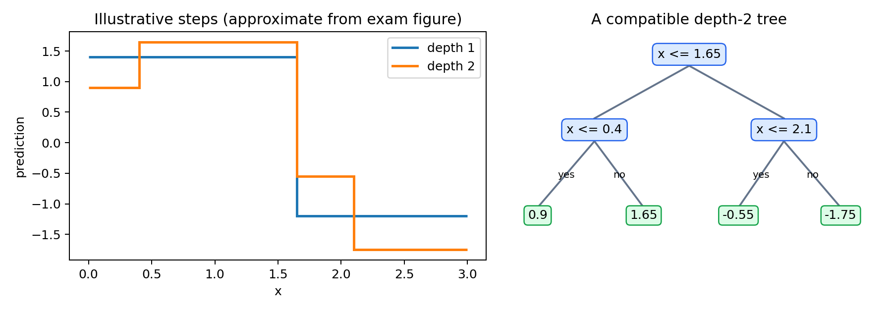
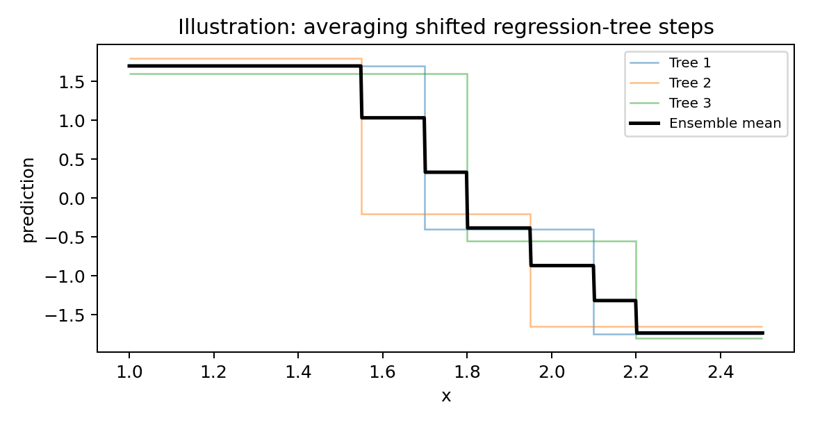

> 双语阅读版：保留原文语言，每个小题单独换行，原文与中文在同一行用空格连接；题目说明与小题之间留空行，公式、数值和图片共用。原文按转换稿整理，修正明显的重音、断词与标点错误；题意以原 PDF 为准。已有中文审查注单独保留，属于补充说明。
> 参考答案：法语在前、中文紧随，置于各小题下一行；依据链接指向本地课件或练习。这是按材料推导的复习答案，并非教师官方答案。计算题注明数值约定，开放题给出一种可行方案；题面缺失条件保留参数，读图近似与精确计算分别标明。

[原 PDF](DataML-CHPS-2021-examen.pdf) · [原文转换稿](MinerU_markdown_DataML-CHPS-2021-examen_2099177016551301120.md) · [试卷目录](README.md)

> 排版核对：依照原 PDF 第 2 页，将被图表隔开的第 2 题 c) 接回完整句子；第 4 题 b) 的表格补回原 PDF 已有、转换稿漏识别的 MSE 列名。

# Data & Apprentissage 数据与学习

8 novembre 2021 2021 年 11 月 8 日

## Examen 考试

Le sujet est imprimé sur 4 pages – Durée 2 heures 试卷共印为 4 页，时长 2 小时。 Aucun document n’est autorisé. L’utilisation de smartphones et l’accès à des ressources documentaires sur internet sont rigoureusement interdits. Toute collaboration entre étudiants pendant l’épreuve sera sévèrement sanctionnée. 禁止使用任何资料。严禁使用手机或访问互联网上的文档资源。考试期间学生之间的任何协作都会受到严厉处罚。

## Exercice 1. Restitution du cours 第 1 题：课程知识回顾

Répondre aux questions suivantes en 5 lignes maximum par question. 回答以下问题，每题最多 5 行。

1\. Expliquer la différence entre données de classification et problème de classification. 解释分类数据与分类问题之间的区别。\
**Réponse (FR) :** Les **données de classification** désignent un jeu d’observations $(x_i, y_i)$ où la variable cible $y_i$ est catégorielle (par exemple $y_i \in \{0, 1\}$). À partir de ces mêmes données, on peut formuler différents problèmes d’apprentissage : le **problème de classification** consiste à apprendre un classifieur $h : \mathcal{X} \to \{0, 1\}$ qui prédit directement une classe (en minimisant le risque d’erreur), tandis que le **problème de scoring** consiste à apprendre une fonction de score $s : \mathcal{X} \to \mathbb{R}$ (ou une probabilité) pour ordonner les observations selon leur risque. **答案（中文）：** **分类数据**是指目标变量 $y_i$ 为离散类别标签（如 $y_i \in \{0,1\}$）的数据集 $(x_i, y_i)$。但基于同样的分类数据，可以提出不同的学习问题：**分类问题**的目标是学习一个判别函数 $h: \mathcal{X} \to \{0,1\}$，直接为新样本分配一个确定的类别；而**评分／排序问题（Scoring）**或**概率估计问题**则是输出连续风险分数 $s(x)$ 或后验概率 $P(Y=1\mid X=x)$，用于对样本按风险高低排序。 **依据：** [第一课：学习框架](../Lectures/01_intro/01_data_and_learning.md) · [第三课：分类与评分](../Lectures/03_LMC_zh.md)。

2\. Donner la définition de la courbe ROC. Quel est son intérêt ? 给出 ROC 曲线的定义。它有什么用途？\
**Réponse (FR) :** Pour une fonction de score $s(x)$ et un seuil $t \in \mathbb{R}$, la courbe ROC (*Receiver Operating Characteristic*) est la courbe paramétrée qui trace le **taux de vrais positifs** $\text{TPR}(t) = P(s(X) \ge t \mid Y=1)$ en ordonnée en fonction du **taux de faux positifs** $\text{FPR}(t) = P(s(X) \ge t \mid Y=0)$ en abscisse lorsque $t$ varie de $+\infty$ à $-\infty$. Son intérêt est d’évaluer et de comparer la capacité discriminante d’un modèle de scoring **indépendamment du choix du seuil** (et des coûts d’erreur), résumée par l’aire sous la courbe $\text{AUC} = P(s(X^+) > s(X^-))$ (pour un score continu), puis de choisir le seuil opérationnel $t$ adapté au compromis métier. **答案（中文）：** 对评分函数 $s(x)$ 和分类阈值 $t \in \mathbb{R}$，当阈值 $t$ 从 $+\infty$ 变化到 $-\infty$ 时，以**假阳性率（误报率）** $\text{FPR}(t) = P(s(X) \ge t \mid Y=0)$ 为横轴、**真阳性率（召回率／灵敏度）** $\text{TPR}(t) = P(s(X) \ge t \mid Y=1)$ 为纵轴画出的参数曲线称为 **ROC 曲线**。它的主要用途是**脱离具体阈值选择**来全面评估和比较模型的排序判别能力（可用曲线下面积 $\text{AUC} = P(s(X^+) > s(X^-))$ 量化），并帮助根据业务误报／漏报代价挑选最佳工作阈值 $t$。 **依据：** [第三课：分类与评分](../Lectures/03_LMC_zh.md)。

3\. Décrire le modèle de régression logistique et expliquer comment l’utiliser pour un problème de classification ? Pour quel autre problème d’apprentissage ce modèle peut-il être utilisé ? 描述逻辑回归模型，并解释如何将它用于分类问题。这个模型还可以用于哪一类学习问题？\
**Réponse (FR) :** Pour $Y \in \{0, 1\}$, la régression logistique modélise la probabilité a posteriori par la fonction sigmoïde $p(x) = P(Y=1 \mid X=x) = \frac{1}{1 + e^{-(w^T x + b)}}$ (soit un log-odds linéaire $\ln\frac{p(x)}{1-p(x)} = w^T x + b$), dont les paramètres $(w, b)$ sont estimés par maximum de vraisemblance. Pour résoudre un **problème de classification**, on compare $p(x)$ à un seuil $t \in (0,1)$ (typiquement $t=0.5$, soit $w^T x + b \ge 0$) et on prédit $\hat{y}=1$ si $p(x) \ge t$, sinon $0$. Ce modèle peut aussi être utilisé pour un **problème de scoring (classement par risque)** et d’estimation de probabilités (ex. risque de défaut de crédit, ciblage marketing). **答案（中文）：** 对二分类变量 $Y \in \{0,1\}$，逻辑回归假设对数几率为线性函数 $\ln\frac{p(x)}{1-p(x)} = w^T x + b$，用 sigmoid 函数给出后验概率 $p(x) = P(Y=1 \mid X=x) = \frac{1}{1 + e^{-(w^T x + b)}}$，并通过极大似然估计（最小化交叉熵）学习参数 $(w,b)$。用于**分类问题**时，设定阈值 $t$（默认 $t=0.5$，等价于 $w^T x + b \ge 0$），若 $p(x) \ge t$ 则判为正类 $1$，否则判为 $0$。除此之外，该模型还可用于**评分与排序问题（Scoring / Ranking）**以及风险概率估计（如信用违约评估、精准营销排序）。 **依据：** [第三课：分类与评分](../Lectures/03_LMC_zh.md) · [Lab1](../Exercises/Lab1/Lab1_zh.ipynb)。

4\. Décrire le principe des méthodes d’apprentissage dites locales. Donner un exemple en indiquant les hyperparamètres de la méthode. 描述局部学习方法的原理。给出一个例子，并指出该方法的超参数。\
**Réponse (FR) :** Les méthodes d’apprentissage locales prédisent la sortie d’un nouveau point $x$ en regroupant les observations d’entraînement situées dans son voisinage (ou dans la même région locale) et en effectuant un vote majoritaire (en classification) ou une moyenne locale (en régression). **Exemple** : l’algorithme des **$k$ plus proches voisins ($k$-NN)**, dont les hyperparamètres sont le nombre de voisins $k$, le choix de la distance (euclidienne, Manhattan, Minkowski) et la pondération éventuelle par la distance (ou l’arbre de décision CART, dont les hyperparamètres sont la profondeur maximale `max_depth` et la taille minimale des feuilles `min_samples_leaf`). **答案（中文）：** 局部学习方法先根据距离或空间划分找到待预测点 $x$ 附近的训练样本（或落入同一局部区域的样本），再通过局部多数投票（分类）或局部均值（回归）给出预测。**典型例子**：**$k$ 近邻算法（$k$-NN）**，其超参数包括邻居数量 $k$、距离度量方式（如欧氏距离、曼哈顿距离）以及是否按距离加权（另一个例子是**决策树**，超参数包括最大深度 `max_depth`、叶节点最小样本数 `min_samples_leaf` 等）。 **依据：** [第一课：算法与流程](../Lectures/01_intro/02_algorithms_and_pipeline.md) · [Lab2](../Exercises/Lab2/Lab2_zh.ipynb)。

5\. Décrire le principe des méthodes d’apprentissage dites globales. Pourquoi utilise-t-on parfois des pertes convexes en apprentissage ? Quels autres choix de pertes conduisent à des méthodes pratiques ? 描述全局学习方法的原理。为什么学习中有时使用凸损失？还有哪些损失选择能够产生实用的方法？\
**Réponse (FR) :** Les méthodes globales cherchent une fonction paramétrique $h_\theta \in \mathcal{H}$ en minimisant une fonctionnelle d’erreur globale (risque empirique éventuellement régularisé) sur l’ensemble des données d’entraînement. En classification, la perte idéale $0\text{–}1$ ($\mathbf{1}\{y h(x) \le 0\}$) est discontinue et non convexe (optimisation NP-difficile) ; on la remplace donc par des **pertes convexes** (comme la perte *hinge* $\max(0, 1-yh(x))$ des SVM, la perte logistique $\ln(1+e^{-yh(x)})$ ou la perte quadratique), ce qui garantit un problème d’optimisation convexe (lorsque le modèle est linéaire) avec un minimum global calculable efficacement par descente de gradient. D’autres choix pratiques incluent la perte absolue $L_1$, la perte de **Huber** (robuste aux valeurs aberrantes), la perte $\varepsilon$-insensible (SVR), ou des objectifs non convexes optimisés par SGD dans les réseaux de neurones profonds. **答案（中文）：** 全局学习方法在假设空间 $\mathcal{H}$ 中通过最小化定义在全体训练样本上的整体目标函数（经验风险＋正则化项）来求解模型参数 $\theta$。在分类问题中，理想的 $0\text{–}1$ 损失是非凸、不连续的阶跃函数，直接优化是 NP 难问题；使用**凸替代损失**（如 SVM 的 Hinge 损失、逻辑回归的对数似然损失、最小二乘的平方损失）能使线性模型的优化变为凸优化问题，从而保证全局最优解并能用梯度法高效求解。其他能够产生实用方法的损失还包括对离群点稳健的 $L_1$ 绝对值损失与 **Huber 损失**、SVR 的 $\varepsilon$-不敏感损失，以及深度学习中通过随机梯度下降（SGD）优化的非凸复合损失。 **依据：** [第一课：算法与流程](../Lectures/01_intro/02_algorithms_and_pipeline.md) · [第五课：SVM、树与集成](../Lectures/05_NLM_zh.md)。

6\. Quels sont les termes d’erreur permettant de rendre compte du phénomène de surapprentissage (overfitting) ? Discuter l’impact du temps de calcul (à ressources fixées) quand la taille d’échantillon augmente ? 哪些误差项能够解释过拟合现象？当样本量增加时，在计算资源固定的情况下，讨论计算时间的影响。\
**Réponse (FR) :** D’après la décomposition de Bottou–Bousquet, l’excès de risque se décompose en trois termes : l’**erreur d’approximation** $\mathcal{E}_{\text{app}}$ (biais de la classe $\mathcal{H}$), l’**erreur d’estimation** $\mathcal{E}_{\text{est}}$ (variance liée à la taille finie $n$ de l’échantillon) et l’**erreur d’optimisation** $\mathcal{E}_{\text{opt}}$. Le surapprentissage (*overfitting*) résulte du compromis entre $\mathcal{E}_{\text{app}}$ et $\mathcal{E}_{\text{est}}$ : choisir $\mathcal{H}$ trop complexe réduit $\mathcal{E}_{\text{app}}$ mais fait exploser $\mathcal{E}_{\text{est}}$. À ressources de calcul et budget de temps $T_{\max}$ fixés, quand la taille d’échantillon $n$ devient très grande (*large-scale learning*), $\mathcal{E}_{\text{est}}$ diminue, mais une passe complète sur les $n$ données devient trop coûteuse : il faut alors accepter une erreur d’optimisation $\mathcal{E}_{\text{opt}} > 0$ plus grande en utilisant des algorithmes rapides comme la descente de gradient stochastique (SGD) ou en ne traitant qu’un sous-échantillon. **答案（中文）：** 根据课程中的三项误差分解（Bottou–Bousquet 分解），超额风险由**近似误差 $\mathcal{E}_{\text{app}}$（偏差）**、**估计误差 $\mathcal{E}_{\text{est}}$（方差）**和**优化误差 $\mathcal{E}_{\text{opt}}$** 组成。过拟合主要由近似误差 $\mathcal{E}_{\text{app}}$ 与估计误差 $\mathcal{E}_{\text{est}}$ 的权衡解释：当模型族 $\mathcal{H}$ 过于复杂时，$\mathcal{E}_{\text{app}}$ 很小，但在有限样本 $n$ 下估计误差 $\mathcal{E}_{\text{est}}$ 急剧增大。当计算资源与时间预算固定而样本量 $n$ 大幅增加（大规模学习）时，虽然增加样本能降低 $\mathcal{E}_{\text{est}}$，但遍历全量数据的单步计算耗时随 $n$ 增长，无法在有限时间内精确求解经验风险最小化，因此需要在 $\mathcal{E}_{\text{est}}$ 与**优化误差 $\mathcal{E}_{\text{opt}}$** 之间权衡（例如改用单步开销与 $n$ 无关的随机梯度下降 SGD，或只训练部分样本以控制计算时间）。 **依据：** [第一课：误差与偏差—方差](../Lectures/01_intro/04_hypotheses_and_bias_variance.md) · [第六课：深度学习](../Lectures/06_DL_zh.md)。

7\. Évoquer les enjeux et la problématique sous-jacente à la calibration des hyperparamètres d’une méthode d’apprentissage. 说明校准学习方法的超参数时涉及的目标与问题。\
**Réponse (FR) :** Les hyperparamètres (ex. paramètre de régularisation $\lambda$, profondeur d’un arbre, nombre de voisins $k$) ne peuvent pas être appris sur le jeu d’entraînement en même temps que les paramètres $\theta$, car minimiser l’erreur d’entraînement choisirait toujours la complexité maximale et conduirait au surapprentissage. L’enjeu est de contrôler le compromis biais–variance en estimant l’erreur de généralisation sur des données indépendantes (jeu de validation ou validation croisée $k$-fold). Formellement, c’est un **problème d’optimisation bi-niveau** $\min_\lambda \hat{R}_{\text{val}}(\hat{\theta}(\lambda))$ coûteux et souvent non dérivable (variables discrètes et continues), que l’on résout en pratique par recherche sur grille (*grid search*), recherche aléatoire (*random search*) ou optimisation bayésienne. **答案（中文）：** 超参数（如正则化系数 $\lambda$、树的最大深度、`k`-NN 的邻居数 $k$）控制着模型的容量和“偏差—方差”权衡。它们不能直接通过最小化训练误差来学习，否则总是会选出最复杂的模型并导致严重过拟合。因此，校准超参数的核心问题是利用**验证集或 $k$ 折交叉验证**最小化验证误差 $\min_\lambda \hat{R}_{\text{val}}(\hat{\theta}(\lambda))$。从数值优化角度看，这是一个计算代价高（每评估一个 $\lambda$ 都要重新训练内层模型 $\hat{\theta}(\lambda)$）、目标函数非凸且常含离散变量的黑盒嵌套优化问题，实践中通常采用网格搜索（Grid Search）、随机搜索或贝叶斯优化求解。 **依据：** [第二课：正则化与验证](../Lectures/02_LM/06_regularization_and_validation.md) · [Lab1](../Exercises/Lab1/Lab1_zh.ipynb) · [作业一第 4 题：数据划分](../Exercises/Assignment1/guide/04_data_splitting.md)。

8\. Donner deux exemples d’applications du machine learning en lien avec des sujets de simulation numérique. 给出两个与数值模拟相关的机器学习应用例子。 Practical example : data points 实际示例：数据点。\
**Réponse (FR) :** Deux exemples d’applications liant machine learning et simulation numérique sont : (1) la construction de **modèles de substitution (surrogate models / métamodèles)** : on entraîne un modèle d’apprentissage (régression, processus gaussien, réseau de neurones) sur une base de simulations éléments finis ou CFD coûteuses afin de prédire quasi instantanément la sortie physique pour de nouveaux paramètres ; (2) la **réduction d’ordre de modèle (ROM)** par apprentissage non supervisé : on applique la PCA (POD) ou un auto-encodeur sur les champs simulés de grande dimension pour extraire un sous-espace réduit dans lequel on résout ou prédit l’évolution dynamique à moindre coût. **答案（中文）：** 与数值模拟相关的两个典型机器学习应用是：(1) **构建代理模型（Surrogate Modeling／元模型）**：用少量高成本数值模拟（如流体力学 CFD 或有限元分析）的结果作为训练数据，训练回归或神经网络模型来近似输入物理参数到输出物理量的映射，实现毫秒级快速预测与参数寻优；(2) **降阶建模（Reduced-Order Modeling, ROM）与流形学习**：利用 PCA（本征正交分解 POD）或自编码器对高维模拟场数据进行无监督降维，提取少数主导模态并在低维空间中预测物理场的演化。 **依据：** [第一课：学习框架](../Lectures/01_intro/01_data_and_learning.md) · [第六课：深度学习](../Lectures/06_DL_zh.md) · [Lab5](../Exercises/Lab5/Lab5_zh.ipynb)。

## Exercice 2. Regression 第 2 题：回归

a) Let P be a set of N 2-dimensional points, $p _ { i } = ( x _ { i } , y _ { i } )$ . Assume that we want to find the line that best fits the points of P. Present in detail how the Ordinary Least Squares (OLS) works when fitting a linear model by estimating its parameters. 设 $P$ 为由 $N$ 个二维点 $p_i=(x_i,y_i)$ 构成的集合。希望找到最贴合 $P$ 中各点的直线。详细说明普通最小二乘法（OLS）如何通过估计参数来拟合线性模型。\
**Réponse (FR) :** On cherche la droite $\hat{y}_i = \beta_1 x_i + \beta_0$ qui minimise la somme des carrés des résidus $\text{RSS}(\beta_0, \beta_1) = \sum_{i=1}^N (y_i - (\beta_1 x_i + \beta_0))^2$. En annulant les dérivées partielles $\frac{\partial \text{RSS}}{\partial \beta_0} = 0$ et $\frac{\partial \text{RSS}}{\partial \beta_1} = 0$, on obtient les équations normales dont la solution analytique est : $\hat{\beta}_1 = \frac{\sum_{i=1}^N (x_i - \bar{x})(y_i - \bar{y})}{\sum_{i=1}^N (x_i - \bar{x})^2} = \frac{\text{Cov}(x,y)}{\text{Var}(x)}$ et $\hat{\beta}_0 = \bar{y} - \hat{\beta}_1 \bar{x}$, avec $\bar{x} = \frac{1}{N}\sum_{i=1}^N x_i$ et $\bar{y} = \frac{1}{N}\sum_{i=1}^N y_i$. Sous forme matricielle, en posant $X \in \mathbb{R}^{N \times 2}$ (avec une colonne de $1$) et $\beta = (\beta_0, \beta_1)^T$, on minimise $\|y - X\beta\|_2^2$, ce qui donne $\hat{\beta} = (X^T X)^{-1} X^T y$. **答案（中文）：** 设线性模型为 $\hat{y}_i = \beta_1 x_i + \beta_0$，普通最小二乘法（OLS）通过最小化残差平方和 $\text{RSS}(\beta_0, \beta_1) = \sum_{i=1}^N (y_i - \beta_1 x_i - \beta_0)^2$ 来估计参数。令目标函数对 $\beta_0$ 和 $\beta_1$ 的偏导数等于 $0$，可解得闭式解：斜率 $\hat{\beta}_1 = \frac{\sum_{i=1}^N (x_i - \bar{x})(y_i - \bar{y})}{\sum_{i=1}^N (x_i - \bar{x})^2} = \frac{S_{xy}}{S_{xx}}$，截距 $\hat{\beta}_0 = \bar{y} - \hat{\beta}_1 \bar{x}$，其中 $\bar{x}, \bar{y}$ 为样本均值。若写成矩阵形式（设计矩阵 $X \in \mathbb{R}^{N\times 2}$ 含常数列 $1$），最小化 $\|y - X\beta\|_2^2$ 的正规方程解为 $\hat{\beta} = (X^T X)^{-1} X^T y$。 **依据：** [第二课：最小二乘](../Lectures/02_LM/01_linear_models_and_least_squares.md) · [Lab1](../Exercises/Lab1/Lab1_zh.ipynb)。

b) Considering the data of Table 2, apply the OLS by making the numerical calculations and report the fitted model and its Root Mean Squared Error (RMSE). 使用表 2 中的数据，进行数值计算以应用 OLS，并给出拟合模型及其均方根误差（RMSE）。\
**Réponse (FR) :** Les moyennes valent $\bar{x} = \frac{2.0 + 1.0 + 0.5 - 0.5}{4} = 0.75$ et $\bar{y} = \frac{1.2 + 2.0 + 1.0 - 0.7}{4} = 0.875$. On calcule $S_{xx} = \sum_{i=1}^4 (x_i - \bar{x})^2 = 1.25^2 + 0.25^2 + (-0.25)^2 + (-1.25)^2 = 3.25$ et $S_{xy} = \sum_{i=1}^4 (x_i - \bar{x})(y_i - \bar{y}) = 1.25(0.325) + 0.25(1.125) + (-0.25)(0.125) + (-1.25)(-1.575) = 2.625$. D’où la pente $\hat{\beta}_1 = \frac{2.625}{3.25} = \frac{21}{26} \approx 0.8077$ et l’ordonnée à l’origine $\hat{\beta}_0 = 0.875 - \frac{21}{26}\times 0.75 = \frac{7}{26} \approx 0.2692$, soit le modèle ajusté **$\hat{y} = 0.8077\,x + 0.2692$**. Les prédictions aux 4 points sont $\hat{y} = (1.8846,\, 1.0769,\, 0.6731,\, -0.1346)$, les résidus $e_i = y_i - \hat{y}_i = (-0.6846,\, 0.9231,\, 0.3269,\, -0.5654)$, ce qui donne $\text{MSE} = \frac{1}{4}\sum_{i=1}^4 e_i^2 = \frac{4543}{10400} \approx 0.4368$ et **$\text{RMSE} = \sqrt{\text{MSE}} \approx 0.6609$**. **答案（中文）：** 先计算均值：$\bar{x} = \frac{2.0+1.0+0.5-0.5}{4} = 0.75$，$\bar{y} = \frac{1.2+2+1-0.7}{4} = 0.875$。接着算中心化平方和与乘积和：$S_{xx} = 1.25^2 + 0.25^2 + (-0.25)^2 + (-1.25)^2 = 3.25$，$S_{xy} = 1.25\times 0.325 + 0.25\times 1.125 + (-0.25)\times 0.125 + (-1.25)\times(-1.575) = 2.625$。由此得斜率 $\hat{\beta}_1 = \frac{2.625}{3.25} = \frac{21}{26} \approx 0.8077$，截距 $\hat{\beta}_0 = 0.875 - \frac{21}{26}\times 0.75 = \frac{7}{26} \approx 0.2692$，拟合直线为 **$\hat{y} = 0.8077\,x + 0.2692$**。代入 4 个点得预测值 $\hat{y} \approx (1.8846, 1.0769, 0.6731, -0.1346)$，残差平方和 $\text{RSS} \approx 1.7473$，均方误差 $\text{MSE} = \frac{\text{RSS}}{4} \approx 0.4368$，因此 **$\text{RMSE} = \sqrt{0.4368} \approx 0.6609$**。 **依据：** [第二课：最小二乘](../Lectures/02_LM/01_linear_models_and_least_squares.md) · [Lab1](../Exercises/Lab1/Lab1_zh.ipynb)。

| i | 1 | 2 | 3 | 4 |
| --- | --- | --- | --- | --- |
| xi | 2.0 | 1.0 | 0.5 | -0.5 |
| yi | 1.2 | 2 | 1 | -0.7 |

$$
P = \{(x _ {i}, y _ {i}), i = 1... 4 \}
$$

c) You are asked to try more complex polynomial models for this dataset. Which ones would you check, and which one would be the most complex that is meaningful to try? 要求你尝试用更复杂的多项式模型拟合该数据集。你会检验哪些模型？其中值得尝试的最复杂模型是什么？\
**Réponse (FR) :** Au-delà du modèle linéaire (degré 1), on peut tester un modèle **quadratique** (degré 2 : $\hat{y} = \beta_0 + \beta_1 x + \beta_2 x^2$, qui capture bien la courbure en cloche visible sur la figure autour de $x=1$) et un modèle **cubique** (degré 3 : $\hat{y} = \beta_0 + \beta_1 x + \beta_2 x^2 + \beta_3 x^3$). Comme il n’y a que $N=4$ points d’abscisses distinctes, le modèle le plus complexe qu’il a un sens d’essayer est le **polynôme de degré $N-1 = 3$** : il possède $4$ paramètres et interpole exactement les $4$ points ($\text{RMSE}_{\text{train}} = 0$). Tout degré $p \ge 4$ aurait plus de paramètres ($p+1 \ge 5$) que d’observations ($N=4$), rendant le système sous-déterminé avec une infinité de solutions. **答案（中文）：** 除了一次线性模型外，可以检验**二次多项式**（$\hat{y} = \beta_0 + \beta_1 x + \beta_2 x^2$，能够很好地贴合散点图中在 $x=1$ 附近先升后降的抛物线趋势）和**三次多项式**（$\hat{y} = \beta_0 + \beta_1 x + \beta_2 x^2 + \beta_3 x^3$）。由于总共只有 $N=4$ 个互异横坐标的数据点，值得尝试的最复杂模型是 **$N-1 = 3$ 次多项式**：它恰好有 4 个未知参数，能唯一精确插值穿过全部 4 个点（训练误差为 $0$）。若次数 $\ge 4$，参数个数将超过样本数（$p+1 > 4$），方程组欠定，存在无穷多组解，因此没有意义。 **依据：** [第二课：最小二乘](../Lectures/02_LM/01_linear_models_and_least_squares.md) · [第二课：高维与秩](../Lectures/02_LM/02_generalization_and_high_dimensions.md) · [Lab1](../Exercises/Lab1/Lab1_zh.ipynb)。

d) Explain the principle of Ridge Regression (RR). 解释岭回归（RR）的原理。\
**Réponse (FR) :** La régression Ridge (régularisation de Tikhonov $L_2$) ajoute une pénalité quadratique sur la norme des coefficients au critère des moindres carrés : $\min_\beta \|y - X\beta\|_2^2 + \lambda \|\beta\|_2^2$ (avec $\lambda > 0$). Sa solution analytique est $\hat{\beta}_{\text{Ridge}} = (X^T X + \lambda I)^{-1} X^T y$. Le terme $\lambda I$ rend la matrice $X^T X + \lambda I$ toujours inversible (même en grande dimension $d > N$ ou en présence de colinéarité) et rétrécit (*shrinkage*) les coefficients vers $0$, ce qui réduit fortement la variance d’estimation au prix d’un léger biais. **答案（中文）：** 岭回归（Ridge Regression，即 $L_2$／Tikhonov 正则化线性回归）在最小二乘损失后加上回归系数的 $L_2$ 范数平方惩罚项：$\min_\beta \|y - X\beta\|_2^2 + \lambda \|\beta\|_2^2$（$\lambda > 0$）。其闭式解为 $\hat{\beta}_{\text{Ridge}} = (X^T X + \lambda I)^{-1} X^T y$。加入对角项 $\lambda I$ 不仅保证了矩阵 $X^T X + \lambda I$ 始终满秩可逆（解决特征共线性或高维 $d > N$ 时不可逆的病态问题），还能将回归系数向 $0$ 收缩，通过引入少量偏差显著降低估计方差，防止过拟合。 **依据：** [第二课：正则化与验证](../Lectures/02_LM/06_regularization_and_validation.md) · [Lab1](../Exercises/Lab1/Lab1_zh.ipynb)。

e) For a linear regression problem, you are given $N { = } 5 0$ datapoints, each one described by d=200 features. Which regression method would you prefer? If you were asked to use specifically OLS, describe one way or more in which you would proceed. 某线性回归问题有 $N=50$ 个数据点，每个点由 $d=200$ 个特征描述。你更倾向于使用哪种回归方法？如果明确要求使用 OLS，请描述一种或多种处理方式。\
**Réponse (FR) :** Comme le nombre de variables dépasse la taille d’échantillon ($d=200 > N=50$), la matrice $X^T X \in \mathbb{R}^{200 \times 200}$ est de rang au plus $50$ et n’est pas inversible : l’OLS standard est mal posé et surapprend totalement. Je préférerais donc une **régression régularisée**, comme la **régression Ridge** (pour stabiliser l’inversion) ou le **LASSO** (pénalité $L_1$, qui sélectionne au plus $N$ variables pertinentes). Si l’on impose d’utiliser spécifiquement l’OLS, on peut procéder de deux façons : (1) **Réduction de dimension préalable (PCR)** : appliquer une PCA sur $X$ pour ne garder que $k < 50$ composantes principales orthogonales, puis ajuster l’OLS sur ces $k$ variables ; (2) **Sélection de variables** : sélectionner un sous-ensemble de $k < 50$ variables (par ex. *forward stepwise selection* ou filtrage par corrélation) avant d’appliquer l’OLS (ou utiliser la pseudo-inverse de Moore-Penrose $\hat{\beta} = X^+ y$ qui donne la solution OLS de norme minimale). **答案（中文）：** 当样本量 $N=50$ 小于特征维数 $d=200$（高维小样本 $d > N$）时，$X^T X$ 的秩至多为 $50$，不可逆，直接用标准 OLS 会有无穷多解并严重过拟合。因此我更倾向于使用**正则化回归方法**，如 **LASSO 回归**（$L_1$ 正则化，能自动做特征选择产生稀疏解）或 **岭回归（Ridge）**（$L_2$ 正则化）。如果明确要求使用 OLS，可以采用以下处理方式：(1) **先降维再 OLS（主成分回归 PCR）**：先用 PCA 将 200 维特征压缩到 $k < 50$ 个正交主成分，再在这些主成分上运行标准 OLS；(2) **先做特征选择再 OLS**：通过相关性筛选或前向逐步选择（Forward Selection）挑出 $k < 50$ 个最重要特征，使子矩阵列满秩后再做 OLS（或者用 SVD 求解 Moore-Penrose 伪逆最小范数解 $\hat{\beta} = X^+ y$）。 **依据：** [第二课：高维与秩](../Lectures/02_LM/02_generalization_and_high_dimensions.md) · [第二课：正则化与验证](../Lectures/02_LM/06_regularization_and_validation.md) · [Lab1](../Exercises/Lab1/Lab1_zh.ipynb)。

## Exercice 3. Decision Trees 第 3 题：决策树

a) Draw directly on the above figure the way $( r o u g h l y )$ a regression tree (RT) approximates the data of the time-series, for $d e p t h = 1$ and $\mathop { d e p t h } = 2$ 直接在上图中画出回归树（RT）如何大致逼近该时间序列数据，分别考虑深度为 1 和 2 的情况。 assignment to cluster 各数据点的聚类归属。\
**Réponse (FR) :** Un arbre de régression approche la série par une **fonction constante par morceaux (en escalier)** : (1) Pour $\text{depth}=1$ (1 seule coupure, $2^1=2$ feuilles), l’arbre coupe l’axe horizontal vers le milieu de la descente ($x \approx 1.65$) et prédit deux paliers horizontaux : la moyenne haute ($\hat{y} \approx 1.4$) à gauche et la moyenne basse ($\hat{y} \approx -1.2$) à droite. (2) Pour $\text{depth}=2$ (3 coupures, $2^2=4$ feuilles), chacun des deux sous-intervalles est recoupé (vers $x \approx 0.4$ à gauche et $x \approx 2.1$ à droite), formant un escalier à $4$ paliers horizontaux (d’ordonnées approximatives $0.9$, $1.65$, $-0.55$ et $-1.75$). Voir le tracé ci-dessous. **答案（中文）：** 回归树用**分段常数函数（水平阶梯线）**来逼近数据：(1) 当 $\text{depth}=1$ 时（分裂 1 次，共 2 个叶节点），树在曲线由正转负的中间位置（约 $x \approx 1.65$）切一刀，左右两侧各画一条水平线，高度分别为左半段样本均值（约 $1.4$）和右半段样本均值（约 $-1.2$）；(2) 当 $\text{depth}=2$ 时（共 4 个叶节点），在左右两个区间内各再切一刀（约在 $x \approx 0.4$ 和 $x \approx 2.1$ 处），形成 4 段水平阶梯（高度依次约为 $0.9, 1.65, -0.55, -1.75$）。作图如下。 **依据：** [Lab3](../Exercises/Lab3/Lab3_zh.ipynb)。

b) Draw on the right to the figure, a (rough) RT with depth = 2. 在图的右侧大致画出一棵深度为 2 的回归树。\
**Réponse (FR) :** L’arbre binaire de profondeur 2 correspondant au découpage ci-dessus possède : une **racine** testant $x \le 1.65$ ; au niveau 1, un **fils gauche** testant $x \le 0.4$ et un **fils droit** testant $x \le 2.1$ ; au niveau 2, **quatre feuilles** prédisant respectivement les moyennes locales $\hat{y} \approx 0.9$ (pour $x \le 0.4$), $\hat{y} \approx 1.65$ (pour $0.4 < x \le 1.65$), $\hat{y} \approx -0.55$ (pour $1.65 < x \le 2.1$) et $\hat{y} \approx -1.75$ (pour $x > 2.1$). (Voir la partie droite de la figure ci-dessus.) **答案（中文）：** 对应的深度为 2 的二叉树结构（见上图右侧）为：**根节点**判断 $x \le 1.65$；**左子节点**判断 $x \le 0.4$，其两个叶节点分别输出均值 $\hat{y} \approx 0.9$（当 $x \le 0.4$）和 $\hat{y} \approx 1.65$（当 $0.4 < x \le 1.65$）；**右子节点**判断 $x \le 2.1$，其两个叶节点分别输出均值 $\hat{y} \approx -0.55$（当 $1.65 < x \le 2.1$）和 $\hat{y} \approx -1.75$（当 $x > 2.1$）。 **依据：** [Lab3](../Exercises/Lab3/Lab3_zh.ipynb)。

c) How would an ensemble of RTs (each tree using random subsets of the data to train with) approximate the region $x \in [ 1 , 2 . 5 ]$ of this dataset? Make a drawing and explain. 若使用回归树集成，每棵树均用随机选取的数据子集训练，它会如何逼近该数据集中的 $x\in[1,2.5]$ 区域？请画图并解释。\
**Réponse (FR) :** Comme chaque arbre $T_b$ est entraîné sur un sous-échantillon aléatoire différent (principe du *Bagging* / *Random Forest*), ses points de coupure sont légèrement décalés par rapport aux autres arbres. Sur la zone de descente $x \in [1, 2.5]$, la prédiction de l’ensemble $\hat{f}_{\text{ens}}(x) = \frac{1}{B}\sum_{b=1}^B T_b(x)$ moyenne ces différents escaliers décalés : on obtient un escalier beaucoup plus fin, composé de nombreuses petites marches qui suivent de façon quasi lisse la pente décroissante de la courbe tout en réduisant la variance (et la sensibilité aux points aberrants). **答案（中文）：** 由于集成模型中的每棵回归树 $T_b$ 使用不同的随机数据子集训练（即 Bagging／随机森林思想），每棵树选出的分裂阈值位置会略有错开。在 $x \in [1, 2.5]$ 的下降区间内，单棵树只有粗糙的几级大台阶；而集成模型对多棵树的预测取平均 $\hat{f}_{\text{ens}}(x) = \frac{1}{B}\sum_{b=1}^B T_b(x)$，错开的台阶叠加平均后会变成密集、平滑的小台阶，从而更平滑、贴切地逼近真实的下降曲线，同时显著降低方差和离群点干扰（见下图）。 **依据：** [第五课：SVM、树与集成](../Lectures/05_NLM_zh.md) · [Lab3](../Exercises/Lab3/Lab3_zh.ipynb)。

d) You have trained your $R T _ { i n i t i a l }$ to approximate the unknown function f(·) using the dataset of the figure. Then, your intention is to use it also for unseen data of the same nature, which however are a bit transformed. Specifically, let $f _ { 1 } ( \cdot ) , f _ { 2 } ( \cdot )$ and $f _ { 3 } ( \cdot )$ be the new functions that can be expressed with respect to f(·): 已使用图中的数据集训练回归树 $RT_{\mathrm{initial}}$，以逼近未知函数 $f(\cdot)$。接下来希望将它用于性质相同、但经过一些变换的未见数据。具体来说，新函数 $f_1(\cdot)$、$f_2(\cdot)$、$f_3(\cdot)$ 与 $f(\cdot)$ 的关系如下：\
**Réponse (FR) :** **Non, il n’est pas nécessaire de réentraîner $RT_{\text{initial}}$ depuis zéro**, car les relations liant $f_1, f_2, f_3$ à $f$ sont analytiquement connues : il suffit d’adapter les seuils de coupure (pour une transformation de l’entrée $x$) ou les valeurs prédites dans les feuilles (pour une transformation de la sortie $f(x)$). Voici la procédure précise pour chaque cas : **答案（中文）：** **不需要从头重新训练 $RT_{\text{initial}}$**。因为 $f_1, f_2, f_3$ 与原函数 $f$ 的数学变换关系完全已知，只需直接对已有回归树的输入特征（分裂阈值）或输出预测（叶节点常数值）做相应变换即可，具体如下： **依据：** [Lab3](../Exercises/Lab3/Lab3_zh.ipynb)。

case d1) $f _ { 1 } ( 5 x ) = f ( x )$ 情形 d1：$f_1(5x)=f(x)$。\
**Réponse (FR) :** En posant $u = 5x$, on a $f_1(u) = f(u/5)$. Il s’agit d’une dilatation horizontale de l’entrée : on prédit $\hat{f}_1(u) = RT_{\text{initial}}(u/5)$ (ou de manière équivalente, on multiplie tous les seuils de coupure $s$ des nœuds internes par $5$ en gardant les mêmes feuilles). **答案（中文）：** 令 $u = 5x$，则 $f_1(u) = f(u/5)$。这只是对输入自变量的水平缩放：预测新输入 $u$ 时，直接计算 $\hat{f}_1(u) = RT_{\text{initial}}(u/5)$（或者等价地，把原树所有内部节点的分裂阈值 $s$ 都乘以 $5$，叶节点预测值保持不变）。 **依据：** [Lab3](../Exercises/Lab3/Lab3_zh.ipynb)。

case d2) $f _ { 2 } ( x ) \ = 5 f ( x )$ 情形 d2：$f_2(x)=5f(x)$。\
**Réponse (FR) :** Comme $f_2(x) = 5f(x)$, il s’agit d’une mise à l’échelle linéaire de la sortie : on garde les mêmes seuils de coupure et on multiplie simplement la valeur prédite de chaque feuille par $5$, soit $\hat{f}_2(x) = 5\,RT_{\text{initial}}(x)$. **答案（中文）：** 因为 $f_2(x) = 5f(x)$ 是对输出的线性放缩，且均值满足线性性质 $\text{mean}(5y) = 5\,\text{mean}(y)$，所以只需保持树的结构和分裂阈值不变，将每个叶节点的预测值直接乘以 $5$，即 $\hat{f}_2(x) = 5\,RT_{\text{initial}}(x)$。 **依据：** [Lab3](../Exercises/Lab3/Lab3_zh.ipynb)。

case d3) $f _ { 3 } ( x ) \ = ( f ( x ) ) ^ { 5 }$ 情形 d3：$f_3(x)=(f(x))^5$。 Do you have to retrain from scratch your RT to apply it in these cases? If yes, why; if no, what is the alternative approach you would follow for $( d 1 ) – ( d 3 ) ?$ 要处理这些情形，是否必须从头重新训练回归树？若需要，请说明原因；若不需要，请说明分别针对 d1–d3 会采用什么替代方法。\
**Réponse (FR) :** Sans réentraîner, on peut approcher $f_3(x)$ en élevant à la puissance $5$ la prédiction de chaque feuille : $\hat{f}_3(x) = (RT_{\text{initial}}(x))^5$. Notons toutefois que comme $y \mapsto y^5$ est non linéaire, la puissance de la moyenne $(\frac{1}{|R|}\sum_{i\in R} y_i)^5$ diffère légèrement de la moyenne des puissances $\frac{1}{|R|}\sum_{i\in R} y_i^5$ qu’aurait produite un réentraînement complet sur $y^5$. **答案（中文）：** 若不重新训练，可以直接将原树每个叶节点的预测值取 5 次方作为输出，即 $\hat{f}_3(x) = (RT_{\text{initial}}(x))^5$。需要注意：由于 $y \mapsto y^5$ 是非线性变换，叶节点内“均值的 5 次方” $(\bar{y})^5$ 与重新训练得到的“5 次方的均值” $\overline{y^5}$ 不完全相等，但当叶节点区域较窄、内部方差较小时，直接取 5 次方依然是无需重训的合理近似。 **依据：** [Lab3](../Exercises/Lab3/Lab3_zh.ipynb)。

e) What would be the difference in (d) if the $R T _ { i n i t i a l }$ is a single tree or an ensemble model of several trees? 在问题 d) 中，$RT_{\mathrm{initial}}$ 是单棵树，或是由多棵树组成的集成模型，两种情况有什么不同？\
**Réponse (FR) :** Pour **(d1)** et **(d2)**, les transformations sont linéaires, donc il n’y a aucune différence : $\frac{1}{B}\sum_{b=1}^B T_b(x/5)$ et $\frac{1}{B}\sum_{b=1}^B 5\,T_b(x) = 5\,\hat{f}_{\text{ens}}(x)$ donnent le même résultat qu’on transforme chaque arbre ou la sortie globale. En revanche, pour **(d3)** qui est non linéaire ($y^5$), il faut d’abord calculer la moyenne de l’ensemble puis l’élever à la puissance $5$, soit $\hat{f}_3(x) = \left(\frac{1}{B}\sum_{b=1}^B T_b(x)\right)^5$ (ce qui est plus précis et moins bruité qu’un arbre seul), et non moyenner les puissances $\frac{1}{B}\sum_{b=1}^B (T_b(x))^5$ car la moyenne et la puissance $5$ ne commutent pas. **答案（中文）：** 在 **(d1)**（输入缩放）和 **(d2)**（输出乘以常数 5）中，由于变换是线性的，单棵树与集成模型没有本质区别：对每棵树分别变换再取平均，与先对集成模型取平均再变换完全等价。但在 **(d3)**（非线性的 5 次方变换）中，由于求平均与 5 次方运算不可交换（$(\frac{1}{B}\sum_b T_b(x))^5 \neq \frac{1}{B}\sum_b (T_b(x))^5$），集成模型应当**先对所有树的输出取平均得到 $\hat{f}_{\text{ens}}(x)$，最后再整体取 5 次方**，即 $\hat{f}_3(x) = (\hat{f}_{\text{ens}}(x))^5$；而且由于集成模型的预测方差比单棵树更小，取 5 次方后对误差的放大效应也比单棵树小得多。 **依据：** [第五课：SVM、树与集成](../Lectures/05_NLM_zh.md) · [Lab3](../Exercises/Lab3/Lab3_zh.ipynb)。

## Exercice 4. Clustering 第 4 题：聚类

a) Consider a special case of the 2-means algorithm: a k-means with k = 2 where, after the centers’ initialization, only one of them (defined by the user) gets updated while the second one remains always fixed. Give a pseudocode of this particular algorithm. 考虑 2-means 的一种特殊形式：令 $k=2$，初始化聚类中心后，只更新其中一个由用户指定的中心，另一个中心始终固定。给出该算法的伪代码。\
**Réponse (FR) :** **Algorithme (2-means avec $c_2$ fixé) :** **Entrées :** données $X = \{x_1, \dots, x_N\}$, centre initial libre $c_1^{(0)}$ et centre fixe $c_2$. **Répéter** pour $t = 1, 2, \dots$ : (1) *Étape d’affectation* : pour chaque $i \in \{1, \dots, N\}$, affecter $x_i$ au cluster $z_i^{(t)} = \arg\min_{k \in \{1, 2\}} \|x_i - c_k^{(t-1)}\|^2$ (soit $C_1 = \{x_i : |x_i - c_1| \le |x_i - c_2|\}$ et $C_2 = X \setminus C_1$) ; (2) *Étape de mise à jour partielle* : mettre à jour uniquement le premier centre $c_1^{(t)} \leftarrow \frac{1}{|C_1|}\sum_{x_i \in C_1} x_i$, et maintenir le second fixe $c_2^{(t)} \leftarrow c_2$ ; **jusqu’à** convergence ($c_1^{(t)} = c_1^{(t-1)}$ et affectations inchangées). **答案（中文）：** **算法伪代码（$c_2$ 固定的受限 2-means）：** **输入：** 数据集 $X=\{x_1,\dots,x_N\}$，初始自由中心 $c_1^{(0)}$，固定中心 $c_2$。**循环执行**（$t=1,2,\dots$）：(1) **簇分配步**：对每个样本 $x_i$，计算其到 $c_1^{(t-1)}$ 和 $c_2$ 的距离，将其归入最近的簇 $z_i^{(t)} = \arg\min_{k\in\{1,2\}} \|x_i - c_k^{(t-1)}\|^2$，得到 $C_1$ 和 $C_2$；(2) **单中心更新步**：仅将第一个簇的中心更新为簇内均值 $c_1^{(t)} \leftarrow \frac{1}{|C_1|}\sum_{x_i \in C_1} x_i$，第二个中心保持不变 $c_2^{(t)} \leftarrow c_2$；**直到**分配结果与中心位置不再变化（$c_1^{(t)} = c_1^{(t-1)}$），返回最终中心 $\hat{c} = (c_1^{(t)}, c_2)$。 **依据：** [Lab4](../Exercises/Lab4/Lab4_zh.ipynb) · [Lab5](../Exercises/Lab5/Lab5_zh.ipynb)。

b) You have the dataset $X = \{ 1 0 , 1 5 , 2 0 , 2 5 , 5 5 , 6 0 , 9 0 , 1 0 0 \}$ . Starting with centers at positions 35 and 80 (fixed), compute numerically all the steps of the algorithm of (a) until convergence to solution $\hat c$. For each step, fill the following table with the positions of the centers, the cluster to which datapoints is assigned, and the Mean Squared Error (MSE). 给定数据集 $X=\{10,15,20,25,55,60,90,100\}$，两个中心的初始位置为 35 和 80，其中 80 固定。数值计算 a) 中算法的所有步骤，直至收敛到解 $\hat c$。在下表中逐步填写中心位置、各数据点的聚类归属，以及均方误差（MSE）。 assignment to cluster\
**Réponse (FR) :** Pour $X = \{10, 15, 20, 25, 55, 60, 90, 100\}$ ($N=8$) : **Étape 1** : avec $c=(35, 80)$, le milieu est $57.5$, donc $C_1 = \{10, 15, 20, 25, 55\}$, $C_2 = \{60, 90, 100\}$ et $\text{MSE} = \frac{1}{8}(25^2+20^2+15^2+10^2+20^2 + 20^2+10^2+20^2) = \frac{2650}{8} = 331.25$ ; on met à jour $c_1 = \frac{10+15+20+25+55}{5} = 25$. **Étape 2** : avec $c=(25, 80)$, le milieu devient $52.5$, donc $55$ bascule dans $C_2$ : $C_1 = \{10, 15, 20, 25\}$, $C_2 = \{55, 60, 90, 100\}$ et $\text{MSE} = \frac{1}{8}(15^2+10^2+5^2+0^2 + 25^2+20^2+10^2+20^2) = \frac{1875}{8} = 234.375$ ; on met à jour $c_1 = \frac{10+15+20+25}{4} = 17.5$. **Étape 3** : avec $c=(17.5, 80)$, le milieu est $48.75$, les clusters ne changent plus et $\text{MSE} = \frac{1}{8}(7.5^2+2.5^2+2.5^2+7.5^2 + 25^2+20^2+10^2+20^2) = \frac{1650}{8} = 206.25$. L’algorithme converge vers $\hat{c} = (17.5, 80)$. **答案（中文）：** 对 $X=\{10,15,20,25,55,60,90,100\}$（$N=8$）：**第 1 步**：中心为 $(35, 80)$，分界中点为 $57.5$，故 $C_1=\{10,15,20,25,55\}$、$C_2=\{60,90,100\}$，$\text{MSE} = \frac{2650}{8} = 331.25$；更新 $c_1 = \frac{10+15+20+25+55}{5} = 25$。**第 2 步**：中心为 $(25, 80)$，分界中点变为 $52.5$，$x_5=55$ 转入簇 2，得 $C_1=\{10,15,20,25\}$、$C_2=\{55,60,90,100\}$，$\text{MSE} = \frac{1875}{8} = 234.375$；更新 $c_1 = \frac{10+15+20+25}{4} = 17.5$。**第 3 步**：中心为 $(17.5, 80)$，分界中点为 $48.75$，各点簇归属不变，$\text{MSE} = \frac{1650}{8} = 206.25$，算法收敛到 $\hat{c} = (17.5, 80)$（见下表）。 **依据：** [Lab5](../Exercises/Lab5/Lab5_zh.ipynb)。

| step / 步骤 | centers / 中心 | $x_{1}$ | $x_{2}$ | $x_{3}$ | $x_{4}$ | $x_{5}$ | $x_{6}$ | $x_{7}$ | $x_{8}$ | MSE |
| --- | --- | --- | --- | --- | --- | --- | --- | --- | --- | --- |
| 1 | $(35, 80)$ | 1 | 1 | 1 | 1 | 1 | 2 | 2 | 2 | $331.25$ |
| 2 | $(25, 80)$ | 1 | 1 | 1 | 1 | 2 | 2 | 2 | 2 | $234.375$ |
| 3 (convergé / 收敛) | $(17.5, 80)$ | 1 | 1 | 1 | 1 | 2 | 2 | 2 | 2 | $206.25$ |
| 4 | — | — | — | — | — | — | — | — | — | — |
| 5 | — | — | — | — | — | — | — | — | — | — |
| 6 | — | — | — | — | — | — | — | — | — | — |

assignment to cluster：各数据点的聚类归属。\
c) Given the centers of ${ \hat { c } } ,$ summarize the dataset by providing two ‘typical’ data examples. Compare how well each cluster is represented by its center, and why. 根据中心 $\hat c$，给出两个“典型”数据样本来概括数据集。比较每个中心对其所在簇的代表程度，并说明原因。\
**Réponse (FR) :** On peut résumer le jeu de données par les deux prototypes $\hat{c}_1 = 17.5$ et $\hat{c}_2 = 80$ (ou, si l’on choisit des points réels du dataset — *médoïdes* — les plus proches des centres : $x_2=15$ ou $x_3=20$ pour $C_1$, et $x_7=90$ pour $C_2$). Le premier cluster $C_1 = \{10, 15, 20, 25\}$ est **beaucoup mieux représenté** par son centre $\hat{c}_1 = 17.5$ que le second cluster $C_2 = \{55, 60, 90, 100\}$ par $\hat{c}_2 = 80$, pour deux raisons : (1) $C_1$ est très compact (variance interne $\frac{125}{4} = 31.25$) tandis que $C_2$ est très dispersé (allant de $55$ à $100$, erreur quadratique moyenne $\frac{1525}{4} = 381.25$ autour de $80$) ; (2) $\hat{c}_1 = 17.5$ est le vrai barycentre optimal de $C_1$, alors que $\hat{c}_2 = 80$ a été fixé artificiellement (loin de la vraie moyenne $76.25$ de $C_2$). **答案（中文）：** 可以直接用两个聚类中心（合成原型）$\hat{c}_1 = 17.5$ 和 $\hat{c}_2 = 80$ 来概括该数据集（若要求从原数据集中挑选真实样本即 medoid，则选离中心最近的样本：簇 1 选 $15$ 或 $20$，簇 2 选 $90$）。对比可知，**第一个簇 $C_1=\{10,15,20,25\}$ 被其中心 $17.5$ 代表得远比第二个簇 $C_2=\{55,60,90,100\}$ 被 $80$ 代表得好**，原因有两点：(1) **簇内紧致度不同**：$C_1$ 的数据点紧密集中在 $10\sim 25$ 之间（簇内均方误差仅 $31.25$），而 $C_2$ 跨度从 $55$ 到 $100$，本身包含 $\{55,60\}$ 和 $\{90,100\}$ 两小群，离散度极大（对 $80$ 的簇内均方误差高达 $381.25$）；(2) **中心是否最优**：$\hat{c}_1=17.5$ 是 $C_1$ 的真实均值（最优质心），而 $\hat{c}_2=80$ 是人为强行固定的，偏离了 $C_2$ 的真实均值 $76.25$。 **依据：** [Lab4](../Exercises/Lab4/Lab4_zh.ipynb) · [Lab5](../Exercises/Lab5/Lab5_zh.ipynb)。

d) Given the centers of $\hat c$, now apply the standard 2-means (no restriction to center updates) and fill in the table below. 从 $\hat c$ 的中心出发，运行标准 2-means（不再限制中心更新），并填写下表。\
**Réponse (FR) :** En partant de $\hat{c} = (17.5, 80)$ sans bloquer le second centre : à l’**Étape 1**, l’affectation reste $C_1 = \{10, 15, 20, 25\}$ et $C_2 = \{55, 60, 90, 100\}$ ($\text{MSE} = 206.25$), puis la mise à jour calcule $c_1 = 17.5$ et $c_2 = \frac{55+60+90+100}{4} = 76.25$. À l’**Étape 2**, avec les centres $(17.5, 76.25)$, le milieu est $46.875$, donc les clusters $C_1$ et $C_2$ ne changent pas, les centres se stabilisent et la MSE descend à $\frac{1}{8}(125 + 21.25^2 + 16.25^2 + 13.75^2 + 23.75^2) = \frac{6375}{32} = 199.21875$. **答案（中文）：** 从 $\hat{c}=(17.5, 80)$ 出发解除对第二个中心的固定限制：**第 1 步**，簇分配仍为 $C_1=\{10,15,20,25\}$、$C_2=\{55,60,90,100\}$（$\text{MSE}=206.25$），随后同时更新两个中心，得 $c_1=17.5$、$c_2 = \frac{55+60+90+100}{4} = 76.25$。**第 2 步**，中心为 $(17.5, 76.25)$，分界中点为 $46.875$，各点归属完全不变，算法立即收敛，最终 $\text{MSE}$ 降至 $\frac{1}{8}(125 + 1468.75) = 199.21875$（见下表）。 **依据：** [Lab5](../Exercises/Lab5/Lab5_zh.ipynb)。

| step / 步骤 | centers / 中心 | $x_{1}$ | $x_{2}$ | $x_{3}$ | $x_{4}$ | $x_{5}$ | $x_{6}$ | $x_{7}$ | $x_{8}$ | MSE |
| --- | --- | --- | --- | --- | --- | --- | --- | --- | --- | --- |
| 1 | $(17.5, 80)$ | 1 | 1 | 1 | 1 | 2 | 2 | 2 | 2 | $206.25$ |
| 2 (convergé / 收敛) | $(17.5, 76.25)$ | 1 | 1 | 1 | 1 | 2 | 2 | 2 | 2 | $199.21875$ |
| 3 | — | — | — | — | — | — | — | — | — | — |

Data/Apprentissage 3 数据／学习，第 3 页。\
e) During k-means, explain how is it possible that one cluster becomes empty? In such case, describe a couple of reasonable heuristics that would allow the process to continue without reducing the cluster number k. 在 k-means 运行过程中，一个簇为什么可能变空？遇到这种情况，请描述两种合理的启发式处理方法，使算法能够继续运行且不减少簇数 $k$。\
**Réponse (FR) :** Un cluster devient vide lors de l’étape d’affectation si aucun point $x_i$ n’admet son centre $c_j$ comme centre le plus proche : cela arrive si $c_j$ a été mal initialisé (très loin du nuage de points) ou si d’autres centres se sont déplacés lors des mises à jour précédentes et ont « capturé » tous ses points en l’encerclant. Pour continuer sans réduire $k$, deux heuristiques classiques sont : (1) **Réaffecter le centre vide au point le plus mal représenté** : placer $c_j$ sur l’observation $x_i$ qui a la plus grande erreur quadratique $\|x_i - c_{z_i}\|^2$ par rapport à son centre actuel ; (2) **Scinder le cluster de plus forte variance** : choisir le cluster ayant la plus grande inertie interne et le diviser en deux (ou réinitialiser $c_j$ sur un point tiré aléatoirement dans ce cluster). **答案（中文）：** 在 k-means 的簇分配步骤中，如果没有任何数据点把某个中心 $c_j$ 当作距离最近的中心，该簇就会变空。这通常发生在初始中心选得太偏远（例如随机初始化在数据范围外），或者在迭代更新过程中其他几个中心移动到了 $c_j$ 周围，把原本属于它的样本全部“抢走”了。为了不减少簇数 $k$ 并让算法继续运行，常用的两种启发式策略是：(1) **将空中心移到误差最大的样本点**：找到当前所有样本中距离其所属中心最远（残差最大）的那个点 $x_i$，直接将其设为新的中心 $c_j$；(2) **拆分最大／最松散的簇**：找到当前簇内方差（误差平方和）最大的那个簇，从中随机选一个点（或将其一分为二）作为空簇的新中心。 **依据：** [Lab4](../Exercises/Lab4/Lab4_zh.ipynb) · [Lab5](../Exercises/Lab5/Lab5_zh.ipynb)。
