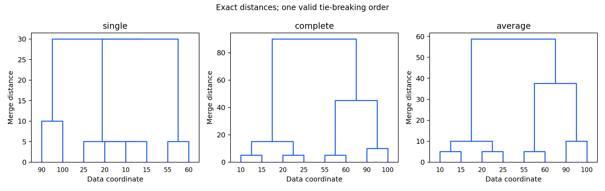
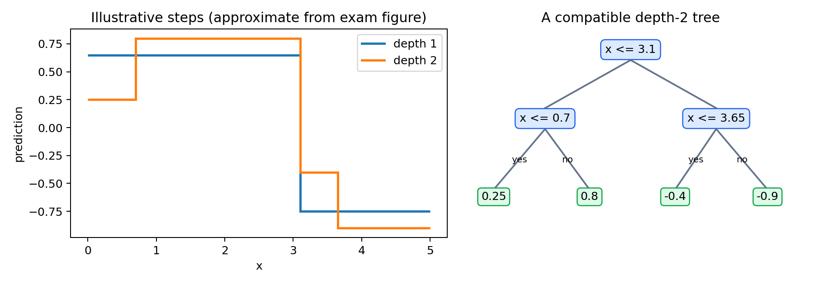

> 双语阅读版：保留原文语言，每个小题单独换行，原文与中文在同一行用空格连接；题目说明与小题之间留空行，公式、数值和图片共用。原文按转换稿整理，修正明显的重音、断词与标点错误；题意以原 PDF 为准。已有中文审查注单独保留，属于补充说明。
> 参考答案：法语在前、中文紧随，置于各小题下一行；依据链接指向本地课件或练习。这是按材料推导的复习答案，并非教师官方答案。计算题注明数值约定，开放题给出一种可行方案；题面缺失条件保留参数，读图近似与精确计算分别标明。

[原 PDF](DataML-CHPS-2022-examen.pdf) · [原文转换稿](MinerU_markdown_DataML-CHPS-2022-examen_2099177035354361856.md) · [试卷目录](README.md)

# Data & Apprentissage 数据与学习

> **日期核对：** 源文件名包含 2022，但 PDF 题面落款为 2023 年 3 月。保留文件名，按题面日期辨认考试；它与 2023 年 11 月的试卷不同。

Mars 2023 2023 年 3 月 Examen final 期末考试 Le sujet est imprimé sur 3 pages – Durée 2 heures 试卷共印为 3 页，时长 2 小时。 Les documents et notes de cours sont autorisés. L’utilisation de smartphones et l’accès à des ressources documentaires sur Internet sont interdits. L’examen est à réaliser individuellement et toute tentative de collaboration entre étudiants sera sévèrement sanctionnée. 允许使用资料和课堂笔记。禁止使用手机或访问互联网上的文档资源。考试须独立完成，学生之间任何试图协作的行为都会受到严厉处罚。

## Exercice 1. Restitution du cours [10 points] 第 1 题：课程知识回顾 [10 分]

Répondre aux questions suivantes en maximum 5-10 lignes par question. 回答以下问题，每题最多用 5–10 行。

1\. Quels sont les liens entre machine learning et simulation numérique ? 机器学习与数值模拟之间有哪些联系？\
**Réponse (FR) :** Deux usages principaux se distinguent : (1) **Modèle de substitution (*surrogate model*)** : on génère des données via des simulations numériques coûteuses, puis on entraîne un modèle rapide capable de prédire une quantité d’intérêt sur de nouveaux paramètres physiques sans relancer le solveur complet (en validant la précision hors échantillon et le domaine de validité physique, et en comparant le gain de temps au coût de génération des données) ; (2) **Modélisation réduite (ROM) et apprentissage guidé par la physique** : on compresse les champs simulés en basse dimension (par ex. via PCA/POD) avant d’apprendre leur dynamique ou leur réponse paramétrique, ou l’on intègre directement des équations et contraintes physiques dans le modèle. **答案（中文）：** 主要有两方面联系：第一，**代理模型（Surrogate model）**：用高成本数值模拟生成数据，训练快速预测物理量的机器学习模型，从而在新参数上直接预测而无需每次运行完整求解器（需用未参与训练的物理参数验证精度与适用范围，并将造数和训练成本计入收益）；第二，**降阶建模（ROM）与物理引导学习**：先用 PCA/POD 等对模拟场降维，再学习低维演化或参数响应，或将物理方程与守恒约束融入训练目标。 **依据：** [第一课：学习框架](../Lectures/01_intro/01_data_and_learning.md) · [第六课：深度学习](../Lectures/06_DL_zh.md) · [Lab5](../Exercises/Lab5/Lab5_zh.ipynb)。

2\. Préciser la différence entre données de classification et problème de classification. 说明分类数据与分类问题之间的区别。\
**Réponse (FR) :** Les **données de classification** désignent la nature du jeu de données : des couples $(x_i,y_i)$ où la variable cible $y_i$ est catégorielle (discrète). Le **problème de classification** désigne la tâche de décision : construire une règle $h:\mathcal{X}\to\mathcal{Y}$ qui attribue une classe à de nouvelles observations en minimisant un risque d’erreur. Or, des données catégorielles peuvent aussi servir à d’autres problèmes : **scoring** (ordonner les individus par score) ou **estimation de probabilités a posteriori** $P(Y=c\mid X=x)$ avant de prendre une décision adaptée aux coûts. **答案（中文）：** **分类数据**指数据的形式，即响应变量 $y_i$ 为离散类别的样本对 $(x_i,y_i)$；**分类问题**则是指决策任务本身——学习规则 $h:\mathcal{X}\to\mathcal{Y}$，以较低的误分类风险为新样本判别类别。同一份带类别标签的数据也可以用于**评分排序（Scoring）**或**后验概率估计**，因此不能把“数据类型”直接等同于“要解决的任务”。 **依据：** [第一课：学习框架](../Lectures/01_intro/01_data_and_learning.md) · [第三课：分类与评分](../Lectures/03_LMC_zh.md)。

3\. Discuter les choix possibles des critères d’évaluation d’une méthode d’apprentissage dans le cas de données de classification. 对于分类数据，讨论评估学习方法时可以选择哪些准则。\
**Réponse (FR) :** Le critère dépend de l’objectif opérationnel (toujours estimé sur un jeu de validation ou de test indépendant) : (1) pour une **décision de classe**, on utilise le risque 0–1 $P(h(X)\neq Y)$ (ou son complément, l’exactitude) ou un risque pondéré par les coûts de la matrice de confusion ; en présence de classes déséquilibrées, la **précision, le rappel (sensibilité), la spécificité et le score $F_1$** sont bien plus informatifs que l’exactitude globale ; (2) pour un **score de classement**, on utilise la courbe **ROC et l’AUC** (et la courbe **Précision–Rappel / PR-AUC** lorsque la classe positive est rare) ; (3) pour des **probabilités prédites**, on évalue la **log-loss** (entropie croisée), le score de **Brier** et la calibration. **答案（中文）：** 评价准则应与实际任务匹配（均需在独立的验证集或测试集上估计）：① **硬分类决策**可用 0–1 风险（或准确率）、按混淆矩阵代价加权的风险；若类别不平衡，单看整体准确率会掩盖少数类失效，应重点看**精确率、召回率（灵敏度）、特异度和 $F_1$ 分数**；② **评分排序**可用 **ROC 曲线与 AUC**，正类稀少时宜结合 **精确率—召回率（PR）曲线**；③ **概率输出**可用交叉熵（**log-loss**）、**Brier 分数**和概率校准度。 **依据：** [第三课：分类与评分](../Lectures/03_LMC_zh.md) · [Lab1](../Exercises/Lab1/Lab1_zh.ipynb)。

4\. Citer les trois grandes familles d’algorithmes d’apprentissage supervisé en donnant deux exemples d’algorithmes par famille. 列出监督学习算法的三大家族，每个家族给出两个算法示例。\
**Réponse (FR) :** Selon le cours, on distingue trois grandes familles (non strictement disjointes) : (1) **Méthodes locales** : $k$ plus proches voisins ($k$-NN) et arbres de décision (ou estimateurs à noyau) ; (2) **Méthodes globales** : régression pénalisée (Ridge / LASSO) et machines à vecteurs de support (SVM) (qui optimisent un critère global) ; (3) **Méthodes d’ensemble** : Bagging et Forêts aléatoires (Random Forests). Le Boosting est d’ailleurs présenté à la fois comme méthode globale et méthode d’ensemble. **答案（中文）：** 监督学习算法可分为三大家族（彼此并非完全互斥）：① **局部方法**：$k$ 近邻（$k$-NN）、决策树（或核方法）；② **全局方法**：岭回归 / LASSO、支持向量机（SVM）（通过优化整体目标函数学习）；③ **集成方法**：Bagging、随机森林（Random Forests）。课件中也同时将 Boosting 归入全局方法与集成方法。 **依据：** [第一课：算法与流程](../Lectures/01_intro/02_algorithms_and_pipeline.md)。

5\. En quoi consiste le compromis « biais-variance » en apprentissage ? 学习中的“偏差—方差“权衡是什么？\
**Réponse (FR) :** En régression quadratique, sous le modèle $Y=f^*(X)+\varepsilon$ avec $\mathbb{E}[\varepsilon\mid X]=0$ et $\operatorname{Var}(\varepsilon\mid X)=\sigma^2$, l’erreur quadratique moyenne en un point $x$ se décompose en :
$$\mathbb{E}\big[(\hat f_n(x)-Y)^2\big]=\underbrace{\big(\mathbb{E}[\hat f_n(x)]-f^*(x)\big)^2}_{\text{Biais}^2}+\underbrace{\operatorname{Var}(\hat f_n(x))}_{\text{Variance}}+\underbrace{\sigma^2}_{\text{Bruit irréductible}}.$$
Un modèle trop simple (ou trop régularisé) sous-apprend : biais élevé, faible variance. Un modèle trop flexible s’adapte au bruit d’échantillonnage : biais faible, mais forte variance (surapprentissage). On règle la complexité ou la régularisation par validation afin de minimiser la somme biais² + variance, puis on évalue une seule fois sur un jeu de test indépendant. **答案（中文）：** 在平方损失回归中，设 $Y=f^*(X)+\varepsilon$（$\mathbb{E}[\varepsilon\mid X]=0$，$\operatorname{Var}(\varepsilon\mid X)=\sigma^2$），模型在点 $x$ 处的期望预测误差可分解为**偏差平方 + 估计方差 + 不可约噪声**三项（见上式）。模型过简单（或正则化过强）会**欠拟合**（高偏差、低方差）；模型过复杂会记住训练样本中的噪声而**过拟合**（低偏差、高方差）。实践上通过验证集调节复杂度或正则化强度来平衡两者使总误差最小，最后在独立测试集上做一次性评估。 **依据：** [第一课：误差与偏差—方差](../Lectures/01_intro/04_hypotheses_and_bias_variance.md) · [第二课：正则化与验证](../Lectures/02_LM/06_regularization_and_validation.md) · [Lab1](../Exercises/Lab1/Lab1_zh.ipynb)。

6\. Décrire les principales caractéristiques d’un algorithme d’apprentissage supervisé de votre choix. Préciser les paramètres choisis par le data scientist et les paramètres ”appris“ par l’algorithme. 任选一种监督学习算法，描述其主要特征。说明哪些参数由数据科学家选择，哪些参数由算法“学得”。\
**Réponse (FR) :** Prenons la **régression Ridge** : elle ajuste une fonction affine $\hat y(x)=w^Tx+b$ en minimisant la somme des erreurs quadratiques pénalisée par $\lambda\|w\|_2^2$, ce qui stabilise l’estimation lorsque les variables sont corrélées ou nombreuses. **Choix du data scientist (hyperparamètres et modélisation)** : sélection et prétraitement des variables (standardisation indispensable), choix de la pénalité $L_2$, protocole de validation croisée et réglage de $\lambda$ (ainsi qu’un éventuel seuil de décision si le score sert à classer). **Paramètres appris par l’algorithme** : les coefficients de régression $w$ et la constante $b$, déterminés automatiquement sur le jeu d’entraînement. **答案（中文）：** 以**岭回归（Ridge）**为例：它通过最小化“平方误差 + $\lambda\|w\|_2^2$”来拟合仿射函数 $\hat y(x)=w^Tx+b$，在特征多重共线性或高维情形下能有效压缩方差、提升稳定性。**由数据科学家选择的参数（超参数与建模决策）**：特征工程与标准化方式、惩罚形式（$L_2$）、交叉验证方案以及通过验证选定的正则化强度 $\lambda$（若后续用于二分类，还包括分类阈值）。**由算法学得的参数**：在训练集上求解出的权重向量 $w$ 和截距 $b$。 **依据：** [第二课：最小二乘](../Lectures/02_LM/01_linear_models_and_least_squares.md) · [第二课：正则化与验证](../Lectures/02_LM/06_regularization_and_validation.md) · [Lab1](../Exercises/Lab1/Lab1_zh.ipynb)。

7\. Quels avantages présentent les arbres de décision sur la majorité des autres algorithmes ? 与大多数其他算法相比，决策树有哪些优点？\
**Réponse (FR) :** Les arbres de décision offrent plusieurs atouts pratiques : (1) **interprétabilité** : un arbre de faible profondeur se lit comme une suite de règles explicites « si… alors… » ; (2) **sélection intégrée des variables** : les coupures ne retiennent que les attributs pertinents ; (3) **interactions et non-linéarités** capturées naturellement sans transformation manuelle ; (4) **invariance d’échelle** : avec des coupures univariées $x_j\le s$, toute transformation monotone croissante d’une variable (changement d’unité) laisse la structure identique, donc la standardisation est superflue ; (5) **polyvalence** (régression et classification, variables mixtes), même si un arbre unique profond reste instable (forte variance). **答案（中文）：** 决策树的主要优势包括：① **可解释性强**：浅层树可转化为直观的“若……则……”规则；② **自带特征选择**：分裂节点自动筛选判别力强的变量；③ **天然建模非线性与特征交互**，无需手工构造多项式或交互项；④ **无需特征标准化**：单变量阈值分裂 $x_j\le s$ 对单一特征的严格单调缩放不敏感，改变物理量纲不影响切分能力；⑤ **适用面广**：可同时处理回归、分类以及连续/离散混合特征（尽管单棵深树存在方差大、不稳定的缺点）。 **依据：** [第五课：SVM、树与集成](../Lectures/05_NLM_zh.md) · [Lab2](../Exercises/Lab2/Lab2_zh.ipynb)。

8\. Quel schéma d’optimisation générique est utilisé dans la calibration des architectures de type Deep Learning? 校准深度学习架构时使用哪一种通用优化方案？\
**Réponse (FR) :** On minimise un risque empirique (souvent régularisé) par **descente de gradient stochastique par mini-lots (*mini-batch SGD*)** ou ses variantes adaptatives (**Adam**, RMSprop) :
$$\theta_{t+1}=\theta_t-\eta_t\nabla_\theta\!\left[\frac{1}{|B_t|}\sum_{i\in B_t}\ell(f_\theta(x_i),y_i)+\lambda\Omega(\theta)\right]\Bigg|_{\theta=\theta_t}.$$
À chaque étape, la passe avant évalue la perte sur un mini-lot $B_t$, la **rétropropagation** calcule efficacement le gradient de tous les poids par dérivation en chaîne, puis l’optimiseur met $\theta$ à jour. L’objectif étant non convexe, l’initialisation, le taux d’apprentissage $\eta_t$, la taille de lot et le critère d’arrêt (*early stopping*) sont cruciaux, sans garantie générale d’optimum global. **答案（中文）：** 通常采用**小批量随机梯度下降（mini-batch SGD）**及其自适应变体（如 **Adam**、RMSprop）来最小化（可加正则项的）经验风险（见上式）。每步先在前向传播中计算小批量 $B_t$ 的损失，再用**反向传播（Backpropagation）**按链式法则高效求取各层梯度，最后由优化器更新参数 $\theta$。由于深度学习目标函数高度非凸，权重初始化、学习率 $\eta_t$、批大小与早停（early stopping）至关重要，通常无法保证收敛到全局最优。 **依据：** [第六课：深度学习](../Lectures/06_DL_zh.md)。

9\. Peut-on résoudre le problème de la calibration d’hyperparamètres par une technique d’optimisation ? Fournir une réponse argumentée en précisant la nature du problème d’un point de vue numérique, ses caractéristiques générales et le type de solution qui pourrait être envisagée. 能否使用优化技术解决超参数校准问题？请论证，并从数值计算角度说明该问题的性质、一般特征以及可以考虑的求解方式。\
**Réponse (FR) :** **Oui** : le réglage des hyperparamètres (par ex. la profondeur maximale d’un arbre ou $\lambda$ en Ridge) se formule comme un **problème d’optimisation bi-niveau** visant à minimiser l’erreur de validation : $\min_{\lambda\in\Lambda}\widehat R_{\mathrm{val}}(\hat\theta(\lambda))$, où $\hat\theta(\lambda)$ résulte de l’entraînement interne sur les plis d’apprentissage. Numériquement, cette fonction objectif est **boîte noire** (pas de gradient explicite simple), **coûteuse** à évaluer (chaque essai exige un ou plusieurs entraînements complets), **bruitée** (sensible à la découpe des plis et aux tirages aléatoires), **non convexe**, souvent **non différentiable**, et définie sur un espace **mixte** (variables continues, entières et catégorielles). On emploie donc des méthodes sans gradient : **recherche en grille** (en très basse dimension), **recherche aléatoire**, **optimisation bayésienne** (modèle probabiliste + fonction d’acquisition) ou approches multi-fidélité/bandits (*Hyperband*), tout en conservant le test final isolé (et en respectant l’ordre du temps pour les séries temporelles). **答案（中文）：** **可以**。超参数校准（如决策树最大深度、岭回归 $\lambda$）本质上是一个**双层嵌套优化问题**：$\min_{\lambda\in\Lambda}\widehat R_{\mathrm{val}}(\hat\theta(\lambda))$，外层最小化验证风险，内层先在训练折上求得模型参数 $\hat\theta(\lambda)$。从数值计算上看，外层目标函数通常具备以下特征：**黑盒**（一般无解析梯度）、**评估代价高**（每次评估需重新训练甚至做 $K$ 折交叉验证）、**含随机噪声**（受划分与随机性影响）、**非凸且常不可微**，搜索空间还包含**连续、离散与类别型混合变量**。常用求解方式包括：**网格搜索**（仅适合极少超参数）、**随机搜索**、**贝叶斯优化**以及早停/多保真方法（如 Hyperband）；注意验证中不能动用最终测试集，时间序列还须保持时序划分。 **依据：** [第二课：正则化与验证](../Lectures/02_LM/06_regularization_and_validation.md) · [Lab1](../Exercises/Lab1/Lab1_zh.ipynb) · [作业一第 4 题：数据划分](../Exercises/Assignment1/guide/04_data_splitting.md)。

10\. Mentionner deux problématiques concrètes de mise en œuvre dans les applications réelles. On prendra l’exemple de la détection d’anomalies (supervisée) sur une chaîne de production industrielle instrumentée par un réseau de capteurs mesurant des grandeurs physiques en continu (qualité des flux entrants et des flux sortants, vibrations, etc.). 列出实际应用中两个具体的实施问题。以工业生产线上的监督式异常检测为例：生产线配备传感器网络，连续测量物理量，例如输入与输出流的质量、振动等。\
**Réponse (FR) :** 1) **Qualité des données, synchronisation et étiquetage** : les capteurs présentent des fréquences, échelles, dérives et valeurs manquantes hétérogènes ; les vrais défauts sont rares et coûteux à annoter (fort déséquilibre des classes), et il faut distinguer une **défaillance de capteur** d’une anomalie réelle de production. 2) **Évaluation réaliste, coûts d’erreur et dérive en production (*concept drift*)** : la validation doit respecter la structure temporelle (découpage par périodes ou cycles pour éviter toute fuite de données), prendre en compte le coût asymétrique entre fausses alertes (arrêts inutiles) et défauts manqués, intégrer le contexte opératoire (une vibration élevée peut être normale à pleine charge) et surveiller la dérive des équipements afin de planifier le réentraînement. **答案（中文）：** 可归纳为两类核心工程问题：① **数据质量与稀缺标签获取**：多传感器采样频率与量纲不一、存在时钟同步误差、信号漂移与缺测；同时真实故障极其罕见、人工标注成本高（严重**类别不平衡**），且需区分“传感器自身故障”与“真正生产异常”。② **无泄露时序评估、误报代价与工况漂移**：必须按时间周期或生产批次划分数据集以防信息泄露；需依据漏检与误报（停机排查）的不对称成本设定阈值；还需引入负载等运行上下文，并在设备老化或工艺变化（**概念漂移**）时持续监控与定期重训。 **依据：** [第一课：算法与流程](../Lectures/01_intro/02_algorithms_and_pipeline.md) · [Lab3](../Exercises/Lab3/Lab3_zh.ipynb) · [作业二](../Exercises/Assignment2/Assignments2_zh.ipynb)。

## Exercice 2. Regression and robust estimation [4 points] 第 2 题：回归与稳健估计 [4 分]

a) Let P be a set of N 2-dimensional points, $p _ { i } = ( x _ { i } , y _ { i } )$ . Assume that we want to find the line that best fits the points of P. Present in detail how the Ordinary Least Squares (OLS) works when fitting a linear model by estimating its parameters. 设 $P$ 为由 $N$ 个二维点 $p_i=(x_i,y_i)$ 构成的集合。希望找到最贴合这些点的直线。详细说明普通最小二乘法（OLS）如何通过估计参数拟合线性模型。\
**Réponse (FR) :** On cherche une droite $\hat y_i = a x_i + b$ minimisant la somme des carrés des résidus verticaux :
$$S(a,b)=\sum_{i=1}^N (y_i - a x_i - b)^2.$$
L’annulation des dérivées partielles $\frac{\partial S}{\partial a}=0$ et $\frac{\partial S}{\partial b}=0$ conduit aux équations normales. En supposant les abscisses non toutes identiques ($S_{xx}=\sum_{i=1}^N(x_i-\bar x)^2>0$), l’unique solution est :
$$\hat a = \frac{S_{xy}}{S_{xx}} = \frac{\sum_{i=1}^N(x_i-\bar x)(y_i-\bar y)}{\sum_{i=1}^N(x_i-\bar x)^2}, \qquad \hat b = \bar y - \hat a\,\bar x.$$
La qualité d’ajustement s’évalue par $\mathrm{RMSE}=\sqrt{\frac{1}{N}\sum_{i=1}^N(y_i-\hat a x_i-\hat b)^2}$ (attention : l’erreur d’entraînement diffère de l’erreur de test et de l’estimateur de variance du bruit divisé par $N-2$). En dimension $d$, avec une matrice de design $X$ incluant une colonne de $1$, on minimise $\|y-X\beta\|_2^2$, ce qui donne $\hat\beta=(X^T X)^{-1}X^T y$ si $X$ est de rang colonne plein (calculé en pratique par décomposition QR ou SVD pour la stabilité numérique). **答案（中文）：** OLS 假设模型为直线 $\hat y_i=ax_i+b$，通过最小化纵向残差平方和 $S(a,b)=\sum_{i=1}^N(y_i-ax_i-b)^2$ 来估计参数。令偏导 $\partial S/\partial a=0$ 与 $\partial S/\partial b=0$，在横坐标不全相同（$S_{xx}>0$）时得到唯一闭式解：$\hat a=S_{xy}/S_{xx}$，$\hat b=\bar y-\hat a\bar x$（式子见上）。拟合优度可用训练集的 $\mathrm{RMSE}=\sqrt{\frac{1}{N}\sum_i(y_i-\hat y_i)^2}$ 度量（注意不要与独立测试误差或除以 $N-2$ 的噪声标准差估计混淆）。推广到多维时，在设计矩阵 $X$ 中加入全 1 常数列并求解 $\min_\beta\|y-X\beta\|_2^2$；当 $X$ 列满秩时正规方程解为 $(X^TX)^{-1}X^Ty$，数值实现上常采用 QR 或 SVD 分解以提高稳定性。 **依据：** [第二课：最小二乘](../Lectures/02_LM/01_linear_models_and_least_squares.md) · [Lab1](../Exercises/Lab1/Lab1_zh.ipynb)。

b) Considering the data of Table 1, apply the OLS by making the numerical calculations and report the fitted model and its Root Mean Squared Error (RMSE). 使用表 1 中的数据，进行数值计算以应用 OLS，并给出拟合模型及其均方根误差（RMSE）。\
**Réponse (FR) :** Pour les $N=4$ points du Tableau 1 :
- Moyennes : $\bar x = \frac{-0.5+0.3+0.7+1.5}{4} = 0.5$, $\bar y = \frac{1.2+2.0+1.0-1.0}{4} = 0.8$.
- Sommes centrées : $S_{xx} = (-1)^2+(-0.2)^2+(0.2)^2+1^2 = 2.08$, $S_{xy} = (-1)(0.4)+(-0.2)(1.2)+(0.2)(0.2)+(1)(-1.8) = -2.4$.
- Coefficients : $\hat a = \frac{-2.4}{2.08} = -\frac{15}{13} \simeq -1.1538$, $\hat b = 0.8 - (-1.153846)(0.5) = \frac{179}{130} \simeq 1.3769$.

Le modèle ajusté est $\hat y = -1.1538\,x + 1.3769$. Avec les coefficients exacts, la somme des carrés des résidus vaut environ $2.1108$, d’où un $\mathrm{RMSE}$ d’ajustement :
$$\mathrm{RMSE} = \sqrt{\frac{2.110769}{4}} \simeq 0.7264.$$
**答案（中文）：** 针对表 1 中的 $N=4$ 个数据点计算如下：
- 均值：$\bar x = 0.5$，$\bar y = 0.8$；
- 中心化平方和与交叉积和：$S_{xx} = 2.08$，$S_{xy} = -2.4$；
- 参数估计：$\hat a = -2.4/2.08 = -15/13 \approx -1.1538$，$\hat b = 0.8 - \hat a\cdot 0.5 = 179/130 \approx 1.3769$。

拟合直线为 $\hat y = -1.1538\,x + 1.3769$。按精确系数计算残差平方和约为 $2.1108$，因此训练集 $\mathrm{RMSE}=\sqrt{2.110769/4}\approx 0.7264$。 **依据：** [第二课：最小二乘](../Lectures/02_LM/01_linear_models_and_least_squares.md) · [Lab1](../Exercises/Lab1/Lab1_zh.ipynb)。

| i | 1 | 2 | 3 | 4 |
| --- | --- | --- | --- | --- |
| xi | -0.5 | 0.3 | 0.7 | 1.5 |
| yi | 1.2 | 2.0 | 1.0 | -1.0 |

Table 1 – Practical example: data points $P = \{ ( x _ { i } , y _ { i } ) , i = 1 . . . 4 \}$ 表 1：实际示例，数据点 $P=\{(x_i,y_i),i=1,\ldots,4\}$。\
c) Describe in detail the standard RANSAC method and algorithm for linear regression. Give insights about the sensitivity to its parameters. What is the difference to a typical bootstrapping estimation procedure? 详细描述用于线性回归的标准 RANSAC 方法及算法，说明其对各参数的敏感性。它与典型的 bootstrap 估计过程有什么不同？\
**Réponse (FR) :** **Algorithme RANSAC (droite 2D) :** Répéter $T$ fois : (1) tirer aléatoirement un sous-ensemble minimal de $2$ points d’abscisses distinctes ; (2) ajuster une droite candidate $y=ax+b$ passant par ces $2$ points ; (3) calculer le résidu $r_i=|y_i-ax_i-b|$ pour tous les $N$ points et former l’ensemble de consensus (inliers) $I=\{i : r_i \le \tau\}$ ; (4) conserver l’ensemble $I^*$ de plus grande taille (en départageant les égalités par la plus petite erreur des inliers, ou en exigeant une taille minimale $d_{\min}$). À l’issue des $T$ essais, réajuster la droite par OLS sur tous les points de $I^*$.

**Sensibilité aux paramètres :**
- **Seuil de tolérance $\tau$** : trop petit, il rejette des inliers bruités et rend l’ajustement instable ; trop grand, il inclut des outliers et détruit la robustesse.
- **Nombre d’itérations $T$** : pour garantir avec probabilité $p$ de tirer au moins un couple pur d’inliers (de proportion $w$), il faut $T \ge \lceil \log(1-p)/\log(1-w^2)\rceil$. Un $T$ trop faible risque de manquer le vrai modèle ; un $T$ trop élevé augmente le coût de calcul.

**Différence avec le bootstrap :** le **bootstrap** rééchantillonne $N$ points avec remise pour estimer la variance/intervalles de confiance d’un estimateur ou agréger des modèles (*bagging*) — il reste sensible aux outliers qui apparaissent aussi dans les tirages. À l’inverse, **RANSAC** tire de minuscules sous-ensembles ($s=2$) dans le but d’isoler un noyau sain (*consensus set*) et d’éliminer les outliers. **答案（中文）：** **标准线性回归 RANSAC 算法：** 重复 $T$ 轮：① 随机抽取 2 个横坐标不同的最小样本点拟合候选直线；② 计算全部 $N$ 个点到该直线的残差 $r_i=|y_i-ax_i-b|$，将满足 $r_i\le\tau$ 的点记为共识集（内点）$I$；③ 记录内点数 $|I|$ 最大的共识集 $I^*$（数量相同时比较内点误差，或设定最小共识阈值 $d_{\min}$）。迭代结束后，仅用最佳共识集 $I^*$ 中的全部内点重新执行 OLS 得到最终直线。

**参数敏感性：** ① **残差阈值 $\tau$**：过小会误拒正常含噪内点，过大会把离群点纳入共识集而失去稳健性；② **最大迭代次数 $T$**：按内点比例 $w$ 与成功概率 $p$ 估算需 $T\ge\lceil\log(1-p)/\log(1-w^2)\rceil$，$T$ 过小易漏掉纯内点样本，过大增加开销。

**与典型 Bootstrap 的区别：** Bootstrap 对数据集有放回地重复采样 $N$ 个点，用于估计统计量的抽样分布（方差、置信区间）或做模型集成（Bagging），它保留全体样本因而易受离群点污染；而 RANSAC 反复抽取最小样本（2 个点）来寻找最大内点共识集并剔除离群点，核心目的是**抗离群点的稳健估计**。 **依据：** [Lab1](../Exercises/Lab1/Lab1_zh.ipynb) · [作业一第 1 题：RANSAC](../Exercises/Assignment1/guide/01_ransac.md)。

d) Imagine that the data acquisition of the N data instances, $X = \{ x _ { 1 } , . . . , x _ { N } \}$ , has a variable quality $q _ { i }$ for each instance x . A domain expert, who is responsible for the data, provides you a data matrix $D \in \mathbb { R } ^ { N \times ( d + 1 ) }$ where the last column contains non-negative real values that correspond to the quality indicators, $q _ { i } \ge 0 , \forall i = 1 , . . . , N )$ 假设采集到的 $N$ 个数据实例 $X=\{x_1,\ldots,x_N\}$ 各自具有不同的质量指标 $q_i$。负责这些数据的领域专家向你提供矩阵 $D\in\mathbb R^{N\times(d+1)}$，最后一列包含对应的非负质量指标 $q_i\ge0$，$i=1,\ldots,N$。 Investigate the statistical properties of X by applying RANSAC for the robust estimation of $\delta = | | \mu - m | | _ { 2 } ,$ , where $\mu$ is the center of the instances in the set, and m is the medoid instance of the set, which has the shortest average distance to the other objects. 使用 RANSAC 稳健估计 $\delta=\|\mu-m\|_2$，以研究 $X$ 的统计性质。其中 $\mu$ 是数据实例集合的中心，$m$ 是该集合的中心样本（medoid），即到其他对象的平均距离最小的那个实例。\
**Réponse (FR) :** La quantité $\delta=\|\mu-m\|_2$ mesure l’écart entre la moyenne géométrique $\mu$ (sensible aux points extrêmes et à l’asymétrie) et le *medoid* $m$ (représentant réel le plus central) : un grand $\delta$ révèle une distribution asymétrique, multi-modale ou perturbée par des outliers. Pour exploiter l’indicateur de qualité $q_i\ge 0$ (en supposant qu’un grand $q_i$ traduit une mesure fiable), il ne faut surtout **pas** traiter $q_i$ comme une $(d+1)$-ième coordonnée spatiale, mais l’intégrer dans une procédure RANSAC pondérée :
1. **Échantillonnage guidé par la qualité** : tirer à chaque itération un petit sous-ensemble candidat (ou un point germe) avec des probabilités proportionnelles aux $q_i$ (tirage uniforme si tous les $q_i=0$) et en déduire un centre candidat $c$.
2. **Consensus et score pondéré** : définir les inliers par la distance dans $\mathbb{R}^d$ uniquement, $I=\{i : \|x_i-c\|_2\le\tau\}$ (avec $\tau$ adapté à l’échelle des variables), puis noter le consensus par la somme des qualités $\sum_{i\in I}q_i$ (en départageant par la dispersion) afin de retenir le meilleur groupe cohérent $I^*$.
3. **Estimation robuste de $\delta$** : sur $I^*$ (éventuellement après réestimation itérative du centre), calculer la moyenne $\hat\mu=\frac{1}{|I^*|}\sum_{i\in I^*}x_i$ et le *medoid* $\hat m=\arg\min_{x_j,\,j\in I^*}\sum_{i\in I^*}\|x_i-x_j\|_2$ (ou leurs versions pondérées par $q_i$ si souhaité, en le précisant), puis évaluer $\hat\delta=\|\hat\mu-\hat m\|_2$. Cela caractérise le cœur robuste des données fiables, sous réserve d’une structure principalement unimodale. **答案（中文）：** $\delta=\|\mu-m\|_2$ 度量集合的均值中心 $\mu$ 与实际中心样本 medoid $m$ 之间的差异，可用于判断分布的**偏斜程度、非对称性或是否受离群点拉偏**（若核心数据对称紧凑，则 $\delta$ 较小）。假设领域专家给出的 $q_i\ge 0$ 越大代表样本质量越高，在 RANSAC 中绝不能把 $q_i$ 直接当成第 $d+1$ 维空间坐标算距离，而应将其用于抽样与共识评分：
1. **质量引导抽样**：每轮按与 $q_i$ 成正比的概率抽取少量样本生成候选中心 $c$（若全为零则退化为均匀抽样）；
2. **共识筛选与评分**：仅在原特征空间 $\mathbb{R}^d$ 计算距离，令内点集 $I=\{i:\|x_i-c\|_2\le\tau\}$（$\tau$ 依据特征尺度设定），按内点质量总和 $\sum_{i\in I}q_i$ 评估候选中心并保留最佳非空共识集 $I^*$（平局时选离散度更小者）；
3. **稳健估计 $\delta$**：在 $I^*$ 上计算平均中心 $\hat\mu=\frac{1}{|I^*|}\sum_{i\in I^*}x_i$ 与中心样本 $\hat m=\arg\min_{x_j,j\in I^*}\sum_{i\in I^*}\|x_i-x_j\|_2$（若目标改为质量加权中心与加权 medoid 需明确说明），最终求 $\hat\delta=\|\hat\mu-\hat m\|_2$。该值反映高质量主体数据群的几何偏度与代表性一致度（在假设主体呈单峰分布时尤为有效）。 **依据：** [作业一第 1 题：RANSAC](../Exercises/Assignment1/guide/01_ransac.md) · [Lab1](../Exercises/Lab1/Lab1_zh.ipynb) · [Lab5](../Exercises/Lab5/Lab5_zh.ipynb)。

## Exercice 3. Clustering [4 points] 第 3 题：聚类 [4 分]

a) Give a pseudocode for the k-means clustering algorithm and explain with simple arguments: why the procedure converges, and why multiple (re)runs are suggested. 给出 k-means 聚类算法的伪代码，并用简单论据解释算法为何收敛，以及为什么建议多次重新运行。\
**Réponse (FR) :** L’algorithme de Lloyd cherche à minimiser l’inertie intra-classe $J(z,c)=\sum_{i=1}^N\|x_i-c_{z_i}\|_2^2$ :

```text
Entrée : données X = {x_1,...,x_N}, nombre de clusters k
Initialiser k centres c_1, ..., c_k
Répéter :
  1. Affectation : pour chaque i = 1..N, z_i <- argmin_{j=1..k} ||x_i - c_j||^2
     (avec règle déterministe en cas d’égalité)
  2. Mise à jour : pour chaque cluster j = 1..k :
       si C_j = {i : z_i = j} est non vide : c_j <- (1/|C_j|) * somme_{i in C_j} x_i
       sinon : réinitialiser le cluster vide c_j (ex. au point le plus mal représenté)
Jusqu’à stabilisation des affectations z (ou diminution de J inférieure à un seuil)
```

- **Pourquoi il converge :** à l’étape 1, chaque point choisit le centre le plus proche, donc $J$ ne peut pas augmenter ; à l’étape 2, la moyenne arithmétique d’un groupe est l’unique point qui minimise la somme des carrés des distances dans ce groupe, donc $J$ ne peut pas augmenter non plus. Comme $J\ge 0$ décroît de façon monotone et qu’il n’existe qu’un nombre **fini** de partitions possibles (au plus $k^N$), l’algorithme termine nécessairement en un nombre fini d’itérations sur un optimum local (avec une règle d’égalité évitant les cycles).
- **Pourquoi plusieurs relances :** $J$ étant **non convexe**, Lloyd possède de nombreux minima locaux et dépend fortement des centres initiaux. Multiplier les initialisations aléatoires (ou utiliser **k-means++**) et retenir le partitionnement de plus faible inertie améliore nettement la qualité de la solution. **答案（中文）：** 经典的 Lloyd k-means 算法通过最小化簇内平方距离和 $J(z,c)=\sum_{i=1}^N\|x_i-c_{z_i}\|_2^2$ 进行聚类（伪代码见上）：交替执行 **① 分配步**（将每个样本分给欧氏距离最近的中心）和 **② 更新步**（将非空簇的新中心更新为簇内均值；若出现空簇需重新放置中心），直至分配不再变化。

- **收敛原因**：分配步和更新步均不会使目标函数 $J$ 增大（均值恰是最小化组内平方和的最优点）。由于 $J\ge 0$ 单调不增，且将 $N$ 个点划分为 $k$ 个簇的可能方案总数**有限**（至多 $k^N$ 种，配合固定平局规则即可避免循环），算法必然在有限步内停止并收敛到某个局部稳定解。
- **建议多次运行的原因**：目标函数 $J$ **非凸**，存在大量局部极小值，对初始中心非常敏感。因此通常多次随机初始化（或采用 **k-means++**）并取最终 $J$ 最小的结果。 **依据：** [Lab4](../Exercises/Lab4/Lab4_zh.ipynb) · [Lab5](../Exercises/Lab5/Lab5_zh.ipynb)。

b) Suppose we initialize the clusters by assigning each of the N data instances to one of the k clusters uniformly at random. How does this compare qualitatively to the typical initialization strategy? Will it converge; faster or slower? 假设初始化时，将 $N$ 个数据实例各自等概率随机分配到 $k$ 个簇之一。定性比较这种方式与常见初始化策略。它会收敛吗？收敛更快还是更慢？\
**Réponse (FR) :**
- **Comparaison qualitative :** en affectant chaque point uniformément au hasard à l’un des $k$ clusters, chaque groupe reçoit un échantillon représentatif de l’ensemble des données. Par la **loi des grands nombres**, les $k$ centres initiaux se retrouvent tous concentrés très près de la **moyenne globale** du nuage, offrant une mauvaise couverture de l’espace (et pouvant même générer des clusters vides si $N$ est petit). À l’inverse, les stratégies usuelles (tirer $k$ points distincts du jeu de données, ou mieux **k-means++**) dispersent d’emblée les centres dans différentes régions.
- **Convergence et vitesse :** l’algorithme **converge toujours** pour la même raison qu’en (a) (chaque itération fait décroître $J$ sur un ensemble fini de partitions), mais il converge **typiquement plus lentement** au démarrage — les centres quasi confondus devant d’abord se séparer progressivement au fil des premières itérations — et risque davantage un médiocre optimum local (bien que le nombre exact d’itérations dépende toujours du jeu de données). **答案（中文）：**
- **定性对比**：将每个样本等概率随机分进 $k$ 个簇时，每个初始簇都会混入来自整个数据集的样本。由**大数定律**，这样算出的 $k$ 个初始质心全都会挤在**全局均值**附近（样本少时还可能产生空簇），空间覆盖很差；而常见策略（从样本中随机选取 $k$ 个点，或 **k-means++**）会让初始中心尽可能分散到不同区域。
- **能否收敛及快慢**：它**仍然会收敛**（目标 $J\ge 0$ 单调不增且有限种划分，理由同上一问），但通常**收敛更慢**（算法需要多轮迭代才能把原本挤在一起的中心慢慢拉开，走向各自的真实簇），且更容易陷入较差的局部最优解（具体迭代次数仍与数据分布有关）。 **依据：** [Lab4](../Exercises/Lab4/Lab4_zh.ipynb) · [Lab5](../Exercises/Lab5/Lab5_zh.ipynb)。

c) Consider the 1D dataset $X \ = \ \{ 1 , 1 . 5 , 2 , 2 . 5 , 5 . 4 , 6 , 9 , 1 0 \}$ . Simulate all the steps of a 2-means solution using the k-farthest initialization, and fill Table 2 below. 给定一维数据集 $X=\{1,1.5,2,2.5,5.4,6,9,10\}$，采用 k-farthest 初始化，模拟 2-means 的全部步骤，并填写下方表 2。\
**Réponse (FR) :** La méthode *k-farthest* nécessite de choisir un premier centre arbitrairement ; par convention standard on prend le premier point $c_1^{(1)}=1$, puis le point le plus éloigné $c_2^{(1)}=10$ (d’où un seuil initial à $\frac{1+10}{2}=5.5$).
- **Itération 1 (initialisation $(1, 10)$) :** tous les points $\le 5.5$ vont dans le cluster $1$ : $C_1=\{1,1.5,2,2.5,5.4\}$, $C_2=\{6,9,10\}$, avec $\mathrm{MSE}_1=4.9825$.
- **Itération 2 (calcul exact) :** les nouveaux centres sont $c_1^{(2)}=\frac{12.4}{5}=2.48$ et $c_2^{(2)}=\frac{25}{3}\simeq 8.3333$, dont le milieu vaut $\frac{2.48+25/3}{2}\simeq 5.4067 > 5.4$. Le point $x_5=5.4$ reste donc dans $C_1$ : les affectations ne changent plus et l’algorithme **converge dès l’étape 2** avec $\mathrm{MSE}_2=\frac{20.574667}{8}\simeq 2.5718$. *(Remarque : si l’on arrondit $c_2^{(2)}$ à $8.3$, la frontière passe à $5.39<5.4$, faisant basculer $5.4$ vers $C_2$ et conduisant en 3 étapes aux centres $(1.75,\,7.6)$ avec $\mathrm{MSE}=2.04625$ ; c’est aussi la solution atteinte si *k-farthest* démarre de $x_4=2.5$ et $10$.)* **答案（中文）：** 采用 *k-farthest* 初始化时通常先任选一点作第一个中心，按常规取首点 $c_1^{(1)}=1$，则最远点为 $c_2^{(1)}=10$（初始分界中点为 $5.5$）。
- **第 1 轮（初始中心 $(1,10)$）**：$\le 5.5$ 的点归第 1 簇，得到 $C_1=\{1,1.5,2,2.5,5.4\}$，$C_2=\{6,9,10\}$，此时 $\mathrm{MSE}=4.9825$。
- **第 2 轮（精确计算）**：更新中心为 $c_1^{(2)}=2.48$ 和 $c_2^{(2)}=25/3\approx 8.3333$，新分界点约 $5.4067>5.4$，因此 $x_5=5.4$ 仍留在第 1 簇。分组不再变化，**第 2 步即稳定收敛**，最终 $\mathrm{MSE}\approx 2.5718$（见表 2）。*(注：若笔算时把 $25/3$ 一位小数约成 $8.3$，分界点变为 $(2.48+8.3)/2=5.39<5.4$，则 $5.4$ 会被划入第 2 簇，从而第 3 步收敛到 $(1.75,7.6)$，最终 $\mathrm{MSE}=2.04625$；若首中心改为 $2.5$ 同样收敛到该解。)* **依据：** [Lab4](../Exercises/Lab4/Lab4_zh.ipynb) · [Lab5](../Exercises/Lab5/Lab5_zh.ipynb)。

d) Given the clusters found in (c), summarize the dataset by providing two ‘typical’ data examples. Explain your answer and comment on how well each of them serves its role. 根据 c) 中得到的簇，给出两个“典型”数据样本概括数据集。解释你的选择，并评论它们各自的代表性。\
**Réponse (FR) :** Pour les clusters obtenus en (c), $C_1=\{1,1.5,2,2.5,5.4\}$ et $C_2=\{6,9,10\}$ :
- En tant que **prototypes synthétiques** (centroïdes), les représentants sont $2.48$ et $25/3\simeq 8.33$ ; ce ne sont pas des observations réelles du jeu de données.
- Si l’on exige deux **exemples réels du jeu de données** (*typical data examples*), on choisit dans chaque cluster soit l’observation la plus proche du centroïde ($2.5$ et $9$), soit le **medoid** minimisant la somme des distances internes ($2$ — médiane de $C_1$ — et $9$ — médiane de $C_2$).
- **Qualité de représentation :** dans $C_2$, $9$ (ou $8.33$) résume assez bien le groupe (variance interne $\approx 2.89$), même si $6$ reste un peu à l’écart. Dans $C_1$ (variance interne $2.3816$), $x_5=5.4$ est très éloigné du sous-groupe dense $\{1,1.5,2,2.5\}$ et tout près de la frontière : il attire le centroïde vers la droite ($2.48$), si bien que ni $2.48$ ni $2$ ne résument fidèlement l’élément isolé $5.4$ (le partitionnement alternatif $(1.75,7.6)$ de MSE $2.04625$ offre à ce titre une meilleure compacité globale). **答案（中文）：** 沿用 (c) 精确解得到的两簇 $C_1=\{1,1.5,2,2.5,5.4\}$ 与 $C_2=\{6,9,10\}$：
- 若允许使用**合成质心**，两个中心为 $2.48$ 和 $25/3\approx 8.33$（并非原始数据中的样本）；
- 若要求给出数据集中的**实际典型样本**，则每簇可取最靠近质心的点（$2.5$ 和 $9$），或使簇内距离和最小的 **medoid**（$2$ 和 $9$，分别对应两簇中位数）。
- **代表性评价**：$C_2$ 的簇内平均平方误差约 $2.8889$，$9$ 整体上能较好代表较高取值的一组（仅 $6$ 偏左）；$C_1$ 的簇内平均平方误差为 $2.3816$，但由于边界点 $5.4$ 远离密集子群 $\{1,1.5,2,2.5\}$ 并把质心右拉到 $2.48$，$2$ 或 $2.5$ 虽然代表了左侧主力，却很难兼顾 $5.4$（相比之下，另一个局部解 $(1.75,7.6)$ 的总 $\mathrm{MSE}=2.04625$ 更紧凑）。 **依据：** [Lab4](../Exercises/Lab4/Lab4_zh.ipynb) · [Lab5](../Exercises/Lab5/Lab5_zh.ipynb)。

e) Give three or more cluster linkage criteria that are used in hierarchical agglomerative clustering, and provide the formulas to compute them. In the following figures, draw the cluster hierarchy that would be computed by each of these criteria. 给出至少三种层次凝聚聚类使用的簇间连接准则，以及它们的计算公式。在下方图中分别画出各准则得到的聚类层次。\
**Réponse (FR) :** Pour deux clusters $A$ et $B$, les trois critères de liaison classiques sont :
1. **Liaison simple (*single linkage*) :** $d_{\mathrm{single}}(A,B)=\min_{x\in A,\,y\in B}\|x-y\|$ (sensible à l’effet de chaîne).
2. **Liaison complète (*complete linkage*) :** $d_{\mathrm{complete}}(A,B)=\max_{x\in A,\,y\in B}\|x-y\|$ (favorise des clusters compacts).
3. **Liaison moyenne (*average linkage* / UPGMA) :** $d_{\mathrm{avg}}(A,B)=\frac{1}{|A|\,|B|}\sum_{x\in A}\sum_{y\in B}\|x-y\|$ (compromis entre les deux précédentes ; on peut aussi citer la liaison de **Ward** minimisant l’augmentation d’inertie intra-classe).

Les trois figures de l’énoncé portent les points $10,15,20,25,55,60,90,100$ (différents du jeu de (c)). En partant des singletons et en fusionnant itérativement les deux groupes les plus proches :
- **Simple :** fusions de $\{10,15,20,25\}$ en chaîne à hauteur $5$ et $\{55,60\}$ à $5$ ; paire $\{90,100\}$ à $10$ ; puis fusion de $\{10..25\}$ avec $\{55,60\}$ à $30$, et enfin avec $\{90,100\}$ à $30$.
- **Complète :** paires $\{10,15\}$, $\{20,25\}$, $\{55,60\}$ à $5$, et $\{90,100\}$ à $10$ ; puis fusion $\{10,15\}$–$\{20,25\}$ à $15$, $\{55,60\}$–$\{90,100\}$ à $45$, et fusion finale à $90$.
- **Moyenne :** mêmes paires initiales à $5$ et $10$ ; puis $\{10,15\}$–$\{20,25\}$ à $10$, $\{55,60\}$–$\{90,100\}$ à $37.5$, et fusion finale à $58.75$. **答案（中文）：** 对两个簇 $A$ 与 $B$，三种常用凝聚连接准则为（也可额外补充最小化簇内方差增量的 Ward 准则）：
1. **单连接（Single linkage）**：$d_{\mathrm{single}}(A,B)=\min_{x\in A,y\in B}\|x-y\|$（易产生链式效应）；
2. **全连接（Complete linkage）**：$d_{\mathrm{complete}}(A,B)=\max_{x\in A,y\in B}\|x-y\|$（倾向紧凑球形簇）；
3. **平均连接（Average linkage）**：$d_{\mathrm{avg}}(A,B)=\frac{1}{|A||B|}\sum_{x\in A}\sum_{y\in B}\|x-y\|$（介于单连接与全连接之间）。

注意原题三幅图中的数据点是 $10,15,20,25,55,60,90,100$（不同于 c 问数据集），每次合并当前距离最小的两簇，对应合并高度与树状图如下：
- **单连接**：$10\text{--}15\text{--}20\text{--}25$ 与 $55\text{--}60$ 在高度 $5$ 形成链式/成对合并，$90\text{--}100$ 在 $10$ 合并；随后 $\{10..25\}$ 与 $\{55,60\}$ 在 $30$ 合并，最后再在 $30$ 并入 $\{90,100\}$（等价平局允许不同合并顺序）。
- **全连接**：前几对仍为 $5$ 与 $10$，之后 $\{10,15\}$ 与 $\{20,25\}$ 在高度 $15$ 合并，$\{55,60\}$ 与 $\{90,100\}$ 在 $45$ 合并，最后总合并高度为 $90$。
- **平均连接**：初始成对高度为 $5$ 与 $10$，之后 $\{10,15\}$ 与 $\{20,25\}$ 在 $10$ 合并，$\{55,60\}$ 与 $\{90,100\}$ 在 $37.5$ 合并，最后总合并高度为 $58.75$。 **依据：** [Lab4](../Exercises/Lab4/Lab4_zh.ipynb)。



| step / 步骤 | centers / 中心 | $x_{1}$ | $x_{2}$ | $x_{3}$ | $x_{4}$ | $x_{5}$ | $x_{6}$ | $x_{7}$ | $x_{8}$ | MSE |
| --- | --- | --- | --- | --- | --- | --- | --- | --- | --- | --- |
| 1 (Init) | $(1,\;10)$ | 1 | 1 | 1 | 1 | 1 | 2 | 2 | 2 | 4.9825 |
| 2 (Exact, stable) | $(2.48,\;8.3333)$ | 1 | 1 | 1 | 1 | 1 | 2 | 2 | 2 | 2.5718 |
| 3 (si arrondi à $8.3$) | $(1.75,\;7.6)$ | 1 | 1 | 1 | 1 | 2 | 2 | 2 | 2 | 2.04625 |
| 4 (—) | — | — | — | — | — | — | — | — | — | — |

Table 2 – k-means iterations. Compute the MSE only for the first and the final iterations. 表 2：k-means 迭代。只需计算第一次与最后一次迭代的 MSE。


## Exercice 4. Decision Trees [2 points] 第 4 题：决策树 [2 分]

a) Draw directly on the figure below, the way (roughly) a regression tree (RT) would approximate the data of the time-series, for depth = 1 and depth = 2. 直接在下图中画出回归树（RT）如何大致逼近该时间序列数据，分别考虑深度为 1 和 2 的情况。\
**Réponse (FR) :** Un arbre de régression approche les données par une fonction **constante par morceaux** (chaque palier vaut la moyenne des points de la région) :
- **Profondeur 1 (2 paliers) :** la coupure optimale sépare le régime positif du régime négatif vers $x \approx 3.1$, avec une constante positive à gauche et une constante négative à droite.
- **Profondeur 2 (4 paliers) :** on redécoupe chaque côté vers $x \approx 0.7$ à gauche et $x \approx 3.65$ à droite, obtenant quatre paliers horizontaux de hauteurs approximatives $0.25$, $0.80$, $-0.40$ et $-0.90$ (voir schéma ci-dessous ; les valeurs exactes dépendent des coordonnées brutes). **答案（中文）：** 回归树用**分段常数（阶梯函数）**逼近数据（每一段的高度为落在该叶节点内样本 $y$ 的均值）：
- **深度 = 1（至多 2 段）**：在信号由正转负的 $x\approx 3.1$ 处分裂，左侧为一条正的水平线段、右侧为一条负的水平线段。
- **深度 = 2（至多 4 段）**：左右两侧再分别在约 $x\approx 0.7$ 与 $x\approx 3.65$ 处继续二分，形成 4 段水平阶梯，高度大致为 $0.25$、$0.80$、$-0.40$ 和 $-0.90$（具体示意如左图所示；精确阈值与叶值取决于原始数据坐标）。 **依据：** [Lab3](../Exercises/Lab3/Lab3_zh.ipynb)。




b) Draw on the right of the figure, the RT for depth = 2. 在图的右侧画出深度为 2 的回归树。\
**Réponse (FR) :** L’arbre binaire correspondant (représenté à droite de la figure de réponse ci-dessus) a la structure suivante :
- **Racine :** $x \le 3.1$ ?
  - **Oui (gauche) :** $x \le 0.7$ ? $\rightarrow$ Feuille $\hat y \approx 0.25$ (si oui) / Feuille $\hat y \approx 0.80$ (si non).
  - **Non (droite) :** $x \le 3.65$ ? $\rightarrow$ Feuille $\hat y \approx -0.40$ (si oui) / Feuille $\hat y \approx -0.90$ (si non). **答案（中文）：** 与上一问对应的深度为 2 的回归树结构如下（已绘于上方配图右侧）：
- **根节点**：判断 $x \le 3.1$？
  - **是（左分支）**：继续判断 $x \le 0.7$？$\rightarrow$ 叶值约 $0.25$（是）/ 叶值约 $0.80$（否）；
  - **否（右分支）**：继续判断 $x \le 3.65$？$\rightarrow$ 叶值约 $-0.40$（是）/ 叶值约 $-0.90$（否）。 **依据：** [Lab3](../Exercises/Lab3/Lab3_zh.ipynb)。

c) You trained your RT to approximate the function f(·) using the above dataset. Now, other clients ask you to directly predict for their data, because they believe they are of the same nature but a bit transformed. Specifically, let $f _ { \# } ( \cdot )$ be clients’ functions: 已使用上面的数据集训练回归树，以逼近函数 $f(\cdot)$。其他客户认为自己的数据性质相同，只是经过一些变换，因此要求你直接为他们预测。设客户的函数 $f_{\#}(\cdot)$ 如下：\
**Réponse (FR) :** Notons $T(x)\approx f(x)$ l’arbre déjà entraîné sur $[0,5]$. Comme les trois transformations sont connues explicitement, **les trois demandes sont acceptables sans réentraîner de modèle** (à condition que l’entrée ramenée reste dans le domaine d’apprentissage $[0,5]$, car un arbre n’extrapole pas hors de ce domaine). **答案（中文）：** 设已训练好的回归树为 $T(x)\approx f(x)$（训练区间 $[0,5]$）。由于三个客户与原函数之间都有精确已知的代数/缩放关系，**三项任务均可以直接复用原树 $T$ 完成，无需从头重新训练**（前提是换算后的输入仍落在原训练区间 $[0,5]$ 内，因为树模型对区间外只能做常值外推）。 **依据：** [Lab3](../Exercises/Lab3/Lab3_zh.ipynb)。

client c1) $f _ { 1 } ( x ) \ = 3 f ( x )$ 客户 c1：$f_1(x)=3f(x)$。\
**Réponse (FR) :** **Faisable :** utiliser $\hat f_1(x)=3\,T(x)$, ce qui revient à **multiplier par $3$ toutes les valeurs de feuilles** tout en gardant les seuils de coupure identiques (l’arbre reste optimal au facteur $3$ près). **答案（中文）：** **可行：** 直接输出 $\hat f_1(x)=3\,T(x)$，等价于**保持所有分裂阈值不变，仅将叶节点预测值乘以 $3$**（线性伸缩不改变平方误差下的最优划分）。 **依据：** [Lab3](../Exercises/Lab3/Lab3_zh.ipynb)。

client c2) $f _ { 2 } ( 3 x ) = f ( x )$; 客户 c2：$f_2(3x)=f(x)$。\
**Réponse (FR) :** **Faisable** (pour des entrées $u\in[0,15]$) : en posant $u=3x$, on obtient $f_2(u)=f(u/3)$. On prédit donc $\hat f_2(u)=T(u/3)$, soit **diviser l’entrée par $3$** (ou de façon équivalente **multiplier tous les seuils de l’arbre par $3$** en conservant les valeurs de feuilles). **答案（中文）：** **可行**（要求客户输入 $u\in[0,15]$）：令 $u=3x$ 即得 $f_2(u)=f(u/3)$。因此预测 $\hat f_2(u)=T(u/3)$，即**把输入特征除以 $3$ 再送入原树**，或等价地**将树内所有分裂阈值乘以 $3$、叶值保持不变**。 **依据：** [Lab3](../Exercises/Lab3/Lab3_zh.ipynb)。

client c3) $f _ { 3 } ( x ) = [ f _ { 1 } ( x ) + f _ { 2 } ( 3 x ) ] ^ { 2 }$ 客户 c3：$f_3(x)=[f_1(x)+f_2(3x)]^2$。 What would you answer? Is it feasible? Which jobs would you accept and how would you manage in each of the cases $\it { ? }$ 你会如何回答？这些要求是否可行？你会接受哪些任务，又会分别如何处理？\
**Réponse (FR) :** **Faisable :** en substituant $f_1(x)=3f(x)$ et $f_2(3x)=f(x)$, l’expression se simplifie en $f_3(x)=[3f(x)+f(x)]^2=16\,f(x)^2$. On accepte donc **les trois clients** et on prédit pour c3 par $\hat f_3(x)=16\,[T(x)]^2$ (soit $16$ fois le carré de chaque feuille). *Mise en garde pratique pour c3 :* contrairement à c1 et c2 (transformations affines), la transformation quadratique ne commute pas avec la moyenne d’une feuille ($(\mathbb{E}[Y])^2\neq\mathbb{E}[Y^2]$) et amplifie l’erreur de prédiction là où $|f(x)|$ est grand ; si les données réelles de c3 deviennent disponibles, un réentraînement direct sur $16y_i^2$ sera plus précis. **答案（中文）：** **可行：** 将前两式代入化简可得 $f_3(x)=[3f(x)+f(x)]^2=16\,f(x)^2$。因此**三个客户的请求都可以接受**：分别按 c1（叶值乘 $3$）、c2（输入除以 $3$ 或阈值乘 $3$）以及 c3（输出 $\hat f_3(x)=16\,[T(x)]^2$，即将叶值平方再乘 $16$）处理。*补充提示（仅针对 c3）：* 与前两者的线性/尺度变换不同，平方变换是非线性的，由于 $(\mathbb{E}[Y])^2\neq \mathbb{E}[Y^2]$，直接平方叶值只是近似复用，且当 $|f(x)|$ 较大时会放大预测误差；若日后能拿到新目标的标注数据，直接用 $16y_i^2$ 重新训练回归树会更准确。 **依据：** [Lab3](../Exercises/Lab3/Lab3_zh.ipynb)。
