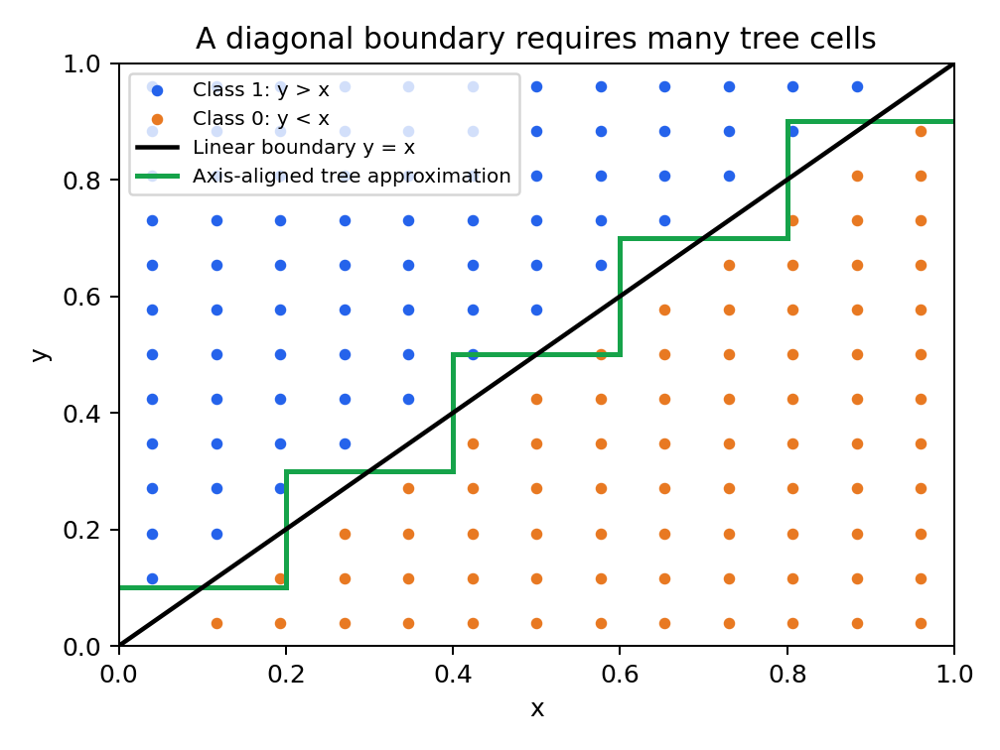

> 双语阅读版：保留原文语言，每个小题单独换行，原文与中文在同一行用空格连接；题目说明与小题之间留空行，公式、数值和图片共用。原文按转换稿整理，修正明显的重音、断词与标点错误；题意以原 PDF 为准。已有中文审查注单独保留，属于补充说明。
> 参考答案：法语在前、中文紧随，置于各小题下一行；依据链接指向本地课件或练习。这是按材料推导的复习答案，并非教师官方答案。计算题注明数值约定，开放题给出一种可行方案；题面缺失条件保留参数，读图近似与精确计算分别标明。

[原 PDF](Exam_2019.pdf) · [原文转换稿](MinerU_markdown_Exam_2019_2099177052739751936.md) · [试卷目录](README.md)

# Data & Apprentissage 数据与学习

Le 18 novembre 2019 2019 年 11 月 18 日 EXAMEN - 45 MINUTES 考试，时长 45 分钟

# Le sujet est imprimé sur 1 page 试卷共印为 1 页。

Les documents et notes de cours ainsi que les supports numériques (PCs, tablettes, téléphones portables) sont interdits. 禁止使用资料、课堂笔记以及任何电子设备（电脑、平板电脑、手机）。

## Restitution du cours 课程知识回顾

Répondre aux questions suivantes en maximum 5-10 lignes par question. 回答以下问题，每题最多用 5–10 行。

1\. Quelle est la différence entre l'apprentissage supervisé et non supervisé? Donnez deux exemples de problèmes de chaque type. 监督学习与无监督学习有什么区别？分别给出两类问题各两个例子。\
**Réponse (FR) :** En apprentissage supervisé, chaque donnée d’entraînement $x_i$ est associée à une étiquette cible $y_i$, et le modèle apprend à prédire $y$ à partir de $x$ (exemples : détection de spam, prédiction de la consommation électrique). En apprentissage non supervisé, on ne dispose d’aucune étiquette $y_i$ et on cherche directement la structure cachée des données $x_i$ (exemples : segmentation de clients par clustering, réduction de dimension par PCA). **答案（中文）：** 监督学习的训练数据带有已知的目标标签 $y_i$，目标是学习从输入 $x$ 到输出 $y$ 的映射（例如：垃圾邮件分类、电力消耗预测）。无监督学习没有标签 $y_i$，目标是直接发现数据本身的内在结构（例如：客户分群聚类、利用 PCA 对高维数据降维）。 **依据：** [第一课：学习框架](../Lectures/01_intro/01_data_and_learning.md) · [Lab1](../Exercises/Lab1/Lab1_zh.ipynb) · [Lab4](../Exercises/Lab4/Lab4_zh.ipynb) · [Lab5](../Exercises/Lab5/Lab5_zh.ipynb)。

2\. Quelle est la différence entre les données de type classification et celles de type régression? 分类类型的数据与回归类型的数据有什么区别？\
**Réponse (FR) :** La différence porte sur la nature de la variable cible $Y$. Dans les données de classification, $Y$ est qualitative (discrète) et prend un nombre fini de valeurs correspondant à des classes (par exemple $Y \in \{0, 1\}$). Dans les données de régression, $Y$ est quantitative (continue), par exemple $Y \in \mathbb{R}$ comme une température ou un prix. Dans les deux cas, les variables d’entrée $X$ peuvent être numériques ou catégorielles. **答案（中文）：** 区别在于目标变量 $Y$ 的类型：分类数据的输出 $Y$ 是离散的类别标签（取有限个值，如 $\{0,1\}$ 或故障类型）；回归数据的输出 $Y$ 是连续的数值（取实数值，如温度或房价）。无论分类还是回归，输入特征 $X$ 都可以包含数值型或类别型变量。 **依据：** [第一课：学习框架](../Lectures/01_intro/01_data_and_learning.md) · [第三课：分类与评分](../Lectures/03_LMC_zh.md)。

3\. Quelles décisions peuvent être prises grâce au modèle de régression logistique? 逻辑回归模型可以用于作出哪些决策？\
**Réponse (FR) :** La régression logistique fournit un score probabiliste $p(x) = P(Y=1 \mid X=x) \in [0, 1]$, ce qui permet trois types de décisions : (1) **décision binaire (classification)** en comparant $p(x)$ à un seuil $t$ (souvent $t=0.5$, ou ajusté selon le coût des faux positifs et faux négatifs) ; (2) **classement par score (scoring/ranking)** pour ordonner les individus du plus risqué au moins risqué ; (3) **décision avec abstention** en définissant une zone d’incertitude $[t_1, t_2]$ où le cas est renvoyé à un expert humain. **答案（中文）：** 逻辑回归输出样本属于正类的后验概率 $p(x) = P(Y=1 \mid X=x) \in [0, 1]$，据此可以做出三类决策：(1) **硬分类决策**，将概率 $p(x)$ 与阈值 $t$（默认 $0.5$，或按误判代价调整）比较以判定类别；(2) **风险排序（打分）**，按概率从高到低对样本排序以优先处理高风险对象；(3) **拒识／人工复核决策**，在阈值附近设不确定区间 $[t_1, t_2]$，交由人工专家判断。 **依据：** [第三课：分类与评分](../Lectures/03_LMC_zh.md) · [Lab1](../Exercises/Lab1/Lab1_zh.ipynb)。

4\. Décrire le modèle de régression logistique et expliquer comment l'utiliser pour un problème de classification ? 描述逻辑回归模型，并解释如何将它用于分类问题。\
**Réponse (FR) :** Pour $Y \in \{0, 1\}$, la régression logistique modélise le log-odds par une fonction linéaire $\ln\frac{p(x)}{1-p(x)} = w^T x + b$, soit $p(x) = P(Y=1 \mid X=x) = \sigma(w^T x + b) = \frac{1}{1 + e^{-(w^T x + b)}}$. Les paramètres $(w, b)$ sont estimés sur les données d’entraînement par maximum de vraisemblance (minimisation de la log-vraisemblance négative par Newton-Raphson / descente de gradient). Pour classer une nouvelle observation $x$, on calcule $p(x)$ et on prédit $\hat{y}=1$ si $p(x) \ge t$ (soit $w^T x + b \ge 0$ pour $t=0.5$), et $\hat{y}=0$ sinon, ce qui définit un hyperplan séparateur linéaire. **答案（中文）：** 对二分类 $Y \in \{0, 1\}$，逻辑回归假设对数几率是输入的线性函数 $\ln\frac{p(x)}{1-p(x)} = w^T x + b$，即通过 sigmoid 函数建模后验概率 $p(x) = P(Y=1 \mid X=x) = \frac{1}{1 + e^{-(w^T x + b)}}$。训练时通过极大似然估计（最小化交叉熵损失，常用 Newton-Raphson 或梯度下降法）求解参数 $(w, b)$。用于分类时，对新样本计算 $p(x)$，若 $p(x) \ge t$（当 $t=0.5$ 时等价于线性判别 $w^T x + b \ge 0$）则预测为 $1$，否则预测为 $0$。 **依据：** [第三课：分类与评分](../Lectures/03_LMC_zh.md) · [Lab1](../Exercises/Lab1/Lab1_zh.ipynb)。

5\. Quels sont les paramètres des algorithmes par arbres de décision? Donner un exemple graphique en 2D, où les classes sont séparables, et la classification par arbres n'est pas efficace. 决策树算法有哪些参数？给出一个二维图例，其中各类别可分，但采用决策树分类并不高效。\
**Réponse (FR) :** Les paramètres appris par l’arbre sont la variable et le seuil de coupure $x^{(j)} \le s$ à chaque nœud interne, ainsi que l’étiquette prédite dans chaque feuille ; les hyperparamètres principaux sont la profondeur maximale (`max_depth`), le nombre minimal d’observations pour diviser un nœud (`min_samples_split`) ou dans une feuille (`min_samples_leaf`), le critère d’impureté (Gini, entropie) et le paramètre d’élagage $\alpha$. En 2D, si deux classes sont séparées par la diagonale $x_2 = x_1$, elles sont linéairement séparables, mais un arbre de décision découpe l’espace uniquement parallèlement aux axes : il doit donc approcher cette droite oblique par une frontière en escalier très profonde, ce qui est inefficace et sujet au surapprentissage. **答案（中文）：** 决策树学到的参数是每个内部节点的分裂特征、分裂阈值以及叶节点的预测类别；超参数主要是最大深度（`max_depth`）、节点最小分裂样本数（`min_samples_split`）、叶节点最小样本数（`min_samples_leaf`）、不纯度准则（Gini 或熵）以及剪枝系数 $\alpha$。在二维平面上，若两类被对角线 $x_2 = x_1$ 分开（线性可分），由于决策树每次只能做平行于坐标轴的划分，它必须用许多层阶梯状折线去逼近这条斜线，导致树结构过于复杂、效率低下且容易过拟合。见下方示意图。 **依据：** [第五课：SVM、树与集成](../Lectures/05_NLM_zh.md) · [Lab2](../Exercises/Lab2/Lab2_zh.ipynb)。

6\. Expliquer brièvement les deux principes clés des classifications de type SVM. Est-ce qu'il est possible de les utiliser en régression ? 简要解释 SVM 分类方法的两个关键原则。它们能用于回归吗？\
**Réponse (FR) :** Les deux principes clés des SVM sont : (1) la **maximisation de la marge**, qui cherche l’hyperplan séparateur $w^T x + b = 0$ maximisant la distance $2/\|w\|$ aux points les plus proches (vecteurs de support), avec variables d’écart $\xi_i$ et paramètre $C$ en cas non séparable ; (2) l’**astuce du noyau (kernel trick)**, qui projette implicitement les données dans un espace de grande dimension via $K(x, x') = \langle \phi(x), \phi(x') \rangle$ pour construire des frontières non linéaires. Oui, les SVM s’utilisent aussi en régression (SVR, *Support Vector Regression*) : on cherche une fonction plate passant dans un tube de largeur $\varepsilon$ autour des cibles, en ne pénalisant que les erreurs supérieures à $\varepsilon$ (perte $\varepsilon$-insensible). **答案（中文）：** SVM 的两个核心原则是：(1) **最大间隔原则**，寻找离两类最近样本（支持向量）距离 $2/\|w\|$ 最大的分类超平面（不可分时引入松弛变量 $\xi_i$ 和惩罚系数 $C$）；(2) **核技巧（Kernel Trick）**，用核函数 $K(x, x') = \langle \phi(x), \phi(x') \rangle$ 将数据隐式映射到高维空间，从而构造非线性决策边界。SVM 可以用于回归（即支持向量回归 SVR）：此时把间隔变成围绕真实值的 $\varepsilon$-管道，使用 $\varepsilon$-不敏感损失，只对偏差超过 $\varepsilon$ 的样本进行惩罚。 **依据：** [第五课：SVM、树与集成](../Lectures/05_NLM_zh.md) · [Lab2](../Exercises/Lab2/Lab2_zh.ipynb) · [Lab3](../Exercises/Lab3/Lab3_zh.ipynb)。

7\. Comment valider le choix du nombre de clusters dans les méthodes de clustering? 在聚类方法中，如何验证聚类数目的选择？\
**Réponse (FR) :** Comme l’inertie intra-classe décroît toujours quand $k$ augmente, on valide le choix de $k$ en combinant plusieurs critères : (1) **la méthode du coude (Elbow method)**, qui cherche le point d’inflexion sur la courbe de l’inertie intra-classe en fonction de $k$ ; (2) **des indices de validation interne** comme le score de silhouette moyen, qui mesure à la fois la cohésion interne et la séparation entre clusters (ou les critères BIC/AIC pour les modèles de mélange GMM) ; (3) **la stabilité par rééchantillonnage** et l’interprétabilité métier des groupes obtenus (ou un indice externe comme l’ARI si l’on dispose d’étiquettes de référence). **答案（中文）：** 由于簇内平方和（惯性）会随 $k$ 增大而单调减小，不能直接最小化它来选 $k$，通常结合三种方式验证：(1) **肘部法（Elbow method）**，画出簇内惯性随 $k$ 变化的曲线，寻找下降明显变缓的拐点；(2) **内部评价指标**，如平均轮廓系数（Silhouette score，同时衡量簇内紧致度与簇间分离度），或在 GMM 中使用 BIC/AIC 准则；(3) **聚类稳定性与业务可解释性**（若有参考标签，也可用 ARI 或互信息等外部指标）。 **依据：** [Lab4](../Exercises/Lab4/Lab4_zh.ipynb) · [Lab5](../Exercises/Lab5/Lab5_zh.ipynb)。

8\. Qu'est-ce que l'erreur de généralisation et quelle est sa relation avec le phénomène d'overfitting. Ces concepts sont-ils pertinent pour clustering? 什么是泛化误差？它与过拟合现象有什么关系？这些概念是否也适用于聚类？\
**Réponse (FR) :** L’erreur de généralisation est l’espérance de la perte $R(h) = \mathbb{E}_{(X,Y)}[\ell(h(X), Y)]$ sur de nouvelles données indépendantes issues de la même distribution que l’échantillon d’apprentissage. Il y a surapprentissage (*overfitting*) lorsqu’un modèle trop complexe mémorise le bruit d’entraînement : son erreur empirique est très faible, mais son erreur de généralisation augmente fortement (forte variance). Oui, ces concepts sont aussi pertinents en clustering : un nombre de clusters $k$ trop grand réduit l’inertie sur l’échantillon (jusqu’à $0$ pour $k=N$), mais produit des groupes instables qui se généralisent mal à de nouvelles observations. **答案（中文）：** 泛化误差是模型在同分布的未见新样本上的期望损失 $R(h) = \mathbb{E}_{(X,Y)}[\ell(h(X), Y)]$。当模型过于复杂、把训练集中的噪声也拟合进去时，就会发生过拟合：此时训练误差极低，但泛化误差很大（方差过高）。这些概念对聚类同样有意义：如果聚类数 $k$ 选得过大（极端情况 $k=N$ 时簇内误差为 $0$），模型就过度拟合了当前样本的偶然分布，得到的簇对新样本没有泛化能力和稳定性。 **依据：** [第一课：误差与偏差—方差](../Lectures/01_intro/04_hypotheses_and_bias_variance.md) · [Lab4](../Exercises/Lab4/Lab4_zh.ipynb)。

9\. Vous avez N = N1 + N2 = 1000 observations de deux classes avec des étiquettes connues, où N1 = 700 et N2 = 300. Décrivez comment vous les utiliseriez exactement pour mesurer la performance de classification d'une méthode avec : a) train-test split, b) k-fold cross validation. 已知来自两个类别的 $N=N_1+N_2=1000$ 个带标签观测，其中 $N_1=700$、$N_2=300$。请具体描述如何利用这些观测评估某种方法的分类性能，分别采用：a) 训练集／测试集划分；b) $k$ 折交叉验证。\
**Réponse (FR) :** Comme les classes sont déséquilibrées ($70\%$ contre $30\%$), on utilise un découpage **stratifié** pour conserver cette proportion : (a) **Train-test split** (par ex. $80\%/20\%$) : on tire aléatoirement $800$ observations pour l’entraînement ($560$ de classe 1 et $240$ de classe 2) et $200$ pour le test ($140$ de classe 1 et $60$ de classe 2) ; on ajuste le modèle sur le train et on évalue sa performance (matrice de confusion, F1-score, AUC) une seule fois sur le test. (b) **$k$-fold cross-validation** (par ex. $k=5$) : on partitionne les $1000$ données en $5$ plis stratifiés de $200$ observations chacun ($140$ de classe 1 et $60$ de classe 2) ; à chaque tour $j=1,\dots,5$, on entraîne sur $4$ plis ($800$ points) et on évalue sur le pli restant ($200$ points), puis on calcule la moyenne et l’écart-type des $5$ scores obtenus. **答案（中文）：** 由于两类样本不平衡（$700:300$，即 $7:3$），应采用**分层抽样（stratified splitting）**以保持类别比例：(a) **训练集／测试集划分**（以 $80\%/20\%$ 为例）：随机抽取 $800$ 个样本作为训练集（类别 1 取 $560$ 个、类别 2 取 $240$ 个），其余 $200$ 个作为测试集（类别 1 取 $140$ 个、类别 2 取 $60$ 个）；在训练集上训练模型，在测试集上评估混淆矩阵、F1 或 AUC 等指标。(b) **$k$ 折交叉验证**（以 $k=5$ 为例）：将 $1000$ 个样本分层均分为 $5$ 折，每折 $200$ 个样本（类别 1 各 $140$ 个、类别 2 各 $60$ 个）；轮流用其中 $4$ 折（$800$ 个样本）训练、剩下的 $1$ 折（$200$ 个样本）验证，共重复 $5$ 次，最后取 $5$ 次验证指标的均值和标准差作为性能估计。 **依据：** [Lab1](../Exercises/Lab1/Lab1_zh.ipynb) · [作业一第 4 题：数据划分](../Exercises/Assignment1/guide/04_data_splitting.md)。

10\. Expliquer l'intérêt des méthodes d'apprentissage dans le domaine du calcul intensif. 解释机器学习方法在高性能计算领域的价值。\
**Réponse (FR) :** Dans le calcul intensif (HPC), le machine learning apporte trois intérêts majeurs : (1) la construction de **modèles de substitution (surrogate models / métamodèles)** qui approchent des simulations numériques très coûteuses (CFD, éléments finis) pour prédire quasi instantanément le résultat lors d’études paramétriques ou d’optimisation ; (2) la **réduction de dimension et d’ordre (ROM)** (via PCA ou auto-encodeurs) pour compresser d’immenses volumes de données issues des simulations en quelques modes dominants ; (3) l’**aide à l’exécution HPC**, comme la détection d’anomalies sur les nœuds de calcul ou le réglage automatique de paramètres de solveurs. **答案（中文）：** 机器学习在高性能计算（HPC）中的价值主要体现在三个方面：(1) **构建代理模型（Surrogate Models）**，用模拟数据训练机器学习模型来近似昂贵的数值模拟（如流体力学或有限元计算），在参数寻优或不确定性量化中实现快速预测；(2) **降维与降阶建模（ROM）**，利用 PCA 或自编码器对海量模拟场数据进行压缩，提取主要物理模态；(3) **智能运维与求解加速**，如超算节点的异常检测、故障预测以及求解器参数的自动调优。 **依据：** [第一课：学习框架](../Lectures/01_intro/01_data_and_learning.md) · [第六课：深度学习](../Lectures/06_DL_zh.md) · [Lab5](../Exercises/Lab5/Lab5_zh.ipynb)。
