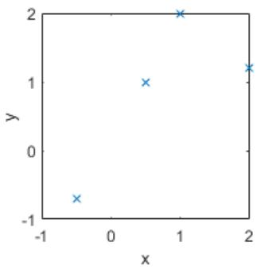
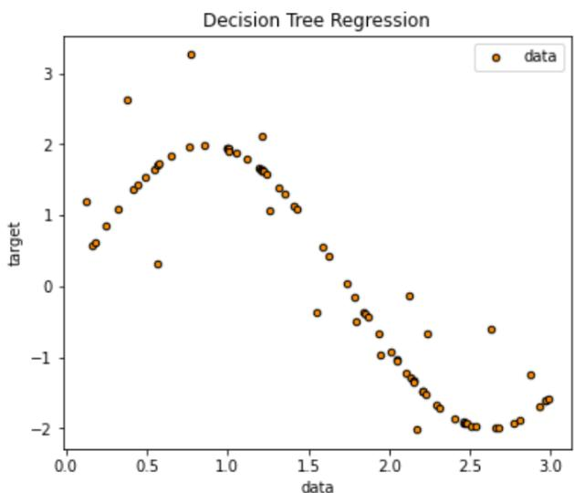
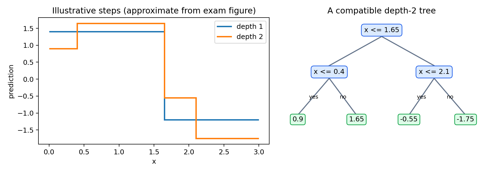
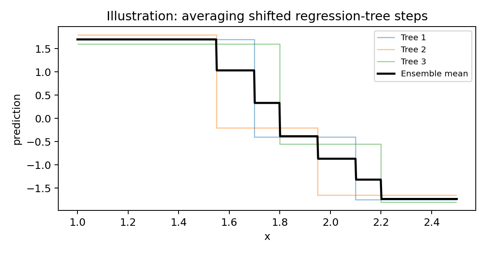
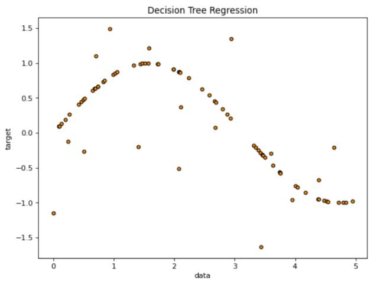
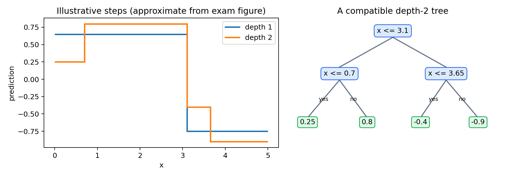
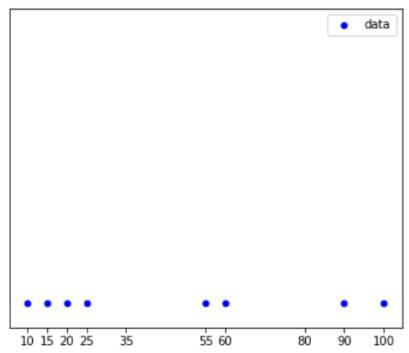
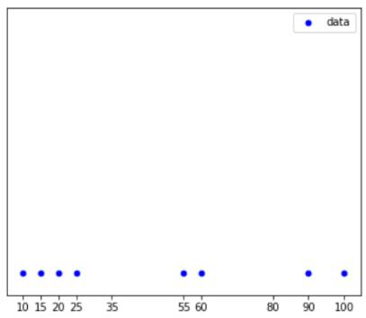
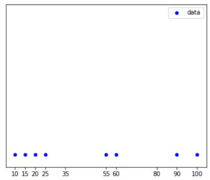
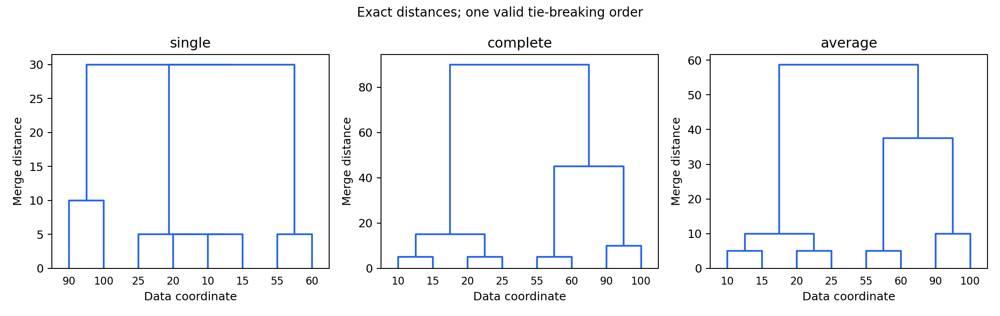

# 高频计算题

[← 清单首页](README.md) · [概念题合集](00_all_in_one.md)

历年试卷里反复出现的计算／画图题，按出现次数排序。每类题依次给出：**解题步骤**、**考场英文写法模板**，然后逐年列出**原题（原文＋中文，含原卷图）**和**完整解答**。数值由脚本重新计算，并已和各卷参考答案核对一致；中间结果保留 4 位小数，最后一步才四舍五入。

| 题型 | 考过 | ★ |
|---|---|---|
| [C1 OLS 手算直线＋RMSE](#c1-ols-手算直线rmse) | 2021、2023.3、2023.11、2024 | ★★★★ |
| [C2 一维 k-means 填表](#c2-一维-k-means-填表) | 2021、2023.3 | ★★ |
| [C3 报警系统的图模型概率](#c3-报警系统的图模型概率) | 2023.11、2024 | ★★ |
| [C4 画回归树](#c4-画回归树) | 2021、2023.3 | ★★ |
| [C5 层次聚类树状图](#c5-层次聚类树状图) | 2023.3 | ★ |
| [附：常用小公式](#附常用小公式) | RANSAC 迭代次数、分层划分 | — |

---

## C1 OLS 手算直线＋RMSE

★★★★ 考过：[2021 Ex2 b](../DataML-CHPS-2021-examen_zh.md) · [2023.3 Ex2 b](../DataML-CHPS-2022-examen_zh.md) · [2023.11 Ex4 b](../DataML-CHPS-2023-examen_zh.md) · [2024 Ex4 a](../DataML-CHPS-2024-examen_zh.md)（2023.11 与 2024 数据相同）

2021、2023.3、2023.11 三年的前一问都是 "a) Present in detail how the Ordinary Least Squares (OLS) works…"（概念，见合集 5.3）；2024 年没有这一问，直接从计算开始。每年只是换数据。

**解题步骤：**

1. 均值：$\bar x=\frac1N\sum x_i$，$\bar y=\frac1N\sum y_i$。
   *为什么*：最优直线一定经过 $(\bar x,\bar y)$（对截距求导得到），后面所有量都以均值为参照。
2. 列表算偏差 $x_i-\bar x$、$y_i-\bar y$，再算 $S_{xx}=\sum(x_i-\bar x)^2$、$S_{xy}=\sum(x_i-\bar x)(y_i-\bar y)$。检查：偏差之和必须为 0。
   *为什么*：$S_{xx}$ 衡量 $x$ 有多分散；$S_{xy}$ 衡量 $x$ 大时 $y$ 是否也大（同号为正、异号为负）。"偏差之和为 0"是均值的性质，能立刻发现均值算错。
3. 斜率 $\hat a=S_{xy}/S_{xx}$，截距 $\hat b=\bar y-\hat a\bar x$。
   *为什么*：斜率＝"$x$ 和 $y$ 一起变化的程度"除以"$x$ 自己变化的程度"，即协方差／方差，这是令 RSS 对斜率的导数为 0 得到的；截距让直线穿过均值点。推导见合集 5.3。
4. 预测 $\hat y_i=\hat ax_i+\hat b$，残差 $e_i=y_i-\hat y_i$。检查：残差之和应为 0。
   *为什么*：残差是竖直方向的误差，OLS 正是让它们的平方和最小；有截距时最优解的残差之和一定为 0，不为 0 就说明前面算错了。
5. $\text{RSS}=\sum e_i^2$，$\text{RMSE}=\sqrt{\text{RSS}/N}$（参考答案都除以 $N=4$；若想除以 $N-2$，要说明：在线性模型假设下，$\text{RSS}/(N-2)$ 是噪声**方差** $\sigma^2$ 的无偏估计；开平方后的 $\sqrt{\text{RSS}/(N-2)}$ 一般**不是**标准差 $\sigma$ 的无偏估计）。
   *为什么*：RSS 是 OLS 最小化的量；开平方后的 RMSE 和 $y$ 同单位，可以读作"平均每个点大约错多少"。它是训练误差，不是测试误差。

**考场英文写法模板：**
First compute the sample means $\bar x=\dots$ and $\bar y=\dots$.
Then compute the centered sums $S_{xx}=\sum (x_i-\bar x)^2=\dots$ and $S_{xy}=\sum (x_i-\bar x)(y_i-\bar y)=\dots$.
The OLS estimates are $\hat a = S_{xy}/S_{xx} = \dots$ and $\hat b = \bar y - \hat a\bar x = \dots$, giving the **fitted model $\hat y = \dots x + \dots$**.
Computing the residuals $e_i = y_i - \hat y_i$ gives $\text{RSS} = \sum e_i^2 = \dots$, so **$\text{RMSE} = \sqrt{\text{RSS}/N} = \dots$** (evaluated on the training points).

### 2021 Ex2 b

**原题：** b) Considering the data of Table 2, apply the OLS by making the numerical calculations and report the fitted model and its Root Mean Squared Error (RMSE).
使用表 2 中的数据，进行数值计算以应用 OLS，并给出拟合模型及其均方根误差（RMSE）。

| i | 1 | 2 | 3 | 4 |
|---|---|---|---|---|
| $x_i$ | 2.0 | 1.0 | 0.5 | −0.5 |
| $y_i$ | 1.2 | 2 | 1 | −0.7 |

Table 2 – Practical example: data points $P=\{(x_i,y_i),\ i=1\dots4\}$（表 2：实际示例，数据点）



**解答：** $\bar x=0.75$，$\bar y=0.875$

| $i$ | $x_i$ | $y_i$ | $x_i-\bar x$ | $y_i-\bar y$ | $(x_i-\bar x)^2$ | $(x_i-\bar x)(y_i-\bar y)$ | $\hat y_i$ | $e_i$ | $e_i^2$ |
|---|---|---|---|---|---|---|---|---|---|
| 1 | 2 | 1.2 | 1.25 | 0.325 | 1.5625 | 0.4062 | 1.8846 | −0.6846 | 0.4687 |
| 2 | 1 | 2 | 0.25 | 1.125 | 0.0625 | 0.2812 | 1.0769 | 0.9231 | 0.8521 |
| 3 | 0.5 | 1 | −0.25 | 0.125 | 0.0625 | −0.0312 | 0.6731 | 0.3269 | 0.1069 |
| 4 | −0.5 | −0.7 | −1.25 | −1.575 | 1.5625 | 1.9688 | −0.1346 | −0.5654 | 0.3197 |
| **和** | 3 | 3.5 | 0 | 0 | **3.25** | **2.625** | | 0 | **1.7473** |

$\hat a=2.625/3.25=21/26\approx 0.8077$，$\hat b=0.875-(21/26)\times0.75=7/26\approx 0.2692$ → **$\hat y=0.8077x+0.2692$**；$\text{RMSE}=\sqrt{1.7473/4}=$ **0.6609**。

> 2021 接着问 c) 更复杂的多项式模型（合集 5.8）、d) Ridge（合集 5.5）、e) N=50、d=200（合集 5.7）。

### 2023.3 Ex2 b

**原题：** b) Considering the data of Table 1, apply the OLS by making the numerical calculations and report the fitted model and its Root Mean Squared Error (RMSE).
使用表 1 中的数据，进行数值计算以应用 OLS，并给出拟合模型及其均方根误差（RMSE）。

| i | 1 | 2 | 3 | 4 |
|---|---|---|---|---|
| $x_i$ | −0.5 | 0.3 | 0.7 | 1.5 |
| $y_i$ | 1.2 | 2.0 | 1.0 | −1.0 |

Table 1 – Practical example: data points $P=\{(x_i,y_i),\ i=1\dots4\}$（表 1：实际示例，数据点）

**解答：** $\bar x=0.5$，$\bar y=0.8$

| $i$ | $x_i$ | $y_i$ | $x_i-\bar x$ | $y_i-\bar y$ | $(x_i-\bar x)^2$ | $(x_i-\bar x)(y_i-\bar y)$ | $\hat y_i$ | $e_i$ | $e_i^2$ |
|---|---|---|---|---|---|---|---|---|---|
| 1 | −0.5 | 1.2 | −1 | 0.4 | 1 | −0.4 | 1.9538 | −0.7538 | 0.5683 |
| 2 | 0.3 | 2 | −0.2 | 1.2 | 0.04 | −0.24 | 1.0308 | 0.9692 | 0.9394 |
| 3 | 0.7 | 1 | 0.2 | 0.2 | 0.04 | 0.04 | 0.5692 | 0.4308 | 0.1856 |
| 4 | 1.5 | −1 | 1 | −1.8 | 1 | −1.8 | −0.3538 | −0.6462 | 0.4175 |
| **和** | 2 | 3.2 | 0 | 0 | **2.08** | **−2.4** | | 0 | **2.1108** |

$\hat a=-2.4/2.08=-15/13\approx -1.1538$，$\hat b=0.8-(-15/13)\times0.5=179/130\approx 1.3769$ → **$\hat y=-1.1538x+1.3769$**；$\text{RMSE}=\sqrt{2.1108/4}=$ **0.7264**。

> 2023.3 接着问 c) RANSAC 及参数敏感性、与 bootstrap 的区别（合集 8.1–8.3），d) 用 RANSAC 估计 δ（合集 8.6）。

### 2023.11 Ex4 b 与 2024 Ex4 a（同一组数据）

**原题：** b)（2024 年为 a）) Considering the data of Table 1, apply the OLS by making the numerical calculations and report the fitted model and its Root Mean Squared Error (RMSE).
使用表 1 中的数据，进行数值计算以应用 OLS，并给出拟合模型及其均方根误差（RMSE）。

| i | 1 | 2 | 3 | 4 |
|---|---|---|---|---|
| $x_i$ | 2.2 | 0.9 | 0.4 | −0.6 |
| $y_i$ | 1.2 | 2 | 1 | −1 |

Table 1 – Practical example: data points $P=\{(x_i,y_i),\ i=1\dots4\}$（表 1：实际示例，数据点）

**解答：** $\bar x=0.725$，$\bar y=0.8$

| $i$ | $x_i$ | $y_i$ | $x_i-\bar x$ | $y_i-\bar y$ | $(x_i-\bar x)^2$ | $(x_i-\bar x)(y_i-\bar y)$ | $\hat y_i$ | $e_i$ | $e_i^2$ |
|---|---|---|---|---|---|---|---|---|---|
| 1 | 2.2 | 1.2 | 1.475 | 0.4 | 2.1756 | 0.59 | 1.9314 | −0.7314 | 0.5350 |
| 2 | 0.9 | 2 | 0.175 | 1.2 | 0.0306 | 0.21 | 0.9342 | 1.0658 | 1.1359 |
| 3 | 0.4 | 1 | −0.325 | 0.2 | 0.1056 | −0.065 | 0.5507 | 0.4493 | 0.2019 |
| 4 | −0.6 | −1 | −1.325 | −1.8 | 1.7556 | 2.385 | −0.2163 | −0.7837 | 0.6141 |
| **和** | 2.9 | 3.2 | 0 | 0 | **4.0675** | **3.12** | | 0 | **2.4868** |

$\hat a=3.12/4.0675=1248/1627\approx 0.7671$，$\hat b=0.8-(1248/1627)\times0.725=1984/8135\approx 0.2439$ → **$\hat y=0.7671x+0.2439$**；$\text{RMSE}=\sqrt{2.4868/4}=$ **0.7885**。

> 2023.11 接着问 c) RANSAC 与模型／数据点互相"打分"（合集 8.1、8.4）；2024 接着问 b) 用广义 RANSAC 拟合圆（合集 8.5）。

---

## C2 一维 k-means 填表

★★ 考过：[2021 Ex4 a–d](../DataML-CHPS-2021-examen_zh.md) · [2023.3 Ex3 c–d](../DataML-CHPS-2022-examen_zh.md)

**解题步骤**（原理见合集 7.1–7.3）：

1. **分配**：一维两中心时，**分界点＝两中心的中点** $m=(c_1+c_2)/2$，$x<m$ 归簇 1，$x>m$ 归簇 2。先算中点再逐个比较，最快也不容易错。
   *为什么*：k-means 让每个点归最近的中心；一维时"离 $c_1$ 更近"恰好等价于"在中点的左边"，比较一次就够了。这一步让 $J$ 不增（合集 7.2）。
2. **更新**：每个簇的新中心＝簇内均值（若题目规定某中心固定，就不更新它）。
   *为什么*：在分组固定时，均值是使簇内平方距离和最小的点，所以这一步也让 $J$ 不增。
3. **MSE**：$\text{MSE}=\frac1N\sum_i(x_i-c_{z_i})^2$，用的是**本步分配所用的中心**。
   *为什么*：MSE 就是目标 $J$ 除以 $N$，用来展示每一步目标在下降；它衡量每个点离自己的代表平均有多远。
4. 分配不再变化就停止，写 "converged"。表格每一行写：步数、中心、8 个点的簇号、MSE。
   *为什么*：分配不变时，下一步算出的中心也不变，算法已经到达不动点（局部最优）。
5. **中心保留足够位数**（如 8.3333 而不是 8.3）。点离分界点很近时，四舍五入可能改变分配结果，见 2023.3 题。

**考场英文写法模板：**
At step $t$, with centers $(c_1,c_2)$, the decision boundary is the midpoint $m=(c_1+c_2)/2$ (points $<m$ go to $C_1$, $>m$ go to $C_2$).
We evaluate $\text{MSE}=\frac{1}{N}\sum_{i=1}^N (x_i - c_{z_i})^2$ using the current centers, then update each free center to its cluster mean $c_j \leftarrow \text{mean}(C_j)$.
**MSE decreases monotonically** at each step until assignments stop changing (**converged**; local optimum).
To summarize clusters with real examples, pick the **nearest point** to each mean (or the 1D **medoid/median**); a cluster with much lower **within-cluster MSE** (or higher **silhouette** $s(i)=\frac{b(i)-a(i)}{\max(a(i),b(i))}$) is better represented.

### 2021 Ex4

**原题：**
a) Consider a special case of the 2-means algorithm: a k-means with k = 2 where, after the centers' initialization, only one of them (defined by the user) gets updated while the second one remains always fixed. Give a pseudocode of this particular algorithm.
考虑 2-means 的一种特殊形式：令 $k=2$，初始化聚类中心后，只更新其中一个由用户指定的中心，另一个中心始终固定。给出该算法的伪代码。

b) You have the dataset $X=\{10,15,20,25,55,60,90,100\}$. Starting with centers at positions 35 and 80 (fixed), compute numerically all the steps of the algorithm of (a) until convergence to solution $\hat c$. For each step, fill the following table with the positions of the centers, the cluster to which datapoints is assigned, and the Mean Squared Error (MSE).
给定数据集 $X=\{10,15,20,25,55,60,90,100\}$，两个中心的初始位置为 35 和 80，其中 80 固定。数值计算 a) 中算法的所有步骤，直至收敛到解 $\hat c$。在下表中逐步填写中心位置、各数据点的聚类归属以及均方误差（MSE）。（原卷表格：列为 step、centers、$x_1$…$x_8$ 的 assignment to cluster、MSE，共 6 行。）

c) Given the centers of $\hat c$, summarize the dataset by providing two 'typical' data examples. Compare how well each cluster is represented by its center, and why.
根据中心 $\hat c$，给出两个"典型"数据样本来概括数据集。比较每个中心对其所在簇的代表程度，并说明原因。

d) Given the centers of $\hat c$, now apply the standard 2-means (no restriction to center updates) and fill in the table below.
从 $\hat c$ 的中心出发，运行标准 2-means（不再限制中心更新），并填写下表。（原卷表格同上，3 行。）

（e) 簇为什么会变空，是概念题，见合集 7.9。）

**解答 a)：** 在标准 Lloyd 伪代码（合集 7.1）里，把更新步改为"只更新 $c_1$，$c_2$ 保持不变"：
```text
input X, initial c1 (free), c2 (fixed)
repeat
  assign: z_i = argmin_{j in {1,2}} |x_i - c_j|
  update: c1 = mean{ x_i : z_i = 1 }     # c2 is NOT updated
until assignments do not change
return c_hat = (c1, c2)
```

**解答 b)：**

| 步 | 中心 $(c_1,c_2)$ | 分界点 | $x_1$ | $x_2$ | $x_3$ | $x_4$ | $x_5$ | $x_6$ | $x_7$ | $x_8$ | MSE |
|---|---|---|---|---|---|---|---|---|---|---|---|
| 1 | (35, 80) | 57.5 | 1 | 1 | 1 | 1 | 1 | 2 | 2 | 2 | 331.25 |
| 2 | (25, 80) | 52.5 | 1 | 1 | 1 | 1 | 2 | 2 | 2 | 2 | 234.375 |
| 3 | (17.5, 80) | 48.75 | 1 | 1 | 1 | 1 | 2 | 2 | 2 | 2 | 206.25 |

第 3 步分配不变，收敛：$\hat c=(17.5,\ 80)$。（第 1 步 55 离 35 是 20、离 80 是 25，所以归簇 1。）

**解答 c)：** 用中心 17.5 和 80 概括（若必须是真实样本，取最近的点：15 或 20，以及 90）。簇 1 $\{10,15,20,25\}$ 很紧凑，簇内 MSE 为 31.25；簇 2 $\{55,60,90,100\}$ 分散（内部还有两个小群），而且 80 是固定的、不是簇 2 的均值，簇内 MSE 高达 381.25（即使换成均值 76.25 也有 367.19）。所以簇 1 被代表得好得多。

**解答 d)：**

| 步 | 中心 $(c_1,c_2)$ | 分界点 | $x_1$–$x_4$ | $x_5$–$x_8$ | MSE |
|---|---|---|---|---|---|
| 1 | (17.5, 80) | 48.75 | 1 | 2 | 206.25 |
| 2 | (17.5, 76.25) | 46.875 | 1 | 2 | 199.2188 |

第 2 步分配不变，收敛：中心 $(17.5,\ 76.25)$。MSE 下降，是因为 $c_2$ 终于移到了簇 2 的真实均值。

### 2023.3 Ex3 c–d

**原题：**
c) Consider the 1D dataset $X=\{1,1.5,2,2.5,5.4,6,9,10\}$. Simulate all the steps of a 2-means solution using the k-farthest initialization, and fill Table 2 below.
给定一维数据集 $X=\{1,1.5,2,2.5,5.4,6,9,10\}$，采用 k-farthest 初始化，模拟 2-means 的全部步骤，并填写下方表 2。
Table 2 – k-means iterations. Compute the MSE only for the first and the final iterations.
表 2：k-means 迭代。只需计算第一次与最后一次迭代的 MSE。（原卷表格：step、centers、$x_1$…$x_8$、MSE，共 4 行。）

d) Given the clusters found in (c), summarize the dataset by providing two 'typical' data examples. Explain your answer and comment on how well each of them serves its role.
根据 c) 中得到的簇，给出两个"典型"数据样本概括数据集。解释你的选择，并评论它们各自的代表性。

**解答 c)：** k-farthest 初始化：取第一个点 $c_1=1$，离它最远的点 $c_2=10$。

| 步 | 中心 $(c_1,c_2)$ | 分界点 | $x_1$ | $x_2$ | $x_3$ | $x_4$ | $x_5$ | $x_6$ | $x_7$ | $x_8$ | MSE |
|---|---|---|---|---|---|---|---|---|---|---|---|
| 1 | (1, 10) | 5.5 | 1 | 1 | 1 | 1 | 1 | 2 | 2 | 2 | 4.9825 |
| 2 | (2.48, 8.3333) | 5.4067 | 1 | 1 | 1 | 1 | 1 | 2 | 2 | 2 | 2.5718 |
| 3（若 $c_2$ 约简为 8.3） | (1.75, 7.6) | 4.675 | 1 | 1 | 1 | 1 | 2 | 2 | 2 | 2 | 2.0463 |

精确计算下，第 2 步分配不变即收敛。**易错点**：$x_5=5.4$ 到 $2.48$ 的距离为 $2.92$，到 $8.3333$ 的距离为 $2.9333$，只差 $0.0133$，因此仍归簇 1。若把 $c_2$ **四舍五入为 8.3**，分界点会变成 $5.39 < 5.4$，使 $5.4$ 改分到簇 2，得到表第 3 行的 $(1.75,\ 7.6)$（$\text{MSE}=2.0463$），这也是原卷参考答案中的结果。建议中心保留足够小数并在答题时说明 $5.4$ 正好卡在分界点附近；同时注意精确迭代停下的解 $\text{MSE}=2.5718 > 2.0463$，说明标准 $k$-means 对初值敏感、只保证收敛到局部最优（见合集 7.3）。

**解答 d)：** 簇中心为 $2.48$ 和 $8.3333$（按精确解）。若必须从原数据集选两个真实样本作为代表：按**离簇均值最近**取 **$2.5$** 和 **$9$**；按**1D medoid（最小化簇内距离和，即中位数）**取 **$2$** 和 **$9$**。两簇代表性都不算理想：簇 1 $\{1,1.5,2,2.5,5.4\}$ 围绕 $2.48$ 的簇内 $\text{MSE}=2.3816\ (\approx 2.38)$，均值被离群点 $5.4$ 明显右拉，使 $2.48$ 落在了密集核心 $\{1..2.5\}$ 的边缘（取 $2$ 更能代表核心群）；簇 2 $\{6,9,10\}$ 围绕 $8.3333$ 的簇内 $\text{MSE}=2.8889\ (\approx 2.89)$，内部跨度较大（$6$ 离 $\{9,10\}$ 较远），$9$ 偏向后两点。

---

## C3 报警系统的图模型概率

★★ 考过：[2023.11 Ex3](../DataML-CHPS-2023-examen_zh.md) · [2024 Ex3](../DataML-CHPS-2024-examen_zh.md)（两年题目完全相同，各 4 分）

**原题：**
A security system relies on a battery, a sensor, and an alarm. Consider the three respective binary random variables a, b, c. When the alarm fires: a = 1; when the battery functions properly: b = 1; and when the sensor functions properly: c = 1. Otherwise, those variables take a value equal to 0. The system architecture is very simple: the battery powers the sensor, and the sensor feeds information to the controller of the alarm that decides to fire to signify a threat. The system manual informs us that:
某安全系统由电池、传感器和报警器构成。考虑三个二元随机变量 $a,b,c$：报警器响起时 $a=1$，电池正常工作时 $b=1$，传感器正常工作时 $c=1$；否则相应变量取 0。系统结构很简单：电池为传感器供电，传感器向报警控制器提供信息，控制器决定是否响起以表示存在威胁。系统手册给出以下信息：

- the probability for the battery to fail is 0.1 — 电池失效的概率为 0.1；
- the probability for the sensor to fail is 0.01 when the battery is ok, and 0.3 when the battery is not ok — 电池正常时传感器失效的概率为 0.01，电池失效时为 0.3；
- the probability for the alarm to be silent is 0.99, when the sensor works fine — 传感器正常工作时，报警器保持静默的概率为 0.99。

a) Give the graphical model that involves the variables of this problem, and translate all the known information given by the manual to proper writing with probabilities (it does not involve calculations).
给出包含这些变量的概率图模型，并将手册中的全部已知信息写成恰当的概率表达式（不需要计算）。

b) Give the $2\times2$ table of the probability $p(a=1\mid b,c)$. Examine if a and b are independent.
给出概率 $p(a=1\mid b,c)$ 的 $2\times2$ 表格。考察 $a$ 与 $b$ 是否独立。

c) Compute the probability for the alarm to be silent.
计算报警器保持静默的概率。

d) Suppose we don't hear any alarm and we have no information about whether the sensor functions correctly. What is the probability of the battery to be malfunctioning?
假设没有听到报警，且不知道传感器是否正常工作。电池失效的概率是多少？

> **题面缺一个条件**：没有给出传感器失效时报警静默的概率，记 $q=P(a=0\mid c=0)$，答案保留 $q$。考场上建议明确写出 "$q$ is not given in the manual"，再给出含 $q$ 的式子；如果想给数字，就写出你假设的 $q$ 值。

**每一问用到的工具**（详细解释见合集 8.7–8.9）：

| 问 | 工具 | 它的用途 |
|---|---|---|
| a) | 贝叶斯网络的分解规则 $p(x_1..x_n)=\prod_ip(x_i\mid\text{父节点})$ | 把"谁影响谁"的结构变成可计算的公式 |
| b) | 条件独立、全概率公式 | 判断"知道 $c$ 后 $b$ 是否还有用"和"不知道 $c$ 时 $b$ 是否影响 $a$" |
| c) | 全概率公式（对未知变量求和＝边缘化） | 从条件概率算出单个事件的概率 |
| d) | 乘法法则 $P(A,B)=P(A\mid B)P(B)$ ＋ Bayes 公式 $P(B\mid A)=P(A,B)/P(A)$ | 从"原因 → 结果"反推"看到结果后原因的概率" |

**解答 a)**（原理见合集 8.7）：链 $b\to c\to a$，$p(a,b,c)=p(b)\,p(c\mid b)\,p(a\mid c)$，即假设 $a\perp b\mid c$。手册翻译成概率，并补上互补概率：

| 量 | 值 | 互补 |
|---|---|---|
| $P(b=0)$ | 0.1 | $P(b=1)=0.9$ |
| $P(c=0\mid b=1)$ | 0.01 | $P(c=1\mid b=1)=0.99$ |
| $P(c=0\mid b=0)$ | 0.3 | $P(c=1\mid b=0)=0.7$ |
| $P(a=0\mid c=1)$ | 0.99 | $P(a=1\mid c=1)=0.01$ |
| $P(a=0\mid c=0)$ | $q$（未给） | $P(a=1\mid c=0)=1-q$ |

**解答 b)**（合集 8.8）：链结构下 $p(a=1\mid b,c)=p(a=1\mid c)$，与 $b$ 无关，两行相同：

| | $c=0$ | $c=1$ |
|---|---|---|
| $b=0$ | $1-q$ | 0.01 |
| $b=1$ | $1-q$ | 0.01 |

给定 $c$ 时 $a\perp b \mid c$（条件独立，两行完全一样）；但边际上（未观测 $c$ 时），$P(a=1\mid b=1)=0.99\times0.01+0.01(1-q)=0.0199-0.01q$，而 $P(a=1\mid b=0)=0.7\times0.01+0.3(1-q)=0.307-0.3q$。两者仅在 $q=0.99$ 时相等，因此一般**不独立**（$b$ 会通过 $c$ 影响 $a$）。

**解答 c)**：对隐变量 $b,c$ 按全概率公式求和（先边缘化 $b$ 求 $P(c)$，再求 $P(a=0)$）：
$P(c=0)=0.9\times0.01+0.1\times0.3=0.039$，$P(c=1)=1-0.039=0.961$；
$P(a=0)=0.99\times0.961+q\times0.039=$ **$0.95139+0.039q$**（随 $q\in[0,1]$ 落在 $0.95139$ 与 $0.99039$ 之间）。

**解答 d)**（Bayes 公式，合集 8.9）：
$P(a=0,b=0)=P(b=0)\sum_{c}P(c\mid b=0)P(a=0\mid c)=0.1\times(0.7\times0.99+0.3q)=0.0693+0.03q$；
$P(b=0\mid a=0)=\dfrac{P(a=0,b=0)}{P(a=0)}=\dfrac{0.0693+0.03q}{0.95139+0.039q}$。当 $q=0$ 时约 **0.0728**，当 $q=1$ 时约 **0.1003**（注：链式结构在只观测末端 $a$ 时不发生 V 结构的 explaining-away，而是经由 $c$ 反向更新对根节点 $b$ 的后验信念）。

**考场英文写法模板：**
- **a)** The graphical model is the chain $b \to c \to a$, factoring as $p(a,b,c)=p(b)\,p(c\mid b)\,p(a\mid c)$ (so $a \perp b \mid c$). Known terms: $P(b=0)=0.1$, $P(c=0\mid b=1)=0.01$, $P(c=0\mid b=0)=0.3$, $P(a=0\mid c=1)=0.99$; $q=P(a=0\mid c=0)$ is not given in the manual and kept as a parameter.
- **b)** Since $a \perp b \mid c$, $P(a=1\mid b,c)=P(a=1\mid c)$ has identical rows for $b=0$ and $b=1$ ($1-q$ for $c=0$, $0.01$ for $c=1$). Marginally, $P(a=1\mid b=1)=0.0199-0.01q \ne 0.307-0.3q=P(a=1\mid b=0)$ unless $q=0.99$, so $a$ and $b$ are **not marginally independent**.
- **c)** Marginalizing $b$ gives $P(c=0)=0.9(0.01)+0.1(0.3)=0.039$ ($P(c=1)=0.961$), hence $P(a=0)=0.99(0.961)+0.039q = 0.95139 + 0.039q$.
- **d)** By Bayes' rule, $P(b=0\mid a=0)=\dfrac{P(b=0)\sum_c P(c\mid b=0)P(a=0\mid c)}{P(a=0)}=\dfrac{0.1(0.7\cdot 0.99+0.3q)}{0.95139+0.039q}=\dfrac{0.0693+0.03q}{0.95139+0.039q}$.

---

## C4 画回归树

★★ 考过：[2021 Ex3 a–c](../DataML-CHPS-2021-examen_zh.md) · [2023.3 Ex4 a–b](../DataML-CHPS-2022-examen_zh.md)

这是读图题，没有唯一的精确数值，按方法画出合理的形状即可。

**画法：**

1. **depth = 1**：找**一个**阈值 $s$，把数据分成左右两段，使两段各自的平方误差和最小（通常切在曲线跳变最明显的地方）。每段画一条**水平线**，高度＝该段数据 $y$ 的**均值**，得到两级台阶。
   *为什么*：回归树的叶子输出常数，而使平方误差最小的常数就是均值；切在跳变处，两边各自最"平"，平方误差下降最多（合集 4.3）。
2. **depth = 2**：在左右两段内**各再切一次**（同样按平方误差最小），最多 4 段水平线、4 级台阶。台阶贴在数据变化大的地方，变化平缓处的台阶就宽。
   *为什么*：深度 2 表示每条路径最多问两个问题，所以最多 $2^2=4$ 个叶子；每次都是贪心地选当前最有用的切点。
3. **画树**：根节点写 $x\le s_1$；两个子节点写 $x\le s_2$、$x\le s_3$；4 个叶节点写各段均值。
   *为什么*：树图和台阶图是同一个模型的两种画法：每个切点对应一个节点，每段台阶对应一个叶子。
4. **树集成**：每棵树用不同的随机子样本训练，台阶位置略有错开，平均后得到**台阶更多、更平滑**的阶梯函数，比单棵树更接近真实曲线；但仍是分段常数，不能外推。
   *为什么*：不同子样本让各棵树的切点不同，平均后台阶变细、随机波动相互抵消，方差下降（合集 2.3）。

**考场英文写法模板：**
A regression tree partitions the input domain into axis-aligned intervals and predicts a **constant (the mean of $y$)** in each leaf, producing a **step function**.
At **depth 1**, CART selects the split $x \le s_1$ minimizing the sum of squared errors in both halves, giving two constant levels ($\bar y_L$ and $\bar y_R$).
At **depth 2**, each half is split once more ($x \le s_2$ on the left, $x \le s_3$ on the right), yielding up to four finer steps.
In an **ensemble of trees** trained on random subsamples, each tree places its splits at slightly shifted positions; averaging their step predictions produces **more numerous, smaller steps** that closely track the true trend with **lower variance**.

### 2021 Ex3 a–c

**原题：**（原卷图：时间序列数据）



a) Draw directly on the above figure the way (roughly) a regression tree (RT) approximates the data of the time-series, for depth = 1 and depth = 2.
直接在上图中画出回归树（RT）如何大致逼近该时间序列数据，分别考虑深度为 1 和 2 的情况。

b) Draw on the right to the figure, a (rough) RT with depth = 2.
在图的右侧大致画出一棵深度为 2 的回归树。

c) How would an ensemble of RTs (each tree using random subsets of the data to train with) approximate the region $x\in[1,2.5]$ of this dataset? Make a drawing and explain.
若使用回归树集成，每棵树均用随机选取的数据子集训练，它会如何逼近该数据集中的 $x\in[1,2.5]$ 区域？请画图并解释。

（d)–e) 函数变换 $f_1(5x)=f(x)$、$f_2=5f$、$f_3=f^5$ 以及单树与集成的区别，是概念题，见合集 4.6。）

**解答 a–b)：** 从原图看，$x\in[0,3]$，$y$ 在前半段约 $+1$ 至 $+2$（先升后降），在后半段降到 $-2$ 附近再略微回升：
- **depth = 1**：在曲线正负落差最大的中段 $x\approx 1.65$ 切一刀，得到两级水平台阶——左半均值约 $1.40$，右半均值约 $-1.20$。
- **depth = 2**：左半在 $x\approx 0.40$ 再切一刀（把左端较低点分出，叶值约 $0.90$ 与 $1.65$）；右半在 $x\approx 2.10$ 再切一刀（区分下降段与底部谷段，叶值约 $-0.55$ 与 $-1.75$）。树结构为根 $x\le 1.65$，子节点 $x\le 0.40$ 与 $x\le 2.10$，四个叶节点对应上述均值。



**解答 c) 集成（$x\in[1,2.5]$）：** 各棵树基于不同的随机子集训练，切分阈值在陡降段（如 $1.55, 1.70, 1.80, 1.95, 2.10, 2.20$ 等位置）略有错开。对所有树的阶梯预测求**平均**后，阶梯数目增多、每步落差变小、整体更平滑地贴近下降曲线；相比单棵浅树偏差更低，相比单棵深树对噪声（图中的几个离群点）更不敏感、方差更小，但仍无法外推。



### 2023.3 Ex4 a–b

**原题：**（原卷图：时间序列数据）



a) Draw directly on the figure below, the way (roughly) a regression tree (RT) would approximate the data of the time-series, for depth = 1 and depth = 2.
直接在下图中画出回归树（RT）如何大致逼近该时间序列数据，分别考虑深度为 1 和 2 的情况。

b) Draw on the right of the figure, the RT for depth = 2.
在图的右侧画出深度为 2 的回归树。

（c) 客户函数 $3f(x)$、$f_2(3x)=f(x)$、$[f_1(x)+f_2(3x)]^2$ 是概念题，见合集 4.6。）

**解答 a–b)：** 从原图看，$x\in[0,5]$，$y$ 在 $[0,3]$ 上为正（先升到 $1$ 再下降），在 $[3,5]$ 上为负（降到 $-1$ 附近）：
- **depth = 1**：在正负跨越处 $x\approx 3.10$ 切分，得到两级水平台阶——左半均值约 $0.64$，右半均值约 $-0.75$。
- **depth = 2**：左半在 $x\approx 0.70$ 再切一刀（区分起点较低值与中部波峰，叶值约 $0.25$ 与 $0.80$）；右半在 $x\approx 3.65$ 再切一刀（区分下降段与谷底平台，叶值约 $-0.40$ 与 $-0.90$）。对应深度为 2 的树为根 $x\le 3.10$，左右子节点分别为 $x\le 0.70$ 和 $x\le 3.65$。



---

## C5 层次聚类树状图

★ 考过：[2023.3 Ex3 e](../DataML-CHPS-2022-examen_zh.md)

**原题：** e) Give three or more cluster linkage criteria that are used in hierarchical agglomerative clustering, and provide the formulas to compute them. In the following figures, draw the cluster hierarchy that would be computed by each of these criteria.
给出至少三种层次凝聚聚类使用的簇间连接准则，以及它们的计算公式。在下方图中分别画出各准则得到的聚类层次。





**解答：** 图中 8 个点为 $\{10,15,20,25,55,60,90,100\}$，一维欧氏距离 $d(x,y)=|x-y|$。三种常用簇间连接准则（详见合集 7.11）：
- **单连接（Single linkage）**：$D(A,B)=\min_{x\in A,\,y\in B} d(x,y)$
- **全连接（Complete linkage）**：$D(A,B)=\max_{x\in A,\,y\in B} d(x,y)$
- **平均连接（Average linkage / UPGMA）**：$D(A,B)=\dfrac{1}{|A||B|}\sum_{x\in A}\sum_{y\in B} d(x,y)$

从 8 个单点簇出发，每次合并距离最近的两个簇，合并高度即为该距离（已用 SciPy 核对）：

| 连接准则 | 合并过程（高度） |
|---|---|
| 单连接 $\min$ | $\{10,15\}$、$\{15,20\}$、$\{20,25\}$、$\{55,60\}$ 都在 5（链式合并成 $\{10,15,20,25\}$）；$\{90,100\}$ 在 10；$\{10..25\}+\{55,60\}$ 在 30（$55-25$）；再并入 $\{90,100\}$ 在 30（$90-60$） |
| 全连接 $\max$ | $\{10,15\}$、$\{20,25\}$、$\{55,60\}$ 在 5；$\{90,100\}$ 在 10；$\{10,15\}+\{20,25\}$ 在 15；$\{55,60\}+\{90,100\}$ 在 45（$100-55$）；最后两簇合并在 90（$100-10$） |
| 平均连接 mean | 同样先合并 $\{10,15\},\{20,25\},\{55,60\}$ 在 5，$\{90,100\}$ 在 10；接着 $\{10,15\}+\{20,25\}$ 在 10；$\{55,60\}+\{90,100\}$ 在 37.5（$\frac{30+40+35+45}{4}$）；最后两簇合并在 58.75 |

**关键对比：** 单连接产生明显的**链式效应**（chaining），先把 $\{55,60\}$ 以高度 $30$ 并入左边 $\{10..25\}$；而全连接和平均连接都会先在右侧合并 $\{55,60\}$ 与 $\{90,100\}$，再在最高处把左右两大簇合二为一。

**考场英文写法模板：**
Three standard linkage criteria between clusters $A$ and $B$ (with $d(x,y)=|x-y|$) are:
- **Single linkage:** $D_{\min}(A,B)=\min_{x\in A,\,y\in B} d(x,y)$. On $\{10,15,20,25,55,60,90,100\}$, nearest pairs merge at $5$ and $10$, chaining $\{10,15,20,25\}$ at $5$; then $\{55,60\}$ merges with $\{10..25\}$ at $30$ and finally with $\{90,100\}$ at $30$ (chaining effect).
- **Complete linkage:** $D_{\max}(A,B)=\max_{x\in A,\,y\in B} d(x,y)$. Pairs merge at $5$ and $10$, then $\{10,15\}+\{20,25\}$ at $15$, $\{55,60\}+\{90,100\}$ at $45$, and the root merge occurs at $90$.
- **Average linkage:** $D_{\text{avg}}(A,B)=\frac{1}{|A||B|}\sum_{x\in A, y\in B} d(x,y)$. Pairs merge at $5$ and $10$, $\{10,15\}+\{20,25\}$ at $10$, $\{55,60\}+\{90,100\}$ at $37.5$, and the final merge occurs at $58.75$.



**每一步为什么这样做：**

1. *从单点簇开始，每次合并最近的两个簇*：这就是"凝聚"的意思，自下而上把相近的点逐步并成大簇。
2. *簇间距离用连接准则算*：点与点的距离很明确，簇与簇的距离需要另外定义，不同定义会得到不同的树（单连接看最近的两点，全连接看最远的两点，平均连接看所有点对）。
3. *记录合并高度*：高度＝合并时的簇间距离，画在树状图的纵轴上。在某个高度横切一刀，就得到那个距离尺度下的分组。
4. *同样的数据、三棵不同的树*：例如 $\{55,60\}$ 用单连接时，到左边（$55-25=30$）和到右边（$90-60=30$）一样近，三团在同一高度 30 连成一串（平局时取任一合法顺序），这就是链式效应；用全连接时，它到左边的最远距离是 $60-10=50$，到右边是 $100-55=45$，所以先和 $\{90,100\}$ 合并。这体现了各准则的不同偏好。

---

## 附：常用小公式

**RANSAC 迭代次数**：内点比例 $w$、最小样本 $s$ 个点、成功概率 $p$ 时，$T\ge\dfrac{\log(1-p)}{\log(1-w^s)}$。$p=0.99$ 时：

| | $w=0.5$ | $w=0.7$ |
|---|---|---|
| 直线 $s=2$ | 17 | 7 |
| 圆 $s=3$ | 35 | 11 |

**分层划分（2019 Q9）**：700＋300 个样本，80/20 划分 → 训练 560＋240、测试 140＋60；5 折 → 每折 140＋60。

**AUC 的含义**：$\text{AUC}=P(s(X^+)>s(X^-))+\tfrac12P(s(X^+)=s(X^-))$，即随机正例分数高于随机负例的概率（同分算一半），0.5 为随机，1 为完美。
