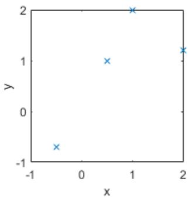
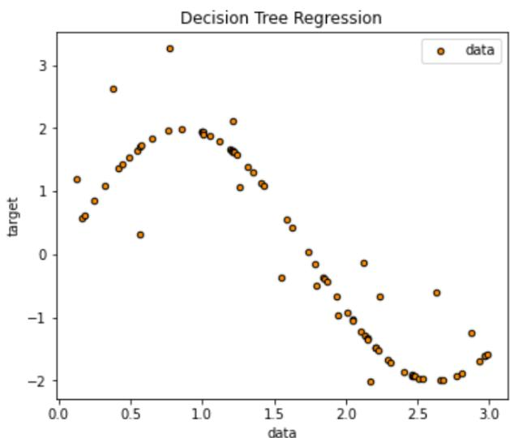
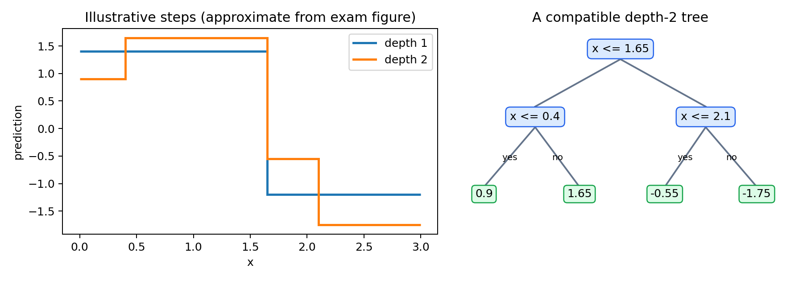
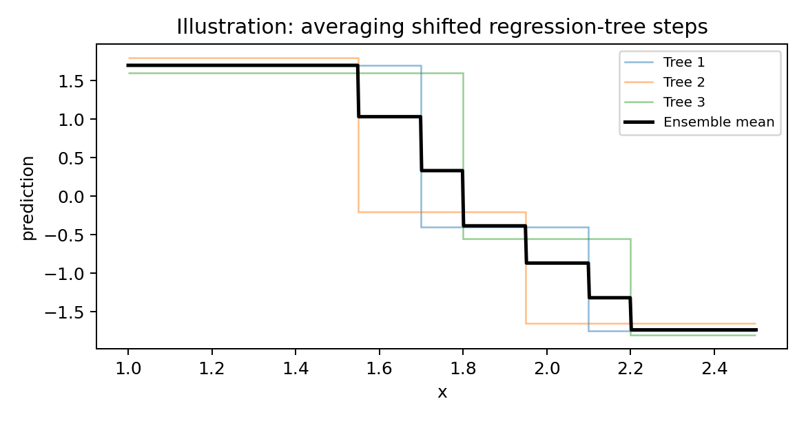
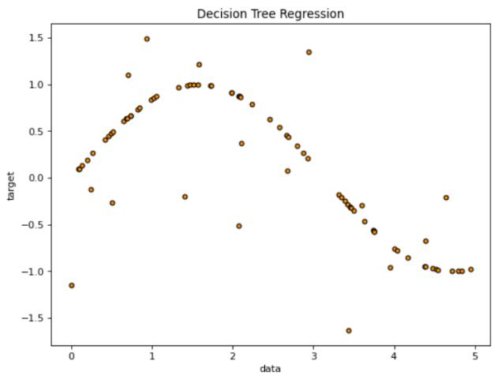
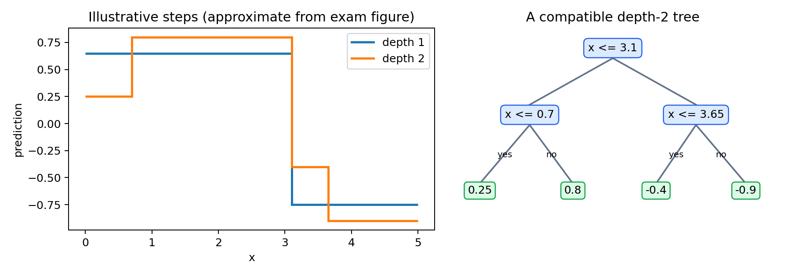
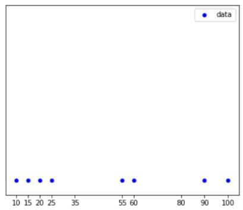
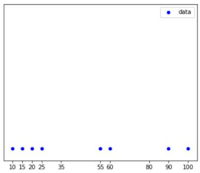
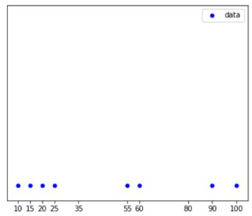
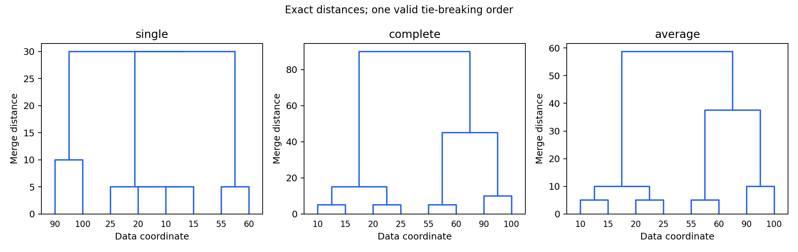

# 背诵版速查（74 题）

## 1. 泛化、误差分解与偏差—方差

### 1.1 What is the bias–variance trade-off? 偏差—方差权衡是什么？ ★★★★

Expected squared error = **bias²** + **variance** + **Bayes error** (noise); for least squares with $d$ parameters, the variance averaged over the training inputs is $\sigma^2 d/n$.
A too **simple** model has high bias: it **underfits**.
A too **complex** model has high variance: it learns the noise and **overfits**.
We choose the complexity (degree, depth, $\lambda$) by **cross-validation**, then test once on a test set.

### 1.2 What are the approximation and estimation errors, and how is the trade-off between them solved? 近似误差和估计误差是什么？二者的权衡如何处理？ ★★

$L(\hat h)-L(h^*)=\underbrace{L(\hat h)-L(\bar h)}_{\textbf{estimation (stochastic)}}+\underbrace{L(\bar h)-L(h^*)}_{\textbf{approximation (deterministic)}}$, with $\bar h$ the best function in $\mathcal H$.
**Approximation error**: the class $\mathcal H$ is too poor (like bias). **Estimation error**: $\hat h$ is learned from finite data (like variance).
A bigger $\mathcal H$ does not increase the approximation error, but the estimation error **tends to increase**.
Learning = choose $\mathcal H$ (design), then estimate the best function in it (training); balance by **regularization / model selection by CV**, and more data.

### 1.3 What is the generalization error and how is it related to overfitting? 什么是泛化误差？它和过拟合有什么关系？ ★

The generalization error (true error) is the expected loss on **new data**: $L(h)=\mathbb E[\ell(h(X),Y)]$.
The training error is too optimistic.
**Overfitting**: the training error is very low but the generalization error is high, because the model learned the noise.
We estimate it on a **test set** or by **cross-validation**.

### 1.4 What is the role of penalization in machine learning? 惩罚项（正则化）在机器学习中起什么作用？ ★

We minimize training error + $\lambda$ penalty: $\hat L_n(\theta)+\lambda\,\Omega(\theta)$. The penalty:
(1) **controls complexity** (Occam's razor): more bias but less variance, so less overfitting ($\lambda$ sets the balance);
(2) **regularizes ill-posed** problems (Tikhonov; Ridge: $X^TX+\lambda I$ is invertible);
(3) adds **structure**, e.g. $\ell_1$ gives **sparsity**. $\lambda$ is a hyperparameter chosen by CV.

### 1.5 Are generalization error and overfitting relevant for clustering? 泛化误差和过拟合的概念适用于聚类吗？ ★

**Yes.** The optimal inertia never increases when $k$ grows (it is 0 when $k=N$ distinct points).
So a too large $k$ **overfits** the sample and gives unstable clusters.
Without labels, we check generalization by **stability under resampling**, held-out likelihood, or **BIC**.

### 1.6 What is the impact of computation time (fixed resources) when the sample size grows? 计算资源固定时，样本量增大对计算时间有什么影响？ ★

More data reduces the **estimation error**, but each exact pass over the data costs $O(n)$.
With fixed time, we must accept a larger **optimization error**.
So we use cheap methods: **SGD / mini-batches**, or a subsample.
A rough optimum on much data is often better than an exact optimum on little data.

## 2. 三大算法家族与 SVM

### 2.1 What is the principle of local methods? Give an example and its hyperparameters. 局部方法的原理是什么？举一个例子并说明超参数。 ★★★

Local methods predict at $x$ with the training points **near $x$**: **majority vote** (classification) or **average** (regression). No global optimization.
Example: **k-nearest neighbors**. Hyperparameters: **$k$** and the **distance**, chosen by cross-validation.
Small $k$: overfitting; large $k$: underfitting. (Decision trees are also local.)

### 2.2 What is the principle of global methods? Give an example. 全局方法的原理是什么？举一个例子。 ★★★

Global methods are based on **functional optimization**: choose one function $h_\theta$ by **minimizing a criterion on all the data**:
$\min_\theta\frac1n\sum_i\ell(h_\theta(x_i),y_i)+\lambda\Omega(\theta)$ (training error + $\lambda$ penalty). The same parameters are used everywhere.
Examples: **regularized regression (Ridge / Lasso)**, **SVM**, **boosting**, **feedforward neural networks**. Complexity is controlled by the class and by $\lambda$.

### 2.3 What are the two main ingredients of ensemble methods? Give an example. 集成方法的两个主要要素是什么？举一个例子。 ★★★

(1) **Resampling**: build many (weak) predictors from the **same data** and the same class $\mathcal H$: **bootstrap** samples (+ random features), or **reweighted** data (**boosting**).
(2) **Aggregation**: **average** (regression) or **majority vote** (classification); boosting uses a weighted vote.
Bagging / random forests mainly reduce **variance**; boosting mainly reduces **bias**.
Example: **random forest** = many unpruned trees + bootstrap + random features.

### 2.4 What are the two key principles of SVM? SVM 的两个核心原理是什么？ ★★

(1) **Maximum margin**: the separating hyperplane with the largest margin $M=1/\|w\|$ (distance to each class): a **convex quadratic** problem. Only the **support vectors** ($\alpha_i\neq0$) matter.
With slack variables: $\min\frac12\|w\|^2+C\sum_i\xi_i$ s.t. $y_i(w^Tx_i+b)\ge1-\xi_i$, $\xi_i\ge0$ (**hinge loss**).
(2) **Kernel trick**: the dual only uses the Gram matrix $x_i^Tx_j$; replace it by a kernel $k(x_i,x_j)$ (e.g. Gaussian RBF), i.e. map the data to a space where they are (almost) **linearly separable** → **non-linear** boundaries.
Hyperparameters: $C$ and the kernel (chosen on validation data).

### 2.5 Why are convex losses sometimes used in learning? 为什么学习中有时使用凸损失？ ★

The **0–1 loss** is not convex and not continuous: minimizing the empirical 0–1 loss is **NP-hard** in general.
We use a **convex surrogate** $\varphi\ge$ 0–1 loss (**hinge** for SVM, **exponential** for boosting), so $L(f)\le A(f)=\mathbb E\,\varphi(-Yf(X))$; with a linear model (or a linear span) the problem is **convex**.
Then every local minimum is **global**, and it is solved efficiently.
Moreover $\text{sgn}(f^*)$ is the **Bayes classifier**, and $L(f)-L^*$ is controlled by $A(f)-A^*$.

### 2.6 What other choices of loss lead to practical methods? 还有哪些损失选择能得到实用的方法？ ★

Keep **Criterion = training error + λ penalty** and **change the loss**: **squared** (Ridge), **hinge** (SVM), **logistic** (logistic regression), **exponential** (boosting).
Other choices: **absolute / Huber** (robust to outliers), **ε-insensitive** (SVR), **quantile** loss.
Even **non-convex** losses work with **SGD** (deep learning), but with no global guarantee. The loss should match the real cost of errors.

### 2.7 Can SVM be used for regression? SVM 能用于回归吗？ ★

**Yes: SVR.** We fit $f(x)=w^Tx+b$ with a **tube $f(x)\pm\varepsilon$**: errors smaller than ε cost nothing (**ε-insensitive loss**).
We minimize $\frac12\|w\|^2+C\sum_i\max(0,|y_i-f(x_i)|-\varepsilon)$.
Points strictly inside the tube are **not support vectors** (sparse solution). Kernels give non-linear regression.

## 3. 模型评估与超参数校准

### 3.1 Give an example of a hyperparameter and explain how to calibrate it. 举一个超参数的例子并说明如何校准。 ★★★

Example: the **maximum depth** of a tree. The training error cannot choose it (a deeper tree never has a higher training error).
**K-fold cross-validation**: for each value in a grid, train on K−1 folds, validate on the held-out fold, rotate over the K folds and average.
Choose the value with the **lowest validation error**, retrain on all training data, and test **once** on the test set.

### 3.2 What are the stakes and difficulties of hyperparameter calibration? 超参数校准的意义和难点是什么？ ★★

Hyperparameters set the **complexity**, so they decide **underfitting vs overfitting**.
Difficulties: we **cannot use the training error**, so we need validation data or CV;
each try needs a **new training** (costly); the score is **noisy**;
tuning on the test set gives an **optimistic** result.

### 3.5 Define the ROC curve. 给出 ROC 曲线的定义。 ★★

For a score $s(x)$ and a threshold $t$: $\text{TPR}(t)=P(s(X)\ge t\mid Y=1)$, $\text{FPR}(t)=P(s(X)\ge t\mid Y=0)$.
The **ROC curve** plots TPR against FPR when $t$ varies, from $(0,0)$ to $(1,1)$.
A random score gives the **diagonal**; a perfect score goes through $(0,1)$.

### 3.6 What is the interest of the ROC curve and the AUC? ROC 曲线和 AUC 有什么用？ ★★

ROC evaluates a score **for all thresholds**.
We use it to **compare** models and to **choose a threshold** (costs, max false alarms).
**AUC** = area under the curve = $P(s(X^+)>s(X^-))+\tfrac12P(s(X^+)=s(X^-))$: 0.5 = random, 1 = perfect ranking.
With rare positives, also use the **precision–recall** curve.

### 3.3 Can hyperparameter calibration be solved by an optimization technique? 超参数校准能用优化方法解决吗？ ★

**Yes**, it is a **bi-level problem**: $\min_\lambda\hat L_{\text{val}}(\hat\theta(\lambda))$.
But the objective is usually a **black box**: no gradient available, **expensive**, **noisy**, often **non-convex**, mixed discrete / continuous variables.
So we use **grid search**, **random search** or **Bayesian optimization**. No guarantee of the global optimum.

### 3.4 Which parameters are chosen by the data scientist and which are learned by the algorithm? 哪些参数由数据科学家选择，哪些由算法学得？ ★

Example: **Ridge**, $\min\sum_i(y_i-w^Tx_i-b)^2+\lambda\|w\|^2$.
**Learned** by the algorithm: the weights **$w$ and $b$**.
**Chosen** by the data scientist: the features and their scaling, the type of penalty, the value of **$\lambda$** (by CV), the validation protocol.
For a tree: splits are learned, the depth is chosen.

### 3.7 Which evaluation criteria can be used for classification data? 分类数据可以用哪些评价准则？ ★

It depends on the task, always measured on **test data**.
Class decision: **error rate / accuracy**, cost-weighted error; with imbalanced classes: **precision, recall, F1**.
Ranking: **ROC / AUC**, PR curve. Probabilities: **log-loss**, Brier score.

### 3.8 How do you measure classification performance with a train–test split (N = 700 + 300)? 如何用训练／测试划分评估分类性能（700＋300）？ ★

Classes are **imbalanced (70/30)**, so use a **stratified** split, e.g. 80/20:
**train 800 (560 + 240)**, **test 200 (140 + 60)**.
Fit the model (and the scaling) on the train set only.
Evaluate **once** on the test set: **confusion matrix**, recall, F1 or AUC, not only accuracy.

### 3.9 How do you measure classification performance with k-fold cross-validation? 如何用 k 折交叉验证评估分类性能？ ★

$k=5$: split into **5 stratified folds of 200 (140 + 60)**.
Each time, train on **4 folds (800)** and test on the remaining fold.
Report the **mean and standard deviation** of the 5 scores; each point is tested exactly once.
If the same CV is used for tuning, use **nested CV**.

## 4. 决策树

### 4.1 What are the hyperparameters of decision trees? 决策树有哪些超参数？ ★★★★

**Hyperparameters**: **max depth**, max number of leaves, **min samples per leaf / per split**, min impurity decrease, split **criterion** (Gini, entropy, MSE), **pruning** parameter $\lambda$ (often called α).
**Learned parameters**: split variables, thresholds, leaf values.
Hyperparameters are chosen by **cross-validation**.

### 4.2 What is a decision tree (representation), e.g. for binary classification? 什么是决策树（表示方式），例如在二分类中？ ★★

A tree is a **recursive partition** of the input space.
Each internal node has a test $x_j\le s$; each **leaf** is an **axis-parallel rectangle** with a prediction.
In binary classification, the leaf gives the **majority class** (0 or 1).
It is a **piecewise-constant**, local model.

### 4.3 How is a decision tree built / trained (pseudocode)? 决策树如何构建／训练（伪代码）？ ★★

```text
Grow(S):
  if stop (pure, max depth, too few points, no valid split): return Leaf(majority class of S)
  choose (j, s) that maximizes the impurity decrease (Gini / entropy)
  S_L = {x in S : x_j <= s},  S_R = S \ S_L
  return Node(x_j <= s, Grow(S_L), Grow(S_R))
```
Splits are chosen **greedily** (locally optimal). Optionally **prune** with $\hat L_n(T)+\lambda|T|$.

### 4.4 What label does a decision tree assign to a new point x? 决策树给新点 x 赋什么标签？ ★★

Send $x$ down from the root, following the tests, until it reaches a **leaf**.
Classification: the **majority class** of the training points in that leaf (the class frequency can be a score).
Regression: the **mean** of their $y$.

### 4.5 What are the advantages of decision trees over most other algorithms? 与大多数其他算法相比，决策树有哪些优点？ ★★

**Easy to interpret**: logical if–then rules (**explainable ML**). **Automatic variable selection**.
Handles **non-linearity and interactions**. **Scale changes** do not matter (invariant to monotone transforms).
Handles **missing and categorical data**, for classification and regression. Fast.
It is the base of **random forests and boosting**.

### 4.6 A tree was trained for f. Can it be reused for f₁(5x)=f(x), f₂(x)=5f(x), f₃(x)=f(x)⁵, without retraining? 为 f 训练好的树，能否不重新训练就用于这些变换后的函数？ ★★

**No retraining** (if the rescaled inputs stay inside the training range). $f_1(5x)=f(x)$: **multiply the thresholds by 5**.
$f_2=5f$: **multiply the leaf values by 5**.
$f_3=f^5$: raise each **leaf value to the power 5**.
For an **ensemble**: the same for linear changes, but for $f^5$ **average first, then take the power**.

### 4.7 What are the drawbacks of decision trees? 决策树有哪些缺点？ ★

**Extremely unstable** (high variance). **Overfits** when deep. **Greedy** training.
**Axis-parallel** boundaries only (a staircase for oblique lines).
**Piecewise-constant**: no extrapolation. Accuracy **below state-of-the-art** methods; large trees are **not interpretable**.

### 4.8 Is it possible to solve the drawbacks of decision trees? 能否克服决策树的缺点？ ★

**Partly.** Overfitting: limit the depth, min leaf size, **pruning** ($\lambda$ by CV).
Variance: **bagging / random forests**. Bias: **boosting**.
Cost: we **lose interpretability** and need more computation.

### 4.9 Give at least two stopping rules for training a decision tree. 至少给出两条决策树训练的停止规则。 ★

Stop when: (1) the node is **pure**; (2) the **max depth** is reached;
(3) there are too **few samples** to split; (4) no split gives enough **impurity decrease**;
(5) the **max number of leaves** is reached.

### 4.10 Is it possible to monitor the number of cells of the tree using the training data? 能否用训练数据控制树的单元（叶）数量？ ★

**Yes**: set a **max number of leaves**, a max depth ($\le2^D$ leaves) or a min leaf size, or **prune** with the penalized criterion $\hat L_n(h_c)+\lambda|c|$ ($|c|$ = number of cells).
But the **training error alone cannot choose** the number of leaves (more leaves never increase it).
So choose it by **validation / CV**.

### 4.11 Give a 2D example where the classes are separable but a tree is not efficient. 给出一个二维例子：类别可分，但决策树效率不高。 ★

Two classes separated by the **diagonal** $x_2=x_1$: they are linearly separable.
But a tree only makes **axis-parallel splits**, so it needs a **staircase** of many splits.
The tree becomes deep and **overfits**. A linear model, or the feature $x_2-x_1$, solves it.

## 5. 线性模型、OLS 与逻辑回归

### 5.1 Describe the logistic regression model. 描述逻辑回归模型。 ★★★

For $Y\in\{0,1\}$: $P(Y=1\mid x)=\sigma(w^Tx+b)=\frac1{1+e^{-(w^Tx+b)}}$, i.e. the **log-odds is linear**.
$(w,b)$ are estimated by **maximum likelihood**: minimize the **cross-entropy** (convex; Newton or gradient descent).
A penalty can be added. It is a **discriminative** model.

### 5.2 What decisions / uses does logistic regression allow (classification, scoring, other problems)? 逻辑回归能支持哪些决策／用途？ ★★★

It gives a probability $p(x)$, so it allows:
(1) **classification**: $\hat y=1$ if $p(x)\ge t$ ($t=0.5$, or chosen from the costs);
(2) **scoring / ranking**: sort individuals by risk (credit, medicine), evaluated by **ROC / AUC**;
(3) **probability estimation**, e.g. send uncertain cases to an expert.

### 5.3 Explain how Ordinary Least Squares (OLS) fits a line / a linear model. 说明 OLS 如何拟合直线／线性模型。 ★★★

Line $\hat y=\beta_0+\beta_1x$. OLS minimizes $\text{RSS}=\sum_i(y_i-\beta_0-\beta_1x_i)^2$.
Setting the derivatives to 0: $\hat\beta_1=\frac{\sum(x_i-\bar x)(y_i-\bar y)}{\sum(x_i-\bar x)^2}$, $\hat\beta_0=\bar y-\hat\beta_1\bar x$.
Matrix form (if $X$ has full column rank): $\hat\beta=(X^TX)^{-1}X^Ty$. Error: $\text{RMSE}=\sqrt{\text{RSS}/N}$.
OLS is **sensitive to outliers**.

### 5.4 How do you use logistic regression for a classification problem? 如何把逻辑回归用于分类问题？ ★★

(1) **Fit** $(w,b)$ on the training data by maximum likelihood.
(2) For a new $x$, compute $p(x)=\sigma(w^Tx+b)$.
(3) Predict 1 if $p(x)\ge t$. With $t=0.5$ this is $w^Tx+b\ge0$: a **linear boundary**.
(4) **Evaluate** on test data (confusion matrix, AUC).

### 5.5 Explain the principle of Ridge regression. 解释岭回归的原理。 ★

Ridge adds an **$\ell_2$ penalty**: $\min_\beta\|y-X\beta\|^2+\lambda\|\beta\|^2$, so $\hat\beta=(X^TX+\lambda I)^{-1}X^Ty$.
$X^TX+\lambda I$ is **always invertible** (even if $d>N$).
The coefficients **shrink towards 0**: more bias, less **variance** (a good $\lambda$ lowers the test error).
$\lambda$ is chosen by CV, on standardized features.

### 5.6 How do you estimate a sparse linear model? 如何估计稀疏线性模型？ ★

Use the **Lasso**: $\min_\beta\|Y-X\beta\|^2+\lambda\|\beta\|_1$.
The **$\ell_1$ penalty** sets many coefficients **exactly to 0**, so it selects variables.
It is the **convex relaxation** of the $\ell_0$ problem (best subset selection, NP-hard).
$\lambda$ by **cross-validation**; solved by **LARS** (whole regularization path), **coordinate descent** or **proximal methods** (ISTA / FISTA, soft thresholding).

### 5.7 With N = 50 data points and d = 200 features, which regression method would you prefer? How could you still use OLS? N=50、d=200 时选哪种回归方法？如果必须用 OLS 怎么办？ ★

$d=200>N=50$: $X^TX$ is **not invertible**; the OLS solution is **not unique** and unstable, with a high risk of **overfitting**.
I prefer **Lasso** (selects variables) or **Ridge**, with $\lambda$ by CV.
To use OLS anyway: first **reduce the dimension below 50** (variable selection, or **PCA then OLS**), or take the **pseudo-inverse** solution $X^+y$.

### 5.8 Which polynomial models would you try on 4 data points, and what is the most complex meaningful one? 4 个数据点上可以尝试哪些多项式模型？最复杂且有意义的是哪个？ ★

Polynomial regression is still **linear in the parameters** (OLS on $1,x,x^2,\dots$).
With 4 points (distinct $x_i$), try degrees **1**, **2** and **3** (at most 4 parameters).
Degree **3** (4 parameters) is the most complex: it **interpolates** the 4 points (zero training error); higher degrees are underdetermined.
In practice, choose a low degree by validation.

## 6. 深度学习与数值优化

### 6.1 What optimization strategy is used to train / calibrate deep learning architectures? 深度学习采用什么优化策略？ ★★

We minimize the empirical risk with **mini-batch SGD** (or **Adam**):
$\theta_{t+1}=\theta_t-\eta_t\nabla_\theta\frac1{|B_t|}\sum_{i\in B_t}\ell(f_\theta(x_i),y_i)$.
The gradient is computed by **backpropagation** (chain rule).
The problem is **non-convex**: no global guarantee. Learning rate, batch size, initialization and **early stopping** matter.

### 6.2 How is numerical optimization achieved in machine learning methods? Give an example. 机器学习方法如何做数值优化？举一个例子。 ★

Write the objective (loss + penalty), then pick a solver:
**closed form** (OLS, Ridge: QR / SVD), **gradient / Newton** (logistic regression), **coordinate descent / proximal** (Lasso), **SGD** (neural networks).
Example: $\ell_2$-regularized logistic regression, $w_{t+1}=w_t-\eta\nabla L(w_t)$ until the gradient is small; it is strictly **convex**, so with a suitable step size it converges to the **global minimum**.

### 6.3 What is the mathematical space of functions of deep feedforward neural networks? 深度前馈神经网络对应怎样的函数空间？ ★

For a fixed architecture: $\mathcal H=\{x\mapsto A_{L+1}\circ\sigma_L\circ A_L\circ\dots\circ\sigma_1\circ A_1(x)\}$, with $A_\ell(u)=W_\ell u+b_\ell$ and $\sigma$ = ReLU, tanh…
It is a **parametric family of compositions**, **non-linear** in $\theta$ and **not a vector space**.
**Universal approximation**: with enough neurons, it can approximate any continuous function on a compact set.

### 6.4 What are the hyperparameters of deep neural networks? 深度神经网络有哪些超参数？ ★

Weights and biases are **learned**. Hyperparameters:
**architecture** (depth, width, activations, layer types);
**regularization** (weight decay, dropout, early stopping);
**optimization** (optimizer, **learning rate**, **batch size**, epochs, initialization). Tuned on a **validation set**.

### 6.5 What is the fundamental difference between deep and shallow learning? 深度学习与浅层学习的根本区别是什么？ ★

**Shallow** learning: **hand-made features** (or a fixed kernel) + **explicit (Tikhonov) regularization** $\min\hat L_n(h)+\lambda\,\text{pen}(h)$; the penalty controls the variance; often convex.
**Deep** learning stacks **many non-linear layers** and **learns the features itself**, end to end; it is a **universal approximator** (almost zero bias).
**No penalty term**: non-convex (SGD), **implicit regularization** (weight decay, dropout, early stopping…), needs **much data and computation**.

## 7. 聚类（k-means、软 k-means、层次聚类）

### 7.1 Give the k-means objective function and the pseudocode of the algorithm. 给出 k-means 的目标函数和算法伪代码。 ★★★★

Objective: $J=\sum_{i=1}^N\|x_i-c_{z_i}\|^2$ (within-cluster sum of squares).
```text
initialize k centers (random data points, or k-means++)
repeat
  assign: z_i = argmin_j ||x_i - c_j||^2
  update: c_j = mean of the points with z_i = j
until the assignments do not change
```

### 7.2 Why does the k-means procedure converge? k-means 为什么会收敛？ ★★★

Each step **cannot increase** $J$: the nearest center minimizes $J$ in $z$; the **mean** minimizes $J$ in $c$.
$J$ strictly decreases whenever the partition changes (ties broken consistently), and there are only **finitely many partitions** ($\le k^N$), so no partition repeats.
So it **stops in finite time**, at a **fixed point** (a local minimum in practice), not always the global one.

### 7.3 Why are multiple (re)runs suggested? How can k-means approximate the globally optimal solution? 为什么建议多次运行？如何用 k-means 逼近全局最优？ ★★★

$J$ is **non-convex**: the result **depends on the initialization**.
So we run k-means **many times** with random starts and **keep the lowest $J$**.
**k-means++** spreads the initial centers and helps.
This often finds a good (near-global) solution, but with **no guarantee**.

### 7.4 How do you validate the choice of the number of clusters? 如何验证聚类数目的选择？ ★★

The optimal $J$ never increases with $k$ (it is 0 when $k=N$), so we cannot just minimize it.
Use the **elbow method**, the **silhouette score** (choose the max), **BIC / AIC** for mixtures,
**stability** under resampling, and domain knowledge.

### 7.5 Propose a soft k-means with probabilistic assignments: definition, pseudocode, convergence. 设计一种概率分配的软 k-means：定义、伪代码、是否收敛。 ★★

Soft assignment with temperature $\tau$: $r_{ij}=\frac{\exp(-\|x_i-c_j\|^2/\tau)}{\sum_l\exp(-\|x_i-c_l\|^2/\tau)}$.
Repeat: **E-step** compute all $r_{ij}$; **M-step** $c_j=\sum_ir_{ij}x_i/\sum_ir_{ij}$.
Both steps do not increase $F=\sum r_{ij}\|x_i-c_j\|^2+\tau\sum r_{ij}\log r_{ij}$, which is bounded below, so the objective **converges** (not necessarily to a global, or even local, minimum).
It is **EM for a GMM** with equal weights and a fixed shared spherical covariance ($\tau=2\sigma^2$).

### 7.6 If k-means is initialized with the soft k-means solution, will the clusters change? Is it a local minimum of hard k-means? 用软 k-means 的解初始化 k-means，簇会变吗？它是硬 k-means 的局部极小吗？ ★★

**Not necessarily.** Soft centers are **weighted means** (every point counts a bit).
With hard assignments, each cluster mean is different, so k-means **moves the centers** and some points can change cluster.
It stays the same only if each soft center already **equals the mean of its hard cluster** (almost 0/1 weights make this approximately true).

### 7.7 Compare hard and soft k-means. When is soft k-means preferable? 比较硬 k-means 和软 k-means。什么时候软 k-means 更合适？ ★★

**Hard**: one cluster per point, **simple and fast**, but boundary points are forced into one cluster.
**Soft**: gives **membership probabilities** and shows **uncertainty**; a GMM can model elliptical clusters.
But it costs more and needs $\tau$ or a model.
Use soft when clusters **overlap** or when probabilities are needed.

### 7.8 Summarize the dataset by two "typical" examples (the centers): how well does each center represent its cluster? 用两个"典型"样本（中心）概括数据：每个中心代表其簇的效果如何？ ★★

The two typical examples are the **centers** (means); if a real point is needed, the **medoid**.
A **compact** cluster is well represented (small MSE).
A **spread** cluster, or one with sub-groups or outliers, is badly represented: its mean can lie where there is no data.
A **fixed** center (not the mean) is worse.

### 7.9 During k-means, how can a cluster become empty? Give heuristics to continue without reducing k. k-means 中簇为什么会变空？给出不减少 k 的处理办法。 ★

A cluster is empty when **no point is closest to its center** (bad initialization, or other centers took its points).
Fixes: move the center to the **point with the largest error**, or **split the biggest cluster**, or **re-seed** it (uniformly at random, or by the **k-means++** rule: probability ∝ squared distance to the nearest center).

### 7.10 What if the initial clusters are formed by assigning each point uniformly at random? Will it converge, faster or slower? 如果初始化时把每个点等概率随机分到某个簇，会收敛吗？更快还是更慢？ ★

Each random cluster is a sample of the whole data, so all initial centers are **near the global mean** (law of large numbers).
It **still converges** (same argument as 7.2), but it can be **slower**, because the centers must first separate.
It may also end more often in a **bad local optimum** (this depends on the data).

### 7.11 Give three linkage criteria for hierarchical agglomerative clustering, with formulas. 给出层次凝聚聚类的三种连接准则及公式。 ★

Start from single points and **merge the two closest clusters** (this gives a dendrogram).
**Single**: $\min_{a,b}\|a-b\|$ (chaining). **Complete**: $\max_{a,b}\|a-b\|$ (compact clusters).
**Average**: $\frac1{|A||B|}\sum_{a,b}\|a-b\|$. **Ward**: merge with the smallest increase of inertia.

### 7.12 Use bootstrapped k-means solutions to compute an outlier score; compare with Isolation Forest. 用多次 bootstrap 的 k-means 解计算离群分数，并与 Isolation Forest 比较。 ★

For $b=1..B$: take a **bootstrap sample**, run k-means, and score each point by its **(normalized) distance to the nearest center**. The outlier score is the **mean / median** over the runs.
It is more stable than one run, but k-means is **not robust** and assumes round clusters.
**Isolation Forest** uses random splits: outliers are **isolated quickly**; no centers, no $k$.

## 8. 稳健估计（RANSAC）与概率图模型

### 8.1 Describe the standard RANSAC method and algorithm for linear regression. 详细描述用于线性回归的标准 RANSAC 方法和算法。 ★★★

```text
repeat T times:
  pick 2 random points -> line y = a x + b
  inliers I = { i : |y_i - a x_i - b| <= tau }
  keep the line with the largest I
refit the line by OLS on the best inlier set
```
Choose $T\ge\frac{\log(1-p)}{\log(1-w^2)}$ ($w$ = inlier ratio). It is robust to many **outliers**.

### 8.7 Give the graphical model of the battery–sensor–alarm system and write the joint distribution. 给出电池—传感器—报警系统的概率图模型并写出联合分布。 ★★

Chain **$b\to c\to a$**: $p(a,b,c)=p(b)\,p(c\mid b)\,p(a\mid c)$, so $a\perp b\mid c$.
Data: $P(b=0)=0.1$, $P(c=0\mid b=1)=0.01$, $P(c=0\mid b=0)=0.3$, $P(a=0\mid c=1)=0.99$.
$P(a=0\mid c=0)=q$ is **not given**.

### 8.8 Are a and b independent? (conditional vs marginal independence) a 和 b 独立吗？（条件独立与边际独立） ★★

Given $c$, **$a$ and $b$ are independent**: both rows of the table $p(a=1\mid b,c)$ are equal ($1-q$ and $0.01$).
But they are **not marginally independent**: $P(a=1\mid b)=\sum_cP(a=1\mid c)P(c\mid b)$ differs for $b=0$ and $b=1$ (except if $q=0.99$).

### 8.9 How do you compute P(battery fails | no alarm) from the model? 如何用模型计算"没听到报警时电池失效"的概率？ ★★

**Sum out** the unknown variables, then use **Bayes**:
$P(c=0)=0.039$, $P(a=0)=0.95139+0.039q$, $P(a=0,b=0)=0.0693+0.03q$,
so $P(b=0\mid a=0)=\frac{0.0693+0.03q}{0.95139+0.039q}$ (between 0.073 and 0.100).

### 8.2 How sensitive is RANSAC to its parameters? RANSAC 对参数的敏感性如何？ ★

**τ**: too small rejects good points; too large accepts outliers. Choose it from the **noise level**.
**T**: too small may miss a clean sample; too large only costs time. $T$ grows fast when there are more outliers.
The results are **random**.

### 8.3 What is the difference between RANSAC and a typical bootstrap estimation procedure? RANSAC 与典型的 bootstrap 估计有什么区别？ ★

**Bootstrap**: samples of **size N with replacement**, to estimate the **variance** of an estimator or to **average** models. Outliers stay inside, so it does **not make a non-robust estimator** (e.g. OLS) robust.
**RANSAC**: **minimal samples** (2 points), and it keeps the **best consensus**, not the average.
Its goal is **robustness** and finding outliers.

### 8.4 How can the internal RANSAC models "grade" datapoints as outliers, and the datapoints "grade" each model? RANSAC 内部的模型如何给数据点"打分"（是否离群），数据点又如何给模型打分？ ★

**Models grade points**: each model says inlier ($r\le\tau$) or outlier; a point rejected by most **good** models is an outlier.
**Points grade models**: the score of a model is its **number of inliers** (or a truncated loss $\sum_i\min(r_i^2,\tau^2)$).

### 8.5 Develop a generalized RANSAC to fit a circle C(c, r). 用广义 RANSAC 拟合圆 C(c, r)。 ★

Same algorithm, with three changes:
(1) sample **3 points** (one circle passes through 3 non-collinear points);
(2) residual = **radial distance** $\big|\|p_i-c\|-r\big|$;
(3) refit $(c,r)$ on the inliers by least squares. Use $T\ge\log(1-p)/\log(1-w^3)$.

### 8.6 Robustly estimate δ = ‖μ − m‖ (mean vs medoid) with RANSAC when each instance has a quality indicator qᵢ. 每个样本带质量指标 qᵢ 时，用 RANSAC 稳健估计 δ = ‖μ − m‖（均值与 medoid 之差）。 ★

$\delta$ compares the **mean** (sensitive to outliers) with the **medoid** (the most central real point); a large $\delta$ means skew or outliers.
RANSAC: sample points with probability $\propto q_i$, compute a candidate center, inliers = points within τ, score = $\sum_{i\in I}q_i$.
On the best inlier set compute $\hat\mu$, $\hat m$ and $\hat\delta=\|\hat\mu-\hat m\|$. Do not use $q_i$ as a coordinate.

## 9. 学习问题的基本概念与实际应用

### 9.1 What are the links between machine learning and numerical simulation / HPC? Give two examples. 机器学习与数值模拟（高性能计算）有哪些联系？举两个例子。 ★★★

(1) **Surrogate models**: run some expensive simulations (CFD, finite elements), then train a fast model (regression, neural network) to predict the output for **new parameters** without running the solver. Useful for optimization and uncertainty studies.
(2) **Reduced-order models**: use **PCA / POD** or autoencoders to compress huge simulated fields into a few modes, then learn or solve in this small space.
Also: tuning solvers, detecting anomalies on HPC nodes.

### 9.2 What is the difference between classification data and a classification problem? 分类数据与分类问题有什么区别？ ★★

**Classification data** describes the **data**: pairs $(x_i,y_i)$ where $y_i$ is a **category** (e.g. 0/1).
A **classification problem** describes the **task**: learn a rule $h:\mathcal X\to\{0,1\}$ that gives a class to new points, with a small error rate.
The same data can also be used for **other problems**: **scoring / ranking** ($s(x)$, evaluated by ROC/AUC) or **probability estimation** $P(Y=1\mid x)$.

### 9.3 What is the difference between supervised and unsupervised learning? Give two examples of each. 监督学习与无监督学习有什么区别？各举两个例子。 ★

**Supervised**: each training point $x_i$ has a known **label $y_i$**; we learn to predict $y$ from $x$. Examples: **spam detection** (classification), **predicting energy consumption** (regression).
**Unsupervised**: **no labels**; we look for **structure** in the $x_i$. Examples: **customer segmentation** (clustering), **dimension reduction** with PCA.
Supervised learning is evaluated by prediction error; unsupervised learning is harder to evaluate.

### 9.4 What is the difference between classification data and regression data? 分类型数据与回归型数据有什么区别？ ★

The difference is the **type of the target $Y$**.
**Classification**: $Y$ is **qualitative / discrete**, a finite set of classes (e.g. $\{0,1\}$, disease type).
**Regression**: $Y$ is **quantitative / continuous**, $Y\in\mathbb R$ (e.g. price, temperature).
The inputs $X$ can be numerical or categorical in both cases. The losses differ: 0–1 / logistic vs squared error.

### 9.5 Give two concrete implementation issues in real applications (supervised anomaly detection on an instrumented production line). 实际应用中的两个具体实施问题（以生产线上的监督式异常检测为例）。 ★

(1) **Data quality and labels**: sensors have different rates, scales, drifts and missing values; real defects are **rare** (strong **class imbalance**) and labels are expensive; a sensor failure must be distinguished from a real anomaly.
(2) **Realistic evaluation and drift**: split by **time** to avoid leakage; false alarms (stopping the line) and missed defects have **different costs**, so choose the threshold accordingly; the machines change over time (**concept drift**), so monitor and retrain.

### 9.6 Describe a data science pipeline to deploy a predictive model (e.g. energy consumption peaks). 描述部署预测模型的数据科学流程（如能耗峰值预测）。 ★

(1) **Collect and join** the data (sites + measures), parse dates and numbers.
(2) **Clean and build features**: missing values, sensor errors, normalization per site, calendar features (hour, day), lagged consumption, temperature.
(3) **Define the target**: e.g. "peak" = consumption above the site's 95% quantile at $t+h$ (classification) or the consumption itself (regression).
(4) **Train and tune** models (logistic regression, random forest, boosting) with a **time-ordered** split, and **evaluate** on later data against a naive baseline.
(5) **Deploy and monitor** (drift), **retrain**, and **capitalize** (document, reuse data and models).

### 9.7 Which points need attention because of the time dimension in the data? 由于数据带有时间维度，需要注意哪些问题？ ★

(1) **No leakage from the future**: split by time (rolling / expanding window), and compute features, scaling and thresholds on the past only; in production, future temperature is a forecast.
(2) **Seasonality**: daily, weekly and yearly cycles, holidays.
(3) **Autocorrelation**: points 10 minutes apart are not independent, so random CV is too optimistic.
(4) **Drift**: monitor and retrain. **Evaluate** with precision / recall / F1 for the rare peaks (RMSE for consumption), against a naive baseline (same hour yesterday).

<div style="page-break-after: always;"></div>

# 高频计算题

## C1 OLS 手算直线＋RMSE

### 2021 Ex2 b

**原题：** b) Considering the data of Table 2, apply the OLS by making the numerical calculations and report the fitted model and its Root Mean Squared Error (RMSE).
使用表 2 中的数据，进行数值计算以应用 OLS，并给出拟合模型及其均方根误差（RMSE）。

| i | 1 | 2 | 3 | 4 |
|---|---|---|---|---|
| $x_i$ | 2.0 | 1.0 | 0.5 | −0.5 |
| $y_i$ | 1.2 | 2 | 1 | −0.7 |

Table 2 – Practical example: data points $P=\{(x_i,y_i),\ i=1\dots4\}$（表 2：实际示例，数据点）



**解答：** $\bar x=0.75$，$\bar y=0.875$

| $i$ | $x_i$ | $y_i$ | $x_i-\bar x$ | $y_i-\bar y$ | $(x_i-\bar x)^2$ | $(x_i-\bar x)(y_i-\bar y)$ | $\hat y_i$ | $e_i$ | $e_i^2$ |
|---|---|---|---|---|---|---|---|---|---|
| 1 | 2 | 1.2 | 1.25 | 0.325 | 1.5625 | 0.4062 | 1.8846 | −0.6846 | 0.4687 |
| 2 | 1 | 2 | 0.25 | 1.125 | 0.0625 | 0.2812 | 1.0769 | 0.9231 | 0.8521 |
| 3 | 0.5 | 1 | −0.25 | 0.125 | 0.0625 | −0.0312 | 0.6731 | 0.3269 | 0.1069 |
| 4 | −0.5 | −0.7 | −1.25 | −1.575 | 1.5625 | 1.9688 | −0.1346 | −0.5654 | 0.3197 |
| **和** | 3 | 3.5 | 0 | 0 | **3.25** | **2.625** | | 0 | **1.7473** |

$\hat a=2.625/3.25=21/26\approx 0.8077$，$\hat b=0.875-(21/26)\times0.75=7/26\approx 0.2692$ → **$\hat y=0.8077x+0.2692$**；$\text{RMSE}=\sqrt{1.7473/4}=$ **0.6609**。

### 2023.3 Ex2 b

**原题：** b) Considering the data of Table 1, apply the OLS by making the numerical calculations and report the fitted model and its Root Mean Squared Error (RMSE).
使用表 1 中的数据，进行数值计算以应用 OLS，并给出拟合模型及其均方根误差（RMSE）。

| i | 1 | 2 | 3 | 4 |
|---|---|---|---|---|
| $x_i$ | −0.5 | 0.3 | 0.7 | 1.5 |
| $y_i$ | 1.2 | 2.0 | 1.0 | −1.0 |

Table 1 – Practical example: data points $P=\{(x_i,y_i),\ i=1\dots4\}$（表 1：实际示例，数据点）

**解答：** $\bar x=0.5$，$\bar y=0.8$

| $i$ | $x_i$ | $y_i$ | $x_i-\bar x$ | $y_i-\bar y$ | $(x_i-\bar x)^2$ | $(x_i-\bar x)(y_i-\bar y)$ | $\hat y_i$ | $e_i$ | $e_i^2$ |
|---|---|---|---|---|---|---|---|---|---|
| 1 | −0.5 | 1.2 | −1 | 0.4 | 1 | −0.4 | 1.9538 | −0.7538 | 0.5683 |
| 2 | 0.3 | 2 | −0.2 | 1.2 | 0.04 | −0.24 | 1.0308 | 0.9692 | 0.9394 |
| 3 | 0.7 | 1 | 0.2 | 0.2 | 0.04 | 0.04 | 0.5692 | 0.4308 | 0.1856 |
| 4 | 1.5 | −1 | 1 | −1.8 | 1 | −1.8 | −0.3538 | −0.6462 | 0.4175 |
| **和** | 2 | 3.2 | 0 | 0 | **2.08** | **−2.4** | | 0 | **2.1108** |

$\hat a=-2.4/2.08=-15/13\approx -1.1538$，$\hat b=0.8-(-15/13)\times0.5=179/130\approx 1.3769$ → **$\hat y=-1.1538x+1.3769$**；$\text{RMSE}=\sqrt{2.1108/4}=$ **0.7264**。

### 2023.11 Ex4 b 与 2024 Ex4 a（同一组数据）

**原题：** b)（2024 年为 a）) Considering the data of Table 1, apply the OLS by making the numerical calculations and report the fitted model and its Root Mean Squared Error (RMSE).
使用表 1 中的数据，进行数值计算以应用 OLS，并给出拟合模型及其均方根误差（RMSE）。

| i | 1 | 2 | 3 | 4 |
|---|---|---|---|---|
| $x_i$ | 2.2 | 0.9 | 0.4 | −0.6 |
| $y_i$ | 1.2 | 2 | 1 | −1 |

Table 1 – Practical example: data points $P=\{(x_i,y_i),\ i=1\dots4\}$（表 1：实际示例，数据点）

**解答：** $\bar x=0.725$，$\bar y=0.8$

| $i$ | $x_i$ | $y_i$ | $x_i-\bar x$ | $y_i-\bar y$ | $(x_i-\bar x)^2$ | $(x_i-\bar x)(y_i-\bar y)$ | $\hat y_i$ | $e_i$ | $e_i^2$ |
|---|---|---|---|---|---|---|---|---|---|
| 1 | 2.2 | 1.2 | 1.475 | 0.4 | 2.1756 | 0.59 | 1.9314 | −0.7314 | 0.5350 |
| 2 | 0.9 | 2 | 0.175 | 1.2 | 0.0306 | 0.21 | 0.9342 | 1.0658 | 1.1359 |
| 3 | 0.4 | 1 | −0.325 | 0.2 | 0.1056 | −0.065 | 0.5507 | 0.4493 | 0.2019 |
| 4 | −0.6 | −1 | −1.325 | −1.8 | 1.7556 | 2.385 | −0.2163 | −0.7837 | 0.6141 |
| **和** | 2.9 | 3.2 | 0 | 0 | **4.0675** | **3.12** | | 0 | **2.4868** |

$\hat a=3.12/4.0675=1248/1627\approx 0.7671$，$\hat b=0.8-(1248/1627)\times0.725=1984/8135\approx 0.2439$ → **$\hat y=0.7671x+0.2439$**；$\text{RMSE}=\sqrt{2.4868/4}=$ **0.7885**。

## C2 一维 k-means 填表

### 2021 Ex4

**原题：**
a) Consider a special case of the 2-means algorithm: a k-means with k = 2 where, after the centers' initialization, only one of them (defined by the user) gets updated while the second one remains always fixed. Give a pseudocode of this particular algorithm.
考虑 2-means 的一种特殊形式：令 $k=2$，初始化聚类中心后，只更新其中一个由用户指定的中心，另一个中心始终固定。给出该算法的伪代码。

b) You have the dataset $X=\{10,15,20,25,55,60,90,100\}$. Starting with centers at positions 35 and 80 (fixed), compute numerically all the steps of the algorithm of (a) until convergence to solution $\hat c$. For each step, fill the following table with the positions of the centers, the cluster to which datapoints is assigned, and the Mean Squared Error (MSE).
给定数据集 $X=\{10,15,20,25,55,60,90,100\}$，两个中心的初始位置为 35 和 80，其中 80 固定。数值计算 a) 中算法的所有步骤，直至收敛到解 $\hat c$。在下表中逐步填写中心位置、各数据点的聚类归属以及均方误差（MSE）。（原卷表格：列为 step、centers、$x_1$…$x_8$ 的 assignment to cluster、MSE，共 6 行。）

c) Given the centers of $\hat c$, summarize the dataset by providing two 'typical' data examples. Compare how well each cluster is represented by its center, and why.
根据中心 $\hat c$，给出两个"典型"数据样本来概括数据集。比较每个中心对其所在簇的代表程度，并说明原因。

d) Given the centers of $\hat c$, now apply the standard 2-means (no restriction to center updates) and fill in the table below.
从 $\hat c$ 的中心出发，运行标准 2-means（不再限制中心更新），并填写下表。（原卷表格同上，3 行。）

（e) 簇为什么会变空，是概念题，见合集 7.9。）

**解答 a)：** 在标准 Lloyd 伪代码（合集 7.1）里，把更新步改为"只更新 $c_1$，$c_2$ 保持不变"：
```text
input X, initial c1 (free), c2 (fixed)
repeat
  assign: z_i = argmin_{j in {1,2}} |x_i - c_j|
  update: c1 = mean{ x_i : z_i = 1 }     # c2 is NOT updated
until assignments do not change
return c_hat = (c1, c2)
```

**解答 b)：**

| 步 | 中心 $(c_1,c_2)$ | 分界点 | $x_1$ | $x_2$ | $x_3$ | $x_4$ | $x_5$ | $x_6$ | $x_7$ | $x_8$ | MSE |
|---|---|---|---|---|---|---|---|---|---|---|---|
| 1 | (35, 80) | 57.5 | 1 | 1 | 1 | 1 | 1 | 2 | 2 | 2 | 331.25 |
| 2 | (25, 80) | 52.5 | 1 | 1 | 1 | 1 | 2 | 2 | 2 | 2 | 234.375 |
| 3 | (17.5, 80) | 48.75 | 1 | 1 | 1 | 1 | 2 | 2 | 2 | 2 | 206.25 |

第 3 步分配不变，收敛：$\hat c=(17.5,\ 80)$。（第 1 步 55 离 35 是 20、离 80 是 25，所以归簇 1。）

**解答 c)：** 用中心 17.5 和 80 概括（若必须是真实样本，取最近的点：15 或 20，以及 90）。簇 1 $\{10,15,20,25\}$ 很紧凑，簇内 MSE 为 31.25；簇 2 $\{55,60,90,100\}$ 分散（内部还有两个小群），而且 80 是固定的、不是簇 2 的均值，簇内 MSE 高达 381.25（即使换成均值 76.25 也有 367.19）。所以簇 1 被代表得好得多。

**解答 d)：**

| 步 | 中心 $(c_1,c_2)$ | 分界点 | $x_1$–$x_4$ | $x_5$–$x_8$ | MSE |
|---|---|---|---|---|---|
| 1 | (17.5, 80) | 48.75 | 1 | 2 | 206.25 |
| 2 | (17.5, 76.25) | 46.875 | 1 | 2 | 199.2188 |

第 2 步分配不变，收敛：中心 $(17.5,\ 76.25)$。MSE 下降，是因为 $c_2$ 终于移到了簇 2 的真实均值。

### 2023.3 Ex3 c–d

**原题：**
c) Consider the 1D dataset $X=\{1,1.5,2,2.5,5.4,6,9,10\}$. Simulate all the steps of a 2-means solution using the k-farthest initialization, and fill Table 2 below.
给定一维数据集 $X=\{1,1.5,2,2.5,5.4,6,9,10\}$，采用 k-farthest 初始化，模拟 2-means 的全部步骤，并填写下方表 2。
Table 2 – k-means iterations. Compute the MSE only for the first and the final iterations.
表 2：k-means 迭代。只需计算第一次与最后一次迭代的 MSE。（原卷表格：step、centers、$x_1$…$x_8$、MSE，共 4 行。）

d) Given the clusters found in (c), summarize the dataset by providing two 'typical' data examples. Explain your answer and comment on how well each of them serves its role.
根据 c) 中得到的簇，给出两个"典型"数据样本概括数据集。解释你的选择，并评论它们各自的代表性。

**解答 c)：** k-farthest 初始化：取第一个点 $c_1=1$，离它最远的点 $c_2=10$。

| 步 | 中心 $(c_1,c_2)$ | 分界点 | $x_1$ | $x_2$ | $x_3$ | $x_4$ | $x_5$ | $x_6$ | $x_7$ | $x_8$ | MSE |
|---|---|---|---|---|---|---|---|---|---|---|---|
| 1 | (1, 10) | 5.5 | 1 | 1 | 1 | 1 | 1 | 2 | 2 | 2 | 4.9825 |
| 2 | (2.48, 8.3333) | 5.4067 | 1 | 1 | 1 | 1 | 1 | 2 | 2 | 2 | 2.5718 |
| 3（若 $c_2$ 约简为 8.3） | (1.75, 7.6) | 4.675 | 1 | 1 | 1 | 1 | 2 | 2 | 2 | 2 | 2.0463 |

精确计算下，第 2 步分配不变即收敛。**易错点**：$x_5=5.4$ 到 $2.48$ 的距离为 $2.92$，到 $8.3333$ 的距离为 $2.9333$，只差 $0.0133$，因此仍归簇 1。若把 $c_2$ **四舍五入为 8.3**，分界点会变成 $5.39 < 5.4$，使 $5.4$ 改分到簇 2，得到表第 3 行的 $(1.75,\ 7.6)$（$\text{MSE}=2.0463$），这也是原卷参考答案中的结果。建议中心保留足够小数并在答题时说明 $5.4$ 正好卡在分界点附近；同时注意精确迭代停下的解 $\text{MSE}=2.5718 > 2.0463$，说明标准 $k$-means 对初值敏感、只保证收敛到局部最优（见合集 7.3）。

**解答 d)：** 簇中心为 $2.48$ 和 $8.3333$（按精确解）。若必须从原数据集选两个真实样本作为代表：按**离簇均值最近**取 **$2.5$** 和 **$9$**；按**1D medoid（最小化簇内距离和，即中位数）**取 **$2$** 和 **$9$**。两簇代表性都不算理想：簇 1 $\{1,1.5,2,2.5,5.4\}$ 围绕 $2.48$ 的簇内 $\text{MSE}=2.3816\ (\approx 2.38)$，均值被离群点 $5.4$ 明显右拉，使 $2.48$ 落在了密集核心 $\{1..2.5\}$ 的边缘（取 $2$ 更能代表核心群）；簇 2 $\{6,9,10\}$ 围绕 $8.3333$ 的簇内 $\text{MSE}=2.8889\ (\approx 2.89)$，内部跨度较大（$6$ 离 $\{9,10\}$ 较远），$9$ 偏向后两点。

## C3 报警系统的图模型概率

**原题：**
A security system relies on a battery, a sensor, and an alarm. Consider the three respective binary random variables a, b, c. When the alarm fires: a = 1; when the battery functions properly: b = 1; and when the sensor functions properly: c = 1. Otherwise, those variables take a value equal to 0. The system architecture is very simple: the battery powers the sensor, and the sensor feeds information to the controller of the alarm that decides to fire to signify a threat. The system manual informs us that:
某安全系统由电池、传感器和报警器构成。考虑三个二元随机变量 $a,b,c$：报警器响起时 $a=1$，电池正常工作时 $b=1$，传感器正常工作时 $c=1$；否则相应变量取 0。系统结构很简单：电池为传感器供电，传感器向报警控制器提供信息，控制器决定是否响起以表示存在威胁。系统手册给出以下信息：

- the probability for the battery to fail is 0.1 — 电池失效的概率为 0.1；
- the probability for the sensor to fail is 0.01 when the battery is ok, and 0.3 when the battery is not ok — 电池正常时传感器失效的概率为 0.01，电池失效时为 0.3；
- the probability for the alarm to be silent is 0.99, when the sensor works fine — 传感器正常工作时，报警器保持静默的概率为 0.99。

a) Give the graphical model that involves the variables of this problem, and translate all the known information given by the manual to proper writing with probabilities (it does not involve calculations).
给出包含这些变量的概率图模型，并将手册中的全部已知信息写成恰当的概率表达式（不需要计算）。

b) Give the $2\times2$ table of the probability $p(a=1\mid b,c)$. Examine if a and b are independent.
给出概率 $p(a=1\mid b,c)$ 的 $2\times2$ 表格。考察 $a$ 与 $b$ 是否独立。

c) Compute the probability for the alarm to be silent.
计算报警器保持静默的概率。

d) Suppose we don't hear any alarm and we have no information about whether the sensor functions correctly. What is the probability of the battery to be malfunctioning?
假设没有听到报警，且不知道传感器是否正常工作。电池失效的概率是多少？

**解答 a)**（原理见合集 8.7）：链 $b\to c\to a$，$p(a,b,c)=p(b)\,p(c\mid b)\,p(a\mid c)$，即假设 $a\perp b\mid c$。手册翻译成概率，并补上互补概率：

| 量 | 值 | 互补 |
|---|---|---|
| $P(b=0)$ | 0.1 | $P(b=1)=0.9$ |
| $P(c=0\mid b=1)$ | 0.01 | $P(c=1\mid b=1)=0.99$ |
| $P(c=0\mid b=0)$ | 0.3 | $P(c=1\mid b=0)=0.7$ |
| $P(a=0\mid c=1)$ | 0.99 | $P(a=1\mid c=1)=0.01$ |
| $P(a=0\mid c=0)$ | $q$（未给） | $P(a=1\mid c=0)=1-q$ |

**解答 b)**（合集 8.8）：链结构下 $p(a=1\mid b,c)=p(a=1\mid c)$，与 $b$ 无关，两行相同：

| | $c=0$ | $c=1$ |
|---|---|---|
| $b=0$ | $1-q$ | 0.01 |
| $b=1$ | $1-q$ | 0.01 |

给定 $c$ 时 $a\perp b \mid c$（条件独立，两行完全一样）；但边际上（未观测 $c$ 时），$P(a=1\mid b=1)=0.99\times0.01+0.01(1-q)=0.0199-0.01q$，而 $P(a=1\mid b=0)=0.7\times0.01+0.3(1-q)=0.307-0.3q$。两者仅在 $q=0.99$ 时相等，因此一般**不独立**（$b$ 会通过 $c$ 影响 $a$）。

**解答 c)**：对隐变量 $b,c$ 按全概率公式求和（先边缘化 $b$ 求 $P(c)$，再求 $P(a=0)$）：
$P(c=0)=0.9\times0.01+0.1\times0.3=0.039$，$P(c=1)=1-0.039=0.961$；
$P(a=0)=0.99\times0.961+q\times0.039=$ **$0.95139+0.039q$**（随 $q\in[0,1]$ 落在 $0.95139$ 与 $0.99039$ 之间）。

**解答 d)**（Bayes 公式，合集 8.9）：
$P(a=0,b=0)=P(b=0)\sum_{c}P(c\mid b=0)P(a=0\mid c)=0.1\times(0.7\times0.99+0.3q)=0.0693+0.03q$；
$P(b=0\mid a=0)=\dfrac{P(a=0,b=0)}{P(a=0)}=\dfrac{0.0693+0.03q}{0.95139+0.039q}$。当 $q=0$ 时约 **0.0728**，当 $q=1$ 时约 **0.1003**（注：链式结构在只观测末端 $a$ 时不发生 V 结构的 explaining-away，而是经由 $c$ 反向更新对根节点 $b$ 的后验信念）。

## C4 画回归树

### 2021 Ex3 a–c

**原题：**（原卷图：时间序列数据）



a) Draw directly on the above figure the way (roughly) a regression tree (RT) approximates the data of the time-series, for depth = 1 and depth = 2.
直接在上图中画出回归树（RT）如何大致逼近该时间序列数据，分别考虑深度为 1 和 2 的情况。

b) Draw on the right to the figure, a (rough) RT with depth = 2.
在图的右侧大致画出一棵深度为 2 的回归树。

c) How would an ensemble of RTs (each tree using random subsets of the data to train with) approximate the region $x\in[1,2.5]$ of this dataset? Make a drawing and explain.
若使用回归树集成，每棵树均用随机选取的数据子集训练，它会如何逼近该数据集中的 $x\in[1,2.5]$ 区域？请画图并解释。

（d)–e) 函数变换 $f_1(5x)=f(x)$、$f_2=5f$、$f_3=f^5$ 以及单树与集成的区别，是概念题，见合集 4.6。）

**解答 a–b)：** 从原图看，$x\in[0,3]$，$y$ 在前半段约 $+1$ 至 $+2$（先升后降），在后半段降到 $-2$ 附近再略微回升：
- **depth = 1**：在曲线正负落差最大的中段 $x\approx 1.65$ 切一刀，得到两级水平台阶——左半均值约 $1.40$，右半均值约 $-1.20$。
- **depth = 2**：左半在 $x\approx 0.40$ 再切一刀（把左端较低点分出，叶值约 $0.90$ 与 $1.65$）；右半在 $x\approx 2.10$ 再切一刀（区分下降段与底部谷段，叶值约 $-0.55$ 与 $-1.75$）。树结构为根 $x\le 1.65$，子节点 $x\le 0.40$ 与 $x\le 2.10$，四个叶节点对应上述均值。



**解答 c) 集成（$x\in[1,2.5]$）：** 各棵树基于不同的随机子集训练，切分阈值在陡降段（如 $1.55, 1.70, 1.80, 1.95, 2.10, 2.20$ 等位置）略有错开。对所有树的阶梯预测求**平均**后，阶梯数目增多、每步落差变小、整体更平滑地贴近下降曲线；相比单棵浅树偏差更低，相比单棵深树对噪声（图中的几个离群点）更不敏感、方差更小，但仍无法外推。



### 2023.3 Ex4 a–b

**原题：**（原卷图：时间序列数据）



a) Draw directly on the figure below, the way (roughly) a regression tree (RT) would approximate the data of the time-series, for depth = 1 and depth = 2.
直接在下图中画出回归树（RT）如何大致逼近该时间序列数据，分别考虑深度为 1 和 2 的情况。

b) Draw on the right of the figure, the RT for depth = 2.
在图的右侧画出深度为 2 的回归树。

（c) 客户函数 $3f(x)$、$f_2(3x)=f(x)$、$[f_1(x)+f_2(3x)]^2$ 是概念题，见合集 4.6。）

**解答 a–b)：** 从原图看，$x\in[0,5]$，$y$ 在 $[0,3]$ 上为正（先升到 $1$ 再下降），在 $[3,5]$ 上为负（降到 $-1$ 附近）：
- **depth = 1**：在正负跨越处 $x\approx 3.10$ 切分，得到两级水平台阶——左半均值约 $0.64$，右半均值约 $-0.75$。
- **depth = 2**：左半在 $x\approx 0.70$ 再切一刀（区分起点较低值与中部波峰，叶值约 $0.25$ 与 $0.80$）；右半在 $x\approx 3.65$ 再切一刀（区分下降段与谷底平台，叶值约 $-0.40$ 与 $-0.90$）。对应深度为 2 的树为根 $x\le 3.10$，左右子节点分别为 $x\le 0.70$ 和 $x\le 3.65$。



## C5 层次聚类树状图

**原题：** e) Give three or more cluster linkage criteria that are used in hierarchical agglomerative clustering, and provide the formulas to compute them. In the following figures, draw the cluster hierarchy that would be computed by each of these criteria.
给出至少三种层次凝聚聚类使用的簇间连接准则，以及它们的计算公式。在下方图中分别画出各准则得到的聚类层次。





**解答：** 图中 8 个点为 $\{10,15,20,25,55,60,90,100\}$，一维欧氏距离 $d(x,y)=|x-y|$。三种常用簇间连接准则（详见合集 7.11）：
- **单连接（Single linkage）**：$D(A,B)=\min_{x\in A,\,y\in B} d(x,y)$
- **全连接（Complete linkage）**：$D(A,B)=\max_{x\in A,\,y\in B} d(x,y)$
- **平均连接（Average linkage / UPGMA）**：$D(A,B)=\dfrac{1}{|A||B|}\sum_{x\in A}\sum_{y\in B} d(x,y)$

从 8 个单点簇出发，每次合并距离最近的两个簇，合并高度即为该距离（已用 SciPy 核对）：

| 连接准则 | 合并过程（高度） |
|---|---|
| 单连接 $\min$ | $\{10,15\}$、$\{15,20\}$、$\{20,25\}$、$\{55,60\}$ 都在 5（链式合并成 $\{10,15,20,25\}$）；$\{90,100\}$ 在 10；$\{10..25\}+\{55,60\}$ 在 30（$55-25$）；再并入 $\{90,100\}$ 在 30（$90-60$） |
| 全连接 $\max$ | $\{10,15\}$、$\{20,25\}$、$\{55,60\}$ 在 5；$\{90,100\}$ 在 10；$\{10,15\}+\{20,25\}$ 在 15；$\{55,60\}+\{90,100\}$ 在 45（$100-55$）；最后两簇合并在 90（$100-10$） |
| 平均连接 mean | 同样先合并 $\{10,15\},\{20,25\},\{55,60\}$ 在 5，$\{90,100\}$ 在 10；接着 $\{10,15\}+\{20,25\}$ 在 10；$\{55,60\}+\{90,100\}$ 在 37.5（$\frac{30+40+35+45}{4}$）；最后两簇合并在 58.75 |

**关键对比：** 单连接产生明显的**链式效应**（chaining），先把 $\{55,60\}$ 以高度 $30$ 并入左边 $\{10..25\}$；而全连接和平均连接都会先在右侧合并 $\{55,60\}$ 与 $\{90,100\}$，再在最高处把左右两大簇合二为一。


