# 作业一中文深入讲解

这份讲解对应 [中英解答 Notebook](Assignments1_solution.ipynb)，逐题解释方法怎样从题目要求中产生、公式如何推导、代码如何实现，以及实验结果能支持什么结论。先理解每题要估计或预测的对象，再看实现，最后回到图表检查判断。

文中的“解题路线”是根据现有实现整理出的可复现步骤与选择依据。某些问题有多种合理做法，下面会把本解答采用的假设单独说清楚。实验数值和图片均取自当前 Notebook 的已保存输出；额外推导、反例和建议实验会明确区分。


**资料更新（2026年10月17日）：** 新压缩包中的题目与本讲解依据的英文原题逐字节一致，六题要求与分值均未改变。配套的[点云数据](cloud-of-points-data.mat)和[原题示意图](cloud-of-points-outliers.png)已补齐。第1题和第2题的现有点云实验仍使用自行生成的样本，符合题目允许的做法；其数值不能当作老师所给数据的实验结果。

**按题阅读：** [第1题 鲁棒估计](#ex1) · [第2题 估计器比较](#ex2) · [第3题 维数灾难](#ex3) · [第4题 数据划分](#ex4) · [第5题 在线分类](#ex5) · [第6题 Regularity](#ex6)

## 阅读方法与六题之间的联系

这六题可以沿着三条线理解。

第一条是**数据不可靠时怎样估计**。第1题用 RANSAC 从可能被污染的数据中找到一致的部分，再把直线拟合推广到中心估计和聚类。第2题保持任务相同，换用单类 SVM 和合成原型，比较它们分别作了什么假设。

第二条是**怎样评价学习效果**。第3题说明高维空间中“最近”不一定意味着“足够近”，并把预测误差拆成偏差、方差和噪声。第4题讨论如何用有限数据训练、调参和测试，避免评价过程给出过于乐观的结果。

第三条是**受到约束时怎样设计方法**。第5题不能保存历史样本，因此需要寻找可递推的统计量。第6题不能只看准确率，还要自己定义局部决策的一致性，同时解释这个指标为什么可能失效。

| 题目 | 先回答的核心问题 | 对应实现入口 |
|---|---|---|
| 第1题 | 少量异常点怎样把普通估计拉偏，怎样找出一致的数据？ | `ransac_line`、`voting_line`、`robust_representative`、`cluster_data` |
| 第2题 | 距离阈值、接受区域与保留比例，分别控制什么？ | `svm_representative`、`synthetic_representative` |
| 第3题 | 高维近邻变远以后，误差为什么增加？ | `nearest_distances`、`radial_predictions`、`cubic_predictions`、`epe_results` |
| 第4题 | 哪些数据可以用来选择模型，哪些只能用来最终评价？ | `development_X`、`validation_results`、`final_model` |
| 第5题 | 不保存样本，能不能保留预测所需的信息？ | `update_means`、`centroid_predict` |
| 第6题 | 附近的预测是否一致，与预测是否正确有什么区别？ | `Regularity`、`evaluate_classifiers`、`selected_results` |

阅读每个小题时，建议先盖住代码，用自己的话说出输入、输出和评价标准；再看公式中每个量如何变成数组运算。最后尝试解释图中的一个反直觉现象。能完成这三步，比记住某一段代码更能帮助你回答口试问题。

文中提到的 `In [n]` 是当前 Notebook 保存的代码执行编号，用于定位；修改或重新运行后编号可能变化，函数名与小题标题是更稳定的入口。

<a id="ex1"></a>

## 第1题 从直线拟合到鲁棒估计

这一题的核心问题是：**数据里混入一部分不符合主要规律的点时，怎样估计我们真正关心的规律？** 普通均值、普通最小二乘法都会让所有观测参与计算，远处的点便可能产生很大影响。RANSAC 的做法是先寻找相互支持的一群点，再用这群点估计模型。

下面按照“题目要求 → 数学对象 → 实现步骤 → 实验结果”的顺序解释当前解答。这是根据代码和保存结果整理的可复现解题路线。

### 1a1：自己实现 RANSAC，与普通回归和库实现比较

#### 先确定需要拟合什么

这里是一维输入的直线回归：


$$
y_i=ax_i+b+\varepsilon_i.
$$


普通最小二乘法（OLS）选择使所有残差平方和最小的参数：


$$
(\hat a,\hat b)=\arg\min_{a,b}\sum_i(y_i-ax_i-b)^2.
$$


残差为 100 的点，贡献是残差为 10 的点的 100 倍。因此，只要少量点离主要直线很远，OLS 就可能牺牲大量普通点的拟合效果，去减小这些大残差。

RANSAC 改为先问：**哪条候选直线能得到最多点的支持？** 支持的定义是纵向残差足够小：


$$
I(a,b)=\{i:|y_i-ax_i-b|\leq\tau\},\qquad\tau=25.
$$


这里用的是纵向距离，符合代码中“给定 $x$，预测 $y$”的回归任务。它不是点到直线的垂直几何距离。

#### 为什么每次只抽两个点

只要两个点的横坐标不同，就能确定直线：


$$
a=\frac{y_j-y_i}{x_j-x_i},\qquad b=y_i-ax_i.
$$


子样本越小，抽到完全无污染样本的机会通常越大。若内点比例为 $w$，把每轮抽样近似看作独立抽取，则两个点全是内点的概率约为 $w^2$。尝试 $T$ 次，至少出现一次全内点子样本的概率约为：


$$
1-(1-w^2)^T.
$$


有限数据下，不放回抽两个点的精确单轮概率是 $n_{\rm in}(n_{\rm in}-1)/[n(n-1)]$。这类公式解释了增加尝试次数的作用，但“抽到两个内点”还不等于“一定得到好直线”：内点自身有噪声，两个横坐标过近时，斜率也可能很不稳定。

#### 代码怎样把这个想法落实

`ransac_line` 的步骤是：随机抽两个点，计算候选直线，扫描所有点，记录支持它的点，最后重新拟合。关键状态有三个：

| 变量 | 含义 |
|---|---|
| `best_mask` | 当前最佳候选的内点集合 |
| `best_count` | 这个集合包含多少个点 |
| `best_error` | 候选直线在该集合上的平均残差平方 |

候选的比较规则先看内点数量；数量相同，再看平均残差平方：

```python
mask = residual <= threshold
count = mask.sum()
error = np.mean(residual[mask] ** 2)
if count > best_count or (count == best_count and error < best_error):
    best_mask = mask
```

`threshold=25` 约为数据生成噪声标准差 10 的 2.5 倍。这个尺度使真实直线附近的大多数普通点能进入支持集，又能排除明显偏离的点。阈值过小，会错删许多正常点；过大，又会把污染点纳入支持集。

最后用 `LinearRegression().fit(X[best_mask], y[best_mask])` 重新拟合。最初的两个点只负责提出候选，最终模型利用整个支持集来减少估计波动。当前实现没有在这次重拟合之后反复更新内点集合；返回的是一次重拟合后的模型。[解答 Notebook：`ransac_line` 与 Lab 数据比较](Assignments1_solution.ipynb)

#### 数据和结果应该怎样读

代码先生成 1000 个线性样本，再把前 50 个改成位于另一处的污染点。因此本小题是**替换 50 个点，总数仍为 1000**。后面的 1a2 才是额外添加数据。

真实直线斜率为 82.1904，截距为 0。保存结果如下：

| 方法 | 斜率 | 截距 |
|---|---:|---:|
| OLS | 54.1724 | −9.3665 |
| 自写 RANSAC | 81.9647 | 0.2794 |
| scikit-learn RANSAC | 82.2502 | 0.2931 |

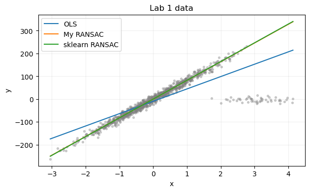

OLS 的斜率明显偏小，两种 RANSAC 都接近真实直线。因此，“匹配库实现的行为”在这里应理解为都能恢复主要线性趋势。它们不需要得到逐位相同的系数：自写版本固定尝试 500 次，库版本配置了最大次数和停止概率；实际采样序列、停止规则、候选比较细节可能不同。

这组实验支持的是“当前数据和参数下，两种鲁棒回归都比 OLS 更接近真实模型”。仅凭一次结果，不能推出自写版本普遍优于库实现。

#### 口试自测

**问：为什么找到最佳候选后，还要重新拟合？**  
答：两个点的噪声会直接影响候选直线。用筛选出的全部内点重新拟合，可以利用更多有效观测，降低这种波动。

**问：RANSAC 为什么可能失败？**  
答：可能一直没抽到合适的干净子样本，也可能阈值不合适，或污染点本身形成了更大、更紧密的结构。它依赖数据里存在足够强的目标一致性。

### 1a2：三种污染方式为什么会产生不同结果

#### 先把题意里的比例和继承关系写清楚

题目说“额外加入 $p\%$”的点。当前解答把分母解释为原有的 1000 个干净点：


$$
n_{\rm out}=1000\frac p{100},\qquad
\text{最终污染比例}=\frac{p}{100+p}.
$$


所以 $p=30$ 时，新增 300 个点，最后共有 1300 个点，污染比例是 23.08%，并非 30%。四种新增比例对应的最终污染比例约为 4.76%、9.09%、16.67%、23.08%。原来的点全部保留，污染点由它们的副本得到。

三种情景分别是：

1. **两侧扰动**：随机选原始点，给副本的 $y$ 加上可正可负的大扰动。
2. **仅正向扰动**：仍随机选点，但把扰动取绝对值，副本被向上移动。
3. **左下方、正向扰动**：改为选择原始数据中 $y$ 最小的点，并沿用第二种情景的正向扰动。

第三种情景是题目“do as before”的一种明确解释。代码按观测到的 `clean_y` 排序，并没有按真实无噪声的 $x$ 排序。由于真实斜率为正，低 $y$ 点通常位于图的左下方，但两种排序并不严格相同。

扰动先从 $\mathcal N(0,150^2)$ 抽取；若绝对值小于 60，就重新抽。这意味着最终使用的是条件分布：


$$
Z\mid |Z|\geq60,
$$


而不是未经筛选的普通高斯分布。正向情景再使用 $|Z|$。这个条件保证“新增扰动”的大小至少为 60；它不严格保证新增点到真实直线的最终残差也至少为 60，因为原始样本已经带有噪声。[解答 Notebook：`add_outliers`](Assignments1_solution.ipynb)

#### 为什么不能只比较污染训练集上的误差

如果以全部污染数据作为评分目标，努力贴合离群点的模型可能得到较低训练误差，但这不代表它恢复了原来的规律。

当前实验知道真实斜率 $a_\star$，因此在原来的 1000 个横坐标上，比较预测值与无噪声真实直线：


$$
\operatorname{RMSE}
=\sqrt{\frac1{1000}\sum_{i=1}^{1000}
\bigl(\hat f(x_i)-a_\star x_i\bigr)^2}.
$$


这里没有与带噪声的 `clean_y` 比较，所以指标衡量的是恢复真实直线的能力。每个设置重复五个噪声种子，表格是这五次 RMSE 的平均值；干净数据在这些重复中保持不变。

#### 用 OLS 公式理解三个方向

把新增污染的作用记作 $z$，则直观上有：


$$
\hat a_{\rm OLS}\approx a_\star+
\frac{\operatorname{Cov}(X,z)}{\operatorname{Var}(X)},\qquad
\hat b\approx E[z]-(\hat a-a_\star)E[X].
$$


这个关系忽略了有限样本噪声等细节，但能解释主要变化：两侧对称扰动的平均作用可能部分抵消；随机正向扰动的均值为正，容易抬高截距；把正向扰动集中加在小 $x$ 一侧，会引入负的 $(X,z)$ 相关性，容易压低斜率。

在新增 30% 点的设置下，保存结果为：

| 污染方式 | OLS RMSE | 自写 RANSAC | 库 RANSAC |
|---|---:|---:|---:|
| 两侧 | 2.5533 | 0.4082 | 0.5846 |
| 仅正向 | 37.4391 | 0.4082 | 0.5846 |
| 左下方、正向 | 41.6998 | 0.4082 | 0.5846 |

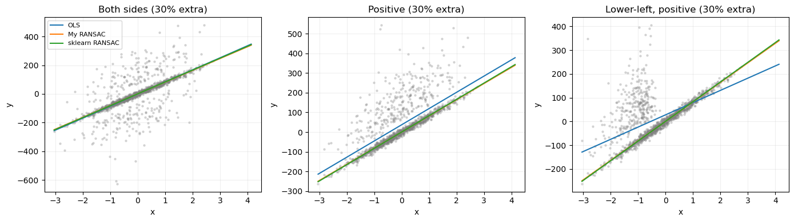

两个 RANSAC 在这些设置下都比较稳定。三种情景中出现相同的汇总数值，与它们主要依靠相同的干净点拟合相符，但仅看均值表不能证明每次运行都选出了完全相同的支持集。

还有一个值得保留的细节：两侧扰动时，OLS 的 RMSE 从新增 20% 时的 3.1378，降到新增 30% 时的 2.5533。有限样本中的正负作用会改变，误差不必随污染数量严格单调。不能为了符合直觉，把这类结果改写成“污染越多一定越差”。

#### 口试自测

**问：新增 30% 离群点，为什么干净点仍占约 77%？**  
答：分母不同。新增数量是原始数量的 30%，最后干净点占 $1000/1300\approx76.92\%$。

**问：为什么左下方正向污染特别影响斜率？**  
答：低 $x$ 区域的响应值被系统性抬高，OLS 为兼顾这些点，容易把直线压平。这与在各个 $x$ 位置随机向上扰动的作用不同。

### 1b：让候选模型给数据点投票

原始 RANSAC 每次给候选模型计分，最后保留一个最佳支持集。本题要求反过来累计每个点获得的支持：


$$
v_i=\sum_{t=1}^{T}
\mathbf 1\bigl(|y_i-f_t(x_i)|\leq\tau\bigr).
$$


完成 500 次候选生成后，把 $v_i$ 从大到小排序，取前 $q=75\%$ 的点做一次普通回归。`votes` 是长度等于样本数的整数数组；每个有效候选给其所有内点加一票：

```python
votes += np.abs(y - (slope * x + intercept)) <= threshold
count = max(2, int(np.ceil(fraction * len(y))))
selected = np.argsort(-votes, kind='stable')[:count]
```

这里每个候选的权重都是 1，并没有按候选质量加权。`kind='stable'` 使票数相同时保持原始行顺序。因为污染副本追加在数据末尾，如果截断位置恰好出现并列，这种规则可能影响选点；它只是一个明确的并列处理规则，不能当作与输入顺序无关的方法。[解答 Notebook：`voting_line`](Assignments1_solution.ipynb)

为什么选择 75%？最严重的当前设置中，1000/1300 的数据是干净点，略高于 75%。取 75% 给排除污染留了一些余量。不过，“保留比例低于干净点比例”只是数量上有可能避开污染，并不能保证票数排序把全部离群点放在末尾。

对于 1300 个点，代码会保留 975 个。即使排序完全正确，也要丢掉至少 25 个干净点。污染较少时丢掉的干净信息更多，因此固定 $q$ 有明显取舍：太小会损失有效数据，太大则增加污染进入的机会。

新增 30% 点时，投票法在两侧、正向、左下方正向三种情景中的 RMSE 分别为 0.4380、0.4365、0.4672，均接近自写 RANSAC 的 0.4082，但没有超过它。新增 10%、两侧扰动时，投票法为 0.3368，自写 RANSAC 为 0.4000。当前结果说明两者各有较好的设置，不能给出普遍优劣排序。

**问：投票多的点一定是真实内点吗？**  
答：不一定。多个错误候选也可能经过某些污染点；密集的异常结构还可能获得大量票。票数衡量对候选集合的一致性，不是真实标签。

**问：这个方法比普通 RANSAC 多了什么需要设定的量？**  
答：最终保留比例 $q$。它直接决定用于最后拟合的数据数量，需要与预期污染程度和数据覆盖范围一起考虑。

### 1c1：把 RANSAC 改成鲁棒中心估计

这里不再拟合 $y=ax+b$，而是给二维点云找一个代表点。数据由 100 个 $\mathcal N((0,0),0.83^2I)$ 内点和 10 个 $\mathcal N((5,5),1.5^2I)$ 离群点组成。

普通均值会被右上方的小点群拉动。如果污染比例为 $\epsilon$，两群的总体均值分别为 $\mu$ 和 $\mu_{\rm out}$，混合分布的均值为：


$$
(1-\epsilon)\mu+\epsilon\mu_{\rm out}.
$$


因此，哪怕污染比例不大，只要 $\mu_{\rm out}$ 足够远，均值偏移也可以很大。

#### 使用老师提供的点云数据

本地文件 `cloud-of-points-data.mat` 中只有一个数据变量 `X`，形状为 `(110, 2)`，每行是一个二维点。题面说明示例包含 100 个内点和 10 个离群点，但文件没有给出逐点标签，不能仅根据行号把前 100 个点当作真实内点。

在 Notebook 所在的 `DM` 目录运行下面的读取代码，即可得到另一组可供比较的点云。使用独立变量 `provided_cloud`，可以保留现有生成样本及其结果，避免混用两个实验。

```python
from scipy.io import loadmat

provided_cloud = loadmat("cloud-of-points-data.mat")["X"]
print(provided_cloud.shape)  # (110, 2)
```

读取后，可将 `provided_cloud` 分别传入 `robust_representative`、`svm_representative` 和 `synthetic_representative`，并与 `provided_cloud.mean(axis=0)` 比较。后三个函数在解答的第1、2题中定义，比较时需要先运行相应定义单元。

这组数据适合用散点图展示各方法估计的中心；若计算到题设总体中心 `(0, 0)` 的距离，应称为“到总体中心的距离”，不能称为“到真实内点样本均值的误差”。要报告后者，需要另有可靠的内点标签。下面的原有结果表和图仍来自种子为 10 的生成样本；本节提供数据接入方法，没有新增这组数据的估计结果。

#### 把“直线”和“残差”换成“中心”和“距离”

`robust_representative` 每次抽三个点，以它们的均值作为候选中心 $c_t$。支持集为：


$$
I_t=\{i:\|x_i-c_t\|_2\leq r\},\qquad r=2.5.
$$


尝试 100 次，保留点数最多的支持集；点数相同时比较到候选中心的平均平方距离。最终返回这个支持集的均值，而非最初三个点的均值。

抽三个点只是当前实现提出候选的选择，不是中心估计的数学最小样本数。一个点也可以作为候选中心；这里对几个点取均值，希望候选更接近一个紧凑点群的内部。`min(3, len(S))` 让小簇也能运行。若所有候选都未获得支持，函数返回逐坐标中位数作为兜底。[解答 Notebook：`robust_representative`](Assignments1_solution.ipynb)

参数 $r$ 使用原始数据的距离单位。数据放大十倍，半径也需要相应调整。对于高维或不同方向尺度不同的数据，一个固定欧氏半径也可能不合适。

#### 必须分清两个“真实中心”

生成分布的总体均值是 $(0,0)$，但有限的 100 个内点的样本均值并不恰好为零。当前题目实现用**内点样本均值**作参照：

| 代表点 | 坐标 | 到内点样本均值的距离 |
|---|---|---:|
| 内点样本均值 | $(-0.194,-0.209)$ | 0 |
| 全部点均值 | $(0.246,0.280)$ | 0.6578 |
| RANSAC 代表点 | $(-0.194,-0.209)$ | 0.0000 |

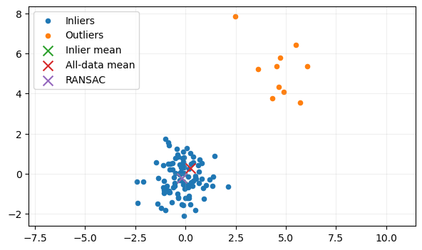

RANSAC 在这次样本上与内点均值一致到显示精度。这不表示它准确知道总体均值，也不表示每次都能完美识别所有污染点。估计函数没有接收内点标签；标签只在外部计算参考中心和误差时使用。

**问：为什么不直接取最大的那个点群的均值？**  
答：我们事先不知道哪些点属于哪个群。随机候选与距离支持集正是在尝试识别主要紧凑点群。

**问：如果离群点比目标点更多而且更紧密，会怎样？**  
答：最大支持集可能对应离群群体。这个方案隐含了目标结构具有足够大支持量的假设，并没有办法仅凭数据自动理解哪个群才是我们想要的。

### 1c2：把代表点估计器接入聚类

普通 k-means 反复执行两步：把点分给最近的中心，再用每组均值更新中心。本题保留第一步，把第二步换成可传入的函数：


$$
z_i=\arg\min_j\|x_i-c_j\|_2,\qquad
c_j\leftarrow\operatorname{representative}(\{x_i:z_i=j\}).
$$


这样，聚类代码只知道“给一组点，得到一个代表点”，无需知道内部使用均值、RANSAC 还是其他方法。关键调用是：

```python
members = X[labels == group]
if len(members) > 0:
    new_centres[group] = representative(members)
```

空簇保持原中心。中心变化在绝对容差 $10^{-5}$ 内便停止，最多迭代 30 次；退出后再次按最终中心计算标签。[解答 Notebook：`cluster_data`](Assignments1_solution.ipynb)

#### 初始化也是结果的一部分

当前实现并不是直接在全部数据上做普通 k-means++。它先计算逐坐标中位数，保留距离该点最近的 75% 数据，再在其中进行 k-means++ 初始化。目的是降低初始中心落在远处污染点上的机会。比较均值更新与鲁棒更新时，两者共享这套规则和相同初始化种子。

这种预筛选也有局限：真实簇若不平衡、离整体中位数较远，合法样本也可能被排除在初始化候选之外。报告结果时，需要把它作为整个聚类方法的一部分说明，不能把所有改善都归因于代表点估计器。

示例有两个中心位于 $(-3,0)$、$(3,0)$ 的内点群，每群 100 点、标准差 0.6；另加 40 个位于上方的点。两种方法在图中的内点 ARI 都为 1，但普通均值中心仍可被上方点拉偏。

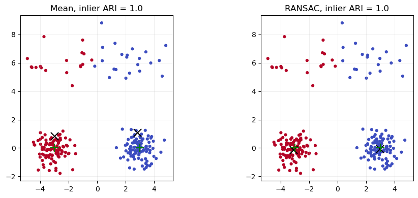

ARI 评价点与点是否被正确分在一起，并不直接评价中心坐标。所以“内点分类全对”与“中心估计有偏”可以同时发生。本实验仍给每个离群点分配一个簇标签，没有专门的“噪声类”。鲁棒更新只控制中心计算时哪些点产生主要影响。

普通 k-means 的均值更新会减小其平方距离目标；替换为 RANSAC 代表点后，这个性质不再自动成立。因此，最大迭代次数只是控制运行长度，不能当作收敛证明。

**问：为什么要让 `representative` 成为参数？**  
答：这样能在相同的分配、初始化和停止规则下比较不同中心估计方法，并且避免为每种方法重复编写聚类代码。

**问：ARI 为 1，是否说明中心一定准确？**  
答：不是。只要分界线仍把两群内点分开，中心即使整体向上移动，内点划分仍可能完全正确。

### 1c3：RANSAC 的一般形式是什么

把回归与中心估计放在一起，就能看出共同结构。一个任务需要提供：候选估计器如何拟合、样本与模型的不一致程度如何计算、什么阈值代表可接受，以及支持集确定后如何重拟合。

```text
最佳支持集 = 空
重复 T 次：
    随机抽一个足以产生候选的小子集
    用这个子集拟合候选模型
    计算所有观测对候选模型的损失
    支持集 = 损失不超过阈值的观测
    优先保留更大的支持集；大小相同则比较支持集上的损失
用最佳支持集重新拟合
返回最终估计器
```

直线任务使用纵向绝对残差，中心任务使用欧氏距离。更换任务时，必须重新判断损失和阈值有没有意义；不能仅替换函数名字。还要考虑退化子样本、候选拟合失败、没有有效支持集等情况。当前直线实现会跳过横坐标几乎相同的点对，并在找不到任何合法候选时抛出错误。

**问：所有统计任务都可以直接套用这段伪代码吗？**  
答：不能。至少需要小子集能提出有用候选、真实结构能形成较大支持集，而且能定义有意义的逐样本损失和阈值。

**问：RANSAC 最重要的可调量是什么？**  
答：候选的样本数量、支持阈值、尝试次数。它们分别影响抽到干净候选的机会、内外点区分方式以及搜索充分程度。

<a id="ex2"></a>

## 第2题 三种鲁棒代表点的比较

第1题已经把“计算一个中心”做成可替换模块。本题继续沿用这个接口，比较三种不同的筛选原则：RANSAC 寻找最大距离支持集，单类 SVM 学习接受区域，合成原型围绕当前中心保留一定比例的最近邻。

### 2a：先用单类 SVM 筛选，再对接受点求均值

#### 如何从“边界模型”得到“代表点”

单类 SVM 本身不直接输出一个均值。当前实现先拟合模型，用 `predict(S) == 1` 找出接受点，再对这些点取均值：


$$
A=\{i:f(x_i)\geq0\},\qquad
r=\frac1{|A|}\sum_{i\in A}x_i.
$$


如果模型没有接受任何点，就返回决策分数最高的一个样本，避免空集合求均值。这只是退化情况下的实现选择。

使用的 RBF 核为：


$$
K(x,x')=\exp(-\gamma\|x-x'\|_2^2).
$$


距离越远，相似度越小。较大的 $\gamma$ 使相似度在较短距离内下降，边界可以更局部；较小的 $\gamma$ 使相似度变化更平缓。它控制的是空间尺度，不直接规定要保留多少点。

#### `nu` 究竟控制什么

一个常见的原始优化形式是：


$$
\min_{w,\rho,\xi}\;
\frac12\|w\|^2+\frac1{\nu n}\sum_i\xi_i-\rho,
\qquad
w^T\phi(x_i)\geq\rho-\xi_i,\quad\xi_i\geq0.
$$


其中 $\xi_i$ 允许部分训练样本违反接受边界。理想精确解及相应条件下，$\nu$ 是训练错误比例的上界，也是支持向量比例的下界。它是优化中的控制参数，**不是“强制删掉正好 $\nu$ 的数据”这个指令**。

实现中实际用决策分数的正负判断接受与拒绝。边界分数接近零时，数值优化误差和容差可能影响分类，因此不能把理论性质不加区分地用于核对每个有限精度预测计数。[解答 Notebook：`svm_representative` 与参数扫描](Assignments1_solution.ipynb)

#### 当前数据说明了什么

默认参数为 `nu=0.2, gamma=0.5`，特征单位和尺度相近，因此未另外缩放。对第1题的同一个点云：

| 方法或参数 | 到内点样本均值的距离 |
|---|---:|
| 全部点均值 | 0.6578 |
| RANSAC | 0.0000 |
| SVM，$\nu=0.2,\gamma=0.5$ | 0.2825 |
| SVM，$\nu=0.2,\gamma=0.1$ | 0.0362 |
| SVM，$\nu=0.3,\gamma=0.1$ | 0.0182 |

改变 $\gamma$ 就明显改变了中心误差，因此单凭“$\nu$ 大于真实污染比例”不能保证估计准确。RBF 单类 SVM 的接受区域可以包含多个不连通部分，远处的小点群也可能获得一个被接受的区域；随后直接平均所有接受点，仍可能把中心向它拉动。反过来，删掉主点群边缘的正常点也会改变有限样本均值。

保存表中 $\nu=0.2,\gamma=1$ 的实际拒绝比例为 0.2455，高于 0.2；$\nu=0.1,\gamma=0.5$ 时则为 0.0727。准确的表述是：**表中的实际拒绝比例与 $\nu$ 不完全相等**。当前保存输出没有列出决策分数分布，因此不能仅凭该表断言所有超出部分都来自数值容差；要确认具体原因，需要检查负分数的大小、求解容差及收敛状态。

**问：为什么单类 SVM 不一定只接受最大的那个点群？**  
答：它学习的是符合核相似性和优化约束的接受区域，并没有“只保留一个最大连通群”的要求。

**问：把 $\nu$ 设成真实离群比例，是否就能删掉全部离群点？**  
答：不能。参数并不知道真实标签；它可能删掉正常边缘点，也可能保留一部分离群点，结果还受 $\gamma$ 和数据尺度影响。

### 2b：从 medoid 开始，逐步扩大邻域

#### 为什么先找 medoid

medoid 必须是原始数据中的一个样本，定义为：


$$
r_0=x_{j^\star},\qquad
j^\star=\arg\min_j\sum_i\|x_i-x_j\|_2.
$$


这里明确使用**欧氏距离之和**。如果改成平方距离之和，便有：


$$
\sum_i\|x_i-x_j\|_2^2
=\sum_i\|x_i-\bar x\|_2^2+n\|x_j-\bar x\|_2^2,
$$


于是会选出最靠近普通均值的样本，已经改变了题目当前采用的 medoid 定义。代码中的 `cdist(S, S)` 默认得到欧氏距离矩阵，`distances.sum(axis=1).argmin()` 选择总距离最小的行。[解答 Notebook：`synthetic_representative`](Assignments1_solution.ipynb)

#### “扩大邻域”具体怎样做

给定比例序列 $\alpha_1<\alpha_2<\cdots$，每轮都从完整的原始集合 $S$ 中，重新选择距离当前代表点最近的 $\lceil\alpha_t n\rceil$ 个样本：


$$
N_t=\operatorname{nearest}_{\lceil\alpha_t n\rceil}(S,r_{t-1}),\qquad
r_t=\frac1{|N_t|}\sum_{x\in N_t}x.
$$


“扩大”是指邻域包含的数量增加。由于中心会移动，前一轮选中的每个点未必在后一轮仍然入选；邻域不必严格嵌套。也不能只在上一轮留下的集合中继续筛选，否则无法按题意扩展到原数据的更大比例。

默认使用 10%、80% 两次求均值。110 个样本对应先选 11 个，再选 88 个。小邻域先提供一个局部中心，较大邻域再加入更多数据以减少小样本波动。这是算法意图，最终是否改善仍由数据决定。

#### 参数扫描的结果

| 求均值比例序列 | 到内点样本均值的距离 |
|---|---:|
| 仅 80% | 0.0909 |
| 10% → 80% | 0.1034 |
| 20% → 80% | 0.0909 |
| 10% → 40% → 80% | 0.0909 |
| 10% → 60% | 0.2814 |
| 10% → 95% | 0.3110 |

结果并不支持“步骤越多越好”。只用 80% 就比默认两步略好；增加一个 40% 步骤也没有胜过单步结果。

最终保留 60% 会舍弃更多点，中心可能因有限样本的局部选择而偏离完整内点均值。保留 95% 则要选 $\lceil0.95\times110\rceil=105$ 个点，而内点只有 100 个，因此无论排序多好，至少要包含 5 个离群点。这是一个仅用计数就能确认的限制。

在固定输入顺序和并列规则下，这个方法没有随机抽样，是确定性的。但确定性只表示同样输入给出同样结果，并不意味着结果一定准确。

**问：两步中的 80% 是上一轮 10% 的 80% 吗？**  
答：不是。两个比例的分母都是原始集合大小，每轮重新从原始数据选点。

**问：为什么称为“合成”原型？**  
答：初始化的 medoid 是一个真实样本，后面求均值得到的代表点通常不是数据中的已有样本，而是由多个样本计算出来的点。

### 2c：在相同聚类框架里比较质量、参数与成本

#### 实验设计要先排除哪些混淆

本题使用同一 `cluster_data`，只替换代表点函数，并保留普通均值作为基线。每个数据集有两个真实中心 $(-3,0)$、$(3,0)$，各生成 100 个标准差为 0.6 的内点。离群点从这两个中心向上平移之后生成，标准差为 0.8。

污染比例取 0、10%、20%、30%，平移距离取 2、4、8、12，每种设置使用十个种子。这里的污染比例分母是**最终总样本数**，与 1a2 不同：


$$
\frac{m}{200+m}=\epsilon
\quad\Longrightarrow\quad
m=\frac{200\epsilon}{1-\epsilon}.
$$


代码对 $m$ 四舍五入，因此 30% 对应 86 个离群点，实际比例为 $86/286\approx30.07\%$。同一设置中的所有方法使用相同数据和相同初始化种子；同一种子下的污染设置复用相同内点及相应的标准化离群抽样序列，减少不必要的数据差异。[解答 Notebook：`clustering_rows` 实验循环](Assignments1_solution.ipynb)

#### 为什么同时报告中心误差和 ARI

估计中心的编号没有固定语义，第一个输出中心可能对应左群，也可能对应右群。因此先用 `linear_sum_assignment` 找到总代价最小的中心匹配，再计算平均距离：


$$
E_{\rm centre}=\min_\pi\frac1k\sum_{j=1}^k
\|\hat c_j-\mu_{\pi(j)}\|_2.
$$


这里对比的是生成分布的**总体中心**，不是前面单点云实验的内点样本均值。样本均值本身也有抽样波动，所以即使完全没有污染，中心误差一般也不会恰好等于零。

ARI 只在 200 个内点上计算。它不评价离群点是否被拒绝，也不把中心坐标误差直接纳入指标。这两个指标分别回答“中心是否准确”和“内点划分是否正确”。

#### 保存结果中的主要对照

污染比例为 30% 时，十个种子的平均中心误差如下：

| 向上平移距离 | 普通均值 | 单类 SVM | RANSAC | 合成原型 |
|---:|---:|---:|---:|---:|
| 2 | 0.6058 | 0.5026 | 0.5829 | 0.2365 |
| 4 | 1.2057 | 0.9803 | 0.5941 | 0.4254 |
| 8 | 2.7007 | 2.3233 | 0.4763 | 1.4040 |
| 12 | 5.2317 | 4.8216 | 1.4021 | 2.7573 |

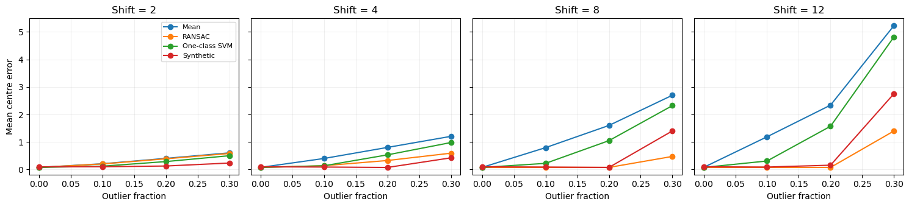

距离 2 时，合成原型最好；距离 12 时，RANSAC 最好。距离较近时，固定半径支持集可能同时包含内点和部分污染点；距离变大后，基于距离的剔除更有机会将两者分开。但聚类还有初始化和分配步骤，不能把曲线变化全部解释成单个中心估计器的性质。

距离 12、污染 30% 时，四种方法的内点 ARI 分别约为 0.60、0.60、0.80、0.7921。因此，RANSAC 虽改善了结果，也没有保证正确划分。错误初始分组、不同结构竞争中心等都可能影响最终输出；当前汇总表没有提供逐次迭代轨迹，不能把每次失败都归结为同一个未经检查的原因。

对于合成原型，默认最后保留 80%。当某个簇的实际污染比例超过 20% 时，即使最近邻排序理想，也没有足够的纯净点填满这 80%。全局污染为 30% 不意味着每个中间簇都恰好污染 30%，但已经提示固定保留比例可能不适合这些设置。

#### 参数究竟控制什么

| 方法 | 当前参数 | 直接作用 | 设定时需要知道什么 |
|---|---|---|---|
| RANSAC | 半径 2.5；100 次；每次 3 点 | 距离接受范围与候选搜索次数 | 主要点群的尺度，是否有足够大支持集 |
| 单类 SVM | $\nu=0.2,\gamma=0.5$ | 对训练例外的容忍与核的空间尺度 | 特征尺度、边界形状、可能的多群结构 |
| 合成原型 | 10% → 80% | 每轮参与均值计算的样本数量 | 预计污染量及是否存在可靠的局部中心 |

本实验没有为每个设置单独调到最优参数。因此比较的是**这些固定参数下的实现**，不能据此宣称某一类算法无论怎样调参都不如另一类。

#### 成本和确定性怎样解释

对一个包含 $m$ 个 $d$ 维点的簇，RANSAC 每轮扫描全部点，主要成本约为 $O(Tmd)$。合成原型显式构建 $m\times m$ 距离矩阵，时间为 $O(m^2d)$，内存为 $O(m^2)$；后续还有排序和求均值。核 SVM 的成本取决于样本数、核计算、支持向量以及优化过程，不能从这一组小数据测量直接外推大规模性能。

全部实验设置的平均完整聚类耗时为：普通均值 0.5472 ms，合成原型 0.8467 ms，单类 SVM 2.7735 ms，RANSAC 8.2141 ms。计时从调用 `cluster_data` 开始，包含初始化、每次分配和更新，因而不只是一次代表点计算。不同方法的迭代次数也可能不同。这些是 Notebook 保存的本机小样本结果。

RANSAC 的算法包含随机采样，不过函数每次都从固定种子开始，给定相同输入可以复现。单类 SVM 与合成原型在固定输入和参数下不依赖随机抽样；整个聚类仍使用随机初始化，所以不能把“代表点函数确定”说成“整个聚类不受种子影响”。

**问：为什么离群点更远，有时仍然让鲁棒聚类更差？**  
答：估计器是在当前分组内工作的。整体分组和初始化一旦受到污染影响，局部鲁棒中心未必能恢复正确的两个群。更远可以使内外点在几何上更容易区分，但不会自动保证整个迭代过程找对结构。

**问：这次实验能不能选出一个永远最好的估计器？**  
答：不能。距离 2 时合成原型更好，距离 12 时 RANSAC 更好，而且它们使用固定参数。应根据污染比例、几何尺度和计算限制选择，再通过具体数据验证。

<a id="ex3"></a>

## 第3题 为什么维度增加会让近邻失效

这道题要求复现《统计学习基础》第 2.5 节的图 2.6–2.9。四幅图共同回答一个问题：**训练样本数固定时，为什么“找离待预测点最近的样本”会越来越不可靠？** 图 2.6 先解释空间几何，图 2.7、2.8 再区分预测误差的来源，图 2.9 最后比较局部方法和有结构假设的线性模型。

以下路线根据[现有解答 Notebook](Assignments1_solution.ipynb)的代码、保存的输出和教材书面第 22–27 页整理。图中的数值来自现有运行记录；推导用于解释这些数值，不把一次模拟结果当作普遍定理。对应代码执行编号为 `In [10]`、`In [11]`、`In [12]`，分别实现图 2.6、图 2.7–2.8、图 2.9。

### 3.1 图 2.6：覆盖相同比例的数据，邻域需要多大

**先明确要算什么。** 在均匀分布的单位超立方体 $[0,1]^p$ 中，以中心为中心取一个边长为 $e$ 的小超立方体。问题是：如果希望里面包含总体概率质量的比例 $r$，$e$ 应取多大？均匀分布让“概率比例”和“体积比例”相同，因此可以先做几何计算，再用随机采样验证。

单位超立方体体积为 1，小超立方体体积是每个方向长度的乘积，即 $e^p$。所以


$$
e^p=r\quad\Longrightarrow\quad e=r^{1/p}.
$$


这里的 $e$ 是**边长**，不是欧氏距离，也不是球的半径。当 $0<r<1$ 固定时，$p$ 增大使 $r^{1/p}$ 接近 1。换言之，要包含相同的数据比例，每个坐标方向都必须覆盖更大范围。

| 维度 $p$ | 覆盖 1% 所需边长 | 覆盖 10% 所需边长 |
|---:|---:|---:|
| 1 | 0.0100 | 0.1000 |
| 2 | 0.1000 | 0.3162 |
| 3 | 0.2154 | 0.4642 |
| 10 | 0.6310 | 0.7943 |

十维中，即使只想包含 1% 的数据，也要覆盖每个坐标范围的约 63%。因此，“样本只占总体的一小部分”和“样本在空间里很接近”不能画等号。

**为什么增加样本有时很昂贵。** 假如每个坐标方向都希望保留相同的覆盖精细程度，可以想象把每条轴分成 10 段。一维只有 10 个小格，二维有 100 个，十维则有 $10^{10}$ 个。这个格子例子不是精确的学习复杂度定理，却说明维度为什么会使“保持相同空间密度”变得困难。实际数据若集中在低维曲面上，或者只有少量有用特征，所需样本数可能小得多；此时应该利用这些结构。

**代码路线。** 右图直接画解析式，无须训练模型。再对 $p=1,2,3,10$ 分别生成 100,000 个均匀点，检查它们是否落入中心邻域。随机种子为 30，验证比例取 $r=0.01,0.1$。

```python
side = fraction ** (1 / dimension)
inside = (np.abs(points - 0.5) <= side / 2).all(axis=1)
observed_fraction = inside.mean()
```

`points - 0.5` 把中心移到原点；每个坐标的绝对偏移不能超过半边长；`.all(axis=1)` 要求一个点在所有坐标上同时满足条件。布尔值的均值就是落入邻域的比例。

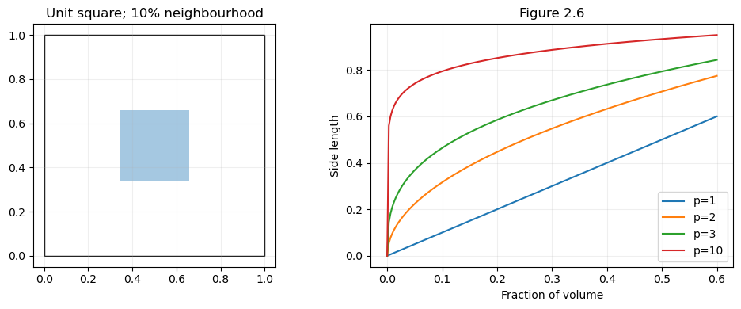

**实际结果与边界。** 十维、目标比例 10% 时，观察比例为 0.1007；二维同一比例为 0.0994，与理论一致。有限采样产生这些小差异是正常的：如果真实比例是 0.1，100,000 次采样的比例标准差约为 $\sqrt{0.1\times0.9/100000}\approx0.00095$。这里验证的是确定邻域的概率质量关系，并未精确计算“第 $k$ 个近邻距离”的有限样本期望。

左图用二维正方形展示 10% 邻域，教材左图用三维示意；几何结论相同，但不是对原图外观的逐像素复制。该结论还依赖均匀分布和邻域完整位于单位立方体内部；靠近边界或分布密度不均匀时，体积比例不再直接等于样本比例。

**口试问答。** “把 $r$ 减小不就能保持局部了吗？”——可以缩小邻域，但里面的样本会更少，估计波动会更大。高维时，既要邻域小、又要邻域里有足够样本，通常需要显著增加总样本数。

### 3.2 图 2.7：径向函数的误差为什么主要是偏差

**题目设置。** 对每个 $p=1,\ldots,10$，独立生成 1000 个来自 $[-1,1]^p$ 的训练点，响应完全由


$$
f(x)=\exp(-8\|x\|^2)
$$


决定，不加观测噪声。待预测点固定为 $x_0=0$，真值为 $f(0)=1$。使用 1-NN 回归：找到离原点最近的训练点 $x_*$，直接输出 $f(x_*)$。每个维度重新生成训练集 2000 次，随机数生成器的种子为 31。

**为什么这样设计。** 固定样本数和算法，只改变维度，才能观察维度的影响；固定测试点，避免把不同测试位置的难度混在一起；不加噪声，才能单独考察近邻位置不够近所造成的误差。每次必须重新生成训练集，仅在同一训练集上重复预测不会产生有意义的训练集方差。

核心实现对应关系是：

```python
squared_distance = np.sum(X ** 2, axis=1)
nearest = squared_distance.argmin()
prediction = np.exp(-8 * squared_distance[nearest])
```

因为目标点是原点，距离平方就是各坐标平方之和。寻找最小距离时不需要开平方，只有保存实际距离供绘图时才用 `sqrt`。

**从误差定义推到分解。** 记第 $b$ 次训练集的预测为 $\hat f_b$，$B=2000$，它们的平均值为 $\bar f$。计算


$$
\widehat{\mathrm{MSE}}=\frac1B\sum_b(\hat f_b-f_0)^2,
$$


$$
\widehat{\mathrm{Bias}^2}=(\bar f-f_0)^2,\qquad
\widehat{\mathrm{Var}}=\frac1B\sum_b(\hat f_b-\bar f)^2.
$$


把 $\hat f_b-f_0$ 写成 $(\hat f_b-\bar f)+(\bar f-f_0)$，展开平方。交叉项含有 $\sum_b(\hat f_b-\bar f)=0$，于是得到


$$
\widehat{\mathrm{MSE}}=\widehat{\mathrm{Var}}+\widehat{\mathrm{Bias}^2}.
$$


这也解释了为什么代码使用 NumPy 默认的 `var(..., ddof=0)`：三项都对同一组 2000 次结果按 $B$ 平均，分解在数值精度内成立。若方差改用分母 $B-1$，则不再满足这个直接相加的有限样本恒等式。它不表示用 $B-1$ 估计总体方差永远错误，而是这里要计算的对象不同。

**三个“平均”要分清。** 最近邻距离先在每个训练集内部通过最小值选出来，再对 2000 个训练集取平均；预测的方差也跨训练集计算；并没有对 1000 个训练标签直接求方差。后者描述的是同一批数据的输出分布，不能回答模型在换一批训练数据后是否稳定。这里把整个训练集看成随机对象，模型预测是这个随机对象的函数。

还有一个容易混淆的细节：有限重复次数下，样本预测均值的平方偏离并不是总体偏差平方的无偏估计。不过我们需要的是一个可以精确检查的经验分解，所以把三项统一定义在同一组模拟结果上。增加重复次数可以减小估计误差；`assert` 验证的是分解的计算一致性，不能证明蒙特卡洛次数已经足够，也不能证明所有实验设置都符合题意。

**为什么出现向下的偏差。** 只要最近邻不是原点，$\|x_*\|^2>0$，就有 $f(x_*)<1$。因此预测总从同一侧偏离真值。维度增加后，最近邻更远，$\exp(-8\|x_*\|^2)$ 很快接近零；此时模型经常稳定地给出接近零的错误预测。预测方差可能下降，同时偏差平方接近 1。

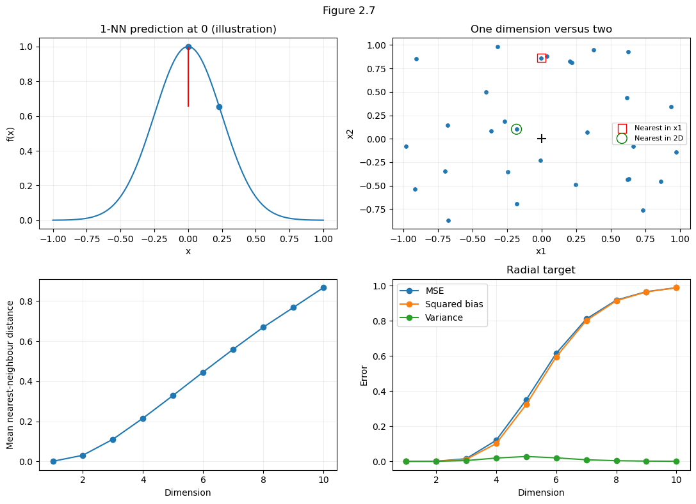

| 维度 | 平均最近邻距离 | MSE | 偏差平方 |
|---:|---:|---:|---:|
| 1 | 0.0010 | $1.6081\times10^{-9}$ | $2.6699\times10^{-10}$ |
| 5 | 0.3294 | 0.34984 | 0.32251 |
| 10 | 0.8670 | 0.98797 | 0.98780 |

十维的方差只有约 $0.00017$，所以误差几乎全部来自偏差平方。不能把“预测结果变化不大”当成“预测准确”：始终预测错，也可以有很小的方差。

**可以先做的一维手算检查。** 在一维中，$X_i\sim U[-1,1]$，因此 $|X_i|\sim U[0,1]$。令 $D=\min_i|X_i|$，则对 $0\le t\le1$，全部 1000 个点都离原点超过 $t$ 的概率是 $(1-t)^{1000}$。积分得到


$$
E[D]=\int_0^1(1-t)^{1000}\,dt=\frac1{1001}\approx0.000999.
$$


这与保存输出中的 0.0010 一致，是一个不需要相信绘图就能检查的参照。如果代码算出一维平均距离接近 0.5，通常是在平均所有点的距离，而不是每轮先取最近邻。教材另有单位球体内最近邻距离的公式；本实验采样域是超立方体，不能把那条公式直接拿来核对所有维度。

**怎样读四个面板。** 左上图用一维函数和示意点 $x=0.23$ 画出预测误差；右上图用另一个种子 32 生成 30 个二维点，比较仅看 $x_1$ 和看完整二维距离时的近邻。它们用于解释几何关系。下方两图才使用每个维度 1000 点、2000 次重复的正式统计，不能把上方 30 点示意当成下方实验的样本量。

**口试问答。** “没有噪声为什么还有方差？”——方差来自训练集抽样。换一组训练点，最近邻的位置会变，预测也会变。这里测量的是不同训练集导致的预测波动。

### 3.3 图 2.8：只有一个有用特征，为什么仍然受高维影响

这一图保持上一图的采样范围、样本数、重复次数和最近邻选择完全相同，只更换目标函数：


$$
f(x)=\frac12(x_1+1)^3,\qquad f(0)=\frac12.
$$


尤其要注意真值从 1 变成了 0.5。径向目标需要全部坐标，三次目标只依赖第一个坐标。其余坐标不影响输出，却仍参与欧氏距离：


$$
\|x\|^2=x_1^2+x_2^2+\cdots+x_p^2.
$$


因此，第一个坐标非常接近零的点，可能因为其他坐标较远而被排除。算法在全部维度上寻找近邻，并不知道哪些特征对输出无关。现有代码复用同一批训练点和同一个 `nearest`，便于直接比较两种函数：

```python
cubic_predictions[index, run] = 0.5 * (X[nearest, 0] + 1) ** 3
cubic_mse = np.mean((cubic_predictions - 0.5) ** 2, axis=1)
cubic_variance = cubic_predictions.var(axis=1)
```

**最短的对照路线。** 不需要重写一套近邻算法。先把两个函数都作用于同一个已找到的近邻，再分别对照各自在原点的真值计算误差。这样两条曲线的差异主要来自目标函数，避免两组随机训练点不一致给比较带来额外波动。如果自己想加一项验证，可以再计算“仅沿第一坐标寻找近邻”的三次预测。它有助于理解无关特征的影响，但属于扩展实验，现有图中的数字并未包含这个额外对照。

**为什么这次方差占主要部分。** 令最近邻的第一坐标为 $Z$。在关于原点对称的总体采样与距离规则下，$Z$ 的分布对称。展开目标：


$$
f(Z)=\frac12+\frac32Z+\frac32Z^2+\frac12Z^3.
$$


对称性给出 $E[Z]=E[Z^3]=0$，从而


$$
E[f(Z)]-f(0)=\frac32E[Z^2].
$$


所以三次函数的偏差并不严格为零。只是在近邻较近时，一阶项 $\frac32Z$ 已经带来左右波动，其方差约为 $\frac94E[Z^2]$；偏差平方则为 $\frac94(E[Z^2])^2$，量级更小。这段近似适用于 $Z$ 较小时，用来理解机制；最终数值仍以完整函数的模拟为准。

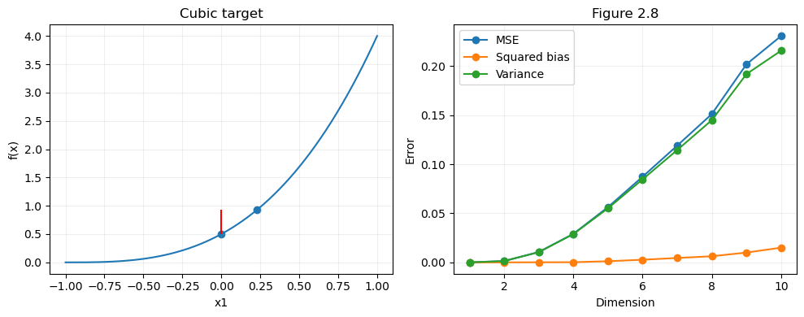

| 维度 | MSE | 方差 | 偏差平方，按前两列近似相减 |
|---:|---:|---:|---:|
| 1 | 0.0000045962 | 0.0000045948 | 约 $1.4\times10^{-9}$ |
| 5 | 0.056272 | 0.055118 | 约 0.001154 |
| 10 | 0.23065 | 0.21568 | 约 0.01497 |

十维时约 94% 的 MSE 来自方差。与图 2.7 对照，就能回答“维数灾难主要增加偏差还是方差”：两种情况都可能出现，取决于目标函数以及算法如何利用特征，不能只背一个固定结论。

**边界与口试问答。** “既然只依赖 $x_1$，为什么不只按 $x_1$ 找近邻？”——如果事先知道这一结构，确实应该这么做；剩余坐标对这个目标没有预测价值。但本实验故意使用完整的 $p$ 维距离，展示无关特征带来的代价。它说明特征选择可能有效，没有证明任何高维数据都无法学习。有限次模拟的曲线也不要求在每一维严格上升。

### 3.4 图 2.9：加入噪声后，为什么 OLS 会胜过 1-NN

**这里更改了实验条件。** 每个维度使用 500 个训练点，仍均匀分布在 $[-1,1]^p$，测试点仍是原点。两个目标分别为 $f(x)=x_1$ 和 $f(x)=\frac12(x_1+1)^3$。训练响应现在是


$$
Y_i=f(X_i)+\varepsilon_i,\qquad \varepsilon_i\sim\mathcal N(0,1).
$$


每个维度重复 3000 次，种子为 33。每次在相同训练输入上比较 1-NN 和带截距的 OLS；两个目标分别生成独立的噪声列。1-NN 直接取最近邻的带噪声响应，OLS 则用全部 500 个点估计系数。

```python
signal = np.column_stack([X[:, 0], 0.5 * (X[:, 0] + 1) ** 3])
y = signal + rng.normal(0, 1, (500, 2))
nn_prediction = y[nearest]
ols_prediction = LinearRegression().fit(X, y).predict(np.zeros((1, dimension)))[0]
```

`LinearRegression()` 默认包含截距。在原点预测时，斜率项都是零，但截距仍由数据估计。若强行去掉截距，原点预测会被固定为零；尤其对于原点真值为 0.5 的三次目标，就变成另一项实验。教材公式中的输入若包含常数项，原始特征的原点对应增广向量 $(1,0,\ldots,0)$，也不能把它误当作全零向量。

**为什么误差要额外加 1。** 图 2.7、2.8 估计的是确定的函数值；现在要预测一个新的带噪声响应 $Y_0=f(0)+\varepsilon_0$。测试噪声 $\varepsilon_0$ 与整个训练过程独立，均值为零，方差为 1。展开平方后交叉项期望为零：


$$
\begin{aligned}
\mathrm{EPE}(0)
&=E[(f(0)+\varepsilon_0-\hat f(0))^2]\\
&=E[(f(0)-\hat f(0))^2]+E[\varepsilon_0^2]\\
&=E[(f(0)-\hat f(0))^2]+1.
\end{aligned}
$$


训练数据中的噪声已通过预测值进入第一项；额外的 1 来自另一份独立的测试噪声。因此没有重复计算同一个噪声。直接解析地加 1，比每轮再抽一个测试噪声更省事，也减少了不必要的模拟波动。

**实现时怎样避免比较不公平。** 每轮的两种方法应使用同一个 $X$ 和同一列 $y$，同时在同一个原点上预测；否则误差差异还会混入不同训练数据的影响。每个训练集重新拟合 OLS，也要重新寻找近邻。不能在所有重复数据拼起来以后只拟合一次 OLS，那会把它的训练样本量从 500 偷换成 150 万。这里使用两个响应列一次拟合，只是方便分别解两个最小二乘问题，不表示两个目标之间共享回归系数。

**比值怎样计算。** 代码先平均每种方法的预测误差，再相除：


$$
\widehat R=\frac{1+B^{-1}\sum_b(\hat f_b^{\mathrm{NN}}-f_0)^2}
{1+B^{-1}\sum_b(\hat f_b^{\mathrm{OLS}}-f_0)^2}.
$$


它不是每轮误差比的平均。一般来说，$E[A]/E[B]\ne E[A/B]$；后者还可能被分母很小的某些随机轮次显著影响。纵轴大于 1 表示 OLS 的平均 EPE 更低。

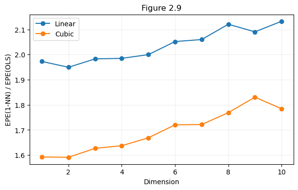

| 维度 | 目标 | 1-NN EPE | OLS EPE | 比值 |
|---:|---|---:|---:|---:|
| 1 | 线性 | 1.9767 | 1.0020 | 1.9727 |
| 5 | 线性 | 2.0041 | 1.0021 | 1.9999 |
| 10 | 线性 | 2.1370 | 1.0020 | 2.1327 |
| 1 | 三次 | 1.9906 | 1.2499 | 1.5927 |
| 5 | 三次 | 2.0891 | 1.2518 | 1.6689 |
| 10 | 三次 | 2.2338 | 1.2518 | 1.7845 |

**线性情形为什么接近 2。** 1-NN 只使用一个训练响应，其噪声方差为 1；要预测的新响应又带来方差 1。对训练输入和噪声取总体期望，有


$$
\mathrm{EPE}_{\mathrm{NN}}(0)=2+E[(f(X_*)-f(0))^2].
$$


低维近邻很近，最后一项很小，所以接近 2。线性 OLS 的模型形式正确，500 个训练点使原点预测的估计方差很小，EPE 接近 1。因此两者比值接近 2。维度增大，近邻的第一坐标通常不再那么接近零，1-NN 额外承担位置误差。

表中一维 1-NN EPE 为 1.9767，略低于理论下界 2，**这是有限 3000 次模拟的估计误差**。代码只对测试噪声做了解析平均，训练噪声仍靠抽样平均，不会强制每次模拟都大于 2。不应为了贴合理论而修改、截断或平滑这个结果。

**三次情形为什么从约 1.6 开始。** 这是可以手算验证的理论近似。令 $X_1\sim U[-1,1]$，有 $E[X_1]=E[X_1^3]=0$、$E[X_1^2]=1/3$、$E[X_1^4]=1/5$。三次目标的总体最佳线性投影满足


$$
a=E[f(X_1)]=1,\qquad
b=\frac{E[X_1f(X_1)]}{E[X_1^2]}=\frac{3/5}{1/3}=\frac95.
$$


其他独立、零均值坐标的总体系数为零。于是总体 OLS 在原点预测 1，真值却为 0.5，偏差平方为 0.25。忽略有限样本估计方差，其 EPE 约为 $1+0.25=1.25$；低维 1-NN EPE 约为 2，所以比值约为 $2/1.25=1.6$。这与表中的 1.2499 和 1.5927 相符。这里是固定原点处的解释，不能直接套用到对所有测试位置平均的风险。

**最后的边界。** OLS 此次获胜，依赖目标函数在这个设置下可被线性模型较好地处理，以及样本数远多于待估参数。换成线性模型严重失配的函数、不同测试位置或小样本高维场景，结论可能变化。教材关于平均测试位置的 $\sigma^2(1+p/N)$ 近似，也不能直接替代本题固定原点的 EPE。

**口试问答。** “OLS 有偏差为什么仍然更好？”——平方损失要比较总误差。这里三次目标带来的偏差平方约为 0.25，而 1-NN 保留了一个训练响应的完整噪声，且还有近邻位置误差；OLS 的总 EPE 因而更低。“这四图最想说明什么？”——方法的效果同时取决于数据几何、目标函数结构和估计方差；只强调模型灵活或者局部平均，并不足以保证预测准确。

<a id="ex4"></a>

## 第4题 怎样划分数据，才能既训练好模型，又可信地评价它

本题最关键的区分是：**训练数据决定能学到什么，评价数据决定我们对模型表现了解得有多准确。** 增加前者、减少后者，不一定会让图上的分数更高。需要先明确每份数据的用途，再解释曲线。

以下结果来自[解答 Notebook](Assignments1_solution.ipynb)中“4a. 训练集大小与模型选择”及紧随其后的两个代码单元；保存的最终模型为 [Assignments1_model.joblib](outputs/Assignments1_model.joblib)。

### 4a-1. 题目要比较什么，为什么选择逻辑回归

题目要求选择一个分类数据集，比较不同训练比例的测试表现，讨论 75/25 是否合理，最后完成一次包含超参数选择的建模流程。这里选用乳腺癌分类数据集，共 569 个样本、30 个数值特征。它规模不大，可以快速重复划分；逻辑回归在该任务上也能得到合理表现，适合把注意力放在数据划分上。

逻辑回归先计算线性分数，再变成类别概率：


$$
z=w^Tx+b,\qquad P(y=1\mid x)=\frac{1}{1+e^{-z}}.
$$


在当前 scikit-learn 二分类实现中，概率大于 0.5 时预测类别 1；恰好平票时选择类别 0。虽然名字中有“回归”，本题用它完成二分类。模型不算特别复杂，便于观察样本数不足时的估计波动。

代码把 `StandardScaler()` 和 `LogisticRegression()` 放入同一个 `Pipeline`。标准化把各特征变为训练集上的零均值、单位标准差，使不同数量级的特征在正则化中更可比较。标准化之后，某个系数对应的是“该特征增加一个训练集标准差时，线性分数改变多少”，并不直接表示概率改变同样的数值，也不代表因果效应。

流水线还有一个更实际的作用：每次 `.fit()` 都只用当前训练数据计算均值和标准差。如果先在全部数据上标准化，再划分训练集和测试集，测试数据的分布信息就提前进入了训练过程。

### 4a-2. 为什么先留下 20%，再扫训练比例

如果一边查看测试分数，一边决定划分比例和模型参数，这份测试集实际上已经参与了选择。当前解答先把数据分为两部分：

| 层次 | 样本数 | 用途 |
|---|---:|---|
| 开发集 | 455 | 比较划分比例、选择参数、最终重新拟合 |
| 最终测试集 | 114 | 所有选择完成后评价一次 |

外层划分使用 `test_size=0.2`、`stratify=data.target`、`random_state=40`。分层划分尽量保留类别比例，固定随机种子用于复现。

接下来只在 455 个开发样本内部扫描训练比例：5%、10%、……、95%，每种比例随机分层划分 30 次。每次都重新拟合标准化和逻辑回归，记录留出部分的准确率，最后计算均值和标准差。这里循环中的 `test_X` 是开发集内部的留出部分，和 `final_test_X` 不是同一份数据。

0% 没有训练样本，无法拟合；100% 没有测试样本，无法计算测试准确率。因此省略这两个端点有明确理由。横轴 75% 的含义也必须读对：它表示开发集的 75%，约为全部数据的 60%，并不是直接使用全体 569 个样本的 75%。

### 4a-3. 怎样读实际曲线，怎样回答“最佳比例”

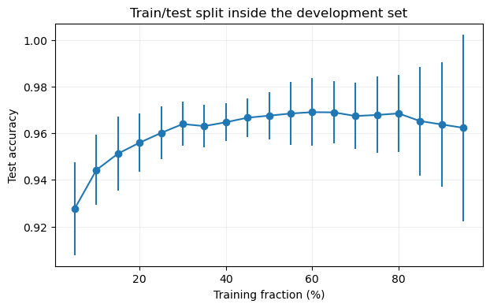

保存结果中的几个代表点如下。

| 开发集内的训练比例 | 平均准确率 | 划分间标准差 |
|---:|---:|---:|
| 5% | 92.77% | 1.99 个百分点 |
| 30% | 96.39% | 0.95 个百分点 |
| 60% | 96.90% | 1.46 个百分点 |
| 65% | 96.90% | 1.33 个百分点 |
| 75% | 96.78% | 1.64 个百分点 |
| 95% | 96.23% | 4.01 个百分点 |

观察到的最高均值在 60%，65% 四舍五入后的结果相同。75% 的均值只比最高值低约 0.12 个百分点。因此合适的回答是：“本次实验约 60%–80% 进入较好的平台，75/25 是合理折中；实际最高均值出现在 60%，不能说实验唯一证明了 75/25 最优。”

这条曲线同时受到两种变化影响。训练比例很小时，模型只看到很少的样本，系数估计容易受个别样本影响；增加训练数据通常能减少这种估计波动。训练比例很大时，留出的测试样本又变少。例如 95% 时只剩 23 个测试点，错一个点就改变约 4.35 个百分点，分数自然容易跳动。

可以用简单近似理解后一种变化：如果固定分类器对每个独立测试点的正确概率都是 $p$，在 $m$ 个测试点上的准确率方差约为


$$
\operatorname{Var}(\widehat{\mathrm{Accuracy}})=\frac{p(1-p)}{m}.
$$


这里的公式帮助解释“测试点少，评价噪声大”，并不精确描述整个重复划分实验，因为每次训练出来的模型也不同。图上的标准差混合了训练样本变化、测试样本变化带来的波动。

因此，95% 处均值下降不能直接解释为“训练数据更多导致过拟合”。当前结果没有单独隔离这一因果关系。同样，增加样本主要改善有限样本估计，无法保证消除线性决策边界本身的模型偏差；本题也没有实际计算分类器的偏差—方差分解，理论讨论应保持在这一层面。

30 次划分重复使用同一个开发集，样本之间有大量重叠。误差棒是这些分数的标准差，**不是 30 次独立实验构成的置信区间**。不能把曲线最高的一个点当成精确且稳定的总体最优比例。

### 4a-4. 怎样选 C，最终交付的模型包含什么

确定使用接近 75/25 的开发集内部划分后，当前代码再次划分开发集，得到 341 个训练样本和 114 个验证样本；加上之前保留的 114 个最终测试样本，整体约为 60/20/20。

逻辑回归的 `C` 控制正则化强弱：`C` 越小，正则化越强；越大，模型越可以用较大的系数贴合训练数据。当前候选为 0.001、0.01、0.1、1、10、100，每个候选只在 341 个训练样本上拟合，然后到验证集上比较。

| C | 验证准确率 |
|---:|---:|
| 0.001 | 90.35% |
| 0.01 | 95.61% |
| 0.1 | 97.37% |
| 1 | 93.86% |
| 10 | 93.86% |
| 100 | 92.11% |

所以选 `C=0.1`。这个结果表明：在当前划分和候选集合中，适度正则化的验证表现最好。它没有证明 0.1 是所有划分、所有数据上的最佳值。

选择结束后，用全部 455 个开发样本重新拟合标准化和逻辑回归。此时验证数据已经完成选参任务，可以加入最终训练；最终测试集仍然保留。最后在 114 个最终测试点中预测对 113 个，得到 $113/114\approx99.12\%$。

99.12% 是这次固定测试集上的观察结果，不能直接写成对所有未来样本的保证。保存的 `.joblib` 包含拟合后的整条处理流程、特征名、类别名。实际预测时应输入与训练时相同顺序和含义的特征，由已保存的流水线执行标准化和预测。

### 4b. 时间序列为什么要按时间向前验证

普通随机划分假定样本之间可以近似交换。时间序列预测的任务则是“用当时已经知道的信息预测后来发生的值”。如果把未来样本随机放入训练集，再预测过去，就改变了实际任务的信息条件。

例如有 12 个月的序列，可以用第 1–8 月拟合、预测第 9–12 月。这是时间顺序留出法。如果还要调参数，可先在更早的数据内部完成验证，把最晚的一段留到最后。预处理、特征选择和模型拟合都遵守相同截止时刻。

```text
时间顺序留出法：
    按时间排序
    选择训练结束时刻 c 和预测跨度 h
    只使用 c 时刻已经可获得的数据构造训练样本
    在训练样本上拟合预处理和模型
    从 c 时刻的信息出发，预测后续 h 个时刻
    等这些目标被观测到后，计算预测误差
```

时间序列的 k 折可以采用扩展窗口。例如初始训练区间为 1–6：第一折训练 1–6、验证 7–8；第二折训练 1–8、验证 9–10；第三折训练 1–10、验证 11–12。验证区间互不重叠，训练区间可以重叠并逐渐扩大。

```text
扩展窗口验证：
    按时间排序，确定初始训练区间和后续 k 个验证区间
    对每个验证区间，从早到晚处理：
        取该区间之前且目标已经可知的样本作为训练集
        重新拟合预处理和模型
        按真实部署时的预测方式预测当前区间
        记录误差与验证样本数
    按验证样本数加权汇总误差
    选择参数后，用更晚且未参加选择的区间进行最终测试
```

尤其要区分“一次预测未来四个月”和“每个月观察到真实值后再预测下个月”。前者不能在预测第 3 个月时偷偷使用未来第 2 个月的真实目标；若使用递归预测，只能把此前预测值作为新的滞后输入。后者可以在真实值到来后更新，但必须在实验中明确这种评价协议。

如果一个训练样本的标签是“未来 h 步的结果”，靠近分界的训练样本可能包含验证期内才会发生的信息。这时需要移除这些样本或在训练与验证之间留间隔。时间排序只是第一步，真正要检查的是每个特征与标签在预测当时是否已经可获得。

### 第 4 题口试自查

- **为什么不直接找到分数最高的训练比例就结束？** 因为分数受有限样本和划分波动影响，比例还需要兼顾训练质量与评价稳定性；当前实验支持一个合理区间。
- **验证集和测试集有什么区别？** 验证集参与参数选择，最终测试集只评价已经确定的流程。
- **为什么标准化也要在每折重新拟合？** 均值和标准差也是从数据学到的参数，不能提前使用该折验证数据。
- **为什么最终能把训练集和验证集合并？** 参数已经选定，合并能增加拟合数据，最终仍有独立保留的测试集。
- **时间序列能否打乱后做普通十折？** 对通常的未来预测任务不合适，会让未来观测参与预测过去；应模拟真实时间推进。

<a id="ex5"></a>

## 第5题 只保存两个均值，怎样得到一个在线线性分类器

本题的路线是先利用数据到达形式，再选择可递推更新的模型。每次恰好来一个 A 类样本和一个 B 类样本，因此两个类别的计数始终相同。最近质心分类器只需要类别均值，而均值又可以不保存历史数据地更新，正好对应题目的存储限制。

### 5a-1. 从“离哪个中心近”推导线性边界

设类别均值为 $\mu_A,\mu_B$，新样本为 $z$。最近质心规则把 $z$ 分给距离更近的中心。分为 B 类的条件是


$$
\|z-\mu_B\|^2\leq\|z-\mu_A\|^2.
$$


展开平方后，两边相同的 $z^Tz$ 消掉：


$$
-2z^T\mu_B+\|\mu_B\|^2
\leq-2z^T\mu_A+\|\mu_A\|^2.
$$


移项并除以 2，可得


$$
z^T(\mu_B-\mu_A)+\frac{\|\mu_A\|^2-\|\mu_B\|^2}{2}\geq0.
$$


因此令


$$
w=\mu_B-\mu_A,\qquad b=\frac{\|\mu_A\|^2-\|\mu_B\|^2}{2},
$$


就得到标准线性判别式 $w^Tz+b$。代码中的 `weights`、`intercept` 正好对应这两个式子。二维时边界是两中心连线的垂直平分线；更高维时是超平面。

例如两个真实均值是 $(-2,0)$ 与 $(2,0)$，则 $w=(4,0)$、$b=0$，按第一坐标是否非负分类。有限样本估计的均值不一定完全对称，所以实际边界可能略有平移或倾斜。

### 5a-2. 均值更新为什么与批量计算一致

收到第 $t$ 个 A 类样本之前，已经有


$$
\mu_{A,t-1}=\frac{1}{t-1}\sum_{i=1}^{t-1}x_i.
$$


加入 $x_t$ 后，新均值就是


$$
\mu_{A,t}=\frac{(t-1)\mu_{A,t-1}+x_t}{t}
=\mu_{A,t-1}+\frac{x_t-\mu_{A,t-1}}{t}.
$$


B 类完全相同。因此 `update_means()` 只需执行两次这样的更新。初始化为零向量、从 `t=1` 开始时，第一次更新直接得到各自的第一个样本；由上述递推式归纳下去，每一时刻的均值都等于当前已经看到的全部同类样本的算术平均。

这里的“正确”有明确范围：递推实现正确计算了最近质心模型所需的统计量，并且在实数运算下与同一批已见数据的批量均值完全等价。浮点计算的求和顺序不同可能产生微小误差，所以代码用 `np.allclose` 检查均值，而不是要求浮点数逐位一致；随后还检查最终测试预测是否逐项相同。

这不是说模型对任意数据分布都能达到最佳分类。算法实现等价与统计模型最优，是两个不同问题。

### 5a-3. 内存与计算量究竟算哪些东西

模型状态只需要两个 $d$ 维均值和一个计数：共 $2d+1$ 个数，空间复杂度 $O(d)$，与累计到达样本数无关。每次更新涉及两个向量的加减和缩放，成本为 $O(d)$；对一个新样本计算线性分数同样为 $O(d)$。

当前 Notebook 预先生成 `stream_a`、`stream_b`，还保存测试集和每一步的准确率，用于模拟数据流、绘图和批量对照。这些实验数组会消耗额外内存。题目中的 $O(d)$ 指在线分类器本身的必要状态，不能拿来描述整个绘图脚本的总内存。

实际流处理可以每次从输入源读取一对样本，更新后丢弃它们。如果类别不再成对到达，就分别保存 $n_A,n_B$，更新各类时用该类自己的计数。若分布随时间改变，累计均值可能跟不上变化；固定步长或遗忘因子可加强近期数据的作用，但此时不再等价于全部历史样本的普通均值。

### 5a-4. 最近质心规则什么时候有统计依据

当两类先验概率相同、各自服从高斯分布，且共享协方差 $\sigma^2I$ 时，两个类别密度的公共常数相同，比较后验概率就等价于比较到均值的平方欧氏距离。所以已知总体均值时，最近质心是这个分布设定下的 Bayes 分类器。

这里实际使用估计均值，是把样本估计代入总体公式。样本增多会让均值更准确，但不会消除类别本身的重叠。

若两类共享同一个非球形协方差 $\Sigma$，相应规则仍可以是线性的，但要按 $\Sigma^{-1}$ 加权距离；简单欧氏最近质心一般不再等价。若两类协方差不同，最优边界还可能是二次的。先验概率不相同时，也需要调整截距。这些条件解释了为什么本题采用相同标准差、平衡类别作为演示。

### 5b. 实验中 500 个点为什么只有 250 个时刻

原题把 $N=n+n$ 定义为总样本数，却又写 $t=1,\ldots,N$；这与“每时刻到达一对样本”不完全一致。解答明确取总训练样本 $N=500$，每类 250 个，所以横轴是收到的样本对数 $t=1,\ldots,250$。处理完第 $t$ 对时，已经看过 $2t$ 个样本。

实验用二维高斯、标准差 1，A、B 均值分别为 $(-a/2,0)$、$(a/2,0)$，选择 $a=4$ 和 $a=1$。每种情况另生成每类 500 个独立测试点。批量基线使用同样的最近质心规则，一开始就利用全部 500 个训练点，所以画成固定水平线。

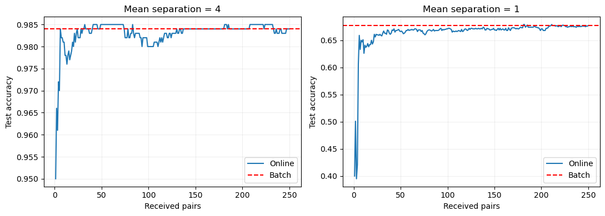

| 均值间距 | 第一对后的准确率 | 第 250 对后的准确率 | 批量基线 | 总体 Bayes 准确率 |
|---:|---:|---:|---:|---:|
| 4 | 95.0% | 98.4% | 98.4% | 97.72% |
| 1 | 40.0% | 67.7% | 67.7% | 69.15% |

最终在线与批量模型的预测一致，符合均值递推的推导。早期少量样本可能把中心估计到不合适的位置，困难情况第一对时只有 40.0%，并不说明实现出错。之后准确率可以上下波动，因为新样本可能让边界在有限测试集上暂时变好或变差。

总体 Bayes 准确率可以直接算出。对称均值、标准差 1 时，真实边界为 $x_1=0$，A 类预测正确的概率为 $P(X_1<0)=\Phi(a/2)$，B 类相同，因此总体准确率也是 $\Phi(a/2)$。本次容易情况的实测 98.4% 高于总体 97.72%，原因是有限测试集会有抽样波动，不意味着学得的分类器超越了总体最优规则。

两种难度用了相同随机种子，因此随机偏差被复用于不同均值设定，便于对照；它们不是两组完全独立的重复实验。当前只有这两种难度下、采用同一固定种子的示例，能展示在线更新行为，不能据此断言所有数据流都遵循同一条学习曲线。

### 第 5 题口试自查

- **为什么没有保存历史样本还能正确更新？** 因为旧均值与计数保留了计算新均值所需的总和信息。
- **这个模型线性在哪里？** 两个平方距离相减后，关于输入的二次项消掉，只剩 $w^Tz+b$。
- **在线结果为什么最终等于批量结果？** 两者使用同一批训练数据、同一种均值统计量和同一种分类规则。
- **为什么准确率不一定越来越高？** 均值估计在有限样本下会波动，离散测试准确率也会随边界小幅移动跳变。
- **代码保存了所有点，会不会违反题意？** 模拟和批量对照保存了数组；在线更新函数自身只需要两个均值和计数，实际部署可逐对读取后丢弃。

<a id="ex6"></a>

## 第6题 怎样定义并检验分类器的局部规律性

本题允许自行提出启发式指标。核心问题是：如果两个输入很近，模型是否倾向给出相同决定？这个问题与“决定是否正确”不同，因此需要同时报告 Regularity 和 Accuracy。

完整记录位于 [Assignments1_ex6_results.csv](outputs/Assignments1_ex6_results.csv)，内部交叉验证选出 $k$ 后的外层结果位于 [Assignments1_ex6_selected.csv](outputs/Assignments1_ex6_selected.csv)。下面的数字直接对应这些保存文件。

### 6-1. 从邻域一致性构造公式

设评价点集有 $m$ 个点，模型预测为 $\hat y_i$，$N_q(i)$ 为评价点集中距离 $x_i$ 最近的 $q$ 个其他点。定义


$$
R(X,\hat y)=\frac{1}{mq}\sum_{i=1}^{m}\sum_{j\in N_q(i)}\mathbf{1}[\hat y_i=\hat y_j].
$$


计算过程很直接：每个点找到附近的 $q$ 个点，统计有多少邻居与它预测相同，再对所有点平均。每个比较结果是 0 或 1，所以 $0\leq R\leq1$。例如某点 5 个邻居中有 4 个同预测，它的局部分数就是 0.8。

必须排除点自身，否则会混入一个必然相等的比较，把分数人为抬高。代码在拟合评价点集后调用不传查询点的 `kneighbors(return_distance=False)`，按该调用方式排除每个样本自身。这里仍可能存在两点坐标相同但不是同一个样本的情况，它们可以互为邻居。

固定 `q=5` 是一个重要控制：分类器的 $k$ 决定预测时参考多少个训练点；指标的 $q$ 决定比较多少个评价点。两者属于不同环节。如果同时改变，曲线变化就无法明确归属于分类器变化还是指标尺度变化。

函数在点数不足时使用 `min(q, len(X)-1)`；数学上这等于把公式中的 $q$ 换为有效邻居数。本实验最小评价集有 8 点，始终足够使用 5 个邻居。这个简洁函数没有处理 0 个或 1 个评价点，若要用作通用工具，需要补上相应约定。

### 6-2. 为什么高 Regularity 不等于高准确率

Accuracy 比较预测与真实标签：


$$
\mathrm{Accuracy}=\frac1m\sum_i\mathbf1[\hat y_i=y_i].
$$


Regularity 比较相邻点之间的预测，不需要真实标签。始终预测类别 0 的模型让所有邻居都一致，所以 $R=1$；在平衡二分类中它却只有约 50% 准确率。代码特意检查了常数预测的 Regularity 等于 1。

因此“最大化 R”本身会鼓励过度平滑甚至常数输出。R 适合描述模型在当前样本几何上的决策一致程度，不能单独作为模型选择目标，也不是模型真实泛化误差的替代量。

这个指标还依赖评价点如何采样。即使决策函数完全不变，在同一区域增加评价点，最近 5 个邻居通常更近，跨越边界的机会也可能减少，R 就可能上升。因此讨论数据量、维度或验证协议时，要同时考虑模型变化与评价邻域变化。

### 6-3. 数据生成为什么只移动第一坐标

参数网格为：每类样本数 $n\in\{50,100,200,500\}$；维度 $d\in\{1,5,10,20,50,100\}$；标准差固定 $\sigma=2$；均值距离 $\delta\in\{2,4,6,8\}$；分类器邻居数 $k\in\{1,\ldots,10\}$。

当前实现设


$$
X\mid A\sim\mathcal N(0,4I),\qquad
X\mid B\sim\mathcal N((\delta,0,\ldots,0),4I).
$$


所以均值欧氏距离始终是 $\delta$，只有第一维含有类别信号。增加维度只增加无关噪声坐标。若在每个坐标上都加 $\delta$，总均值距离会变为 $\delta\sqrt d$，维度上升时同时增加了信号，研究的问题就不同了。

这种构造也让总体 Bayes 分类难度不随 $d$ 改变：等先验、等球形协方差下，只需比较第一坐标与 $\delta/2$，总体准确率为 $\Phi(\delta/4)$。因此观察到高维 kNN 下降，可以理解为有限样本下欧氏距离受到无关坐标影响；不过当前实验没有进一步逐项隔离所有原因，不能把每一点波动都归为单一机制。

### 6-4. 960 个组合、十次重复与两层评价怎样对应

参数组合数为 $4\times6\times4\times10=960$，每组包含 10 个运行编号。但代码实际按 $(n,d,\delta,\mathrm{run})$ 生成数据，同一份数据和同一组划分供 10 个 $k$ 共用。这是合理的配对比较，可减少不同 $k$ 恰好遇到不同数据的干扰。不能把它描述成 9600 份相互独立生成的数据。

每轮先将 $2n$ 个点分为外层训练部分 80% 与测试部分 20%，随后进行两条评价：

1. **Holdout**：用外层训练部分拟合，在外层测试集计算两项指标。
2. **Inner CV**：只在外层训练部分内部做分层十折，每折用其中九折拟合、剩余一折评价，平均十个结果。

在本参数网格中，各折大小相同，因此简单平均等于按样本数加权平均。外层测试集没有参加内部交叉验证。

| 每类 n | 总样本 | 外层训练 | 外层测试 | 内层每折训练 | 内层每折验证 |
|---:|---:|---:|---:|---:|---:|
| 50 | 100 | 80 | 20 | 72 | 8 |
| 100 | 200 | 160 | 40 | 144 | 16 |
| 200 | 400 | 320 | 80 | 288 | 32 |
| 500 | 1000 | 800 | 200 | 720 | 80 |

每个参数组合、运行编号、评价方式和模型各记录一行，所以完整文件有 $960\times10\times2\times2=38400$ 行。再对每个 $(n,d,\delta,\mathrm{run})$，只依据内部 CV Accuracy 选择 $k$，读取该 $k$ 的外层表现，得到 $4\times6\times4\times10=960$ 行选参记录。并列时 `argmax()` 选择先出现的较小 $k$。

代码先算出所有外层分数，再用内部结果索引所选 $k$ 的外层分数。这在计算上可复用，但推断上必须坚持：选 $k$ 的规则只看内部 CV，不能观察外层分数后再改选择规则。

这里比较的是外层留出评价与内部 CV 评价，并没有构建“做过 CV 的模型”与“没做过 CV 的模型”两种训练算法。CV 本身是评价和选参程序；固定 $k$ 时，模型差异来自训练样本和训练量。这个实现是对原题嵌套描述的一种明确解释，不应扩大成完整的多层嵌套交叉验证结论。

### 6-5. kNN 与决策树代码中有哪些选择

kNN 在训练集上一次寻找最近的 10 个邻居。对某个 $k$，只取前 $k$ 个标签投票。二分类标签为 0、1，所以标签和大于 $k/2$ 时预测 1，否则预测 0。这样可复用近邻搜索；代码已经用一个随机样例核对了 $k=1,\ldots,10$ 时与 `KNeighborsClassifier` 的预测一致。

偶数 $k$ 可能平票，本实现固定选 0。因此偶数和相邻奇数 $k$ 的差异，不只来自邻域大小，还包含平票规则的影响。若将规则改为随机平票、距离加权或其他方式，需要重新评价，不能默认结果不变。

决策树固定 `max_depth=5`、`min_samples_leaf=5`，这些设置在测试前确定，没有进一步搜索最佳深度。树的训练和预测不依赖 $k$，所以同一轮树的结果在 10 个 $k$ 下重复列出。图上树关于 $k$ 的曲线水平，是代码定义的直接结果，不是发现树对某个近邻参数具有稳定性。

固定深度控制了树的复杂度，但没有证明这是树的最佳设置。当前实验可以比较所选两个模型配置；若要比较各方法经过调参后的最佳能力，应把树深度等参数也放到内部选择流程中。

### 6-6. 结果说明了什么，哪些结论不能直接下

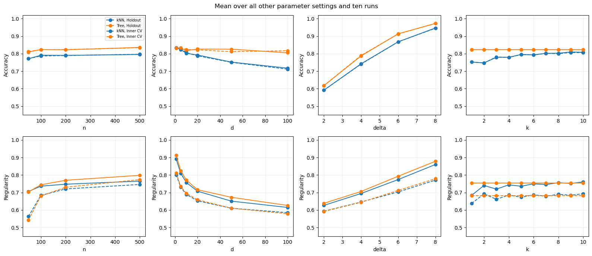

八张子图都是**对其余参数和十次运行取平均的边际曲线**。例如关于维度的曲线混合了多个样本量、类别距离与 $k$，不是某一数据集逐渐加维后的单条轨迹，也不是单独固定其他所有条件的因果实验。

| 外层留出结果 | kNN | 决策树 |
|---|---:|---:|
| 整个网格平均 Accuracy | 78.70% | 82.27% |
| d=1 的平均 Accuracy | 83.45% | 83.06% |
| d=100 的平均 Accuracy | 71.73% | 80.52% |
| 整个网格平均 Regularity | 0.7387 | 0.7540 |

维度增加时，kNN 明显下降；当前数据的第一坐标独自含有信号，树可以按这个坐标划分，因此较少受到欧氏距离中无关坐标的影响。这是与构造相符的解释，不能推广成“决策树通常优于 kNN”。

类别均值更远时，类别重叠减少，两个模型的平均准确率都提高。样本量增加总体有帮助，但保存结果并不逐点单调：例如 kNN 从每类 100 点的 79.11% 到每类 200 点的 79.03%，有小幅下降。因此宜说“总体趋势”，不宜把每条曲线都描述为严格递增。

$k=1$ 到 $k=9$ 时，kNN 平均 Accuracy 从 75.23% 到 80.98%，R 从 0.684 到 0.752；$k=10$ 时 Accuracy 为 80.81%，R 为 0.760。更大的邻域往往平滑预测，但准确率和规律性并不总是同步变好。内部 CV 选择 $k$ 后，$d=1$ 的外层平均准确率为 84.12%，$d=100$ 为 74.68%；它们属于选参后的结果，和对所有 $k$ 平均的数字回答不同问题。

### 6-7. 为什么内部 CV 的 Regularity 特别低

整个网格的树 R 从 Holdout 的 0.7540 到 Inner CV 的 0.6817，kNN 则从 0.7387 到 0.6783。不能据此说“交叉验证让模型更不规律”。

首先，内层模型使用的数据比外层模型少；其次，计算 R 的评价点集也小得多，固定 5 个邻居往往覆盖更大的空间。这两个变化同时存在，当前代码没有把各自影响单独分离。

$n=50$ 的极端情况最容易看清：内层验证折只有 8 个点，平衡分成两类各 4 个。即使分类器把全部 8 个点预测正确，对任意点而言，其他点中最多只有 3 个同类点。必须挑 5 个邻居，就至少包含 2 个异类，因此该点的一致比例最高是 $3/5=0.6$，全折的 R 也最多是 0.6。与此相反，把所有点都预测成同一类，反而能得到 R=1。

这一上限来自评价样本数、类别构成和 q 的组合，不是学习算法出错。它说明当前 R 对小验证折尤其敏感。若要公平比较不同协议，可以让各模型都在同一独立参考点集上评价 R，或研究不同邻域尺度下的完整曲线；这些是改进方向，当前结果并未实施。

内部各折训练集也互相重叠，十个折分数不是十次独立实验。重复运行中的新数据提供了另一层变化，但也不能把文件里所有重复树行、所有 $k$ 行当作独立观测来计算统计显著性。

### 6-8. 如果改用 radius-NN，实验要怎样调整

kNN 固定邻居数量，邻域半径随局部密度变化；radius-NN 固定半径，邻居数量随密度变化。需要始终找到若干参考点时，kNN 比较方便，但稀疏区域可能借用很远的点；距离具有明确实际含义、希望拒绝远距离参考时，radius-NN 更自然，但可能一个邻居也找不到。

改写实验时，用半径网格替换 $k$ 网格，保持数据、划分和两项评价指标一致。半径应由特征单位与维度共同确定，不能把一个数值未经检查地套到所有维度。无邻居时必须明确采用拒绝预测还是备用分类规则，并同时报告预测覆盖率；如果只评价能预测的点，不能隐藏被拒绝样本的比例。

分类器改为 radius-NN，并不强制指标也改为半径邻域。继续固定 q=5，可以保持当前评价定义；若也要改指标，需要另外规定其评价半径，以及孤立点如何计分，两种尺度依然要区分。

### 6-9. 回归任务如何定义 Regularity

连续输出很少恰好相等，所以把标签相等的指示函数换成预测差异惩罚。当前解答提出


$$
R_{\rm reg}=\frac{1}{1+\frac{1}{mq s_y^2}
\sum_i\sum_{j\in N_q(i)}(\hat y_i-\hat y_j)^2}.
$$


其中 $s_y^2>0$ 是由训练数据确定的固定目标尺度。先求邻近预测的平均平方差，再按目标尺度无量纲化，最后用 $1/(1+u)$ 转为差异越小、分数越高的指标。若训练目标方差为零，需要单独约定正尺度，避免除以零。

该指标仍有相同局限：常数预测 R=1，但可能有很大 MSE；真实函数变化很陡时，正确预测也可能局部差异较大。它也没有除以输入点间距离，所以反映的是当前采样邻域内的变化量，不能直接当成函数导数或 Lipschitz 常数。回归评价仍应同时报告测试 MSE，并明确 R 使用的邻域尺度。

### 第 6 题口试自查

- **q 和 k 有什么不同？** k 用训练点决定分类预测，q 用评价点衡量预测之间的局部一致性。
- **为什么常数分类器是一个必要检查？** 它立即证明 R 不能单独衡量预测质量，也能检查实现是否符合公式。
- **9600 组配置运行是否意味着 9600 份独立数据？** 不是。同一 $(n,d,\delta,\mathrm{run})$ 下的十个 k 共用数据和划分，实际生成 960 份数据。
- **树关于 k 为什么是一条水平线？** 树没有使用 k，其同一结果只是为了图表比较而重复记录。
- **内层 R 低是否说明交叉验证不好？** 不能。训练量与评价邻域规模同时变化，最小折甚至存在完美预测 R 不超过 0.6 的结构性上限。
- **为什么增维时把均值平移只放在第一坐标？** 为了固定两类均值的欧氏距离，使新增维度主要代表无关噪声。
- **能不能根据外层测试结果选择最好的 k？** 这样会把测试集变成选参数据；当前做法只按内部 CV Accuracy 选择，再报告外层表现。

## 把整份作业讲清楚

准备口头说明时，可以先用一句话概括每题，再用一个结果支撑它。以下是一种十分钟内的讲解顺序，具体时间按老师的提问调整。

| 内容 | 应说明的主线 | 适合展示的证据 |
|---|---|---|
| 第1题，约2分钟 | 普通平方损失容易被异常点影响；RANSAC 先选一致集合，再重新拟合 | Lab 1 的三条回归直线；真实斜率82.19与估计值 |
| 第2题，约1.5分钟 | 三种鲁棒估计器控制的对象不同，因此没有普遍最优者 | 30%污染、平移12时的中心误差；较小平移下的反例 |
| 第3题，约2分钟 | 局部邻域随维度扩大，目标函数决定偏差和方差谁占主导 | 图2.7与2.8的误差分解；图2.9中额外的测试噪声 |
| 第4题，约1分钟 | 数据越多越有利于训练，但评价也需要足够的独立样本 | 划分比例的平台区；训练、验证、测试的职责 |
| 第5题，约1分钟 | 类别均值可以递推，最近均值规则可写成线性判别式 | 递推等式；在线和批量最终预测一致 |
| 第6题，约2分钟 | 准确与局部一致是两个问题，指标解释取决于样本几何 | 常数分类器反例；8点验证折的Regularity上限 |

遇到“为什么用这个参数”，先说明参数的单位和作用，再说明本次选择依据。例如 RANSAC 的25是响应变量单位中的残差阈值，来自噪声标准差10；Regularity 的5是邻居数量，是固定的评价尺度选择，两者不能用同一种理由解释。

遇到“你的方法是否总是更好”，先限定任务和条件，再用本实验的反例说明边界。例如合成原型在平移距离2时可以优于 RANSAC，而 RANSAC 在30%污染、平移12时也并非完全恢复正确聚类。

遇到“这是理论证明还是实验结果”，可以明确区分：在线均值等于批量均值是代数恒等式；某次准确率为98.4%是有限测试集上的观测；60%训练比例最好是本次划分实验的结果；额外增加训练数据是否继续提高准确率，还需要进一步实验。

### 六个值得亲手完成的小检查

下面是学习用的建议，不属于已保存结果。

1. 把 RANSAC 阈值从25改成10和50，先预测它会少收内点还是多收离群点，再运行。
2. 保持点云不变，只改单类 SVM 的 gamma，分别查看接受的点和最后的均值，区分“识别了多少点”与“中心是否准确”。
3. 在图2.9中单独去掉公式中的测试噪声项1，确认此时算的是估计无噪声函数值的 MSE，不能继续称为原来的 EPE。
4. 固定测试样本索引，检查标准化的均值与标准差究竟由哪一部分数据拟合。
5. 用三对手写的二维点手算在线均值，再与批量求和除以3比较。
6. 构造每类四个点的验证集，设置完美预测和常数预测，比较 Accuracy 与 Regularity，解释为什么后者可能把常数预测评得更高。

### 阅读结果时保留的几个区别

| 容易混淆的说法 | 本作业中更准确的表述 |
|---|---|
| 额外加入30%的离群点 | 第1题以原1000个点为分母，最终污染比例约23.08%；第2题直接以最终数据集为分母设30% |
| RANSAC找到了真实中心 | 当前点云中它等于内点的样本均值，不等于总体均值必须为零 |
| 单类SVM恰好去掉nu比例的数据 | nu约束的是优化问题中的量，实际预测拒绝比例与边界及数值求解有关 |
| 75/25是理论最优划分 | 它是本次平台区中的实用折中，不是所有任务的定理 |
| 在线模型只用常数内存 | 相对于到达样本总数，模型状态不增长；相对于特征维数，状态为O(d) |
| 第6题有9600份独立数据 | 共有960个独立生成配置；每份数据复用于10个k，因此共有9600组参数运行记录 |
| Regularity越高就越好 | 它不衡量标签是否正确，且依赖评价点数量和邻域尺度 |

## 资料与复现入口

- [原始题目](Assignments1.ipynb)与[中文题目](Assignments1_zh.ipynb)：核对每道题的要求、分值和提交规则。
- [中英解答 Notebook](Assignments1_solution.ipynb)：完整代码、公式、12张图以及已保存的数值输出。
- [第6题全部实验记录](outputs/Assignments1_ex6_results.csv)：38,400行，包含两种评价方式、两个模型、十个k及十次重复。
- [第6题内部选k后的外层评价](outputs/Assignments1_ex6_selected.csv)：960行，每个数据配置只保留内部交叉验证选择的k及其外层测试分数。
- [第4题保存的模型](outputs/Assignments1_model.joblib)：标准化与逻辑回归的完整流程，以及特征名、类别名；Notebook 中保留重新训练的代码。
- [Lab 1](../Lab1/Lab1.ipynb)：第1题回归数据生成方式的来源。
- [The Elements of Statistical Learning 本地PDF](<../../References/The Elements of Statistical Learning/PDF/ESLII_print12_toc.pdf>)：第2.5节，印刷页22–27，图2.6–2.9。
- scikit-learn 官方文档：[RANSACRegressor](https://scikit-learn.org/stable/modules/generated/sklearn.linear_model.RANSACRegressor.html)、[OneClassSVM](https://scikit-learn.org/stable/modules/generated/sklearn.svm.OneClassSVM.html)、[NearestNeighbors](https://scikit-learn.org/stable/modules/generated/sklearn.neighbors.NearestNeighbors.html)、[交叉验证](https://scikit-learn.org/stable/modules/cross_validation.html)。
- Kalogeratos 等，[Document clustering using synthetic cluster prototypes](https://kalogeratos.com/files/MyPapers/Document-clustering-using-synthetic-cluster-prototypes-DKE2011-recompiled.pdf)，2011，算法2：合成原型方法的来源；本作业采用的是题目给出的简化版本。

Notebook 保存的运行环境为 NumPy 2.4.6、SciPy 1.16.2、scikit-learn 1.9.1；其他版本下的边界判断、并列处理或随机算法细节可能使数值略有变化。所有图都来自该 Notebook 的保存输出，本讲解没有重新计算并替换实验结果。

本讲解由 OpenAI Codex 辅助整理，用于理解和复核现有答案。Notebook 中已有大语言模型使用说明；实际提交时，应如实补充自己完成的修改、运行和检查。
