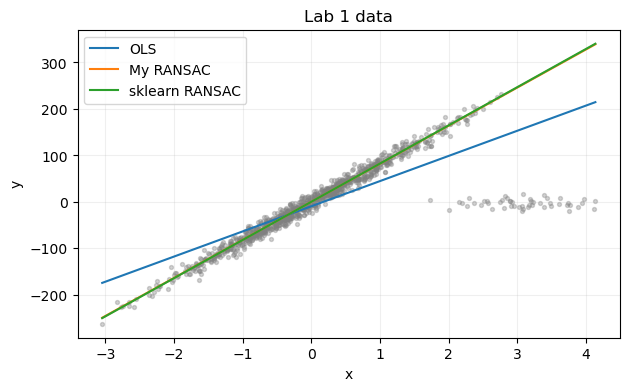
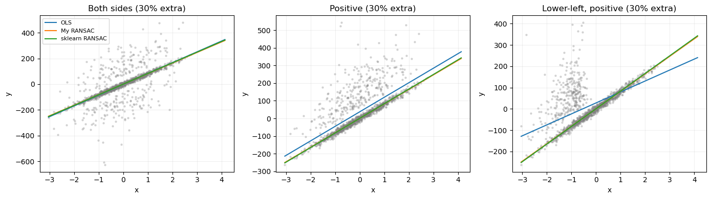
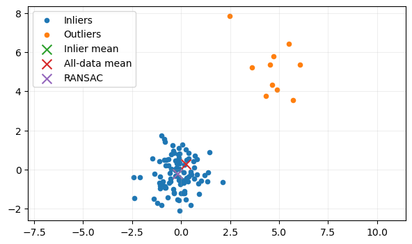
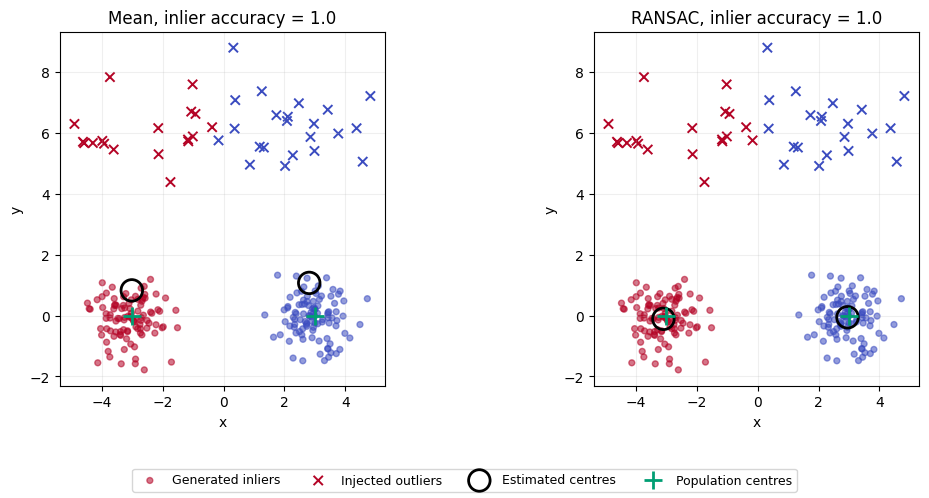

# 第1题 · RANSAC 与鲁棒估计

[作业一目录](../README.md) · [题目原文](../Assignments1.ipynb) · [中文题目](../Assignments1_zh.ipynb) · [下一题：三种鲁棒代表点](02_robust_representatives.md)

分值 25%，是全作业最重的一题。整道题围绕一个问题：**数据里混进一部分不服从主要规律的点时，怎样仍然估计出主要规律？** a 小题做直线回归，b 小题换一种投票方式，c 小题把同一思路推广到"求中心"和聚类，最后写出通用伪代码。

先看第 2 节交付清单，再对照参考解答读第 3 节的小题讲解。遇到不懂的概念，回查第 0、1 节；运行后，试着用自己的话解释一张图或一个参数选择。报告要用英语或法语写，核心概念都附了英文术语。

## 0. 按需查阅的材料

**默认你已经会：**Python 和 NumPy 数组运算、matplotlib 画图、scikit-learn 的 `fit` / `predict`；均值、方差、正态分布。不熟悉 scikit-learn 的话，先看 [Lab1](../../Lab1/Lab1_zh.ipynb) 第 4 节"Python 中的线性回归"（约 6 分钟）。

| 优先级 | 材料与范围 | 读完应该会 | 用时 |
|---|---|---|---|
| 必读 1 | [Lab1](../../Lab1/Lab1_zh.ipynb) 第 9 节"稳健线性回归"全节，并把其中的代码跑一遍 | 说出 RANSAC 每轮的四步；`min_samples`、`residual_threshold`、`max_trials` 各管什么；a1 的数据怎样生成（1000 点、噪声 10、50 个离群点） | 约 15 分钟 |
| 必读 2 | [第一课第 5 篇](../../../Lectures/01_intro/05_linear_models.md)开头到"从三个样本算出一条直线"结束 | 最小二乘在最小化什么；怎样从数据算出斜率和截距 | 约 8 分钟 |
| 必读 3 | [ESL 第 14 章](<../../../References/The Elements of Statistical Learning/PDF/14_Unsupervised Learning.pdf>) 14.3.6 节"K-means"，含 Algorithm 14.1（英文约 750 词；课程讲义没有专门讲 k-means） | k-means 的分配、更新两步；为什么均值更新让目标单调下降；初始化会影响结果 | 约 8 分钟 |
| 选读 | 第一课第 5 篇"[观测中的变化怎样传到参数和预测中](../../../Lectures/01_intro/05_linear_models.md#reading-noise-propagation)" | 为什么用更多点拟合能降低估计波动，即 refit 的理由 | 约 5 分钟 |
| 选读 | Lab1 第 9 节开头推荐的 Derpanis《Overview of the RANSAC Algorithm》（英文短文） | 尝试次数公式 $T=\log(1-P)/\log(1-w^s)$ 的出处 | 约 10 分钟 |

三项主要材料完整读完约 30 分钟。“必读”表示本题的主要来源；已经理解的部分可以跳过，不必读完才开始做题。

## 1. 前置知识

### 1.1 最重要的 20%

下面四个概念撑起整道题。弄懂它们，后面各小题只是在不同对象上重复同一套逻辑。

#### ① 平方损失会被离群点"绑架"（squared loss is not robust）

普通最小二乘（OLS，ordinary least squares）选残差平方和最小的直线：

$$
(\hat a,\hat b)=\arg\min_{a,b}\sum_i(y_i-ax_i-b)^2 .
$$

均值也是同一个原理：$\bar x=\arg\min_c\sum_i(x_i-c)^2$。平方会放大大残差：残差为 100 的点贡献 $10^4$，是残差为 10 的点的 100 倍。只要有少量点离主要直线很远，最优解就会牺牲大量普通点的拟合，去减小这几个大残差。

一个最小的例子：$\{1,2,3,100\}$ 的均值是 26.5，四个数里没有一个接近它；中位数是 2.5。一个坏点就能把均值拉到任意远的地方，统计上称均值的**崩溃点（breakdown point）**为 0，中位数的崩溃点为 50%。

这是要用 RANSAC 的原因，也是 a2 中三种污染方式结果不同的根源（见 3.2 节）。

#### ② 内点、离群点与"共识"（inliers, outliers, consensus）

- **内点（inlier）**：服从我们关心的模型、只带正常噪声的点。
- **离群点（outlier）**：不服从这个模型的点，比如测量错误，或由另一种机制产生的点。
- 关键在于：**事先不知道谁是内点。**估计方法只能看到数据本身；如果知道标签，直接删掉离群点就行了。

RANSAC（RANdom SAmple Consensus）把问题换了一个问法：不问"哪条线的误差总和最小"，而问"**哪条候选线能得到最多点的支持**"。一个点支持候选模型，是指它的误差不超过阈值 $\tau$：

$$
I(a,b)=\{\,i:|y_i-ax_i-b|\le\tau\,\}.
$$

这里用纵向残差，因为回归任务是"给定 $x$ 预测 $y$"；它不是点到直线的垂直几何距离。离群点再远也只是"不投票"，不会把模型拉走，这就是 RANSAC 鲁棒的原因。

#### ③ RANSAC 的循环与三个旋钮

```text
重复 T 次：
    随机抽 s 个点（确定一个候选模型所需的最少点数；直线 s=2）
    用这 s 个点算出候选模型
    数出误差 ≤ τ 的点，得到支持集
    支持集比当前最好的更大，就记下来
用最好的支持集里的全部点重新拟合（refit）
```

两个横坐标不同的点就确定一条直线：$a=(y_j-y_i)/(x_j-x_i)$，$b=y_i-ax_i$。三个旋钮各管一件事：

| 旋钮 | 管什么 | 设得太小 | 设得太大 |
|---|---|---|---|
| 阈值 $\tau$ | 多大误差还算支持 | 正常点也被当成离群点，支持集太小 | 离群点混进支持集 |
| 尝试次数 $T$ | 搜索是否充分 | 可能一次都没抽到干净子样本 | 只是更慢 |
| 子样本大小 $s$ | 每个候选用几个点 | 不够确定模型 | 抽到全干净子样本的概率下降 |

**$\tau$ 怎么定。**若内点噪声服从零均值、标准差为 $\sigma$ 的高斯分布，相对真实直线取 $\tau=2.5\sigma$，内点落在阈值内的概率约为 98.8%。候选直线接近真实直线时，可以用这个比例作近似参考；它不保证任意候选都能收下这么多内点。Lab 1 数据的噪声 $\sigma=10$，所以选择 $\tau=25$。

**$T$ 怎么定。**设内点比例为 $w$，一次抽 $s$ 个点全是内点的概率约为 $w^s$，$T$ 次中至少一次全干净的概率是 $1-(1-w^s)^T$。要让它达到 $P$（如 0.99），需要

$$
T\ge\frac{\log(1-P)}{\log(1-w^s)} .
$$

代入数字：$w=0.77,\ s=2$ 时 $w^2\approx0.59$，6 次就有 99%；$w=0.5$ 时需要 17 次。所以几百次尝试对本题绰绰有余。注意这个公式只保证"抽到干净子样本"，不保证"候选模型好"：两个内点本身也带噪声，横坐标太近时斜率会很不稳定。这也是最后必须用整个支持集 refit 的原因。

#### ④ 把"估计一个中心"做成可替换的模块

c 小题要求写 `robust_representative(S)`：输入一组点，返回一个代表点，然后把它放进 k-means。先回顾 k-means（Lloyd 算法）反复执行的两步：

$$
\text{分配：}z_i=\arg\min_j\|x_i-c_j\|_2,\qquad
\text{更新：}c_j\leftarrow\operatorname{mean}\{x_i:z_i=j\}.
$$

题目要求把"更新"中的 mean 换成任意传入的函数，并且**聚类代码不关心这个函数内部怎么算**。写法上，让聚类函数接收一个参数 `representative`。这样第 2 题只需传入别的估计器，不用改聚类代码，也才能在同样的分配、初始化和停止规则下公平比较。

### 1.2 其余前置知识速查

| 概念 | 一句话 | 去哪里复习 |
|---|---|---|
| 线性回归与最小二乘 | 斜率 $\hat a=\operatorname{Cov}(x,y)/\operatorname{Var}(x)$ | [第一课 · 三个点的线性回归](../../../Lectures/01_intro/05_linear_models.md#reading-linear-example)；[Lab1](../../Lab1/Lab1_zh.ipynb) 第 10 节 |
| scikit-learn 的 RANSAC | `RANSACRegressor`，Lab1 有完整示例和数据生成代码 | [Lab1](../../Lab1/Lab1_zh.ipynb) 第 9 节"鲁棒线性回归" |
| 污染比例的分母 | "额外加 $p\%$"时最终污染比例是 $p/(100+p)$ | 3.2 节 |
| 混合分布的均值 | 污染比例为 $\epsilon$ 时，均值为 $(1-\epsilon)\mu+\epsilon\mu_{\rm out}$ | 3.4 节 |
| k-means | 交替分配和更新；初始中心从数据点中随机挑选 | [ESL 第 14 章](<../../../References/The Elements of Statistical Learning/PDF/14_Unsupervised Learning.pdf>) 14.3.6 节 |
| 聚类的内点准确率 | 簇编号没有含义：两个簇时把两种标签对应方式都算一遍，取较高的准确率 | 3.5 节 |
| 读 `.mat` 文件 | `scipy.io.loadmat(path)["X"]` | 3.4 节 |

### 1.3 开始前的自测

1. 数据 $\{2,3,4,5,1000\}$ 的均值和中位数各是多少？哪个更能代表大多数数据？
2. RANSAC 为什么每次只抽 2 个点，而不是抽 100 个点拟合候选直线？
3. 内点噪声标准差为 10，阈值设成 5 会出什么问题？设成 500 呢？
4. 找到支持最多的候选直线后，为什么还要用支持集重新拟合？

<details><summary>参考答案</summary>

1. 均值 202.8，中位数 4。中位数更能代表大多数数据。
2. 子样本越大，全是内点的概率越低（$w^{100}$ 几乎为 0）；2 个点刚好够确定一条直线。
3. $\tau=5$ 时只有约 38% 的内点在阈值内，支持集太小，比较不稳定；$\tau=500$ 时几乎所有离群点都算支持，失去筛选作用。
4. 两个点的噪声会直接决定候选直线；用支持集中全部内点拟合，可以平均掉这些噪声。

</details>

## 2. 题目要你交什么

| 小题 | 必须交付 | 需要自己决定并在报告中说明 |
|---|---|---|
| a1 | 自写 RANSAC；在 Lab 1 数据上与 OLS、sklearn RANSAC 比较；一张画出三条直线的图 | 阈值 $\tau$、尝试次数 $T$、怎样算"行为一致" |
| a2 | 三种污染情景、若干 $p$ 下的结果和图；描述并解释差异 | "额外加 $p\%$"的分母；"足够大"的扰动怎么定义；用什么指标评价 |
| b | 投票版 RANSAC；与 a 比较并讨论 | 保留比例 $q$；票数并列怎么处理 |
| c1 | 自包含函数 `robust_representative(S)` 及设计说明 | 候选怎么产生、距离半径、找不到支持时的兜底 |
| c2 | 可插拔估计器的聚类实现和示例 | 初始化、停止条件、空簇处理 |
| c3 | 通用 RANSAC 伪代码 | — |

## 3. 逐小题讲解

下面的数值来自参考解答的一次运行。你的参数和随机种子不同，数字也会不同；要对照的是趋势和解释，不是逐位相同。

### 3.1 a1：自写 RANSAC，与 OLS 和库实现比较

**数据。**Lab 1 的例子先生成 1000 个线性样本（噪声标准差 10），再把前 50 个替换成位于另一处的污染点。所以 a1 是**替换 50 个点，总数仍为 1000**；a2 才是额外添加数据。

**实现要点。**每轮随机抽两个横坐标不同的点（横坐标几乎相同的点对直接跳过），算出候选直线，扫描全部点得到支持集。参考解答记录三个状态：`best_inliers` 是当前最佳候选的内点集合，`best_count` 是它的大小，`best_error` 是候选直线在该集合上的平均残差平方。比较候选时先看支持集大小，大小相同再看平均残差平方：

```python
inliers = residual <= threshold
count = inliers.sum()
error = np.mean(residual[inliers] ** 2)
if count > best_count or (count == best_count and error < best_error):
    best_inliers = inliers
```

最后用 `LinearRegression().fit(X[best_inliers], y[best_inliers])` 重新拟合。最初的两个点只负责提出候选，最终模型用整个支持集减少估计波动。参考解答只 refit 一次，没有在 refit 后重新计算支持集并反复迭代；那是一种可选的改进。

有限数据下，不放回抽两个点都是内点的精确概率为 $n_{\rm in}(n_{\rm in}-1)/[n(n-1)]$，与近似值 $w^2$ 很接近。

**结果怎么读。**真实斜率为 82.1904，截距为 0：

| 方法 | 斜率 | 截距 |
|---|---:|---:|
| OLS | 54.1724 | −9.3665 |
| 自写 RANSAC | 81.9647 | 0.2794 |
| scikit-learn RANSAC | 82.2502 | 0.2931 |



OLS 的斜率明显偏小，两种 RANSAC 都接近真实直线。题目说的"匹配库实现的行为"，应理解为都能恢复主要线性趋势，不要求系数逐位相同：自写版本固定尝试 500 次，库版本配置了最大次数和停止概率，采样序列、停止规则和候选比较细节都可能不同。这组实验支持的是"当前数据和参数下，两种鲁棒回归都比 OLS 更接近真实模型"；仅凭一次结果，不能推出自写版本普遍优于库实现。

### 3.2 a2：三种污染方式为什么结果不同

**先把比例写清楚。**题目说"额外加入 $p\%$"的点。参考解答把分母理解为原有的 1000 个干净点：

$$
n_{\rm out}=1000\cdot\frac{p}{100},\qquad
\text{最终污染比例}=\frac{p}{100+p}.
$$

所以 $p=30$ 时新增 300 个点，最终共 1300 个点，污染比例是 23.08%，不是 30%。四种新增比例对应的最终污染比例约为 4.76%、9.09%、16.67%、23.08%。原来的点全部保留，污染点由它们的副本扰动得到。这是一个需要在报告中写明的解释。

**三种情景：**

1. **两侧扰动**：随机选原始点，给副本的 $y$ 加上可正可负的大扰动。
2. **仅正向扰动**：仍随机选点，但把扰动取绝对值，副本都被移到上方。
3. **左下方、正向扰动**：改为选原始数据中 $y$ 最小的 $p\%$ 的点，沿用第二种情景的正向扰动。

第三种情景是对题目"do as before"的一种明确解释。参考解答按观测到的 `clean_y` 排序，而不是按真实无噪声值排序。真实斜率为正，所以低 $y$ 点通常位于图的左下方，但两种排序并不严格相同。

**"足够大"的扰动怎么定义。**参考解答先从 $\mathcal N(0,150^2)$ 抽取扰动，绝对值小于 60 就重抽，因此实际使用的是条件分布 $Z\mid |Z|\ge60$，而不是普通高斯分布；正向情景再取 $|Z|$。这保证新增扰动至少为 60，但不严格保证新增点到真实直线的最终残差也至少为 60，因为原始样本本身已带噪声。

**评价指标：不能只看污染数据上的误差。**如果用全部污染数据打分，努力贴合离群点的模型可能训练误差更低，却没有恢复原来的规律。模拟实验知道真实斜率 $a_\star$，所以可以在原来 1000 个横坐标上，比较预测值和无噪声真实直线：

$$
\operatorname{RMSE}=\sqrt{\frac1{1000}\sum_{i=1}^{1000}\bigl(\hat f(x_i)-a_\star x_i\bigr)^2}.
$$

这里不与带噪声的 `clean_y` 比较，所以指标衡量的是恢复真实直线的能力。每个设置重复五个噪声种子取平均，干净数据在重复中保持不变。

**用 OLS 斜率公式理解三个方向。**把新增污染的作用记作 $z$，直观上有

$$
\hat a_{\rm OLS}\approx a_\star+\frac{\operatorname{Cov}(X,z)}{\operatorname{Var}(X)},\qquad
\hat b\approx E[z]-(\hat a-a_\star)E[X].
$$

这个关系忽略了有限样本噪声等细节，但能解释主要差异：两侧对称扰动的平均作用会部分抵消；随机正向扰动的均值为正，主要抬高截距；把正向扰动集中加在小 $x$ 一侧，会让 $X$ 和 $z$ 负相关，于是压低斜率。

新增 30% 点时的结果：

| 污染方式 | OLS RMSE | 自写 RANSAC | 库 RANSAC |
|---|---:|---:|---:|
| 两侧 | 2.5533 | 0.4082 | 0.5846 |
| 仅正向 | 37.4391 | 0.4082 | 0.5846 |
| 左下方、正向 | 41.6998 | 0.4082 | 0.5846 |



两种 RANSAC 在这些设置下都很稳定。三种情景的汇总数值相同，与它们主要依靠同一批干净点拟合相符；但仅看均值表，不能证明每次运行都选出了完全相同的支持集。

还有一个值得保留的细节：两侧扰动时，OLS 的 RMSE 从新增 20% 时的 3.1378 降到新增 30% 时的 2.5533。有限样本中正负作用的抵消程度会变化，误差不必随污染数量单调增加。不要为了符合直觉，把这类结果改写成"污染越多一定越差"。

### 3.3 b：让候选模型给点投票

原始 RANSAC 给候选模型计分，最后保留一个最佳支持集。本题反过来，累计每个点得到的支持：

$$
v_i=\sum_{t=1}^{T}\mathbf 1\bigl(|y_i-f_t(x_i)|\le\tau\bigr).
$$

生成 500 个候选后，按 $v_i$ 从大到小排序，取前 $q=75\%$ 的点做一次普通回归。`votes` 是长度等于样本数的整数数组，每个有效候选给它的全部内点加一票：

```python
votes += np.abs(y - (slope * x + intercept)) <= threshold
count = max(2, int(np.ceil(fraction * len(y))))
selected = np.argsort(-votes, kind='stable')[:count]
```

每个候选的权重都是 1，没有按候选质量加权。`kind='stable'` 让票数相同时保持原始行顺序；污染副本追加在数据末尾，若截断位置恰好出现并列，这条规则会影响选点。它只是一个明确的并列处理规则，方法本身并不与输入顺序无关。

**为什么选 75%。**最严重的设置中干净点占 1000/1300，略高于 75%，取 75% 给排除污染留了余量。但"保留比例低于干净点比例"只说明数量上有可能避开污染，不能保证票数排序把全部离群点排在最后。

1300 个点保留 975 个，即使排序完全正确，也至少丢掉 25 个干净点；污染越少，丢掉的干净信息越多。所以固定 $q$ 有明显取舍：太小会损失有效数据，太大则让污染更容易进入。

**结果。**新增 30% 点时，投票法在三种情景中的 RMSE 分别为 0.4380、0.4365、0.4672，接近但没有超过自写 RANSAC 的 0.4082；新增 10%、两侧扰动时，投票法为 0.3368，自写 RANSAC 为 0.4000。两者各有较好的设置，不能给出普遍的优劣排序。

### 3.4 c1：把 RANSAC 改成鲁棒中心估计

**污染怎样拉动均值。**题目的点云由 100 个 $\mathcal N((0,0),0.83^2I)$ 内点和 10 个 $\mathcal N((5,5),1.5^2I)$ 离群点组成。若污染比例为 $\epsilon$，两群总体均值分别为 $\mu$ 和 $\mu_{\rm out}$，混合分布的均值为

$$
(1-\epsilon)\mu+\epsilon\mu_{\rm out}.
$$

这里 $\epsilon=10/110\approx0.09$，$\mu_{\rm out}=(5,5)$，所以普通均值每个坐标约被拉偏 0.45。污染比例不大，但只要 $\mu_{\rm out}$ 足够远，偏移就可以很大。

**使用老师提供的数据。**`cloud-of-points-data.mat` 只有一个变量 `X`，形状为 `(110, 2)`，每行一个点。题面说包含 100 个内点和 10 个离群点，但文件**没有逐点标签**，不能根据行号把前 100 个点当作内点。在 notebook 所在目录运行：

```python
from scipy.io import loadmat

provided_cloud = loadmat("cloud-of-points-data.mat")["X"]
print(provided_cloud.shape)  # (110, 2)
```

题目允许用给定数据、自己生成数据，或两者都用。没有标签时，可以画散点图展示各方法估计的中心；若计算到 `(0, 0)` 的距离，应称为"到总体中心的距离"，不能称为"到内点样本均值的误差"。参考解答的数值来自自己生成的样本（种子 10），不是老师这份数据的结果。

**把"直线"和"残差"换成"中心"和"距离"。**参考解答的 `robust_representative` 每次抽三个点，以它们的均值作为候选中心 $c_t$，支持集为

$$
I_t=\{\,i:\|x_i-c_t\|_2\le r\,\},\qquad r=2.5.
$$

尝试 100 次，保留点数最多的支持集；点数相同时比较到候选中心的平均平方距离。最终返回这个支持集的均值，而不是最初三个点的均值。

抽三个点只是提出候选的一种选择，不是数学上的最小样本数：一个点也可以作为候选中心，对几个点取均值是希望候选更接近紧凑点群的内部。`min(3, len(S))` 让很小的簇也能运行；所有候选都没有得到支持时，函数返回逐坐标中位数作为兜底。

半径 $r$ 使用数据本身的距离单位：数据放大十倍，半径也要相应放大。对高维数据或各方向尺度不同的数据，一个固定的欧氏半径也可能不合适。

**分清两个"真实中心"。**生成分布的总体均值是 $(0,0)$，但有限的 100 个内点的样本均值并不恰好为零。参考解答用**内点样本均值**作参照：

| 代表点 | 坐标 | 到内点样本均值的距离 |
|---|---|---:|
| 内点样本均值 | $(-0.194,-0.209)$ | 0 |
| 全部点均值 | $(0.246,0.280)$ | 0.6578 |
| RANSAC 代表点 | $(-0.194,-0.209)$ | 0.0000 |



RANSAC 在这次样本上与内点均值一致到显示精度。这不表示它知道总体均值，也不表示每次都能完美识别全部污染点。估计函数没有接收内点标签；标签只在外部计算参照中心和误差时使用。

### 3.5 c2：把代表点估计器接入聚类

按 1.1 ④ 的思路，保留 k-means 的分配步，把更新步换成传入的函数：

$$
c_j\leftarrow\operatorname{representative}(\{x_i:z_i=j\}).
$$

聚类代码只知道"给一组点，得到一个代表点"。关键调用是：

```python
members = X[labels == group]
if len(members) > 0:
    new_centres[group] = representative(members)
```

空簇保持原中心；中心变化在绝对容差 $10^{-5}$ 内就停止，最多迭代 30 次；退出后按最终中心再算一次标签。

**初始化也是方法的一部分。**参考解答先算逐坐标中位数，保留离它最近的 75% 数据，再用固定种子从中随机选 k 个点作为初始中心，以降低初始中心落在远处污染点上的机会。比较均值更新和鲁棒更新时，两者使用相同的初始中心。这一步不能省：若直接从全部数据随机选点，下面的示例在种子 0 下会有一个初始中心落到上方的离群点带上，另一个中心把两个内点群合成一组，两种更新方式的内点准确率都只有 0.5。中心一旦落在离群点里，离群点就是它所在簇中最密的点群，鲁棒代表点也拉不回来。这种预筛选也有局限：真实簇若不平衡、离整体中位数较远，合法样本也可能被排除在初始化候选之外。报告中要把它写成聚类方法的一部分，不能把所有改善都归功于代表点估计器。

**示例与内点准确率。**示例有两个中心在 $(-3,0)$、$(3,0)$ 的内点群，每群 100 点、标准差 0.6，另加 40 个位于上方的点。两种方法的内点准确率都为 1，但普通均值中心仍被上方的点拉偏。



内点准确率评价的是分组是否正确（簇编号可以互换，所以两种对应方式取较高者），不直接评价中心坐标，所以"内点分组全对"和"中心估计有偏"可以同时成立。本实验仍给每个离群点分配一个簇标签，没有专门的"噪声类"；鲁棒更新只控制计算中心时哪些点起主要作用。

普通 k-means 的均值更新会使平方距离目标单调下降；换成 RANSAC 代表点后，这个性质不再自动成立。因此最大迭代次数只是限制运行长度，不能当作收敛证明。

### 3.6 c3：RANSAC 的一般形式

把回归和中心估计放在一起，就能看出共同结构。一个任务需要提供四样东西：候选估计器怎样拟合、样本与模型的不一致程度怎样计算、什么阈值代表可接受、支持集确定后怎样重新拟合。

```text
最佳支持集 = 空
重复 T 次：
    随机抽一个足以产生候选的小子集
    用这个子集拟合候选模型
    计算所有观测对候选模型的损失
    支持集 = 损失不超过阈值的观测
    优先保留更大的支持集；大小相同则比较支持集上的损失
用最佳支持集重新拟合
返回最终估计器
```

直线任务用纵向绝对残差，中心任务用欧氏距离。更换任务时，必须重新判断损失和阈值是否有意义，不能只替换函数名。还要处理退化子样本、候选拟合失败、没有有效支持集等情况：参考解答的直线版会跳过横坐标几乎相同的点对，并在找不到任何合法候选时抛出错误。

## 4. 动手顺序

1. 先用 Lab1 第 9 节的代码生成数据，画出 OLS 和 sklearn RANSAC 两条线，确认数据和画图没问题。
2. 写 `my_ransac(X, y, threshold, trials, seed)`，先只返回最佳支持集的 mask，打印支持集大小。候选接近真实直线时，$950\times98.8\%\approx938$ 个内点可作粗略参考；实际数量还受样本波动、拟合误差和混入的离群点影响，不能用这个数作硬性校验。
3. 加上 refit，把斜率和 sklearn 的结果并排打印。
4. 写添加污染的函数：先只做一种情景、一个 $p$，画出来肉眼确认污染点在哪里，再扩展到三种情景和四个 $p$。
5. 定好评价指标（到真实直线的 RMSE），每个设置跑几个种子取平均，做成表和图。
6. 改出投票版：把"记录最佳支持集"换成"累加票数"，最后取前 $q\%$ 拟合。
7. c1：先画出点云和普通均值，再写 `robust_representative`，在报告中说清用"内点样本均值"还是"总体中心"作参照。
8. c2：先用普通均值作 `representative` 跑通 k-means，确认结果合理，再传入 `robust_representative`。
9. 最后写 c3：对照自己写过的直线版和中心版，把不同的部分抽象成"拟合、损失、阈值、重新拟合"。

**值得亲手做的小检查：**把阈值从 25 改成 10 和 50，先预测会少收内点还是多收离群点，再运行验证。

## 5. 容易说错的地方

| 容易说错 | 更准确的说法 |
|---|---|
| 额外加入 30% 离群点，所以污染比例是 30% | 以原 1000 个点为分母时，最终污染比例约 23.08% |
| RANSAC 找到了真实中心 | 这次样本中它等于内点的样本均值；总体均值 (0,0) 是另一回事 |
| 内点准确率为 1，所以中心估计准确 | 准确率只看分组；中心整体偏移时，分组仍可能全对 |
| 自写 RANSAC 应与库实现系数相同 | 采样和停止规则不同，都恢复主要趋势即可 |
| 污染越多误差一定越大 | 有限样本中正负作用会抵消，误差不必单调 |
| 投票多的点一定是真实内点 | 票数衡量与候选集合的一致性，不是真实标签 |

## 6. 口试自测

口试时这一题约讲 2 分钟。主线：普通平方损失容易被离群点影响；RANSAC 先找一致的点集，再重新拟合。可以展示 Lab 1 上的三条回归直线，以及真实斜率与各方法估计值的对比。

**问：RANSAC 为什么可能失败？**

<details><summary>答案</summary>

可能一直没抽到合适的干净子样本，可能阈值不合适，也可能离群点本身形成了更大、更紧密的结构。它依赖数据中存在足够强的一致结构。

</details>

**问：新增 30% 离群点后，为什么干净点仍占约 77%？**

<details><summary>答案</summary>

分母不同。新增数量是原始数量的 30%，最后干净点占 $1000/1300\approx76.92\%$。

</details>

**问：为什么左下方的正向污染特别影响斜率？**

<details><summary>答案</summary>

低 $x$ 区域的响应被系统性抬高，OLS 为了兼顾这些点会把直线压平。这和在各个 $x$ 位置随机向上扰动不同，后者主要抬高截距。

</details>

**问：投票法比普通 RANSAC 多了什么需要设定的量？**

<details><summary>答案</summary>

最终保留比例 $q$。它直接决定最后拟合用多少数据，要结合预期污染程度和数据覆盖范围来定。

</details>

**问：为什么不直接取最大那个点群的均值？**

<details><summary>答案</summary>

事先不知道哪些点属于哪个群。随机候选加距离支持集，正是在尝试识别主要的紧凑点群。

</details>

**问：如果离群点比目标点更多、更紧密，会怎样？**

<details><summary>答案</summary>

最大支持集可能对应离群点群。这个方案隐含了"目标结构的支持量足够大"的假设，仅凭数据无法自动知道哪个群才是我们想要的。

</details>

**问：为什么要让 `representative` 成为参数？**

<details><summary>答案</summary>

这样能在相同的分配、初始化和停止规则下比较不同的中心估计方法，也不必为每种方法重写聚类代码。

</details>

**问：所有统计任务都能直接套用 c3 的伪代码吗？**

<details><summary>答案</summary>

不能。至少需要小子集能提出有用的候选、真实结构能形成较大的支持集，并且能定义有意义的逐样本损失和阈值。

</details>

**问：RANSAC 最重要的可调量是什么？**

<details><summary>答案</summary>

候选的样本数、支持阈值和尝试次数。它们分别影响抽到干净候选的机会、内外点的区分方式和搜索的充分程度。

</details>

## 7. 资料

- [Lab1](../../Lab1/Lab1_zh.ipynb) 第 9 节：RANSAC 示例，也是 a1 数据的来源。
- scikit-learn 文档：[RANSACRegressor](https://scikit-learn.org/stable/modules/generated/sklearn.linear_model.RANSACRegressor.html)。
- [ESL 第 14 章](<../../../References/The Elements of Statistical Learning/PDF/14_Unsupervised Learning.pdf>) 14.3.6 节：k-means。
- 参考解答 [Assignments1_solution.ipynb](../Assignments1_solution.ipynb) 中对应的函数是 `ransac_line`、`add_outliers`、`voting_line`、`robust_representative`、`cluster_data`。建议自己写完、跑完之后再对照。
