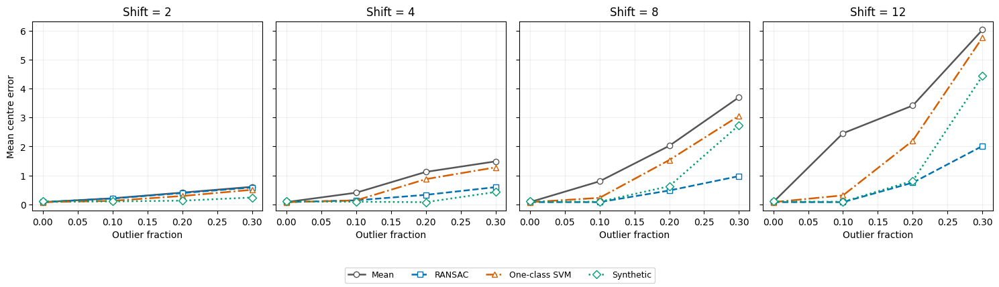

# 第2题 · 三种鲁棒代表点的比较

[作业一目录](../README.md) · [题目原文](../Assignments1.ipynb) · [中文题目](../Assignments1_zh.ipynb) · [上一题：RANSAC](01_ransac.md) · [下一题：维数灾难](03_curse_of_dimensionality.md)

分值 15%。第1题已经把"求一组点的中心"做成了可替换模块。本题再做两个替代品，即单类 SVM 和合成原型，把它们和 RANSAC 版放进同一个聚类框架，从**中心质量、参数含义、成本与确定性**三方面比较。这题的重点不是哪个方法赢，而是说清**每个方法的参数到底控制什么**。

本题依赖第1题：要用到 c1 的 `robust_representative` 和 c2 的聚类函数。

## 0. 开始之前：先读哪些材料

**前提：**已完成第1题的 c1、c2，并读过[第1题讲解](01_ransac.md)的前置知识。单类 SVM 在课程讲义中没有专门讲（题目提到的 Lab 3 本仓库还没有），下表用 scikit-learn 文档补上。

| 优先级 | 材料与范围 | 读完应该会 | 用时 |
|---|---|---|---|
| 必读 1 | [第五课](../../../Lectures/05_NLM_zh.md#kernel-svm)"规范最优超平面"中从核技巧到"sigmoid 核"一段 | 核函数替换内积是什么意思；RBF 核的公式 | 约 5 分钟 |
| 必读 2 | scikit-learn 用户指南 [Novelty and Outlier Detection](https://scikit-learn.org/stable/modules/outlier_detection.html) 中 One-Class SVM 一节，以及 [OneClassSVM](https://scikit-learn.org/stable/modules/generated/sklearn.svm.OneClassSVM.html) 页面上 `nu`、`gamma` 的参数说明（英文） | `nu` 的上界、下界含义；`predict` 与 `decision_function` 的输出 | 约 10 分钟 |
| 必读 3 | Kalogeratos 等 2011 年[论文](https://kalogeratos.com/files/MyPapers/Document-clustering-using-synthetic-cluster-prototypes-DKE2011-recompiled.pdf)中的 Algorithm 2，只看算法框和前后一段 | 合成原型的原始做法，以及题目给出的简化版本省略了什么 | 约 5 分钟 |
| 选读 | [第五课](../../../Lectures/05_NLM_zh.md#section-11)从"场景 1：具有良好泛化能力的超平面"到"规范最优超平面"（公式较多） | 间隔与松弛变量 $\xi$；读懂这些，$\nu$ 在优化问题中的作用就更清楚 | 约 15 分钟 |

必读合计约 20 分钟。

## 1. 前置知识

### 1.1 最重要的 20%

#### ① 三种"筛掉离群点"的原则

| 方法 | 筛选原则 | 参数的单位 |
|---|---|---|
| RANSAC 代表点 | 离候选中心距离不超过 $r$ 的点才算数 | 距离，与数据同单位 |
| 单类 SVM | 学出一个"正常区域"，区域外的点不算 | 核尺度 $\gamma$（距离平方的倒数）加例外比例的上界 $\nu$ |
| 合成原型 | 只用离当前中心最近的 $\alpha\%$ 的点 | 比例，无单位 |

一句话概括：RANSAC 固定"多远算远"，合成原型固定"保留多少"，单类 SVM 介于两者之间，它学出一条边界，$\nu$ 只是软性地约束保留多少。题目 2c 的第二条问的正是这个："参数控制的是一个数据比例，还是一个距离阈值？"

#### ② 单类 SVM（one-class SVM）

- **目的**：只有一类数据，学一个函数 $f$，使大部分数据满足 $f(x)\ge0$（正常），少数满足 $f(x)<0$（例外）。sklearn 中 `predict` 返回 +1 或 −1，`decision_function` 返回 $f(x)$。
- **RBF 核** $K(x,x')=\exp(-\gamma\|x-x'\|^2)$：距离为 $1/\sqrt\gamma$ 时，相似度降到 $e^{-1}\approx0.37$。所以 $1/\sqrt\gamma$ 可以看作模型的空间尺度：$\gamma=0.5$ 时约 1.4，$\gamma=0.1$ 时约 3.2。$\gamma$ 大，边界贴着数据、容易碎成几块；$\gamma$ 小，边界更平滑。$\gamma$ 控制空间尺度，不直接规定保留多少点。
- **$\nu\in(0,1]$**：在优化问题的精确解处，$\nu$ 是**训练例外比例的上界**，也是**支持向量比例的下界**（Schölkopf 等，2001）。它是优化中的控制量，**不是"正好删掉 $\nu$ 比例的数据"的指令**。
- **它不直接输出中心。**要得到代表点，可以先拟合，再取被接受的点求均值。这是你需要在报告中说明的设计选择。
- **尺度敏感**：RBF 依赖欧氏距离，各特征尺度不同时要先标准化。本题是同尺度的二维数据，可以不做，但要写明理由。

#### ③ medoid 与截尾均值（trimmed mean）

- **medoid**：数据中到其他点的距离之和最小的那个**样本**，必须是真实存在的数据点。一维例子 $\{0,1,2,3,100\}$：点 2 到其他点的绝对距离之和为 102，点 1 和点 3 为 103，所以 medoid 是 2，而均值是 21.2。一维时用绝对距离求出的 medoid 就是一个样本中位数，所以它天然稳健。
- **截尾均值**：去掉一部分"极端"点后再求均值。合成原型就是以当前中心为参照、只保留最近一部分点的截尾均值。
- **计数论证**（口试很好用）：如果保留比例 $\alpha$ 大于内点比例 $1-\epsilon$，那么无论排序多好，至少有 $(\alpha-(1-\epsilon))n$ 个离群点一定被纳入。例如 110 个点中有 100 个内点，保留 95% 即 105 个点，至少包含 5 个离群点。

#### ④ 公平比较的实验设计

- **一次只改一个因素**：同一份数据、同一个初始化种子，只替换代表点函数。
- **两个变化方向**（题目要求）：离群比例增加；离群点离内点更远。
- **多次重复**：每个设置用多个随机种子取平均，否则一次运气会主导结论。
- **两个指标各回答一个问题**：中心误差回答"中心准不准"，内点准确率回答"内点分组对不对"。
- **簇编号没有含义**：估计出的第 1 个中心可能对应真实的第 2 个，所以算中心误差前要先对齐编号：两个簇只有两种对应方式，都算一遍取平均距离较小的一种。

### 1.2 其余前置知识速查

| 概念 | 一句话 | 去哪里复习 |
|---|---|---|
| SVM 与核技巧 | 最大间隔加核函数，把线性方法变成非线性 | [第五课 · 核 SVM](../../../Lectures/05_NLM_zh.md#kernel-svm) |
| 单类 SVM | 题目提到的 Lab 3 本仓库没有；看 sklearn 的 [OneClassSVM](https://scikit-learn.org/stable/modules/generated/sklearn.svm.OneClassSVM.html) 和 [Novelty and Outlier Detection](https://scikit-learn.org/stable/modules/outlier_detection.html) | — |
| 局部方法 | 用邻域内的点做决定 | [第一课 · 三类算法](../../../Lectures/01_intro/02_algorithms_and_pipeline.md#classroom-local) |
| 内点准确率 | 两种标签对应方式各算一次准确率，取较高者 | [第1题](01_ransac.md) 3.5 节 |
| 复杂度记号 | $O(m^2d)$ 表示时间随样本数平方、维数线性增长 | 3.3 节 |
| 污染比例的分母 | 本题以最终总数为分母：$m=200\epsilon/(1-\epsilon)$ | 3.3 节 |
| 合成原型原论文 | Kalogeratos 等，2011，算法 2 | [PDF](https://kalogeratos.com/files/MyPapers/Document-clustering-using-synthetic-cluster-prototypes-DKE2011-recompiled.pdf) |

### 1.3 开始前的自测

1. $\nu=0.2$ 的单类 SVM 在 110 个点上拟合后，被拒绝的点一定是 22 个吗？
2. $\gamma$ 从 0.5 改到 0.1，边界会变得更碎还是更平滑？
3. 用绝对距离，$\{1,2,3,4,50\}$ 的 medoid 是哪个点？
4. 合成原型最后保留 80%，如果某个簇里离群点占 30%，会发生什么？

参考答案

1. 不一定。$\nu$ 是上界性质的软约束，实际拒绝比例还受边界形状和数值求解影响；参考解答中 $\nu=0.2,\gamma=1$ 时实际拒绝了 24.55%。
2. 更平滑，因为空间尺度 $1/\sqrt\gamma$ 变大了。
3. 3。它到其他点的距离之和为 51，点 2 和点 4 都是 52。
4. 内点只有 70%，保留 80% 意味着至少纳入 10% 的离群点，无论排序多好。

## 2. 题目要你交什么

| 小题 | 必须交付 | 需要自己决定并在报告中说明 |
|---|---|---|
| 2a | 基于单类 SVM 的代表点：设计、实现、参数作用（尤其是 $\nu$）；与 1c1 和普通均值比较 | 怎样从 SVM 得到一个点；参数取值；是否标准化 |
| 2b | 合成原型的实现；对比例和步数的敏感性分析 | 距离度量；比例序列的网格 |
| 2c | 三种估计器（加均值基线）接入同一聚类；按题目三条轴比较；图和讨论 | 数据怎样生成（离群比例、平移距离）；重复次数；指标 |

## 3. 逐小题讲解

下面的数值来自参考解答的运行，2a、2b 使用与第1题 c1 相同的自生成点云。你的数字会不同，要对照的是趋势和解释。

### 3.1 2a：先用单类 SVM 筛选，再对接受点求均值

参考解答先拟合模型，用 `predict(S) == 1` 找出接受点，再对这些点取均值：

$$
A=\{\,i:f(x_i)\ge0\,\},\qquad r=\frac1{|A|}\sum_{i\in A}x_i.
$$

如果模型一个点都没接受，就返回决策分数最高的那个样本，避免对空集合求均值。这只是退化情况下的实现选择。

**$\nu$ 在优化问题里的位置。**一个常见的原始形式是

$$
\min_{w,\rho,\xi}\ \frac12\|w\|^2+\frac1{\nu n}\sum_i\xi_i-\rho,
\qquad
w^T\phi(x_i)\ge\rho-\xi_i,\quad\xi_i\ge0 .
$$

$\xi_i$ 允许部分训练样本越过接受边界，$\nu$ 越大，越过边界的"罚"越轻。1.1 ② 中的上界、下界性质是在精确解和相应条件下成立的。实现中用决策分数的正负判断接受和拒绝，分数接近零时数值优化误差和容差可能影响分类，所以不能用理论性质去核对每个有限精度下的预测计数。

**当前数据说明了什么。**默认参数为 `nu=0.2, gamma=0.5`：

| 方法或参数 | 到内点样本均值的距离 |
|---|---:|
| 全部点均值 | 0.6578 |
| RANSAC | 0.0000 |
| SVM，$\nu=0.2,\gamma=0.5$ | 0.2825 |
| SVM，$\nu=0.2,\gamma=0.1$ | 0.0362 |
| SVM，$\nu=0.3,\gamma=0.1$ | 0.0182 |

只改 $\gamma$ 就明显改变了中心误差，所以单凭"$\nu$ 大于真实污染比例"不能保证估计准确。RBF 单类 SVM 的接受区域可以由几块不相连的部分组成，远处的小点群也可能得到一块接受区域，随后对全部接受点求均值，中心仍会被拉过去。反过来，删掉主点群边缘的正常点，也会改变有限样本的均值。

保存的参数表中，$\nu=0.2,\gamma=1$ 的实际拒绝比例为 0.2455，高于 0.2；$\nu=0.1,\gamma=0.5$ 时为 0.0727。准确的说法是：**实际拒绝比例与 $\nu$ 不完全相等**。保存的输出没有列出决策分数的分布，不能仅凭这张表断定超出部分全来自数值容差；要确认原因，需要检查负分数的大小、求解容差和收敛状态。

### 3.2 2b：从 medoid 开始，逐步扩大邻域

**medoid 的定义要写明距离。**参考解答用**欧氏距离之和**：

$$
r_0=x_{j^\star},\qquad j^\star=\arg\min_j\sum_i\|x_i-x_j\|_2 .
$$

如果改用平方距离之和，由于

$$
\sum_i\|x_i-x_j\|_2^2=\sum_i\|x_i-\bar x\|_2^2+n\|x_j-\bar x\|_2^2,
$$

选出的会是最靠近普通均值的样本，失去了 medoid 的稳健性，也改变了定义。代码中 `cdist(S, S)` 默认得到欧氏距离矩阵，`distances.sum(axis=1).argmin()` 选出总距离最小的那一行。

**"扩大邻域"具体怎样做。**给定比例序列 $\alpha_1<\alpha_2<\cdots$，每一轮都从**完整的原始集合** $S$ 中，重新选出离当前代表点最近的 $\lceil\alpha_tn\rceil$ 个样本：

$$
N_t=\operatorname{nearest}_{\lceil\alpha_tn\rceil}(S,r_{t-1}),\qquad
r_t=\frac1{|N_t|}\sum_{x\in N_t}x .
$$

"扩大"指邻域包含的点数增加。中心会移动，所以前一轮选中的点在后一轮不一定还在，邻域不必严格嵌套。也不能只在上一轮留下的点中继续筛选，否则无法按题意扩展到原数据的更大比例。

默认先 10% 再 80%：110 个样本对应先选 11 个、再选 88 个。小邻域先给出一个局部中心，大邻域再纳入更多数据以减小小样本波动。这是算法的意图，最终是否改善由数据决定。

**敏感性扫描：**

| 求均值的比例序列 | 到内点样本均值的距离 |
|---|---:|
| 仅 80% | 0.0909 |
| 10% → 80% | 0.1034 |
| 20% → 80% | 0.0909 |
| 10% → 40% → 80% | 0.0909 |
| 10% → 60% | 0.2814 |
| 10% → 95% | 0.3110 |

结果不支持"步骤越多越好"：只用 80% 比默认两步略好，多加一个 40% 的步骤也没有胜过单步。最终只保留 60% 时舍弃的点更多，中心会因有限样本的局部选择而偏离完整内点均值。保留 95% 则要选 105 个点，而内点只有 100 个，按 1.1 ③ 的计数论证至少包含 5 个离群点。

在固定输入顺序和并列规则下，这个方法没有随机抽样，是确定性的。但确定性只表示同样的输入给出同样的结果，不表示结果准确。

### 3.3 2c：在同一聚类框架里比较质量、参数与成本

**实验设计。**使用同一个聚类函数，只替换代表点函数，并保留普通均值作为基线。每个数据集有两个真实中心 $(-3,0)$、$(3,0)$，各 100 个标准差为 0.6 的内点；离群点从这两个中心向上平移后生成，标准差为 0.8。污染比例取 0、10%、20%、30%，平移距离取 2、4、8、12，每种设置用十个种子。

注意这里污染比例的分母是**最终总样本数**，与第1题 a2 不同：

$$
\frac{m}{200+m}=\epsilon\quad\Longrightarrow\quad m=\frac{200\epsilon}{1-\epsilon}.
$$

$m$ 四舍五入，所以 30% 对应 86 个离群点，实际比例为 $86/286\approx30.07\%$。同一设置下所有方法使用相同数据和相同的初始化种子；同一种子下，不同污染设置复用相同的内点和相应的离群点抽样序列，减少不必要的数据差异。

**为什么同时报告中心误差和内点准确率。**估计出的中心编号没有固定含义。两个簇只有两种对应方式（下式中 $\pi$ 只有两种取法），取平均距离较小的一种：

$$
E_{\rm centre}=\min_\pi\frac1k\sum_{j=1}^k\|\hat c_j-\mu_{\pi(j)}\|_2 .
$$

这里对比的是生成分布的**总体中心**，不是 2a 中的内点样本均值。样本均值本身有抽样波动，即使完全没有污染，中心误差一般也不恰好为零。内点准确率只在 200 个内点上计算，它不评价离群点是否被拒绝，也不包含中心坐标的误差。

**主要结果。**污染比例 30% 时，十个种子的平均中心误差：

| 向上平移距离 | 普通均值 | 单类 SVM | RANSAC | 合成原型 |
|---:|---:|---:|---:|---:|
| 2 | 0.6058 | 0.5026 | 0.5829 | 0.2365 |
| 4 | 1.4835 | 1.2773 | 0.5941 | 0.4254 |
| 8 | 3.6977 | 3.0551 | 0.9747 | 2.7375 |
| 12 | 6.0259 | 5.7598 | 2.0149 | 4.4367 |

距离 2 时合成原型最好，距离 12 时 RANSAC 最好。距离较近时，固定半径的支持集可能同时包含内点和部分污染点；距离变大后，基于距离的剔除更有机会把两者分开。但聚类还有初始化和分配两步，不能把曲线变化全部归因于单个中心估计器。

距离 12、污染 30% 时，四种方法的内点准确率约为 0.70、0.70、0.85、0.75。RANSAC 虽然改善了结果，也没有保证正确分组。错误的初始分组、不同结构争夺同一个中心等因素都可能影响最终输出；汇总表没有逐次迭代的轨迹，不能把每次失败都归结为同一个未经检查的原因。

合成原型默认最后保留 80%。某个簇的实际污染比例超过 20% 时，即使最近邻排序理想，也没有足够的干净点填满这 80%。全局污染 30% 不等于每个中间簇都恰好污染 30%，但已经提示固定的保留比例可能不适合这些设置。

**参数究竟控制什么：**

| 方法 | 当前参数 | 直接作用 | 设定时需要知道什么 |
|---|---|---|---|
| RANSAC | 半径 2.5；100 次；每次 3 点 | 距离接受范围与候选搜索次数 | 主要点群的尺度，是否有足够大的支持集 |
| 单类 SVM | $\nu=0.2,\gamma=0.5$ | 对训练例外的容忍度与核的空间尺度 | 特征尺度、边界形状、可能的多群结构 |
| 合成原型 | 10% → 80% | 每轮参与求均值的样本数 | 预计的污染量，是否存在可靠的局部中心 |

本实验没有为每个设置单独调到最优参数，所以比较的是**这些固定参数下的实现**，不能据此说某类算法无论怎样调参都不如另一类。

**成本和确定性。**对一个含 $m$ 个 $d$ 维点的簇，RANSAC 每轮扫描全部点，主要成本约为 $O(Tmd)$。合成原型显式构建 $m\times m$ 距离矩阵，时间为 $O(m^2d)$、内存为 $O(m^2)$，之后还有排序和求均值。核 SVM 的成本取决于样本数、核计算、支持向量数和优化过程，不能从这组小数据的测量外推到大规模。

全部设置的平均完整聚类耗时：普通均值 0.1937 ms，合成原型 0.5991 ms，单类 SVM 2.5471 ms，RANSAC 9.6422 ms。计时从调用聚类函数开始，包含初始化和每次分配、更新，不只是一次代表点计算；不同方法的迭代次数也可能不同。这些是本机小样本上的结果。

RANSAC 包含随机采样，但函数每次从固定种子开始，相同输入可以复现。单类 SVM 和合成原型在固定输入和参数下不依赖随机抽样；整个聚类仍有随机初始化，所以不能把"代表点函数是确定的"说成"整个聚类不受种子影响"。

## 4. 动手顺序

1. 复用第1题的点云，先算出三个参照：全部点均值、内点均值（若有标签）、1c1 的结果。
2. 写 `svm_representative(S, nu, gamma)`：拟合、`predict(S) == 1`、求均值，并处理一个点都没接受的情况。把接受和拒绝的点画在图上。
3. 在 $\nu$ 和 $\gamma$ 的小网格上，同时记录实际拒绝比例和中心误差，分开看这两件事。
4. 写 medoid（`cdist` 加 `sum(axis=1).argmin()`），再写逐步扩大邻域，每一轮都从完整集合重新选最近的点。
5. 扫比例序列：仅 80%、10%→80%、10%→40%→80%、10%→95% 等，解释每一行。
6. 设计 2c 的数据：两个簇加向上平移的离群点群，离群比例和平移距离组成网格，每个设置多个种子。
7. 同一数据、同一初始化种子下跑四种代表点函数，记录中心误差（先对齐编号）、内点准确率和耗时。
8. 按题目的三条轴组织讨论：质量随污染比例和距离的变化、参数的含义、成本与确定性。

**值得亲手做的小检查：**保持点云不变、只改 $\gamma$，分别看接受了多少点和最后的均值，体会"识别了多少点"与"中心是否准确"是两件事。

## 5. 容易说错的地方

| 容易说错 | 更准确的说法 |
|---|---|
| 单类 SVM 恰好去掉 $\nu$ 比例的数据 | $\nu$ 约束的是优化问题中的量；实际拒绝比例与边界和数值求解有关 |
| 把 $\nu$ 设成真实离群比例，就能删掉全部离群点 | 参数不知道真实标签，结果还受 $\gamma$ 和数据尺度影响 |
| 两步中的 80% 是上一轮 10% 的 80% | 两个比例的分母都是原始集合的大小 |
| 步骤越多越好 | 敏感性扫描不支持这一点 |
| 确定性就是准确 | 只表示同样输入给出同样结果 |
| 第2题的 30% 污染与第1题含义相同 | 第2题以最终总数为分母，第1题以原始干净点数为分母 |

## 6. 口试自测

口试时这一题约讲 1.5 分钟。主线：三种鲁棒估计器控制的对象不同，所以没有普遍最优者。可以展示 30% 污染、平移 12 时的中心误差，以及平移较小时合成原型反而更好的反例。

**问：单类 SVM 为什么不一定只接受最大的那个点群？**

答案

它学的是满足核相似性和优化约束的接受区域，并没有"只保留一个最大连通群"的要求。

**问：为什么叫"合成"原型？**

答案

初始化用的 medoid 是一个真实样本，之后求均值得到的代表点通常不是数据中已有的样本，而是由多个样本计算出来的点。

**问：离群点更远时，为什么鲁棒聚类有时仍然更差？**

答案

估计器只在当前分组内工作。整体分组和初始化一旦受到污染影响，局部的鲁棒中心未必能恢复正确的两个群。更远让内外点在几何上更好区分，但不自动保证整个迭代找对结构。

**问：这次实验能不能选出一个永远最好的估计器？**

答案

不能。距离 2 时合成原型更好，距离 12 时 RANSAC 更好，而且它们用的是固定参数。应根据污染比例、几何尺度和计算限制选择，再在具体数据上验证。

**问：三种方法的参数，哪个最容易在实际中设定？**

答案

取决于你知道什么。知道内点的尺度（如噪声标准差），RANSAC 的半径最好定；知道大致污染比例，合成原型的比例最好定；单类 SVM 同时需要尺度（$\gamma$）和比例（$\nu$）的信息，两者还会相互影响。

## 7. 资料

- scikit-learn 文档：[OneClassSVM](https://scikit-learn.org/stable/modules/generated/sklearn.svm.OneClassSVM.html)、[Novelty and Outlier Detection](https://scikit-learn.org/stable/modules/outlier_detection.html)。
- Schölkopf 等，*Estimating the Support of a High-Dimensional Distribution*，Neural Computation，2001：单类 SVM 与 $\nu$ 性质的原始论文。
- Kalogeratos 等，[Document clustering using synthetic cluster prototypes](https://kalogeratos.com/files/MyPapers/Document-clustering-using-synthetic-cluster-prototypes-DKE2011-recompiled.pdf)，2011，算法 2：合成原型的来源；本题采用的是题目给出的简化版本。
- 参考解答 [Assignments1_solution.ipynb](../Assignments1_solution.ipynb) 中对应 `svm_representative`、`synthetic_representative` 和第 2c 题的实验循环。建议自己写完、跑完之后再对照。
