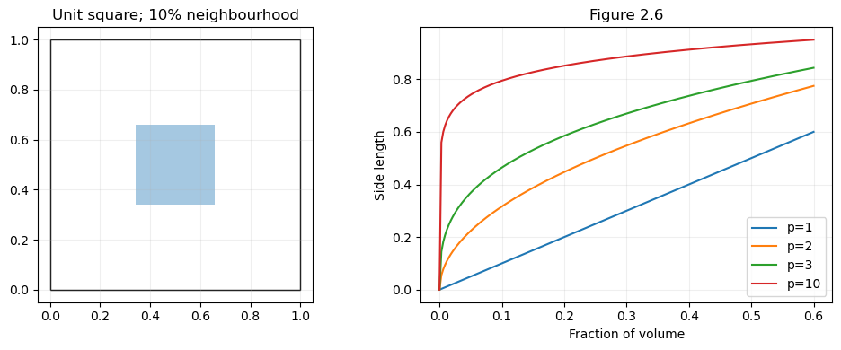
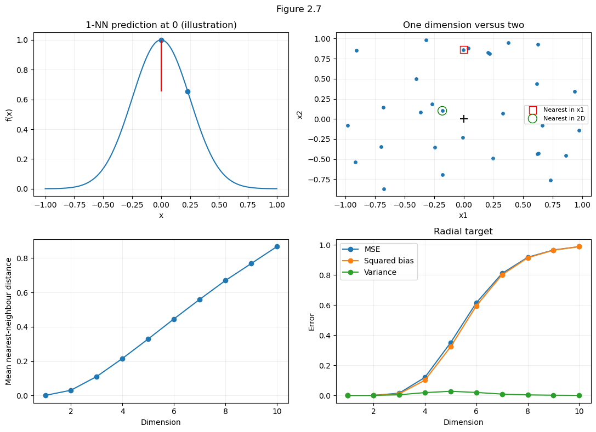
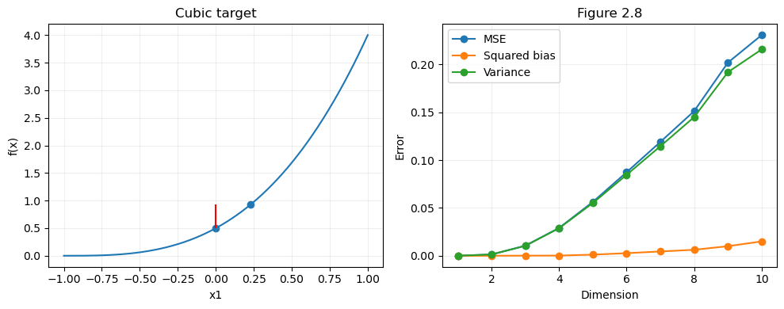
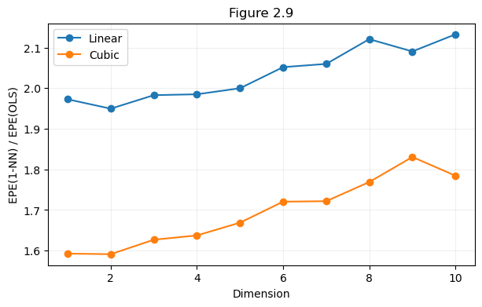

# 第3题 · 维数灾难：复现 ESL 图 2.6–2.9

[作业一目录](../README.md) · [题目原文](../Assignments1.ipynb) · [中文题目](../Assignments1_zh.ipynb) · [上一题：三种鲁棒代表点](02_robust_representatives.md) · [下一题：数据划分](04_data_splitting.md)

分值 15%。题目只有一句话：读 ESL 第 2.5 节，写代码复现并验证图 2.6–2.9 的全部实验。难点在于把书里简短的描述翻译成精确的模拟实验，并能解释每张图背后的机制。四张图共同回答一个问题：**训练样本数固定时，为什么"找离待预测点最近的样本"在高维越来越不可靠？**图 2.6 讲空间几何，图 2.7、2.8 拆分误差的来源，图 2.9 比较局部方法和带结构假设的线性模型。

## 0. 开始之前：先读哪些材料

**默认你已经会：**期望、方差及其基本运算；均匀分布和正态分布；NumPy 的向量化运算（本题的模拟要重复上千次，逐点写 Python 循环会很慢）。

| 优先级 | 材料与范围 | 读完应该会 | 用时 |
|---|---|---|---|
| 必读 1 | [ESL 第 2 章 PDF](<../../../References/The Elements of Statistical Learning/PDF/02_Overview of Supervised Learning.pdf>) 2.5 节"Local Methods in High Dimensions"全节，书面第 22–27 页（英文约 2400 词；也有[文字版](<../../../References/The Elements of Statistical Learning/Markdown/02_Overview of Supervised Learning.md>)）。这就是题目本身 | 四张图各自的实验设置：样本数、维度范围、目标函数、有没有噪声、在哪个点预测 | 约 25 分钟 |
| 必读 2 | [第一课第 4 篇](../../../Lectures/01_intro/04_hypotheses_and_bias_variance.md#bias-variance)后半：从"统计推断中的偏差—方差权衡"到篇末，含折叠的推导 | MSE = 方差 + 偏差平方；预测新观测时为什么还要加一项噪声 | 约 8 分钟 |
| 选读 | [第二课第 2 篇](../../../Lectures/02_LM/02_generalization_and_high_dimensions.md#reading-orange-shell)"同样厚度的'橘子皮'，在高维里占多少体积" | 高维中体积集中在外壳，二维、三维的直觉要重新检查 | 约 3 分钟 |
| 选读 | [第一课第 5 篇](../../../Lectures/01_intro/05_linear_models.md#projection)"$d/n$ 项的解释" | OLS 的预测方差约按 $d/n$ 增长，可用来解释图 2.9 中 OLS 的 EPE 为什么接近 1 | 约 4 分钟 |
| 选读 | [第五课](../../../Lectures/05_NLM_zh.md#section-19)"局部方法 1：k 近邻" | kNN 的算法步骤 | 约 5 分钟 |

必读合计约 35 分钟。

## 1. 前置知识

### 1.1 最重要的 20%

#### ① 高维中的"局部邻域"会变得巨大

在单位超立方体 $[0,1]^p$ 中均匀撒点，以中心为中心取一个边长为 $e$ 的小立方体。想让它包含比例为 $r$ 的数据，需要多大的 $e$？均匀分布下"数据比例"等于"体积比例"，小立方体的体积是 $e^p$，所以

$$
e^p=r\quad\Longrightarrow\quad e_p(r)=r^{1/p}.
$$

| 维度 $p$ | 包含 1% 所需边长 | 包含 10% 所需边长 |
|---:|---:|---:|
| 1 | 0.0100 | 0.1000 |
| 2 | 0.1000 | 0.3162 |
| 3 | 0.2154 | 0.4642 |
| 10 | 0.6310 | 0.7943 |

十维时，哪怕只想包含 1% 的数据，也要覆盖每个坐标范围的约 63%。"只用一小部分样本"和"用的样本离得很近"在高维不再是一回事，这就是局部方法在高维失效的几何根源。

另一个直观说法：想在每条坐标轴上保持同样的分辨率，比如每条轴分 10 格，一维要 10 格，二维 100 格，十维 $10^{10}$ 格。要让每格都有样本，样本数随维度指数增长。实际数据若集中在低维结构上，或只有少数特征有用，需要的样本会少得多，那时应该利用这些结构。

#### ② 一个点上的偏差—方差分解

训练集 $\mathcal T$ 是随机抽出来的，所以模型在固定点 $x_0$ 的预测 $\hat f(x_0)$ 是一个随机变量。**随机的是训练集**：换一批训练数据，预测就会变。设真值为 $f(x_0)$：

$$
\underbrace{E_{\mathcal T}\bigl[(\hat f(x_0)-f(x_0))^2\bigr]}_{\text{MSE}}
=\underbrace{E_{\mathcal T}\bigl[(\hat f(x_0)-E_{\mathcal T}\hat f(x_0))^2\bigr]}_{\text{方差 Variance}}
+\underbrace{\bigl(E_{\mathcal T}\hat f(x_0)-f(x_0)\bigr)^2}_{\text{偏差平方 Bias}^2}.
$$

如果要预测的是带噪声的新观测 $Y_0=f(x_0)+\varepsilon_0$（$\operatorname{Var}\varepsilon_0=\sigma^2$），还要加上不可约误差：

$$
\mathrm{EPE}(x_0)=\sigma^2+\mathrm{Variance}+\mathrm{Bias}^2 .
$$

用掷飞镖理解：偏差是平均落点离靶心多远，方差是落点有多分散。一个不管训练集是什么都预测 0 的模型，方差为 0，偏差却可能很大，所以"预测稳定"不等于"预测准确"。

#### ③ 用蒙特卡洛模拟估计期望

上面的期望 $E_{\mathcal T}$ 算不出来，就模拟：生成 $B$ 个独立的训练集，各算一次预测 $\hat f_b$，记均值为 $\bar f$，然后

$$
\widehat{\mathrm{MSE}}=\frac1B\sum_b(\hat f_b-f_0)^2,\qquad
\widehat{\mathrm{Bias}^2}=(\bar f-f_0)^2,\qquad
\widehat{\mathrm{Var}}=\frac1B\sum_b(\hat f_b-\bar f)^2 .
$$

三项都按 $B$ 平均时，$\widehat{\mathrm{MSE}}=\widehat{\mathrm{Var}}+\widehat{\mathrm{Bias}^2}$ 精确成立（推导见 3.2 节），可以写成代码里的 `assert` 检查实现。蒙特卡洛估计有误差，量级约为 $1/\sqrt B$；模拟结果和理论值有小差异是正常的。

#### ④ 结构假设 vs 局部方法

- **1-NN** 不预设 $f$ 的参数形式，但依赖所选距离能够反映输出的局部相似性。预测只用一个点，保留了那一个训练响应的全部噪声（方差 $\sigma^2$），高维时还要承担"最近邻其实很远"的位置误差。
- **OLS** 假设 $f$ 是线性的，用全部 $N$ 个点估计少量系数：在原点的预测方差约为 $\sigma^2/N$，非常小。假设对了（或近似对），它就赢；假设错了，会有偏差。

图 2.9 和整个 2.5 节的结论是：**在高维中，结构正确的"刚性"模型可以胜过灵活的局部方法。**方法的效果取决于数据几何、目标函数结构和估计方差三者的共同作用。

### 1.2 其余前置知识速查

| 概念 | 一句话 | 去哪里复习 |
|---|---|---|
| 偏差—方差（课上） | 参数估计与预测误差两种情形 | [第一课 · 偏差—方差](../../../Lectures/01_intro/04_hypotheses_and_bias_variance.md#bias-variance)、[预测误差](../../../Lectures/01_intro/04_hypotheses_and_bias_variance.md#prediction-error) |
| 高维的反直觉现象 | 高维中体积集中在表面薄层 | [第二课 · 高维插曲](../../../Lectures/02_LM/02_generalization_and_high_dimensions.md#reading-orange-shell) |
| k 近邻 | 用最近的 $k$ 个训练点投票或平均 | [第五课 · k 近邻](../../../Lectures/05_NLM_zh.md#section-19) |
| 均匀采样 | `rng.uniform(-1, 1, (N, p))` | — |
| 找最近邻不用开方 | 比较平方距离即可，只有画距离时才 `sqrt` | 3.2 节 |
| 一维最近邻距离的期望 | $E[\min_i|X_i|]=1/(N+1)$，$N=1000$ 时约 0.001，可用来检查代码 | 3.2 节 |
| 对称分布的奇数阶矩为 0 | $E[Z]=E[Z^3]=0$，用于解释图 2.8 | 3.3 节 |
| $E[A]/E[B]\ne E[A/B]$ | 图 2.9 的比值要先平均再相除 | 3.4 节 |
| `LinearRegression` 默认含截距 | 在原点预测时截距仍由数据估计 | 3.4 节 |

### 1.3 开始前的自测

1. $p=5$ 时，要包含 10% 的均匀数据，中心小立方体的边长约是多少？
2. 一个模型不管训练集是什么都预测 0，真值是 1。它的偏差平方、方差和 MSE 各是多少？
3. 估计"预测方差"时，为什么要重新生成训练集，而不是在同一个训练集上重复预测？
4. 图 2.9 中，低维时 1-NN 的 EPE 为什么接近 $2\sigma^2$？

<details><summary>参考答案</summary>

1. $0.1^{1/5}\approx0.63$。
2. 偏差平方 1，方差 0，MSE 1。
3. 方差描述的是"换一批训练数据，预测会变多少"。同一个训练集上重复预测，结果完全相同，测不出这种波动。
4. 1-NN 直接输出一个训练响应，它带一份方差为 $\sigma^2$ 的噪声；要预测的新观测又带一份独立的噪声 $\sigma^2$。低维时最近邻很近，位置误差可以忽略，合计约 $2\sigma^2$。

</details>

## 2. 题目要你交什么

| 图 | 要复现的内容 | 实验设置（按书） |
|---|---|---|
| 2.6 | 邻域边长随维度和目标比例变化的曲线；可以用随机点验证 | 解析式 $r^{1/p}$，加均匀采样核对 |
| 2.7 | 径向函数 $\exp(-8\|x\|^2)$ 下 1-NN 在原点的最近邻距离、MSE、方差、偏差平方随 $p$ 变化 | $[-1,1]^p$ 中 1000 个训练点，$p=1,\ldots,10$，无噪声 |
| 2.8 | 换成只依赖 $x_1$ 的三次函数 $\frac12(x_1+1)^3$，同样四条曲线 | 同上 |
| 2.9 | 加噪声后，1-NN 与 OLS 在原点的 EPE 之比；线性和三次两个目标 | 500 个训练点，$\varepsilon\sim\mathcal N(0,1)$ |

需要自己决定并在报告中说明：每个维度重复多少次、随机种子、图 2.8 是否复用图 2.7 的训练点、上半部分的示意图怎么画。

## 3. 逐图讲解

下面的数值来自参考解答的运行。你的重复次数和种子不同，数字会有小差异，要对照的是形状、量级和解释。

### 3.1 图 2.6：覆盖相同比例的数据，邻域需要多大

公式和数值表见 1.1 ①。要注意 $e$ 是**边长**，不是欧氏距离，也不是球的半径；$0<r<1$ 固定时，$p$ 增大会让 $r^{1/p}$ 趋近 1。

**代码路线。**右图直接画解析式，不需要训练模型。再对 $p=1,2,3,10$ 各生成 100,000 个均匀点，检查它们是否落入中心邻域（参考解答种子为 30，验证 $r=0.01,0.1$）：

```python
side = fraction ** (1 / dimension)
inside = (np.abs(points - 0.5) <= side / 2).all(axis=1)
observed_fraction = inside.mean()
```

`points - 0.5` 把中心移到原点；每个坐标的绝对偏移不能超过半个边长；`.all(axis=1)` 要求一个点在所有坐标上同时满足条件；布尔值的均值就是落入邻域的比例。



**结果与边界。**十维、目标 10% 时观察比例为 0.1007，二维为 0.0994，与理论一致。这些小差异是有限采样造成的：真实比例为 0.1 时，100,000 次采样的比例标准差约为 $\sqrt{0.1\times0.9/100000}\approx0.00095$。这里验证的是固定邻域的概率质量，并没有精确计算"第 $k$ 个近邻距离"的期望。

左图用二维正方形展示 10% 的邻域，书上用三维示意，几何结论相同，不必逐像素复制原图。这个结论依赖均匀分布，且邻域完整位于立方体内部；靠近边界或密度不均匀时，体积比例不再直接等于样本比例。

### 3.2 图 2.7：径向函数的误差为什么主要是偏差

**设置。**对每个 $p=1,\ldots,10$，独立生成 1000 个 $[-1,1]^p$ 中的训练点，响应完全由

$$
f(x)=\exp(-8\|x\|^2)
$$

决定，不加噪声。待预测点固定为 $x_0=0$，真值 $f(0)=1$。1-NN 回归找到离原点最近的训练点 $x_*$，直接输出 $f(x_*)$。每个维度重新生成训练集 2000 次（参考解答种子为 31）。

**为什么这样设计。**固定样本数和算法、只改维度，才能看出维度的影响；固定测试点，避免把不同位置的难度混在一起；不加噪声，才能单独考察"最近邻不够近"造成的误差；每次都要重新生成训练集，否则测不出训练集带来的方差。

核心实现：

```python
squared_distance = np.sum(X ** 2, axis=1)
nearest = squared_distance.argmin()
prediction = np.exp(-8 * squared_distance[nearest])
```

目标点是原点，所以距离平方就是各坐标平方之和。

**分解为什么精确成立。**把 $\hat f_b-f_0$ 写成 $(\hat f_b-\bar f)+(\bar f-f_0)$ 再展开平方，交叉项含 $\sum_b(\hat f_b-\bar f)=0$，于是 $\widehat{\mathrm{MSE}}=\widehat{\mathrm{Var}}+\widehat{\mathrm{Bias}^2}$。这也是代码用 NumPy 默认的 `var(..., ddof=0)` 的原因：三项都对同一组 2000 次结果按 $B$ 平均，分解在数值精度内成立。若方差改用分母 $B-1$，这个有限样本恒等式就不再直接成立。这并不表示用 $B-1$ 估计总体方差是错的，只是这里要算的对象不同。

**三个"平均"要分清。**最近邻距离先在每个训练集内部取最小值，再对 2000 个训练集取平均；预测的方差也跨训练集计算；没有对 1000 个训练标签直接求方差，后者描述的是同一批数据的输出分布，回答不了"换一批训练数据，模型是否稳定"。

有限重复次数下，样本预测均值的平方偏离并不是总体偏差平方的无偏估计。这里要的是一个能精确检查的经验分解，所以把三项统一定义在同一组模拟结果上。`assert` 检查的是计算的一致性，不能证明蒙特卡洛次数已经足够。

**为什么偏差向下。**只要最近邻不是原点，$\|x_*\|^2>0$，就有 $f(x_*)<1$，预测总从同一侧偏离真值。维度增加后最近邻更远，$\exp(-8\|x_*\|^2)$ 很快接近零，模型经常稳定地给出接近零的错误预测：方差可能下降，偏差平方却趋近 1。



| 维度 | 平均最近邻距离 | MSE | 偏差平方 |
|---:|---:|---:|---:|
| 1 | 0.0010 | $1.6081\times10^{-9}$ | $2.6699\times10^{-10}$ |
| 5 | 0.3294 | 0.34984 | 0.32251 |
| 10 | 0.8670 | 0.98797 | 0.98780 |

十维时方差只有约 0.00017，误差几乎全来自偏差平方。

**一维手算检查。**一维中 $X_i\sim U[-1,1]$，所以 $|X_i|\sim U[0,1]$。令 $D=\min_i|X_i|$，对 $0\le t\le1$，1000 个点都离原点超过 $t$ 的概率是 $(1-t)^{1000}$，积分得

$$
E[D]=\int_0^1(1-t)^{1000}\,dt=\frac1{1001}\approx0.000999 .
$$

这与输出中的 0.0010 一致，是不用看图就能做的检查。如果你的代码算出一维平均距离接近 0.5，多半是在平均所有点的距离，而不是每轮先取最近邻。书上另有单位球中最近邻距离的公式，本实验的采样域是超立方体，不能直接拿那条公式核对所有维度。

**怎样读四个面板。**左上图用一维函数和示意点 $x=0.23$ 画出预测误差；右上图用另一个种子 32 生成 30 个二维点，比较只看 $x_1$ 和看完整二维距离时的最近邻。这两张是解释几何关系的示意图。下方两张才是每个维度 1000 点、2000 次重复的正式统计，不要把上方 30 个点当成实验的样本量。

### 3.3 图 2.8：只有一个有用特征，为什么仍然受高维影响

采样范围、样本数、重复次数和最近邻选择都与图 2.7 相同，只更换目标函数：

$$
f(x)=\frac12(x_1+1)^3,\qquad f(0)=\frac12 .
$$

注意真值从 1 变成了 0.5。径向目标需要全部坐标，三次目标只依赖第一个坐标；其余坐标不影响输出，却仍参与欧氏距离 $\|x\|^2=x_1^2+x_2^2+\cdots+x_p^2$。第一个坐标很接近零的点，可能因为其他坐标较远而被排除。算法在全部维度上找近邻，并不知道哪些特征与输出无关。

参考解答复用同一批训练点和同一个 `nearest`，便于直接比较两种函数：

```python
cubic_predictions[index, run] = 0.5 * (X[nearest, 0] + 1) ** 3
cubic_mse = np.mean((cubic_predictions - 0.5) ** 2, axis=1)
cubic_variance = cubic_predictions.var(axis=1)
```

这样两条曲线的差异主要来自目标函数，避免两组随机训练点带来额外波动。若想加一项验证，可以再算"只沿第一坐标找近邻"的三次预测，帮助理解无关特征的影响；这属于扩展实验，图中的数字不包含它。

**为什么这次方差占主要部分。**令最近邻的第一坐标为 $Z$。采样和距离规则关于原点对称，所以 $Z$ 的分布对称。展开目标：

$$
f(Z)=\frac12+\frac32Z+\frac32Z^2+\frac12Z^3 .
$$

对称性给出 $E[Z]=E[Z^3]=0$，于是

$$
E[f(Z)]-f(0)=\frac32E[Z^2].
$$

所以三次函数的偏差并不严格为零。但在近邻较近时，一阶项 $\frac32Z$ 已经带来左右波动，方差约为 $\frac94E[Z^2]$；偏差平方为 $\frac94(E[Z^2])^2$，量级更小。这段近似适用于 $Z$ 较小时，用来理解机制，最终数值以完整函数的模拟为准。



| 维度 | MSE | 方差 | 偏差平方（前两列相减） |
|---:|---:|---:|---:|
| 1 | 0.0000045962 | 0.0000045948 | 约 $1.4\times10^{-9}$ |
| 5 | 0.056272 | 0.055118 | 约 0.001154 |
| 10 | 0.23065 | 0.21568 | 约 0.01497 |

十维时约 94% 的 MSE 来自方差。与图 2.7 对照，就能回答"维数灾难主要增加偏差还是方差"：两种情况都会出现，取决于目标函数和算法怎样利用特征。

如果事先知道只有 $x_1$ 有用，当然应该只按 $x_1$ 找近邻。本实验故意用完整的 $p$ 维距离，展示无关特征的代价。它说明特征选择可能有效，并没有证明高维数据都无法学习；有限次模拟的曲线也不要求每一维都严格上升。

### 3.4 图 2.9：加入噪声后，为什么 OLS 胜过 1-NN

**实验条件变了。**每个维度用 500 个训练点，仍均匀分布在 $[-1,1]^p$，测试点仍是原点。两个目标为 $f(x)=x_1$ 和 $f(x)=\frac12(x_1+1)^3$，训练响应现在带噪声：

$$
Y_i=f(X_i)+\varepsilon_i,\qquad\varepsilon_i\sim\mathcal N(0,1).
$$

每个维度重复 3000 次（参考解答种子为 33）。每次在相同的训练输入上比较 1-NN 和带截距的 OLS，两个目标各用独立的噪声列。1-NN 直接取最近邻的带噪声响应，OLS 用全部 500 个点估计系数：

```python
signal = np.column_stack([X[:, 0], 0.5 * (X[:, 0] + 1) ** 3])
y = signal + rng.normal(0, 1, (500, 2))
nn_prediction = y[nearest]
ols_prediction = LinearRegression().fit(X, y).predict(np.zeros((1, dimension)))[0]
```

`LinearRegression()` 默认含截距。在原点预测时斜率项都为零，截距仍由数据估计。若去掉截距，原点预测会被固定为 0，对真值为 0.5 的三次目标就变成了另一个实验。书中的输入若包含常数项，原点对应增广向量 $(1,0,\ldots,0)$，不是全零向量。

**为什么误差要额外加 1。**图 2.7、2.8 估计的是确定的函数值，现在要预测带噪声的新响应 $Y_0=f(0)+\varepsilon_0$。测试噪声与整个训练过程独立、均值为零、方差为 1，展开平方后交叉项期望为零：

$$
\begin{aligned}
\mathrm{EPE}(0)
&=E[(f(0)+\varepsilon_0-\hat f(0))^2]\\
&=E[(f(0)-\hat f(0))^2]+E[\varepsilon_0^2]\\
&=E[(f(0)-\hat f(0))^2]+1 .
\end{aligned}
$$

训练噪声已经通过预测值进入第一项，额外的 1 来自另一份独立的测试噪声，没有重复计算。直接解析地加 1，比每轮再抽一个测试噪声更省事，也少了一份模拟波动。

**怎样保证比较公平。**每轮两种方法要用同一个 $X$、同一列 $y$，在同一个原点预测，否则误差差异会混入训练数据不同的影响。每个训练集都要重新拟合 OLS、重新找近邻；不能把所有重复数据拼起来只拟合一次 OLS，那会把训练样本量从 500 偷换成 150 万。用两个响应列一次拟合，只是同时解两个最小二乘问题，两个目标并不共享系数。

**比值怎样算。**先平均每种方法的误差，再相除：

$$
\widehat R=\frac{1+B^{-1}\sum_b(\hat f_b^{\mathrm{NN}}-f_0)^2}{1+B^{-1}\sum_b(\hat f_b^{\mathrm{OLS}}-f_0)^2}.
$$

它不是每轮误差比的平均。一般 $E[A]/E[B]\ne E[A/B]$，后者还可能被分母很小的个别轮次显著影响。纵轴大于 1 表示 OLS 的平均 EPE 更低。



| 维度 | 目标 | 1-NN EPE | OLS EPE | 比值 |
|---:|---|---:|---:|---:|
| 1 | 线性 | 1.9767 | 1.0020 | 1.9727 |
| 5 | 线性 | 2.0041 | 1.0021 | 1.9999 |
| 10 | 线性 | 2.1370 | 1.0020 | 2.1327 |
| 1 | 三次 | 1.9906 | 1.2499 | 1.5927 |
| 5 | 三次 | 2.0891 | 1.2518 | 1.6689 |
| 10 | 三次 | 2.2338 | 1.2518 | 1.7845 |

**线性情形为什么接近 2。**对训练输入和噪声取期望，

$$
\mathrm{EPE}_{\mathrm{NN}}(0)=2+E[(f(X_*)-f(0))^2].
$$

低维时近邻很近，最后一项很小，所以接近 2。线性 OLS 的模型形式正确，500 个点使原点预测的方差很小，EPE 接近 1，比值因此接近 2。维度增大后，近邻的第一坐标通常不再那么接近零，1-NN 额外承担位置误差。

表中一维 1-NN 的 EPE 为 1.9767，略低于理论下界 2，**这是 3000 次模拟的估计误差**：代码只对测试噪声做了解析平均，训练噪声仍靠抽样平均，不会强制每次都大于 2。不要为了贴合理论而修改、截断或平滑这个结果。

**三次情形为什么从约 1.6 开始。**这可以手算验证。令 $X_1\sim U[-1,1]$，有 $E[X_1]=E[X_1^3]=0$、$E[X_1^2]=1/3$、$E[X_1^4]=1/5$。三次目标的总体最佳线性投影为

$$
a=E[f(X_1)]=1,\qquad b=\frac{E[X_1f(X_1)]}{E[X_1^2]}=\frac{3/5}{1/3}=\frac95 .
$$

其他坐标独立且均值为零，总体系数为零。于是总体 OLS 在原点预测 1，真值却是 0.5，偏差平方为 0.25。忽略有限样本的估计方差，EPE 约为 $1+0.25=1.25$；低维 1-NN 的 EPE 约为 2，比值约为 $2/1.25=1.6$，与表中的 1.2499 和 1.5927 相符。这是固定原点处的解释，不能直接套用到对所有测试位置平均的风险。

OLS 这次获胜，依赖于目标函数在这个设置下能被线性模型较好地处理，以及样本数远多于待估参数。换成线性模型严重失配的函数、其他测试位置，或小样本高维的场景，结论可能变化。书中关于平均测试位置的 $\sigma^2(1+p/N)$ 近似，也不能直接替代本题固定原点的 EPE。

## 4. 动手顺序

1. 图 2.6：先画解析曲线，再用 10 万个均匀点验证两三个点。
2. 图 2.7：写一个返回原点最近邻索引的小函数，先只跑 $p=1$、$B=200$，检查平均最近邻距离约为 0.001。
3. 扩展到 $p=1,\ldots,10$、$B=2000$，同时保存最近邻距离和预测；算 MSE、方差和偏差平方，用 `assert np.allclose(mse, var + bias2)` 检查。
4. 图 2.8：复用同一批训练点和同一个最近邻，只换目标函数和真值（0.5）。
5. 图 2.9：$N=500$ 并加噪声；每轮在同一个 $X$、同一列 $y$ 上比较 1-NN 和 OLS；EPE 等于 1 加平均平方误差；先平均再相除。
6. 把自己的四张图和书上的图对照：形状和量级是否一致，不一致处能否解释。

**值得亲手做的小检查：**在图 2.9 中去掉公式里的测试噪声项 1，确认此时算的是"估计无噪声函数值"的 MSE，不能再叫原来的 EPE。

## 5. 容易说错的地方

| 容易说错 | 更准确的说法 |
|---|---|
| 维数灾难就是方差变大 | 图 2.7 偏差主导、图 2.8 方差主导，取决于目标函数和算法 |
| 预测稳定就是准确 | 一直预测错也可以方差很小 |
| 边长 $e$ 是邻域半径 | $e$ 是超立方体的边长 |
| 1-NN 的 EPE 低于 2 说明代码有错 | 有限次模拟的估计误差 |
| OLS 有偏差，所以更差 | 比较的是总误差：0.25 的偏差平方远小于 1-NN 多出的噪声 |
| 比值是每轮误差比的平均 | 先分别平均，再相除 |

## 6. 口试自测

口试时这一题约讲 2 分钟。主线：局部邻域随维度扩大，目标函数决定偏差和方差谁占主导。可以展示图 2.7 和 2.8 的误差分解，以及图 2.9 中额外的测试噪声项。

**问：把 $r$ 减小，不就能保持"局部"了吗？**

<details><summary>答案</summary>

可以缩小邻域，但里面的样本会更少，估计波动更大。高维时既要邻域小、又要邻域里有足够样本，通常需要显著增加总样本数。

</details>

**问：没有噪声，为什么还有方差？**

<details><summary>答案</summary>

方差来自训练集的抽样。换一组训练点，最近邻的位置会变，预测也跟着变。这里测的是不同训练集导致的预测波动。

</details>

**问：既然三次目标只依赖 $x_1$，为什么不只按 $x_1$ 找近邻？**

<details><summary>答案</summary>

如果事先知道这个结构，确实应该这么做。本实验故意用完整的 $p$ 维距离，展示无关特征带来的代价，说明特征选择可能有用。

</details>

**问：OLS 有偏差，为什么仍然更好？**

<details><summary>答案</summary>

平方损失比较的是总误差。三次目标给 OLS 带来约 0.25 的偏差平方，而 1-NN 保留了一个训练响应的全部噪声（约 1），还有近邻位置误差，所以 OLS 的总 EPE 更低。

</details>

**问：这四张图最想说明什么？**

<details><summary>答案</summary>

方法的效果同时取决于数据几何、目标函数结构和估计方差。只强调模型灵活或局部平均，不足以保证预测准确；结构假设正确时，简单模型在高维中可以胜过局部方法。

</details>

## 7. 资料

- [ESL 第 2 章 PDF](<../../../References/The Elements of Statistical Learning/PDF/02_Overview of Supervised Learning.pdf>)：2.5 节，图 2.6–2.9；[文字版](<../../../References/The Elements of Statistical Learning/Markdown/02_Overview of Supervised Learning.md>)。
- 参考解答 [Assignments1_solution.ipynb](../Assignments1_solution.ipynb) 中第 3 题的三个代码单元（变量 `nearest_distances`、`radial_predictions`、`cubic_predictions`、`epe_results`）。建议自己写完、跑完之后再对照。
