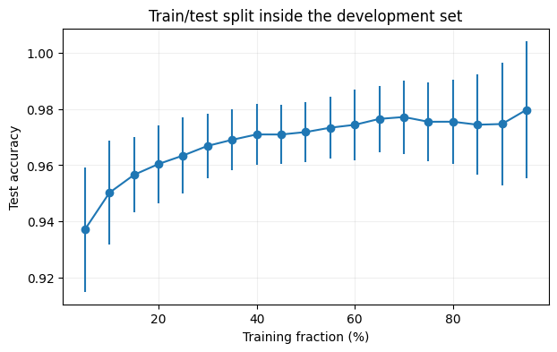

# 第4题 · 数据怎样划分：训练、验证、测试与时间序列

[作业一目录](../README.md) · [题目原文](../Assignments1.ipynb) · [中文题目](../Assignments1_zh.ipynb) · [上一题：维数灾难](03_curse_of_dimensionality.md) · [下一题：在线分类器](05_online_classifier.md)

分值 15%。本题最关键的区分是：**训练数据决定能学到什么，评价数据决定我们对模型表现了解得有多准。**数据总量固定，增加一边就减少另一边，所以图上的分数不一定随训练比例上升。a 小题用实验检验"75/25"经验法则，再完成一次包含超参数选择的完整流程并交付模型；b 小题写时间序列两种验证方法的伪代码。

## 0. 开始之前：先读哪些材料

**默认你已经会：**scikit-learn 的 `fit` / `predict` / `score`；分类准确率的含义。

| 优先级 | 材料与范围 | 读完应该会 | 用时 |
|---|---|---|---|
| 必读 1 | [Lab1](../../Lab1/Lab1_zh.ipynb) 第 13 节"验证方法"全节 | 训练/测试与训练/验证/测试两种划分；为什么反复看测试分数调参会泄漏信息；K 折与嵌套交叉验证 | 约 10 分钟 |
| 必读 2 | [第二课第 6 篇](../../../Lectures/02_LM/06_regularization_and_validation.md#reading-cross-validation)"一次交叉验证到底做什么"和"为什么先统一特征尺度" | 每一折只用训练部分计算标准化参数；Pipeline 的作用。展开末尾折叠的"延伸"，最后一段说明时间序列要用过去训练、在后续时间验证 | 约 6 分钟 |
| 必读 3 | [Lab1](../../Lab1/Lab1_zh.ipynb) 第 10 节后半"逻辑回归"（用过逻辑回归可以跳过） | 逻辑回归输出类别概率；用最大似然拟合 | 约 10 分钟 |
| 选读 | [Lab1](../../Lab1/Lab1_zh.ipynb) 第 12 节"偏差与方差的权衡" | 正则化以一定偏差换取更低方差；用于 4a 的理论解释 | 约 4 分钟 |
| 选读 | [ESL 第 7 章](<../../../References/The Elements of Statistical Learning/PDF/07_Model Assessment and Selection.pdf>) 7.10.1–7.10.2 节（英文） | K 折交叉验证；"错误和正确的交叉验证方式" | 约 15 分钟 |
| 选读 | scikit-learn [交叉验证指南](https://scikit-learn.org/stable/modules/cross_validation.html)中 Time Series Split 一节（英文） | 4b 的扩展窗口划分在库里怎样实现 | 约 5 分钟 |

必读合计约 25 分钟。

## 1. 前置知识

### 1.1 最重要的 20%

#### ① 三份数据，三种职责

| 数据 | 职责 | 例子 |
|---|---|---|
| 训练集（training set） | 拟合模型参数 | 逻辑回归的系数 $w,b$ |
| 验证集（validation set） | 在候选超参数之间做选择 | 正则化强度 `C` |
| 测试集（test set） | 所有选择结束后，评价一次 | 最终报告的准确率 |

核心规则：**一份数据只要参与过任何选择，它给出的分数就偏乐观，不能再当最终评价。**这叫数据泄漏（data leakage）。例如你一边看测试分数一边决定训练比例和 `C`，测试集实际上已经变成了验证集。所以本题最好先留出一份最终测试集，之后不再碰它，所有比较都在剩下的"开发集"里做。

#### ② 划分比例的两难，以及它和偏差—方差的关系

题目要求"用偏差—方差的理论解释观察到的行为"，可以从两边说：

- **训练太少**：估计出的系数随样本波动大（估计方差大），泛化差。增加训练数据能降低估计方差，但消除不了模型本身的偏差，比如线性边界画不出曲线边界。所以曲线先上升，然后进入平台。
- **测试太少**：分数本身噪声大。若分类器对每个测试点的正确概率为 $p$，$m$ 个测试点上准确率的标准差约为

$$
\sqrt{\frac{p(1-p)}{m}} .
$$

$p=0.97$ 时，$m=114$ 对应约 1.6 个百分点，$m=23$ 对应约 3.6 个百分点；23 个点中错一个就改变 4.35 个百分点。

所以实验曲线混合了两种波动，"最佳比例"应该回答成一个区间，而不是一个精确的点。

#### ③ 预处理也是"学出来的"：用 Pipeline

标准化（`StandardScaler`）的均值和标准差是从数据里估计的参数，只能用训练数据计算。如果先在全部数据上标准化再划分，测试数据的分布信息就提前进入了训练。把 `StandardScaler()` 和模型放进同一个 `Pipeline`，每次 `.fit()` 只用当前训练数据计算这些量，泄漏就自动避免了。交叉验证的每一折也同样适用。

#### ④ 时间序列不能打乱

时间序列预测的任务是"用当时已经知道的信息预测之后的值"。随机划分假定样本可以互换；如果把未来的样本随机放进训练集再去预测过去，就改变了实际任务的信息条件。正确做法是**按时间向前**：

- **留出法**：训练截止某个时刻，之后的一段作测试。
- **k 折**：扩展窗口（expanding window），每一折的训练区间都早于验证区间，训练区间逐折扩大。
- 标签跨越未来多步时，训练和验证之间留一个间隔（gap）。

### 1.2 其余前置知识速查

| 概念 | 一句话 | 去哪里复习 |
|---|---|---|
| 逻辑回归 | $P(y=1\mid x)=1/(1+e^{-(w^Tx+b)})$，用于二分类 | [第三课 · 逻辑回归](../../../Lectures/03_LMC_zh.md#logistic-model)；[Lab1](../../Lab1/Lab1_zh.ipynb) 第 10 节 |
| `C` | sklearn 中 `C` 是正则化强度的倒数：越小正则越强 | [第二课 · 正则化比较与参数选择](../../../Lectures/02_LM/06_regularization_and_validation.md) |
| 留出法 | 留一部分数据评价 | [第三课 · 实践中的留出法](../../../Lectures/03_LMC_zh.md#section-09) |
| k 折交叉验证、为什么先标准化 | 轮流用一折评价、其余训练 | [第二课 · 交叉验证](../../../Lectures/02_LM/06_regularization_and_validation.md#reading-cross-validation)；[Lab1](../../Lab1/Lab1_zh.ipynb) 第 13 节；[ESL 第 7 章](<../../../References/The Elements of Statistical Learning/PDF/07_Model Assessment and Selection.pdf>) 7.10 节 |
| 偏差—方差 | 见第3题前置知识 | [Lab1](../../Lab1/Lab1_zh.ipynb) 第 12 节；[第3题](03_curse_of_dimensionality.md) |
| 标准差与置信区间 | 重复划分的分数高度相关，标准差不是独立实验的置信区间 | 3.3 节 |
| `TimeSeriesSplit` | sklearn 中的扩展窗口划分 | 3.5 节 |

### 1.3 开始前的自测

1. 你在测试集上试了 6 个 `C`，选出最好的，然后报告这个测试分数。问题在哪里？
2. 测试集只有 20 个点，错 1 个点会让准确率变化多少个百分点？
3. 先对全部数据标准化、再划分训练和测试，泄漏了什么信息？
4. 12 个月的销量数据，随机抽 3 个月作测试，其余训练。为什么不对？

<details><summary>参考答案</summary>

1. 测试集参与了选择，报告的分数偏乐观；它应该在验证集上选 `C`，测试集只在最后用一次。
2. 5 个百分点。
3. 测试数据的均值和标准差进入了训练过程，模型间接"看到"了测试数据的分布。
4. 训练集中会有比测试月份更晚的数据，等于用未来预测过去，和真实的预测任务不符。

</details>

## 2. 题目要你交什么

| 小题 | 必须交付 | 需要自己决定并在报告中说明 |
|---|---|---|
| a | 选数据集和分类器；训练比例 5%–95% 的测试表现曲线（带误差棒）；用偏差—方差解释；回答最佳比例；用训练/验证/测试选超参数；交付最终模型 | 数据集、分类器、每个比例重复几次、是否先留出最终测试集、超参数网格 |
| b | 时间序列 (i) 留出法和 (ii) k 折的伪代码 | 扩展窗口还是滑动窗口、预测跨度、是否留间隔 |

## 3. 逐小题讲解

下面的数值来自参考解答的运行。你选的数据集或分类器不同，数字会不同，要对照的是曲线形状和解释方法。

### 3.1 数据集和分类器的选择

参考解答用乳腺癌分类数据集（`load_breast_cancer`，569 个样本、30 个数值特征）。它规模小，可以快速重复划分；逻辑回归在上面表现合理，能把注意力放在数据划分上。

逻辑回归先算线性分数，再转成类别概率：

$$
z=w^Tx+b,\qquad P(y=1\mid x)=\frac{1}{1+e^{-z}}.
$$

sklearn 二分类实现中，概率大于 0.5 时预测类别 1，恰好平票时选类别 0。名字里有"回归"，本题用它做二分类；模型不算复杂，便于观察样本不足时的估计波动。

`StandardScaler()` 和 `LogisticRegression()` 放进同一个 `Pipeline`（原因见 1.1 ③）。标准化后，某个系数表示"该特征增加一个训练集标准差时线性分数改变多少"，不直接表示概率改变同样的数值，也不代表因果效应。

### 3.2 为什么先留下 20%，再扫训练比例

按 1.1 ① 的规则，参考解答先把数据分为两层：

| 层次 | 样本数 | 用途 |
|---|---:|---|
| 开发集 | 455 | 比较划分比例、选择参数、最终重新拟合 |
| 最终测试集 | 114 | 所有选择完成后评价一次 |

外层划分使用 `test_size=0.2`、`random_state=40`，固定种子用于复现。

接着只在 455 个开发样本内部扫描训练比例 5%、10%、……、95%，每个比例随机划分 30 次。每次都重新拟合标准化和逻辑回归，记录留出部分的准确率，最后算均值和标准差。循环中的 `test_X` 是开发集内部的留出部分，和 `final_test_X` 不是同一份数据。

0% 没有训练样本，无法拟合；100% 没有测试样本，无法计算准确率，所以省略这两个端点。横轴 75% 要读对：它是开发集的 75%，约为全部数据的 60%，不是直接用全体 569 个样本的 75%。

### 3.3 怎样读曲线，怎样回答"最佳比例"



| 开发集内的训练比例 | 平均准确率 | 划分间标准差 |
|---:|---:|---:|
| 5% | 93.72% | 2.21 个百分点 |
| 30% | 96.69% | 1.16 个百分点 |
| 65% | 97.65% | 1.18 个百分点 |
| 70% | 97.71% | 1.30 个百分点 |
| 75% | 97.54% | 1.40 个百分点 |
| 95% | 97.97% | 2.44 个百分点 |

观察到的最高均值在 95%，但它与 65%–80% 各比例的差距都不到 0.5 个百分点，远小于 95% 处 2.44 个百分点的划分间标准差。合适的回答是："本次实验约 65% 之后进入平台，75/25 是合理的折中；95% 的最高均值只基于约 23 个测试点，实验并没有证明 75/25 或 95/5 唯一最优。"

曲线同时受 1.1 ② 中两种变化的影响：左端训练样本太少，系数估计受个别样本影响；右端测试样本太少，95% 时只剩 23 个测试点，分数自然容易跳动。$p(1-p)/m$ 这个近似能解释"测试点少，评价噪声大"，但它不精确描述整个重复划分实验，因为每次训练出的模型也不同；图上的标准差混合了训练样本变化和测试样本变化两种波动。

因此，95% 处均值最高也不能直接解释成"训练数据越多越好，应该用 95/5"：测试点太少，这个最高值很可能来自评价波动，当前结果没有单独隔离这个因果关系。同样，增加样本主要改善有限样本估计，不能保证消除线性决策边界本身的模型偏差；本题也没有真正计算分类器的偏差—方差分解，理论讨论应停留在这一层面。

30 次划分重复使用同一个开发集，样本大量重叠。误差棒是这些分数的标准差，**不是 30 次独立实验的置信区间**，不能把曲线最高的一个点当成精确、稳定的总体最优比例。

### 3.4 怎样选 C，最终交付什么

确定使用接近 75/25 的开发集内部划分后，参考解答再次划分开发集，得到 341 个训练样本和 114 个验证样本；加上之前留出的 114 个最终测试样本，整体约为 60/20/20。

逻辑回归的 `C` 控制正则化强弱：越小正则越强，越大越允许用较大的系数贴合训练数据。候选为 0.001、0.01、0.1、1、10、100，每个只在 341 个训练样本上拟合，在验证集上比较：

| C | 验证准确率 |
|---:|---:|
| 0.001 | 81.58% |
| 0.01 | 93.86% |
| 0.1 | 94.74% |
| 1 | 95.61% |
| 10 | 96.49% |
| 100 | 94.74% |

所以选 `C=10`：在当前划分和候选集合中，较弱的正则化验证表现最好，`C=100` 时又回落。这并不证明 10 对所有划分、所有数据都最好。

选定后，用全部 455 个开发样本重新拟合标准化和逻辑回归。验证数据已经完成了选参的任务，可以并入最终训练；最终测试集仍保持未用。最后在 114 个测试点中预测对 110 个，即 $110/114\approx96.49\%$。

96.49% 是这一个固定测试集上的观察，不能写成对未来样本的保证。保存的 `.joblib` 包含拟合好的整条处理流程、特征名和类别名；实际预测时要输入相同顺序和含义的特征，由保存的流水线完成标准化和预测。

### 3.5 b：时间序列为什么要按时间向前验证

例如有 12 个月的序列，用第 1–8 月拟合、预测第 9–12 月，就是时间顺序留出法。如果还要调参数，先在更早的数据内部完成验证，把最晚的一段留到最后。预处理、特征选择和模型拟合都遵守同一个截止时刻。

```text
时间顺序留出法：
    按时间排序
    选择训练结束时刻 c 和预测跨度 h
    只使用 c 时刻已经可获得的数据构造训练样本
    在训练样本上拟合预处理和模型
    从 c 时刻的信息出发，预测后续 h 个时刻
    等这些目标被观测到后，计算预测误差
```

时间序列的 k 折可以用扩展窗口。例如初始训练区间为 1–6 月：第一折训练 1–6、验证 7–8；第二折训练 1–8、验证 9–10；第三折训练 1–10、验证 11–12。验证区间互不重叠，训练区间可以重叠并逐渐扩大。

```text
扩展窗口验证：
    按时间排序，确定初始训练区间和后续 k 个验证区间
    对每个验证区间，从早到晚处理：
        取该区间之前且目标已经可知的样本作为训练集
        重新拟合预处理和模型
        按真实部署时的预测方式预测当前区间
        记录误差与验证样本数
    按验证样本数加权汇总误差
    选择参数后，用更晚且未参加选择的区间进行最终测试
```

要区分"一次预测未来四个月"和"每个月观察到真实值后再预测下个月"。前者在预测第 3 个月时不能偷用第 2 个月的真实目标；若用递归预测，只能把此前的预测值作为新的滞后输入。后者可以在真实值到来后更新，但必须在实验中写明这种评价协议。

如果一个训练样本的标签是"未来 $h$ 步的结果"，靠近分界的训练样本可能包含验证期内才发生的信息，这时要删掉这些样本，或在训练和验证之间留间隔。按时间排序只是第一步，真正要检查的是每个特征和标签在预测当时是否已经可以获得。

## 4. 动手顺序

1. 选一个分类数据集（如 `load_breast_cancer`），先跑一次 75/25，确认分类器表现合理。
2. 留出最终测试集（如 20%），之后不再碰它。
3. 在开发集内部扫训练比例 5%–95%，每个比例重复若干次随机划分，画均值和标准差。
4. 解释曲线：左边为什么低，右边为什么抖，平台在哪里。
5. 开发集内部再分训练和验证，扫 `C`；选定后在开发集全部数据上重新拟合，在最终测试集上评价一次，用 `joblib.dump` 保存模型。
6. 写 b 的伪代码，用 12 个月的小例子逐折检查：每一折的训练区间是否都早于验证区间。

**值得亲手做的小检查：**固定测试样本的索引，查看 `pipeline[0].mean_`，确认标准化的均值和标准差究竟是用哪部分数据算的。

## 5. 容易说错的地方

| 容易说错 | 更准确的说法 |
|---|---|
| 75/25 是理论最优划分 | 它是本次实验平台区中的实用折中，不是普适定理 |
| 95% 处均值最高，所以应该用 95/5 | 只剩约 23 个测试点，评价波动最大；它与平台区的差距远小于标准差 |
| 误差棒是置信区间 | 重复划分高度重叠，误差棒只是分数的标准差 |
| 横轴 75% 等于全部数据的 75% | 先留出测试集时，它是开发集的 75% |
| 96.49% 保证了未来表现 | 只是一个固定测试集上的观察 |

## 6. 口试自测

口试时这一题约讲 1 分钟。主线：训练数据越多越利于学习，但评价也需要足够多的独立样本。可以展示划分比例曲线的平台区，并讲清训练、验证、测试各自的职责。

**问：为什么不直接选分数最高的训练比例就结束？**

<details><summary>答案</summary>

分数受有限样本和划分波动影响，比例还要兼顾训练质量和评价稳定性。实验支持的是一个合理区间。

</details>

**问：验证集和测试集有什么区别？**

<details><summary>答案</summary>

验证集参与参数选择；最终测试集只评价已经确定的流程。

</details>

**问：为什么标准化也要在每一折重新拟合？**

<details><summary>答案</summary>

均值和标准差也是从数据学到的参数，不能提前用到该折验证数据。

</details>

**问：为什么最后可以把训练集和验证集合并？**

<details><summary>答案</summary>

参数已经选定，合并能增加拟合数据，而最终仍有一份独立保留的测试集。

</details>

**问：时间序列能不能打乱后做普通十折？**

<details><summary>答案</summary>

对一般的未来预测任务不合适，那会让未来的观测参与预测过去。应该模拟真实的时间推进。

</details>

## 7. 资料

- scikit-learn 文档：[交叉验证](https://scikit-learn.org/stable/modules/cross_validation.html)（含 `TimeSeriesSplit`）、[Pipeline](https://scikit-learn.org/stable/modules/compose.html)。
- [ESL 第 7 章](<../../../References/The Elements of Statistical Learning/PDF/07_Model Assessment and Selection.pdf>) 7.10 节：交叉验证，以及"错误和正确的交叉验证方式"。
- 参考解答 [Assignments1_solution.ipynb](../Assignments1_solution.ipynb) 中"4a. 训练集大小与模型选择"及其后两个代码单元；保存的模型在 [outputs/Assignments1_model.joblib](../outputs/Assignments1_model.joblib)。建议自己写完、跑完之后再对照。
