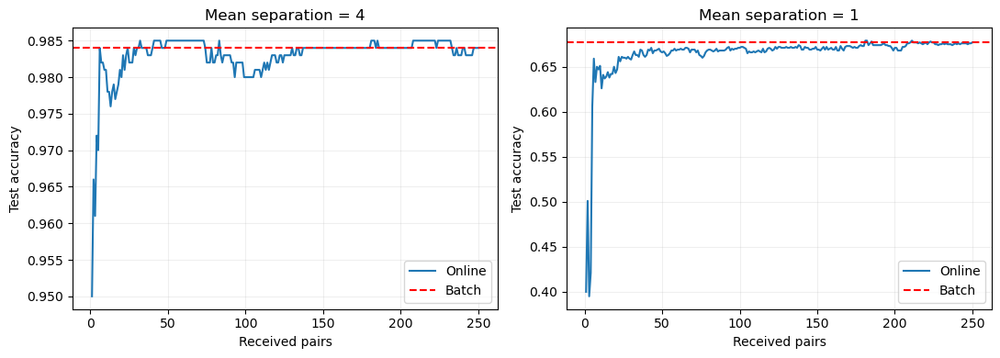

# 第5题 · 只存两个均值的在线线性分类器

[作业一目录](../README.md) · [题目原文](../Assignments1.ipynb) · [中文题目](../Assignments1_zh.ipynb) · [上一题：数据划分](04_data_splitting.md) · [下一题：Regularity](06_regularity.md)

分值 15%。数据成对到达，每个时刻来一个 A 类样本和一个 B 类样本；不能保存历史数据，却要随时能分类新数据。解题路线是：先想清楚"预测需要哪些信息"，再找一个能用少量状态递推更新的线性模型。参考解答用的是最近质心分类器；题目也允许别的线性模型，但都要说清正确性和内存需求。

这是六题中篇幅最短、最适合先拿下的一题：核心只有两个推导和一个实验。

## 0. 开始之前：先读哪些材料

**默认你已经会：**向量的内积和范数；多元正态分布的基本形式；条件概率与 Bayes 公式。

| 优先级 | 材料与范围 | 读完应该会 | 用时 |
|---|---|---|---|
| 必读 1 | [第三课](../../../Lectures/03_LMC_zh.md#section-10)从"方法 1：线性判别分析（LDA）与二次判别分析（QDA）"到"二次判别分析（QDA）"结束（公式较多） | 类条件高斯加共享协方差得到线性边界；协方差不同时边界变成二次 | 约 10 分钟 |
| 必读 2 | [第一课第 7 篇](../../../Lectures/01_intro/07_bayes_and_learning_bounds.md#reading-bayes-solutions)"先固定一个输入，再比较不同预测的损失" | 二分类的 Bayes 规则：选条件概率较大的类别 | 约 7 分钟 |
| 选读 | LDA 教程[第 3 节](<../../../Tutorials/tutorial-LDA/Markdown/03_Linear Discriminant Analysis for Binary Classification.md>)（英文约 1000 词） | LDA 二分类的完整推导 | 约 10 分钟 |
| 选读 | LDA 教程[第 10 节](<../../../Tutorials/tutorial-LDA/Markdown/10_Relation to Bayes Optimal Classifier and Gaussian Naive Bayes.md>)（英文约 1400 词） | LDA 与 Bayes 最优分类器的关系 | 约 15 分钟 |
| 选读 | [第五课](../../../Lectures/05_NLM_zh.md#section-08)"感知机算法"和"一般感知机算法" | 另一种只存 $w$、$b$ 的在线线性模型，口试可能问到两者的对比 | 约 3 分钟 |

必读合计约 17 分钟，是六题中最少的。

## 1. 前置知识

### 1.1 最重要的 20%

#### ① 在线学习与"足够的状态"

- **批量学习（batch）**：拿到全部数据后一次拟合。
- **在线学习（online / streaming）**：数据一个个（本题是一对对）到来，每来一次就更新模型，旧数据用完就丢。

在线学习的核心问题是：**模型需要的信息，能不能浓缩成一组可以递推更新的统计量？**能，旧数据就可以丢弃，内存只取决于这组统计量的大小，与已经到达的样本数 $t$ 无关。题目说的"frugal"（节俭），就是要让这组统计量尽量小。

#### ② 增量均值

收到第 $t$ 个样本前，均值是 $\mu_{t-1}=\frac1{t-1}\sum_{i=1}^{t-1}x_i$。加入 $x_t$ 后：

$$
\mu_t=\frac{(t-1)\mu_{t-1}+x_t}{t}=\mu_{t-1}+\frac{x_t-\mu_{t-1}}{t}.
$$

只需要旧均值和计数 $t$，不需要旧样本。手算一遍：数据依次为 2、4、9，得到 $\mu_1=2$，$\mu_2=2+(4-2)/2=3$，$\mu_3=3+(9-3)/3=5$；批量计算 $(2+4+9)/3=5$，完全一致。用归纳法可以证明，每一时刻的递推均值都等于已见样本的算术平均。

#### ③ 最近质心就是线性分类器

最近质心规则把新样本 $z$ 分给更近的类别均值。分为 B 类的条件是

$$
\|z-\mu_B\|^2\le\|z-\mu_A\|^2 .
$$

展开平方，两边相同的 $z^Tz$ 消掉：

$$
-2z^T\mu_B+\|\mu_B\|^2\le-2z^T\mu_A+\|\mu_A\|^2 .
$$

移项并除以 2：

$$
z^T(\mu_B-\mu_A)+\frac{\|\mu_A\|^2-\|\mu_B\|^2}{2}\ge0 .
$$

令

$$
w=\mu_B-\mu_A,\qquad b=\frac{\|\mu_A\|^2-\|\mu_B\|^2}{2},
$$

就得到标准的线性判别式 $w^Tz+b$。二维时边界是两个中心连线的垂直平分线，更高维时是超平面。例：$\mu_A=(-2,0)$、$\mu_B=(2,0)$ 时 $w=(4,0)$、$b=0$，即按第一坐标的正负分类。

所以"只存两个均值"本身就是一个线性模型，题目要求的"simple linear model"自然满足。

#### ④ 它什么时候是最优的

Bayes 分类器选后验概率最大的类别。当两类先验相同、各自服从高斯分布、并共享协方差 $\sigma^2I$ 时，比较后验就等价于比较到均值的平方欧氏距离，所以**已知总体均值时，最近质心就是 Bayes 分类器**。

这给了实验一条天花板：两类标准差为 1、均值相距 $a$（分别在 $(\pm a/2,0)$）时，最优边界是 $x_1=0$，总体最高准确率为

$$
\Phi(a/2):\qquad a=4\ \text{时约 }97.7\%,\qquad a=1\ \text{时约 }69.1\%.
$$

$\Phi$ 是标准正态分布函数。假设不成立时要调整：两类共享非球形协方差 $\Sigma$，边界仍是线性的，但要按 $\Sigma^{-1}$ 加权距离（即 LDA）；两类协方差不同时，最优边界可能是二次的（QDA）；先验不同时要平移截距。

### 1.2 其余前置知识速查

| 概念 | 一句话 | 去哪里复习 |
|---|---|---|
| LDA | 共享协方差的高斯模型给出线性边界 | [第三课 · LDA](../../../Lectures/03_LMC_zh.md#discriminant-analysis) |
| Bayes 最优分类器 | 选后验概率最大的类 | [第一课 · Bayes 最优](../../../Lectures/01_intro/07_bayes_and_learning_bounds.md#reading-bayes-solutions) |
| 其他在线线性模型 | 感知机按误分类更新，通常依赖样本顺序；SGD 逻辑回归还需选择学习率，通常不与批量拟合精确相等 | [第五课 · 感知机](../../../Lectures/05_NLM_zh.md#section-08) |
| 标准正态分布函数 | `scipy.stats.norm.cdf` | — |
| 浮点数比较 | 用 `np.allclose`，不用 `==` | 3.2 节 |
| 有限测试集的波动 | 1000 个测试点的准确率标准差约 $\sqrt{p(1-p)/1000}$：$p=0.977$ 时约 0.47 个百分点，$p=0.69$ 时约 1.46 个百分点 | 3.4 节 |

### 1.3 开始前的自测

1. 用增量公式计算 2、4、9 的均值序列。
2. $\mu_A=(0,0)$、$\mu_B=(2,2)$：写出 $w$ 和 $b$，点 $(1.5,0)$ 分到哪一类？
3. $d$ 维数据，模型状态一共要存多少个数？
4. 为什么在线模型处理完全部数据后，预测会和批量模型完全一样？

参考答案

1. 2、3、5。
2. $w=(2,2)$，$b=(0-8)/2=-4$，分数 $2\times1.5+0-4=-1<0$，分到 A 类。直接比距离也一样：到 A 的距离平方 2.25，到 B 的 4.25。
3. 两个 $d$ 维均值加一个计数，共 $2d+1$ 个数。
4. 两者用同一批数据算出同样的均值（递推与批量在实数运算下相等），又用同一种分类规则。

## 2. 题目要你交什么

| 小题 | 必须交付 | 需要自己决定并在报告中说明 |
|---|---|---|
| a | 分析问题需求；实现一个在线线性模型；论证它为什么正确；说明内存需求 | 用哪种线性模型；类别不再成对到达时怎么办 |
| b | 两个二维高斯生成数据；$\text{model}_t$ 随 $t$ 的测试准确率曲线；把批量训练的线性分类器画成水平线；一组容易、一组困难的均值 | $N$ 指总样本数还是样本对数；均值和标准差；测试集大小 |

## 3. 逐小题讲解

### 3.1 a：模型选择与代码对应

为什么选最近质心：每次恰好来一个 A 类、一个 B 类样本，两个类别的计数始终相同；最近质心只需要两个类别均值（1.1 ③），而均值可以不保存历史地更新（1.1 ②），正好对应题目的存储限制。

`update_means()` 对两个类别各执行一次 1.1 ② 的更新；从零向量和 `t=1` 开始时，第一次更新就直接得到各自的第一个样本。代码中的 `weights`、`intercept` 正好对应 1.1 ③ 的 $w$ 和 $b$。

### 3.2 a："正确"的范围要说清

递推实现正确计算了最近质心模型所需的统计量，并且在实数运算下与同一批已见数据的批量均值完全等价。浮点计算中求和顺序不同可能带来极小误差，所以参考解答用 `np.allclose` 检查均值，而不要求逐位相同；随后还检查了最终测试预测是否逐项相同。

这不等于说模型对任意数据分布都能达到最佳分类。**实现等价与统计最优是两个问题**：前者是代数恒等式，后者依赖 1.1 ④ 的分布假设。

### 3.3 a：内存与计算量算哪些

模型状态只需要两个 $d$ 维均值和一个计数，共 $2d+1$ 个数，空间复杂度 $O(d)$，与累计到达的样本数无关。每次更新是两个向量的加减和缩放，成本 $O(d)$；对新样本算线性分数也是 $O(d)$。

参考解答为了模拟数据流、画图和做批量对照，预先生成了 `stream_a`、`stream_b`，还保存了测试集和每一步的准确率，这些实验数组会占用额外内存。题目中的 $O(d)$ 指在线分类器本身的必要状态，不是整个实验脚本的总内存。

实际的流处理可以每次从输入源读一对样本，更新后丢弃。如果类别不再成对到达，就分别保存 $n_A$、$n_B$，各类用自己的计数更新。若分布随时间变化，累计均值会跟不上；用固定步长或遗忘因子可以加强近期数据的作用，但那时不再等价于全部历史样本的普通均值。

### 3.4 b：实验设置与结果

原题把 $N=n+n$ 定义为总样本数，又写 $t=1,\ldots,N$，这与"每个时刻到达一对样本"不完全一致。参考解答明确取总训练样本 $N=500$，每类 250 个，所以横轴是收到的样本对数 $t=1,\ldots,250$；处理完第 $t$ 对时已看过 $2t$ 个样本。报告中要写明你的解释。

实验用二维高斯、标准差 1，A、B 两类的均值分别为 $(-a/2,0)$、$(a/2,0)$，取 $a=4$（容易）和 $a=1$（困难）。每种情况另生成每类 500 个独立测试点。批量基线使用同样的最近质心规则，一开始就用全部 500 个训练点，所以画成水平线。

| 均值间距 | 第一对后的准确率 | 第 250 对后的准确率 | 批量基线 | 总体 Bayes 准确率 |
|---:|---:|---:|---:|---:|
| 4 | 95.0% | 98.4% | 98.4% | 97.72% |
| 1 | 40.0% | 67.7% | 67.7% | 69.15% |

最终在线模型和批量模型的预测一致，符合均值递推的推导。早期样本很少时，中心可能估计到不合适的位置，困难情况第一对后只有 40.0%，这并不说明实现有错。之后准确率会上下波动，因为新样本可能让边界在有限测试集上暂时变好或变差。

容易情况的实测 98.4% 高于总体 Bayes 准确率 97.72%，原因是有限测试集的抽样波动（标准差约 0.47 个百分点），不表示学到的分类器超越了总体最优规则。

两种难度用了相同的随机种子，随机偏差被复用在不同的均值设定上，便于对照；它们不是两组完全独立的重复实验。这两个示例能展示在线更新的行为，但不能据此断言所有数据流都遵循同一条学习曲线。

## 4. 动手顺序

1. 写 `update(mean_a, mean_b, xa, xb, t)` 和 `predict(mean_a, mean_b, Z)`（用 $w$、$b$ 实现）。
2. 用三对手写的二维点手算均值，和批量结果比较。
3. 生成两组二维高斯数据（容易：间距 4；困难：间距 1），每类 250 个训练点和 500 个测试点。
4. 循环 $t=1,\ldots,250$：更新均值，在测试集上算准确率，记录下来。
5. 批量基线：用全部训练点算均值得到分类器，画成水平线；也可以再画一条 $\Phi(a/2)$ 的 Bayes 参考线。
6. 用 `np.allclose` 检查最终在线均值与批量均值一致，并检查两者的测试预测逐项相同。
7. 在报告中写清：为什么正确（递推恒等式）、内存 $2d+1$、什么条件下最优。

**值得亲手做的小检查：**用三对手写的二维点手算在线均值，再与"批量求和除以 3"比较。

## 5. 容易说错的地方

| 容易说错 | 更准确的说法 |
|---|---|
| 在线模型只用常数内存 | 相对于到达的样本数，状态不增长；相对于特征维数，状态是 $O(d)$ |
| 递推实现正确，所以模型最优 | 实现等价与统计最优是两回事 |
| 准确率应该随 $t$ 单调上升 | 有限样本的均值估计会波动，离散的测试准确率也会跳变 |
| 98.4% 高于 Bayes 的 97.72%，说明超越了最优 | 有限测试集的抽样波动 |
| 代码保存了所有点，违反了题意 | 模拟和批量对照需要保存数组；在线更新本身只需要两个均值和计数 |

## 6. 口试自测

口试时这一题约讲 1 分钟。主线：类别均值可以递推，最近均值规则可以写成线性判别式。可以展示递推等式，以及在线和批量最终预测一致的结果。

**问：没有保存历史样本，为什么还能正确更新？**

答案

旧均值和计数保留了计算新均值所需的全部总和信息。

**问：这个模型"线性"在哪里？**

答案

两个平方距离相减后，关于输入的二次项消掉，只剩 $w^Tz+b$。

**问：为什么准确率不一定越来越高？**

答案

均值估计在有限样本下会波动，离散的测试准确率也会随边界的小幅移动而跳变。

**问：如果用感知机做在线分类，和你的方法有什么不同？**

答案

感知机也只存 $w$ 和 $b$，内存同样是 $O(d)$。它按误分类情况更新，通常依赖样本到达顺序；数据不可线性分离时，基本算法可能持续更新。对零初始化、固定正学习率的基本感知机，在精确运算下改变学习率只会等比例缩放 $w,b$，不会改变边界，因此不应把“必须调学习率”当作区别。最近质心则递推类别均值，最终与同一批数据直接计算的均值等价。

**问：两类的协方差不同时，你的方法还是最优吗？**

答案

不是。最优边界可能变成二次的（QDA）。共享但非球形的协方差时，最优边界仍是线性的，但要按 $\Sigma^{-1}$ 加权（LDA），在线维护协方差需要 $O(d^2)$ 的内存。

## 7. 资料

- [第三课 · LDA](../../../Lectures/03_LMC_zh.md#discriminant-analysis)：共享协方差的高斯模型与线性边界。
- 参考解答 [Assignments1_solution.ipynb](../Assignments1_solution.ipynb) 中的 `update_means`、`centroid_predict`。建议自己写完、跑完之后再对照。
