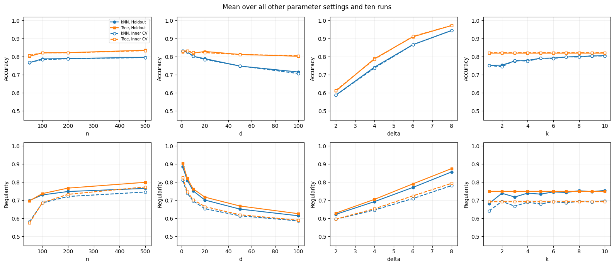

# 第6题 · 定义并检验分类器的局部规律性

[作业一目录](../README.md) · [题目原文](../Assignments1.ipynb) · [中文题目](../Assignments1_zh.ipynb) · [上一题：在线分类器](05_online_classifier.md)

分值 15%。这是全作业最开放的一题：你要**自己设计**一个基于最近邻的指标 `Regularity(X, Y, ...)`，衡量分类器的决策在局部是否一致；然后在一个参数网格上同时报告它和准确率；最后回答 kNN 与 radius-NN 的区别、回归任务怎样定义这个指标两个问题。没有标准答案，评分看你的定义是否讲得通、实验是否干净、解释是否诚实。

完整网格要跑很久，务必先用小网格调通，再跑全量并把结果存成 CSV。

## 0. 开始之前：先读哪些材料

**默认你已经会：**scikit-learn 的分类器用法；pandas 的 `DataFrame` 和 `groupby`（结果表有几万行，要靠分组求平均来画图）。

| 优先级 | 材料与范围 | 读完应该会 | 用时 |
|---|---|---|---|
| 必读 1 | [第五课](../../../Lectures/05_NLM_zh.md#local-methods)从"基于局部性的非线性模型"到"关于局部方法的要点"结束 | kNN 的三步；$k$ 和距离都是超参数；决策树的递归划分与深度；局部方法的局限 | 约 12 分钟 |
| 必读 2 | [第一课第 2 篇](../../../Lectures/01_intro/02_algorithms_and_pipeline.md#classroom-local)"局部方法先决定'谁和谁接近'" | 规律性假设的直观说法：近的点应当得到相近的决定 | 约 2 分钟 |
| 必读 3 | [Lab1](../../Lab1/Lab1_zh.ipynb) 第 13 节中"交叉验证"和"嵌套交叉验证"两小节（做第4题时已读可跳过） | 内层选参、外层评价的嵌套结构 | 约 5 分钟 |
| 选读 | [第3题讲解](03_curse_of_dimensionality.md) 1.1 ① | 高维中近邻变远，用来解释 $d$ 增大时 kNN 变差 | 约 3 分钟 |
| 选读 | [第一课第 7 篇](../../../Lectures/01_intro/07_bayes_and_learning_bounds.md#reading-bayes-solutions) Bayes 二分类（做第5题时已读可跳过） | 理论上限 $\Phi(\delta/4)$ 是怎么来的 | 约 7 分钟 |
| 选读 | [ESL 第 13 章](<../../../References/The Elements of Statistical Learning/PDF/13_Prototype Methods and Nearest-Neighbors.pdf>) 13.3 节开头到 13.3.1 之前（英文约 1000 词） | kNN 分类器，以及维数对它的影响 | 约 10 分钟 |
| 选读 | scikit-learn [RadiusNeighborsClassifier](https://scikit-learn.org/stable/modules/generated/sklearn.neighbors.RadiusNeighborsClassifier.html) 文档 | 问题 1 中 radius-NN 怎样处理没有邻居的点 | 约 3 分钟 |

必读合计约 20 分钟。

## 1. 前置知识

### 1.1 最重要的 20%

#### ① 规律性假设，以及 kNN 和决策树

学习问题的一个核心假设是**规律性（regularity）**，也叫平滑性：输入相近，输出也应该相近。没有这个假设，从已知样本推断新样本就无从谈起。

- **kNN 分类器**：找离新点最近的 $k$ 个训练点，按多数投票。$k$ 小，边界曲折、对个别点敏感（方差大）；$k$ 大，边界平滑、可能抹掉真实细节（偏差大）。它完全依赖距离，所以对无关特征敏感：无关维度会稀释距离。
- **决策树**：沿坐标轴反复切分空间，深度控制复杂度。它可以只在有信息的坐标上切分，因而较少受无关特征影响。

题目里的 $k$ 是分类器的参数，它间接决定分类器在多大范围内"征求意见"。

#### ② Accuracy 和 Regularity 回答不同的问题

- **Accuracy**：预测与真实标签是否一致，$\frac1m\sum_i\mathbf 1[\hat y_i=y_i]$。
- **Regularity**：相邻点的预测彼此是否一致，可以不需要真实标签。

关键反例：一个永远预测类别 0 的分类器，任何邻居都和它预测相同，所以 Regularity 为满分 1；在平衡二分类中它的准确率却只有约 50%。所以 **Regularity 不能单独作为选模型的标准**，它描述的是决策的一种性质，不是好坏。

设计你自己的定义时，要回答这几个问题（这些就是报告里"explain the logic"要写的内容）：

| 设计问题 | 可选做法 |
|---|---|
| 比较什么 | 一个点的预测与邻居的预测（无标签）；或与邻居的真实标签（有标签） |
| 邻居从哪里来 | 评价集内部；训练集；一份独立的参考点 |
| 邻域多大 | 固定 $q$ 个最近邻；或固定半径 |
| 是否排除自身 | 应该排除，否则每个点都和自己一致，分数虚高 |
| 怎样汇总 | 每个点算一致比例，再对所有点平均，得到 0 到 1 之间的数 |

另外要注意：**指标的邻域大小 $q$ 和分类器的 $k$ 是两回事**。$k$ 决定预测时参考多少个训练点，$q$ 决定评价时比较多少个评价点。如果两者一起变，就分不清曲线的变化来自分类器还是来自指标。

#### ③ 实验设计：因素、配对与理论上限

题目的四个因素是每类样本数 $n$、维度 $d$、类别间距 $\delta$、近邻数 $k$。几个要点：

- **间距只加在第一个坐标上**：两类为 $\mathcal N(0,\sigma^2I)$ 和 $\mathcal N((\delta,0,\ldots,0),\sigma^2I)$，均值的欧氏距离始终是 $\delta$，新增维度全是无关噪声。若每个坐标都加 $\delta$，距离会变成 $\delta\sqrt d$，维度上升时信号也在增强，研究的就是另一个问题。
- **理论上限与 $d$ 无关**：等先验、等球形协方差时，最优规则是比较 $x_1$ 和 $\delta/2$，总体最高准确率为 $\Phi(\delta/(2\sigma))$。$\sigma=2$ 时：

| $\delta$ | 2 | 4 | 6 | 8 |
|---|---:|---:|---:|---:|
| 最高准确率 $\Phi(\delta/4)$ | 69.1% | 84.1% | 93.3% | 97.7% |

  你的结果平均值不应明显高于这些数，这是一个好用的检查。高维时 kNN 达不到上限，是有限样本下距离被无关坐标干扰的结果。
- **配对比较**：同一份数据和同一组划分给 10 个 $k$ 共用，可以减少"不同 $k$ 恰好遇到不同数据"的干扰。
- **边际曲线**：每张图只画一个因素，对其他因素和重复次数取平均。这样的曲线混合了其他条件，不是固定其他条件的因果实验。

#### ④ "有 CV"与"无 CV"：两层评价

题目要求"with and without 10-fold CV (inside the train/test nested part)"。一种清楚的解释是：

1. 每轮先把数据分为外层训练集和外层测试集。
2. **无 CV（Holdout）**：在外层训练集上拟合，在外层测试集上算两个指标。
3. **有 CV（Inner CV）**：只在外层训练集内部做 10 折，每折用九折拟合、一折评价，取平均。
4. 进一步：只按内层 CV 的准确率选 $k$，再读取这个 $k$ 在外层测试集上的表现，这就是嵌套交叉验证（nested CV）。

核心规则和第4题一样：**不能看外层测试结果来选 $k$**，否则外层测试集就变成了验证集。

### 1.2 其余前置知识速查

| 概念 | 一句话 | 去哪里复习 |
|---|---|---|
| k 近邻 | 多数投票；$k$ 控制平滑程度 | [第五课 · k 近邻](../../../Lectures/05_NLM_zh.md#section-19)；[ESL 第 13 章](<../../../References/The Elements of Statistical Learning/PDF/13_Prototype Methods and Nearest-Neighbors.pdf>) 13.3 节 |
| 决策树 | 沿坐标轴切分；深度控制复杂度 | [第五课 · 决策树](../../../Lectures/05_NLM_zh.md#decision-trees) |
| 局部方法的局限 | 高维时邻域变大、距离被无关维度稀释 | [第五课 · 局部方法要点](../../../Lectures/05_NLM_zh.md#section-21)；[第3题](03_curse_of_dimensionality.md) |
| k 折、嵌套交叉验证 | `KFold(shuffle=True)`；内层选参、外层评价 | [Lab1](../../Lab1/Lab1_zh.ipynb) 第 13 节 |
| `NearestNeighbors.kneighbors()` | 不传查询点时，自动排除每个样本自身 | 3.1 节 |
| radius-NN | `RadiusNeighborsClassifier`：固定半径，邻居数可变 | 3.8 节 |
| 偶数 $k$ 平票 | 二分类时偶数 $k$ 可能平票，要定平票规则 | 3.5 节 |

### 1.3 开始前的自测

1. 平衡二分类中，一个永远预测类别 0 的模型，Accuracy 和"预测与邻居一致的比例"各约是多少？
2. 为什么把 $\delta$ 只加在第一个坐标上，而不是每个坐标都加？
3. $\sigma=2$、$\delta=4$ 时，任何分类器的总体最高准确率约是多少？
4. 能用外层测试集的结果来选最好的 $k$ 吗？

参考答案

1. Accuracy 约 50%，一致比例为 1。
2. 为了让两类均值的距离固定为 $\delta$，新增维度只代表无关噪声；每个坐标都加，距离会变成 $\delta\sqrt d$，信号随维度增强。
3. $\Phi(1)\approx84.1\%$。
4. 不能。那样外层测试集参与了选参，报告的分数会偏乐观；应只按内层 CV 选择。

## 2. 题目要你交什么

| 部分 | 必须交付 | 需要自己决定并在报告中说明 |
|---|---|---|
| 定义 | `Regularity(X, Y, ...)` 的公式、背后的逻辑、参数含义 | 比较对象、邻居来源、$q$、是否排除自身 |
| 实验 | $n\times d\times\delta\times k$ 网格，kNN 与决策树，10 次重复，有和没有 10 折 CV；Accuracy 与 Regularity 的图和讨论 | 树的深度、数据怎样生成、"有/无 CV"的具体含义、怎样画边际曲线 |
| 问题 1 | kNN 与 radius-NN 的主要区别、各自适用场合、实验要怎样调整 | — |
| 问题 2 | 回归任务中 Regularity 要怎样改 | — |

## 3. 逐部分讲解

下面的数值来自参考解答的运行，完整记录在 [outputs/Assignments1_ex6_results.csv](../outputs/Assignments1_ex6_results.csv)，内层选 $k$ 后的外层结果在 [outputs/Assignments1_ex6_selected.csv](../outputs/Assignments1_ex6_selected.csv)。你的定义和参数不同，数字会不同。

### 3.1 参考解答采用的定义

设评价点集有 $m$ 个点，模型预测为 $\hat y_i$，$N_q(i)$ 是评价点集中离 $x_i$ 最近的 $q$ 个**其他**点：

$$
R(X,\hat y)=\frac1{mq}\sum_{i=1}^m\sum_{j\in N_q(i)}\mathbf 1[\hat y_i=\hat y_j].
$$

每个点找到附近 $q$ 个点，数有多少邻居和它预测相同，再对所有点平均。每次比较的结果是 0 或 1，所以 $0\le R\le1$。例如某点的 5 个邻居中有 4 个与它预测相同，它的局部分数就是 0.8。

代码在评价点集上拟合 `NearestNeighbors` 后，调用不传查询点的 `kneighbors(return_distance=False)`，这样会排除每个样本自身。两点坐标完全相同但不是同一个样本时，它们仍可以互为邻居。

参考解答固定 `q=5`（理由见 1.1 ②）。点数不足时用 `min(q, len(X)-1)`，数学上相当于把公式中的 $q$ 换成有效邻居数；本实验最小的评价集有 8 个点，始终够用。这个函数没有处理 0 个或 1 个评价点的情况，若作通用工具需要补上约定。

这是一种无标签的定义。你也可以设计有标签的版本，例如比较预测与邻居的真实标签，但要在报告中说明它衡量的是什么。

### 3.2 为什么高 Regularity 不等于高准确率

1.1 ② 的常数分类器反例说明，"最大化 $R$"会鼓励过度平滑，甚至常数输出。参考解答特意检查了常数预测的 $R$ 等于 1，这既是实现的单元测试，也是报告中最有说服力的论据。$R$ 适合描述模型在当前样本几何上的决策一致程度，不能单独作为选模型的目标，也不能替代泛化误差。

这个指标还依赖评价点的采样。即使决策函数完全不变，在同一区域增加评价点，最近 5 个邻居通常更近，跨越边界的机会也减少，$R$ 就可能上升。所以讨论数据量、维度或验证协议的影响时，要同时考虑"模型变了"和"评价邻域变了"两种原因。

### 3.3 数据生成

参数网格为：每类样本数 $n\in\{50,100,200,500\}$，维度 $d\in\{1,5,10,20,50,100\}$，标准差固定 $\sigma=2$，均值间距 $\delta\in\{2,4,6,8\}$，分类器近邻数 $k\in\{1,\ldots,10\}$。数据按 1.1 ③ 的方式只在第一坐标上平移：

$$
X\mid A\sim\mathcal N(0,4I),\qquad X\mid B\sim\mathcal N((\delta,0,\ldots,0),4I).
$$

因为总体最高准确率 $\Phi(\delta/4)$ 不随 $d$ 变化，观察到的高维 kNN 下降可以理解为有限样本下欧氏距离受无关坐标影响。不过实验没有进一步逐项隔离所有原因，不能把每一处波动都归为单一机制。

### 3.4 960 个组合、十次重复与两层评价

参数组合数为 $4\times6\times4\times10=960$，每组 10 个运行编号。但代码按 $(n,d,\delta,\text{run})$ 生成数据，同一份数据和同一组划分给 10 个 $k$ 共用（1.1 ③ 的配对比较），所以不能说成 9600 份独立生成的数据。

每轮先把 $2n$ 个点分成外层训练 80% 和外层测试 20%，然后做 1.1 ④ 中的两种评价。本参数网格中各折大小相同，简单平均等于按样本数加权平均；外层测试集没有参加内层交叉验证。

| 每类 $n$ | 总样本 | 外层训练 | 外层测试 | 内层每折训练 | 内层每折验证 |
|---:|---:|---:|---:|---:|---:|
| 50 | 100 | 80 | 20 | 72 | 8 |
| 100 | 200 | 160 | 40 | 144 | 16 |
| 200 | 400 | 320 | 80 | 288 | 32 |
| 500 | 1000 | 800 | 200 | 720 | 80 |

每个参数组合、运行编号、评价方式和模型各记一行，完整文件共 $960\times10\times2\times2=38400$ 行。再对每个 $(n,d,\delta,\text{run})$ 只按内层 CV 准确率选 $k$，读取该 $k$ 的外层表现，得到 960 行选参记录。本实验各折等长，平均准确率最高等价于十折预测正确的总数最多；代码累加整数正确数，再用 `argmax()` 选择，确保同分时选较小的 $k$，不受浮点累加误差影响。

代码先算出所有外层分数，再用内层结果去索引所选 $k$ 的外层分数。这样计算可以复用，但推断上必须坚持：选 $k$ 的规则只看内层 CV，不能看到外层分数后再改规则。

这里比较的是外层留出评价与内层 CV 评价，并不是"做过 CV 的模型"和"没做过 CV 的模型"两种训练算法。CV 本身是评价和选参的程序；固定 $k$ 时，模型差异只来自训练样本和训练量。这是对原题嵌套描述的一种明确解释，报告中要写清楚。

### 3.5 kNN 与决策树代码中的选择

kNN 在训练集上一次找出最近的 10 个邻居，对某个 $k$ 只取前 $k$ 个标签投票：标签为 0、1，标签和大于 $k/2$ 时预测 1，否则预测 0。这样可以复用近邻搜索；参考解答用一个随机样例核对过，$k=1,\ldots,10$ 时与 `KNeighborsClassifier` 的预测一致。

偶数 $k$ 可能平票，本实现固定选 0。所以偶数 $k$ 和相邻奇数 $k$ 的差异，除了邻域大小，还包含平票规则的影响。改成随机平票或距离加权，需要重新评价。

决策树固定 `max_depth=5`、`min_samples_leaf=5`，在测试前确定，没有进一步搜索最佳深度。树的训练和预测不依赖 $k$，所以同一轮树的结果在 10 个 $k$ 下重复列出；图上树关于 $k$ 是一条水平线，这是代码定义的直接结果，不是"树对近邻参数稳定"的发现。若要比较各方法调参后的最佳能力，应把树深度也放进内层选择流程。

### 3.6 结果说明了什么，哪些结论不能直接下

八张子图都是对其他参数和十次运行取平均的边际曲线（1.1 ③）。

| 外层留出结果 | kNN | 决策树 |
|---|---:|---:|
| 整个网格的平均 Accuracy | 78.54% | 82.05% |
| $d=1$ 的平均 Accuracy | 83.06% | 82.65% |
| $d=100$ 的平均 Accuracy | 71.55% | 80.27% |
| 整个网格的平均 Regularity | 0.7358 | 0.7502 |

维度增加时 kNN 明显下降；当前数据只有第一坐标含有信号，树可以按这个坐标切分，因而较少受无关坐标影响。这是与数据构造相符的解释，不能推广成"决策树通常优于 kNN"。

类别间距越大、重叠越少，两个模型的平均准确率都越高。样本量增加总体有帮助，但增幅并不均匀：kNN 从每类 100 点的 78.79% 到每类 200 点只升到 78.99%。所以要说"总体趋势"，不要把每条曲线都描述为稳定递增。

$k$ 从 1 到 10 时，kNN 平均 Accuracy 从 75.11% 升到 80.69%，$R$ 从 0.682 升到 0.755；但中间并不单调，例如 $k=9$ 的 $R$ 为 0.748，低于 $k=8$ 的 0.753。更大的邻域往往让预测更平滑，但准确率和规律性并不总是同步变好。内层 CV 选 $k$ 后，$d=1$ 的外层平均准确率为 83.72%，$d=100$ 为 73.66%；这是选参后的结果，和对所有 $k$ 平均的数字回答的是不同问题。

### 3.7 为什么内层 CV 的 Regularity 特别低

整个网格中，树的 $R$ 从 Holdout 的 0.7502 降到 Inner CV 的 0.6919，kNN 从 0.7358 降到 0.6832。不能据此说"交叉验证让模型更不规律"。

原因有两个，而且同时存在：内层模型用的训练数据比外层少；计算 $R$ 的评价点集也小得多，固定 5 个邻居往往覆盖更大的空间。代码没有把两者的影响分开。

$n=50$ 的极端情况最容易看清：内层验证折只有 8 个点。若两类各 4 个，即使分类器把 8 个点全部预测正确，对任意一个点，其他点中最多只有 3 个同类；必须挑 5 个邻居，就至少包含 2 个异类，所以每个点的一致比例最高是 $3/5=0.6$，整折的 $R$ 也最多是 0.6。参考解答用的是不分层的 `KFold`，每折的类别构成会变化：类别越不均衡，这个上限越高（例如 6 比 2 时为 0.8），但都低于 1。反过来，把所有点预测成同一类，反而能得到 $R=1$。

这个上限来自评价样本数、类别构成和 $q$ 的组合，不是学习算法出错，说明 $R$ 对小验证折特别敏感。要公平比较不同协议，可以让各模型都在同一份独立的参考点集上算 $R$，或研究不同邻域尺度下的完整曲线；参考解答没有实施这些改进。

内层各折的训练集互相重叠，十个折分数不是十次独立实验；也不能把文件中重复的树结果行、所有 $k$ 行都当作独立观测来算统计显著性。

### 3.8 问题 1：如果改用 radius-NN

kNN 固定邻居数量，邻域半径随局部密度变化；radius-NN 固定半径，邻居数量随密度变化。需要始终找到若干参考点时，kNN 更方便，但在稀疏区域可能借用很远的点；距离有明确实际含义、希望拒绝远距离参考时，radius-NN 更自然，但可能一个邻居也找不到。

改写实验时，用半径网格替换 $k$ 网格，保持数据、划分和两个评价指标不变。半径要结合特征单位和维度来定（高维时点间距离普遍变大），不能把同一个数值不加检查地套到所有维度。没有邻居时，要明确是拒绝预测还是使用备用规则，并同时报告预测覆盖率；如果只评价能预测的点，不能隐藏被拒绝样本的比例。

分类器改成 radius-NN，并不强制指标也改成半径邻域。继续固定 $q=5$ 可以保持当前的评价定义；若指标也改，需要另外规定评价半径和孤立点怎样计分，两种尺度仍要区分开。

### 3.9 问题 2：回归任务的 Regularity

连续输出很少恰好相等，所以把"预测相同"的指示函数换成对预测差异的惩罚。参考解答的提议是

$$
R_{\rm reg}=\frac{1}{1+\dfrac{1}{mq\,s_y^2}\sum_i\sum_{j\in N_q(i)}(\hat y_i-\hat y_j)^2},
$$

其中 $s_y^2>0$ 是由训练数据确定的固定目标尺度。先求相邻预测的平均平方差，再除以目标尺度使其无量纲，最后用 $1/(1+u)$ 转成"差异越小、分数越高"的指标。训练目标方差为零时，需要另外约定一个正尺度，避免除以零。

它有同样的局限：常数预测得到 $R=1$，但可能有很大的 MSE；真实函数变化很陡时，正确的预测也可能局部差异很大。它没有除以点间距离，所以反映的是当前采样邻域内的变化量，不能直接当作函数的导数或 Lipschitz 常数。回归评价仍应同时报告测试 MSE，并写明 $R$ 使用的邻域尺度。

## 4. 动手顺序

1. 先写你的 `Regularity` 函数，做两个单元测试：常数预测应得 1；手工构造每类 4 个点的小例子，验证公式。
2. 写数据生成函数 `make_data(n, d, delta, seed)`，画出 $d=2$ 的散点图确认。
3. 写一个评价函数，返回两个模型在 $k=1,\ldots,10$ 下的 (Accuracy, Regularity)；kNN 可以一次找 10 个邻居反复使用。
4. 先在小网格上跑通（如 $n\in\{50,200\}$、$d\in\{1,20\}$、$\delta\in\{2,6\}$、2 次重复），对照 1.1 ③ 的理论上限检查结果是否合理。
5. 加上内层 10 折 CV，按内层准确率选 $k$，读外层分数。
6. 跑完整网格，结果存成 CSV，之后画图只读 CSV，不用重跑。
7. 画边际曲线：每个因素一列，Accuracy 和 Regularity 各一行。
8. 回答两个问题，写进报告。

**值得亲手做的小检查：**构造每类四个点的验证集，分别设置完美预测和常数预测，比较 Accuracy 与 Regularity，解释为什么后者可能把常数预测评得更高。

## 5. 容易说错的地方

| 容易说错 | 更准确的说法 |
|---|---|
| Regularity 越高越好 | 它不衡量预测是否正确，还依赖评价点数量和邻域尺度 |
| 第6题有 9600 份独立数据 | 共 960 份独立生成的数据，每份复用于 10 个 $k$ |
| 树关于 $k$ 很稳定 | 树不使用 $k$，水平线是代码定义的结果 |
| 内层 $R$ 低说明交叉验证不好 | 训练量和评价邻域同时变化；8 点的折中完美预测的 $R$ 也不超过 0.6 |
| 决策树通常优于 kNN | 只是与"信号只在第一坐标"的数据构造相符的解释 |
| 边际曲线展示了固定其他条件时的因果效应 | 它们对其他因素取了平均 |

## 6. 口试自测

口试时这一题约讲 2 分钟。主线：准确与局部一致是两个问题，指标的解释取决于样本几何。可以展示常数分类器的反例，以及 8 点验证折的 Regularity 上限。

**问：$q$ 和 $k$ 有什么不同？**

答案

$k$ 用训练点决定分类预测；$q$ 用评价点衡量预测之间的局部一致性。

**问：为什么常数分类器是一个必要的检查？**

答案

它立刻证明 $R$ 不能单独衡量预测质量，同时也能检查实现是否符合公式。

**问：树关于 $k$ 为什么是一条水平线？**

答案

树不使用 $k$，同一结果只是为了和 kNN 放在同一张图里比较而重复记录。

**问：内层 $R$ 偏低，是否说明交叉验证不好？**

答案

不能。训练量和评价邻域的规模同时变了；最小的折甚至存在完美预测 $R$ 不超过 0.6 的结构性上限。

**问：增加维度时，为什么只在第一坐标上平移均值？**

答案

为了固定两类均值的欧氏距离，使新增维度只代表无关噪声，理论最高准确率也不随维度变化。

**问：能不能根据外层测试结果选最好的 $k$？**

答案

不能，那会把测试集变成选参数据。应只按内层 CV 准确率选择，再报告外层表现。

## 7. 资料

- scikit-learn 文档：[NearestNeighbors](https://scikit-learn.org/stable/modules/generated/sklearn.neighbors.NearestNeighbors.html)、[RadiusNeighborsClassifier](https://scikit-learn.org/stable/modules/generated/sklearn.neighbors.RadiusNeighborsClassifier.html)、[交叉验证](https://scikit-learn.org/stable/modules/cross_validation.html)。
- [ESL 第 13 章](<../../../References/The Elements of Statistical Learning/PDF/13_Prototype Methods and Nearest-Neighbors.pdf>) 13.3 节：k 近邻分类器。
- 参考解答 [Assignments1_solution.ipynb](../Assignments1_solution.ipynb) 中的 `Regularity`、`evaluate_classifiers` 和第6题的实验循环。建议自己写完、跑完之后再对照。
