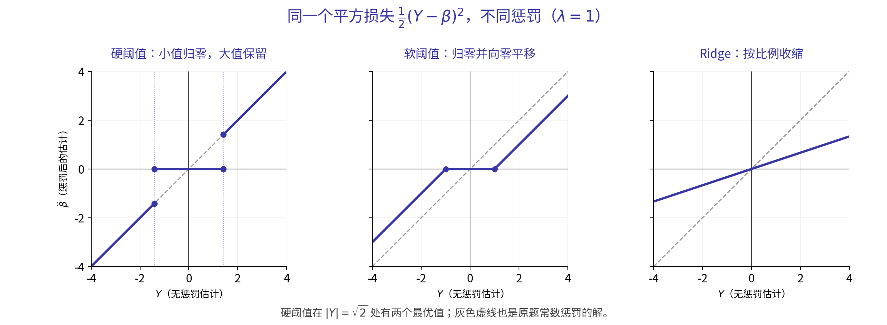

# 6. 正则化比较与参数选择

[本课目录](../02_LM_zh.md) · [上一篇：岭回归与对偶](05_ridge_and_duality.md) · [下一篇：非线性扩展与核方法](07_kernels_and_extensions.md)

## Elastic Net The best of LASSO and Ridge?

**Elastic Net：兼得 LASSO 与 Ridge 的优点？**

- Rationale (from [Zou and Hastie, 2005])

  动机（引自 Zou 与 Hastie，2005）：

(a) In the $p > n { \mathrm { ~ c a s e } }$ , the lasso selects at most n variables before it saturates, because of the nature of the convex optimization problem. This seems to be a limiting feature for a variable selection method. Moreover, the lasso is not well defined unless the bound on the $L _ { \mathrm { l } } \mathrm { - n o r m }$ of the coefficients is smaller than a certain value

(a) 在 $p > n { \mathrm { ~ c a s e } }$ 的情形下，由于凸优化问题自身的性质，LASSO 在达到饱和之前最多选择 n 个变量。对于变量选择方法，这似乎是一项限制。此外，除非系数的 $L _ { \mathrm { l } } \mathrm { - n o r m }$ 上界小于某个值，否则 LASSO 不是良好定义的。

(b) If there is a group of variables among which the pairwise correlations are very high, then the lasso tends to select only one variable from the group and does not care which one i selected. See Section 2.3.

(b) 如果一组变量之间的两两相关性非常高，LASSO 倾向于只从中选择一个变量，而不在意具体选中哪个。参见第 2.3 节。

(c) For usual $n > p$ situations, if there are high correlations between predictors, it has been empirically observed that the prediction performance of the lasso is dominated by ridge regression (Tibshirani, 1996)

(c) 对通常的 $n > p$ 情形，如果预测变量之间高度相关，经验上观察到 LASSO 的预测性能不如岭回归（Tibshirani，1996）。

> **Note:** These statements are quoted in the slides from Zou and Hastie (2005). Without that paper's conditions, they cannot be interpreted as saying that every LASSO problem has no solution or has a nonunique solution.

> **译注：** 以上是原课件引用 Zou 与 Hastie（2005）的论述，不能脱离该文的条件把它解释为所有 LASSO 问题都不存在解或都不唯一。

- Combination of $\ell _ { 1 }$ and $\ell _ { 2 }$ penalties

  组合 $\ell _ { 1 }$ 与 $\ell _ { 2 }$ 惩罚。

$$
\widehat {\beta} _ {\lambda} \in \underset {\beta \in \mathbb {R} ^ {d}} {\arg \min} \left\{\| \mathbf {Y} - \mathbf {X} \beta \| ^ {2} + \lambda \| \beta \| _ {1} + \mu \| \beta \| _ {2} ^ {2} \right\}
$$

### Combining sparsity with shared contributions from correlated variables

**同时保留稀疏性与相关变量的共同贡献**

Continuing the small orthogonal-design example, the Elastic Net objective for one coordinate is

继续在正交设计的小例子中计算，Elastic Net 的单个坐标目标为

$$
(z-b)^2+\lambda|b|+\mu b^2,
$$

Its solution is

其解为

$$
\widehat b_{\mathrm{EN}}
=\frac{\operatorname{sign}(z)(|z|-\lambda/2)_+}{1+\mu}.
$$

The absolute-value penalty first applies soft thresholding, and the quadratic penalty then adds shrinkage. With $\mathbf Y=(3,0.4,-2)^T$, $\lambda=2$, and $\mu=1$, the three methods give:

先由绝对值惩罚产生软阈值，再由二次惩罚进一步收缩。对 $\mathbf Y=(3,0.4,-2)^T$，取 $\lambda=2$、$\mu=1$，三种方法的结果为：

| Method 方法 | Penalty in this example 本例采用的惩罚 | Estimated coefficients 估计系数 |
|---|---|---|
| LASSO | $2\lVert\beta\rVert_1$ | $(2,0,-1)$ |
| Ridge | $2\lVert\beta\rVert_2^2$ | $(1,0.4/3,-2/3)$ |
| Elastic Net | $2\lVert\beta\rVert_1+\lVert\beta\rVert_2^2$ | $(1,0,-0.5)$ |

Consider two identical features again. If they must contribute a total $s>0$, LASSO charges the same $\ell_1$ cost $s$ for any nonnegative allocation $\beta_1+\beta_2=s$. Adding the quadratic term makes the equal split $s/2,s/2$ cheapest. Elastic Net can therefore encourage correlated features to share the prediction while retaining a sparsity mechanism.

再看两个完全相同的特征。若它们需要提供总贡献 $s>0$，LASSO 对任意非负分配 $\beta_1+\beta_2=s$ 都收取同样的 $\ell_1$ 代价 $s$；加入二次项以后，均匀分配 $s/2,s/2$ 的代价最小。因此 Elastic Net 能在保留稀疏机制的同时，鼓励相关特征共同承担预测。

When $\mu>0$, the quadratic term also makes the coefficient optimization strictly convex, so the coefficient solution is unique. Coefficients can still be negative; applications requiring nonnegativity need an explicit nonnegative constraint. [Elastic Net objectives and correlated features](https://scikit-learn.org/stable/modules/linear_model.html#elastic-net)

当 $\mu>0$ 时，二次项还使这个系数优化问题严格凸，因而系数解唯一。系数仍可以为负；如果应用确实要求非负，就要另外写出非负约束。[Elastic Net 的目标与相关特征](https://scikit-learn.org/stable/modules/linear_model.html#elastic-net)

## LASSO vs. Elastic Net Comparison of regularization paths

**LASSO 与 Elastic Net：正则化路径比较**

In a path plot, each curve represents a feature and its vertical coordinate is that feature's coefficient. The horizontal coordinate may be $\lambda$, $\log\lambda$, or a coefficient-norm ratio; first check which direction the plotted quantity increases. Fixing a horizontal coordinate gives the complete coefficient vector at one regularization strength.

读路径图时，每条曲线对应一个特征，纵坐标给出该特征的系数；横坐标可能画 $\lambda$、$\log\lambda$ 或某种系数范数比例，要先看原图标注的增减方向。固定一个横坐标，就得到某个正则化强度下的完整系数向量。

A curve leaving zero shows a feature entering the model. Related curves changing together illustrate shared contributions. Crossings, negative coefficients, and variables leaving a path can all have valid statistical explanations. One example plot does not establish that Elastic Net guarantees nonnegative coefficients or noncrossing paths. Nor does entry order alone give a universal ranking of true variable importance.

观察曲线何时离开零，可以看到特征怎样进入模型；观察多条相关曲线怎样一起变化，可以理解共同贡献。曲线的交叉、负系数和变量退出路径都可能有合理的统计原因。图中某个例子的表现，不构成 Elastic Net 保证所有系数非负、路径不交叉的性质，也不能仅按进入先后给变量排出普遍的“真实重要性”顺序。

## Tuning the hyperparameters Cross-validation

**超参数调整：交叉验证**

- How do we select the parameters λ and $\mu ?$ These are called hyperparameters or smoothing parameters or regularization parameters.

  如何选择参数 λ 和 $\mu ?$？它们称为超参数、平滑参数或正则化参数。

- This is a universal problem in monitoring the overfitting efect of Machine Learning methods.

  这是控制机器学习方法过拟合效应时普遍遇到的问题。

- The procedure of cross-validation will be developed later in the course.

  交叉验证过程将在后续课程中展开。

### What one cross-validation procedure actually does

**一次交叉验证到底做什么**

Parameter $\beta$ is estimated from the training objective, while hyperparameter $\lambda$ determines the objective itself. Comparing several values of $\lambda$ requires evaluating the resulting fitted models on data excluded from each fit.

参数 $\beta$ 由训练目标求出，超参数 $\lambda$ 决定训练目标本身。要比较多个 $\lambda$，需要观察各自训练出的模型在未参与本次拟合的数据上表现如何。

For example, first hold out a final test set. Split the remaining nine development observations into three folds: observations 1–3, 4–6, and 7–9. For each candidate $\lambda$, fit on two folds and compute mean squared error on the third, rotating three times and averaging. The following illustrative results show the calculation:

例如，先留出最终测试集，把其余 9 条开发数据分成三折：第 1–3 条、第 4–6 条、第 7–9 条。对每个候选 $\lambda$，依次用其中两折拟合，在剩下一折计算平均平方误差，三次轮换后取平均。下面是一组说明计算过程的示意结果：

| $\lambda$ | Fold 1 validation error 第 1 折验证误差 | Fold 2 validation error 第 2 折验证误差 | Fold 3 validation error 第 3 折验证误差 | Mean 平均 |
|---:|---:|---:|---:|---:|
| 0 | 0.92 | 1.10 | 0.98 | 1.00 |
| 0.5 | 0.55 | 0.60 | 0.65 | 0.60 |
| 5 | 1.20 | 1.10 | 1.30 | 1.20 |

Three candidates with three folds each require nine fits. Here select $\lambda=0.5$, refit once on all nine development observations, and finally evaluate on the test set kept aside throughout. Each validation uses samples excluded from its fit, while development data take turns in training and validation roles. [Cross-validation procedure](https://scikit-learn.org/stable/modules/cross_validation.html)

三个候选、每个三折，共需要拟合 9 次。这里选 $\lambda=0.5$，再用全部 9 条开发数据重新拟合一次，最后用一直留出的测试集评估。这样每次验证都在模型没用来拟合的样本上进行，同时让开发数据轮流承担训练和验证的角色。[交叉验证流程](https://scikit-learn.org/stable/modules/cross_validation.html)

### Why standardize feature scales first?

**为什么先统一特征尺度**

Expressing the same length in centimeters instead of meters multiplies its numerical value by 100. To preserve the same prediction, its coefficient becomes $1/100$ of its previous value. The prediction is unchanged, yet its $\ell_1$ penalty becomes $1/100$ and its squared $\ell_2$ penalty becomes $1/10000$ of the original. Coefficient-penalized models thus depend on measurement units. Comparable numerical features are usually centered and standardized before fitting.

同样的长度，如果从米改成厘米，数值变成原来的 100 倍；为了维持相同预测，对应系数只需变成原来的 $1/100$。预测含义完全相同，$\ell_1$ 惩罚却变成原来的 $1/100$，平方 $\ell_2$ 惩罚变成原来的 $1/10000$。因此带系数惩罚的模型会受到计量单位影响，通常需要先对可比较的数值特征中心化、标准化，再拟合。

During cross-validation, each fold's means and standard deviations are estimated only from its training portion and then used to transform its validation portion. After hyperparameter selection, these preprocessing quantities and the model are refitted on all development data. A Pipeline can combine preprocessing and regression in one training procedure. [Data transformations in cross-validation](https://scikit-learn.org/stable/modules/cross_validation.html#data-transformation-with-held-out-data)

交叉验证时，每一折的均值、标准差都只从该折训练部分计算，再用于变换验证部分；选择超参数后，再在全部开发数据上重新拟合这些预处理量与模型。Pipeline 可以把预处理和回归放在同一套训练流程中。[交叉验证中的数据变换](https://scikit-learn.org/stable/modules/cross_validation.html#data-transformation-with-held-out-data)

Further detail: λ conventions and the cost of searching several hyperparameters 延伸：λ 的写法与多个超参数的搜索成本

This lecture mainly uses $\mathrm{RSS}+\lambda P(\beta)$. Rewriting it as $\mathrm{RSS}/n+\lambda'P(\beta)$ requires $\lambda'=\lambda/n$ to represent the same problem. Software or textbooks may also put $1/2$ before squared loss, so inspect the full objective before comparing parameter values.

本讲主要使用 $\mathrm{RSS}+\lambda P(\beta)$。若改写成 $\mathrm{RSS}/n+\lambda'P(\beta)$，要表示同一个问题，应取 $\lambda'=\lambda/n$。软件或教材还可能在平方损失前放 $1/2$，因此比较数值时要先看完整目标函数。

Elastic Net compares combinations of $(\lambda,\mu)$; kernel methods may add width or degree. Trying five values for each of ten hyperparameters gives $5^{10}=9,765,625$ combinations in a complete grid, with multiple training folds per combination. The difficulty mainly comes from exhaustive search cost. A smaller range, random search, or other sequential search strategies can reduce it while retaining cross-validation for evaluation.

Elastic Net 需要比较 $(\lambda,\mu)$ 的组合，核方法还可能增加核宽度或次数。如果 10 个超参数各尝试 5 个值，完整网格就有 $5^{10}=9,765,625$ 个组合，每个组合还要做若干折训练。困难主要来自穷举网格的成本；实际可以缩小搜索范围，使用随机搜索或其他逐步搜索策略，交叉验证作为评估方式仍然可以保留。

The split must also reflect the prediction task. Time series generally train on the past and validate on later times; related observations from the same entity may need grouping by entity. Such validation more closely resembles the model's eventual use.

划分方式也要符合预测任务。时间序列通常用过去训练、在后续时间验证；同一对象的多条关联观测可能需要按对象分组。这样验证过程才更接近将来真正使用模型的情形。

## Exercise Comparison of the three penalties

**练习：比较三种惩罚**

- Consider the following toy problem: $Y \sim { \mathcal { N } } _ { 1 } ( \beta ^ { * } , 1 )$ where $\beta$ is a real-valued parameter $( d = 1 )$

  考虑如下玩具问题：$Y \sim { \mathcal { N } } _ { 1 } ( \beta ^ { * } , 1 )$，其中 $\beta$ 是实值参数，$( d = 1 )$。

- Find the three estimators when minimizing the following three functions:

  分别最小化下面三个函数，求出相应的三个估计量：

$$
(\mathrm{i}) \frac {1}{2} (Y - \beta) ^ {2} + \lambda , (\mathrm{ii}) \frac {1}{2} (Y - \beta) ^ {2} + \lambda | \beta |, (\mathrm{iii}) \frac {1}{2} (Y - \beta) ^ {2} + \lambda \beta^ {2}
$$

- Show a plot of the estimators as functions of the unconstrained LSE and explain the use of the following terminology for the penalized procedures: hard thresholding, soft thresholding, shrinkage.

  以无约束最小二乘估计为自变量，画出这些估计量的函数图像，并解释惩罚估计过程中使用的术语：硬阈值、软阈值、收缩。

### Solution: comparing the three effects on one number line

**解答：把三种作用放在同一条数轴上**

**The exercise's first term needs clarification.** Page 64 of the original PDF also gives $\tfrac12(Y-\beta)^2+\lambda$. Here $\lambda$ is constant with respect to $\beta$, so the literal solution remains $\widehat\beta=Y$. To obtain the requested hard threshold, replace it with the $\ell_0$ penalty $\lambda\mathbb I\{\beta\neq0\}$. The calculation below preserves this distinction while comparing the three usual estimators.

**题目第一项需要辨清。** 原 PDF 第 64 页也写成了 $\tfrac12(Y-\beta)^2+\lambda$。其中 $\lambda$ 是与 $\beta$ 无关的常数，按字面求解仍是 $\widehat\beta=Y$。若要得到题目要求比较的硬阈值，应改为 $\ell_0$ 惩罚 $\lambda\mathbb I\{\beta\neq0\}$。下面保留这个区别，同时计算三种通常要比较的估计。

Let $\lambda>0$. The unpenalized least-squares solution is $Y$:

令 $\lambda>0$，无惩罚的最小二乘解是 $Y$：

| Penalty 惩罚 | Optimal estimate 最优估计 | Effect on the observation 对观测的作用 |
|---|---|---|
| $\lambda\mathbb I\{\beta\neq0\}$ | $\widehat\beta=Y\mathbb I\{\lvert Y\rvert>\sqrt{2\lambda}\}$; see below for the threshold boundary $\widehat\beta=Y\mathbb I\{\lvert Y\rvert>\sqrt{2\lambda}\}$，阈值处见下文 | Small values become zero; large values stay unchanged: hard thresholding 小值归零，大值原样保留：硬阈值 |
| $\lambda\lvert\beta\rvert$ | $\widehat\beta=\operatorname{sign}(Y)(\lvert Y\rvert-\lambda)_+$ | Small values become zero; large values also move toward zero: soft thresholding 小值归零，大值也向零缩短：软阈值 |
| $\lambda\beta^2$ | $\widehat\beta=Y/(1+2\lambda)$ | Proportional reduction: shrinkage 按比例缩小：收缩 |

At the hard-threshold boundary $|Y|=\sqrt{2\lambda}$, both $\widehat\beta=0$ and $\widehat\beta=Y$ attain the minimum. With $\lambda=1$, the three results are $3,2,1$ when $Y=3$, and $0,0,1/6$ when $Y=0.5$.

在硬阈值的边界 $|Y|=\sqrt{2\lambda}$，$\widehat\beta=0$ 与 $\widehat\beta=Y$ 都达到最小值。取 $\lambda=1$，当 $Y=3$ 时，三个结果依次为 $3,2,1$；当 $Y=0.5$ 时，依次为 $0,0,1/6$。

The gray dashed line is the unpenalized estimate, also the solution to the exercise's literal constant-penalty version. Blue lines show the $\ell_0$, $\ell_1$, and squared $\ell_2$ penalties. Hard thresholding has two optima at its boundary, both marked in the plot. Soft thresholding meets zero continuously. Ridge remains a straight line with a smaller slope.

灰色虚线是无惩罚估计，也是原题常数惩罚版本的解。蓝线展示 $\ell_0$、$\ell_1$ 和平方 $\ell_2$ 惩罚的结果。硬阈值在边界处允许两个最优值，图中分别标出；软阈值连续地接到零；Ridge 始终是一条斜率较小的直线。

This exercise places $1/2$ before squared loss, so the LASSO threshold is $\lambda$ and the Ridge denominator is $1+2\lambda$. The earlier example using $(z-b)^2$ has threshold $\lambda/2$ and denominator $1+\lambda$. The difference comes from the objective's scaling.

本题平方损失前有 $1/2$，所以 LASSO 阈值是 $\lambda$，Ridge 分母是 $1+2\lambda$。前面采用 $(z-b)^2$ 的例子对应阈值 $\lambda/2$ 和分母 $1+\lambda$；两处的差别来自目标函数中的比例。

Derivation: calculating hard thresholds, soft thresholds, and shrinkage 推导：硬阈值、软阈值和收缩分别怎样算出来

For the $\ell_0$ penalty, choosing $\beta=0$ gives objective $Y^2/2$. If a nonzero coefficient is retained, the best choice is $\beta=Y$, with objective $\lambda$. Comparing them shows that retention is worthwhile only when $Y^2/2>\lambda$. Both choices are optimal at equality; for $Y=0$, choose zero directly.

对 $\ell_0$ 惩罚，取 $\beta=0$ 时目标值为 $Y^2/2$；如果保留非零系数，最好的选择是 $\beta=Y$，目标值为 $\lambda$。比较两者，只有 $Y^2/2>\lambda$ 才值得保留。等号时两种选择都最优；$Y=0$ 时直接取零。

For the $\ell_1$ penalty, the derivative is $\beta-Y+\lambda$ when $\beta>0$ and $\beta-Y-\lambda$ when $\beta<0$. The respective solutions are $Y-\lambda$ and $Y+\lambda$, valid only when they lie on the appropriate half-line. Zero covers the remaining range $|Y|\leq\lambda$.

对 $\ell_1$ 惩罚，$\beta>0$ 时导数为 $\beta-Y+\lambda$，$\beta<0$ 时为 $\beta-Y-\lambda$。两侧解分别为 $Y-\lambda$ 和 $Y+\lambda$，只有落在相应半轴时才有效；剩下的 $|Y|\leq\lambda$ 由零点接住。

For the squared $\ell_2$ penalty, the derivative exists everywhere:

对平方 $\ell_2$ 惩罚，导数处处存在：

$$
\beta-Y+2\lambda\beta=0
\quad\Longrightarrow\quad
\widehat\beta=\frac{Y}{1+2\lambda}.
$$

---

[本课目录](../02_LM_zh.md) · [上一篇：岭回归与对偶](05_ridge_and_duality.md) · [下一篇：非线性扩展与核方法](07_kernels_and_extensions.md)
