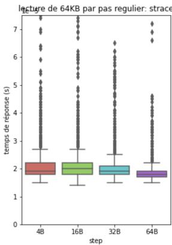
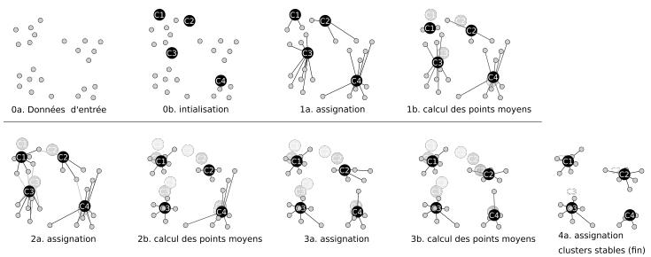

# Évaluation des performances : workloads 性能评估：工作负载

[课程入口](../README.md) · [法语课件 PDF（59 页）](2_edp.pdf) · [法语 Markdown](2_edp.md)

已于 2026-09-30 按当前 59 页法语课件核对，依次讲解引言、负载选择、特征化、合成负载和真实负载。保留必要的法文术语、公式与例子，补充解释紧接对应概念。文末提供 PDF 页码对照；原资料中的数学简写及订正见[审校说明](../审校说明.md)。

格式说明：法语在前、中文在后，同一行以空格隔开，撇号统一为 '。法语优先依据对应课件及法语讲义，必要时沿用已有订正；中文补充、校注和附录中没有对应原文的部分配以法语译写，仍属补充材料。

## 1 Introduction 引言 (Introduction)

Il existe deux classes de workloads : charges réelles et charges synthétiques. 存在两类工作负载 (workloads/charges de travail): 真实负载 (charges réelles) 和合成负载 (charges synthétiques)。

### 1.1 Les charges réelles 真实负载 (Les charges réelles)

- Observées ou mesurées pendant une exécution sur un système réel. 在真实系统执行期间被观察或测量
- Une exécution et son contexte complet ne sont pas exactement reproductibles ; une trace peut être rejouée dans les limites des événements enregistrés. 一次真实运行及其完整环境难以精确重现；已记录的轨迹可以重放，但只能复现轨迹中保留的事件

Avantages : 优点:

- Représentativité optimale 最优的代表性 (représentativité optimale)
- Richesse des détails 细节丰富 (riches en détails)

Inconvénients : 缺点:

- Grande taille 数据量大
- Contexte initial difficile à reproduire intégralement 原始运行环境难以完全复现
- Extraction parfois difficile 提取方式有时困难

### 1.2 Les charges synthétiques 合成负载 (Les charges synthétiques)

- Créées selon des caractéristiques déterminées pour représenter un contexte ou comportement précis. 根据明确的特征创建, 以代表特定的上下文/行为 (contexte/comportement)
- Peuvent être répétées à l'infini. 可以无限次重复 (réitérées à l'infini)

Avantages : 优点:

- Développement rapide 开发快速
- Répétition à l'infini 可无限重复
- Taille réduite 数据量小
- Portabilité 可移植性 (portabilité)

Inconvénients : 缺点:

- Représentativité moindre 代表性较低
- Nombreuses approximations 大量近似 (approximations)

## 2 Sélection des workloads 工作负载的选择 (Sélection)

La sélection de la charge détermine l'utilité et l'exactitude des résultats de l'évaluation. Quatre aspects majeurs : 工作负载的选择对于性能评估至关重要, 因为它决定了分析所获得结果的实用性和准确性。选择工作负载需要考虑四个主要方面:

1. Service délivré par le système 系统提供的服务 (service délivré)

2. Niveau de détail demandé 所需的细节级别 (niveau de détail)

3. Représentativité des charges 负载的代表性 (représentativité)

4. Alignement temporel 负载内的时间对齐 (alignement temporel)

### 2.1 Service délivré 提供的服务 (Service délivré)

Le système est un fournisseur de services. Isoler le service étudié des autres services disponibles. 要分析的系统被视为一组服务的提供者。必须考虑研究所涉及的服务, 并将其与系统可能提供的其他服务明确区分。

Remarque : un service indépendant du contexte est plus représentatif et ne limite pas la validité des résultats à un contexte particulier. 备注: 独立于上下文 (contexte) 的服务更具代表性, 因此更适合分析, 因为它不会将结果的有效性限制在特定的上下文中。

Exemple d'analyse du stockage : 示例: 分析数据存储时:

- Le système étudié est le stockage, le disque étant le composant fournissant le service. 分析的系统是存储系统, 但我们考虑磁盘, 因为它是提供所分析服务的组件
- Choisir des métriques au niveau système : temps de réponse moyen ou TPS, plutôt que seul temps d'accès au disque. 用于分析的指标 (métrique) 应该在系统级别而非磁盘级别。应该使用平均响应时间 (temps de réponse moyen)、TPS 吞吐量 (débit en TPS) 等, 而不是磁盘访问时间

### 2.2 Niveau de détail 细节级别 (Niveau de détail)

#### 2.2.1 Relation avec la méthode d'évaluation 与评估方法的关系

- La modélisation mathématique exige moins de détails, souvent des moyennes ou distributions. 数学建模 (modélisation mathématique) 需要较少的细节 (通常使用平均值或分布)
- Simulation et mesure utilisent des charges horodatées : traces ou charges exécutables. 仿真 (simulation) 和测量 (mesure) 使用带时间戳的负载: 跟踪 (traces) 或可执行负载 (charges exécutables)

#### 2.2.2 Traitement des traces 跟踪处理

Les traces sont souvent volumineuses et détaillées : 跟踪通常数据量大且细节丰富:

- Utiliser des traces de haut niveau pour réduire les données à analyser. 使用高层跟踪以减少要分析的数据量
- Adapter leur finesse aux résultats obtenus et souhaités. 根据获得的结果和期望的结果调整跟踪的细节精度

### 2.3 Représentativité 代表性 (Représentativité)

Un workload de test doit représenter une application, un comportement ou une classe d'applications partageant des paramètres. 测试工作负载必须代表某个应用/行为或具有共同参数的应用类别。

La charge et l'application doivent correspondre sur : 为了使负载能代表一个应用, 两者必须在以下方面相匹配:

- Taux d'arrivée 到达率 (taux d'arrivée)
- Ressources demandées 所需资源 (ressources demandées)
- Profil d'utilisation des ressources 资源使用概况 (profil d'utilisation)

### 2.4 Alignement temporel 时间对齐 (Alignement dans le temps)

La charge doit suivre et représenter les variations temporelles du comportement du système. 工作负载必须跟随并代表系统行为的时间变化。

Niveaux possibles : 可以区分几个级别:

- Faible : tendance temporelle uniquement. 弱 (Faible): 仅给出时间行为的趋势
- Fort : reproduction précise de tous les événements. 强 (Fort): 准确追踪系统中发生的所有事件
- Intermédiaire : changements clés de la tendance. 中等 (Intermédiaire): 追踪构成系统行为趋势的关键变化

### 2.5 Autres critères de sélection 其他选择考虑因素

> Précision : une charge « meilleure » ou « pire » dépend du débit ou du temps de réponse étudié ; l'exécution réelle n'est pas entièrement reproductible, mais une trace peut être rejouée. 校注：负载高低的“最好／最坏”取决于考察吞吐量还是响应时间；真实负载的原始运行难以完全复现，但记录的轨迹可重放。

#### 2.5.1 Bien utiliser les résultats de calibration 校准结果的良好使用

Les niveaux de charge décrivent les régimes d'utilisation : 负载级别反映系统可以运行的状态:

- Faible : temps de réponse de base avec peu d'attente. 低负载：观察排队较少时的基础响应时间
- Typique : utilisation courante. 典型负载：代表平时的使用状态
- Proche de la saturation : capacité de débit et croissance du temps de réponse. 接近饱和的高负载：观察吞吐能力以及响应时间是否快速增长

Le meilleur ou pire cas dépend de la métrique : débit élevé ne signifie pas faible temps de réponse. “最好／最坏”必须针对具体指标判断：高吞吐量不代表低响应时间。

#### 2.5.2 Répétition 重复性 (Répétition)

La même charge doit produire des résultats comparables à chaque exécution. 使用相同负载每次执行获得” 相同” 的结果。

Remarque : une forte variabilité des résultats conduit à de larges intervalles de confiance et rend la charge moins commode. 备注: 引入结果高度可变性的负载不太理想, 因为它们会产生较大的置信区间 (intervalles de confiance)。

### 2.6 Intervalle de confiance 置信区间 (Intervalle de confiance)

Un intervalle exprime l'incertitude sur un paramètre, ici la moyenne. À 95 %, environ 95 % des intervalles construits par répétition de la procédure couvrent la vraie moyenne ; ce n'est pas une probabilité de 95 % attribuée à un intervalle déjà fixé. 置信区间描述对总体参数（此处为均值）估计的不确定性。95% 置信水平指：反复抽样并使用同一方法构造区间时，长期约 95% 的区间包含真实均值；不是说某个已经算出的固定区间有 95% 的概率包含固定的总体均值。

À confiance égale, un intervalle plus étroit est plus précis. Pour les mêmes données, augmenter la confiance élargit l'intervalle. 在置信水平相同的条件下，区间越窄，估计越精确。对同一批数据，提高置信水平会使区间变宽。

#### 2.6.1 Calcul de l'intervalle 置信区间的计算

Pour des observations indépendantes, lorsque l'approximation normale de la moyenne convient : 对独立样本，在均值的正态近似适用时：

$$
\left[\bar X-z_{1-\alpha/2}\frac{s}{\sqrt n},\quad \bar X+z_{1-\alpha/2}\frac{s}{\sqrt n}\right].
$$

$1-\alpha$ est le niveau de confiance et $s$ l'écart type empirique. Pour une population normale de variance inconnue, utiliser $t_{1-\alpha/2,n-1}$. 其中 $1-\alpha$ 是置信水平，$s$ 是样本标准差。正态总体且方差未知时，使用 $t_{1-\alpha/2,n-1}$。

> Précision : les correspondances du cours sont approximatives. Sous la loi normale, 1, 2 et 3 écarts types couvrent environ 68.27 %, 95.45 % et 99.73 % ; les seuils bilatéraux à 95 % et 99 % sont environ 1.960 et 2.576. 校注：原笔记沿用课件中的粗略对应关系。标准正态的 1、2、3 倍标准差范围约覆盖 68.27%、95.45%、99.73%；双侧 95%、99% 的临界值分别约为 1.960、2.576。

## 3 Caractérisation des workloads 工作负载的特征化 (Caractérisation)

Quel que soit le type de charge, extraire les caractéristiques clés du contexte étudié. 无论工作负载类型如何, 我们都提取关键特征来代表研究的上下文。

### 3.1 Intérêt 目的 (Intérêt)

- Représenter ou identifier le contexte. 表示/识别研究上下文
- Produire une charge synthétique liée au réel mais répétable à l'infini. 生成与真实工作负载相关的合成工作负载, 但可以无限重复

### 3.2 Implémentation 实施 (Implémentation)

Techniques statistiques : moyennes, dispersion, histogrammes simples et multiples. 基于统计技术, 如: 平均值、离散因子、简单和多重直方图等。

### 3.3 Moyennes et facteurs de dispersion 平均值和离散因子 (Moyennes et facteurs de dispersion)

#### 3.3.1 Moyennes 平均值 (Moyennes)

La technique la plus simple résume par une seule valeur les valeurs possibles d'un paramètre et donne sa tendance. 最简单的技术: 用单个值来表征负载, 该值总结了所研究参数在负载中可能取的所有值, 从而提供其趋势信息。

Le choix entre moyenne arithmétique, géométrique ou harmonique dépend du paramètre. 存在多种平均值 (算术、几何、调和等), 每种的使用根据所分析的参数更为合适。

Soient $(x_1,x_2,\ldots,x_n)$ les valeurs possibles du paramètre X dans la charge. 设 $( x _{1} , x _{2} , \ldots , x _{n} )$ 为参数 X 在分析的负载中可能取的值。

Moyenne arithmétique : 算术平均值 (Moyenne arithmétique):

$$
\bar{X} = \frac{1}{n} \sum_{i = 1} ^{n} x _{i}
$$

Moyenne géométrique : 几何平均值 (Moyenne géométrique):

$$
\bar{X} = \left(\prod_{i = 1} ^{n} x _{i}\right) ^{1 / n}
$$

Moyenne harmonique : 调和平均值 (Moyenne harmonique):

$$
\bar{X} = \frac{n}{\frac{1}{x _{1}} + \frac{1}{x _{2}} + \cdots + \frac{1}{x _{n}}}
$$

Exemples : 示例:

- Temps moyen de réponse : moyenne arithmétique. 平均响应时间 (算术)
- Taux global de défauts de cache : défauts totaux / accès totaux, soit une moyenne arithmétique pondérée par les accès. 总体缓存未命中率：总未命中次数 / 总访问次数，等价于按访问次数加权的算术平均
- Vitesse moyenne sur distances égales : harmonique ; sur durées égales : arithmétique. 等距离路段的平均速度：调和平均；等时间段则使用算术平均

#### 3.3.2 Moyenne pondérée 加权平均值 (Moyenne pondérée)

Chaque valeur de la charge est associée à un coefficient déterminant son poids. 加权平均值是一种平均值, 其中所考虑负载中的每个不同值都与确定其权重的系数相关联。

Moyenne arithmétique pondérée : 算术加权平均值:

$$
\bar{X} = \frac{\sum_{i = 1} ^{n} p _{i} x _{i}}{\sum_{i = 1} ^{n} p _{i}}
$$

Les poids $p_i$ sont non négatifs et leur somme strictement positive. 其中 $p_i$ 为非负权重，且权重总和大于零。

#### 3.3.3 Facteur de dispersion 离散因子 (Facteur de dispersion)

La moyenne seule ne suffit pas lorsque les valeurs sont très variables. 仅有平均值是不够的, 特别是当参数可能取的值存在很大离散 (variabilité) 时。

La dispersion est estimée par la variance : 离散度由方差 (variance) 估计:

$$
\operatorname{var} (X) = \sigma^{2} = \frac{1}{n - 1} \sum_{i = 1} ^{n} (X _{i} - \bar{X}) ^{2}
$$

> Précision : le cours note σ une estimation de variance avec dénominateur n−1, usuellement notée s² pour la distinguer de la variance de population. Le coefficient de variation suppose une échelle de rapport pertinente et une moyenne non nulle ; un écart type empirique nul indique seulement des observations identiques. 校注：本段沿用课件的 σ 记号，但分母 n−1 给出的是样本方差估计，通常记作 s²，以区别于总体方差。变异系数适用于有意义的比率尺度且均值非零的情形；样本标准差为零只表明这些观测值相同。

On en déduit l'écart type : 由此推导出标准差 (écart type):

$$
\sigma = \sqrt{\operatorname{var} (X)}
$$

On utilise souvent le coefficient de variation, ou écart type relatif : 常使用变异系数 (coefficient de variation) 或相对标准差:

$$
\sigma / \bar{X}
$$

Remarque 1 : un écart type empirique nul ne garantit pas que les exécutions futures soient constantes. 备注 1：样本标准差为零，说明本次观测值都相同，不能据此保证未来运行中的参数始终不变。

Remarque 2 : si la dispersion est élevée, regrouper les valeurs en classes peut être plus pertinent. 备注 2: 如果标准差较高, 更适合将参数值组织成类别。

### 3.4 Quantiles et histogrammes 分位数和直方图 (Quantiles et histogrammes)

#### 3.4.1 Définition des quantiles 分位数定义 (Quantiles: définition)

Les quantiles sont des points qui partagent une série ordonnée en q parties d'effectifs comparables. 分位数是将有序列表以规则间隔划分为 q 个等效部分的点。

##### Quantiles usuels : 最常用的分位数:

- Centiles : cent parties. 100-分位数或百分位数 (centiles): 将样本分为 100 份
- Déciles : dix parties. 10-分位数或十分位数 (déciles): 将样本分为 10 份
- Quartiles : quatre parties. 4-分位数或四分位数 (quartiles): 将样本分为 4 份
- Médiane : deux parties. 2-分位数或中位数 (médiane): 将样本分为 2 份

#### 3.4.2 Calcul des quantiles 分位数计算 (Quantiles: calcul)

Pour $p\in(0,1)$, une définition empirique est $Q_p=\inf\{x:F_n(x)\ge p\}$ : au moins une proportion $p$ des observations est inférieure ou égale à $Q_p$. Distinguer q parties et proportion p ; les logiciels peuvent aussi interpoler. Exemples : 对比例 $p\in(0,1)$，一种经验分位数定义是 $Q_p=\inf\{x:F_n(x)\ge p\}$，即至少比例 $p$ 的观测值不大于 $Q_p$。分成 $q$ 份与取比例 $p$ 是两种记法，不应混淆；软件还可能使用插值约定。示例：

- Premier décile : plus petite valeur observée couvrant au moins 10 % des observations. 第一个十分位数 (10-分位数) 是使至少 10% 的观测值不大于它的最小样本值
- Troisième quartile : plus petite valeur observée couvrant au moins 75 % des observations. 第三个四分位数 (4-分位数) 是使至少 75% 的观测值不大于它的最小样本值

#### 3.4.3 Exemple 示例

| Valeur 值 | 4 | 7 | 9 | 11 | 13 | 15 | 18 |
| --- | --- | --- | --- | --- | --- | --- | --- |
| Effectif 出现次数 | 6 | 5 | 10 | 6 | 2 | 7 | 4 |

- Premier quartile = 7, au moins 25 % des valeurs lui sont inférieures ou égales. 第 1 个四分位数 = 7，至少 25% 的值不大于它
- Troisième quartile = 15, au moins 75 % des valeurs lui sont inférieures ou égales. 第 3 个四分位数 = 15，至少 75% 的值不大于它
- Médiane = 9, les observations 20 et 21 valent toutes deux 9. 2-分位数 (中位数) = 9，第 20、21 个观测值均为 9

#### 3.4.4 Écart interquartile 四分位距 (L'écart inter-quartile)

L'écart $Q_3-Q_1$ s'interprète selon l'unité et l'ordre de grandeur. 四分位距为 $Q_3-Q_1$，应结合数据单位与量级判断它的大小。

Un écart plus grand ou plus petit traduit une dispersion plus forte ou plus faible. 较大 (或较小) 的四分位距表示异质 (或同质) 分布。

Ici, $Q_3-Q_1=15-7=8$ décrit l'étendue de la moitié centrale ; son importance dépend du contexte et de l'unité. 在前面的例子中，$Q_3-Q_1=15-7=8$。它描述中间一半观测值的跨度；是否算“大”，还需结合数据单位和应用场景判断。

#### 3.4.5 Médiane 中位数 (Médiane)

Autre nom du quantile d'ordre 1/2, valeur centrale d'une série croissante. 2-分位数的另一个名称, 表示有序样本 (ASC) 的中心值。

Elle est moins sensible aux valeurs aberrantes que la moyenne. 它不像平均值那样受异常值的影响。

Calcul : 中位数计算:

- Avec $2n+1$ observations : médiane $=u_{n+1}$. 如果样本有 (2n+1) 项, 中位数 $= u _{n + 1}$
- Avec $2n$ observations : médiane $=(u_n+u_{n+1})/2$. 如果样本有 2n 项, 中位数 $\textstyle{\frac{u _{n} + u _{n + 1}} {2}}$

#### 3.4.6 Exemple 1 : médiane, moyenne et mode 示例 1: 中位数、平均值和众数 (Mode)

| Valeur 值 | 4 | 7 | 9 | 11 | 13 | 15 | 18 |
| --- | --- | --- | --- | --- | --- | --- | --- |
| Effectif 出现次数 | 6 | 5 | 10 | 6 | 2 | 7 | 4 |

- Moyenne pondérée : 10.45. 加权平均值:10.45
- Médiane : 9 ; les observations 20 et 21 valent 9. 中位数：9（第 20、21 个观测值均为 9）
- Mode : 9, valeur la plus fréquente. 众数:9(最频繁的值)

#### 3.4.7 Exemple 2 : médiane, moyenne et mode 示例 2: 中位数、平均值和众数

| Valeur 值 | 32 | 41 | 48 | 58 | 60 | 97 | 124 |
| --- | --- | --- | --- | --- | --- | --- | --- |
| Effectif 出现次数 | 15 | 10 | 15 | 15 | 15 | 2 | 6 |

- Moyenne pondérée : 55.4, influencée par les valeurs extrêmes. 加权平均值:55.4(异常值的影响)
- Médiane : 48 ; les observations 39 et 40 valent 48. 中位数：48（第 39、40 个观测值均为 48）
- Modes : 32, 48, 58 et 60, ex æquo pour l'effectif maximal. 众数:32, 48, 58, 60(最频繁的值)

#### 3.4.8 Représentation graphique de la variabilité 可变性的图形表示

> Précision : documenter la règle des moustaches ; les quantiles 5 % et 95 % ne sont qu'une convention possible. 校注：箱线图须注明须线规则，5%／95% 分位数只是其中一种约定。

La boîte à moustaches est particulièrement adaptée à la représentation d'un échantillon variable. 箱线图 (Box plot/boîte à moustache) 是一种统计图形工具, 当样本中观察到很大的可变性时, 它提供了非常合适的表示。

Elle montre notamment : 用途:

- La moitié centrale, entre les quartiles 25 % et 75 % ; 以清晰的视觉方式获得样本 50% 的范围 (位于 25% 和 75% 之间)
- La position de la médiane et de la moyenne ; 中位数和平均值的位置
- Les valeurs aberrantes ; 异常值 (outliers)
- Avec la convention du cours, les points 5 % et 95 % par rapport à la boîte. 对应于样本 5% 和 95% 的点距离箱体的偏差被表示出来

*Boîtes à moustaches du temps de réponse selon le pas d'accès — p. 32 不同访问步长下的响应时间箱线图，课件第 32 页*

L'axe horizontal est le pas d'accès, le vertical le temps de réponse. Comparer médianes, boîtes puis points de forte latence : un comportement typique proche n'exclut pas des queues différentes. Confirmer la règle des moustaches plutôt que supposer 5 %/95 %. 图中横轴为访问步长，纵轴为响应时间。先比较中位数和箱体，再观察高延迟点：典型请求相近，并不意味着长尾表现相同。须线的具体规则需要由作图方法确认，不能仅凭图片认定它就是 5%／95% 分位数。

#### 3.4.9 Analyse plus fine de la variabilité 可变性的更精细分析

Si une forte variabilité révèle un échantillon hétérogène : 当可变性加剧显示出异质样本时:

Identifier d'abord ses classes par une technique de clustering, puis les analyser séparément. 必须优先通过分类技术之一 (聚类/clustering) 识别组成初始样本的这些类别, 并分别分析每个类别。

### 3.5 Classification 分类 (Classification)

#### 3.5.1 Technique k-means k-means 技术

> Précision : k-means exige des caractéristiques numériques ; encoder les catégories de manière adaptée. Encodage et distance influencent les résultats. 校注：k-means 需要数值特征，类别特征须先作适当编码；编码和距离选择会影响结果。

K-means regroupe les points à partir des distances entre les éléments. k-means 技术允许进行有效的分类, 基于样本不同元素 (点) 之间的距离或间隔的计算。

Les données peuvent décrire des grandeurs quantitatives, comme durée, taille ou débit, ou des événements qualitatifs à encoder. 间隔可以是定量的 (时间、大小、吞吐量) 和定性的 (事件到达)。

#### 3.5.2 Classification par k-means k-means 分类

En HPC, les données sont le plus souvent quantitatives ; on emploie couramment la distance euclidienne. 在 HPC 中, 分析的数据最常是定量的, 间隔度量是: 欧几里得距离 (distance euclidienne)

##### Étapes de k-means : k-means 算法步骤:

1. Choisir C centres initiaux Ctr pour C classes ; l'initialisation influence la convergence. 选择 C 个点形成要构建的 c 个类的中心 Ctr。此选择对收敛有重要影响

2. Affecter chaque point à son centre le plus proche. 通过计算每个点到中心 Ctr 的距离形成类, 并将它们关联到最近中心的类

3. Recalculer les centres $\mathrm{Ctr}_{\mathrm{new}}$ comme barycentres des classes. 计算新中心 $\operatorname{C t r} _{\operatorname{n e w}} .$ : 前面形成的类的质心 (barycentres)

4. Répéter 2 et 3 avec $\mathrm{Ctr}\gets\mathrm{Ctr}_{\mathrm{new}}$ jusqu'à convergence. 用 $( \mathrm{C t r} \gets \mathrm{C t r} _{\mathrm{n e w}} )$ 重复步骤 2 和 3 直到收敛

#### 3.5.3 Calcul du barycentre 质心计算

Barycentre ou centre de gravité d'un sous-échantillon : 集合 (子样本) 的质心或重心 (centre de gravité) 计算公式:

$$
G = \frac{1}{\sum_{i = 1} ^{N} p _{i}} \sum_{i = 1} ^{N} p _{i} n _{i} \quad \text{其中} \sum_{i = 1} ^{N} p _{i} \neq 0
$$

Pour des points de poids identiques : 在点具有等价权重的情况下:

$$
G = \frac{1}{N} \sum_{i = 1} ^{N} n _{i}
$$

#### 3.5.4 Condition de convergence 收敛条件

Convergence lorsque les affectations ne changent plus entre deux itérations. 当一次迭代的类与前一次迭代的类相同时, 达到收敛。

On peut aussi imposer un nombre maximal d'itérations. 可能在定义的迭代次数后停止 (不考虑类的条件)。

*K-means : de l'initialisation aux groupes stables — p. 39 k-means 从初始化到稳定聚类的过程，课件第 39 页*

Dans la figure, 0a contient les données et 0b initialise quatre centres. Affectation au centre le plus proche et recalcul des barycentres alternent jusqu'au regroupement stable 4a. 图中的 0a 是输入数据，0b 初始化四个中心；随后交替执行“分配到最近中心”和“重新计算质心”，直到 4a 中的分组保持稳定。

### 3.6 Autres outils : histogrammes 其他工具: 直方图 (Histogrammes)

#### 3.6.1 Histogramme simple 简单直方图

L'histogramme simple, à un paramètre, compte les observations ayant des valeurs proches. 最常用的类型是简单或单参数直方图。它突出显示参数可能取的相似值的数量。

Il relie la représentation empirique des observations et quantiles à la description par une distribution, par exemple normale. 直方图是观察值/分位数表示工具 (通过排序、实验测量批次混合) 与概率定律/分布描述 (例如正态定律) 之间的联系。

#### 3.6.2 Histogrammes multiples 多重直方图 (Histogrammes multiples)

Utilisés pour plusieurs paramètres liés, le plus souvent deux ou trois. 当多个参数相关时使用。最常见的是 2 到 3 个参数。

Pour deux paramètres, des tours de hauteurs différentes se placent sur une grille. 对于 2 参数直方图, 使用不同高度的” 塔” 作为棋盘上的棋子。

## 4 Workloads synthétiques 合成工作负载 (Workloads synthétiques)

### 4.1 Paramètres à générer 要生成的参数 (Paramètres à générer)

Paramètres courants en HPC : 在高性能计算中最常用来表征负载的参数是:

1. Timing de la charge 负载的时序 (timing)

2. Adresses d'accès 访问地址 (adresses d'accès)

3. Nombre de sources 负载源的数量 (nombre de sources)

4. Temps d'exécution ou de service 执行/服务时间 (temps d'exécution/service)

Leurs valeurs sont générées selon des lois de probabilité. 它们可能取的值使用概率定律生成。

### 4.2 Génération du timing 生成: 时序 (Timing)

#### 4.2.1 Temps inter-arrivées 到达间隔时间 (Temps d'inter-arrivées)

Générer les dates d'arrivée des instructions, accès cache ou disque, et tâches : 指令/访问请求 (缓存、磁盘等)/任务的到达日期生成:

- À partir d'une date de référence : zéro au démarrage ou date d'un événement ; 从参考日期开始。此日期可以是零 (系统启动) 或对应于事件到达的日期
- Selon une fréquence représentant la pression exercée sur le système ; 根据频率, 确定被分析系统所承受的压力
- Selon un mode d'utilisation caractérisant le comportement de l'application. 根据使用模式，刻画应用对系统的使用行为

#### 4.2.2 Taux ou fréquence d'arrivée 到达率或频率/吞吐量

Noté λ, il donne le nombre d'instructions, requêtes ou tâches soumises par unité de temps. 记为 λ, 确定在一个时间单位内提交给系统的指令/请求/任务数量。

Il intervient avec le mode d'utilisation dans la génération d'intervalles représentatifs. 在生成到达间隔时间时使用, 结合系统的使用模式, 以更好地代表合成负载。

##### Modes d'utilisation : 使用类型:

- Fixe 固定使用 (utilisation fixe)
- Ordinaire 普通使用 (utilisation ordinaire)
- En rafales 突发使用 (utilisation en rafales)
- Périodique ON/OFF, à queue lourde, etc. 周期性使用 (périodiques) (ON/OFF), 重尾 (heavy tailed) 等

#### 4.2.3 Utilisation fixe 固定使用 (Utilisation fixe)

Les dates sont séparées par un intervalle fixe δt. 确定负载时序的日期由固定时间 δt 分隔。

Les arrivées sont périodiques. 到达是周期性的。

Aucune loi aléatoire n'est nécessaire : incrémenter la date de δt. 因此不需要概率定律来生成日期。这通过步长为 δt 的增量过程完成。

$$
\mathrm{date} _{i} = \mathrm{date} _{\mathrm{ref}} + i \times \delta t
$$

#### 4.2.4 Utilisation ordinaire 普通使用 (Utilisation ordinaire)

Dans un processus de Poisson homogène de taux $\lambda>0$, le nombre d'arrivées sur une durée $\Delta$ suit $\operatorname{Poisson}(\lambda\Delta)$ ; les intervalles sont indépendants, de loi $\operatorname{Exp}(\lambda)$ et de moyenne $1/\lambda$. Distinguer comptage et intervalle. 在速率为 $\lambda>0$ 的齐次泊松过程模型中，长度为 $\Delta$ 的时间窗口内的到达数量服从 $\operatorname{Poisson}(\lambda\Delta)$；相邻到达之间的等待时间独立，服从 $\operatorname{Exp}(\lambda)$，均值为 $1/\lambda$。泊松分布描述数量，指数分布描述间隔。

##### Génération des dates : 生成到达日期:

1. Tirer u uniformément sur $(0,1)$, sans les bornes. 生成遵循 $(0,1)$ 上均匀分布（排除端点） (loi Uniforme) 的随机变量 u 的值

2. Calculer l'intervalle par : 使用此值计算到达间隔时间:

$$
\delta t = - \frac{1}{\lambda} \ln(u)
$$

3. Ajouter δt à la date précédente pour obtenir la date courante. 当前指令/请求/任务的日期由前一个的日期加上此 δt 获得

#### 4.2.5 Utilisation en rafales 突发使用 (Utilisation en rafales)

Les rafales arrivent selon un processus de Poisson ; leur taille suit une loi géométrique de paramètre p, inverse de la taille moyenne. 到达以突发 (bursts) 形式发生, 遵循泊松定律, 突发大小遵循参数为 p 的几何定律 (loi géométrique),对应于突发平均大小的倒数。

##### Deux étapes de génération : 生成到达日期分两步:

1. Générer la taille de la rafale. 生成突发大小

2. Générer les dates des événements du workload. 生成组成工作负载的事件的到达时间

La taille de la rafale est son nombre d'événements. 突发大小生成: 突发大小对应于其事件数量。

1. Tirer u uniformément dans $(0,1)$. 给随机变量 u 赋予遵循 $(0,1)$ 上均匀分布（排除端点）的值

2. Calculer la taille par : 使用此值计算突发大小:

$$
G (p) = \left\lceil \frac{\ln(u)}{\ln(1 - p)} \right\rceil
$$

##### Dates des événements : 生成事件到达时间:

1. Générer des intervalles exponentiels entre rafales, puis les cumuler en dates. 按指数分布生成突发之间的间隔，再累加得到到达时刻（泊松过程）

2. Générer la taille, puis autant d'événements à cette date. 生成其大小 (前面描述), 生成在此日期到达的该数量的事件

Des variantes répartissent les événements à l'intérieur de la rafale. 存在指定突发内事件分布的变体。

Pour $0<p<1$, la taille est un entier positif de moyenne $1/p$ ; pour $p=1$, prendre 1. Distinguer taux de rafales et d'événements : pour $\lambda_b$ rafales par unité de temps et des tailles indépendantes des dates, le taux moyen d'événements vaut $\lambda_b/p$. 公式要求 $0<p<1$，生成的突发大小为正整数，均值为 $1/p$；$p=1$ 时直接取大小 1。区分“突发到达率”和“事件到达率”：若每单位时间平均有 $\lambda_b$ 个突发，大小与到达时刻独立，则事件平均到达率为 $\lambda_b/p$。

### 4.3 Génération des adresses 生成: 地址 (Addressing)

> Précision : discrétiser les adresses selon la plage, par exemple $\lfloor uM\rfloor$ avec $0\le u<1$ et M adresses. 校注：离散地址应按范围取整，例如 $\lfloor uM\rfloor$，其中 $0\le u<1$、$M$ 为地址个数。

Les accès mémoire ou disque peuvent être uniformes dans l'espace ou concentrés dans des zones à localité spatiale, les hot spots. 对缓存/磁盘和其他存储的访问地址可以均匀分布在整个地址空间上, 也可以显示某种空间局部性(localité spatiale), 集中在某些区域 (热点/hot spots)。

#### 4.3.1 Distribution uniforme 均匀分布

Les adresses suivent une loi uniforme. 地址生成遵循均匀定律。

#### 4.3.2 Hot spots 热点 (hot spots)

Génération uniforme à l'intérieur des zones, avec un facteur de concentration pour les zones actives. 地址生成遵循均匀定律, 在组成热点的区域上有集中因子。

##### Génération uniforme : 均匀地址生成:

1. Tirer $u$ uniformément dans $[0,1)$. 在区间 $[0,1)$ 中生成均匀随机数 $u$

2. Adapter à la taille de l'espace d'adressage : 将这些地址适配到要分析系统的地址空间大小:

$$
\mathrm{adr}=\lfloor uM\rfloor\in\{0,\ldots,M-1\}
$$

Génération de hot spots : 热点生成:

- Diviser l'espace en sous-ensembles ; 将空间细分为子集
- Identifier les plus actifs ; 确定其中最活跃的子集
- Associer un facteur de concentration a aux zones actives. 将集中因子 (a) 关联到这些活跃区域

Chaque région a un facteur a : $a>1$ pour les zones actives, $a=1$ pour les autres. 备注: 每个区域关联一个因子 a。对于活跃区域，$a > 1$ ; 对于其他区域，$a = 1$

### 4.4 Génération du nombre de sources 生成: 源数量 (Nombre de sources)

La charge peut provenir d'un utilisateur ou d'une application, ou de plusieurs sources. 负载可以来自单个用户/应用 (单源负载) 或多个 (多源负载)。

#### 4.4.1 Charge à une source 单源负载

Voir les sections précédentes. 见前述。

#### 4.4.2 Charge à plusieurs sources 多源负载

Cette section présente un modèle d'intervalles de loi d'Erlang d'ordre k. 本节给出用 $k$ 阶 Erlang 分布生成到达间隔的一种模型。

> Précision : k compte des étapes exponentielles indépendantes. Superposer plusieurs sources de Poisson indépendantes donne encore un processus de Poisson, pas automatiquement des intervalles d'Erlang. 校注：$k$ 表示独立指数等待阶段的数量。多个独立泊松源叠加后仍是泊松过程，不能根据源数量直接推断 Erlang 间隔。

$\operatorname{Erlang}(1,\lambda)=\operatorname{Exp}(\lambda)$ est une loi d'attente continue, pas une loi de comptage de Poisson. 备注：$\operatorname{Erlang}(1,\lambda)=\operatorname{Exp}(\lambda)$，其等待时间是指数分布，不能写成离散的泊松计数分布。

Pour k > 1 étapes indépendantes, la formule utilise un taux par étape $k\lambda$ pour un temps total moyen $1/\lambda$ ; les $u_i$ doivent être indépendants. 生成 k 阶段等待时间 (k > 1): 到达间隔时间采用 k 阶 Erlang 定律, 其中 $k$ 是等待阶段数。下式的阶段速率为 $k\lambda$，总等待时间均值为 $1/\lambda$，各 $u_i$ 须独立。

1. Tirer indépendamment $k$ nombres $u_1,\ldots,u_k\in(0,1)$ uniformes. 独立生成 $k$ 个均匀随机数 $u_1,\ldots,u_k\in(0,1)$

2. Calculer l'attente avec le taux cible $\lambda$ : 使用这些值和目标到达率 $\lambda$ 计算等待时间：

$$
t = - \left(\frac{1}{\lambda k}\right) \times \ln \left(\prod_{i = 1} ^{k} u _{i}\right)
$$

## 5 Workloads réels 真实工作负载 (Workloads réels)

Deux sources de charges réelles : 真实负载可以来自两个来源:

1. Collecte pendant l'exécution d'applications utilisateurs. 在观察系统上执行用户应用期间收集

2. Collecte pendant l'exécution de benchmarks. 在观察系统上执行基准测试 (benchmarks) 期间收集

### 5.1 Benchmarks 基准测试 (Benchmarks)

#### 5.1.1 Définition 定义

Partie du code utilisateur représentative du comportement de l'application. 用户代码的一部分, 最能表征该应用的行为。

#### 5.1.2 Exemples 示例

- Calcul : SPEC, Linpack, Livermore, NAS. 计算: SPEC 基准测试、Linpack、Livermore、NAS
- Entrées-sorties : Bonnie et IOzone. 输入/输出: Bonnie、IOzone

### 5.2 Applications utilisateurs 用户应用 (Applications utilisateurs)

- Exécuter l'application étudiée ou une application représentative de sa classe. 执行要分析的用户应用或代表要分析类别的应用
- Collecter la charge produite pendant cette exécution. 收集此执行期间生成的负载
- La réutiliser dans d'autres contextes d'exécution, ou 在将来的不同执行上下文中可能重用它们, 或
- Extraire ses caractéristiques et les modéliser par des distributions pour élargir les cas analysables. 推导出主要特征并用分布定律表示它们, 以增加可能的分析案例

#### 5.2.1 Précautions 注意事项

Avant l'exécution, définir les mesures souhaitées et préparer les outils d'extraction de la charge. 在执行用户应用之前, 明确要测量什么, 并准备提取由此产生的负载的工具。

Pour approfondir, voir le cours ultérieur sur la mesure. 更多信息: 参见几周后的测量课程 (Cours Mesure)

### 5.3 Paramètres des workloads réels 真实工作负载: 参数

Qu'il s'agisse de benchmarks ou d'applications : 无论收集涉及基准测试还是用户应用:

La collecte porte sur les événements qui modifient l'état du système : 它专注于改变系统状态的事件:

- Changements de contexte 上下文切换 (changement de contexte)
- Déplacements de la tête de disque 磁盘寻道 (Seek)
- Réception ou envoi de messages, etc. 消息接收或发送等

Enregistrer dates, nombres par unité de temps, tailles, etc. 包括它们的日期、一个时间单位内的数量、大小等。

## Correspondance avec le PDF 课件页码对照

Pagination du lecteur PDF, couverture comprise. Les pages 1–3 présentent le titre et le plan en cinq parties ; la suite conserve l'ordre du cours. 以下采用 PDF 阅读器页码，包含封面。第 1–3 页是课程标题与目录，其余内容按原顺序展开。

| Pages du PDF PDF 页码 | Section des notes 中文讲义位置 |
|---|---|
| 1–3 | Titre et plan en cinq parties 课程标题与五部分目录 |
| 4–5 | §1 Charges réelles et synthétiques §1：真实与合成负载 |
| 6–8 | §2–2.1 Sélection et frontière du service §2–2.1：选择原则与服务边界 |
| 9–10 | §2.2 Niveau de détail §2.2：细节级别 |
| 11–12 | §2.3–2.4 Représentativité et alignement temporel §2.3–2.4：代表性与时间对齐 |
| 13–15 | §2.5–2.6 Charge, répétition et confiance §2.5–2.6：负载级别、重复性与置信区间 |
| 16–20 | §3.1–3.3.2 Caractérisation et moyennes §3.1–3.3.2：特征化与各类平均值 |
| 21–23 | §3.3.3 Variance, écart type et variation relative §3.3.3：方差、标准差与变异系数 |
| 24–30 | §3.4.1–3.4.7 Quantiles et exemples §3.4.1–3.4.7：分位数与两组数据例子 |
| 31–33 | §3.4.8–3.4.9 Boîtes à moustaches et groupes §3.4.8–3.4.9：箱线图与分组分析 |
| 34–39 | §3.5 Algorithme, barycentres et convergence §3.5：算法、质心、收敛与图例 |
| 40–41 | §3.6 Histogrammes simples et multiples §3.6：单参数与多参数直方图 |
| 42 | §4.1 Quatre paramètres synthétiques §4.1：合成负载的四类参数 |
| 43–46 | §4.2.1–4.2.4 Taux et intervalles §4.2.1–4.2.4：到达率、固定间隔与指数间隔 |
| 47–49 | §4.2.5 Tailles et dates des rafales §4.2.5：突发大小与到达时刻 |
| 50–52 | §4.3 Adresses uniformes et hot spots §4.3：均匀地址与热点 |
| 53–54 | §4.4 Sources multiples et Erlang §4.4：多源与 Erlang 模型 |
| 55–56 | §5–5.1 Charges réelles et benchmarks §5–5.1：真实负载与基准测试 |
| 57–58 | §5.2 Exécution, collecte et réutilisation §5.2：运行、采集与复用 |
| 59 | §5.3 Événements et attributs §5.3：采集事件及属性 |
