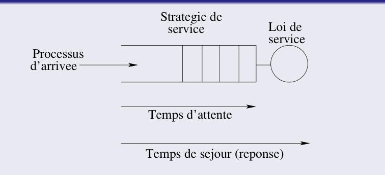
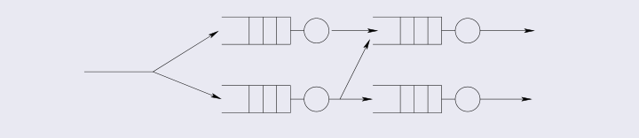
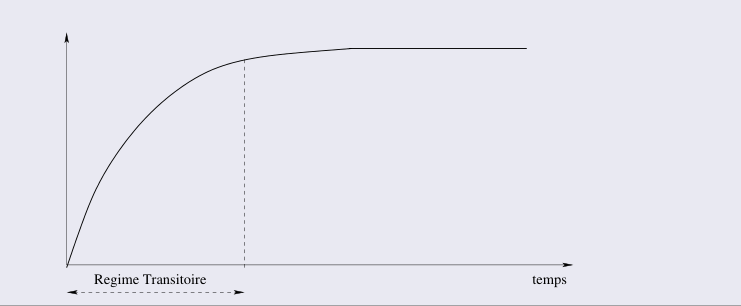
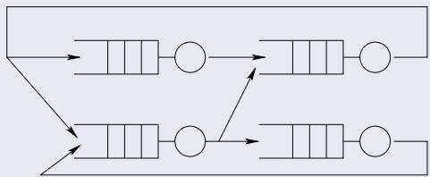
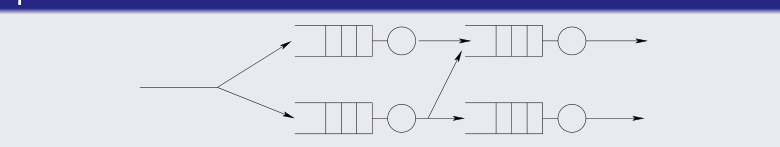
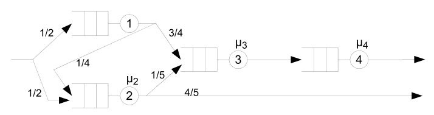
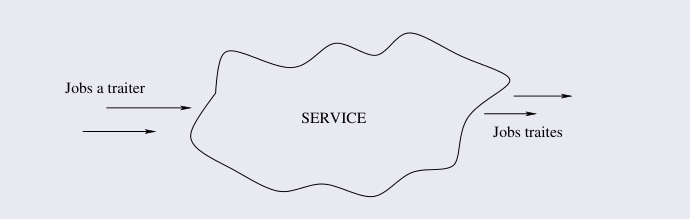

# Cours 3 — Modélisation mathématique

Soraya Zertal · Master 2 CHPS · Li-PaRAD / UVSQ

[Sommaire du module](../README.md) · [Diaporama PDF — 51 pages](3_edp.pdf) · [Notes en chinois](3_edp_zh.md)

Version synchronisée le 8 octobre 2026 avec le PDF de 51 pages. L’ordre des notions et les figures suivent le diaporama ; les compléments conservés sont signalés. La correspondance des pages figure en fin de document. Les corrections de notation sont consignées dans le [compte rendu](../审校说明.md).

## Introduction

### Définition

La modélisation mathématique est un outil relativement simple, qui consiste en l’abstraction du système réel en un ensemble de fonctions mathématiques, représentant ses principales fonctionnalités/services afin d’analyser le comportement dudit système.

### Formalismes de description

Le système peut être décrit par différents formalismes : files d’attente, chaînes de Markov, réseaux de Petri...etc

## Introduction aux files d’attente

### Files d’attente

Une théorie mathématique, basée sur les probabilités et utilisée pour l’évaluation des performances des systèmes où des clients peuvent arriver et demandent l’acquisition de ressources pour une certaine durée.

Certains clients doivent donc patienter avant d’être servi et quitter le système.

La file d’attente est alimentée par le flux d’arrivée des clients et vidée par les serveurs (ressources).

Pour le modèle M/M/1 à capacité infinie étudié ici, un régime stationnaire exige $\lambda<\mu$. La théorie des files d’attente traite aussi les régimes transitoires et les systèmes saturés.

> **Précision.** La condition de stabilité limite l’usage des formules stationnaires, pas le domaine de la théorie des files d’attente.

## Modélisation analytique : intérêt et limitation

### Intérêt

La modélisation mathématique permet l’évaluation d’un nombre considérable de configurations possibles du système à analyser ainsi que des charges qu’il est susceptible de supporter.

### Limitation

Les hypothèses et les approximations sur lesquelles se base la modélisation peuvent restreindre le champ d’application de ses résultats et impacter leur précision.

## Vocabulaire

$$
\begin{array}{c} \text{Ressource (CPU, mémoire, disque…)}\equiv\text{serveur} \\ \text{Job, processus, requête I/O}\equiv\text{client} \end{array}
$$

### Définition

Les clients attendent dans une file que le serveur soit libre pour les servir.

Le serveur sélectionne selon une stratégie définie, un client en attente dans la file à servir.

## Modèles de files d’attente

Figure: File d’attente élémentaire

### Stratégies de sélection

FIFO premier arrivé dans la file, le premier servi

LIFO dernier arrivé dans la file, le premier servi

Random aléatoire (au hasard)

Round Robin cyclique

Time sharing (TS) temps partagé, valable surtout pour la ressource processeur

Priorités : sélection selon un indicateur ou un niveau de priorité.

## Réseaux de files d’attente

### Connecter les files d’attente ...

Les serveurs et les files peuvent être interconnectés pour former un réseau de files d’attente

Figure: Réseau de files d’attente

## Régime permanent et transitoire

### Régime transitoire

Régime d’évolution d’un système qui n’a pas encore atteint son régime stable ou permanent.

Il peut apparaitre lors de l’amorce du système ou de sa modification.

### Régime permanent

Régime de stabilité que le système atteint après un certain temps de fonctionnement. Dans un régime stationnaire, la distribution des états est invariante par translation du temps. Un régime périodique établi reste dépendant de la phase et doit être distingué de la stationnarité stricte.

## Réseaux de files d’attente : paramètres

### Paramètres de performance

Dans un réseau de files d’attente, ils se définissent aussi bien dans le régime transitoire que permanent par :

Débit ou fréquence d’arrivée et de sortie

Nombre moyen de clients dans le système

Temps moyen de séjour

Taux d’utilisation du serveur

## Réseaux de files d’attente : stabilité

### Condition de stabilité

La stabilité permet de justifier l’emploi des formules de régime stationnaire ci-dessous.

Une condition nécessaire de conservation du flux est :

Le débit moyen en entrée est égal au débit moyen en sortie dans le régime stationnaire considéré.

> **Précision.** L’égalité des flux ne suffit pas à prouver la stabilité. Pour M/M/1 à capacité infinie, il faut $\rho<1$ ; le cas $\rho=1$ n’admet pas de distribution stationnaire normalisable.

## Topologies et classes

Selon leurs topologies, les réseaux de files d’attente peuvent être:

Ouverts : des clients arrivent de l’extérieur ; après un service, ils rejoignent une autre file ou quittent le système. Le nombre de clients présents peut varier. Des boucles internes restent possibles. Pour le réseau de Jackson ouvert considéré, chaque station doit satisfaire sa condition de stabilité.

Fermés : une population fixe circule dans le réseau, sans arrivée ni départ externe.

### Complément : réseaux fermés

#### Définition

Un réseau de files d'attente fermé a un nombre fixe de clients qui circulent à travers les différents serveurs et files d'attente. Il n’y a ni arrivée ni départ externe ; les clients circulent entre les stations.

#### Remarques

Un réseau fermé représente une population finie de clients. Cela ne fixe pas, à lui seul, une capacité de buffer propre à chaque station.

La résolution de tels modèles reste plus complexe.

#### Illustration complémentaire (ancienne version)

Figure: Réseau de files d’attente fermé

## Réseaux de files d’attente ouverts

### Définition

Un réseau de files d’attente ouvert est un réseau où :

1. Les clients arrivent d’une source externe,

2. Sont servis par les différents serveurs,

3. Sont dirigés vers une autre station ou vers la sortie selon le routage.

### Remarques

On suppose un routage permettant à chaque client de quitter le réseau avec probabilité 1.

Un nombre illimité de clients compose donc un flux entrant et sortant du système.

### Exemple

Figure: Réseau de files d’attente ouvert

### Réseaux de Jackson

Mono-classe de clients

Les arrivées poissoniennes

Un serveur par station, avec temps de service exponentiels indépendants dans le modèle de Jackson présenté ici

File de capacité illimitée, Discipline FIFO

Routage probabiliste

### Exemple :

Figure: Réseau de Jackson

Calcul des taux d’arrivées :

$$
\begin{aligned}
\lambda_1&=\frac{\lambda}{2},\\
\lambda_2&=\frac{\lambda}{2}+\frac14\lambda_1=\frac{5\lambda}{8},\\
\lambda_3&=\frac34\lambda_1+\frac15\lambda_2=\frac{\lambda}{2},\\
\lambda_4&=\lambda_3=\frac{\lambda}{2}.
\end{aligned}
$$

Pour chaque station $i$, vérifier $\lambda_i<\mu_i$ avec le taux total reçu après routage.

## Hypothèses

A considérer avant la modélisation sont :

### Equilibre du flux des clients

Le nombre de clients sortants doit être équivalent à celui des clients entrants en considérant une observation à long terme.

### Comportement à une étape

A chaque moment, seul un client peut entrer ou sortir du système. L’état du système change donc de manière incrémentale

### Remarques

Concernant le comportement à chaque étape :

Les arrivées ainsi que les départs multiples ne sont pas autorisés.

Les mouvements simultanés des clients entre les files d’attente au sein du même système sont non autorisés.

### Homogénéité

Le taux moyen d’arrivée et le taux moyen de service sont indépendants de l’état du système.

### Exclusivité

Un client peut se trouver au niveau d’un seul serveur (en service ou en attente).

Un client ne peut pas demander deux services simultanément et quand il obtient un, il est le seul à être servi par ce serveur.

### Service non-bloquant

Le serveur est seul maître du service fourni. Celui-ci ne peut être contrôlé par aucun composant du système.

### Indépendance

Les clients ne doivent pas interagir ni se synchroniser entre eux dans le modèle considéré.

Ces hypothèses définissent les modèles simples étudiés ici ; elles ne sont pas des restrictions universelles de la théorie des files d’attente. Un transfert entre deux stations est un seul événement de routage, même s’il modifie les deux files.

## Notation

Dans le reste du cours, on utilisera la notation suivante:

| Symbole | Commentaire |
| --- | --- |
| s | temps de service moyen pour un client |
| $\mu$ | taux de service (1/s) |
| $\lambda$ | taux d'arrivée moyen |
| $\rho$ | l'intensité du trafic ( $\lambda/\mu$ ) |
| r | temps de réponse moyen |
| w | temps d'attente moyen |
| q | nombre moyen de clients dans la file d'attente |
| n | nombre moyen de clients dans le système (en attente + en service) |
| U | fraction d'utilisation du système |
| a | nombre d'arrivées pendant un temps d'observation T |
| d | nombre de départs pendant un temps d'observation T |

Dans les formules de performance, $n$ est une moyenne. Dans $P_k$, $k$ est un nombre entier de clients et $P_k$ la probabilité de cet état.

## L’analyse opérationnelle

### Vue globale

L’analyse débute en considérant le système à analyser comme une boîte noire à l’entrée de laquelle arrivent des jobs (clients) à traiter (servir) et en sortie de laquelle figure des jobs traités.

Figure: Vue globale de l’analyse opérationnelle

### Caractérisation

Les caractéristiques du système sont évalués par mesure ou par hypothèse (utilisateur,fabriquant/constructeur).

L’évaluation du comportement du système pourra alors s’effectuer dans ce contexte précis.

### Lois d’utilisation

### Taux d’arrivée

On observe le système pendant une période T, durant laquelle a clients sont arrivés,

on en déduis le taux d’arrivée λ :

$$
\lambda = \frac{a}{T}
$$

### Lois d’utilisation

### Utilisation du serveur

Si le serveur a été occupé pendant seulement b unités de temps durant toute la période d'observation T,
On en déduis l'utilisation du serveur U :

$$
U = \frac{b}{T} = \frac{b}{d} \times \frac{d}{T}
$$

d étant le nombre de clients servis, $\frac{b}{d}$ est le temps moyen pour servir un client, et $\frac{d}{T}$ le taux de départ des clients.

### Lois d’utilisation

### Utilisation du serveur

Selon l’hypothèse d’équilibre, le flux en entrée doit être équivalent à celui en sortie, d’où :

$$
U = \frac{b}{d} \times \frac{d}{T} = s \times \frac{d}{T}
$$

$$
U = \lambda \times s
$$

### L’intensité du trafic

$$
\rho = \frac{\lambda}{\mu}
$$

Pour la file M/M/1 de capacité infinie :

- $\rho<1$ : régime stationnaire, $U=\rho$ et probabilité d’inactivité $1-\rho$.
- $\rho=1$ : cas critique, sans distribution stationnaire normalisable.
- $\rho>1$ : la demande dépasse la capacité de service ; le nombre de clients s’accumule et il n’existe pas de temps d’attente moyen stationnaire fini.

L’utilisation physique reste comprise entre 0 et 1 ; lorsque $\rho>1$, $\rho$ mesure la charge offerte et ne représente plus une fraction d’occupation stationnaire.

### Loi de Little

Une loi générale qui peut s’appliquer à tout système.

Pas d’hypothèse particulière sur les distributions d’inter-arrivées et de service

Les moyennes à long terme doivent exister et utiliser la même frontière du système et le même flux de clients.

Le cours utilise ici la forme stationnaire de la loi. Les moyennes doivent être finies et les effets de bord de la fenêtre d’observation négligeables ; l’équilibre des flux seul ne suffit pas à établir la stabilité.

Le nombre moyen de clients (N), le temps moyen de séjour ou (t) et le débit moyen λ d’un système en régime permanent se relient selon la loi :

$$
N = t \times \lambda
$$

### Loi de Little : importance

Permet de calculer l’un des trois paramètres (N,t,λ) en fonction des 2 autres.

Peut s’appliquer à n’importe quel système :

Un buffer uniquement

Un buffer + serveur

Le serveur de la file

### Un buffer uniquement

N représente le nombre moyen de clients dans la file d’attente, t représente le temps moyen d’attente avant le service et λ le flux d’arrivée (ou de départ) des clients.

### Un buffer + serveur

N représente le nombre moyen de clients dans le système (dans la file ou en service), t représente le temps moyen de séjour (attente et service) et λ le flux d’arrivée.

### Le serveur de la file

N représente le nombre moyen de clients en service, t représente le temps moyen de service et λ le flux d’arrivée.

## L’analyse stochastique

### Limite des lois d’utilisation et de Little

Elles ne considèrent aucune hypothèse concernant les lois de probabilité des inter-arrivées et du service.

Elles sont complètement indépendantes des distributions

### Intérêt de l’analyse stochastique

La connaissance des distributions permet d’effectuer une analyse stochastique et d’affiner ainsi l’analyse du système en fournissant des résultats plus détaillés que ceux de l’analyse opérationnelle.

### Définition

Avec l’analyse stochastique, le système n’est plus une boîte noire. Ce qui permet d’avoir des résultats bien détaillés sur le système analysé, tel que :

le temps d’attente moyen pour un client,

le nombre moyen de clients dans la file,

la probabilité d’avoir un certain nombre de clients en attente,

le temps de réponse moyen...

### Notation de Kendall

Le système est composé d’une file d’attente et d’un ou plusieurs serveurs. Il sera représenté par le mot A/S/C/B/N/D avec :

A : La loi des temps inter-arrivées, symbolisée par M pour des intervalles exponentiels indépendants (arrivées de Poisson), D pour des intervalles constants, $E _{k}$ pour Erlang, G pour général.

S : La distribution du service, utilisant des lois similaires à celles pour le processus d’entrée.

C : le nombre de serveurs identiques dans le système. Si un système contient des serveurs différents, il faut le décomposer en sous systèmes ayant chacun des serveurs identiques.

B : Le nombre total de clients dans le système (sa capacité), supposé infini pour simplifier l’analyse.

N : la taille de la population source, supposée infinie par défaut ; elle est distincte de la capacité B du système.

D : L’ordre ou la stratégie de service: FIFO, LIFO...etc

### Cas M/M/1

C’est le cas le plus simple :

L’arrivée est Poissonienne de taux λ,

Le service exponentiel de taux µ,

Il y a un seul serveur,

Capacité infinie de la file (par défaut),

Nombre de clients pouvant entrer dans le système est infini (par défaut) et

Stratégie de service FIFO (par défaut).

Les formules suivantes supposent $0<\lambda<\mu$, des arrivées de Poisson, des services exponentiels indépendants et une file FIFO de capacité infinie. Pour $\lambda=0$, utiliser les limites correspondantes.

Les paramètres de performance de la file $M/M/1$ en régime permanent sont :

Débit La file est stable, donc il y a un équilibre entre les flux, d’ou :

$$
\mathrm{Débit} = \lambda
$$

Taux d’utilisation du serveur C’est la probabilité que le serveur soit occupé :

$$
U = \frac{\lambda}{\mu} = \rho
$$

Probabilité que le système soit vide

$$
P _{0} = 1 - \rho
$$

Probabilité qu’un client arrivant doive attendre

$$
P _{a} = \rho
$$

Nombre moyen de clients dans le système :

$$
n = \frac{\rho}{(1 - \rho)}
$$

Temps moyen de séjour se déduit de la loi de Little :

$$
r = \frac{n}{\lambda} = \frac{1}{\mu(1 - \rho)}
$$

et peut se décomposer en :

$$
\frac{1}{\mu} + \frac{\rho}{\mu(1 - \rho)}
$$

Temps passé dans la file d’attente en découle :

$$
w = \frac{\rho}{\mu(1 - \rho)}
$$

Nombre moyen de clients dans la file

$$
q = w \times \lambda = \frac{\rho^{2}}{(1 - \rho)}
$$

En régime stationnaire :

La probabilité d’avoir 0 clients dans le système est :

$$
P _{0} = (1 - \rho)
$$

La probabilité d’avoir $k$ clients dans le système est :

$$
P_k=(1-\rho)\rho^k,\qquad k=0,1,2,\ldots
$$

## L’analyse stochastique : cas M/M/C

Le modèle comporte $C$ serveurs identiques, chacun de taux $\mu$, et une file commune de capacité infinie. Les arrivées sont poissoniennes de taux $\lambda$ et les temps de service exponentiels indépendants. Un serveur libre prend le prochain client de la file (FIFO).

### Condition de stabilité

$$
\lambda<C\mu,\qquad A=\frac{\lambda}{\mu},\qquad \rho=\frac{\lambda}{C\mu}=\frac{A}{C}<1.
$$

> **Précision (PDF, p. 48–51).** La page 48 définit $\rho=\lambda/(C\mu)$, mais les pages 49–51 utilisent ce symbole comme $\lambda/\mu$. On note ici $A=\lambda/\mu$ la charge offerte et $\rho=A/C$ l’utilisation moyenne par serveur. $A$ est distinct du nombre d’arrivées $a$ mesuré pendant $T$.

Le débit stationnaire vaut $\lambda$. Les autres paramètres sont :

**Probabilité que le système soit vide :**

$$
P_0=\left[\sum_{k=0}^{C-1}\frac{A^k}{k!}+\frac{A^C}{C!(1-\rho)}\right]^{-1}.
$$

**Probabilité qu’un client arrivant doive attendre (Erlang C) :**

$$
P_a=P_0\frac{A^C}{C!(1-\rho)}
    =P_0\frac{A^C}{(C-1)!(C-A)}.
$$

**Nombre moyen de clients dans le système :**

$$
n=A+\frac{\rho P_a}{1-\rho}
 =A\left(1+\frac{P_a}{C-A}\right).
$$

**Temps moyen de séjour :**

$$
r=\frac n\lambda=\frac1\mu+\frac{P_a}{C\mu-\lambda}
 =\frac1\mu\left(1+\frac{P_a}{C-A}\right).
$$

**Temps moyen d’attente et nombre moyen de clients en file :**

$$
w=\frac{P_a}{C\mu-\lambda}
 =\frac{P_0A^C}{\mu(C-1)!(C-A)^2},\qquad q=\lambda w.
$$

Les temps $r$ et $w$ sont des moyennes à long terme, et $\mu$ est le taux de chaque serveur, non le taux total.

## Correspondance avec le PDF

Pagination physique, couverture comprise. Le schéma du réseau fermé est un complément de l’ancienne version, sans page correspondante dans ce PDF.

| Pages | Contenu |
|---|---|
| 1–2 | Présentation |
| 3 | Introduction |
| 4–6 | Files d’attente, intérêt et limites |
| 7–10 | Vocabulaire, service et réseaux |
| 11–14 | Régimes, paramètres et stabilité |
| 15–16 | Topologies ouvertes et fermées |
| 17–19 | Réseaux ouverts et exemple de Jackson |
| 20–23 | Hypothèses |
| 24 | Notation |
| 25–26 | Analyse opérationnelle |
| 27–29 | Lois d’utilisation |
| 30–31 | Intensité du trafic |
| 32–35 | Loi de Little |
| 36–37 | Analyse stochastique |
| 38–39 | Notation de Kendall |
| 40–45 | M/M/1 |
| 46–51 | M/M/C |
