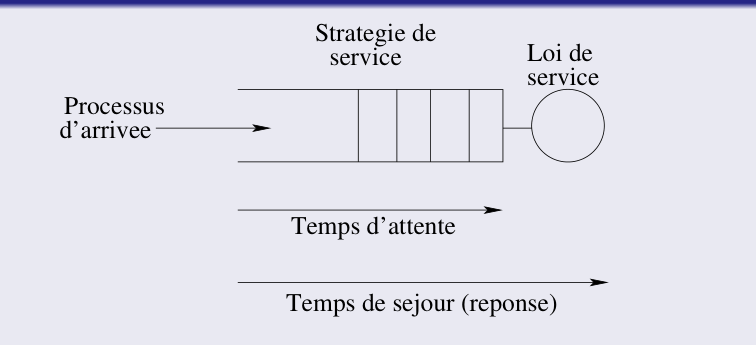
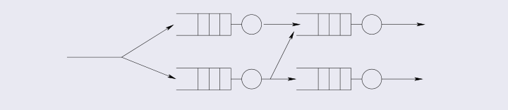
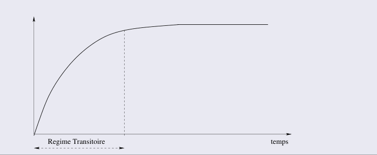
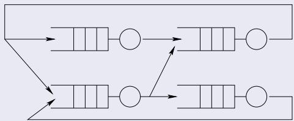
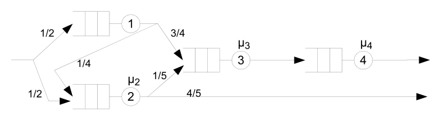
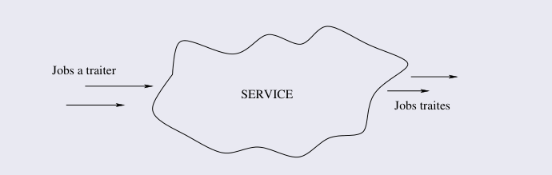

# 性能评估：数学建模与排队论

[课程入口](../README.md) · [法语课件 PDF（51 页）](3_edp.pdf) · [法语 Markdown](3_edp.md)

已于 2026-10-08 按新版 51 页课件同步，依次讲解排队模型、网络拓扑、建模假设、操作分析和随机分析。保留原讲义的推导与解释，图示取自当前 PDF；旧版封闭网络示意图作为补充保留。文末提供页码对照，公式记号订正见[审校说明](../审校说明.md)。

## 0 建模导论

### 0.1 定义

数学建模 (modélisation mathématique) 是一个相对简单的工具，它将真实系统 (système réel) 抽象为一组数学函数，用以表示其主要功能/服务 (fonctionnalités/services)，从而分析该系统的行为。

### 0.2 描述形式化 (Formalismes de description)

系统可以用不同的形式化方法描述：
- 排队论 (files d’attente)
- 马尔可夫链 (chaînes de Markov)
- Petri 网 (réseaux de Petri) 等

## 1 排队论导论 (Introduction aux files d’attente)

### 1.1 排队论

排队论是一种基于概率论的数学理论 (théorie mathématique)，用于评估系统性能，在这些系统中，客户 (clients) 可以到达并请求获取资源 (ressources) 一段时间。

某些客户必须在被服务之前等待，然后离开系统。

排队 (file d’attente) 由客户的到达流 (flux d’arrivée) 填充，由服务器 (serveurs) (资源) 清空。

### 1.2 应用条件

本节使用的无限容量 M/M/1 稳态公式要求到达率 $\lambda$ 小于服务率 $\mu$。排队论本身也可研究瞬态和饱和情况，不能将稳态条件理解为整个理论的适用范围。

### 1.3 分析建模的优势与局限

#### 1.3.1 优势 (Intérêt)

数学建模允许评估待分析系统的大量可能配置 (configurations possibles) 以及其可能承受的负载(charges)。

#### 1.3.2 局限 (Limitation)

建模所基于的假设和近似 (hypothèses et approximations) 可能限制其结果的应用范围并影响其精度(précision)。

## 2 排队模型 (Modèles de files d’attente)

### 2.1 通用概念 (Généralités)

#### 2.1.1 词汇表
- 资源 (CPU, 内存, 磁盘...) 服务器 (serveur)
- 作业 (Job), 进程 (Processus), IO 请求 客户 (client)

#### 2.1.2 定义

客户在队列中等待，直到服务器空闲来服务他们。

服务器根据定义的策略 (stratégie définie) 从等待队列中选择一个客户进行服务。

### 2.2 关键概念
- 逗留时间 (Temps de séjour) = 响应时间 (temps de réponse)
- 等待时间 (Temps d’attente)
- 服务规律 (Loi de service)
- 服务策略 (Stratégie de service)
- 到达过程 (Processus d’arrivée)

逗留时间包含等待和服务两部分，平均值满足 $r=w+s$。计算指标时先明确系统边界，避免把排队时间与整个请求的响应时间混用。

### 2.3 选择策略 (Stratégies de sélection)
- FIFO: 先到先服务 (premier arrivé, premier servi)
- LIFO: 后到先服务 (dernier arrivé, premier servi)
- Random: 随机 (aléatoire)
- Round Robin: 循环 (cyclique)
- Time Sharing (TS): 时间共享 (temps partagé)，主要适用于处理器资源
- 优先级（priorité）：按优先级标记或等级选择客户

### 2.4 排队网络 (Réseaux de files d’attente)

服务器和队列可以互连形成排队网络 (réseau de files d’attente)。

### 2.5 稳态与瞬态 (Régime permanent et transitoire)

#### 2.5.1 瞬态 (Régime transitoire)

系统尚未达到稳定或稳态的演化状态 (régime d’évolution)。它可能在系统启动 (amorce) 或修改时出现。

#### 2.5.2 稳态 (Régime permanent)

系统在一定运行时间后达到的稳定状态 (régime de stabilité)。严格的平稳分布不随时间变化；达到稳定周期的系统仍依赖周期内的相位，应与严格平稳状态区分。

### 2.6 性能参数 (Paramètres de performance)

在排队网络中，瞬态和稳态下的性能参数定义为：
- 到达和离开的吞吐量或频率 (Débit ou fréquence d’arrivée et de sortie)
- 系统中客户的平均数量 (Nombre moyen de clients dans le système)
- 平均逗留时间 (Temps moyen de séjour)
- 服务器利用率 (Taux d’utilisation du serveur)

### 2.7 稳定性条件 (Condition de stabilité)

使用后文稳态公式前，需要先验证系统能否达到相应的稳定状态。

稳态下平均入口吞吐量等于平均出口吞吐量。但流量相等本身不是稳定的充分条件，例如无限容量 M/M/1 在 $\lambda=\mu$ 时无可归一化的稳态分布。

### 2.8 拓扑与类别

根据拓扑结构，排队网络可以是：
- 开放式 (Ouverts)：存在外部到达和离开；服务后可以去另一站或离开，网络内客户总数可变化，内部路由仍可有反馈环。对本课的开放 Jackson 网络，每个站点都必须满足稳定条件
- 封闭式 (Fermés)：固定客户群在网络内循环，没有外部到达和离开

### 2.9 封闭网络的补充说明

#### 定义

封闭式排队网络有固定数量的客户 (nombre fixe de clients) 在不同服务器和队列之间循环。

客户在网络内部循环；没有外部到达和外部离开，但各站点之间仍有客户流动。

#### 备注
- 封闭网络表示客户总数固定；这不等于各站点的缓冲区都设有独立的容量限制
- 此类模型的求解更为复杂

## 3 开放式排队网络 (Réseaux de files d’attente ouverts)

### 3.1 定义

开放式排队网络是这样的网络：

1. 客户从外部源 (source externe) 到达

2. 被不同的服务器服务

3. 服务后按路由进入另一站点，或离开系统

### 3.2 备注
- 模型假设路由使客户最终以概率 1 离开网络
- 因此无限数量的客户构成进出系统的流

### 3.3 Jackson 网络 (Réseaux de Jackson)

Jackson 网络的特征：
- 单类客户 (Mono-classe de clients)
- 泊松到达 (Arrivées Poissoniennes)
- 本节模型中每个站点一个服务器，服务时间独立且服从指数分布
- 无限容量队列，FIFO 规则 (File de capacité illimitée, Discipline FIFO)
- 概率路由 (Routage probabiliste)

### 3.4 示例

下图来自当前教师课件第 19 页，便于核对路由概率：

$$
\lambda_1=\frac{\lambda}{2},\qquad
\lambda_2=\frac{\lambda}{2}+\frac14\lambda_1=\frac{5\lambda}{8},
$$

$$
\lambda_3=\frac34\lambda_1+\frac15\lambda_2=\frac{\lambda}{2},\qquad
\lambda_4=\lambda_3=\frac{\lambda}{2}.
$$

各站点的到达率是外部输入与上游路由流量之和。稳定性须逐站检查 $\lambda_i<\mu_i$，不能只比较网络的外部到达率与某一台服务器的服务率。

## 4 建模过程 (Processus de modélisation)

### 4.1 假设 (Hypothèses)

#### 4.1.1 建模前需考虑的假设

客户流的平衡 (Équilibre du flux des clients) 考虑长期观察，离开的客户数量必须等于进入的客户数量。

单步行为 (Comportement à une étape) 每个时刻只有一个客户可以进入或离开系统。因此系统状态以增量方式变化 (de manière incrémentale)。

##### 关于单步行为的备注
- 不允许多重到达和离开
- 不允许同一系统内队列之间客户的同时移动

齐次性 (Homogénéité) 平均到达率和平均服务率独立于系统状态。

##### 独占性 (Exclusivité)
- 一个客户只能位于一个服务器处（服务中或等待中）
- 一个客户不能同时请求两个服务，当获得一个服务时，他是唯一被该服务器服务的

非阻塞服务 (Service non-bloquant) 服务器是所提供服务的唯一主控者。该服务不能被系统的任何组件控制。

##### 独立性 (Indépendance)

本模型中的客户之间不发生交互，也不互相同步。若任务需要等待其他任务完成、同步屏障或持有多个资源，就必须把这些依赖另行建模。

这些假设限定本节使用的简单模型，不是整个排队论的通用要求。站点间的一次转移可以同时使上一站人数减一、下一站人数加一，仍属于一次路由事件。

### 4.2 符号表 (Notation)

在课程的其余部分，我们将使用以下符号：

| 符号 | 说明 |
| --- | --- |
| s | 客户的平均服务时间 |
| μ | 服务率 (taux de service) (1/s) |
| λ | 平均到达率 (taux d'arrivée moyen) |
| ρ | 流量强度 (intensité du trafic) (λ/μ) |
| r | 平均响应时间 (temps de réponse moyen) |
| w | 平均等待时间 (temps d'attente moyen) |
| q | 队列中客户的平均数量 |
| n | 系统中客户的平均数量（等待 + 服务中） |
| U | 系统利用率 (fraction d'utilisation) |
| a | 观察时间 T 内的到达数量 |
| d | 观察时间 T 内的离开数量 |

性能公式中的 $n$ 表示平均人数；状态概率 $P_k$ 中的 $k$ 则是整数人数，两者不要混淆。

## 5 操作分析 (L’analyse opérationnelle)

### 5.1 整体视图 (Vue globale)

分析从将待分析系统视为黑盒 (boîte noire) 开始，其输入端到达待处理的作业（客户），输出端是已处理的作业。

### 5.2 特征化 (Caractérisation)

系统特征通过测量或假设（用户、制造商/构造商）进行评估。然后可以在这个精确的环境中评估系统的行为。

### 5.3 利用率法则 (Lois d’utilisation)

#### 5.3.1 到达率 (Taux d’arrivée)

在时间周期 T 内观察系统，期间有 a 个客户到达，我们推导出到达率 λ：

$$
\lambda = \frac{a}{T}
$$

#### 5.3.2 服务器利用率 (Utilisation du serveur)

如果服务器在整个观察期 T 内仅被占用 b 个时间单位，我们推导出服务器利用率 U：

$$
U = \frac{b}{T} = \frac{b}{d} \times \frac{d}{T}
$$

其中 d 是被服务的客户数量， $\textstyle{\frac{b} {d}}$ 是服务一个客户的平均时间， $\textstyle{\frac{d} {T}}$ 是客户的离开率。根据平衡假设 (hypothèse d’équilibre)，入口流必须等于出口流，因此：

$$
\begin{array}{c} {U = \frac{b}{d} \times \frac{d}{T} = s \times \frac{d}{T}} \\ {U = \lambda \times s} \end{array}
$$

### 5.4 流量强度 (L’intensité du trafic)

$$
\rho = \frac{\lambda}{\mu}
$$
对无限容量 M/M/1：

- $\rho<1$：存在稳态，$U=\rho$，服务器空闲概率为 $1-\rho$。
- $\rho=1$：临界状态，不存在可归一化的稳态概率分布。
- $\rho>1$：到达需求超过服务能力，客户持续积累，没有有限的稳态平均等待时间。

实际忙碌时间比例始终在 $[0,1]$ 内；$\rho>1$ 表示需求超过容量，并不意味着服务器利用率超过 100%。也不意味着每个已到达客户的等待时间立即变成无穷。

### 5.5 Little 定律 (Loi de Little)

#### 5.5.1 定义

Little 定律是可应用于任何系统的通用法则：
- 不要求到达间隔或服务时间服从某个特定分布
- 不要求知道系统内部的具体调度细节
- 本节在稳态下使用 Little 定律：长期平均量须存在，人数、逗留时间和吞吐量应对应同一系统边界与同一客户流

#### 5.5.2 公式

稳态系统的平均客户数量 (N)、平均逗留时间或响应时间 (t) 和平均吞吐量 λ 根据以下定律相关联：

$$
\boxed{N = t \times \lambda}
$$

#### 5.5.3 重要性
- 允许根据其他两个参数计算三个参数 (N,t,λ) 中的一个
- 可应用于任何系统：

- 仅缓冲区
- 缓冲区 + 服务器
- 队列的服务器

#### 5.5.4 应用

仅缓冲区 (Un buffer uniquement) N 表示队列中客户的平均数量，t 表示服务前的平均等待时间，λ表示客户的到达（或离开）流。

缓冲区 + 服务器 (Un buffer + serveur) N 表示系统中客户的平均数量（队列中或服务中），t 表示平均逗留时间（等待和服务），λ 表示到达流。

队列的服务器 (Le serveur de la file) N 表示服务中客户的平均数量，t 表示平均服务时间，λ 表示到达流。

## 6 随机分析 (L’analyse stochastique)

### 6.1 利用率法则和 Little 定律的局限

它们不考虑关于到达间隔 (inter-arrivées) 和服务的概率法则 (lois de probabilité) 的任何假设。它们完全独立于分布 (distributions)。

### 6.2 随机分析的优势

了解分布允许进行随机分析，从而通过提供比操作分析更详细的结果来细化系统分析。

### 6.3 定义

通过随机分析，系统不再是黑盒。这允许获得关于所分析系统的详细结果，例如：
- 客户的平均等待时间
- 队列中客户的平均数量
- 有一定数量客户等待的概率
- 平均响应时间...

### 6.4 Kendall 符号 (Notation de Kendall)

系统由一个队列和一个或多个服务器组成。它将用词 $A / S / C / B / N / D$ 表示：
- A: 到达间隔的分布，用 M 表示独立指数间隔（即泊松到达过程），D 表示常数， $E _{k}$ 表示 Erlang 分布，G 表示一般分布
- S: 服务的分布 (distribution du service)，使用与到达过程类似的法则
- C: 系统中相同服务器的数量。如果系统包含不同的服务器，必须将其分解为每个都有相同服务器的子系统
- B: 系统中客户的总数（其容量 capacité），假设为无限以简化分析
- N: 潜在客户源的总体规模，假设为无限以简化分析
- D: 服务顺序或策略 (ordre ou stratégie de service)：FIFO、LIFO 等

### 6.5 M/M/1 情况

这是最简单的情况：
- 到达为速率 $\lambda$ 的泊松过程；到达间隔独立且服从参数 $\lambda$ 的指数分布
- 服务是速率为 µ 的指数分布 (exponentiel)
- 只有一个服务器
- 队列容量无限（默认）
- 可进入系统的客户数量无限（默认）
- 服务策略 FIFO（默认）

#### 6.5.1 稳态下的性能参数

以下公式要求 $0<\lambda<\mu$，到达过程与独立指数服务时间相互独立；$\lambda=0$ 时取相应极限。

吞吐量 (Débit) 队列是稳定的，因此流量平衡：

$$
\mathrm{Débit} = \lambda
$$

服务器利用率 这是服务器被占用的概率：

$$
U = \frac{\lambda}{\mu} = \rho
$$

系统为空的概率

$$
P _{0} = 1 - \rho
$$

到达客户需要等待的概率

$$
P _{a} = \rho
$$

系统中客户的平均数量

$$
n = \frac{\rho}{(1 - \rho)}
$$

平均逗留时间 由 Little 定律推导：

$$
r = \frac{n}{\lambda} = \frac{1}{\mu(1 - \rho)}
$$

可分解为：

$$
r = \frac{1}{\mu} + \frac{\rho}{\mu(1 - \rho)}
$$

队列中花费的时间

$$
w = \frac{\rho}{\mu(1 - \rho)}
$$

队列中客户的平均数量

$$
q = w \times \lambda = \frac{\rho^{2}}{(1 - \rho)}
$$

稳态下的概率 系统中有 0 个客户的概率：

$$
P _{0} = (1 - \rho)
$$

系统中有 $k$ 个客户的概率：

$$
P_k=(1-\rho)\rho^k,\qquad k=0,1,2,\ldots
$$

### 6.6 M/M/C 情况

这是前一种情况的 C 个相同类型且独立的服务器（处理器或磁盘）。

作业/IO 请求在同一队列中等待被服务。

如果 C 个服务器中有一个可用，它将服务队列中的一个作业/IO 请求。

#### 6.6.1 稳定性条件

为了达到稳定性，单位时间内到达队列的平均客户数量必须小于 C 个服务器单位时间内能够处理的客户数量。

因此：

$$
\lambda < C \mu
$$

#### 6.6.2 稳态下的性能参数

区分总业务量 $A$ 与单台服务器的平均利用率 $\rho$：

$$
A=\frac{\lambda}{\mu},\qquad \rho=\frac{\lambda}{C\mu}=\frac{A}{C}<1.
$$

当前 PDF 第 48 页定义 $\rho=\lambda/(C\mu)$，第 49–51 页的公式却按 $\lambda/\mu$ 使用它。以下统一用 $A$ 表示总业务量、$\rho$ 表示每台服务器的平均利用率；$\mu$ 是每台服务器的服务率，$A$ 与前文观测期间的到达数量 $a$ 不同。

**吞吐量：** 稳态下为 $\lambda$。

**系统为空的概率：**

$$
P_0=\left[\sum_{k=0}^{C-1}\frac{A^k}{k!}+\frac{A^C}{C!(1-\rho)}\right]^{-1}.
$$

**到达客户需要等待的概率（Erlang C）：**

$$
P_a=P_0\frac{A^C}{C!(1-\rho)}
    =P_0\frac{A^C}{(C-1)!(C-A)}.
$$

**系统中的平均客户数：**

$$
n=A+\frac{\rho P_a}{1-\rho}
 =A\left(1+\frac{P_a}{C-A}\right).
$$

**平均逗留时间：** 由 Little 定律得到：

$$
r=\frac n\lambda=\frac1\mu\left(1+\frac{P_a}{C-A}\right)
 =\frac1\mu+\frac{P_a}{C\mu-\lambda}.
$$

**平均等待时间：**

$$
w=\frac{P_a}{C\mu-\lambda}
 =\frac{P_0A^C}{\mu(C-1)!(C-A)^2}.
$$

**队列中的平均客户数：** $q=\lambda w$。这些公式要求泊松到达、独立指数服务时间、相同服务器、共同的无限容量 FIFO 队列及稳定条件。令 $C=1$，可退化为前一节的 M/M/1 公式。

## 课件页码对照

按 PDF 阅读器页码计数，包含封面。§2.9 的封闭网络示意图是保留的旧版补充图，当前 PDF 无对应图页。

| PDF 页码 | 中文讲义位置 |
|---|---|
| 1–2 | 课程标题 |
| 3 | §0 建模导论 |
| 4–6 | §1 排队论导论 |
| 7–10 | §2.1–2.4 模型、策略与网络 |
| 11–14 | §2.5–2.7 瞬态、稳态与稳定性 |
| 15–16 | §2.8–2.9 网络拓扑及封闭网络补充 |
| 17–19 | §3 开放网络与 Jackson 例题 |
| 20–23 | §4.1 建模假设 |
| 24 | §4.2 符号表 |
| 25–26 | §5.1–5.2 操作分析 |
| 27–29 | §5.3 利用率法则 |
| 30–31 | §5.4 流量强度 |
| 32–35 | §5.5 Little 定律 |
| 36–37 | §6.1–6.3 随机分析 |
| 38–39 | §6.4 Kendall 符号 |
| 40–45 | §6.5 M/M/1 |
| 46–51 | §6.6 M/M/C |
