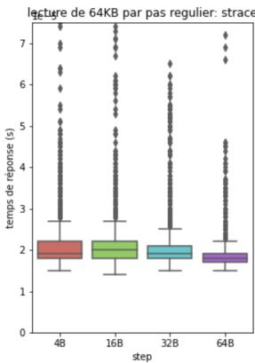
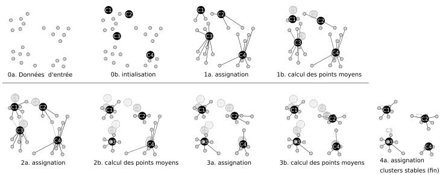
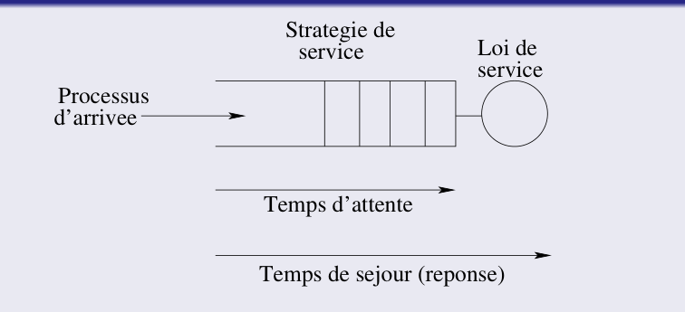
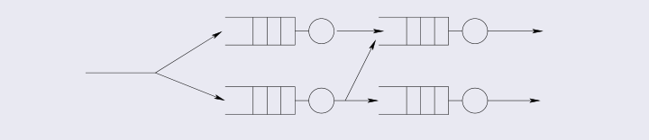
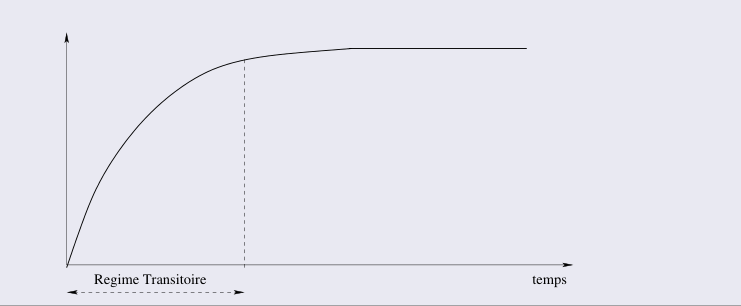
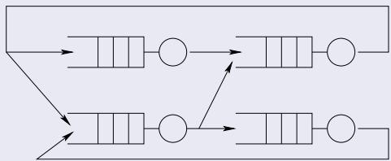
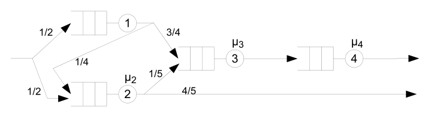
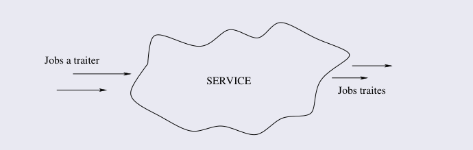

# Évaluation des performances : CM1–CM3 性能评估：第一至第三课总讲义

## CM1 · Évaluation des performances : concepts de base et performance en HPC 性能评估：基础概念与 HPC 性能

### 6 Introduction aux métriques 性能指标简介

Métriques courantes : 以下为常见性能指标：

- **Temps de réponse $r$ 响应时间 $r$** : durée entre la requête et la réponse ; une valeur plus faible est préférable. 从发出请求到收到响应的时间，通常越小越好。
- **Débit $X$ 吞吐量 $X$** : quantité de travail achevée par unité de temps ; une valeur plus élevée est préférable à tâche identique. 单位时间完成的工作量，在任务相同的条件下通常越大越好。
- **Accélération $\mathrm{Acc}$ 加速比 $\mathrm{Acc}$** : rapport du temps de référence au temps étudié. 基准执行时间与当前执行时间的比值。
- **Efficacité $E$ 并行效率 $E$** : accélération rapportée au nombre de processeurs $P$. 加速比除以处理器数量 $P$。
- **Utilisation $U$ 资源利用率 $U$** : fraction du temps d'observation pendant laquelle la ressource est occupée. 观察期内资源处于忙碌状态的时间比例。
- **Fiabilité $R_{\mathrm{rel}}(T)$ 可靠性 $R_{\mathrm{rel}}(T)$** : probabilité de fournir un service correct sans défaillance pendant une durée $T$. 在给定时长 $T$ 内持续正确工作、没有发生失效的概率。
- **Disponibilité $A$ 可用性 $A$** : fraction du temps pendant laquelle le système peut fournir le service. 系统能够提供服务的时间比例。

Les sections suivantes définissent ces métriques et leurs conditions d'emploi. Le débit réalisé $X$ se distingue du taux d'arrivée $\lambda$ du cours 3 ; ils sont égaux à l'équilibre des flux. 后文分别说明这些指标及适用条件。实际完成吞吐量 $X$ 与 CM3 的到达速度 $\lambda$ 含义不同，在流量平衡时两者相等。

### 7 Temps de réponse 响应时间

Définition : le temps de réponse $r$ sépare la requête de l'utilisateur de la réponse du système ; $r_0$ désigne sa valeur sous charge minimale. Une charge accrue peut augmenter l'attente et donc $r$. 响应时间 $r$ 是从用户发出请求到系统返回响应的时间；最小负载下的基准值记为 $r_0$。负载增加可能带来更多等待，使 $r$ 增大。

Le facteur d'extension est défini par : 伸长因子定义为：

$$
\mathrm{stretchfactor} = \frac{r}{r_0}
$$

Il quantifie l'allongement du temps de réponse lorsque la charge augmente. 它衡量负载增长所带来的性能恶化程度。

Exemple en temps partagé : rapport du temps de réponse avec multiprogrammation à celui sans multiprogrammation. 例子：在分时系统中，使用多道程序时的响应时间与无多道程序时的响应时间之比即为伸长因子。

### 8 Débit 吞吐量

Définition : le débit $X=d/T$ est le nombre de requêtes achevées $d$ pendant une durée d'observation $T$, divisé par cette durée. 吞吐量记为 $X=d/T$，其中 $d$ 是观察期内完成的请求数，$T$ 是观察时长；它描述完成速度，不是请求到来的速度。

Unités selon le système : 不同系统的吞吐量单位：

- Système interactif : requêtes/s 交互式系统：requests/s
- CPU：MIPS，MFLOPS
- Traitement par lots : jobs/s 批处理：jobs/s
- Réseau : paquets/s, bits/s 网络：packets/s，bits/s
- Système transactionnel : transactions/s (TPS) 事务系统：transactions/s (TPS)

Le débit croît avec la charge jusqu'à une capacité maximale, comme la bande passante d'un réseau. 吞吐量随负载增加直到达到某种最大容量上限（类似网络带宽上限）。

#### 8.1 Deux notions de capacité 容量的两种定义

1. Capacité nominale : débit maximal sous une charge idéale. 名义容量：系统在理想负载下能达到的最大吞吐量。

Exemple : après amorçage, un pipeline sans dépendance pénalisante ni branchement peut exécuter une instruction par cycle. 例：流水线填满后，无数据依赖停顿且无分支跳转的处理器可做到每周期完成一条指令。

2. Capacité d'usage : débit maximal compatible avec un temps de réponse acceptable. 可用容量：在保持用户可接受响应时间约束下可达到的最大吞吐量。

**Complément.** En présence d'aléas et de files d'attente (cf. CM3), lorsque le débit approche la capacité nominale et que l'utilisation $\rho$ tend vers $1$, le temps d'attente croît fortement (par exemple $\bar{R} \propto \frac{1}{1-\rho}$ pour une file M/M/1). Les contraintes de temps de réponse et les fluctuations de charge font donc généralement que la capacité d'usage $X_{\max}$ (telle que $R(X_{\max}) \le R_{\mathrm{cible}}$) reste inférieure à la capacité nominale. **补充说明。** 在存在随机波动与排队等待的系统中（见 CM3），当吞吐量逼近名义容量、利用率 $\rho \to 1$ 时，排队等待时间会急剧上升（例如 M/M/1 队列中 $\bar{R} \propto \frac{1}{1-\rho}$）。因此受响应时间上限 $R(X_{\max}) \le R_{\mathrm{cible}}$ 与负载波动的约束，实际可用容量通常低于理想名义容量。

### 9 MIPS et MFLOPS MIPS 与 MFLOPS

Avec $N_{\mathrm{inst}}$ instructions exécutées en $T_{\mathrm{exec}}$ secondes, les MIPS (millions d'instructions par seconde) valent : 设执行指令数为 $N_{\mathrm{inst}}$、执行时间为 $T_{\mathrm{exec}}$ 秒，则 MIPS（每秒百万条指令）为：

$$
\mathrm{MIPS} = \frac{N_{\mathrm{inst}}}{10^{6}T_{\mathrm{exec}}}
$$

Les MFLOPS comptent les millions d'opérations flottantes par seconde ; une instruction vectorielle ou FMA peut représenter plusieurs opérations. MFLOPS 统计每秒完成的百万次浮点运算；运算数不一定等于浮点指令数，例如向量指令和融合乘加（FMA）。

En notant $N_{\mathrm{FLOP}}$ le nombre d'opérations flottantes, $\mathrm{MFLOPS}=N_{\mathrm{FLOP}}/(10^6T_{\mathrm{exec}})$. Une FMA scalaire compte pour deux opérations, une multiplication et une addition. 浮点运算总数记为 $N_{\mathrm{FLOP}}$，则 $\mathrm{MFLOPS}=N_{\mathrm{FLOP}}/(10^6T_{\mathrm{exec}})$。标量 FMA 的一次乘法和一次加法合计为 2 次浮点运算。

Remarques : 说明：

- Les deux unités sont évaluées ici sous l'hypothèse simplificatrice que les instructions sont déjà en mémoire. 此处讨论采用简化测量条件，假设指令已全部在内存中（不计缺页或外存加载开销；这是简化测试前提，而非单位本身的定义要求）。
- Les MIPS, en particulier, ne constituent pas une métrique fiable. 特别是 MIPS，不是可靠的性能指标。

**Complément.** Pourquoi MIPS est-il trompeur ? Dans $\mathrm{MIPS} = \frac{N_{\mathrm{inst}}}{10^6 T_{\mathrm{exec}}}$, le numérateur $N_{\mathrm{inst}}$ dépend du jeu d'instructions (ISA) et du compilateur, et non du travail utile accompli :
1. **Granularité des instructions (RISC vs CISC / SIMD / Coprocesseur)** : une opération complexe remplacée par une séquence de $k$ instructions simples augmente $N_{\mathrm{inst}}$ d'un facteur $k$. Si ces instructions simples s'exécutent vite dans le pipeline, le ratio $N_{\mathrm{inst}}/T_{\mathrm{exec}}$ (les MIPS) augmente alors même que le temps total $T_{\mathrm{exec}}$ s'allonge.
2. **MFLOPS vs MIPS** : pour un algorithme numérique donné, le nombre d'opérations mathématiques $N_{\mathrm{FLOP}}$ (ex. $2n^3$ pour une multiplication matricielle $n\times n$) est lié au problème, ce qui rend les MFLOPS plus comparables que les MIPS à algorithme fixé. **补充说明。** 为什么 MIPS 容易误导？在 $\mathrm{MIPS} = \frac{N_{\mathrm{inst}}}{10^6 T_{\mathrm{exec}}}$ 中，分子 $N_{\mathrm{inst}}$ 取决于指令集架构（ISA）与编译器，而非实际完成的有效工作量：
1. **指令粒度差异（RISC vs CISC / 向量化 / 协处理器）**：若一条复杂硬件指令被拆成 $k$ 条简单指令软件模拟，$N_{\mathrm{inst}}$ 会成倍膨胀；由于简单指令单条周期短，比值 $N_{\mathrm{inst}}/T_{\mathrm{exec}}$（即 MIPS）反而可能升高，而实际总耗时 $T_{\mathrm{exec}}$ 却大幅恶化（见 §17.2 Whetstone 反例）。
2. **MFLOPS 与 MIPS 的区别**：对于给定数值算法，浮点数学运算次数 $N_{\mathrm{FLOP}}$（如 $n\times n$ 矩阵乘法的 $2n^3$ 次运算）由问题规模决定，因此在固定算法下 MFLOPS 比 MIPS 更具可比性。

### 10 Accélération / Speedup 加速比

Définition : $\mathrm{Acc}$ compare le temps séquentiel $T_{\mathrm{séquentiel}}$ au temps parallèle $T_{\mathrm{parallèle}}$ pour la même tâche ; on les note aussi $T_1$ et $T_P$ pour $P$ processeurs. 加速比记为 $\mathrm{Acc}$，比较同一任务的串行时间 $T_{\mathrm{séquentiel}}$ 与并行时间 $T_{\mathrm{parallèle}}$；后文也用 $T_1$、$T_P$ 表示单处理器与 $P$ 个处理器的执行时间。

$$
\mathrm{Acc} = \frac{T _{\mathrm{séquentiel}}}{T _{\mathrm{parallèle}}}
$$

Loi d'Amdahl : Amdahl 定律：

$$
\mathrm{Acc} = \frac{1}{(1 - F _{a}) + \frac{F _{a}}{P}}
$$

Avec : 其中：

- $F_a$ : fraction du temps séquentiel de référence correspondant au travail parallélisable, avec $0\le F_a\le1$. $F_a$：可并行工作占串行基准执行时间 $T_1$ 的比例（$0\le F_a\le1$），不是源代码行数的比例。
- $P$ : nombre de processeurs. $P$：处理器数量。

**Complément (dérivation).** En décomposant le temps séquentiel $T_1$ en une partie purement séquentielle $(1-F_a)T_1$ et une partie parfaitement parallélisable $F_a T_1$, le temps sur $P$ processeurs sans surcoût vaut $T_P = (1-F_a)T_1 + \frac{F_a T_1}{P}$. Le rapport $\mathrm{Acc} = \frac{T_1}{T_P}$ donne immédiatement la formule, et lorsque $P \to \infty$, $\mathrm{Acc}_{\max} = \frac{1}{1-F_a}$ : la fraction séquentielle $(1-F_a)$ borne durement le gain maximal. **补充说明（推导）。** 将单核基准时间 $T_1$ 拆分为不可并行的串行部分 $(1-F_a)T_1$ 与可理想平摊的并行部分 $F_a T_1$，则在无额外开销时 $P$ 核耗时为 $T_P = (1-F_a)T_1 + \frac{F_a T_1}{P}$。取比值 $\mathrm{Acc} = \frac{T_1}{T_P}$ 即得 Amdahl 公式；当 $P \to \infty$ 时，$\mathrm{Acc}_{\max} = \frac{1}{1-F_a}$，说明串行时间占比 $(1-F_a)$ 直接锁死了加速比的理论上限。

#### 10.1 Coût de parallélisation 并行化成本

L'accélération n'est généralement pas linéaire, notamment à cause de : 加速比通常不是线性的，因为并行化带来：

- Communications 通信
- Synchronisation 同步
- Ordonnancement, déséquilibre de charge, etc. 调度、负载不均衡等

Loi d'Amdahl enrichie : 扩展的 Amdahl 定律：

$$
\mathrm{Acc} = \frac{1}{(1 - F _{a}) + \frac{F _{a}}{P} + C _{t} (F _{a} , P)}
$$

$C_t$ est le surcoût temporel de parallélisation divisé par le temps séquentiel de référence ; il doit être sans dimension pour s'ajouter aux autres termes du dénominateur. 其中 $C_t(F_a, P) = \frac{T_{\mathrm{surcoût}}(P)}{T_1}$ 是并行化引入的额外时间除以串行基准时间 $T_1$，必须是无量纲量，才能与分母中的时间比例相加。

### 11 Efficacité 效率

Définition : l'efficacité parallèle $E$ rapporte l'accélération $\mathrm{Acc}$ au nombre de processeurs $P$ ; $E=1$ correspond à une accélération linéaire. 并行效率记为 $E$，等于加速比 $\mathrm{Acc}$ 除以处理器数量 $P$；$E=1$ 对应线性加速。

$$
E = \frac{\mathrm{Acc}}{P}
$$

Ou, de manière équivalente : 或等价地：

$$
E = \frac{T _{\mathrm{séquentiel}}}{T _{\mathrm{parallèle}} \times P}
$$

Une efficacité réduite peut venir du code séquentiel, du déséquilibre de charge, des communications, de la synchronisation ou d'autres surcoûts ; il faut les mesurer. 效率下降可能来自串行部分、负载不均衡、通信、同步或其他开销，需要结合测量判断。

### 12 Taux d'utilisation 资源利用率

Définition : l'utilisation $U=b/T$ est le temps d'occupation $b$ de la ressource divisé par la durée d'observation $T$, avec $0\le U\le1$. 利用率记为 $U=b/T$，其中 $b$ 是资源累计忙碌时长，$T$ 是观察时长，$0\le U\le1$。

Objectifs : 目标：

- Maximiser l'utilisation d'une ressource. 最大化单资源利用率
- Équilibrer la charge entre les ressources. 全系统实现负载均衡

L'efficacité parallèle $E$ et l'utilisation $U$ sont distinctes : une ressource peut être occupée par des communications ou une attente active. 并行效率 $E$ 与资源利用率 $U$ 不等同：资源可能在通信或忙等待（spin-waiting）时仍被计为“忙碌”，此时 $U$ 很高但有效并行效率 $E$ 很低。

### 13 Strong scaling et weak scaling 强扩展与弱扩展

#### 13.1 Strong scaling 强扩展

À taille de problème $n$ constante, augmenter le nombre de processeurs $P$ ; comparer les temps $T_1(n)$ et $T_P(n)$ du même problème. 固定问题总规模 $n$，增加处理器数量 $P$，比较同一问题的执行时间 $T_1(n)$ 与 $T_P(n)$。

Dans le cas idéal : 理想情况：

$$
\mathrm{Acc} \rightarrow P, \qquad E \rightarrow 1
$$

#### 13.2 Weak scaling 弱扩展

Augmenter la taille $n$ avec $P$ pour garder le travail par processeur approximativement constant ; si $n$ mesure le travail total, cela donne $n(P)=P\,n(1)$. 随处理器数量 $P$ 增大问题规模 $n$，使每个处理器承担的工作量近似不变；若 $n$ 表示总工作量，则为 $n(P)=P\,n(1)$，理想目标是并行执行时间 $T_P(n(P)) \approx T_1(n(1))$ 保持近似恒定。

### 14 Loi de Gustafson-Barsis Gustafson-Barsis 定律

Pour un calcul parallèle dont la taille augmente : 对于规模随处理器数增大的并行计算：

$$
\mathrm{Acc} (n, P) \leq P + (1 - P) s
$$

Ici, $s$ est la fraction séquentielle du temps de l'exécution parallèle du problème agrandi, $n$ sa taille et $P$ le nombre de processeurs. La fraction d'Amdahl utilise le temps séquentiel de référence ; les deux ne sont pas interchangeables. 这里的 $s$ 是扩大问题后，串行阶段占**并行运行总时间 $T_P$** 的比例，$n$ 是问题规模，$P$ 是处理器数量。Amdahl 模型中的串行比例以**单核串行基准时间 $T_1$** 为分母，两者不能直接混用；本课的比例 $s$ 也不同于 CM3 的平均服务时间 $s$。

Le modèle de Gustafson-Barsis montre le potentiel d'accélération pour des problèmes agrandis. 与 Amdahl 不同，该定律表明并行计算在大问题规模下可获得随 $P$ 线性增长的加速比。

**Complément (dérivation et comparaison avec Amdahl).** Dans le cas idéal (sans surcoût de communication ni déséquilibre, ce qui donne l'égalité dans la borne ci-dessus), supposons que sur $P$ processeurs le problème agrandi prenne un temps total $T_P$, dont une fraction $s$ est séquentielle ($s T_P$, ex. initialisation et I/O qui ne croissent pas avec la taille) et une fraction $(1-s)$ est parfaitement parallèle ($(1-s)T_P$). Si un seul processeur devait exécuter ce même problème agrandi, la partie parallèle lui prendrait $P$ fois plus de temps :
$$
T_1' = s T_P + P(1-s)T_P.
$$
L'accélération mise à l'échelle (scaled speedup) vaut donc :
$$
\mathrm{Acc}(n, P) = \frac{T_1'}{T_P} = s + P(1-s) = P + (1-P)s.
$$
La différence fondamentale réside dans le **dénominateur de la fraction séquentielle** et le mode de passage à l'échelle :
- **Amdahl (strong scaling, taille $n$ fixée)** : $s_{\mathrm{Amdahl}} = 1 - F_a = \frac{T_{\mathrm{seq}}}{T_1}$ est mesuré sur $1$ processeur ; quand $P$ augmente, le temps parallèle $F_a T_1 / P$ rétrécit tandis que $T_{\mathrm{seq}}$ reste fixe.
- **Gustafson (weak scaling, travail par processeur quasi constant)** : $s = \frac{T_{\mathrm{seq}}}{T_P}$ est mesuré sur $P$ processeurs ; on maintient le travail parallèle par processeur (et donc $(1-s)T_P$) approximativement constant en augmentant la taille $n$ avec $P$ (soit $n \propto P$ si $n$ mesure le travail total, mais $n \propto P^{1/3}$ si le travail croît en $O(n^3)$ comme pour un produit matriciel $n\times n$), ce qui dilue le poids du code séquentiel dans le travail total $T_1'$. À problème et hypothèses d'exécution fixés, les deux fractions se convertissent d'ailleurs exactement l'une dans l'autre : Gustafson ne contredit pas Amdahl, il répond à une question d'échelle différente. **补充说明（推导及与 Amdahl 的本质区别）。** 在无额外通信与负载失衡开销的理想情况下（此时上式取等号），设扩大后的问题在 $P$ 个处理器上总耗时为 $T_P$，其中串行阶段耗时 $s T_P$（如不随问题规模膨胀的初始化等），并行阶段耗时 $(1-s)T_P$。若将这同一个扩大后的问题放到单处理器上串行执行，并行部分耗时将放大 $P$ 倍：
$$
T_1' = s T_P + P(1-s)T_P.
$$
由此得到扩展加速比（scaled speedup）：
$$
\mathrm{Acc}(n, P) = \frac{T_1'}{T_P} = s + P(1-s) = P + (1-P)s.
$$
两定律的核心区别在于**串行比例的分母基准与扩展方式不同**：
- **Amdahl（强扩展，固定规模 $n$）**：串行比例 $s_{\mathrm{Amdahl}} = 1 - F_a = \frac{T_{\mathrm{seq}}}{T_1}$ 以单核时间 $T_1$ 为分母；随 $P$ 增大，并行耗时 $\frac{F_a T_1}{P}$ 不断缩小，导致串行部分成为瓶颈。
- **Gustafson（弱扩展，保持单核工作量近似不变）**：串行比例 $s = \frac{T_{\mathrm{seq}}}{T_P}$ 以 $P$ 核并行时间 $T_P$ 为分母；通过随 $P$ 扩大问题规模 $n$ 使每个处理器的工作量（即并行耗时 $(1-s)T_P$）保持近似恒定（若 $n$ 直接代表总计算量则为 $n \propto P$；若如 $n\times n$ 矩阵乘法总计算量为 $O(n^3)$ 则对应 $n \propto P^{1/3}$），从而在总工作量 $T_1'$ 中稀释了串行开销的占比。对于同一具体问题和执行假设，这两个串行比例在代数上可以互相换算，因此 Gustafson 定律并非推翻 Amdahl 定律，而是刻画了随核数扩大问题规模时的加速潜力。

### 15 Fiabilité 可靠性

Définition : la fiabilité $R_{\mathrm{rel}}(T)$ est la probabilité de fournir un service correct sans défaillance pendant une durée $T$, à partir d'un système initialement opérationnel. 可靠性记为 $R_{\mathrm{rel}}(T)$，表示系统从正常状态开始，在时长 $T$ 内持续正确工作且不发生失效的概率。

Fiabilité des données : la redondance totale ou partielle protège leur intégrité. 数据可靠性：存储系统通过完全或部分冗余保证数据正确性。

Fiabilité du réseau : les messages parviennent à leurs destinataires. 网络可靠性：保证消息被成功送达目的地。

Métrique usuelle : temps moyen entre erreurs, MTBE. 常用指标：错误之间的平均时间 MTBE（Mean Time Between Errors）。

### 16 Disponibilité 可用性

Définition : la disponibilité $A$ est la fraction du temps pendant laquelle le système peut servir les utilisateurs. 可用性记为 $A$，表示系统能够提供服务的时间比例。

Uptime : fonctionnement normal ; downtime : indisponibilité. uptime：正常运行时间；downtime：停机不可用时间。

Indicateurs courants : 常用指标：

- **MTTF** (Mean Time To Failure) : durée moyenne avant une défaillance. 发生失效前的平均正常运行时长。
- **MTBF** (Mean Time Between Failures) : durée moyenne entre défaillances successives d'un système réparable ; préciser si les temps de réparation sont inclus. 可修复系统两次相邻失效之间的平均时长（使用时须明确是否包含修复停机时间）。

**Complément (relation entre uptime, downtime, MTTF, MTTR, MTBF, disponibilité et fiabilité).** En notant $\mathrm{uptime}$ la durée moyenne de bon fonctionnement ($\mathrm{MTTF}$) et $\mathrm{downtime}$ la durée moyenne de réparation ou d'indisponibilité ($\mathrm{MTTR}$, *Mean Time To Repair*), la disponibilité stationnaire s'écrit :
$$
A = \frac{\mathrm{uptime}}{\mathrm{uptime} + \mathrm{downtime}} = \frac{\mathrm{MTTF}}{\mathrm{MTTF} + \mathrm{MTTR}}.
$$
Attention aux deux conventions courantes pour le **MTBF** : lorsqu'on définit le MTBF comme la période moyenne d'un cycle complet entre deux pannes successives incluant la réparation ($\mathrm{MTBF} = \mathrm{MTTF} + \mathrm{MTTR}$), on a $A = \frac{\mathrm{MTTF}}{\mathrm{MTBF}}$ ; en revanche, certaines normes d'ingénierie (ex. NIST) définissent le MTBF comme le seul temps de fonctionnement cumulé divisé par le nombre de pannes (hors temps de réparation, soit l'équivalent du MTTF pour un système réparable). Enfin, ne pas confondre **fiabilité** et **disponibilité** : un système qui tombe en panne toutes les heures ($\mathrm{MTTF} = 1\text{ h}$) mais redémarre en $1\text{ ms}$ ($\mathrm{MTTR} \approx 0$) a une **disponibilité** $A \approx 100\%$, mais une **fiabilité** $R_{\mathrm{rel}}(T)$ très faible sur une mission de $T = 24\text{ h}$ (car une exécution HPC sans checkpointing sera interrompue dès la première panne). **补充说明（uptime、downtime、MTTF、MTTR、MTBF 与可用性、可靠性的关系）。** 设可修复系统每次正常运行的平均时长为 $\mathrm{uptime} = \mathrm{MTTF}$，每次故障修复停机的平均时长为 $\mathrm{downtime} = \mathrm{MTTR}$（Mean Time To Repair），则稳态可用性为：
$$
A = \frac{\mathrm{uptime}}{\mathrm{uptime} + \mathrm{downtime}} = \frac{\mathrm{MTTF}}{\mathrm{MTTF} + \mathrm{MTTR}}.
$$
需注意工程文献中 **MTBF** 的两种常见口径：若将 MTBF 定义为两次相邻故障起点之间包含修复时间在内的完整周期（即 $\mathrm{MTBF} = \mathrm{MTTF} + \mathrm{MTTR}$），则可写作 $A = \frac{\mathrm{MTTF}}{\mathrm{MTBF}}$；但也有部分标准（如 NIST）将 MTBF 定义为不含修复停机时间的累计正常运行时间除以失效次数（此时它与可修复系统的 MTTF 同义）。此外，切勿混淆**可靠性**与**可用性**：如果一台机器每小时崩溃一次（$\mathrm{MTTF} = 1\text{ h}$），但每次只需 $1\text{ ms}$ 即可瞬间重启恢复（$\mathrm{MTTR} \approx 0$），则它的**可用性** $A \approx 100\%$ 极高，但在 $T = 24\text{ h}$ 内的**可靠性** $R_{\mathrm{rel}}(T)$ 极低（未做检查点容错的 HPC 长作业只要遇到一次崩溃就会前功尽弃）。

### 17 Caractéristiques d'une bonne métrique 好指标的特征

#### 17.1 Linéarité 线性

La métrique devrait varier aussi linéairement que possible avec la performance réelle. 指标应尽量与实际性能成线性关系。

Exemple : une échelle logarithmique peut conduire à des malentendus. 例：某些对数尺度的指标容易引起直观上的误解。

#### 17.2 Fiabilité 可靠性

Une métrique fiable classe les systèmes selon leur performance réelle : un débit élevé est généralement préférable, un temps de réponse faible également. 一个可靠指标应使排序与实际性能排序一致：吞吐量通常越大越好，响应时间通常越小越好，不能统一理解为数值越大越好。

Contre-exemple : MIPS. 反例：MIPS。

Exemple du benchmark Whetstone : Whetstone 基准测试例子：

- Avec coprocesseur flottant : 1.08 s, 1.6 MIPS. 使用浮点协处理器：耗时 $1.08\text{ s}$，指标为 $1.6\text{ MIPS}$。
- Sans coprocesseur : 13.6 s, 2.7 MIPS. 不使用浮点协处理器：耗时 $13.6\text{ s}$，指标为 $2.7\text{ MIPS}$。

Le second cas affiche davantage de MIPS, mais prend environ 12.6 fois plus de temps : les MIPS ne reflètent pas ici la performance. 尽管第二种情况的 MIPS 数值更高，但实际耗时慢了约 $12.6$ 倍，说明 MIPS 不是可靠指标。

**Complément (explication du paradoxe Whetstone).** En utilisant $N_{\mathrm{inst}} = \mathrm{MIPS} \times 10^6 \times T_{\mathrm{exec}}$, on retrouve le nombre total d'instructions exécutées dans chaque configuration :
- Avec coprocesseur : $N_{\mathrm{inst}} = 1.6 \times 10^6 \times 1.08 \approx 1.73 \times 10^6$ instructions (les opérations flottantes sont prises en charge directement par les instructions matérielles du coprocesseur).
- Sans coprocesseur : $N_{\mathrm{inst}} = 2.7 \times 10^6 \times 13.6 \approx 36.7 \times 10^6$ instructions (en l'absence de coprocesseur, chaque opération flottante doit être émulée en logiciel par une séquence de nombreuses instructions entières plus simples).
La configuration sans coprocesseur exécute donc environ $21.25$ fois plus d'instructions à un débit d'instructions par seconde plus élevé ($2.7$ vs $1.6\text{ MIPS}$), mais met $12.6$ fois plus de temps pour accomplir le même programme. **补充说明（Whetstone 悖论的定量解释）。** 由 $N_{\mathrm{inst}} = \mathrm{MIPS} \times 10^6 \times T_{\mathrm{exec}}$ 可以反推出两种配置实际执行的指令总数：
- 有浮点协处理器：$N_{\mathrm{inst}} = 1.6 \times 10^6 \times 1.08 \approx 1.73 \times 10^6$ 条指令（浮点运算直接由协处理器指令完成，总指令数很少）。
- 无浮点协处理器：$N_{\mathrm{inst}} = 2.7 \times 10^6 \times 13.6 \approx 36.7 \times 10^6$ 条指令（缺少硬件协处理器时，每次浮点运算需通过软件库由多条简单整数指令模拟实现）。
无协处理器时执行了约 $21.25$ 倍数量的指令，每秒指令吞吐数看似更高（$2.7 > 1.6\text{ MIPS}$），但完成同一任务的总时间却慢了约 $12.6$ 倍。

#### 17.3 Déterminisme 确定性

Un test répété devrait donner la même valeur de métrique (en pratique, une bonne répétabilité sous conditions contrôlées, en documentant la variabilité observée). 理想情况下，重复测试应得到相同指标值（在实际系统测量中，要求在受控条件下具有良好可重复性，并如实报告多次测量的波动范围）。

#### 17.4 Facilité de mesure 易测性

Une métrique difficile à mesurer risque d'être erronée et sera moins utilisée. 难以测量的指标容易引入测量误差，因此较少被采用。

### 18 Méthodes d'évaluation des performances 性能评估方法

Trois méthodes : 三类方法：

- **Modélisation analytique 数学建模** : abstraire le système en variables et équations pour calculer des indicateurs sous des hypothèses explicites. 将系统抽象为变量和方程，在明确假设下计算性能指标。
- **Simulation 仿真** : exécuter un modèle pour suivre son comportement dans des configurations choisies ; elle nécessite généralement moins d'hypothèses simplificatrices que la modélisation analytique, mais demande davantage de temps de développement et d'exécution. 运行系统模型以观察其在指定配置与输入下的演化；仿真所需的简化假设通常少于解析建模，但往往更耗时。
- **Mesure 实测** : observer une exécution réelle pour obtenir durées, événements et débits. 观察真实运行，获得执行时间、事件数量和吞吐量等数据。

Critères de choix : 选择依据包括：

- Existence du système 系统是否已存在
- Coût temporel 时间成本
- Budget 预算
- Précision souhaitée 所需精度

Si le système existe et est accessible, privilégier la mesure ; sinon, utiliser la simulation ou la modélisation. 若系统存在且可访问，可优先测量；否则可使用仿真或建模。

On compare souvent deux méthodes pour valider les résultats. 通常采用两种方法互相验证。

### 19 Objectifs de l'évaluation en HPC HPC 性能评估的目标

Une machine au débit théorique plus élevé exécutera-t-elle nécessairement l'application plus vite ? Il faut connaître la répartition du temps sur l'ancienne machine et la ressource améliorée sur la nouvelle. 买一台峰值算力更高的机器，应用就一定更快吗？要回答这个问题，需要知道应用在原机器上把时间花在哪里，以及新机器改善了哪一种资源。

L'évaluation HPC se rapproche du matériel : mesurer ses performances élémentaires, caractériser processeur et mémoire, comparer les architectures et estimer les gains technologiques. Deux principes méthodologiques s'imposent : HPC 性能评估因此更贴近硬件：测量基础性能，刻画处理器、内存与其他部件的行为，比较硬件方案，并判断技术变化可能带来多少收益。在方法上尤其强调两点：

- **Isoler un facteur.** Utiliser des microbenchmarks ciblés, éventuellement proches des limites de la ressource, pour observer saturation et évolution des performances. **把单个因素测清楚。** 用针对性的微基准施加负载，必要时测试接近资源极限的情况，观察饱和与性能变化。
- **Contrôler le travail réellement exécuté.** Vérifier, voire écrire, l'assembleur pour identifier les instructions et accès effectivement exécutés malgré les transformations du compilateur ou de l'environnement. **控制实际执行的工作。** 为避免编译器或运行环境改变实验含义，有时需要检查乃至编写汇编，确认真正执行了哪些指令、哪些数据访问。

Il faut relier ces mesures à l'application : une bande passante élevée sous un certain motif d'accès ne garantit pas que l'application l'exploite ; cela dépend de ses accès et de son parallélisme. 这些基础测量还要回到应用：内存带宽测得很高，只说明这台机器在相应访问方式下能提供这样的带宽；应用能否利用它，取决于自己的访问模式和并行程度。

### 20 Parallélisme et performance 并行性与性能

#### 20.1 Loi d'Amdahl : identifier le travail répartissable Amdahl 定律：先看哪些时间能被分摊

Pour un problème fixe de durée séquentielle $T_1$, la fraction séquentielle vaut $s$ ; le reste est idéalement réparti sur $P$ processeurs, sans surcoût : 设固定问题在单处理器上的执行时间为 $T_1$，其中串行部分占比为 $s$；其余部分理想地分配到 $P$ 个处理器，暂不计额外开销：

Dans cette section, $s=1-F_a$ et $S(P)$ est le même speedup que $\mathrm{Acc}$ en §10 ; $s$ n'est pas la fraction mesurée sur le temps parallèle agrandi du §14. 本节中 $s=1-F_a$，$S(P)$ 与 §10 的 $\mathrm{Acc}$ 都表示加速比；此处 $s$ 的时间基准（以 $T_1$ 为分母）不同于 §14 在扩大问题的并行运行时间 $T_P$ 上定义的比例。

$$
T_P=T_1\left(s+\frac{1-s}{P}\right),\qquad
S(P)=\frac{T_1}{T_P}=\frac{1}{s+(1-s)/P}.
$$

Pour $s>0$, l'accélération tend vers $1/s$ lorsque $P$ augmente. 当 $s>0$ 时，随着 $P$ 增大，加速比趋近 $1/s$。

**Exemple.** Sur 100 secondes, 10 sont séquentielles ($s = 0.1$). Avec 10 processeurs, le temps idéal vaut $10+90/10=19$ secondes, soit un speedup d'environ $5.26$ ; même avec une infinité de processeurs ($P \to \infty$), le speedup ne dépassera jamais $1/0.1 = 10$. **例子。** 一个任务原来需要 $100$ 秒，其中 $10$ 秒必须串行（$s = 0.1$）。使用 $10$ 个处理器后，理想时间是 $10+90/10=19$ 秒，加速比约为 $5.26$；即便处理器数量趋于无穷（$P \to \infty$），加速比也绝不会超过 $1/0.1 = 10$。

Le modèle suppose une taille fixe et une référence séquentielle définie. Communications, synchronisation, ordonnancement et déséquilibre ajoutent des coûts à modéliser ; le nombre de cœurs n'invalide pas à lui seul la relation. 模型要求固定问题规模及明确的串行基准。实际通信、同步、调度与负载不均衡通常还会增加时间；大规模并行时应把这些因素单独建模。核心数量增加本身不会使 Amdahl 的关系失效。

#### 20.2 Parallélisme explicite et implicite 显式并行与隐式并行

On distingue souvent deux modes d'organisation du parallélisme : 通常将并行的组织方式分为两类：

- **Parallélisme explicite 显式并行** : parallélisme organisé avec MPI ou OpenMP, où découpage des tâches, distribution des données et coordinations doivent être explicitement programmés. 用 MPI、OpenMP 等明确组织的并行：程序需要显式表达任务划分、数据分配及必要的同步与通信协调。
- **Parallélisme implicite 隐式并行** : jobs indépendants, tirages Monte Carlo et explorations paramétriques (balayage de paramètres), souvent lançables en parallèle par un script ou un ordonnanceur de travaux. 多个独立作业、Monte Carlo 抽样和参数扫描：这些工作单元之间具有天然的独立性（embarrassingly parallel），可由外部脚本或作业调度器直接并发启动。

**Complément.** Le qualificatif « implicite » ne dispense pas d'organiser l'exécution, les entrées/sorties et les flux aléatoires. Par ailleurs, MPI est une norme d'interface de communication par passage de messages (utilisable en C, C++, Fortran, etc.) et OpenMP une interface de programmation à mémoire partagée à base de directives, et non deux langages de programmation indépendants. **补充说明。** “隐式”并不意味着无需组织执行：脚本、调度器、I/O 竞争和独立随机数流仍需要正确配置。此外，MPI 是消息传递通信接口标准，OpenMP 是基于编译指导语句的共享内存并行编程规范，二者都不是独立的编程语言。

#### 20.3 Scale-up et Speed-up : préciser l'objectif Scale-up 与 Speed-up：先明确评估对象

On distingue deux objectifs lors de la montée en charge : 扩展能力可以从两种不同目标来审视：

| Terme 术语 | Question 关注的问题 | Grandeurs observables 可以观察的量 |
|---|---|---|
| Scale-up | Peut-on servir davantage de tâches, utilisateurs ou transactions identiques simultanément ? 能否同时支持更多相同任务、用户或事务？ | Capacité concurrente, tâches par seconde et temps de réponse 并发容量、每秒完成的任务数，以及相应响应时间 |
| Speed-up | Une tâche donnée peut-elle se terminer plus tôt ? 一项给定任务能否更早完成？ | Temps de réalisation et accélération par rapport à une référence 完成时间及相对于基准的加速比 |

**Exemple.** Exécuter simultanément 100 simulations indépendantes raccourcit le traitement du lot, sans nécessairement accélérer chaque simulation. Répartir une simulation sur plusieurs processeurs vise à accélérer celle-ci. **例子。** 把 100 个独立模拟从串行运行改为同时运行，整批任务会更早完成，但每个模拟自身未必变快。把单个模拟的计算拆给多个处理器协同完成，则是在缩短这一个模拟的完成时间。

Ces notions ne correspondent pas directement au strong/weak scaling : ceux-ci définissent la variation de taille avec le nombre de processeurs, tandis qu'ici on distingue les objectifs de traitement. 这里的 Scale-up 与 Speed-up 与第 13 节的 strong/weak scaling 不构成一一对应关系：强弱扩展规定的是“处理器数变化时问题规模如何变化”，而这里区分的是“希望提升系统并发吞吐容量还是缩短单任务耗时”。

#### 20.4 Exploration paramétrique et Monte Carlo 参数扫描与 Monte Carlo 的例子

**Exploration paramétrique.** Exécuter $n$ simulations indépendantes avec différents paramètres ; les distribuer peut raccourcir le délai global, mais collecte des résultats, chargement et contention coûtent encore du temps. **参数扫描。** 对同一程序使用不同输入参数，执行 $n$ 次相互独立的模拟。如果资源充足，可以将它们分发到多台机器，缩短全部结果收齐的时间；但汇总结果、加载输入与共享资源竞争仍可能产生开销。

**Monte Carlo.** Pour de nombreux essais aléatoires indépendants, distinguer deux modes de comparaison : **Monte Carlo 模拟。** 对于大量相互独立的随机试验，需要区分两种比较方式：

- Nombre total d'essais fixé : réduire le temps total. 固定试验总数 $N$：并行执行的目标是缩短总时间。
- Temps total fixé : davantage de ressources peuvent permettre plus d'essais et une estimation plus précise. 固定总运行时间 $T$：更多计算资源允许完成更多次试验 $N$，从而改善统计估计精度。

**Complément.** Pour des observations i.i.d. de variance finie $\sigma^2$, l'erreur standard de la moyenne empirique vaut $\sigma / \sqrt{N}$ (cf. CM2 §2.6.1). Multiplier le nombre d'échantillons $N$ par $P$ réduit donc l'incertitude statistique d'un facteur $\sqrt{P}$. Le parallélisme n'améliore pas la qualité de chaque échantillon individuel, et il est impératif d'attribuer des graines ou sous-flux pseudo-aléatoires indépendants à chaque processus pour éviter de dupliquer exactement les mêmes tirages. **补充说明。** 对独立同分布、方差为 $\sigma^2$ 的样本均值，其标准误差为 $\sigma / \sqrt{N}$（见 CM2 §2.6.1）。将总试验次数 $N$ 扩大 $P$ 倍，统计误差会按 $1/\sqrt{P}$ 缩小。并行化本身不会提高单个样本的精度；并行实现时必须保证各工作进程使用相互独立的随机数种子或子流，避免不同进程重复生成完全相同的随机数序列。

#### 20.5 Pourquoi certains codes passent-ils mieux à l'échelle ? 为什么有的代码更容易扩展？

Certains codes (comme Linpack pour l'algèbre linéaire dense) exploitent bien les processeurs supplémentaires ; d'autres sont limités par les dépendances, le découpage ou la communication. 有些代码（如稠密线性代数基准 Linpack）能很好地利用新增处理器；而另一些代码则受限于算法自身的依赖关系、网格划分方式或通信成本。

Quand le calcul par processeur diminue, échanges et synchronisations peuvent peser davantage. Questions à poser : 随着每个处理器分到的计算量减少，数据交换和同步开销往往占据更大比例。分析可扩展性时可以依次追问：

1. Le travail parallélisable est-il suffisant ? 可并行的工作量是否足够大？
2. La charge est-elle équilibrée ? 各处理器分到的工作是否均衡？
3. Peut-on recouvrir communication et calcul ? 通信能否与计算重叠？
4. Les synchronisations font-elles attendre les processeurs rapides ? 同步是否迫使较快的处理器等待最慢的处理器？

Ces questions relient le speedup au comportement du programme. Voir l'[annexe](1_edpCpl_zh_annex.md) pour les communications, NUMA et les modèles. 这些问题把加速比曲线与程序行为直接联系起来。关于通信拓扑、NUMA 与性能模型的进一步讨论见 [annex](1_edpCpl_zh_annex.md)。

### 21 Ensemble de travail, cache et localité 工作集、缓存命中与局部性

Une instruction ou donnée présente dans le cache étudié produit un hit ; sinon, un miss nécessite un accès à un niveau inférieur de la hiérarchie. 处理器需要的指令或数据如果已在所考察的缓存中，访问就是一次命中（hit）；否则发生缺失（miss），需要向更低一级存储层次取数据。

$$
\mathrm{miss\ ratio}=\frac{\text{缓存缺失次数}}{\text{对应的访问次数}}.
$$

Numérateur et dénominateur doivent concerner le même événement, niveau de cache et périmètre ; les taux de miss L1 et dernier niveau ne répondent pas à la même question. 分子和分母必须属于同一种事件、同一个缓存层级及同一测量范围。例如 L1 数据缓存缺失率与末级缓存（LLC）缺失率回答的是不同问题。

#### 21.1 Pourquoi un petit programme peut-il être plus rapide ? “程序很小”为什么可能更快？

Si les données réutilisées restent en cache, les accès suivants sollicitent moins les niveaux lents. Distinguer : 如果反复使用的数据能留在缓存中，后续访问可减少对更慢存储层次的请求。理解这里的“小”，需要区分三个概念：

- **Empreinte mémoire :** espace occupé par les instructions et les données. **内存占用**：程序的指令和数据总共占据多少内存空间。
- **Ensemble de travail actif :** instructions et données réellement réutilisées pendant la phase étudiée. **活跃工作集**：在所考察执行阶段中实际反复访问的指令和数据集合。
- **Workload :** notion générale incluant tâches, tailles, accès et arrivées. **工作负载**：整门课中的广义概念，包括任务类型、数据规模、访问行为、到达方式等。

**Complément.** Un petit ensemble de travail actif favorise les hits après chargement initial, mais ne supprime ni les défauts obligatoires du premier accès (*compulsory/cold misses*), ni les défauts de conflit d'associativité (*conflict misses*), ni les invalidations de cohérence ou interférences entre threads partageant le cache. **补充说明。** 活跃工作集小于缓存容量有利于数据复用命中，但并不能消除首次访问的冷缺失（cold misses）、组相联映射冲突缺失（conflict misses）以及多核共享缓存时的线程干扰或一致性失效。

#### 21.2 Comment la localité influence-t-elle les accès ? 局部性怎样影响访问？

- **Localité temporelle :** réutiliser rapidement une donnée récente, par exemple un petit tableau dans une boucle. **时间局部性**：近期访问过的数据很快再次被访问，例如在循环中重复使用同一个小数组或累加变量。
- **Localité spatiale :** accéder rapidement à des adresses voisines, comme lors d'un parcours séquentiel. **空间局部性**：访问某个地址后，很快访问其邻近地址，例如按连续内存顺序遍历数组（充分复用同一条缓存行）。

Les instructions répétées ont souvent une bonne localité ; les données nécessitent une optimisation adaptée. Le blocage vise notamment à réutiliser les données avant leur éviction. 反复执行的循环指令通常天然具有较好的局部性；而数据访问往往需要结合算法调优。循环分块（loop tiling / blocking）的核心目的，就是让一个数据子块在被逐出缓存之前完成尽可能多的计算复用。

**Exemple.** La même boucle sur un petit tableau ou un tableau dépassant le cache peut solliciter différents niveaux mémoire ; documenter taille et état des caches. **例子。** 顺序处理一个小数组和一个远大于缓存的大数组，即使执行完全相同的循环代码，实际访问的也是不同的存储层次（L1/L2 缓存 vs 主存 DRAM）。因此比较结果时必须记录数组规模和缓存状态（冷缓存或热缓存）。

### 22 Latence, bande passante, utilisation et autres métriques HPC HPC 中的延迟、带宽、利用率与其他指标

| Métrique 指标 | Question 回答的问题 | Exemples et limites 例子及解释边界 |
|---|---|---|
| Latence 延迟 | Durée entre émission et achèvement d'une opération ? 一个操作从发出到完成要多久？ | Accès mémoire, aller-retour réseau, réponse d'une base de données 内存访问、网络消息往返、数据库请求响应 |
| Débit ou bande passante 吞吐量或带宽 | Travail ou données transférées par unité de temps ? 单位时间完成多少工作或传输多少数据？ | GB/s, Gb/s, FLOP/s ; distinguer octets B et bits b GB/s、Gb/s、FLOP/s；须区分字节 B 与比特 b |
| Utilisation 利用率 | Degré d'occupation pendant l'observation ? 某资源在观察期内被使用到什么程度？ | Temps CPU occupé, occupation du lien ; définition selon la ressource et l'outil CPU 忙碌时间比例、链路占用等；计数口径因资源和工具而异 |

**Faible latence et forte bande passante sont deux objectifs distincts.** Des accès dépendants peuvent attendre chaque requête, tandis que des accès concurrents saturent la bande passante. Estimer la latence par la moitié d'un aller-retour ping-pong suppose notamment des trajets et surcoûts approximativement symétriques. **低延迟与高带宽是两个不同的目标。** 前后依赖的串行访存受制于每次请求的往返等待延迟；而大量独立的并发请求则可以把数据通路的带宽占满。用网络 ping-pong 往返时间（RTT）除以 2 来估计单程延迟，隐含了往返路径与两端软件处理开销近似对称的假设。

Autres métriques importantes en HPC : 其他常见 HPC 评估指标包括：

- **Fraction du pic théorique 实测占理论峰值比** : le rapport performance mesurée/pic théorique ($R_{\max}/R_{\mathrm{peak}}$) décrit la fraction du pic matériel atteinte ; le distinguer de l'efficacité parallèle $E = S(P)/P$. 实测性能与硬件理论峰值之比描述了硬件算力潜能的发挥程度，应与第 11 节的并行效率 $E = S(P)/P$ 区分。
- **Fiabilité et disponibilité 可靠性与可用性** : la fiabilité concerne la survie sans erreur ni défaillance sur $[0,T]$ ; la disponibilité mesure la fraction de temps de service, comme aux sections 15–16. 可靠性关注给定时长内无故障持续运行的能力；可用性关注可提供服务的时间比例，定义见第 15–16 节。
- **Performance/prix et performance/puissance 性能价格比与性能功耗比** : comparer performance/prix sur un périmètre de coût cohérent (achat matériel seul vs coût total de possession TCO) ; performance/puissance peut s'exprimer en FLOP/s/W, mais l'énergie totale consommée ($E_{\mathrm{énergie}} = P_{\mathrm{moy}} \times T_{\mathrm{exec}}$) dépend aussi de la durée d'exécution. 性能/价格需使用一致的成本口径；性能/功耗常用 FLOP/s/W（如 Green500），但完成一次任务的总能耗还取决于运行时间。

**Complément.** Saturation d'une ressource, goulot d'étranglement (*bottleneck*) et chemin critique (*critical path*) sont trois notions distinctes : une forte utilisation sur une ressource mérite examen mais ne prouve pas à elle seule qu'elle limite le temps global si ce travail est recouvert en parallèle ; le chemin critique est la plus longue chaîne de tâches dépendantes qui détermine la durée minimale d'achèvement du programme. **补充说明。** 资源饱和、性能瓶颈与关键路径是三个不同概念：某项资源利用率高值得排查，但如果它与其他更慢的操作并行重叠，则未必是限制总时间的全局瓶颈；关键路径则是决定程序最短完成时间的依赖链。

### 23 Identifier les goulots de performance 判断程序的性能瓶颈（xxx-bound）

#### 23.1 Classer selon la ressource limitante 用“限制在哪里”理解分类

| Catégorie 类别 | Limitation principale 主要限制 | Exemple 用于理解的例子 |
|---|---|---|
| CPU / compute-bound | Capacité d'exécution d'instructions ou d'opérations 处理器执行指令或算术运算的能力 | Noyau arithmétique avec bonne réutilisation des données en cache 数据在缓存中复用充分、算术运算密集的计算内核（如分块矩阵乘法） |
| Memory bandwidth-bound | Débit de transfert au niveau mémoire étudié 所考察内存层次的数据传输速度上限 | Parcours de grands tableaux avec peu de calcul par élément 对大数组进行流式连续读写、每元素算术运算很少（如向量加法） |
| Memory latency-bound | Données trop lentes à revenir et attente difficile à masquer 所需数据返回延迟太长，且难以用并发工作隐藏等待 | Parcours de pointeurs avec adresses dépendantes 下一次访存地址依赖上一次读取结果的指针追踪（如链表/图遍历） |
| I/O-bound | Bande passante ou latence du stockage et des chemins I/O 存储设备或文件/网络 I/O 路径的带宽与延迟 | Gros fichiers ou nombreuses petites requêtes de lecture/écriture 频繁读写大文件或大量零碎小 I/O 请求 |

**Complément.** Un diagnostic précis ne se réduit ni à la seule fréquence CPU ni au seul taux de cache miss : un code peut être limité par les dépendances entre instructions ou le débit d'un port d'exécution spécifique dans le cœur, et un taux de miss élevé n'entraîne un goulot *bandwidth-bound* ou *latency-bound* que si le matériel ne parvient pas à masquer ces accès par le préchargement (*prefetching*) et le parallélisme mémoire (MLP). **补充说明。** 诊断不能简单将 CPU-bound 等同于受限于主频，也不能单凭高缓存缺失率直接下结论：计算受限可能源于指令间依赖链或特定执行端口吞吐上限；而高缓存缺失率只有在硬件预取与访存级并行（MLP）无法掩盖访存开销时，才会真正表现为内存带宽或内存延迟瓶颈。

#### 23.2 I/O-bound : localiser le temps d'entrée-sortie I/O-bound：先确认 I/O 时间花在哪里

Outils et leviers courants pour analyser et atténuer les limitations d'entrée-sortie : 排查与缓解 I/O 瓶颈的常见工具与手段包括 `iostat`、并行 I/O（如 MPI-IO）、条带化（striping）、高速固态存储（SSD / NVMe）以及软件架构调整。

Ces options répondent à différentes limites : striping pour répartir les transferts sur plusieurs cibles de stockage, faible latence pour les petites requêtes aléatoires, regroupement ou réduction des I/O au niveau applicatif. Identifier d'abord périphérique, système de fichiers, réseau ou motif d'accès. 这些手段针对的是不同层面的限制：条带化将数据分散到多个存储目标（OST/磁盘），以提高顺序大块传输的聚合带宽；低延迟介质（SSD）有助于改善大量零碎随机小请求；应用层则可通过合并小请求、异步 I/O 重叠或减少冗余读写获益。优化前应先定位瓶颈在存储介质、并行文件系统、互连网络还是应用的访问模式。

Éviter les limitations I/O sur les nœuds de calcul est un objectif courant en HPC, mais une application de traitement de données peut légitimement comporter des phases I/O importantes. 在 HPC 中通常希望避免计算节点长时间空等 I/O，但数据密集型应用本身就包含必要的 I/O 阶段，应针对具体阶段特征做系统调优。

#### 23.3 Pourquoi 100 % CPU ne suffit-il pas au diagnostic ? CPU 显示 100%，为什么还不能下结论？

Une expérience simple consiste à faire varier la fréquence du processeur et à observer la performance de l'application : 一种直观的诊断实验是改变处理器主频，观察应用性能随之变化的敏感度：

- Une amélioration sensible et quasi proportionnelle avec la fréquence suggère une limitation par le calcul ou la latence interne au cœur. 性能随主频升高而显著改善，提示处理器核心内部的计算或执行周期很可能是主要限制。
- Une faible variation suggère d'autres ressources à examiner, notamment la mémoire principale ou les entrées-sorties. 性能随主频变化很小，提示瓶颈可能位于核心外部（如主存带宽、外存 I/O 或同步等待）。

L'utilisation CPU rapportée par le système d'exploitation décrit surtout l'occupation du thread planifié sur un cœur logique. Les cycles d'attente mémoire (*memory stalls*) et l'attente active (*spin-waiting*) dans MPI/OpenMP comptent comme temps CPU occupé : **100 % CPU ne signifie donc pas calcul au pic**. 操作系统报告的 CPU 利用率主要反映线程在逻辑核上的调度驻留状态。处理器流水线因等待内存返回而停顿的周期（memory stall cycles），以及并行运行时库中的忙等待轮询（spin-waiting），在操作系统看来都属于“CPU 100% 忙碌”。因此 **100% CPU 利用率绝不等于处理器正在满负荷执行有效算术运算**。

**Complément.** Pour qu'un test de variation de fréquence soit rigoureux, il faut fixer la taille du problème, le nombre de threads, l'affinité (épinglage des threads aux cœurs), le régime thermique et relever la fréquence effective réelle (hors fluctuations Turbo). Noter aussi que sur certaines architectures, la fréquence de l'anneau d'interconnexion ou du cache L3 (*uncore*) peut varier avec l'état de puissance, et que l'insensibilité à la fréquence CPU peut venir d'une attente de synchronisation ou d'I/O aussi bien que de la mémoire. **补充说明。** 进行变主频实验时，必须固定数据规模、线程数、核绑定（thread pinning）、散热状态，并监测实际生效的运行频率（排除动态睿频干扰）。此外，对 CPU 主频不敏感也可能源于同步屏障等待或 I/O 阻塞，仍需结合硬件计数器或微基准进一步确认是否为内存受限。

#### 23.4 Le goulot dépend du programme, de l'entrée et de la machine 瓶颈是“程序、输入和机器”的共同结果

Deux facteurs font fréquemment basculer la nature du goulot : 两个常见变化会直接改变同一段代码的瓶颈类型：

1. Une taille d'entrée différente peut faire dépasser la capacité du cache et transformer un noyau *compute-bound* (en cache L1/L2) en noyau *memory bandwidth-bound* (en DRAM). 输入数据规模增大时，活跃工作集可能从装得进缓存变为溢出到主存，使原本受限于算力的程序转为受限于主存带宽。
2. Un autre processeur peut modifier l'équilibre matériel calcul/bande passante (ex. davantage de cœurs ou d'unités SIMD pour la même bande passante mémoire) et déplacer le goulot. 更换处理器架构后，机器的峰值算力与内存带宽之比（machine balance）发生改变，同一程序在新机器上可能表现出不同的瓶颈。

Qualifier la limitation pour une machine, une entrée et une configuration précises. Le [complément Roofline](1_edpCpl_zh_annex.md#annex-roofline) formalise graphiquement cette relation entre intensité arithmétique, bande passante et pic de calcul. 因此，性能结论必须表述为“该程序在某台机器、某个输入规模和运行配置下受某资源限制”，而不能给代码贴上脱离硬件与规模的永久标签。关于算术强度（Arithmetic Intensity）、内存带宽与算力屋顶的定量关系，详见 [Roofline 模型补充](1_edpCpl_zh_annex.md#annex-roofline)。

### 24 Mesurer les métriques classiques : STREAM et calcul flottant 测量经典性能指标：STREAM 与浮点性能

#### 24.1 Que mesure STREAM ? STREAM 在测什么？

STREAM caractérise la bande passante mémoire soutenue avec des opérations vectorielles simples sur de grands tableaux (devant dépasser largement la taille du dernier niveau de cache). Le tableau suivant compte les lectures et écritures **utiles** de l'algorithme par itération pour des éléments `double` de 8 octets : STREAM 用大数组上的简单流式操作刻画可持续主存带宽（数组大小须远超末级缓存容量）。下表按每个双精度元素（`double`）占 $8$ 字节，统计每次迭代算法层面的**有效数据读写量**：

| Noyau 内核 | Opération 操作形式 | Accès par élément 每元素读写 | Octets utiles 有效字节数 | Opérations flottantes 浮点运算数 |
|---|---|---|---:|---:|
| Copy | `c[i] = a[i]` | Une lecture, une écriture 一读一写 | 16 B | 0 |
| Scale | `c[i] = scalar * a[i]` | Une lecture, une écriture 一读一写 | 16 B | 1 |
| Add | `c[i] = a[i] + b[i]` | Deux lectures, une écriture 两读一写 | 24 B | 1 |
| Triad | `c[i] = a[i] + scalar * b[i]` | Deux lectures, une écriture 两读一写 | 24 B | 2 |

Une multiplication et une addition dans Triad comptent pour 2 FLOP, même si le compilateur émet une seule instruction FMA. La réduction en lecture seule `Tot = Tot + a[i]` (1 lecture = 8 B, 1 FLOP par élément) sert parfois de test complémentaire en dehors des quatre noyaux STREAM standard. 在 Triad 中，一次乘法加一次加法按算法运算量计为 $2\text{ FLOP}$（即使编译器生成了一条融合乘加 FMA 指令）。此外，纯读取归约 `Tot = Tot + a[i]`（每元素一读 $8\text{ B}$、$1\text{ FLOP}$）常作为辅助对比测试，但不属于上表四个标准 STREAM 内核。

Calcul de la bande passante effective $B_{\mathrm{eff}}$ : si $V_{\mathrm{utile}}$ est le volume utile en octets et $T_{\mathrm{exec}}$ la durée en secondes, elle s'exprime en octets/s : 有效带宽记为 $B_{\mathrm{eff}}$；设算法规定的有效读写总量为 $V_{\mathrm{utile}}$ 字节、执行时间为 $T_{\mathrm{exec}}$ 秒，则：

$$
B_{\mathrm{eff}}=\frac{V_{\mathrm{utile}}}{T_{\mathrm{exec}}}.
$$

**Exemple.** Triad sur $N = 10^7$ doubles transfère $V_{\mathrm{utile}} = 24\times10^7\text{ B} = 240\text{ MB}$ utiles ; si l'exécution dure $T_{\mathrm{exec}} = 0.01\text{ s}$, la bande passante STREAM rapportée vaut $B_{\mathrm{eff}} = 24\text{ GB/s}$ ($10^9\text{ B/s}$). **例子。** Triad 处理 $N = 10^7$ 个双精度元素，有效数据量为 $V_{\mathrm{utile}} = 24\times10^7\text{ B} = 240\text{ MB}$；若耗时 $T_{\mathrm{exec}} = 0.01\text{ s}$，则按 STREAM 规则报告的有效带宽为 $B_{\mathrm{eff}} = 24\text{ GB/s}$（十进制单位）。

#### 24.2 Trafic utile et trafic réel du bus mémoire 有效流量与实际内存总线流量

Les caches modifient le trafic réel sur le bus mémoire : avec une politique d'écriture **write-allocate** (allocation à l'écriture, standard sur la plupart des caches CPU), lorsqu'un cœur écrit dans `c[i]` et que la ligne de cache correspondante n'est pas présente dans le cache, le contrôleur doit **d'abord lire la ligne entière depuis la DRAM** vers le cache (*Read For Ownership*, RFO) avant d'y modifier `c[i]`, puis réécrire plus tard la ligne sale en DRAM lors de son éviction. 缓存写策略会改变主存总线上的实际物理流量：在常见的**写分配（write-allocate）**缓存策略下，当处理器执行普通写入 `c[i] = ...` 且目标地址不在缓存中时，硬件必须**先把目标缓存行从主存读入缓存**（Read For Ownership，占 $8\text{ B}$/元素），修改后再在后续替换时**将脏行写回主存**（又占 $8\text{ B}$/元素）。

**Complément (comparaison des comptages d'octets).** Ainsi, pour une écriture ordinaire avec *write-allocate*, chaque store `c[i]` engendre en réalité **1 lecture + 1 écriture** sur le bus DRAM (l'écriture est « comptée deux fois » en trafic matériel) :
- **Copy / Scale** : $16\text{ B}$ utiles pour l'algorithme, mais $8\text{ B (lecture de }a\text{)} + 8\text{ B (RFO de }c\text{)} + 8\text{ B (writeback de }c\text{)} = 24\text{ B}$ réellement transférés sur le bus DRAM.
- **Add / Triad** : $24\text{ B}$ utiles pour l'algorithme, mais $16\text{ B (lectures de }a,b\text{)} + 8\text{ B (RFO de }c\text{)} + 8\text{ B (writeback de }c\text{)} = 32\text{ B}$ réellement transférés sur le bus DRAM.
En revanche, si le compilateur utilise des **instructions d'écriture non temporelles** (*streaming stores / cache-bypass*, ex. `movntpd` sur x86), l'écriture contourne le cache sans lecture préalable RFO, et le trafic matériel retombe à $16\text{ B}$ et $24\text{ B}$. La convention officielle [STREAM](https://www.cs.virginia.edu/stream/ref.html) utilise toujours les octets utiles ($16\text{ B}$ et $24\text{ B}$), tandis que les compteurs matériels du contrôleur mémoire mesurent le trafic physique réel ($24\text{ B}$ et $32\text{ B}$ avec write-allocate) : il ne faut jamais mélanger les deux conventions. **补充说明（两种字节计数口径对比）。** 因此，在普通写分配（write-allocate）路径下，每次写入 `c[i]` 在主存总线上实际产生**一次读加一次写**（即“写被算作两次总线传输”）：
- **Copy / Scale**：算法有效字节数为 $16\text{ B}$，但主存总线实际传输了 $8\text{ B（读 }a\text{）} + 8\text{ B（读入 }c\text{ 所在缓存行）} + 8\text{ B（写回 }c\text{）} = 24\text{ B}$。
- **Add / Triad**：算法有效字节数为 $24\text{ B}$，但主存总线实际传输了 $16\text{ B（读 }a,b\text{）} + 8\text{ B（读入 }c\text{ 所在缓存行）} + 8\text{ B（写回 }c\text{）} = 32\text{ B}$。
反之，若编译器生成了绕过缓存的**非时间局部性流式写指令**（streaming stores / non-temporal stores，如 x86 上的 `movntpd`），则直接向内存写入而无需先读入缓存行，实际总线流量就回到 $16\text{ B}$ 与 $24\text{ B}$。[STREAM 官方规范](https://www.cs.virginia.edu/stream/ref.html)统一按算法有效字节数（$16\text{ B}$ 和 $24\text{ B}$）计算报告带宽，而硬件内存控制器计数器测出的是实际物理总线流量，比较时切勿将两种口径混为一谈。

Pour mesurer la mémoire principale, utiliser assez de données et examiner le plateau de bande passante avec les threads. De petits tableaux peuvent mesurer surtout le cache ; la progression n'est pas toujours linéaire. 测量主存带宽时必须使用远大于末级缓存的数据规模，并观察随线程数增加带宽如何趋于饱和平台；过小的数组测到的是缓存带宽，而多线程达到内存控制器上限后带宽将不再随核数线性增长。

#### 24.3 Pourquoi contextualiser MFLOPS et MIPS ? MFLOPS / MIPS 为什么仍要配合上下文？

Le mélange d'instructions, la vectorisation (SIMD) et l'alimentation en données par la mémoire influencent directement le débit d'opérations observé ; deux programmes résolvant le même problème peuvent exécuter des nombres d'instructions et d'opérations très différents. 程序中的指令构成比例、SIMD 向量化程度以及内存数据供给速度都会直接影响实测运算吞吐量；两个完成相同任务的程序完全可能执行不同数量与类型的指令。

Calculer les FLOP/s à partir des opérations flottantes réellement effectuées et de leur durée, pas du nombre total d'instructions. Les MIPS restent des millions d'instructions par seconde (parfois ironiquement surnommés *Meaningless Indicator of Processor Speed*) ; comparer toujours tâche, taille, précision, correction et durée d'exécution. 实际 FLOP/s 必须由真正完成的浮点运算数和相应执行时间计算，不能把整数、访存或控制指令混入分子。MIPS 的字面定义是每秒百万条指令（在性能界也常被戏称为 *Meaningless Indicator of Processor Speed*，“毫无意义的处理器速度指标”，以警示跨架构直接比数值的陷阱）。在对比不同实现时，必须同时报告所执行的任务、问题规模、数值精度、结果正确性以及总完成时间。

### 25 Microbenchmarks et compteurs matériels 获取性能证据：微基准与硬件计数器

#### 25.1 Poser une question assez précise 先问一个足够具体的问题

Un microbenchmark isole un facteur : parcourir séquentiellement un grand tableau explore la bande passante ; enchaîner des adresses dépendantes (`p = a[p]`) empêche le recouvrement des requêtes et explore la latence mémoire. Un même volume de données transféré ne garantit donc pas la même grandeur physique mesurée. 微基准（microbenchmark）用于隔离并测量单一硬件特征：连续流式访问大数组可以测出带宽上限；而构造前后依赖的指针追踪（`p = a[p]`）则会消除访存重叠，专门暴露单次访存延迟。因此，即使两个测试搬运了相同总量的数据，测到的物理特征也可能完全不同。

L'accès aux compteurs matériels de performance (PMU) repose sur des interfaces système et des bibliothèques dédiées telles que `perf` (`perf_event`), Perfmon, Perfctr ou PAPI (qui fournit une interface portable multiplateforme : [présentation officielle](https://icl.utk.edu/papi/)). Les événements disponibles et leur sémantique exacte dépendent de la microarchitecture du processeur. 读取硬件性能监控单元（PMU）通常借助系统接口或跨平台库，如 Linux `perf`、Perfmon、Perfctr 或 PAPI（提供统一的跨平台性能计数编程接口，见 [PAPI 官方说明](https://icl.utk.edu/papi/)）。具体可测的事件名称与精确含义取决于底层处理器微架构。

#### 25.2 Que peut-on lire dans les compteurs ? 从计数器读出什么？

| Événement 硬件计数事件 | Question possible 可以帮助回答的问题 | Points à vérifier 解释时要核对的口径 |
|---|---|---|
| Cycles 周期数 | Combien de cycles consomme une phase ? 某段程序消耗多少处理器周期？ | Cycles cœur effectifs ou cycles de référence à fréquence fixe 核心实际时钟周期与固定参考周期的区别，以及动态调频的影响 |
| Cycles de blocage 停顿周期 | Quelles étapes du pipeline sont bloquées ? 流水线在哪些阶段受阻停顿？ | Définition et recouvrements entre causes de stall ; ne pas additionner arbitrairement 事件定义与不同停顿原因的重叠关系；不可随意直接相加 |
| Instructions, instructions flottantes 指令数、浮点指令数 | Combien et quels types d'instructions sont exécutés ? 执行了多少、哪类指令？ | Instructions retirées (*retired*) vs exécutées spéculativement, largeur SIMD, FMA 已退休指令与投机执行指令的区别，SIMD 向量宽度（如 AVX-512 一条指令含 8 个双精度元素）及 FMA |
| Load / store 访存指令数 | Combien d'opérations de lecture et d'écriture sont émises ? 发出了多少次读写操作？ | Nombre d'instructions mémoire distinct du volume en octets ; hits possibles en cache 访存指令条数不等于实际传输字节数，且访问可能命中各级缓存 |
| Branches et mauvaises prédictions 分支及预测失败 | Le contrôle de flux pénalise-t-il le pipeline ? 分支控制流是否造成显著冲刷开销？ | Distinguer nombre total de branchements et taux de mauvaise prédiction 区分分支指令总数与分支预测失败（branch misprediction）次数 |
| Défauts de cache 缓存缺失 | Quel niveau de la hiérarchie mémoire limite l'alimentation ? 哪个存储层级的数据供给存在瓶颈？ | Distinguer nombre absolu de misses, miss ratio (par accès) et MPKI (misses pour 1000 instructions) 区分缺失绝对次数、该级缓存缺失率（除以该级访问数）与每千条指令缺失数（MPKI） |

**Complément.** Ces compteurs orientent l'analyse mais ne fournissent un diagnostic fiable que si l'on vérifie la définition matérielle exacte de chaque événement : par exemple, sur de nombreux processeurs modernes, une seule instruction SIMD FMA `vfmadd231pd` sur un registre de 512 bits (8 `double`) compte pour $1$ instruction retirée, mais réalise $8 \times 2 = 16\text{ FLOP}$. **补充说明。** 硬件计数器是定位瓶颈的有力线索，但解读时必须核对微架构手册中的精确定义：例如在支持 AVX-512 的处理器上，一条 512 位双精度融合乘加指令 `vfmadd231pd` 在指令计数器中仅计为 $1$ 条指令，但它对 $8$ 个双精度元素各做了一次乘法和一次加法，实际完成了 $8 \times 2 = 16\text{ FLOP}$。

#### 25.3 Pourquoi mesurer par groupes ? 为什么需要分批测量？

Les événements microarchitecturaux observables se comptent par centaines, mais chaque cœur physique ne dispose que d'un petit nombre de registres compteurs matériels simultanés (souvent 4 à 8 compteurs programmables). Deux solutions existent : 处理器支持观测的微架构事件多达数百种，但每个物理核心同时可用的硬件计数寄存器数量非常有限（通常只有 4 到 8 个可编程计数器）。为此通常采用两种方式：

1. **Répétition par groupes 分组重复运行** : exécuter plusieurs fois le même workload en observant à chaque passage un petit groupe d'événements compatibles, tout en gardant entrées, phase mesurée et environnement aussi constants que possible. 对同一工作负载重复运行多次，每次只采集一组互不冲突的硬件事件；重复实验时须保持输入数据、计时阶段和运行环境严格一致。
2. **Multiplexage temporel 事件时间多路复用** : l'outil (perf, PAPI) permute périodiquement les groupes d'événements sur les compteurs physiques au cours d'une seule exécution, puis extrapole le total au prorata du temps d'activation ($N_{\mathrm{estimé}} = N_{\mathrm{mesuré}} \times \frac{T_{\mathrm{total}}}{T_{\mathrm{actif}}}$). Cela introduit un léger surcoût et une erreur d'échantillonnage, surtout si le programme traverse des phases courtes au comportement très variable (voir le [guide PAPI](https://icl.utk.edu/projects/papi/files/documentation/PAPI_USER_GUIDE.htm)). 由工具在单次运行中按时间片轮流切换不同事件复用物理计数器，再按各事件实际开启的时间比例缩放估算总计数（$N_{\mathrm{estimé}} = N_{\mathrm{mesuré}} \times \frac{T_{\mathrm{total}}}{T_{\mathrm{actif}}}$）。这种方式会引入切换开销与采样外推误差，当程序包含短促且行为剧烈变化的阶段时误差尤为明显（参见 [PAPI 用户指南的 multiplexing 说明](https://icl.utk.edu/projects/papi/files/documentation/PAPI_USER_GUIDE.htm)）。

#### 25.4 Construire une explication vérifiable 把线索串成可检验的解释

**Exemple.** Pour diagnostiquer un parcours de tableau anormalement lent, mesurer d'abord la durée d'exécution, les défauts du dernier niveau de cache (LLC misses) et la bande passante mémoire effective. Si la bande passante mesurée approche le plafond soutenu d'un microbenchmark STREAM sur la même machine, l'hypothèse d'une limitation par la bande passante mémoire (*memory bandwidth-bound*) est solidement étayée ; si en revanche la bande passante effective est très faible malgré de nombreux misses, examiner les dépendances d'adresses (latence), le manque de parallélisme ou les synchronisations. **例子。** 若发现某段大数组遍历代码很慢，可先测执行时间、末级缓存缺失（LLC misses）和实际内存带宽。如果实测带宽已逼近同机器上 STREAM 微基准的持续带宽上限，则“受限于主存带宽”的判断就有充分证据支持；反之，如果缓存缺失很多但实测内存带宽较低，应进一步检查访存并发度、访问延迟（如地址依赖、跨 NUMA 访问）和同步等待。

Modifier ensuite un facteur ciblé (ex. disposition des données en mémoire, blocage pour le cache ou nombre de threads), puis vérifier que le temps d'exécution et les compteurs matériels évoluent conformément à l'hypothèse. 随后针对性地改变一个因素（如将结构体数组 AoS 改为数组结构体 SoA、加入循环分块或调整线程数），再检验执行时间与硬件计数器是否按理论预期同步改善。完整的性能结论需要这种“观测—假设—干预验证”的闭环证据链，而不能仅停留在“cache miss 很多”或“CPU 很忙”的表面现象。

## CM2 · Évaluation des performances : workloads 性能评估：工作负载

### 1 Introduction 引言

Il existe deux classes de workloads : charges réelles et charges synthétiques. 存在两类工作负载：真实负载和合成负载。

#### 1.1 Les charges réelles 真实负载

- Observées ou mesurées pendant une exécution sur un système réel. 在真实系统运行期间直接观察或测量得到。
- Une exécution et son contexte complet ne sont pas exactement reproductibles ; une trace peut être rejouée dans les limites des événements enregistrés. 一次真实运行及其完整环境难以精确复现；已记录的轨迹可以重放，但只能复现轨迹中保留的事件。

Avantages : 优点：

- Représentativité optimale 代表性最优
- Richesse des détails 细节丰富

Inconvénients : 缺点：

- Grande taille 数据量大
- Contexte initial difficile à reproduire intégralement 原始运行环境难以完全复现
- Extraction parfois difficile 提取有时较为困难

#### 1.2 Les charges synthétiques 合成负载

- Créées selon des caractéristiques déterminées pour représenter un contexte ou comportement précis. 根据设定的特征人工构造，用以代表特定的运行场景或行为。
- Peuvent être répétées à l'infini. 可以无限次重复运行。

Avantages : 优点：

- Développement rapide 开发快速
- Répétition à l'infini 可无限重复
- Taille réduite 数据量小
- Portabilité 可移植性好

Inconvénients : 缺点：

- Représentativité moindre 代表性相对较低
- Nombreuses approximations 包含较多近似假设

**Complément — exécution réelle, trace et charge synthétique 真实运行、轨迹重放与合成负载的关系。** Une *exécution réelle* dépend de l'état instantané de l'OS, des caches et des autres processus, ce qui la rend non déterministe d'un essai à l'autre. Une *trace* fige une exécution réelle sous forme de journal d'événements horodatés (ex. liste d'accès disque ou mémoire) : elle est rejouable à l'identique, mais un simple rejeu à horodatages fixes (boucle ouverte) ne réagit pas si le nouveau système répond plus vite ou plus lentement (sauf recours à des traces élastiques enregistrant les dépendances). Une *charge synthétique* peut être construite à partir des caractéristiques statistiques extraites d'une trace (taux moyen $\lambda$, loi des tailles, localité) ou directement spécifiée selon les besoins de l'expérience afin de faire varier facilement les paramètres. **真实运行**受操作系统调度、缓存状态和背景噪声影响，每次运行难以完全一致；**轨迹（trace）**将某次真实运行录制成事件日志（如 I/O 请求序列），虽可重放，但简单的固定时间戳重放属于开环回放，无法随新系统的快慢动态改变后续请求（除非采用额外记录依赖关系的弹性轨迹）；**合成负载**则既可以依据真实轨迹提取的统计特征（如到达速度 $\lambda$、请求大小分布、地址局部性）构造，也可以按实验设计需求直接设定参数。

### 2 Sélection des workloads 工作负载的选择

La sélection de la charge détermine l'utilité et l'exactitude des résultats de l'évaluation. Quatre aspects majeurs : 工作负载的选择决定了性能评估结果的实用性与准确性，需重点考虑四个方面：

1. Service délivré par le système 系统提供的服务

2. Niveau de détail demandé 所需的细节级别

3. Représentativité des charges 负载的代表性

4. Alignement temporel 时间对齐

#### 2.1 Service délivré 提供的服务

Le système est un fournisseur de services. Isoler le service étudié des autres services disponibles. 待分析系统被视为服务提供者；必须明确界定所研究的目标服务，并将其与系统提供的其他服务区分开。

Remarque : un service indépendant du contexte est plus représentatif et ne limite pas la validité des résultats à un contexte particulier. 备注：独立于特定上下文的服务更具代表性，不会把分析结论局限于某一个特殊场景。

Exemple d'analyse du stockage : 示例（存储系统分析）：

- Le système étudié est le stockage, le disque étant le composant fournissant le service. 研究对象是整个存储系统，而磁盘只是其中提供底层存储服务的组件。
- Choisir des métriques au niveau système : temps de réponse moyen ou TPS, plutôt que seul temps d'accès au disque. 评价指标应选在系统服务层级（如平均响应时间、每秒事务数 TPS），而非仅看底层磁盘的硬件访问时间。

**Complément — frontière du service 服务边界的意义。** Le temps d'accès physique au disque (recherche + rotation + transfert) ignore le cache de pages du système d'exploitation, la file d'attente de l'ordonnanceur I/O et le contrôleur RAID. Placer la frontière au niveau du *service de stockage* permet de mesurer la performance réellement perçue par l'application cliente. 底层磁盘硬件访问时间只反映磁头寻道、旋转和传输耗时，忽略了操作系统页缓存（Page Cache）、I/O 调度队列及控制器的影响；将边界设在“存储服务”层级，测出的响应时间和吞吐量才对应上层应用实际感受到的性能。

#### 2.2 Niveau de détail 细节级别

##### 2.2.1 Relation avec la méthode d'évaluation 与评估方法的关系

- La modélisation mathématique exige moins de détails, souvent des moyennes ou distributions. 数学建模所需的细节较少，通常只需平均值或概率分布（如第三课的 $\lambda$、$\mu$ 与分布类型）。
- Simulation et mesure utilisent des charges horodatées : traces ou charges exécutables. 仿真和实测则需要带时间戳的细粒度负载：事件轨迹（traces）或可直接运行的程序负载。

##### 2.2.2 Traitement des traces 轨迹处理

Les traces sont souvent volumineuses et détaillées : 轨迹通常数据量庞大且细节繁杂：

- Utiliser des traces de haut niveau pour réduire les données à analyser. 可采用高层级轨迹（如记录系统调用或事务级事件，而非逐条指令）以缩减数据规模。
- Adapter leur finesse aux résultats obtenus et souhaités. 应根据目标分析精度来裁剪轨迹的粒度。

#### 2.3 Représentativité 代表性

Un workload de test doit représenter une application, un comportement ou une classe d'applications partageant des paramètres. 测试负载必须能够代表某个目标应用、某类特定行为，或具有共同特征的一类应用。

La charge et l'application doivent correspondre sur : 测试负载与目标应用需在以下维度保持一致：

- Taux d'arrivée moyen $\lambda$ : nombre de requêtes soumises par unité de temps. 平均到达速度 $\lambda$：单位时间内提交的请求数量。
- Ressources demandées 请求占用的资源类型与规模。
- Profil d'utilisation des ressources 资源使用画像（各资源随时间的负载比例与访问模式）。

#### 2.4 Alignement temporel 时间对齐

La charge doit suivre et représenter les variations temporelles du comportement du système. 工作负载必须反映系统行为随时间的演变规律。

Niveaux possibles : 可分为三个级别：

- Faible : tendance temporelle uniquement. 弱：仅反映宏观的时间变化趋势（如全天平均流量的涨落）。
- Fort : reproduction précise de tous les événements. 强：精确复现所有事件发生的时刻与先后顺序。
- Intermédiaire : changements clés de la tendance. 中等：捕捉构成行为趋势转折的关键阶段变化。

#### 2.5 Autres critères de sélection 其他选择标准

##### 2.5.1 Bien utiliser les résultats de calibration 合理设置负载水平

Les niveaux de charge décrivent les régimes d'utilisation : 不同的负载水平用于考察系统在不同运行区域的表现：

- Faible : temps de réponse de base avec peu d'attente. 低负载：排队极少，用于估计无排队竞争时的基准响应时间 $r_0$。
- Typique : utilisation courante. 典型负载：评估系统在日常工作压力下的常规表现。
- Proche de la saturation : capacité de débit et croissance du temps de réponse. 接近饱和的高负载：测试系统的最大吞吐能力上限，以及排队导致的响应时间急剧上升。

Le meilleur ou pire cas dépend de la métrique : débit élevé ne signifie pas faible temps de réponse. “最好”或“最坏”情况取决于所选指标：高负载下吞吐量可能达到最高（对吞吐量是好情况），但排队等待也最严重（对响应时间是最坏情况）。

##### 2.5.2 Répétition 重复性

La même charge doit produire des résultats comparables à chaque exécution. 同一负载在相同条件下多次运行，应产生可比较的一致结果。

Remarque : une forte variabilité des résultats conduit à de larges intervalles de confiance et rend la charge moins commode. 备注：若每次运行结果波动过大，会导致置信区间过宽，需要大量重复实验才能得到可靠均值。

#### 2.6 Intervalle de confiance 置信区间

Un intervalle exprime l'incertitude sur un paramètre, ici la moyenne de population $\mu$, estimée par la moyenne d'échantillon $\bar X$. À 95 %, environ 95 % des intervalles construits par répétition de la procédure couvrent $\mu$ ; cela n'attribue pas une probabilité à un intervalle déjà fixé. Ici, $\mu$ est une moyenne statistique, pas le taux de service de CM3. 置信区间用于量化对总体参数（此处为总体均值 $\mu$，用样本均值 $\bar X$ 估计）的不确定性。95% 置信水平是指：若用同一抽样与计算方法反复构造许多区间，长期约有 95% 的区间会覆盖真实总体均值 $\mu$（注意：此处的 $\mu$ 表示统计总体均值，不是第三课中的服务速度）。

À confiance égale, un intervalle plus étroit est plus précis. Pour les mêmes données, augmenter la confiance élargit l'intervalle. 在置信水平相同时，区间越窄说明估计越精确；而在同一批样本数据下，要求更高的置信水平（如从 95% 提高到 99%）必然会使区间变宽。

##### 2.6.1 Calcul de l'intervalle 置信区间的计算

Pour des observations indépendantes, lorsque l'approximation normale de la moyenne convient : 对独立观测样本，当样本均值适用正态近似时：

Notations : $X_i$ est la mesure $i$, $n$ le nombre de mesures, $\bar X$ leur moyenne et $s$ leur écart type empirique ; $1-\alpha$ est le niveau de confiance et $z_{1-\alpha/2}$ le quantile correspondant de la loi normale standard. 符号说明：$X_i$ 为第 $i$ 次观测值，$n$ 为样本数，$\bar X$ 为样本均值，$s$ 为样本标准差，$1-\alpha$ 为置信水平，$z_{1-\alpha/2}$ 为标准正态分布的双侧临界值。

$$
\left[\bar X-z_{1-\alpha/2}\frac{s}{\sqrt n},\quad \bar X+z_{1-\alpha/2}\frac{s}{\sqrt n}\right].
$$

Pour une population normale de variance inconnue, remplacer $z_{1-\alpha/2}$ par le quantile de Student $t_{1-\alpha/2,n-1}$ à $n-1$ degrés de liberté. Le terme $s/\sqrt n$ est l'erreur standard estimée de la moyenne, et non la dispersion d'une mesure isolée ; voir [CM4–5 §5](45_edp_zh.md). 若总体服从正态分布但方差未知（尤其是小样本），应将 $z_{1-\alpha/2}$ 替换为自由度为 $n-1$ 的 Student $t$ 分布分位数 $t_{1-\alpha/2,n-1}$（详见 [CM4–5 §5](45_edp_zh.md)）。

**Complément — pourquoi diviser par $\sqrt{n}$ et valeurs usuelles de $z$ 为什么分母有 $\sqrt{n}$ 及常用临界值。** Si $X_1,\dots,X_n$ sont indépendantes de variance $\sigma^2$, la variance de leur moyenne $\bar X=\frac{1}{n}\sum_{i=1}^n X_i$ vaut $\operatorname{Var}(\bar X)=\frac{1}{n^2}\sum_{i=1}^n\sigma^2=\frac{\sigma^2}{n}$, d'où un écart type de la moyenne (erreur standard) égal à $\frac{\sigma}{\sqrt{n}}\approx\frac{s}{\sqrt{n}}$. Sous cette approximation normale (à niveau de confiance fixé, pour des observations indépendantes et une variance empirique $s^2$ stable), réduire de moitié la largeur de l'intervalle demande donc de multiplier par environ $4$ le nombre de mesures $n$. Sous la loi normale standard, les intervalles $\pm 1\sigma$, $\pm 2\sigma$ et $\pm 3\sigma$ couvrent environ $68.27\%$, $95.45\%$ et $99.73\%$ ; les quantiles exacts pour des niveaux de confiance bilatéraux de $90\%$, $95\%$ et $99\%$ sont respectivement $z_{0.95}\approx 1.645$, $z_{0.975}\approx 1.960$ et $z_{0.995}\approx 2.576$. 因为 $n$ 次独立测量的样本均值 $\bar X=\frac{1}{n}\sum_{i=1}^n X_i$ 的方差为 $\operatorname{Var}(\bar X)=\frac{1}{n^2}\sum_{i=1}^n\sigma^2=\frac{\sigma^2}{n}$，开方后得到**均值的标准误差（Standard Error）为 $\frac{\sigma}{\sqrt{n}}\approx\frac{s}{\sqrt{n}}$**（注意区分单次测量的波动 $s$ 与均值估计的误差 $s/\sqrt{n}$）。这也意味着：**在相同置信水平、观测独立且样本方差稳定的正态近似下，若想把置信区间宽度缩小一半，重复测量次数 $n$ 约需增加到原来的 $4$ 倍**。在标准正态分布下，$\pm 1\sigma$、$\pm 2\sigma$、$\pm 3\sigma$ 分别覆盖约 $68.27\%$、$95.45\%$、$99.73\%$（精确双侧临界值在 $90\%$、$95\%$、$99\%$ 下分别为 $1.645$、$1.960$、$2.576$）。

### 3 Caractérisation des workloads 工作负载的特征化

Quel que soit le type de charge, extraire les caractéristiques clés du contexte étudié. 无论工作负载属于哪一类，都需要提取其关键特征来刻画所研究的运行场景。

#### 3.1 Intérêt 目的

- Représenter ou identifier le contexte. 表征或识别所研究的运行场景。
- Produire une charge synthétique liée au réel mais répétable à l'infini. 据此构造既贴近真实负载特征、又能无限重复运行的合成负载。

#### 3.2 Implémentation 实施方法

Techniques statistiques : moyennes pour résumer le niveau, dispersion et quantiles pour décrire les fluctuations, histogrammes pour visualiser la distribution et clustering pour séparer des groupes. 常用统计方法包括：用平均值概括总体水平，用离散指标和分位数刻画波动，用直方图展示分布形态，并用聚类区分异质类别。

#### 3.3 Moyennes et facteurs de dispersion 平均值与离散指标

##### 3.3.1 Moyennes 平均值

La technique la plus simple résume par une seule valeur les valeurs possibles d'un paramètre et donne sa tendance. 最简单的方法是用单一数值概括某参数在负载中的所有取值，以反映其中心趋势。

Le choix entre moyenne arithmétique, géométrique ou harmonique dépend du paramètre. 常见平均值有算术平均、几何平均和调和平均，须根据参数的物理意义选择。

Soient $x_1,\ldots,x_n$ les $n$ observations du paramètre $X$. On distingue ci-dessous les moyennes arithmétique $\bar X_{\mathrm A}$, géométrique $\bar X_{\mathrm G}$ et harmonique $\bar X_{\mathrm H}$ ; sans indice, $\bar X$ désigne ensuite la moyenne arithmétique. 设参数 $X$ 有 $n$ 个观测值 $x_1,\ldots,x_n$。以下分别用 $\bar X_{\mathrm A}$、$\bar X_{\mathrm G}$、$\bar X_{\mathrm H}$ 表示算术、几何与调和平均；后文不带下标的 $\bar X$ 默认指算术平均。

Moyenne arithmétique $\bar X_{\mathrm A}$ : somme divisée par l'effectif, adaptée par exemple à des durées mesurées sur des requêtes de même poids. 算术平均 $\bar X_{\mathrm A}$：总和除以样本数，适用于可直接相加的量（如等权重请求的耗时，或等时间段内的速度）。

$$
\bar X_{\mathrm A} = \frac{1}{n} \sum_{i = 1} ^{n} x _{i}
$$

Moyenne géométrique $\bar X_{\mathrm G}$ : moyenne multiplicative de valeurs strictement positives, utile pour résumer des ratios normalisés à des références comparables. 几何平均 $\bar X_{\mathrm G}$：对正数作连乘后再开 $n$ 次方，适用于汇总已归一化的相对性能比或加速比（如 SPEC 基准测试）。

$$
\bar X_{\mathrm G} = \left(\prod_{i = 1} ^{n} x _{i}\right) ^{1 / n}
$$

Moyenne harmonique $\bar X_{\mathrm H}$ : inverse de la moyenne des inverses, adaptée à des vitesses positives lorsque chaque segment porte la même quantité de travail. 调和平均 $\bar X_{\mathrm H}$：倒数的算术平均的倒数，适用于**每个样本对应相同工作量（或相同距离）时的速度平均**。

$$
\bar X_{\mathrm H} = \frac{n}{\frac{1}{x _{1}} + \frac{1}{x _{2}} + \cdots + \frac{1}{x _{n}}}
$$

Exemples : 示例：

- Temps moyen de réponse : moyenne arithmétique. 平均响应时间：算术平均。
- Taux global de défauts de cache : défauts totaux / accès totaux, soit une moyenne arithmétique pondérée par les accès. 总体缓存未命中率：总未命中次数 $\div$ 总访问次数，等价于按每次运行的访问次数加权的算术平均。
- Vitesse moyenne sur distances égales : harmonique ; sur durées égales : arithmétique. 等距离（或等工作量）下的平均速度：调和平均；等时间段下的平均速度：算术平均。

**Complément — pourquoi et comment choisir entre $\bar X_{\mathrm A}$, $\bar X_{\mathrm H}$ et $\bar X_{\mathrm G}$ 三种平均值的选择原则与推导。** Le choix d'une moyenne repose sur l'invariant physique que l'on souhaite conserver : 选择哪种平均值，取决于**哪个总量在物理上具有可加性（或可乘性）**：
1. **Dérivation de la moyenne harmonique pour les vitesses 速度为何用调和平均：** Si $n$ segments portent chacun la *même quantité de travail* $W$ (ex. même nombre d'instructions ou même distance) et sont exécutés aux vitesses $v_1,\dots,v_n$, la durée du segment $i$ vaut $t_i=\frac{W}{v_i}$. La vitesse moyenne globale est le travail total divisé par le temps total : 若 $n$ 个阶段各自完成**相同的工作量 $W$**（如相同指令数或相同路程），速度分别为 $v_1,\dots,v_n$，则第 $i$ 阶段耗时为 $t_i=\frac{W}{v_i}$。总平均速度必须等于“总工作量 $\div$ 总时间”：
   $$\bar v = \frac{\text{Travail total}}{\text{Temps total}} = \frac{nW}{\sum_{i=1}^n t_i} = \frac{nW}{\sum_{i=1}^n \frac{W}{v_i}} = \frac{n}{\sum_{i=1}^n \frac{1}{v_i}} = \bar X_{\mathrm H}$$
   En revanche, si chaque segment dure le *même temps* $T$, le travail du segment $i$ vaut $W_i=v_i T$, et $\bar v=\frac{\sum v_i T}{nT}=\frac{1}{n}\sum v_i=\bar X_{\mathrm A}$. 反之，若每个阶段持续**相同的时间 $T$**，则总工作量为 $\sum v_i T$，总平均速度为 $\frac{\sum v_i T}{nT}=\bar X_{\mathrm A}$（算术平均）。
2. **Pourquoi la moyenne géométrique pour des ratios normalisés 归一化比值为何用几何平均：** Pour comparer deux machines A et B sur $n$ programmes de temps $T_{\mathrm{A},i}$ et $T_{\mathrm{B},i}$, le rapport des moyennes géométriques vérifie $\frac{\bar X_{\mathrm G}(\mathrm A)}{\bar X_{\mathrm G}(\mathrm B)}=\left(\prod_{i=1}^n\frac{T_{\mathrm{A},i}}{T_{\mathrm{B},i}}\right)^{1/n}$ : le classement relatif entre A et B reste **invariant quelle que soit la machine de référence choisie pour normaliser**, propriété que la moyenne arithmétique ne respecte pas. 对多组基准测试的相对比值 $\frac{T_{\mathrm{A},i}}{T_{\mathrm{B},i}}$，几何平均满足 $\left(\prod_{i=1}^n\frac{T_{\mathrm{A},i}}{T_{\mathrm{B},i}}\right)^{1/n}=\frac{\bar X_{\mathrm G}(\mathrm A)}{\bar X_{\mathrm G}(\mathrm B)}$，即**无论选哪台机器作为归一化基准，两台被测系统的相对优劣比例都保持不变**；若对相对比值误用算术平均，更换基准机器就可能颠倒排名结论。 Notice aussi l'inégalité classique $\bar X_{\mathrm H}\le\bar X_{\mathrm G}\le\bar X_{\mathrm A}$ (avec égalité si et seulement si tous les $x_i$ sont égaux). 此外恒有均值不等式 $\bar X_{\mathrm H}\le\bar X_{\mathrm G}\le\bar X_{\mathrm A}$（当且仅当所有 $x_i$ 相等时取等号）。

##### 3.3.2 Moyenne pondérée 加权平均值

Chaque valeur de la charge est associée à un coefficient déterminant son poids. 加权平均值将每个不同的观测值 $x_i$ 与反映其重要程度或出现频数的权重系数 $p_i$ 关联起来。

Moyenne arithmétique pondérée : 算术加权平均值：

$$
\bar{X} = \frac{\sum_{i = 1} ^{n} p _{i} x _{i}}{\sum_{i = 1} ^{n} p _{i}}
$$

Les poids $p_i$ sont non négatifs et leur somme strictement positive. 其中 $p_i$ 为非负权重，且权重总和大于零。

##### 3.3.3 Facteur de dispersion 离散指标

La moyenne seule ne suffit pas lorsque les valeurs sont très variables. 当参数取值波动较大时，仅靠平均值无法反映数据的分散程度（例如 $\{10,10,10\}$ 与 $\{0,10,20\}$ 的均值同为 $10$，但稳定性截然不同）。

La variance de population est notée $\sigma^2$ ; à partir des $n>1$ observations, on l'estime par la variance empirique corrigée $s^2$ (souvent aussi notée $\sigma^2$ par abus de notation) : 总体方差记为 $\sigma^2$；由 $n>1$ 个样本观测值估计时，采用修正样本方差 $s^2$（分母取 $n-1$ 以消除用样本均值 $\bar X$ 代替总体均值带来的偏差；部分讲义中也直接简记为 $\sigma^2$）：

$$
s^2 = \frac{1}{n - 1} \sum_{i = 1} ^{n} (x_i - \bar X)^2
$$

L'écart type empirique $s$ est la racine carrée de $s^2$ et garde l'unité des observations : 样本标准差 $s$ 是样本方差的平方根，其量纲与原观测值一致：

$$
s = \sqrt{s^2}
$$

Le coefficient de variation empirique $CV$ compare l'écart type à la moyenne ; pour une grandeur positive de moyenne $\bar X>0$ : 样本变异系数 $CV$ 是标准差与均值的无量纲比值，用于衡量相对波动大小（便于比较不同单位或不同量级的指标）：

$$
CV = s/\bar X
$$

Remarque 1 : un écart type empirique nul ne garantit pas que les exécutions futures soient constantes. 备注 1：样本标准差为零仅说明本次采样的观测值恰好相同，不能保证未来运行永远恒定。

Remarque 2 : si la dispersion est élevée, regrouper les valeurs en classes peut être plus pertinent. 备注 2：若标准差或 $CV$ 很大，说明负载可能混杂了多种不同模式，宜先将样本分箱或聚类后再分别分析。

#### 3.4 Quantiles et histogrammes 分位数与直方图

##### 3.4.1 Définition des quantiles 分位数定义

Les quantiles sont des points qui partagent une série ordonnée en $q$ parties d'effectifs comparables. 分位数是将从小到大排序后的数据集划分为 $q$ 个等比例区间的分割点。

###### Quantiles usuels : 最常用的分位数：

- Centiles : cent parties. 百分位数（100-分位数）：将有序样本分为 100 等份。
- Déciles : dix parties. 十分位数（10-分位数）：将有序样本分为 10 等份。
- Quartiles : quatre parties. 四分位数（4-分位数）：将有序样本分为 4 等份（即 $25\%, 50\%, 75\%$）。
- Médiane : deux parties. 中位数（2-分位数）：将有序样本分为左右各 $50\%$ 的 2 等份。

##### 3.4.2 Calcul des quantiles 分位数计算

Pour une proportion $p\in(0,1)$, le quantile empirique $Q_p$ peut être défini par $Q_p=\inf\{x:F_n(x)\ge p\}$, où $F_n(x)=\#\{i:x_i\le x\}/n$ est la proportion des $n$ observations inférieures ou égales à $x$. 对比例 $p\in(0,1)$，经验分位数定义为 $Q_p=\inf\{x:F_n(x)\ge p\}$，其中经验分布函数 $F_n(x)=\#\{i:x_i\le x\}/n$ 表示样本中不大于 $x$ 的比例。直观地说，将 $n$ 个数据从小到大排好序后，**$Q_p$ 就是排在第 $\lceil np\rceil$ 个位置（即累计比例首次达到或超过 $p$）的那个样本值**：

- Premier décile ($Q_{0.10}$) : plus petite valeur observée couvrant au moins 10 % des observations. 第 1 个十分位数（$Q_{0.10}$）：使至少 10% 的观测值不大于它的最小样本值。
- Troisième quartile ($Q_{0.75}$) : plus petite valeur observée couvrant au moins 75 % des observations. 第 3 个四分位数（$Q_{0.75}$）：使至少 75% 的观测值不大于它的最小样本值。

##### 3.4.3 Exemple 示例

| Valeur 值 | 4 | 7 | 9 | 11 | 13 | 15 | 18 |
| --- | --- | --- | --- | --- | --- | --- | --- |
| Effectif 出现次数 | 6 | 5 | 10 | 6 | 2 | 7 | 4 |

- Premier quartile $Q_1 = 7$, au moins 25 % des valeurs lui sont inférieures ou égales. 第 1 四分位数 $Q_1 = 7$（至少 25% 的值不大于它）。
- Troisième quartile $Q_3 = 15$, au moins 75 % des valeurs lui sont inférieures ou égales. 第 3 四分位数 $Q_3 = 15$（至少 75% 的值不大于它）。
- Médiane $Q_2 = 9$, les observations 20 et 21 valent toutes deux 9. 中位数 $Q_2 = 9$（排序后第 20、21 个观测值均为 9）。

**Complément — détail du calcul par effectifs cumulés 用累计频数手算上述分位数的步骤。** Le nombre total d'observations vaut $N=6+5+10+6+2+7+4=40$. En cumulant les effectifs dans l'ordre croissant des valeurs : 先求总样本数 $N=6+5+10+6+2+7+4=40$，再按值从小到大累加出现次数（确定每个值占用的排名区间）：
- Valeur $4$ : rangs $1\text{ à }6$ (cumul $6/40=15\%$) ;
- Valeur $7$ : rangs $7\text{ à }11$ (cumul $11/40=27.5\%$) $\implies$ le rang $0.25\times 40=10$ tombe sur **$Q_1=7$** ;
- Valeur $9$ : rangs $12\text{ à }21$ (cumul $21/40=52.5\%$) $\implies$ les rangs centraux $20$ et $21$ tombent sur **$\text{Médiane}=9$** ;
- Valeurs $11$ et $13$ : rangs $22\text{ à }27$ puis $28\text{ à }29$ (cumul $29/40=72.5\%$) ;
- Valeur $15$ : rangs $30\text{ à }36$ (cumul $36/40=90\%$) $\implies$ le rang $0.75\times 40=30$ tombe sur **$Q_3=15$**.

##### 3.4.4 Écart interquartile 四分位距

L'écart interquartile est noté $IQR=Q_3-Q_1$, avec $Q_1=Q_{0.25}$ et $Q_3=Q_{0.75}$. 四分位距记为 $IQR=Q_3-Q_1$（即第 3 四分位数减去第 1 四分位数），表示剔除首尾各 25% 极端值后**中间 50% 数据的跨度**。

Un écart plus grand ou plus petit traduit une dispersion plus forte ou plus faible. 四分位距越大，说明中间主体数据越分散；越小则越集中。

Ici, $Q_3-Q_1=15-7=8$ décrit l'étendue de la moitié centrale ; son importance dépend du contexte et de l'unité. 在上例中，$IQR=Q_3-Q_1=15-7=8$；其绝对大小需结合数据的物理单位与量级来评判。

##### 3.4.5 Médiane 中位数

Autre nom du quantile d'ordre 1/2, valeur centrale d'une série croissante. 即 $50\%$ 分位数，表示升序排列样本的中心位置值。

Elle est moins sensible aux valeurs aberrantes que la moyenne. 与算术平均值相比，中位数具有**抗离群值（稳健性）**：个别极大或极小的异常值不会改变中心排名位置。

Soient $u_1\le\cdots\le u_m$ les observations triées, de nombre total $m$ : 设升序排列后的全部观测值为 $u_1\le\cdots\le u_m$（总数为 $m$），中位数计算公式为：

- Avec $m=2n+1$ observations (impair) : médiane $=u_{n+1}$. 若样本量 $m=2n+1$ 为奇数：取正中间第 $n+1$ 项，中位数 $= u _{n + 1}$。
- Avec $m=2n$ observations (pair) : médiane $=(u_n+u_{n+1})/2$. 若样本量 $m=2n$ 为偶数：取中间第 $n$ 项与第 $n+1$ 项的均值，中位数 $= \frac{u _{n} + u _{n + 1}} {2}$。

**Complément (conventions sur les quantiles empiriques).** Pour un effectif pair $m=2n$, la définition par fonction de répartition inverse (§3.4.2) donne $Q_{0.5}=u_n$, tandis que la définition symétrique de la médiane prend la moyenne $(u_n+u_{n+1})/2$ (par exemple sur $\{1,2,3,4\}$, la première donne $2$ et la seconde $2.5$). Dans les deux exemples ci-dessous, $u_n=u_{n+1}$, si bien que les deux conventions coïncident. **补充说明（经验分位数的两种常见约定）。** 当样本量为偶数 $m=2n$ 时，按 §3.4.2 经验分布反函数定义会取第 $n$ 项 $u_n$，而对称中位数定义则取中间两项的均值 $(u_n+u_{n+1})/2$（例如对 $\{1,2,3,4\}$，前者得 $2$，后者得 $2.5$）。在下文两个课程算例中，由于正中间两项数值恰好相等（$u_n=u_{n+1}$），两种约定给出完全相同的结果。

##### 3.4.6 Exemple 1 : médiane, moyenne et mode 示例 1：中位数、平均值与众数

| Valeur 值 | 4 | 7 | 9 | 11 | 13 | 15 | 18 |
| --- | --- | --- | --- | --- | --- | --- | --- |
| Effectif 出现次数 | 6 | 5 | 10 | 6 | 2 | 7 | 4 |

- Moyenne pondérée : $\bar X = \frac{4\times 6+7\times 5+9\times 10+11\times 6+13\times 2+15\times 7+18\times 4}{40} = \frac{418}{40} = 10.45$. 加权平均值：$\frac{418}{40}=10.45$。
- Médiane : $9$ (les observations de rangs 20 et 21 valent 9). 中位数：$9$（共 $40$ 项，第 20、21 项均为 $9$）。
- Mode : $9$ (valeur la plus fréquente, d'effectif 10). 众数：$9$（出现次数最多的值，共出现 $10$ 次）。

##### 3.4.7 Exemple 2 : médiane, moyenne et mode 示例 2：中位数、平均值与众数（异常值影响对比）

| Valeur 值 | 32 | 41 | 48 | 58 | 60 | 97 | 124 |
| --- | --- | --- | --- | --- | --- | --- | --- |
| Effectif 出现次数 | 15 | 10 | 15 | 15 | 15 | 2 | 6 |

- Moyenne pondérée : $\bar X = \frac{32\times 15+41\times 10+48\times 15+58\times 15+60\times 15+97\times 2+124\times 6}{78} = \frac{4318}{78} \approx 55.4$, tirée vers le haut par les valeurs extrêmes (97 et 124). 加权平均值：$\frac{4318}{78}\approx 55.4$（被右侧极少数大值 $97$ 和 $124$ 明显拉高）。
- Médiane : $48$ (sur $N=78$ observations, les effectifs cumulés sont $15, 25, 40\dots$ ; les rangs 39 et 40 valent donc 48). 中位数：$48$（总样本数 $N=78$，累计频数依次为 $15, 25, 40\dots$，故第 39、40 项均落在 $48$，不受尾部大值干扰）。
- Modes : $32, 48, 58\text{ et }60$ (ex æquo avec l'effectif maximal 15 : distribution multimodale). 众数：$32, 48, 58, 60$（出现次数同为最高值 $15$，属于多峰分布）。

##### 3.4.8 Représentation graphique de la variabilité 离散程度的图形表示：箱线图

La boîte à moustaches est particulièrement adaptée à la représentation d'un échantillon variable. 箱线图是一种非常适合直观展示样本离散程度、偏态与尾部特征的统计图形工具。

Elle montre notamment : 箱线图可呈现以下统计特征：

- La moitié centrale, entre les quartiles 25 % ($Q_1=Q_{0.25}$) et 75 % ($Q_3=Q_{0.75}$), dont la hauteur est l'$IQR$ ; 中间 50% 数据的分布区间（箱体下沿为第 1 四分位数 $Q_1=Q_{0.25}$，上沿为第 3 四分位数 $Q_3=Q_{0.75}$，箱体高度即四分位距 $IQR$）；
- La position de la médiane, ainsi que la moyenne lorsqu'elle est marquée en complément ; 中位数（箱内横线）以及可另行标出的平均值位置（中位数偏离箱体中心或偏离均值可反映分布偏斜程度）；
- Les points situés au-delà des moustaches (valeurs extrêmes ou aberrantes selon la règle choisie) ; 超出须线范围的外侧数据点（极端值，是否判定为离群点取决于所采用的须线规则）；
- Les moustaches, qui représentent dans la convention du cours les quantiles 5 % ($Q_{0.05}$) et 95 % ($Q_{0.95}$) (d'autres conventions utilisent les extrêmes de l'échantillon ou les observations les plus éloignées dans la limite de $1.5\,IQR$). 上下须线端点：本课介绍以 5% 分位数（$Q_{0.05}$）和 95% 分位数（$Q_{0.95}$）作为须线端点的约定（其他常见约定包括取样本极值，或按 Tukey 规则延伸到 $1.5\,IQR$ 判别边界以内最外侧的观测值）。

*Boîtes à moustaches du temps de réponse selon le pas d'accès* 不同访问步长下的响应时间箱线图

L'axe horizontal est le pas d'accès, le vertical le temps de réponse. Comparer médianes, boîtes puis points de forte latence : un comportement typique proche n'exclut pas des queues différentes. 图中横轴为访问步长，纵轴为响应时间。读图时先比较中位数和箱体高度（主体 50% 请求的表现），再观察上方须线与高延迟外侧点：即使中位数相近，不同步长下的长尾延迟也可能相差悬殊。

##### 3.4.9 Analyse plus fine de la variabilité 异质样本的进一步细分

Si une forte variabilité révèle un échantillon hétérogène : 当整体方差很大、数据呈现出多种截然不同的行为模式（异质样本）时：

Identifier d'abord ses classes par une technique de clustering, puis les analyser séparément. 应先用聚类算法将混合样本拆分为内部同质的若干子类别，再对每个类别分别计算统计指标（否则把读写混合或大小请求直接平均会掩盖真实特征）。

#### 3.5 Classification 聚类分类

##### 3.5.1 Technique k-means k-means 聚类

K-means regroupe les points à partir des distances entre les éléments. k-means 算法根据样本点在特征空间中的距离远近，自动将数据划分为 $C$ 个紧凑的簇。

Les données peuvent décrire des grandeurs quantitatives, comme durée, taille ou débit, ou des événements qualitatifs préalablement encodés de manière appropriée en valeurs numériques. 特征可以是定量指标（如持续时间、请求大小、吞吐量），也可以是经过适当编码转化为数值的定性属性（注意：无序类别不宜随意编码为 $1,2,3$ 以免人为引入虚假的大小和距离关系；此外不同量纲的特征通常需先做归一化以防大数值特征主导距离）。

##### 3.5.2 Classification par k-means k-means 算法流程

En HPC, les données sont le plus souvent quantitatives ; on emploie couramment la distance euclidienne. 在高性能计算中，被分析的特征多为定量数值，最常用欧几里得距离（即两点坐标差的平方和开方，$\|x-y\|_2=\sqrt{\sum_d(x_d-y_d)^2}$）。

###### Étapes de k-means : k-means 迭代步骤：

1. Choisir $C$ centres initiaux $\mathrm{Ctr}_1,\ldots,\mathrm{Ctr}_C$ pour $C$ classes ; $C$ est le nombre de groupes, souvent noté $k$ dans le nom k-means. 选定聚类数 $C$（即算法名称 k-means 中的 $k$），并初始化 $C$ 个簇中心 $\mathrm{Ctr}_1,\ldots,\mathrm{Ctr}_C$（初始中心的选择会影响最终收敛到的局部最优解）。

2. Affecter chaque point à son centre le plus proche. 分配步骤：计算每个样本点到各中心 $\mathrm{Ctr}_j$ 的距离，将其归入距离最近的中心所属的类别。

3. Recalculer les centres $\mathrm{Ctr}_{\mathrm{new}}$ comme barycentres des classes. 更新步骤：计算每个新形成类别内所有点的质心（均值向量），作为新的簇中心 $\mathrm{Ctr}_{\mathrm{new}}$。

4. Répéter 2 et 3 avec $\mathrm{Ctr}\gets\mathrm{Ctr}_{\mathrm{new}}$ jusqu'à convergence. 令 $\mathrm{Ctr}\gets\mathrm{Ctr}_{\mathrm{new}}$，交替重复步骤 2 和步骤 3，直至满足收敛条件。

##### 3.5.3 Calcul du barycentre 质心计算

Barycentre $G$ d'un groupe de $N$ points $n_i$, avec poids $p_i\ge0$ de somme positive ; ici $n_i$ est un point ou vecteur de caractéristiques, pas un effectif : 设某类别包含 $N$ 个样本点（特征向量）$n_1,\dots,n_N$，对应非负权重 $p_i$，则该类的加权质心 $G$ 为（注意此处 $n_i$ 表示第 $i$ 个样本的坐标向量，不是人数）：

$$
G = \frac{1}{\sum_{i = 1} ^{N} p _{i}} \sum_{i = 1} ^{N} p _{i} n _{i} \quad \text{其中} \sum_{i = 1} ^{N} p _{i} \neq 0
$$

Pour des points de poids identiques : 当所有样本点权重相等（$p_i=1$）时，质心即为各点坐标的算术平均：

$$
G = \frac{1}{N} \sum_{i = 1} ^{N} n _{i}
$$

##### 3.5.4 Condition de convergence 收敛条件

Convergence lorsque les affectations ne changent plus entre deux itérations. 当某次迭代后所有样本点所属的类别与上一轮完全相同（质心不再移动）时，算法达到收敛。

On peut aussi imposer un nombre maximal d'itérations. 实际实现中也常设置最大迭代次数上限以强制终止。

*K-means : de l'initialisation aux groupes stables* k-means 从初始化到稳定聚类的迭代过程

Dans la figure, 0a contient les données et 0b initialise quatre centres. Affectation au centre le plus proche et recalcul des barycentres alternent jusqu'au regroupement stable 4a. 图中 `0a` 为原始未分类数据点，`0b` 随机放置了 4 个初始中心；随后不断交替执行“按最近距离划分区域”与“将中心移至区域质心”，直到 `4a` 中 4 个簇的边界和中心不再变化。

#### 3.6 Autres outils : histogrammes 其他工具：直方图

##### 3.6.1 Histogramme simple 单参数直方图

L'histogramme simple, à un paramètre, compte les observations ayant des valeurs proches. 单参数直方图将取值范围划分为若干连续区间（分箱 bins），统计落在每个区间内的观测样本数量。

Il relie la représentation empirique des observations et quantiles à la description par une distribution, par exemple normale. 它是连接离散实测数据与连续概率分布模型（如正态分布、指数分布）的桥梁：通过观察直方图的形状，可以判断负载参数适合用哪种理论概率分布来近似拟合。

##### 3.6.2 Histogrammes multiples 多参数联合直方图

Utilisés pour plusieurs paramètres liés, le plus souvent deux ou trois. 当需要同时考察两个或三个参数之间的相关性（如“请求大小”与“到达间隔”是否相关）时，使用多维直方图。

Pour deux paramètres, des tours de hauteurs différentes se placent sur une grille. 二维直方图在平面网格上用不同高度的柱体（如同棋盘上的塔）表示两个参数组合同时出现的频数。

### 4 Workloads synthétiques 合成工作负载

#### 4.1 Paramètres à générer 要生成的参数

Paramètres courants en HPC : 在高性能计算中，合成负载最常需要生成的四类核心参数是：

1. Timing : dates $\mathrm{date}_i$, intervalles $\delta t$ et taux moyen $\lambda$. 时序参数：事件到达时刻 $\mathrm{date}_i$、相邻到达间隔 $\delta t$ 与平均到达速度 $\lambda$。

2. Adresses d'accès $\mathrm{adr}$ dans un espace de $M$ adresses. 访存或磁盘访问地址 $\mathrm{adr}$（地址空间共包含 $M$ 个可选离散地址）。

3. Nombre de sources $N_{\mathrm{src}}$ ; il ne détermine pas à lui seul la loi des intervalles. 负载源数量 $N_{\mathrm{src}}$（仅凭源数量本身不能直接决定到达间隔的分布类型）。

4. Temps d'exécution ou de service, de moyenne $s$ ; le taux de service correspondant est $\mu=1/s$. Ici, $s$ est une durée, pas l'écart type de la partie statistique. 单次执行或服务耗时，平均值记为 $s$，对应的服务速度为 $\mu=1/s$（注意此处 $s$ 表示平均服务时间，不是第 2、3 节中的样本标准差）。

Leurs valeurs sont générées selon des lois de probabilité. 上述参数的取值通常借助伪随机数发生器与概率分布逆变换来生成。

#### 4.2 Génération du timing 生成：时序

##### 4.2.1 Temps inter-arrivées 到达间隔时间

Générer les dates d'arrivée des instructions, accès cache ou disque, et tâches : 生成指令、缓存/磁盘访问请求或计算任务的到达时刻，需依据以下三个要素：

- À partir d'une date de référence : zéro au démarrage ou date d'un événement ; 参考基准时刻 $\mathrm{date}_{\mathrm{ref}}$：可取 $0$（系统启动时刻）或前一个关联事件的发生时刻；
- Selon une fréquence représentant la pression exercée sur le système ; 到达频率（到达速度 $\lambda$）：反映外部对被测系统施加的负载压力大小；
- Selon un mode d'utilisation caractérisant le comportement de l'application. 使用模式：刻画应用发出请求的时间规律（平稳、周期或突发）。

##### 4.2.2 Taux ou fréquence d'arrivée 到达速度或频率

Noté $\lambda$, il donne le nombre moyen d'instructions, requêtes ou tâches soumises par unité de temps ; ce taux d'entrée n'est pas nécessairement le débit de sortie. 记为 $\lambda$，表示单位时间内提交的平均指令、请求或任务数量（注意 $\lambda$ 是外部输入速度，若系统过载或阻塞，未必等于系统实际完成的输出吞吐量）。

Il intervient avec le mode d'utilisation dans la génération d'intervalles représentatifs. 将平均到达速度 $\lambda$ 与具体的使用模式结合，即可生成具有代表性的到达间隔序列。

###### Modes d'utilisation : 常见使用模式：

- Fixe 固定间隔模式（等间隔周期到达）
- Ordinaire 普通随机模式（泊松到达／指数分布间隔）
- En rafales 突发模式（成批簇集到达）
- Périodique ON/OFF, à queue lourde, etc. 周期性启停模式（ON/OFF）、重尾分布模式等

##### 4.2.3 Utilisation fixe 固定间隔模式

Les dates $\mathrm{date}_i$ sont séparées par un intervalle fixe $\delta t=1/\lambda$, à partir de la référence $\mathrm{date}_{\mathrm{ref}}$ ; $i$ est l'indice de l'événement. 相邻到达时刻 $\mathrm{date}_i$ 之间保持严格恒定的时间间隔 $\delta t=1/\lambda$（对应第三课 Kendall 记号中的确定性分布 `D`），其中 $\mathrm{date}_{\mathrm{ref}}$ 为参考起点，$i$ 为事件序号。

Les arrivées sont périodiques. 请求呈严格的周期性到达。

Aucune loi aléatoire n'est nécessaire : incrémenter la date de $\delta t$. 无需生成随机数，直接按固定步长 $\delta t$ 累加即可得到各事件的到达时刻：

$$
\mathrm{date} _{i} = \mathrm{date} _{\mathrm{ref}} + i \times \delta t
$$

##### 4.2.4 Utilisation ordinaire 普通随机模式（泊松过程）

Dans un processus de Poisson homogène de taux $\lambda>0$, le nombre d'arrivées sur une durée $\Delta$ suit $\operatorname{Poisson}(\lambda\Delta)$ ; les intervalles sont indépendants, de loi $\operatorname{Exp}(\lambda)$ et de moyenne $1/\lambda$. Distinguer comptage et intervalle. 在速度为 $\lambda>0$ 的齐次泊松过程中，任意长度为 $\Delta$ 的时间窗内到达的事件个数服从泊松分布 $\operatorname{Poisson}(\lambda\Delta)$；而相邻两次到达之间的时间间隔 $\delta t$ 则独立同分布，服从参数为 $\lambda$ 的指数分布 $\operatorname{Exp}(\lambda)$（均值为 $1/\lambda$，对应第三课 Kendall 记号中的 `M`）。需注意区分“离散计数（泊松）”与“连续时间间隔（指数）”。

###### Génération des dates : 到达时刻生成步骤：

1. Tirer $u$ uniformément sur $(0,1)$, sans les bornes. 生成开区间 $(0,1)$ 上的均匀分布随机数 $u\sim\mathcal{U}(0,1)$。

2. Calculer l'intervalle par : 用逆变换公式计算本次到达间隔 $\delta t$：

$$
\delta t = - \frac{1}{\lambda} \ln(u)
$$

3. Ajouter $\delta t$ à la date précédente pour obtenir la date courante : $\mathrm{date}_i = \mathrm{date}_{i-1} + \delta t$. 将 $\delta t$ 加到上一个事件的到达时刻上，即得当前事件的到达时刻 $\mathrm{date}_i = \mathrm{date}_{i-1} + \delta t$。

**Complément — dérivation par inversion de la loi exponentielle 指数间隔生成公式的逆变换推导。** La fonction de répartition de $\delta t\sim\operatorname{Exp}(\lambda)$ est $F(t)=\mathbb{P}(\delta t\le t)=1-e^{-\lambda t}$. Si $v\sim\mathcal{U}(0,1)$, poser $F(\delta t)=v$ donne $1-e^{-\lambda\delta t}=v$, soit $e^{-\lambda\delta t}=1-v$. Comme $u=1-v$ suit aussi la loi uniforme sur $(0,1)$, on obtient $e^{-\lambda\delta t}=u\implies\delta t=-\frac{1}{\lambda}\ln(u)$. 指数分布 $\operatorname{Exp}(\lambda)$ 的累积分布函数为 $F(t)=1-e^{-\lambda t}$。根据逆变换采样法，令 $F(\delta t)=v\sim\mathcal{U}(0,1)$，则 $e^{-\lambda\delta t}=1-v$。由于 $u=1-v$ 同样服从 $(0,1)$ 上的均匀分布，两边取自然对数即得 $\delta t=-\frac{1}{\lambda}\ln(u)$。

##### 4.2.5 Utilisation en rafales 突发模式

Les rafales arrivent selon un processus de Poisson de taux $\lambda_b$ ; leur taille $G(p)$ suit une loi géométrique de paramètre $p$, de moyenne $1/p$. 在突发模型中，“一簇突发（rafale / burst）”整体按速度为 $\lambda_b$ 的泊松过程到达；而每次突发内部包含的事件个数 $G(p)\in\{1,2,3,\dots\}$ 服从参数为 $p\in(0,1)$ 的几何分布，平均每次突发包含 $1/p$ 个事件（注意此处的 $p$ 是几何分布的成功概率参数，不是 §3.4 的分位比例）。

###### Deux étapes de génération : 生成突发负载分两步：

1. Générer la taille $G(p)$ de la rafale. 生成每次突发所含的事件个数 $G(p)$；

2. Générer les dates des événements du workload. 生成各个事件的到达时刻。

La taille de la rafale est son nombre d'événements : 突发大小 $G(p)$ 的生成方法：

1. Tirer $u$ uniformément dans $(0,1)$. 生成 $(0,1)$ 上的均匀分布随机数 $u\sim\mathcal{U}(0,1)$。

2. Calculer la taille par : 用下式计算突发包含的事件数（向上取整 $\lceil\cdot\rceil$）：

$$
G (p) = \left\lceil \frac{\ln(u)}{\ln(1 - p)} \right\rceil
$$

###### Dates des événements : 事件到达时刻的生成步骤：

1. Générer des intervalles exponentiels entre rafales, puis les cumuler en dates. 先按速度为 $\lambda_b$ 的指数分布生成相邻两次突发之间的时间间隔 $\delta t_b=-\frac{1}{\lambda_b}\ln(u_b)$，累加得到每次突发的到达时刻；

2. Générer la taille, puis autant d'événements à cette date. 对每次突发生成其大小 $G(p)$，并在该突发时刻一次性生成 $G(p)$ 个同时到达的事件（变体模型也可以在突发持续期内按微小间隔分散排列这 $G(p)$ 个事件）。

**Complément — dérivation de la loi géométrique et taux moyen d'événements 几何分布取整公式推导与总事件到达速度。**
1. **Pourquoi le plafond $\left\lceil\frac{\ln(u)}{\ln(1-p)}\right\rceil$ 为什么用对数向上取整：** Pour une loi géométrique sur $\{1,2,\dots\}$, $\mathbb{P}(G=k)=(1-p)^{k-1}p$ et la fonction de répartition vaut $F(k)=\mathbb{P}(G\le k)=1-(1-p)^k$. Par inversion, on choisit $G=k$ lorsque $F(k-1)<v\le F(k)$ avec $v\sim\mathcal{U}(0,1)$, soit $(1-p)^k\le 1-v<(1-p)^{k-1}$. En posant $u=1-v\sim\mathcal{U}(0,1)$ et en divisant par $\ln(1-p)<0$ (ce qui inverse les inégalités), il vient $k-1<\frac{\ln(u)}{\ln(1-p)}\le k$, c'est-à-dire exactement $k=\left\lceil\frac{\ln(u)}{\ln(1-p)}\right\rceil$ (pour $0<p<1$ ; si $p=1$, $G\equiv 1$). 取值在 $\{1,2,\dots\}$ 上的几何分布满足 $\mathbb{P}(G=k)=(1-p)^{k-1}p$，累积分布为 $F(k)=\mathbb{P}(G\le k)=1-(1-p)^k$。逆变换法在 $F(k-1)<v\le F(k)$ 时取 $G=k$，令 $u=1-v\sim\mathcal{U}(0,1)$ 即得 $(1-p)^k\le u<(1-p)^{k-1}$。两边取自然对数并除以负数 $\ln(1-p)<0$（不等号方向反转），得到 $k-1<\frac{\ln(u)}{\ln(1-p)}\le k$，这恰好就是向上取整 $k=\left\lceil\frac{\ln(u)}{\ln(1-p)}\right\rceil$（要求 $0<p<1$；若 $p=1$ 则恒取 $1$）。
2. **Taux de rafales vs taux d'événements 区分突发到达速度与总事件到达速度：** Si les rafales arrivent au taux moyen $\lambda_b$ et que chaque rafale contient en moyenne $\mathbb{E}[G(p)]=1/p$ événements (indépendamment des dates), le taux moyen total d'arrivée des événements vaut $\lambda=\frac{\lambda_b}{p}$. 若每单位时间平均到达 $\lambda_b$ 次突发，每次突发平均包含 $1/p$ 个事件，则系统收到的**单个事件的总平均到达速度为 $\lambda=\frac{\lambda_b}{p}$**。

#### 4.3 Génération des adresses 生成：访问地址

Les accès mémoire ou disque peuvent être uniformes dans l'espace ou concentrés dans des zones à localité spatiale, les hot spots. 内存或磁盘的访问地址既可以均匀分布在全部地址空间中，也可以呈现出**空间局部性**——即大量访问集中在少数特定区域（称为**热点 / hot spots**）。

##### 4.3.1 Distribution uniforme 均匀地址分布

Les adresses suivent une loi uniforme sur les $M$ adresses disponibles. 所有 $M$ 个可选地址被访问的概率完全相等：

1. Tirer $u$ uniformément dans $[0,1)$. 在半开区间 $[0,1)$ 内生成均匀随机数 $u\sim\mathcal{U}[0,1)$；

2. Adapter à la taille de l'espace d'adressage par discrétisation : 按地址空间总数 $M$ 缩放并向下取整，映射到离散地址编号 $\{0,1,\dots,M-1\}$：

$$
\mathrm{adr}=\lfloor uM\rfloor\in\{0,\ldots,M-1\}
$$

##### 4.3.2 Hot spots 热点地址分布

Génération uniforme à l'intérieur des zones, avec un facteur de concentration pour les zones actives : 热点模型将地址空间划分为若干区域，对活跃区域赋予更高的集中因子 $a$，并在每个区域内部保持均匀分布：

- Diviser l'espace en sous-ensembles ; 将总地址空间划分为 $R$ 个互不重叠的子区域（设第 $j$ 个区域包含 $M_j$ 个地址，$\sum_{j=1}^R M_j = M$）；
- Identifier les plus actifs ; 确定其中的活跃热点区域；
- Associer un facteur de concentration $a$ aux zones actives ($a>1$ pour les zones actives, $a=1$ pour les autres). 为每个区域关联一个相对集中因子 $a_j$（活跃热点区域取 $a_j>1$，普通区域取 $a_j=1$）。

**Complément — comment tirer une adresse avec facteur de concentration $a$ 如何用集中因子生成热点地址。** Les facteurs $a_j$ sont des poids relatifs par adresse (ou par zone), et non directement des probabilités. Par exemple, si chaque adresse de la zone $j$ reçoit un poids relatif $a_j$, le poids total de la zone $j$ est $W_j=a_j M_j$ ; on procède alors en deux étapes : 集中因子 $a_j$ 是相对权重而非直接的概率（概率之和必须为 $1$）。若将 $a_j$ 视为区域 $j$ 内单个地址的相对访问权重，则区域 $j$ 的总权重为 $W_j=a_j M_j$，生成一次访问分两步：
1. **Choix de la zone 选择区域：** tirer la zone $j$ avec la probabilité normalisée $P_j=\frac{W_j}{\sum_{r=1}^R W_r}=\frac{a_j M_j}{\sum_{r=1}^R a_r M_r}$ ; 按归一化概率 $P_j=\frac{a_j M_j}{\sum_{r=1}^R a_r M_r}$ 随机抽中某个区域 $j$；
2. **Choix de l'adresse dans la zone 区域内均匀取址：** tirer ensuite une adresse uniformément parmi les $M_j$ adresses de la zone $j$. 再在区域 $j$ 包含的 $M_j$ 个地址中按均匀分布随机抽取一个具体地址。

#### 4.4 Génération du nombre de sources 生成：负载源数量

La charge peut provenir d'un utilisateur ou d'une application, ou de plusieurs sources. 工作负载可以来自单个用户/应用（单源负载），也可以来自多个并发实体（多源负载）。

##### 4.4.1 Charge à une source 单源负载

Voir les sections précédentes. 即前文 §4.2–4.3 所述的生成方法。

##### 4.4.2 Charge à plusieurs sources 多源负载

La superposition de processus de Poisson indépendants de taux $\lambda_1,\ldots,\lambda_{N_{\mathrm{src}}}$ reste un processus de Poisson, de taux total $\sum_i\lambda_i$. 多个独立泊松负载源叠加后仍为泊松过程，总到达速度为各源速度之和，间隔仍服从指数分布。

### 5 Workloads réels 真实工作负载

Deux sources de charges réelles : 真实负载主要通过以下两种途径获取：

1. Collecte pendant l'exécution d'applications utilisateurs. 在被测系统上运行真实用户应用期间直接采集；

2. Collecte pendant l'exécution de benchmarks. 在被测系统上运行标准基准测试程序期间采集。

#### 5.1 Benchmarks 基准测试

##### 5.1.1 Définition 定义

Partie du code utilisateur représentative du comportement de l'application. 从真实用户应用中提炼出的、最能代表该类应用核心计算或访存行为的标准测试程序（或核心代码片段 kernel）。

##### 5.1.2 Exemples 示例

- Calcul : SPEC, Linpack, Livermore, NAS. 计算类基准（测试处理器、内存层次及编译器综合性能）：SPEC、Linpack（稠密线性代数，用于 TOP500）、Livermore Loops、NAS Parallel Benchmarks（NPB）。
- Entrées-sorties : Bonnie et IOzone. I/O 存储基准：Bonnie、IOzone。

#### 5.2 Applications utilisateurs 用户应用

- Exécuter l'application étudiée ou une application représentative de sa classe. 直接运行待分析的目标用户应用（或该应用类别的代表性程序）；
- Collecter la charge produite pendant cette exécution. 采集运行期间产生的实际负载轨迹；
- La réutiliser dans d'autres contextes d'exécution, ou 将采集到的轨迹重用于其他系统配置或仿真环境中，或者
- Extraire ses caractéristiques et les modéliser par des distributions pour élargir les cas analysables. 提取其统计特征并拟合为概率分布模型（转化为 §4 的合成负载或第三课的解析模型），以扩展可分析的场景范围。

## CM3 · Évaluation des performances : modélisation mathématique et files d'attente 性能评估：数学建模与排队论

### 0 Introduction 建模导论

#### 0.1 Définition 定义

La modélisation mathématique est un outil relativement simple, qui consiste en l'abstraction du système réel en un ensemble de fonctions mathématiques, représentant ses principales fonctionnalités/services afin d'analyser le comportement dudit système. 数学建模 (modélisation mathématique) 是一个相对简单的工具，它将真实系统 (système réel) 抽象为一组数学函数，用以表示其主要功能/服务 (fonctionnalités/services)，从而分析该系统的行为。

#### 0.2 Formalismes de description 描述形式化

Le système peut être décrit par différents formalismes : 系统可以用不同的形式化方法描述：

- **Files d'attente 排队模型** — Représentent l'arrivée, l'attente et le service des clients pour calculer notamment le temps de réponse, le débit et l'utilisation des ressources. 用客户的到达、等待和接受服务来描述资源竞争，从而计算响应时间、吞吐量和资源利用率等指标。
- **Réseaux de files d'attente 排队网络** — Relient plusieurs files d'attente pour étudier la circulation des clients entre ressources et les goulets d'étranglement du système. 将多个排队节点连接起来，描述请求在 CPU、磁盘或不同服务之间的流转，并分析整体响应时间和瓶颈，是排队模型的扩展。
- **Chaînes de Markov 马尔可夫链** — Décrivent des transitions probabilistes entre états, le futur étant conditionnellement indépendant du passé lorsque l'état présent est connu. 用状态及其概率转移描述系统演化，并假设在已知当前状态的条件下，未来与过去的历史无关。

**Complément — lien entre les formalismes 方法之间的联系。** Ces formalismes ne sont pas exclusifs : une file M/M/1 peut être représentée par une chaîne de Markov à temps continu, tandis que des réseaux de Petri temporisés ou stochastiques permettent d'ajouter des durées aux interactions. 这些方法可以相互联系：例如 M/M/1 排队模型可以表示为连续时间马尔可夫链，而时间 Petri 网或随机 Petri 网可进一步为交互过程加入时间信息。

### 1 Introduction aux files d'attente 排队论导论

#### 1.1 Files d'attente 排队论

Une théorie mathématique, basée sur les probabilités et utilisée pour l'évaluation des performances des systèmes où des clients peuvent arriver et demandent l'acquisition de ressources pour une certaine durée. 排队论是一种基于概率论的数学理论 (théorie mathématique)，用于评估一类系统的性能：在这类系统中，客户 (clients，如计算任务、进程或 I/O 请求) 会陆续到达，并请求占用系统资源 (ressources，如 CPU、内存或磁盘) 一段时间。

Certains clients doivent donc patienter avant d'être servis, puis quittent le système. 当请求的资源正被占用时，新到达的客户就必须在队列中等待，直到获得服务并在完成后离开系统。

La file d'attente est alimentée par le flux d'arrivée des clients et vidée par les serveurs (ressources). 等待队列 (file d'attente) 由不断进入的客户到达流 (flux d'arrivée) 填充，并由提供服务的服务器 (serveurs，即系统资源) 逐个处理清空。

**Complément — pourquoi les probabilités ? 为什么需要概率论？** Même si la capacité moyenne de traitement dépasse la demande moyenne, l'aléa sur les instants d'arrivée et sur les durées de service crée des engorgements temporaires. La théorie des probabilités permet de quantifier ces fluctuations pour calculer les temps d'attente et la taille des files. 即使系统的平均处理能力大于平均到达需求，客户到达时刻和服务耗时的随机波动（如短时突发请求）仍会造成暂时拥堵。概率论的作用正是刻画这种随机性，从而算出平均等待时间、队长和资源利用率等指标。

#### 1.2 Conditions d'application 应用条件

Lorsque la capacité de service est supérieure à la demande — pour un seul serveur, le taux d'arrivée moyen $\lambda$ est inférieur au taux de service $\mu$, soit $\lambda<\mu$ — le système n'est pas saturé. 当系统的服务能力大于到达需求时，系统处于**未饱和状态 (non saturé)**；对单服务器，平均到达速度记为 $\lambda$，服务速度记为 $\mu$，条件为 $\lambda<\mu$。

Pour les modèles à capacité infinie étudiés dans ce cours, cette condition est nécessaire pour utiliser les formules de régime permanent (voir §2.5, §5.4 et §6.5–6.6). La théorie des files d'attente traite toutefois aussi les régimes transitoires et les systèmes saturés : cette condition ne limite donc pas le domaine de la théorie elle-même. 对本课研究的无限容量模型，只有在服务能力大于到达需求时才能使用稳态公式（具体解释见 §2.5、§5.4 及 §6.5–6.6）。不过排队论本身也可研究瞬态和饱和情况，不能将稳态条件理解为整个理论的适用范围。

*Arrivée, attente, service et départ* 到达、排队、服务与离开

**Complément — lecture du schéma et lien avec la suite 图示解读与后文衔接。** Le schéma ci-dessus résume le cycle de vie d'un client en quatre étapes : **arrivée** $\rightarrow$ **file d'attente (buffer)** $\rightarrow$ **service (serveur)** $\rightarrow$ **départ**. Il faut dès maintenant distinguer la *file d'attente* (attente seule) du *système complet* (file + serveur) : cette distinction sera reprise en §2.2 pour les temps ($w$ vs $r$), en §4.2 pour les effectifs ($q$ vs $n$) et en §5.5 pour la loi de Little. 上图概括了一个客户在单站点中的完整生命周期：**到达（Arrivée）$\rightarrow$ 队列等待（File d'attente）$\rightarrow$ 接受服务（Service）$\rightarrow$ 离开（Départ）**。读图时需注意区分狭义的“队列（仅指等待缓冲区）”与广义的“系统（等待队列 + 服务器）”，这一边界区分直接对应后文 §2.2 的等待时间与响应时间、§4.2 的符号表以及 §5.5 Little 定律的三种应用范围。

#### 1.3 Modélisation analytique : intérêt et limites 分析建模的优势与局限

##### 1.3.1 Intérêt 优势

La modélisation mathématique permet l'évaluation d'un nombre considérable de configurations possibles du système à analyser ainsi que des charges qu'il est susceptible de supporter. 数学建模允许评估待分析系统的大量可能配置 (configurations possibles) 以及其可能承受的负载(charges)。

##### 1.3.2 Limites 局限

Les hypothèses et les approximations sur lesquelles se base la modélisation peuvent restreindre le champ d'application de ses résultats et impacter leur précision. 建模所基于的假设和近似 (hypothèses et approximations) 可能限制其结果的应用范围并影响其精度(précision)。

### 2 Modèles de files d'attente 排队模型

#### 2.1 Généralités 通用概念

##### 2.1.1 Vocabulaire 词汇表

- Ressource (CPU, mémoire, disque…) ≡ serveur 资源 (CPU, 内存, 磁盘...) 服务器 (serveur)
- Job, processus, requête I/O ≡ client 作业 (Job), 进程 (Processus), IO 请求 客户 (client)

##### 2.1.2 Définition 定义

Les clients attendent dans une file que le serveur soit libre pour les servir. 客户在队列中等待，直到服务器空闲来服务他们。

Le serveur sélectionne, selon une stratégie définie, un client en attente dans la file à servir. 服务器根据定义的策略 (stratégie définie) 从等待队列中选择一个客户进行服务。

#### 2.2 Notions clés 关键概念

- Temps de séjour = temps de réponse : moyenne notée $r$, incluant l'attente et le service. 逗留时间 = 响应时间：平均值记为 $r$，包含等待和服务两部分。
- Temps d'attente : moyenne notée $w$, avant le début du service. 等待时间：平均值记为 $w$，指开始接受服务之前的等待。
- Loi de service : distribution des temps de service, de moyenne $s$ ; le taux de service est noté $\mu=1/s$. 服务规律：服务时间的分布，平均服务时间记为 $s$，服务速度记为 $\mu=1/s$。
- Stratégie de service : champ $D$ de la notation de Kendall (§6.4), par exemple FIFO. 服务策略：在 Kendall 记号（§6.4）中用字段 $D$ 表示，例如 FIFO。
- Processus d'arrivée : taux moyen noté $\lambda$ ; $\lambda$ seul ne décrit pas toute la loi du processus. 到达过程：平均到达速度记为 $\lambda$；仅有 $\lambda$ 不能完整描述到达过程的概率规律。

*Attente et séjour* 等待时间与逗留时间

**Complément.** Le temps de séjour comprend l'attente et le service ; en moyenne, $r=w+s$. Il faut préciser la frontière du système pour ne pas confondre l'attente en file et le temps de réponse de la requête complète. 逗留时间包含等待和服务两部分，平均值满足 $r=w+s$。计算指标时先明确系统边界，避免把排队时间与整个请求的响应时间混用。

#### 2.3 Stratégies de sélection 选择策略

- FIFO : premier arrivé dans la file, premier servi. FIFO: 先到先服务
- LIFO : dernier arrivé dans la file, premier servi. LIFO: 后到先服务
- Random : aléatoire (au hasard). Random: 随机
- Round Robin : cyclique. Round Robin: 循环
- Time sharing (TS) : temps partagé, valable surtout pour la ressource processeur. Time Sharing (TS): 时间共享，主要适用于处理器资源
- Priorités : sélection selon un indicateur ou un niveau de priorité. 优先级：按优先级标记或等级选择客户

#### 2.4 Réseaux de files d'attente 排队网络

Les serveurs et les files peuvent être interconnectés pour former un réseau de files d'attente. 服务器和队列可以互连形成排队网络 (réseau de files d'attente)。

*Stations interconnectées* 互连的排队网络

#### 2.5 Régime permanent et transitoire 稳态与瞬态

##### 2.5.1 Régime transitoire 瞬态

Régime d'évolution d'un système qui n'a pas encore atteint son régime stable ou permanent. Il peut apparaître lors de l'amorce du système ou de sa modification. 系统尚未达到稳定或稳态的演化状态 (régime d'évolution)。它可能在系统启动 (amorce) 或修改时出现。

*Régime transitoire* 瞬态向稳定状态的演化示意

##### 2.5.2 Régime permanent 稳态

Régime de stabilité que le système atteint après un certain temps de fonctionnement. Dans un régime stationnaire, la distribution des états ne dépend plus du temps. Un régime périodique établi reste dépendant de la phase et doit être distingué de la stationnarité stricte. 系统在一定运行时间后达到的稳定状态 (régime de stabilité)。严格的平稳分布不随时间变化；达到稳定周期的系统仍依赖周期内的相位，应与严格平稳状态区分。

**Complément.** En régime stationnaire, la distribution des états et les moyennes sont constantes, mais la taille réelle de la file continue de fluctuer. Qu'une unité d'exécution reste occupée à 100 % sur une fenêtre finie ne signifie donc pas que la file est instable : des travaux prêts accumulés en amont (par exemple des MMA prêtes pour un Tensor Core) peuvent simplement combler un ralentissement temporaire de l'alimentation (voir §6.7). 稳态下不变的是状态概率分布和长期均值，实际队长仍会随时波动。因此，执行单元在某段时间内连续满载并不意味着队列不稳定：前面积压的就绪工作（如可执行的 MMA 工作）可以填补后续供应变慢的空档，使其在该时间段内保持满载（完整硬件讨论见 §6.7）。

#### 2.6 Paramètres de performance 性能参数

Dans un réseau de files d'attente, on définit les paramètres de performance, en régime transitoire comme en régime permanent : 在排队网络中，瞬态和稳态下的性能参数定义为：

- Débit ou fréquence d'arrivée et de sortie : $\lambda$ pour le taux d'arrivée ; sur une période $T$, $a/T$ à l'entrée et $d/T$ à la sortie, où $a$ et $d$ comptent les arrivées et les départs ; ces débits s'égalisent à long terme à l'équilibre. 到达速度与离开速度：到达速度记为 $\lambda$；在观察时长 $T$ 内，到达数量为 $a$、离开数量为 $d$，对应 $a/T$ 与 $d/T$，两者在流量平衡时长期相等。
- Nombre moyen de clients dans le système : $n$, incluant l'attente et le service ; dans la file seule : $q$. 系统中的平均客户数记为 $n$，包含等待中和服务中的客户；仅等待队列中的平均客户数记为 $q$。
- Temps moyen de séjour : $r=w+s$, avec $w$ le temps moyen d'attente et $s$ le temps moyen de service. 平均逗留时间记为 $r=w+s$，其中 $w$ 为平均等待时间，$s$ 为平均服务时间。
- Taux d'utilisation du serveur : $U$, proportion du temps pendant laquelle le serveur est occupé. 服务器利用率记为 $U$，表示服务器处于忙碌状态的时间比例。

#### 2.7 Condition de stabilité 稳定性条件

Avant d'utiliser les formules stationnaires ci-dessous, il faut vérifier que le système admet le régime stable correspondant. 使用后文稳态公式前，需要先验证系统能否达到相应的稳定状态。

En régime stationnaire, le débit moyen en entrée est égal au débit moyen en sortie. Cette égalité n'est toutefois pas une condition suffisante de stabilité : pour M/M/1 à capacité infinie, le cas $\lambda=\mu$ n'admet pas de distribution stationnaire normalisable. 稳态下平均入口吞吐量等于平均出口吞吐量。但流量相等本身不是稳定的充分条件，例如无限容量 M/M/1 在 $\lambda=\mu$ 时无可归一化的稳态分布。

#### 2.8 Topologies et classes 拓扑与类别

Selon leurs topologies, les réseaux de files d'attente peuvent être : 根据拓扑结构，排队网络可以是：

- Ouverts : des clients arrivent de l'extérieur ; après un service, ils rejoignent une autre station ou quittent le système. Le nombre de clients présents peut varier et des boucles internes restent possibles. Pour le réseau de Jackson ouvert considéré, chaque station doit satisfaire sa condition de stabilité. 开放式 (Ouverts)：存在外部到达和离开；服务后可以去另一站或离开，网络内客户总数可变化，内部路由仍可有反馈环。对本课的开放 Jackson 网络，每个站点都必须满足稳定条件
- Fermés : une population fixe circule dans le réseau, sans arrivée ni départ externe. 封闭式 (Fermés)：固定客户群在网络内循环，没有外部到达和离开

#### 2.9 Complément : réseaux fermés 封闭网络的补充说明

##### Définition 定义

Un réseau de files d'attente fermé a un nombre fixe de clients $N$ qui circulent à travers les différents serveurs et files d'attente. 封闭式排队网络有固定数量 $N$ 的客户在不同服务器和队列之间循环。

Il n'y a ni arrivée ni départ externe ; les clients circulent entre les stations du réseau. 客户在网络内部循环；没有外部到达和外部离开，但各站点之间仍有客户流动。

##### Remarques 备注

- Un réseau fermé représente une population fixe de clients. Cela ne fixe pas, à lui seul, une capacité de buffer propre à chaque station. 封闭网络表示客户总数固定；这不等于各站点的缓冲区都设有独立的容量限制
- Parce que l'effectif total $N$ en circulation est borné, aucune file ne peut croître vers l'infini : un système matériel à concurrence fixe (nombre fixe de tâches ou de requêtes en vol) diffère donc fondamentalement d'une file ouverte à arrivées externes indépendantes. 由于在途客户总数 $N$ 有上界，任何站点的队列都不会无限增长；因此具有**固定并发度**的硬件或软件系统（如固定数量的在途请求或循环任务），在稳定性机制上与外部独立无界到达的开放队列（如后文的 M/M/1）有本质区别
- La résolution de tels modèles reste plus complexe. 此类模型的求解更为复杂

*Réseau fermé* 封闭网络示意

### 3 Réseaux de files d'attente ouverts 开放式排队网络

#### 3.1 Définition 定义

Un réseau de files d'attente ouvert est un réseau où : 开放式排队网络是这样的网络：

1. Les clients arrivent d'une source externe ; 客户从外部源 (source externe) 到达

2. Ils sont servis par les différents serveurs ; 被不同的服务器服务

3. Ils sont dirigés vers une autre station ou vers la sortie selon le routage. 服务后按路由进入另一站点，或离开系统

#### 3.2 Remarques 备注

- On suppose un routage permettant à chaque client de quitter le réseau avec probabilité 1. 模型假设路由使客户最终以概率 1 离开网络
- Une population source illimitée peut ainsi alimenter le flux entrant ; les clients quittent le système après leur parcours. 潜在客户源可以无限地向系统提供客户；客户完成其路径后离开系统

*Réseau ouvert* 开放式排队网络

#### 3.3 Réseaux de Jackson Jackson 网络

Caractéristiques du réseau de Jackson considéré : Jackson 网络的特征：

- Mono-classe de clients 单类客户 (Mono-classe de clients)
- Arrivées poissoniennes 泊松到达 (Arrivées Poissoniennes)
- Un serveur par station, avec des temps de service exponentiels indépendants. 本节模型中每个站点一个服务器，服务时间独立且服从指数分布
- File de capacité illimitée, discipline FIFO 无限容量队列，FIFO 规则 (File de capacité illimitée, Discipline FIFO)
- Routage probabiliste 概率路由 (Routage probabiliste)

#### 3.4 Exemple 示例

Considérons le réseau de Jackson suivant et ses probabilités de routage : 考虑如下 Jackson 网络及其路由概率：

*Réseau de Jackson et routage* Jackson 网络及路由概率

Dans cet exemple, $\lambda$ est le taux d'arrivée externe total du réseau, $\lambda_i$ le taux d'arrivée total à la station $i$ (flux externe et routage interne compris), et $\mu_i$ le taux de service de son serveur. 本例中，$\lambda$ 表示网络的外部总到达速度，$\lambda_i$ 表示站点 $i$ 接收的总到达速度（包含外部输入与内部路由），$\mu_i$ 表示该站点服务器的服务速度。

$$
\lambda_1=\frac{\lambda}{2},\qquad
\lambda_2=\frac{\lambda}{2}+\frac14\lambda_1=\frac{5\lambda}{8},
$$

$$
\lambda_3=\frac34\lambda_1+\frac15\lambda_2=\frac{\lambda}{2},\qquad
\lambda_4=\lambda_3=\frac{\lambda}{2}.
$$

**Complément.** Le taux d'arrivée à chaque station est la somme du flux externe et des flux reçus après routage. Pour chaque station $i$, vérifier $\lambda_i<\mu_i$ avec le taux total reçu ; il ne suffit pas de comparer le taux d'arrivée externe du réseau au taux de service d'un seul serveur. 各站点的到达速度是外部输入与上游路由流量之和。稳定性须逐站检查 $\lambda_i<\mu_i$，不能只比较网络的外部到达速度与某一台服务器的服务速度。

### 4 Processus de modélisation 建模过程

#### 4.1 Hypothèses 假设

##### 4.1.1 Hypothèses à considérer avant la modélisation 建模前需考虑的假设

Équilibre du flux des clients : sur une observation à long terme, le débit moyen de sortie doit être égal au débit moyen d'entrée. Sur une fenêtre finie, le nombre d'arrivées et celui des départs peuvent différer en raison de la variation du nombre de clients présents. 客户流的平衡 (Équilibre du flux des clients)：长期观察下，平均离开速度应等于平均到达速度。有限观察窗口内，到达总数与离开总数可以因系统内人数变化而不同。

Comportement à une étape : dans le modèle à événements élémentaires considéré, les événements surviennent un par un. Une arrivée, un départ ou un transfert entre stations modifie l'état de manière incrémentale. 单步行为 (Comportement à une étape)：在本节采用的基本事件模型中，事件逐个发生。一次到达、离开或站点间转移都会使系统状态发生增量变化。

###### Remarques sur les événements élémentaires 关于单步行为的备注

- Les arrivées et les départs par lots sont exclus de ce modèle simple. 本节简单模型不考虑成批到达和成批离开
- Des déplacements distincts ne se produisent pas simultanément ; un transfert d'un client entre deux stations reste un seul événement de routage. 不同的移动事件不同时发生；同一客户从一个站点转移到另一个站点仍算一个路由事件

Homogénéité : dans le modèle simple considéré, le taux moyen d'arrivée et le taux de service d'un serveur occupé ne dépendent pas de l'état du système. Le taux total de départ peut toutefois dépendre du nombre de serveurs occupés. 齐次性 (Homogénéité)：在本节简单模型中，平均到达速度和单台忙碌服务器的服务速度不依赖系统状态；总离开速度仍可能随忙碌服务器数量变化。

###### Exclusivité 独占性

- Un client ne peut se trouver qu'à une seule station à la fois, en service ou en attente. 一个客户同一时刻只能位于一个站点（服务中或等待中）
- Dans ce modèle à serveurs exclusifs, un client ne demande pas deux services simultanément et chaque serveur ne sert qu'un client à la fois. 在本节独占服务器模型中，一个客户不同时请求两个服务，每台服务器同一时刻只服务一个客户

Service non bloquant : dans le modèle considéré, un service en cours peut s'achever sans attendre la libération d'une autre ressource ou d'une place dans une station en aval. 非阻塞服务 (Service non-bloquant)：在本节模型中，正在进行的服务可以完成，无须等待其他资源释放或下游站点出现空位。

###### Indépendance 独立性

Les clients n'interagissent pas et ne se synchronisent pas entre eux dans ce modèle. Si des tâches doivent attendre d'autres tâches, franchir une barrière de synchronisation ou détenir plusieurs ressources, il faut modéliser ces dépendances séparément. 本模型中的客户之间不发生交互，也不互相同步。若任务需要等待其他任务完成、同步屏障或持有多个资源，就必须把这些依赖另行建模。

**Complément.** Ces hypothèses définissent les modèles simples étudiés ici ; elles ne sont pas des restrictions universelles de la théorie des files d'attente. Un transfert entre deux stations est un seul événement de routage, même s'il diminue d'une unité l'effectif de la station de départ et augmente d'une unité celui de la station d'arrivée. 这些假设限定本节使用的简单模型，不是整个排队论的通用要求。站点间的一次转移可以同时使上一站人数减一、下一站人数加一，仍属于一次路由事件。

#### 4.2 Notation 符号表

Dans le reste du cours, on utilisera la notation suivante : 在课程的其余部分，我们将使用以下符号：

| Symbole 符号 | Commentaire 说明 |
| --- | --- |
| $s$ | Temps de service moyen pour un client 客户的平均服务时间 |
| $\mu$ | Taux de service d'un serveur occupé, $\mu=1/s$ 单台服务器忙碌时的服务速度，$\mu=1/s$ |
| $\lambda$ | Taux d'arrivée moyen 平均到达速度 |
| $\lambda_i,\mu_i$ | Taux d'arrivée total et taux de service de la station $i$ 站点 $i$ 的总到达速度与服务速度 |
| $\rho$ | Intensité du trafic : $\lambda/\mu$ pour M/M/1 ; $\lambda/(C\mu)$ pour M/M/C (§6.6.2) 流量强度：M/M/1 中为 $\lambda/\mu$，M/M/C 中为 $\lambda/(C\mu)$（见 §6.6.2） |
| $r$ | Temps de séjour ou de réponse moyen, attente et service compris 平均逗留时间或响应时间，包含等待与服务 |
| $w$ | Temps d'attente moyen avant le service 开始服务前的平均等待时间 |
| $q$ | Nombre moyen de clients dans la file d'attente 仅等待队列中的平均客户数 |
| $n$ | Nombre moyen de clients dans le système, en attente et en service 系统中的平均客户数（等待 + 服务中） |
| $U$ | Fraction du temps pendant laquelle le serveur observé est occupé 所观察服务器处于忙碌状态的时间比例 |
| $T$ | Durée de la période d'observation 观察时长 |
| $b$ | Temps total d'occupation du serveur pendant $T$, d'où $U=b/T$ 观察期 $T$ 内服务器的累计忙碌时长，因此 $U=b/T$ |
| $a$ | Nombre d'arrivées pendant $T$ 观察期 $T$ 内的到达数量 |
| $d$ | Nombre de départs pendant $T$ 观察期 $T$ 内的离开数量 |
| $C$ | Nombre de serveurs identiques 相同服务器的数量 |
| $B$ | Capacité totale du système dans Kendall : attente et service compris (§6.4) Kendall 记号中的系统总容量，包含等待与服务位置（见 §6.4） |
| $N$ | Population fixe d'un réseau fermé (§2.9), effectif moyen dans la forme générale de Little (§5.5), ou population source potentielle dans Kendall (§6.4), selon le contexte 按上下文分别表示封闭网络的固定客户总数（§2.9）、Little 通式中的平均客户数（§5.5），或 Kendall 记号中的潜在客户源总体规模（§6.4） |
| $t$ | Temps moyen associé à la frontière choisie dans la forme générale de Little (§5.5) Little 通式中与所选系统边界对应的平均时间（见 §5.5） |
| $P_k$ | Probabilité stationnaire d'avoir exactement $k$ clients dans le système, attente et service compris 系统中恰有 $k$ 个客户的稳态概率，包含等待与服务中的客户 |
| $P_0$ | Probabilité stationnaire que le système soit vide 系统为空的稳态概率 |
| $P_a$ | Probabilité qu'un client arrivant doive attendre ; l'indice $a$ n'est pas le compteur d'arrivées 到达客户需要等待的概率；下标 $a$ 不是到达数量 |
| $A$ | Charge offerte totale $A=\lambda/\mu$ en §6.6.2 ; en §6.4, le champ $A$ de Kendall désigne la loi des temps inter-arrivées §6.6.2 中为总业务量 $A=\lambda/\mu$；§6.4 中的 Kendall 字段 $A$ 则表示到达间隔分布 |

**Complément.** Dans les formules de performance, $n$ est un nombre moyen de clients. Dans $P_k$, $k$ est un nombre entier de clients et $P_k$ la probabilité de cet état. 性能公式中的 $n$ 表示平均人数；状态概率 $P_k$ 中的 $k$ 则是整数人数，两者不要混淆。

### 5 L'analyse opérationnelle 操作分析

#### 5.1 Vue globale 整体视图

L'analyse débute en considérant le système à analyser comme une boîte noire, à l'entrée de laquelle arrivent des jobs (clients) à traiter (servir) et à la sortie de laquelle figurent des jobs traités. 分析从将待分析系统视为黑盒 (boîte noire) 开始，其输入端到达待处理的作业（客户），输出端是已处理的作业。

*Vue globale de l'analyse opérationnelle* 操作分析中的系统边界

#### 5.2 Caractérisation 特征化

Les caractéristiques du système sont évaluées par mesure ou par hypothèse (utilisateur, fabricant/constructeur). L'évaluation du comportement du système pourra alors s'effectuer dans ce contexte précis. 系统特征通过测量或假设（用户、制造商/构造商）进行评估。然后可以在这个精确的环境中评估系统的行为。

#### 5.3 Lois d'utilisation 利用率法则

##### 5.3.1 Taux d'arrivée $\lambda$ 到达速度 $\lambda$

On observe le système pendant une période $T$, durant laquelle $a$ clients sont arrivés ; on en déduit le taux d'arrivée $\lambda$ : 在时间周期 T 内观察系统，期间有 a 个客户到达，我们推导出到达速度 λ：

$$
\lambda = \frac{a}{T}
$$

##### 5.3.2 Utilisation du serveur $U$ 服务器利用率 $U$

Si le serveur a été occupé pendant $b$ unités de temps durant la période d'observation $T$, on en déduit son utilisation $U$ : 如果服务器在整个观察期 T 内仅被占用 b 个时间单位，我们推导出服务器利用率 U：

$$
U = \frac{b}{T} = \frac{b}{d} \times \frac{d}{T}
$$

$d$ étant le nombre de clients servis, $b/d$ est le temps moyen pour servir un client et $d/T$ le taux de départ des clients. Sous l'hypothèse d'équilibre des flux, le taux d'entrée est égal au taux de sortie, d'où : 其中 d 是被服务的客户数量， $\textstyle{\frac{b} {d}}$ 是服务一个客户的平均时间， $\textstyle{\frac{d} {T}}$ 是客户的离开速度。根据平衡假设 (hypothèse d'équilibre)，入口流必须等于出口流，因此：

$$
\begin{array}{c} {U = \frac{b}{d} \times \frac{d}{T} = s \times \frac{d}{T}} \\ {U = \lambda \times s} \end{array}
$$

#### 5.4 L'intensité du trafic $\rho$ 流量强度 $\rho$

Pour un seul serveur, l'intensité du trafic $\rho$ compare le taux d'arrivée $\lambda$ au taux de service $\mu$ : 对单服务器，流量强度 $\rho$ 表示平均到达速度 $\lambda$ 与服务速度 $\mu$ 的比值：

$$
\rho = \frac{\lambda}{\mu}
$$

Pour la file M/M/1 de capacité infinie : 对无限容量 M/M/1：

- $\rho<1$ : régime stationnaire, $U=\rho$ et probabilité d'inactivité $1-\rho$. $\rho<1$：存在稳态，$U=\rho$，服务器空闲概率为 $1-\rho$。
- $\rho=1$ : cas critique, sans distribution stationnaire normalisable. $\rho=1$：临界状态，不存在可归一化的稳态概率分布。
- $\rho>1$ : la demande dépasse la capacité de service ; les clients s'accumulent et il n'existe pas de temps d'attente moyen stationnaire fini. $\rho>1$：到达需求超过服务能力，客户持续积累，没有有限的稳态平均等待时间。

L'utilisation physique reste comprise dans $[0,1]$. Lorsque $\rho>1$, la charge offerte dépasse la capacité ; cela ne signifie ni une utilisation supérieure à 100 %, ni un temps d'attente immédiatement infini pour chaque client déjà arrivé. 实际忙碌时间比例始终在 $[0,1]$ 内；$\rho>1$ 表示需求超过容量，并不意味着服务器利用率超过 100%。也不意味着每个已到达客户的等待时间立即变成无穷。

#### 5.5 Loi de Little Little 定律

##### 5.5.1 Définition 定义

La loi de Little est une loi générale qui peut s'appliquer à tout système sous les conditions d'existence des moyennes considérées : Little 定律是在所讨论平均量存在的条件下，可应用于各种系统的通用法则：

- Elle n'exige pas de distribution particulière des temps inter-arrivées ou de service. 不要求到达间隔或服务时间服从某个特定分布
- Il n'est pas nécessaire de connaître les détails de l'ordonnancement interne. 不要求知道系统内部的具体调度细节
- On utilise ici sa forme stationnaire : les moyennes à long terme doivent exister et être finies ; le nombre de clients, le temps de séjour et le débit doivent correspondre à la même frontière du système et au même flux de clients. 本节使用其稳态形式：长期平均量须存在且有限，人数、逗留时间和吞吐量应对应同一系统边界与同一客户流

##### 5.5.2 Formule 公式

Le nombre moyen de clients $N$, le temps moyen de séjour ou de réponse $t$ et le débit moyen $\lambda$ d'un système en régime permanent sont reliés par : 稳态系统的平均客户数量 (N)、平均逗留时间或响应时间 (t) 和平均吞吐量 λ 根据以下定律相关联：

$$
\boxed{N = t \times \lambda}
$$

Ici, $N$ et $t$ sont des notations générales : pour le système complet, $N=n$ et $t=r$ ; pour la file seule, $N=q$ et $t=w$ ; pour le service seul, $t=s$. Ce $N$ est une moyenne associée à la frontière choisie, et non nécessairement la population fixe du réseau fermé de §2.9. 这里的 $N$ 和 $t$ 是通用记号：对整个系统，$N=n$、$t=r$；对等待队列，$N=q$、$t=w$；仅考察服务部分时，$t=s$。此处的 $N$ 是所选边界内的平均客户数，不一定是 §2.9 封闭网络中的固定客户总数。

##### 5.5.3 Importance 重要性

- Elle permet de calculer l'un des trois paramètres $(N,t,\lambda)$ en fonction des deux autres. 允许根据其他两个参数计算三个参数 (N,t,λ) 中的一个
- Elle peut s'appliquer à différentes frontières du système : 可针对不同的系统边界使用：
- Un buffer uniquement 仅缓冲区
- Un buffer et un serveur 缓冲区 + 服务器
- Le serveur de la file 队列的服务器

##### 5.5.4 Applications 应用

Un buffer uniquement : $N$ représente le nombre moyen de clients dans la file d'attente, $t$ le temps moyen d'attente avant le service et $\lambda$ le flux d'arrivée (ou de départ) des clients. 仅缓冲区 (Un buffer uniquement) N 表示队列中客户的平均数量，t 表示服务前的平均等待时间，λ表示客户的到达（或离开）流。

Un buffer et un serveur : $N$ représente le nombre moyen de clients dans le système (en attente ou en service), $t$ le temps moyen de séjour (attente et service) et $\lambda$ le flux d'arrivée. 缓冲区 + 服务器 (Un buffer + serveur) N 表示系统中客户的平均数量（队列中或服务中），t 表示平均逗留时间（等待和服务），λ 表示到达流。

Le serveur de la file : $N$ représente le nombre moyen de clients en service, $t$ le temps moyen de service et $\lambda$ le flux d'arrivée. 队列的服务器 (Le serveur de la file) N 表示服务中客户的平均数量，t 表示平均服务时间，λ 表示到达流。

### 6 L'analyse stochastique 随机分析

#### 6.1 Limites des lois d'utilisation et de Little 利用率法则和 Little 定律的局限

Les lois d'utilisation et de Little ne supposent aucune loi de probabilité particulière pour les temps inter-arrivées et de service. Elles sont indépendantes de la forme de ces distributions. 它们不考虑关于到达间隔 (inter-arrivées) 和服务的概率法则 (lois de probabilité) 的任何假设。它们完全独立于分布 (distributions)。

#### 6.2 Intérêt de l'analyse stochastique 随机分析的优势

La connaissance des distributions permet d'effectuer une analyse stochastique et d'affiner ainsi l'analyse du système en fournissant des résultats plus détaillés que ceux de l'analyse opérationnelle. 了解分布允许进行随机分析，从而通过提供比操作分析更详细的结果来细化系统分析。

#### 6.3 Définition 定义

Avec l'analyse stochastique, le système n'est plus une boîte noire. On peut obtenir des résultats détaillés, tels que : 通过随机分析，系统不再是黑盒。这允许获得关于所分析系统的详细结果，例如：

- Le temps d'attente moyen d'un client $w$ 客户的平均等待时间 $w$
- Le nombre moyen de clients dans la file $q$ 队列中的平均客户数 $q$
- La probabilité d'avoir un certain nombre de clients en attente, à déduire des probabilités d'état $P_k$ en distinguant attente et service. 有一定数量客户等待的概率，可由状态概率 $P_k$ 推得，计算时需区分等待中的客户与服务中的客户。
- Le temps de réponse moyen $r$ 平均响应时间 $r$

#### 6.4 Notation de Kendall Kendall 符号

Le système est composé d'une file d'attente et d'un ou plusieurs serveurs. Il est représenté par la notation $A/S/C/B/N/D$, avec : 系统由一个队列和一个或多个服务器组成。它将用词 $A / S / C / B / N / D$ 表示：

- A : loi des temps inter-arrivées (l'écart de temps $T$ entre deux arrivées consécutives, de moyenne $\mathbb{E}[T]=1/\lambda$) ; **M**, **D** et **G** caractérisent la forme et la variabilité de cette durée : A：相邻两次客户到达之间的**时间间隔 $T$ 的概率分布**（设平均间隔固定为 $\mathbb{E}[T]=1/\lambda$），以下三个常见代号刻画该时间间隔的分布形态与波动大小：
  - **M** (*Markovien / Memoryless*，马尔可夫／无记忆指数分布) : $T\sim\operatorname{Exp}(\lambda)$, de densité $f(t)=\lambda e^{-\lambda t}$ ($t\ge 0$), de moyenne $\frac{1}{\lambda}$ et de variance $\sigma^2=\frac{1}{\lambda^2}$ (coefficient de variation $CV=\frac{\sigma}{\mathbb{E}[T]}=1$). C'est la seule loi continue **sans mémoire** : $\mathbb{P}(T>t_0+t\mid T>t_0)=\mathbb{P}(T>t)=e^{-\lambda t}$ (le temps déjà attendu n'influence pas le temps restant). Des intervalles exponentiels indépendants de taux $\lambda$ équivalent exactement à un processus de comptage de Poisson de taux $\lambda$. $T\sim\operatorname{Exp}(\lambda)$，概率密度为 $f(t)=\lambda e^{-\lambda t}$（$t\ge 0$），**均值 $\frac{1}{\lambda}$、方差 $\sigma^2=\frac{1}{\lambda^2}$（变异系数 $CV=\frac{\sigma}{\mathbb{E}[T]}=1$）**。它是连续时间下唯一具有**无记忆性**的分布：$\mathbb{P}(T>t_0+t\mid T>t_0)=\mathbb{P}(T>t)=e^{-\lambda t}$（已经等了多久完全不影响接下来还要等多久，因此系统状态只需记录当前人数，可直接建成马尔可夫链）。“相邻间隔独立且服从 $\operatorname{Exp}(\lambda)$”在数学上严格等价于“单位时间内到达个数服从泊松过程 $\operatorname{Poisson}(\lambda)$”。
  - **D** (*Déterministe*，确定性常数分布) : la durée est constante, $T\equiv\frac{1}{\lambda}$, de variance nulle ($\sigma^2=0$, $CV=0$). Il n'y a aucun aléa (ex. déclenchement par horloge à période fixe, ou instruction matérielle à latence fixe). 时间间隔恒为常数 $T\equiv\frac{1}{\lambda}$，**均值 $\frac{1}{\lambda}$、方差 $\sigma^2=0$（$CV=0$）**，没有任何随机波动（如固定周期的硬件定时器触发，或固定周期指令的执行耗时）。
  - **G** (*Général*，一般分布) : loi quelconque ; sa moyenne et sa variabilité dépendent de la loi choisie. 任意分布，均值和波动大小由所选分布决定。
- S : distribution des temps de service $S$ (durée de traitement d'un client par un serveur, de moyenne $s=1/\mu$), décrite par les mêmes codes (**M**, **D**, **G**) en remplaçant $\lambda$ par $\mu$. S：**单次服务时间的分布**（服务器处理一个客户的耗时规律，均值为 $s=1/\mu$），使用上述三个代号（**M**、**D**、**G**，将上述公式中的 $\lambda$ 替换为 $\mu$ 即可）。
- C : nombre de serveurs identiques. Des serveurs hétérogènes nécessitent un modèle adapté, par exemple des stations distinctes ; la notation simple à C serveurs identiques ne suffit pas à les décrire. C: 相同服务器的数量。异构服务器需要适当的模型，例如拆分为不同站点；这一简化的 C 台相同服务器记法不足以描述异构情况
- B : capacité totale du système, soit le nombre maximal de clients présents, en attente et en service ; elle est supposée infinie par défaut. B: 系统的总容量，即等待中与服务中的客户数量上限；默认假设为无限
- N : taille de la population source potentielle, supposée infinie par défaut ; elle est distincte de la capacité B du système. N: 潜在客户源的总体规模，假设为无限以简化分析
- D : ordre ou stratégie de service, par exemple FIFO ou LIFO. D: 服务顺序或策略 (ordre ou stratégie de service)：FIFO、LIFO 等

Les majuscules $A,S,D$ désignent ici des champs de Kendall : $A$ n'est pas la charge offerte de §6.6.2, $S$ n'est pas le temps moyen $s$, et le champ de discipline $D$ se distingue du code « D » signifiant une durée déterministe dans les champs $A$ ou $S$. 这里的大写 $A,S,D$ 是 Kendall 记号的字段：$A$ 不是 §6.6.2 的总业务量，$S$ 不是平均服务时间 $s$，服务策略字段 $D$ 也不同于在 $A$ 或 $S$ 字段中表示确定性时间的分布代码 D。

**Complément — capacité finie $B$, contre-pression et systèmes matériels 有限容量 $B$、反压与硬件系统。** Dans un système matériel réel, les files ont une capacité finie $B$ et la concurrence $N$ est souvent bornée. Lorsque la file approche de sa limite, un mécanisme de **contre-pression (backpressure / stall)** ralentit ou bloque l'émetteur en amont : cela explique pourquoi *cette file locale* ne croît pas à l'infini, mais l'attente peut alors se reporter vers l'amont (et la contre-pression n'augmente pas, à elle seule, l'offre de travail lorsque la file manque déjà de clients). En revanche, le modèle M/M/1 ci-dessous suppose $B=\infty$, $N=\infty$ et des arrivées externes indépendantes sans contre-pression. 真实硬件中的队列容量 $B$ 有限，且并发规模 $N$ 往往有界。当队列接近满时，**反压（backpressure / stall）**会阻塞或减缓上游发射：这解释了为何**该局部队列**不会无限增长，但等待可能因此转移到前端或更上游（要判断整个系统是否稳定，必须把上游一并算入；且反压本身不会增加工作供应）。下文的 M/M/1 模型则默认 $B=\infty$、$N=\infty$ 且外部独立到达无反压，应用时需注意两者的机制差异。

#### 6.5 Cas M/M/1 M/M/1 情况

C'est le cas le plus simple : 这是最简单的情况：

- Les arrivées forment un processus de Poisson de taux $\lambda$ ; les temps inter-arrivées sont indépendants et exponentiels de paramètre $\lambda$. 到达为速度 $\lambda$ 的泊松过程；到达间隔独立且服从参数 $\lambda$ 的指数分布
- Les temps de service suivent une loi exponentielle de taux $\mu$, de moyenne $s=1/\mu$. 服务时间服从速度为 $\mu$ 的指数分布，平均服务时间为 $s=1/\mu$。
- Il y a un seul serveur : $C=1$. 只有一个服务器，即 $C=1$。
- La capacité totale du système est infinie : $B=\infty$ (par défaut). 系统总容量无限，即 $B=\infty$（默认）。
- La population source est infinie : $N=\infty$ (par défaut). 潜在客户源的总体规模无限，即 $N=\infty$（默认）。
- La discipline de service est FIFO : $D=\mathrm{FIFO}$ (par défaut). 服务策略为 FIFO，即 $D=\mathrm{FIFO}$（默认）。

##### 6.5.1 Paramètres de performance en régime stationnaire 稳态下的性能参数

Les formules suivantes supposent $0<\lambda<\mu$, des arrivées de Poisson et des temps de service exponentiels indépendants, indépendants du processus d'arrivée. Pour $\lambda=0$, utiliser les limites correspondantes. 以下公式要求 $0<\lambda<\mu$，到达过程与独立指数服务时间相互独立；$\lambda=0$ 时取相应极限。

Débit $\lambda$ : la file est stable, donc les flux s'équilibrent : 吞吐量 $\lambda$：队列稳定，因此到达速度与离开速度平衡：

$$
\mathrm{Débit} = \lambda
$$

Taux d'utilisation du serveur $U$ : c'est la probabilité que le serveur soit occupé : 服务器利用率 $U$：即服务器被占用的概率：

$$
U = \frac{\lambda}{\mu} = \rho
$$

Probabilité que le système soit vide $P_0$ 系统为空的概率 $P_0$

$$
P _{0} = 1 - \rho
$$

Probabilité qu'un client arrivant doive attendre $P_a$ 到达客户需要等待的概率 $P_a$

$$
P _{a} = \rho
$$

Nombre moyen de clients dans le système $n$ 系统中的平均客户数 $n$

$$
n = \frac{\rho}{(1 - \rho)}
$$

Temps moyen de séjour $r$, déduit de la loi de Little : 平均逗留时间 $r$，由 Little 定律推导：

$$
r = \frac{n}{\lambda} = \frac{1}{\mu(1 - \rho)}
$$

Il peut se décomposer en : 可分解为：

$$
r = \frac{1}{\mu} + \frac{\rho}{\mu(1 - \rho)}
$$

Temps moyen d'attente $w$ 队列中的平均等待时间 $w$

$$
w = \frac{\rho}{\mu(1 - \rho)}
$$

Nombre moyen de clients dans la file $q$ 等待队列中的平均客户数 $q$

$$
q = w \times \lambda = \frac{\rho^{2}}{(1 - \rho)}
$$

En régime stationnaire, la probabilité $P_0$ d'avoir 0 client dans le système est : 稳态下，系统中有 0 个客户的概率 $P_0$ 为：

$$
P _{0} = (1 - \rho)
$$

La probabilité $P_k$ d'avoir $k$ clients dans le système est : 系统中恰有 $k$ 个客户的概率 $P_k$ 为：

$$
P_k=(1-\rho)\rho^k,\qquad k=0,1,2,\ldots
$$

**Complément — pourquoi $\rho<1$ est requis et pourquoi $\rho=1$ ne peut pas utiliser ces formules 为什么要求 $\rho<1$ 以及 $\rho=1$ 为何不能直接套公式。** Dans M/M/1 à capacité infinie, la normalisation $\sum_{k=0}^{\infty}P_k=1$ utilise la série géométrique $\sum_{k=0}^{\infty}\rho^k=\frac{1}{1-\rho}$, qui ne converge que si $\rho<1$. À l'équilibre, l'utilisation moyenne vaut $U=1-P_0=\rho<1$ : la probabilité de système vide $P_0=1-\rho>0$ est indispensable pour absorber les fluctuations aléatoires des arrivées et des services. Lorsque $\rho\to 1^-$, $P_0\to 0$ et l'effectif moyen $n=\frac{\rho}{1-\rho}$ (ainsi que $q$, $w$ et $r$) diverge vers $+\infty$. Pour $\rho=1$ ($\lambda=\mu$), tous les états auraient le même poids dans la récurrence ($P_k=P_0$), ce qui ne permet aucune distribution stationnaire normalisable : la file effectue une marche aléatoire sans dérive de retour et ne possède pas d'état stationnaire fini. 在无限容量 M/M/1 中，状态概率归一化 $\sum_{k=0}^{\infty}P_k=1$ 依赖几何级数 $\sum_{k=0}^{\infty}\rho^k=\frac{1}{1-\rho}$，仅当 $\rho<1$ 时收敛。稳态下服务器平均利用率为 $U=1-P_0=\rho<1$：系统必须保留非零的空闲概率 $P_0=1-\rho>0$，才能消化随机到达与服务耗时带来的突发积压。当 $\rho\to 1^-$ 时，$P_0\to 0$，平均队长 $n=\frac{\rho}{1-\rho}$（以及 $q,w,r$）中的分母趋于 $0$，结果发散至无穷大；当 $\rho=1$（$\lambda=\mu$）时，递推关系给出所有状态等权（$P_k=P_0$），无法归一化为概率分布，因此不能直接套用稳态公式。

#### 6.6 Cas M/M/C M/M/C 情况

Le cas précédent est étendu à $C$ serveurs identiques (processeurs ou disques), chacun de taux de service $\mu$ et de temps moyen de service $s=1/\mu$, avec des temps de service indépendants ; le taux d'arrivée total reste noté $\lambda$. 将前一种情况扩展为 $C$ 个相同服务器（处理器或磁盘），每台服务速度为 $\mu$、平均服务时间为 $s=1/\mu$，各次服务时间相互独立；系统的总到达速度仍记为 $\lambda$。

Les jobs ou requêtes I/O attendent d'être servis dans la même file. 作业/IO 请求在同一队列中等待被服务。

Si l'un des C serveurs est disponible, il prend en charge un job ou une requête I/O de la file. 如果 C 个服务器中有一个可用，它将服务队列中的一个作业/IO 请求。

##### 6.6.1 Condition de stabilité 稳定性条件

Pour atteindre la stabilité, le nombre moyen de clients arrivant par unité de temps doit être inférieur au nombre de clients que les C serveurs peuvent traiter par unité de temps. 为了达到稳定性，单位时间内到达队列的平均客户数量必须小于 C 个服务器单位时间内能够处理的客户数量。

D'où : 因此：

$$
\lambda < C \mu
$$

##### 6.6.2 Paramètres de performance en régime stationnaire 稳态下的性能参数

On distingue la charge offerte totale $A$ et l'utilisation moyenne d'un serveur $\rho$ : 区分总业务量 $A$ 与单台服务器的平均利用率 $\rho$：

$$
A=\frac{\lambda}{\mu},\qquad \rho=\frac{\lambda}{C\mu}=\frac{A}{C}<1.
$$

**Remarque sur la notation 记号说明.** Certaines présentations notent $\rho$ tantôt l'utilisation moyenne par serveur $\lambda/(C\mu)$, tantôt la charge totale $\lambda/\mu$. Pour éviter toute ambiguïté, on note ici $A=\lambda/\mu$ la charge offerte et $\rho=A/C$ l'utilisation moyenne par serveur. $\mu$ est le taux de chaque serveur, et $A$ est distinct du nombre d'arrivées $a$ mesuré pendant $T$. 不同资料中有时会混用 $\rho$ 表示单台服务器利用率 $\lambda/(C\mu)$ 或总业务量 $\lambda/\mu$。为避免歧义，以下统一用 $A=\lambda/\mu$ 表示总业务量、$\rho=A/C$ 表示每台服务器的平均利用率；$\mu$ 是每台服务器的服务速度，$A$ 与前文观测期间的到达数量 $a$ 不同。

**Débit $\lambda$ :** il vaut $\lambda$ en régime stationnaire. **吞吐量 $\lambda$：** 稳态下等于总到达速度。

**Probabilité que le système soit vide $P_0$ :** **系统为空的概率 $P_0$：**

$$
P_0=\left[\sum_{k=0}^{C-1}\frac{A^k}{k!}+\frac{A^C}{C!(1-\rho)}\right]^{-1}.
$$

**Probabilité qu'un client arrivant doive attendre $P_a$ (Erlang C) :** **到达客户需要等待的概率 $P_a$（Erlang C）：**

$$
P_a=P_0\frac{A^C}{C!(1-\rho)}
    =P_0\frac{A^C}{(C-1)!(C-A)}.
$$

**Nombre moyen de clients dans le système $n$ :** **系统中的平均客户数 $n$：**

$$
n=A+\frac{\rho P_a}{1-\rho}
 =A\left(1+\frac{P_a}{C-A}\right).
$$

**Temps moyen de séjour $r$ :** par application de la loi de Little : **平均逗留时间 $r$：** 由 Little 定律得到：

$$
r=\frac n\lambda=\frac1\mu\left(1+\frac{P_a}{C-A}\right)
 =\frac1\mu+\frac{P_a}{C\mu-\lambda}.
$$

**Temps moyen d'attente $w$ :** **平均等待时间 $w$：**

$$
w=\frac{P_a}{C\mu-\lambda}
 =\frac{P_0A^C}{\mu(C-1)!(C-A)^2}.
$$

**Nombre moyen de clients dans la file $q$ :** $q=\lambda w$. Ces formules supposent des arrivées de Poisson, des services exponentiels indépendants, des serveurs identiques, une file FIFO commune de capacité infinie et la condition de stabilité. Pour $C=1$, on retrouve les formules M/M/1. **队列中的平均客户数 $q$：** $q=\lambda w$。这些公式要求泊松到达、独立指数服务时间、相同服务器、共同的无限容量 FIFO 队列及稳定条件。令 $C=1$，可退化为前一节的 M/M/1 公式。
