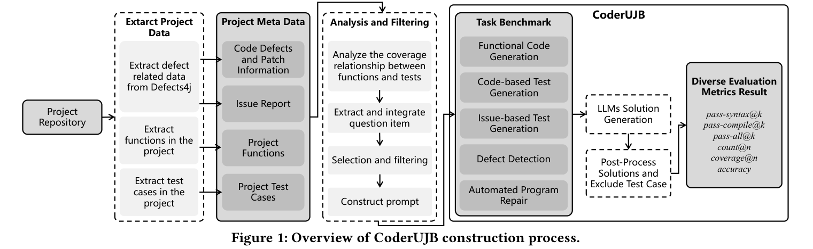
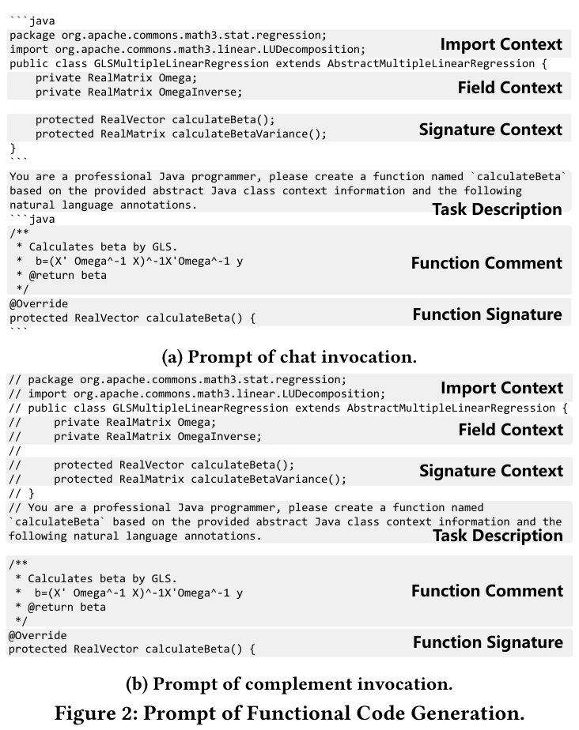
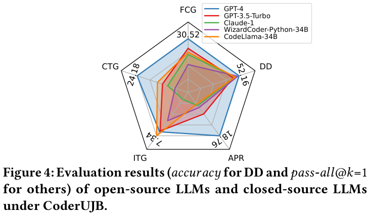

# CoderUJB：面向实际编程场景的可执行统一 Java 基准

# CoderUJB: An Executable and Unified Java Benchmark for Practical Programming Scenarios

**中英对照阅读版 / Bilingual reading edition**

- 作者 / Authors：Zhengran Zeng、Yidong Wang、Rui Xie、Wei Ye、Shikun Zhang。
- 单位 / Affiliation：Peking University, Beijing, China / 北京大学，中国北京。
- 通讯作者 / Corresponding authors：Rui Xie、Wei Ye、Shikun Zhang。
- 会议 / Venue：ISSTA ’24, September 16–20, 2024, Vienna, Austria。
- 正式出版信息 / Publication：ACM, New York, NY, USA, 13 pages；印刷页码 / printed pages 124–136。
- DOI：[10.1145/3650212.3652115](https://doi.org/10.1145/3650212.3652115)。
- 原文 / Source：[本地会议版 PDF / Local conference PDF](CoderUJB_ISSTA2024.pdf)。
- 代码 / Code：[WisdomShell/ujb](https://github.com/WisdomShell/ujb)。
- 整理日期 / Prepared：2026-11-03。

> **整理说明**：本文件对会议版论文的摘要及第 1–7 节作中英对照整理，包含全部 5 张表、4 幅图、3 个公式及 67 条参考文献。英文由 PDF 转写，合并双栏、跨页和断行，修复提取造成的空格与连字符问题；中文按小节对照翻译，必要时重分段。图保留原始英文标注，图题和主要术语提供中文；参考文献保留原始英文书目信息。所有“我们”“本研究”均指原论文作者。原文的结论及模型比较属于论文当时的实验范围。整理者新增说明单列为校注，不代表已完成本地复现。
>
> **Editorial note:** This edition pairs the paper’s abstract and Sections 1–7 with Chinese translations and retains all five tables, four figures, three equations, and 67 references. English text is transcribed from the conference PDF with column order, page breaks, line wraps, and extraction spacing repaired. Chinese translations are paired by subsection and may use different paragraph breaks. Figures retain original English labels with bilingual captions; bibliographic entries remain in their original language. “We” and “our study” refer to the paper’s authors. Findings apply to the paper’s historical experimental setting. Added editorial notes are separate from the paper, and no local replication is claimed.

## 目录 / Contents

- [摘要 / Abstract](#abstract)
- [1 引言 / Introduction](#section-1)
- [2 背景与相关工作 / Background and Related Work](#section-2)
- [3 CoderUJB 基准 / CoderUJB Benchmark](#section-3)
- [4 综合实验研究 / The Extensive Study](#section-4)
- [5 启示与讨论 / Implications and Discussions](#section-5)
- [6 有效性威胁 / Threats to Validity](#section-6)
- [7 结论 / Conclusions](#section-7)
- [参考文献 / References](#references)
- [整理校注与页码对照 / Editorial Notes and Page Map](#editorial-notes)

## 关键词与术语 / Keywords and Terminology

关键词 / Keywords：代码生成 / Code Generation；大语言模型 / Large Language Models；基准 / Benchmark。

CCS Concepts：Software and its engineering → Automatic programming / 软件及其工程 → 自动编程。

| 英文 / English | 中文 / Chinese | 本文用法 / Usage |
| --- | --- | --- |
| Executable | 可执行 | 通过实际运行检查解答 / Evaluate solutions by execution |
| Project-Runnable | 项目内可运行 | 依赖完整项目上下文执行 / Execution within a project context |
| Functional Code Generation, FCG | 功能代码生成 | 业务逻辑代码生成 / Generate operational code |
| Code-based Test Generation, CTG | 基于代码的测试生成 | 根据代码与注释生成测试 / Generate tests from code and comments |
| Issue-based Test Generation, ITG | 基于 issue 的测试生成 | 依据问题报告生成缺陷复现测试 / Generate bug-reproducing tests from issue reports |
| Defect Detection, DD | 缺陷检测 | 判断目标函数是否存在缺陷 / Classify whether a function is defective |
| Automated Program Repair, APR | 自动程序修复 | 修复给定缺陷函数 / Repair a buggy function |
| Continued pre-training | 继续预训练 | 在额外语料上继续训练 / Continue pre-training on additional corpora |
| Instruction fine-tuning | 指令微调 | 使用指令样本微调 / Fine-tune on instruction examples |
| Complement / completion invocation | 补全调用 | 按原文术语，区别于对话调用 / The paper’s term for completion-style invocation |

## 摘要 / Abstract

> 原文位置 / Source: PDF 1（PDF 页码从 1 起 / PDF pages are 1-based）

**English**

In the evolving landscape of large language models (LLMs) tailored for software engineering, the need for benchmarks that accurately reflect real-world development scenarios is paramount. Current benchmarks are either too simplistic or fail to capture the multi-tasking nature of software development. To address this, we introduce CoderUJB, a new benchmark designed to evaluate LLMs across diverse Java programming tasks that are executable and reflective of actual development scenarios, acknowledging Java’s prevalence in real-world software production. CoderUJB comprises 2,239 programming questions derived from 17 real open-source Java projects and spans five practical programming tasks. Our empirical study on this benchmark investigates the coding abilities of various open-source and closed-source LLMs, examining the effects of continued pre-training in specific programming languages code and instruction fine-tuning on their performance. The findings indicate that while LLMs exhibit strong potential, challenges remain, particularly in non-functional code generation (e.g., test generation and defect detection). Importantly, our results advise caution in the specific programming languages continued pre-training and instruction fine-tuning, as these techniques could hinder model performance on certain tasks, suggesting the need for more nuanced strategies. CoderUJB thus marks a significant step towards more realistic evaluations of programming capabilities in LLMs, and our study provides valuable insights for the future development of these models in software engineering.

**中文**

面向软件工程的大语言模型（LLM）不断发展，因此，能够准确反映真实开发场景的基准尤为重要。现有基准要么过于简单，要么未能体现软件开发的多任务特征。考虑到 Java 在实际软件生产中的广泛使用，我们提出 CoderUJB：一个面向多种 Java 编程任务的新基准，其任务既可执行，也符合实际开发场景。CoderUJB 从 17 个真实开源 Java 项目中构建了 2,239 道编程题，覆盖五类实际编程任务。

我们在该基准上对多种开源及闭源 LLM 的编程能力进行了实证研究，考察特定编程语言代码上的继续预训练，以及指令微调的影响。结果表明，虽然 LLM 展现出较强潜力，但仍面临挑战，尤其是在功能代码生成以外的任务中，例如测试生成和缺陷检测。研究结果还提示，在采用特定语言继续预训练和指令微调时应保持审慎，因为这些方法可能降低模型在某些任务上的表现，需要更细致的策略。CoderUJB 推动了更贴近实际的 LLM 编程能力评估，本研究也为这些模型在软件工程中的后续发展提供了参考。

## 1 引言 / Introduction

> 原文位置 / Source: PDF 1–2（PDF 页码从 1 起 / PDF pages are 1-based）

**English**

Researchers have found that advanced AI technologies, exemplified by large language models (LLMs), are proficient in addressing a broad spectrum of challenges, spanning from everyday tasks to complex software engineering issues [1, 10, 40, 52–54, 56, 60, 64](#ref-1). In addition to these general-purpose LLMs, there are code-centric large language models (code LLMs), such as CodeX [10](#ref-10), CodeLlama [44](#ref-44), and StarCoder [27](#ref-27), which are specifically designed to excel at software engineering tasks. Many of these code LLMs are open-source and can be privately deployed to avoid data security issues. As a result, they have gained significant attention for their strong coding skills. Because of this interest, different benchmarks [10, 13, 16, 23, 30, 59](#ref-10) have been designed to measure the programming capabilities of these LLMs. Specifically, Table 1 presents a selection of notable benchmarks within software engineering alongside our CoderUJB, illustrating their distinct characteristics. The HumanEval [10](#ref-10) benchmark stands out in this field, which is used to evaluate the ability of Python function generation and consists of 164 manually designed Python programming questions, and evaluates the quality of the generated solutions by checking whether the solution can be successfully executed by unit tests. We denote those execution-based evaluations as "Executable (✓)". Then, CoderEval [59](#ref-59) noticed that the questions in HumanEval are simple single-function generation tasks that do not match the actual development scenarios (i.e., writing code in a software project). So, they introduced a new benchmark with 460 questions that better aligned with the actual development scenarios. We denote those actual development questions as "Project-Runnable (✓)", indicating that the generated code requires a project context dependency for execution. However, those benchmarks focus on a single programming scenario and cannot provide a comprehensive evaluation of the programming capability of LLMs. Previous multi-task benchmarks, like CodeXGLUE [30](#ref-30), have been critiqued [10](#ref-10) because they rely on similarity-based metrics like BLEU and CodeBLEU [43](#ref-43), which do not involve running the code. The recently proposed multi-programming task dataset XCodeEval [23](#ref-23) focuses on questions from programming competitions, which do not accurately reflect typical real-world development scenarios. Consequently, the absence of a benchmark that comprehensively covers multi-programming tasks, executability, and matches real-world development scenarios prevents us from assessing the effectiveness of current LLMs on a broader range of real-world programming tasks.

To this end, we introduce CoderUJB, a comprehensive benchmark designed for evaluating LLMs that supports multiple tasks, adheres to real-world software development scenarios, and allows for execution within a complete program context(i.e., all source code and execution environments). Specifically, CoderUJB is built on 17 real open-source Java projects, acknowledging Java’s prevalence in real-world software production [6](#ref-6). We extracted 238 functional code generation questions and 140 code-based test generation [62](#ref-62) questions from these projects by analyzing the abstract syntax trees and test coverage relationships of the project source code. Then, we extracted and collected 451 issue-based test generation [22](#ref-22) questions, 470 automatic program repair [56](#ref-56) questions, and 940 defect detection [66](#ref-66) questions from the projects by combining the detailed defect information and related issue reports from the projects. Altogether, CoderUJB comprises 2,239 programming questions covering five trending and practical programming tasks, which is the largest benchmark that is "Project-Runnable" and each question comes with a complete program context to facilitate the researcher’s detailed analysis of the questions and the generated solutions. Ultimately, the solutions generated by the LLMs will be placed in real projects for execution, and the programming ability of the LLMs will be evaluated using the execution success rate as the primary metric.

Next, to illustrate the value of CoderUJB to the field, we conducted a comprehensive empirical study on CoderUJB to explore the programming abilities of a representative set of open-source code LLMs and general-purpose closed-source LLMs. The aim was to answer a couple of crucial questions: How good are these LLMs at coding? And how do continued pre-training [44](#ref-44) and instruction fine-tuning [31](#ref-31) affect their programming performance? After running a slew of experiments on CoderUJB, we find that current LLMs still perform poorly in solving non-functional code generation tasks, especially defect detection tasks. Secondly, superior open-source LLMs can already approach or even surpass GPT-3.5-Turbo on the functional code generation task and the two test generation tasks. Thirdly, continued pre-training in a specific programming language can reduce an LLM’s performance in other languages, and this negative impact diminishes as the task becomes less related to the original pre-training task. Such varied outcomes across different tasks emphasize CoderUJB’s value as a unified evaluation benchmark that incorporates multiple programming tasks. Lastly, our findings indicate that instruction fine-tuning diminishes the performance of code LLMs in functional code generation and the two test generation tasks—a contrast to the results from the less practical benchmark, HumanEval. This highlights the value of CoderUJB as a practical programming evaluation benchmark.

We summarize the main contributions of this study as follows:

- Benchmark. We have introduced CoderUJB, a universal Java benchmark for assessing LLM performance across multiple real-world programming tasks. The benchmark includes executable test cases and the complete program context (i.e., all source code and execution environments), comprising 2,239 programming questions. 

- Study. We ran a comprehensive empirical analysis of both open-source and proprietary LLMs using CoderUJB, studying (1) their performance across diverse coding tasks, (2) the effect of continued pre-training in a specific language code, and (3) the impact of instruction fine-tuning on these models. 

- Implications. This work revealed multiple significant findings: (1) Program context is useful in code generation tasks. (2) Caution is advised when continuing pre-training in a specific programming language, as its effects tend to be unpredictable, especially if the downstream task is substantially different from the pre-training task. (3) Instruction fine-tuning should be approached carefully, as it can diminish the performance of LLMs on tasks that align closely with the pre-trained task. (4) Comprehensive evaluations are essential, given that different programming tasks may yield disparate results when the same training strategy is applied.

The CoderUJB are publicly available in https://github.com/WisdomShell/ujb.

**中文**

研究发现，以大语言模型为代表的先进 AI 技术能够处理从日常任务到复杂软件工程问题的多种挑战 [1, 10, 40, 52–54, 56, 60, 64](#ref-1)。除通用 LLM 外，还有 CodeX [10](#ref-10)、CodeLlama [44](#ref-44) 和 StarCoder [27](#ref-27) 等专门面向软件工程任务的代码大语言模型。许多代码 LLM 是开源的，能够私有部署以避免数据安全问题，其编程能力因此受到广泛关注。研究者设计了多种基准来衡量这些模型的编程能力 [10, 13, 16, 23, 30, 59](#ref-10)。表 1 将软件工程中的若干重要基准与 CoderUJB 进行了比较。

其中，HumanEval [10](#ref-10) 用于评估 Python 函数生成能力，包含 164 道人工设计的 Python 编程题，通过运行单元测试来检查生成解答的质量。我们将这种基于执行的评估记为“可执行（✓）”。CoderEval [59](#ref-59) 则指出，HumanEval 中的题目只是简单的单函数生成任务，与在软件项目中编写代码的真实开发场景不符，因此提出了包含 460 道题、更加贴近实际开发场景的新基准。我们将这类实际开发题目记为“项目内可运行（✓）”，表示生成代码需要依赖项目上下文才能执行。

然而，这些基准只关注单一编程场景，无法全面评价 LLM 的编程能力。CodeXGLUE [30](#ref-30) 等早期多任务基准因依赖 BLEU、CodeBLEU [43](#ref-43) 等相似度指标而受到质疑 [10](#ref-10)，因为这些指标不涉及实际运行代码。较新的多编程任务数据集 XCodeEval [23](#ref-23) 侧重编程竞赛题，也无法准确反映典型的真实开发场景。因此，缺少同时涵盖多任务、可执行性和真实开发场景的基准，限制了我们评估现有 LLM 在更广泛实际编程任务中的有效性。

为此，我们提出综合性评估基准 CoderUJB。它支持多种任务，遵循真实软件开发场景，并允许代码在完整程序上下文中执行，即提供全部源代码和执行环境。考虑到 Java 在实际软件生产中的普及程度 [6](#ref-6)，CoderUJB 基于 17 个真实开源 Java 项目构建。通过分析项目源代码的抽象语法树及测试覆盖关系，我们提取了 238 道功能代码生成题和 140 道基于代码的测试生成题 [62](#ref-62)；结合项目中的详细缺陷信息及相关 issue 报告，又提取、收集了 451 道基于 issue 的测试生成题 [22](#ref-22)、470 道自动程序修复题 [56](#ref-56) 和 940 道缺陷检测题 [66](#ref-66)。这 2,239 道题覆盖五类受到关注的实际编程任务。作者将其描述为当时最大的“项目内可运行”基准，每道题均提供完整程序上下文，以便研究者详细分析题目和生成解答。最终，模型生成的解答将被放回真实项目中执行，并以执行成功率作为主要指标评估编程能力。

为了说明 CoderUJB 的价值，我们开展了综合实证研究，考察一组具有代表性的开源代码 LLM 和通用闭源 LLM 的编程能力，重点回答：这些模型的编程能力如何？继续预训练 [44](#ref-44) 和指令微调 [31](#ref-31) 如何影响其编程表现？实验发现，现有 LLM 在功能代码生成以外的任务上仍表现不佳，尤其是缺陷检测。其次，优秀开源 LLM 在功能代码生成和两类测试生成任务上已能接近甚至超过 GPT-3.5-Turbo。再次，在特定编程语言上继续预训练可能降低其他语言上的表现，而且任务与原始预训练任务的关联越弱，这种负面影响越小。不同任务呈现不同结果，说明统一评估多个编程任务的价值。最后，指令微调会降低代码 LLM 在功能代码生成和两类测试生成任务上的表现，这与较少反映实际开发情境的 HumanEval 上的结果不同，再次说明 CoderUJB 的实际编程评估价值。

本研究的主要贡献如下：

- **基准**：提出通用 Java 基准 CoderUJB，包含 2,239 道题，覆盖多类真实编程任务，并提供可执行测试及完整程序上下文。
- **研究**：利用 CoderUJB 对开源及专有 LLM 进行实证分析，研究它们在不同编程任务上的表现、特定语言继续预训练的影响，以及指令微调的影响。
- **启示**：程序上下文有助于代码生成；特定语言继续预训练的效果可能难以预测，尤其在下游任务与预训练任务差异较大时；指令微调可能降低模型在与预训练任务高度一致的任务上的表现，因此应谨慎使用；同一训练策略可能在不同编程任务上产生不同结果，因此需要全面评估。

CoderUJB 已公开于 https://github.com/WisdomShell/ujb。

**Table 1: Comparison of existing code benchmark and CoderUJB. / 表 1：现有代码基准与 CoderUJB 的比较。**

| 基准 / Benchmark | 题目数 / Questions | 可执行 / Executable | 项目内可运行 / Project-Runnable | 多任务 / Multi-Tasks |
| --- | --- | --- | --- | --- |
| HumanEval [10](#ref-10) | 164 | ✓ | × | × |
| MultiPL-E [9](#ref-9) | 2,952 | ✓ | × | × |
| MBPP [7](#ref-7) | 974 | ✓ | × | × |
| CoderEval [59](#ref-59) | 460 | ✓ | ✓ | × |
| Defects4j [21](#ref-21) | 835 | ✓ | ✓ | × |
| ChatTester [62](#ref-62) | 1,000 | ✓ | ✓ | × |
| Libro [22](#ref-22) | 750 | ✓ | ✓ | × |
| CodeXGLUE [30](#ref-30) | 759,000 | × | × | ✓ |
| XCodeEval [23](#ref-23) | 159,464 | ✓ | × | ✓ |
| CoderUJB | 2,239 | ✓ | ✓ | ✓ |

[原表截图 / Original table](Images/table-1-benchmarks.png)

## 2 背景与相关工作 / Background and Related Work

### 2.1 面向软件工程的大语言模型 / Large Language Models for Software Engineering

> 原文位置 / Source: PDF 2–3（PDF 页码从 1 起 / PDF pages are 1-based）

**English**

Recently, many code LLMs [10, 27, 37, 44](#ref-10) have been proposed to solve software engineering tasks. These models typically leverage the Transformer Decoder [50](#ref-50) architecture and undergo extensive training on large-scale code databases [10, 27, 37](#ref-10), expecting excellence in executing code-intensive tasks.

A prominent example within this realm is CodeX [10](#ref-10). For the first time, they increased the model parameter size to 12 billion (B) and used 159 gigabytes (GB) of Python code data for pre-training. They also proposed the widely adopted benchmark HumanEval and the pass@k metric for evaluating the quality of generated code, in which CodeX achieved a pass@k=1 of 28.81 on HumanEval. Subsequently, StarCoderBase [27](#ref-27) further scaled both the parameter size to 15B and the training dataset to 799.37 GB code corpus, which contained various programming languages. We designate those LLMs that have not undergone specialized training for particular tasks (e.g., Python programming challenges or question-and-answer activities) as "Base LLM".

As mentioned, to enhance Python-specific performance on tasks like HumanEval, researchers continued pre-training the base model StarCoderBase on an additional 35B tokens of Python code, yielding a Python-enhanced version of the model StarCoder-Python. Ultimately, StarCoderBase and StarCoder-Python achieved a pass@k=1 of 30.4 and 33.6 on HumanEval, respectively. We designate those LLMs that have continued pre-training in specific programming language corpus as "Specific Programming Language (PL) Base".

Moreover, the team behind WizardCoder [31](#ref-31) found that fine-tuning base LLMs with high-quality instruction samples (i.e., more diverse and more challenging coding problems) further boosted the LLMs programming performance. They used an evolutionary instruction-based data collection strategy to collect 80k instruction fine-tuning samples from ChatGPT. Utilizing these novel datasets, they fine-tuned a "Instruction Tuned" LLM WizardCoder, significantly enhancing the HumanEval pass@k=1 rate from 33.57 to an impressive 58.12.

Despite the progress, the prevailing methods of evaluating these code LLMs tend to focus on simple Python-based programming puzzles like HumanEval and lack a comprehensive assessment of other programming tasks in software engineering. This limited evaluation does not fully capture the advancements made in code LLMs, nor does it comprehensively evaluate the impact of specialized training processes such as continued pre-training in a specific language code (mostly in Python) and instructional fine-tuning on various practical software engineering scenarios. In response to these limitations, our study introduces a multi-programming task, executable and real-world programming scenario-compliant evaluation benchmark, and provides an in-depth study to address the questions mentioned above.

**中文**

近年来，研究者提出了多种面向软件工程任务的代码 LLM [10, 27, 37, 44](#ref-10)。这些模型通常采用 Transformer Decoder 架构 [50](#ref-50)，在大规模代码库上进行充分训练 [10, 27, 37](#ref-10)，以提升代码密集型任务的处理能力。

CodeX [10](#ref-10) 是一个重要例子：它首次将模型规模提升至 120 亿参数，并使用 159 GB Python 代码进行预训练。该工作还提出了被广泛采用的 HumanEval 基准和评估生成代码质量的 pass@k 指标；CodeX 在 HumanEval 上的 pass@1 为 28.81。随后，StarCoderBase [27](#ref-27) 将参数规模进一步扩大到 150 亿，训练数据扩大至包含多种编程语言的 799.37 GB 代码语料。本文把未针对特定任务进行专门训练的模型称为“基础 LLM”，例如未专门针对 Python 编程题或问答任务训练的模型。

为了提升 HumanEval 等 Python 任务的表现，研究者在额外的 350 亿 Python 代码 token 上继续预训练 StarCoderBase，得到 Python 增强版本 StarCoder-Python。StarCoderBase 与 StarCoder-Python 在 HumanEval 上的 pass@1 分别为 30.4 和 33.6。本文把在特定编程语言语料上继续预训练的模型称为“特定编程语言基础模型”（Specific PL Base）。

WizardCoder 团队 [31](#ref-31) 还发现，使用高质量指令样本，即更加多样且更具挑战性的编程问题，对基础 LLM 进行微调，可以进一步提升编程能力。他们采用基于指令演化的数据收集策略，从 ChatGPT 收集了 8 万条指令微调样本，随后微调得到 WizardCoder。其 HumanEval pass@1 从 33.57 提高到 58.12。

虽然已有这些进展，主流代码 LLM 评估仍主要围绕 HumanEval 这类简单的 Python 编程题，缺少对其他软件工程编程任务的全面评价。这种有限的评估既不能完整反映代码 LLM 的进展，也不能全面考察特定语言代码继续预训练（主要是 Python）及指令微调对不同实际软件工程场景的影响。针对这些局限，我们提出兼具多编程任务、可执行性及真实编程场景特征的评估基准，并开展深入研究。

### 2.2 代码基准 / Coder Benchmark

> 原文位置 / Source: PDF 3（PDF 页码从 1 起 / PDF pages are 1-based）

**English**

Recent scholarly efforts have proposed many benchmarks [7, 9, 10, 23, 59](#ref-7) to evaluate the programmatic skill of LLMs as presents in Table 1. The HumanEval [10](#ref-10) benchmark stands out in this field, consisting of 164 manually designed Python programming questions. Each question provides function signatures, comments, function bodies, and multiple unit tests. LLMs are tasked with crafting function bodies informed by the given signatures and comments. Subsequently, the generated functions are executed and evaluated regarding their success in passing the unit tests tied to each question. We refer to such non-test-case code generation questions as functional code generation tasks. Later, CoderEval noticed that the questions in HumanEval are simple "self-contained" [59](#ref-59) function generation tasks that each function only has language built-in dependency and do not match the actual development scenarios that rely on multiple public libraries and project files. Therefore, they introduced 460 Java and Python code generation questions derived from real projects on GitHub that are more aligned with actual development settings.

In addition to mainstream functional code generation tasks, there are other types of datasets designed to evaluate LLMs. For example, Defects4j [21](#ref-21), a seminal benchmark in automated program repair, catalogs 835 defects across 17 authentic Java projects from Github. It offers both the defective and fixed versions of the code alongside related test cases. In this evaluative phase, the fix code generated by LLMs is executed, and the accompanying test cases verify the correctness of the fix. Based on Defects4j, Libro [22](#ref-22) has developed a benchmark for generating issue-specific tests. This requires LLMs to generate test cases that trigger the corresponding defects based on a given issue report. Additionally, the ChatTester [62](#ref-62) benchmark, designated for code-based test generation tasks, collects 1,000 test generation questions from open-source Java projects on GitHub. Each test question contains the code needed for testing, a natural language description of the task, and a test case. LLMs need to generate test cases based on the code under test and the natural language description.

Besides the single-task benchmark mentioned above, previous researchers have proposed two multi-programming task benchmarks, CodeXGLUE [30](#ref-30) and XCodeEval [23](#ref-23), that incorporate a broad range of questions and tasks, establishing a more substantial framework for evaluating LLMs. However, CodeXGLUE still uses textual similarity metrics, such as BLEU and CodeBLEU [43](#ref-43), thereby falling short of actual code execution. XCodeEval focuses on programming competition questions, which, like HumanEval, are not "Project-Runnable" and do not match the actual development scenarios. Therefore, CoderUJB fills the current gap in the field as a benchmark that simultaneously includes multiple programming tasks that are executable and match real-world development scenarios, thus broadening the scope of evaluation for LLMs across various practical programming tasks.

**中文**

近期研究提出了多种评估 LLM 编程能力的基准 [7, 9, 10, 23, 59](#ref-7)，见表 1。HumanEval [10](#ref-10) 包含 164 道人工设计的 Python 编程题，每道题提供函数签名、注释、函数体及多个单元测试。模型根据给定签名和注释编写函数体，生成函数随后被执行，并根据能否通过题目对应的单元测试进行评价。我们将这种生成非测试代码的题目称为功能代码生成任务。CoderEval 指出，HumanEval 中的题目只是简单的“自包含”函数生成任务 [59](#ref-59)，每个函数仅依赖语言内置功能，而实际开发往往依赖多个公共库和项目文件。因此，CoderEval 从 GitHub 真实项目中收集了 460 道 Java 和 Python 代码生成题，更贴近实际开发情境。

除主流功能代码生成任务外，还有针对其他任务的数据集。例如，自动程序修复领域的重要基准 Defects4J [21](#ref-21) 收录了 GitHub 上 17 个真实 Java 项目的 835 个缺陷，同时提供缺陷版本、修复版本及相关测试。在评估时执行 LLM 生成的修复代码，再用配套测试验证修复是否正确。基于 Defects4J，Libro [22](#ref-22) 构建了面向特定 issue 的测试生成基准，要求模型根据 issue 报告生成能够触发相应缺陷的测试。ChatTester [62](#ref-62) 则面向基于代码的测试生成，从 GitHub 开源 Java 项目中收集了 1,000 道题。每道题包含待测试代码、任务的自然语言描述和一个测试用例，模型需根据代码和描述生成测试。

除单任务基准外，CodeXGLUE [30](#ref-30) 和 XCodeEval [23](#ref-23) 这两个多编程任务基准纳入了广泛的问题和任务，提供了更大范围的 LLM 评估框架。但 CodeXGLUE 仍使用 BLEU、CodeBLEU [43](#ref-43) 等文本相似度指标，没有实际执行代码；XCodeEval 侧重编程竞赛题，与 HumanEval 一样不具备“项目内可运行”特征，与实际开发场景不符。因此，CoderUJB 同时纳入多种可执行且符合真实开发场景的编程任务，填补了这一空缺，也拓宽了 LLM 的实际编程任务评估范围。

## 3 CoderUJB 基准 / CoderUJB Benchmark

> 原文位置 / Source: PDF 3（PDF 页码从 1 起 / PDF pages are 1-based）

**English**

This section outlines the programming tasks included in the CoderUJB and provides an overview of the dataset construction process and evaluation metrics.

**中文**

本节介绍 CoderUJB 所包含的编程任务，并概述数据集构建过程及评估指标。

### 3.1 CoderUJB 中的任务 / Tasks in CoderUJB

> 原文位置 / Source: PDF 3–4（PDF 页码从 1 起 / PDF pages are 1-based）

**English**

CoderUJB has chosen four representative program generation tasks and one crucial program classification task to create a comprehensive and uniform dataset for evaluating programming skills. 

**Functional Code Generation (FCG):** Code generation is a crucial topic for LLMs in software development [10, 30](#ref-10), often consuming much of the developer’s time. In this task, we need to generate the corresponding function code based on the given function annotations. We refer to previous work [10, 59](#ref-10) to define the input of the task as function-related context, function annotations, and function signatures, while the output of the task is a function that meets the task requirements, and test cases are used to evaluate the quality of the generated function. Note that this task is limited to generating operational code that executes the service’s logic (i.e., not test case function or configuration file). 

**Code-based Test Generation (CTG):** Test generation is another part of the code generation task, but it requires programming skills different from functional code generation. For example, writing test cases usually requires more cross-functional understanding, whereas generating functional functions tends to focus only on the content of the current function following decoupled design principles [51](#ref-51). Therefore, we refer to previous work [62](#ref-62) on test generation as a separate task. This task involves reading and understanding the program logic of the code under test and then generating test cases that verify the code’s core functionality based on the test cases’ function annotations. Consequently, we define the input of the task as task-related context, test case annotations and test case signatures, and the output of the task as test cases that meet the task requirements, and evaluate the quality of the generated test cases based on metrics such as whether they meet the task requirements and test coverage, which will be detailed in Section 3.5. 

**Issue-based Test Generation (ITG):** Issue report-based test generation is a process where LLMs analyze and comprehend bugs reported in issue reports. Following the comprehension, they devise test cases to reproduce those issues. We follow the task definition developed in previous works [22](#ref-22) for this kind of task. The task input consists of two elements: an issue report detailing a particular bug and the corresponding function signature linked to that bug, while the output of the task is defined as the test case that meets the task requirements. 

**Defect Detection (DD):** Defect detection is a critical activity in software engineering, significantly influencing the overall software development process [28, 66](#ref-28). The primary purpose of this task is to detect possible bugs in the software’s code, including, but not limited to, syntax errors and potential runtime errors. Following the previous work’s task definition [66](#ref-66), our task input for defect detection would include the specific function under scrutiny, and the output is a statement that indicates whether or not a bug exists. 

**Automated Program Repair (APR):** After successfully identifying issues within a program, the next step is to make corrections. In the task of automated program repair, LLMs are given samples of functions containing defects, and they are expected to fix these errors, returning functions that are free of defects. This task is crucial in software engineering, so we align our definition with previous task definitions [56](#ref-56). In this case, the task input includes task-related contexts and defective functions; the output should be fixed functions. Eventually, test cases are used to evaluate the correctness of the fixed functions.

**中文**

CoderUJB 选取了四种具有代表性的程序生成任务和一种重要的程序分类任务，形成全面、统一的编程能力评估数据集。

**功能代码生成（FCG）**：代码生成是 LLM 软件开发应用的重要方向 [10, 30](#ref-10)，也常占用开发者大量时间。该任务根据给定函数注释生成相应函数代码。按照已有工作 [10, 59](#ref-10)，输入为函数相关上下文、函数注释和函数签名，输出为满足任务要求的函数，通过测试用例评估生成质量。本任务限于生成执行业务逻辑的代码，不包括测试函数或配置文件。

**基于代码的测试生成（CTG）**：测试生成也是代码生成的一部分，但所需能力不同于功能代码生成。例如，编写测试通常要求跨函数理解，而依据解耦设计原则 [51](#ref-51)，生成业务函数往往更侧重当前函数内部。因此，参照已有工作 [62](#ref-62)，我们把测试生成视为独立任务。模型需要阅读并理解被测代码的程序逻辑，然后根据测试函数的注释生成用于验证核心功能的测试。输入为任务相关上下文、测试用例注释和测试用例签名，输出为满足要求的测试用例；质量通过是否满足任务要求、测试覆盖率等指标衡量，详见第 3.5 节。

**基于 issue 的测试生成（ITG）**：模型先分析、理解 issue 报告中描述的缺陷，再设计能够复现该问题的测试。本文沿用已有工作 [22](#ref-22) 的任务定义：输入包含详细描述特定缺陷的 issue 报告，以及与该缺陷关联的函数签名；输出为符合要求的测试用例。

**缺陷检测（DD）**：缺陷检测是软件工程中的关键活动，对整个软件开发过程有显著影响 [28, 66](#ref-28)。其目的在于发现代码中可能存在的问题，包括但不限于语法错误和潜在运行时错误。按照已有定义 [66](#ref-66)，输入为待检查的具体函数，输出为说明是否存在缺陷的判断。

**自动程序修复（APR）**：成功识别程序问题后，需要进一步修正。模型接收存在缺陷的函数，修复其中错误，并返回不含该缺陷的函数。该任务在软件工程中十分重要，本文沿用已有定义 [56](#ref-56)：输入为任务相关上下文和缺陷函数，输出为修复后的函数，最终通过测试用例评估修复是否正确。

### 3.2 CoderUJB 中的数据集 / Datasets in CoderUJB

> 原文位置 / Source: PDF 4（PDF 页码从 1 起 / PDF pages are 1-based）

**English**

This section introduces the process of collecting and processing CoderUJB questions. Figure 1 illustrates the overview of the data processing procedure within CoderUJB. As mentioned in Section 2.2, Defects4j [21](#ref-21) provided 17 qualitative and practical open source Java projects as well as their defects data and issue reports, due to its completeness and quality, it has become the infrastructure in the field of automated program repair [19, 32, 56](#ref-19). Recognizing the value of Defects4j, we build a comprehensive benchmark on it. Consequently, each of the five programming tasks of CoderUJB gleaned its source data from 17 projects under Defects4j. Additionally, while it could incorporate other sources to build CodeUJB. we chose to collecting our coding problems across different tasks from the same reliable source (i.e., Defects4j), providing similar quality and difficulty levels across tasks and minimizing data quality impacts on our findings. Such selection offers substantial benefits over using varied datasets from disparate sources.

**中文**

本节介绍 CoderUJB 题目的收集和处理过程，图 1 给出了整体流程。如第 2.2 节所述，Defects4J [21](#ref-21) 提供 17 个质量较高、具有实际用途的开源 Java 项目，以及缺陷数据和 issue 报告。由于完整性和质量较好，它已成为自动程序修复领域的基础设施 [19, 32, 56](#ref-19)。

我们基于 Defects4J 构建综合基准，因此 CoderUJB 的五类任务均从其 17 个项目中获取原始数据。虽然也可以纳入其他数据源，但我们选择让不同任务的编程题都来自同一个可靠来源，即 Defects4J，以使各任务的数据质量和难度更加接近，并减少数据质量对研究发现的影响。与使用来源不同、彼此分散的数据集相比，这样的选择具有明显优势。

**Figure 1 / 图 1**

*English: Overview of CoderUJB construction process.*

*中文：CoderUJB 构建流程概览。*

**图中流程说明（整理者） / Figure guide (editorial)**

中文：从项目仓库提取缺陷和补丁、issue 报告、项目函数与测试；分析函数和测试的覆盖关系，整合题目、筛选数据并构造提示；形成五类任务后生成解答，进行后处理并执行测试，计算各类指标。图中 “Exclude Test Case” 为原图文字，具体执行行为须核对代码。

English: Project metadata, including defects and patches, issue reports, functions, and tests, feeds coverage analysis, question extraction, filtering, and prompt construction. The five task benchmarks then feed solution generation, post-processing, test execution, and evaluation. “Exclude Test Case” is retained from the original figure; its implementation should be checked in the code.

### 3.3 数据集构建 / Dataset Construction

> 原文位置 / Source: PDF 4–5（PDF 页码从 1 起 / PDF pages are 1-based）

**English**

**Functional Code Generation (FCG):** In the processing flow for the functional code generation benchmark, we first select the latest defect-free versions of the 17 open-source projects within Defects4j [21](#ref-21) as the original project repository. We opt for the latest versions because they undergo continuous evolution and development, thus likely possessing the fewest potential defects and demonstrating superior code quality. Subsequently, we extract all functions and test cases found in the project through an abstract syntax tree (AST) investigation. Then, as depicted in the "Analysis and Filtering Process" in Figure 1, we first analyze the coverage relationship between test cases and functions via a test coverage analysis tool [3](#ref-3) to determine the test cases calling each function. Following this, we gather question-related data about each function, which includes the function body, comments, source code of the associated class, and related test cases. Later, we eliminated low-quality data by referring to CoderEval’s guidelines [59](#ref-59). More specifically, we ensure that: 1) The function is not a test, interface, or deprecated. 2) The function has function-level comment in English. 3) The test coverage ratio larger than 50%. Then, the question units are ranked in descending order based on the associated test coverage ratio, and a manual quality assessment is performed to further omit low-quality functions, such as oversimplified getter and setter functions. Ultimately, 238 functional code generation questions were filtered out, and each function had about 161.66 test cases on average. The question prompt is then formulated, and the exact structure will be discussed in detail in Section 3.4. 

**Code-based Test Generation (CTG):** For the code-based test generation benchmark, we also select the latest defect-free project version in Defects4j as the initial project repository. We then follow the same process for the functional code generation dataset to extract functions and test cases, while also examining their coverage relationship. We subsequently filter out low-quality data using standards similar to those applied by CoderEval [59](#ref-59) and ChatTester [62](#ref-62). More specifically, we ensure that the test case 1) has name includes a test-associated keyword such as "Test", 2) is not deprecated, 3) has function-level comments in English, 4) is in a class that corresponds to a related functional class, such as "Example.java" and "ExampleTest.java". Finally, we manually evaluate their quality to eliminate any low-quality instances, such as those with low test coverage, which are usually the bug reproduced test cases, and the ability to generate such test-cases we would like to examine in the following issue-based test generation task. We finally filtered out 140 code-based test cases to generate the test questions. 

**Automated Program Repair (APR):** As previously noted in Section 2.2, the Defects4j [21](#ref-21) dataset is a prevalent source for automated program repair (APR). In designing our benchmark for APR, we directly adopt the defect dataset provided by Defects4j and refer to the previous work [56](#ref-56) to focus only on the single-function defects in Defects4j. This specific focus makes it easier for us to create a uniform question prompt, which ultimately enhances the quality of our benchmark questions. In the end, we extracted 470 single-function defects from the dataset to serve as our APR benchmark. 

**Defect Detection (DD):** For the defect detection benchmark, we have also developed a benchmark based on the Defects4j. Specifically, we focused on single-function defects as well, selecting 470 such bugs in Defects4j and using their defective functions along with their corresponding fixed versions as positive and negative samples. In the end, we have compiled a balanced dataset containing 940 detection samples for defect detection. 

**Issue-based Test Generation (ITG):** As mentioned in Section 2.2, LIBRO [22](#ref-22) has proved a comprehensive benchmark for issue-based test generation based on Defects4j. Therefore, from the 750 test generation questions provided by LIBRO, we kept those related to issues that match the bugs in our automated program repair benchmark. Consequently, we obtained a benchmark consisting of 451 issue-based test generation questions.

**中文**

**功能代码生成（FCG）**：首先，选取 Defects4J [21](#ref-21) 中 17 个开源项目当时最新的无缺陷版本，作为初始项目仓库。作者认为，持续演进、开发后的最新版本可能包含更少潜在缺陷，代码质量也更高。随后，利用抽象语法树（AST）分析提取项目内全部函数和测试用例。按照图 1 的“分析与筛选流程”，先用测试覆盖分析工具 [3](#ref-3) 确定测试与函数之间的覆盖关系，找出调用各函数的测试；再收集每个函数的函数体、注释、所属类源代码及相关测试。

之后参照 CoderEval 的准则 [59](#ref-59) 去除低质量数据，具体要求为：函数不是测试函数、接口，也未被弃用；具有英文函数级注释；测试覆盖率大于 50%。再按相关测试覆盖率从高到低排序，人工评估质量，进一步去除过于简单的 getter、setter 等低质量函数。最终得到 238 道功能代码生成题，每个函数平均约有 161.66 个测试用例。之后构造题目提示，结构详见第 3.4 节。

**基于代码的测试生成（CTG）**：同样选取 Defects4J 项目当时最新的无缺陷版本，沿用功能代码生成数据集的流程提取函数、测试，并分析覆盖关系。随后依据与 CoderEval [59](#ref-59)、ChatTester [62](#ref-62) 相近的标准筛除低质量数据，要求测试用例名称包含 Test 等测试相关关键词；未被弃用；具有英文函数级注释；所在测试类与相应功能类对应，例如 Example.java 与 ExampleTest.java。最后人工评价质量，删除低覆盖率等低质量样本。低覆盖率样本通常是缺陷复现测试，而生成此类测试的能力将放到后续基于 issue 的测试生成任务中考察。最终筛得 140 个基于代码的测试用例，用于构造测试生成题。

**自动程序修复（APR）**：Defects4J [21](#ref-21) 是 APR 的常用数据来源。我们直接采用其缺陷数据，并参照已有工作 [56](#ref-56) 仅关注单函数缺陷，以便形成统一的题目提示并提高题目质量。最终提取 470 个单函数缺陷，构成 APR 基准。

**缺陷检测（DD）**：同样基于 Defects4J，选择 470 个单函数缺陷，分别将其缺陷函数与相应修复版本用作正、负样本，构成含 940 个样本的平衡缺陷检测数据集。

**基于 issue 的测试生成（ITG）**：LIBRO [22](#ref-22) 已基于 Defects4J 提供了综合性的 issue 测试生成基准。我们从其 750 道测试生成题中，保留与本研究 APR 基准缺陷匹配的 issue，最终得到 451 道 ITG 题。

### 3.4 基础提示设计 / Base Prompt Design

> 原文位置 / Source: PDF 5–6（PDF 页码从 1 起 / PDF pages are 1-based）

**English**

**Functional Code Generation (FCG):** Figure 2 shows an example prompt for a functional code generation task consisting of six parts. Among them, "Import Context", "Filed Context", and "Signature Context" serve as task-related contexts, extracted from the corresponding Java files of the task functions through AST analysis. We will show the effectiveness of those contexts in Section 4.3.1. The other three components, namely "Task Description", "Function Comment", and "Function Signature", define the specific requirements of the task, instructing the LLMs on the desired code content to be generated.

It is important to note that the prevalent usage of current LLMs falls into two ways: chat invocation (e.g., ChatGPT [1](#ref-1) with chat alignment) and complement invocation (e.g., StarCoderBase [27](#ref-27) without chat alignment). However, most users prefer the chat invocation method. Additionally, most open-source LLMs are typically offered only in the base version (i.e., without fine-tuning) [27, 37, 49](#ref-27), limiting us to using the model in a complement invocation way. For a fair comparison of these two types of LLMs, we have proposed two invocation prompts for each task: one in the style of a chat (i.e., Figure 2a) and the other in a complementary format (i.e., Figure 2b). While the content of the two prompts remains the same, they differ in how the information is formatted. Hence, we consider these two prompts equivalent, enabling a fair comparison between the two invocation ways. 

**Code-based Test Generation (CTG):** Figure 3a illustrates a chat invocation prompt for code-based test generation. In the task-related context, we provide both the under-test class context (i.e., the "Abstract Tested Class Context" in Figure 3a) and the test class context (i.e., the "Abstract Test Class Context" in Figure 3a). The term "Abstract Class Context" here indicates the aggregate of "Import Context", "Field Context", and "Signature Context" in Figure 2. Additionally, the task prompt also has a "Task Description", "Function Comment", and "Function Signature" to outline the unique requirements of the task. Meanwhile, the complement invocation prompt for this task is similar to Figure 2a, with the prompt components reformatted and organized. 

**Issue-based Test Generation (ITG):** Figure 3b presents an example chat invocation prompt for issue-based test generation. This prompt format is guided by the LIBRO [22](#ref-22). More specifically, this task’s prompt is composed of three key elements. The first element is the "Issue Context"; it includes the issue report featuring the issue ID, title, and a detailed description specific to that issue. The other two elements, "Task Description" and "Function Signature" lay out the exact requirements of the task. The completion prompt for this task is also with the prompt components reformatted and organized. It is noteworthy that we do not provide "Abstract Class Context" and "Function Comment" in the prompt because we want to evaluate the capacity of LLMs in deriving those task information directly from issue reports [22](#ref-22). 

**Automated Program Repair (APR):** Figure 3c shows an example chat invocation prompt for an automated program repair task. The design of this prompt references from prior APR work [56](#ref-56). More specifically, this prompt has four key components and is similar to the design for functional code generation in Figure 2a. The main difference is that the prompt for the APR task includes the "Buggy Function", which is the defective function that needs to be fixed by the LLMs. 

**Defect Detection (DD):** Figure 3d presents a complement invocation prompt for defect detection. Considering that this task is categorical, our prompt structure borrows from the design paradigms of classification benchmarks in the natural language processing (NLP) domain, such as MMLU [17](#ref-17) and C-Eval [18](#ref-18), which utilize few-shot examples to guide base LLMs (i.e., not fine-tuned with instructions) in generate valid output (i.e., the option of a multiplechoice question). We have implemented a two-shot format [34](#ref-34), following with relevant code context and a binary multiple-choice question.

**中文**

**功能代码生成（FCG）**：图 2 给出一个包含六个部分的提示示例。其中，“导入上下文”（Import Context）、“字段上下文”（Field Context）和“签名上下文”（Signature Context）是任务相关上下文，利用 AST 分析从目标函数对应的 Java 文件中提取；其有效性将在第 4.3.1 节评估。另三个部分为“任务描述”（Task Description）、“函数注释”（Function Comment）及“函数签名”（Function Signature），用于定义具体要求，指导模型生成所需代码。

当时 LLM 主要有两种调用方式：经过对话对齐的模型采用对话调用，例如 ChatGPT [1](#ref-1)；未经对话对齐的模型采用补全调用，例如 StarCoderBase [27](#ref-27)。多数用户更偏好对话方式，但许多开源模型当时仅提供未经微调的基础版本 [27, 37, 49](#ref-27)，只能以补全方式调用。为公平比较，我们为每个任务设计了对话形式（图 2a）和补全形式（图 2b）两套提示。两者信息内容相同，仅组织格式不同，因此作者将其视为等价，以比较两类调用方式。

**基于代码的测试生成（CTG）**：图 3a 给出对话提示。任务上下文同时提供被测类的抽象上下文（Abstract Tested Class Context）和测试类的抽象上下文（Abstract Test Class Context）。这里的“抽象类上下文”指图 2 中导入、字段和签名上下文的集合。提示还包括任务描述、函数注释和函数签名，以说明具体要求。补全形式会重新组织这些组成部分；原文在此指向图 2a。

**基于 issue 的测试生成（ITG）**：图 3b 的对话提示参考 LIBRO [22](#ref-22)，由三部分构成。“issue 上下文”包括 issue 编号、标题和详细描述；另两部分为任务描述和函数签名。补全提示包含相同组成部分，但重新组织格式。由于希望评估模型直接从 issue 报告推导任务信息的能力 [22](#ref-22)，此任务不提供抽象类上下文和函数注释。

**自动程序修复（APR）**：图 3c 给出的对话提示参考已有 APR 工作 [56](#ref-56)，包含四个关键组成部分，整体类似图 2a 的功能代码生成提示。主要区别是增加了“缺陷函数”（Buggy Function），即需要模型修复的函数。

**缺陷检测（DD）**：图 3d 给出补全形式提示。由于这是分类任务，我们借鉴自然语言处理领域 MMLU [17](#ref-17) 和 C-Eval [18](#ref-18) 等分类基准的设计，通过少样本示例引导未经指令微调的基础模型输出有效答案，即选择题选项。本文采用两个示例（two-shot）[34](#ref-34)，然后给出相关代码上下文及一道二选一问题。

**Figure 2 / 图 2**

*English: Prompt of Functional Code Generation. (a) Prompt of chat invocation. (b) Prompt of complement invocation.*

*中文：功能代码生成提示。(a) 对话调用提示；(b) 补全调用提示。*

**Figure 3 / 图 3**

*English: Prompt of CoderUJB. (a) Chat prompt of Code-based Test Generation. (b) Chat prompt of Issue-based Test Generation. (c) Chat prompt of Automated Program Repair. (d) Complement prompt of Defect Detection.*

*中文：CoderUJB 各任务提示：(a) CTG 对话提示；(b) ITG 对话提示；(c) APR 对话提示；(d) DD 补全提示。*

| 原图标注 / Original label | 中文 / Chinese |
| --- | --- |
| Import Context | 导入上下文 |
| Field Context | 字段上下文 |
| Signature Context | 签名上下文 |
| Task Description | 任务描述 |
| Function Comment | 函数注释 |
| Function Signature | 函数签名 |
| Abstract Tested Class Context | 被测类的抽象上下文 |
| Abstract Test Class Context | 测试类的抽象上下文 |
| Issue Context | issue 上下文 |
| Buggy Function | 缺陷函数 |
| Target Function | 目标函数 |
| Few Shot Example | 少样本示例 |

### 3.5 CoderUJB 中的指标 / Metrics in CoderUJB

> 原文位置 / Source: PDF 6–7。

#### 3.5.1 pass@k

**English**

We apply the pass@k metric to evaluate the generated solutions of the code generation task as it has been widely used in previous researches [10, 14, 59](#ref-10). Specifically, given an unordered set of n candidate solutions, pass@k indicates the probability of selecting at least one correct solution in k solutions sample from all n candidate solutions. We use the following formula to compute pass@k defined by previous work [10](#ref-10):

**中文**

我们使用已有研究广泛采用的 pass@k 指标评价代码生成任务的解答 [10, 14, 59](#ref-10)。给定一个包含 n 个候选解答的无序集合，pass@k 表示从中抽取 k 个解答时，至少有一个解答正确的概率。按照已有工作 [10](#ref-10)，其计算公式如下。

$$
\operatorname{pass}@k
:=\mathbb{E}_{\mathrm{problems}}\left[
1-\frac{\binom{n-c}{k}}{\binom{n}{k}}
\right]. \tag{1}
$$

[公式原图 / Original equation](Images/equation-1-pass.png)

**English**

Given that the number of generated solutions is n, the number of solutions used to estimate pass@k is k, and c is the number of correct solutions out of n samples. Moreover, the pass@k result for the entire dataset is the expected value (mean) of the pass@k for individual problems. It is important to note that we have set n to 20 in our study (doubling the size used in prior research [59](#ref-59)) to improve the stability of our findings.

In functional code generation and automated program repair scenarios, a solution is correct if it passes all relevant tests. In the test generation scenario, we refer to the definition of previous work [62](#ref-62) and define a solution to be correct if and only if the test case can be run successfully and covers the tested code. In addition, in the issue-based test generation scenario, the test case must reproduce the issue bug by reporting the error in the defective project version but running successfully in the fixed version [22](#ref-22). Beyond executing correct metrics, we recorded the outcomes at various executing stages to better examine the solution. Specifically, we employ a pass@k metric for syntax checking, defined as pass-syntax@k, where correctness equates to successful syntax checking, and another metric used for compilation checking, referred to as pass-compile@k, where we consider the solution to be correct if it compiles successfully. Lastly, we use a metric, pass-all@k, for situations where all test cases and checklists are passed.

**中文**

其中，n 为生成的解答数量，k 为用于估计 pass@k 的抽取数量，c 为 n 个样本中的正确解答数。整个数据集的结果是各题 pass@k 的期望，即平均值。为提高结果稳定性，本研究将 n 设为 20，是此前工作 [59](#ref-59) 所用数量的两倍。

在功能代码生成和自动程序修复中，解答通过全部相关测试即视为正确。在基于代码的测试生成中，参照已有定义 [62](#ref-62)，当且仅当测试能够成功运行且覆盖被测代码时，才视为正确。在基于 issue 的测试生成中，测试还必须在缺陷项目版本上报错以复现问题，并在修复版本上成功运行 [22](#ref-22)。

除最终执行是否正确外，我们还记录不同执行阶段的结果：pass-syntax@k 将成功通过语法检查视为正确；pass-compile@k 将成功编译视为正确；pass-all@k 则要求通过全部测试和检查项。

#### 3.5.2 count@n

**English**

To demonstrate the ability of LLMs to solve code-generation problems more intuitively, we introduce a metric count@n, which is similar to the standard metric plausible patches in the field of APR [14, 19, 32, 56](#ref-14). Specifically, this metric measures the number of coding problems an LLM can successfully solve by generating n solutions for each problem. Therefore, the count@n value assigned to each problem is defined as:

**中文**

为了更直观地展示模型解决代码生成题的能力，我们引入 count@n。该指标类似 APR 领域常用的 plausible patches 指标 [14, 19, 32, 56](#ref-14)，统计在每题生成 n 个解答时，模型能够成功解决的编程题数量。单题对应的 count@n 定义如下。

$$
\operatorname{count}@n
:=\bigvee_{i=1}^{n}\operatorname{correct}(\operatorname{solution}_i).
\tag{2}
$$

[公式原图 / Original equation](Images/equation-2-count.png)

**English**

If any of the n solutions generated by the LLMs for a given problem is correct, the count@n value for that problem is assigned as 1, and for all other situations, it would be 0. The count@n score across an entire benchmark is the sum of count@n values for each problem within the benchmark.

**中文**

若模型为某道题生成的 n 个解答中有任意一个正确，该题的 count@n 为 1，否则为 0。整个基准的 count@n 分数为所有题目相应取值之和。

> **整理者说明 / Editorial clarification**：式 (2) 的运算符是逻辑“或” $\bigvee$，不是求和 $\sum$；单题结果为 0 或 1，再在题目之间求和。 / Equation (2) uses logical OR, not summation: each problem receives 0 or 1, and those values are summed across problems.

#### 3.5.3 coverage@n

**English**

Test coverage is a crucial metric for measuring the effectiveness of test cases [51](#ref-51). Therefore, we also counted the combined test coverage for the code under test for the test generation task. Specifically, for each set of n solutions generated for a particular programming problem, we first identify and record the lines of code that each solution can cover. Subsequently, we accumulate the code lines covered from all n solutions into a comprehensive set. The final step is to compute the percentage of this comprehensive set’s lines of code against the total lines of code under test. The coverage@n of the entire benchmark is then derived as the mean of the coverage@n for each problem within the benchmark. Consequently, we define the coverage@n metric as follow:

**中文**

测试覆盖率是衡量测试有效性的重要指标 [51](#ref-51)，因此，我们还统计测试生成任务中对被测代码的联合覆盖率。具体而言，针对一道题生成 n 个解答，先记录每个解答能够覆盖的代码行，再把这 n 个解答覆盖的代码行取并集，最后计算并集内代码行数占全部被测代码行数的比例。整个基准的 coverage@n 是各题 coverage@n 的平均值，定义如下。

$$
\operatorname{coverage}@n
:=\frac{
\operatorname{count}\left(
\bigcup_{i=1}^{N}\operatorname{cover\_line}(\operatorname{solution}_i)
\right)
}{\operatorname{all\_tested\_line\_count}}.
\tag{3}
$$

[公式原图 / Original equation](Images/equation-3-coverage.png)

**English**

The cover_line function can get the lines of code that a specific solution solution_i can cover, and all_tested_line indicates the number of lines of all tested code in the programming problem.

**中文**

cover_line 函数给出特定解答 solution_i 能够覆盖的代码行，all_tested_line 表示该题全部被测代码的行数。

> **整理者校注 / Editorial note**：式 (3) 保留原文并集上界的大写 $N$；邻近正文使用小写 $n$ 表示生成解答数，正文对分母的名称也略有不同。复现时须结合代码核对，不能据此改变覆盖率的定义。 / The original uppercase $N$ is retained in Equation (3), although the prose uses lowercase $n$ for the number of solutions and a slightly different denominator name. Check the implementation when reproducing the metric.

#### 3.5.4 accuracy

**English**

For the classification task of defect detection, we simply adopt the widely used accuracy metrics [17, 18, 30](#ref-17).

**中文**

对于缺陷检测这一分类任务，直接采用被广泛使用的准确率 accuracy 指标 [17, 18, 30](#ref-17)。

## 4 综合实验研究 / The Extensive Study

> 原文位置 / Source: PDF 7（PDF 页码从 1 起 / PDF pages are 1-based）

**English**

In this section, we further evaluate existing leading LLMs with CoderUJB to delve into issues that are pertinent to researchers and to showcase CoderUJB’s contribution to advancing the field.

**中文**

本节进一步使用 CoderUJB 评估当时具有代表性的 LLM，研究相关问题，并展示该基准对本领域的价值。

### 4.1 研究问题 / Research Questions

> 原文位置 / Source: PDF 7（PDF 页码从 1 起 / PDF pages are 1-based）

**English**

This study investigates the following research questions: 

- RQ1: Does the basic program context prompt improve the performance of LLMs on CoderUJB? To this research question, we aim to explore how various prompts influence the performance of LLMs to confirm whether the basic program context given by CoderUJB is beneficial. 

- RQ2: How do open-source and closed-source LLMs perform under CoderUJB? We are looking to better understand the current progress of two types of LLMs and provide a thorough evaluation of their effectiveness in handling real programming tasks. 

- RQ3: How does continued pre-training of specific programming

language (PL) data affect the performance of code LLMs under CoderUJB? This part of our study will explore how continued pre-training of specific programming language data might impact the performance of code LLMs when handling real programming tasks in other coding languages. 

- RQ4: How does instruction fine-tuning influence the performance

of code LLMs in CoderUJB? This research question will investigate the potential benefits of instruction fine-tuning strategies on the performance of code LLMs under CoderUJB to provide feasible guidelines for the practical application of code LLMs.

**中文**

本研究考察以下问题：

- **RQ1：基础程序上下文提示能否提升 LLM 在 CoderUJB 上的表现？** 考察不同提示对模型表现的影响，确认基准提供的基础程序上下文是否有帮助。
- **RQ2：开源与闭源 LLM 在 CoderUJB 上表现如何？** 理解两类模型的发展水平，全面评估它们处理真实编程任务的有效性。
- **RQ3：特定编程语言数据上的继续预训练如何影响代码 LLM 在 CoderUJB 上的表现？** 考察此类预训练对模型处理其他语言真实编程任务的影响。
- **RQ4：指令微调如何影响代码 LLM 在 CoderUJB 上的表现？** 研究其可能带来的收益，为实际应用提供参考。

### 4.2 研究对象：代码 LLM / Code LLMs Subjects

> 原文位置 / Source: PDF 7（PDF 页码从 1 起 / PDF pages are 1-based）

**English**

For the study subject, we focus on the widely used code LLMs and three closed-source commercial LLMs. Table 2 provides an overview of these selected models. Specifically, take CodeLlama-7B as an example, "Trained From" and "Training Dataset" represent CodeLlama-7B is trained from Llama2-7B with 500B tokens code corpus and 20B tokens long context corpus. We have classified these LLMs into four primary categories: 

**Base LLMs:** This type of LLM consists of the widely adopted CodeLlama-7B, 13B, 34B [44](#ref-44), and StarCoderBase-15B [27](#ref-27). We chose these models because they each come with their own Specific-PL-Base and Instruction-Tuned versions, aiding our future comparison studies and experiments. Meanwhile, previous studies [31, 45, 58, 61](#ref-31) have thoroughly researched these models, making them noteworthy representatives of code LLMs. Additionally, we add another CodeShell [57](#ref-57) as a baseline for LLM with lower training resources, as it is trained from scratch using only 500B code tokens. We apply complement prompt for interacting with those LLMs. Specific-PL-

**Base LLMs:** In addition to the Base LLMs, many existing code LLMs [27, 37, 44](#ref-27) have an additional version that undergoes further pre-training on Python data to improve the performance of the base LLM under Python programming tasks. However, this can raise concerns for researchers about how these models would perform with tasks in other programming languages [9, 65](#ref-9). Therefore, we collected four specific Python base LLMs, namely CodeLlama-Python-7B, 13B, 34B [44](#ref-44), and StarCoder-15B [27](#ref-27). Moreover, to investigate how continued pre-training on specific programming languages data would affect LLMs on programming tasks in other languages, we follow the setting of StarCoder-Python to further continue pre-training StarCoder-Base on another 35B Java tokens (random sampling from The Stack [24](#ref-24)) and get a specific Java model StarCoder-Java. We apply complement prompt for interacting with those LLMs. 

**Instruction-Tuned LLMs:** Along with the Base LLMs, instruction fine-tuned LLMs are another crucial category of interest [31, 39](#ref-31). Unlike traditional fine-tuning, which focuses on single-task training, instruction fine-tuning employs diverse task data to train the model. Previous studies [31, 39, 45, 61](#ref-31) have shown that instruction fine-tuning enhances performance across various NLP and programming tasks, showing more promise than traditional fine-tuning strategy. With this in mind, we selected eight open-source, instruction fine-tuned LLMs named CodeLlama-Instruct-7B, 13B, 34B [44](#ref-44), WizardCoder-Python-7B, 13B, 34B, WizardCoder-15B [31](#ref-31), and CodeShell-Chat [57](#ref-57) for our exploration of how instruction fine-tuning influences LLMs in distinct programming tasks. We apply chat prompt for interacting with those LLMs. 

**Closed-Source LLMs:** We also select three closed-source commercial LLMs (i.e., Claude-1 [2](#ref-2), GPT-3.5-Turbo-0301 [1](#ref-1), and GPT-4-0314 [5](#ref-5)) to evaluate the gap between open-source and closed-source LLMs. We apply chat prompt for interacting with those LLMs.

**中文**

我们选择了当时常用的代码 LLM，以及三个闭源商业 LLM。表 2 概述这些模型。以 CodeLlama-7B 为例，“Trained From”与“Training Dataset”表示它由 Llama2-7B 出发，在 5,000 亿代码 token 和 200 亿长上下文 token 上训练而成。模型分为四类。

**基础 LLM**：选择广泛使用的 CodeLlama-7B、13B、34B [44](#ref-44) 和 StarCoderBase-15B [27](#ref-27)。这些模型均有相应的特定语言基础版本和指令微调版本，便于后续比较；此前研究也对它们进行了充分考察 [31, 45, 58, 61](#ref-31)，因此具有代表性。另加入 CodeShell [57](#ref-57)，作为训练资源较少的基线，它只使用 5,000 亿代码 token 从头训练。此类模型均采用补全提示。

**特定语言基础 LLM**：许多代码 LLM [27, 37, 44](#ref-27) 另有在 Python 数据上继续预训练的版本，用以提升 Python 编程任务表现，但它们在其他语言任务中的效果值得研究 [9, 65](#ref-9)。我们选择 CodeLlama-Python-7B、13B、34B [44](#ref-44) 及 StarCoder-15B [27](#ref-27) 这四个 Python 专门版本。为研究其他语言上的继续预训练影响，我们还沿用 StarCoder-Python 的设置，使用从 The Stack [24](#ref-24) 随机抽样的额外 350 亿 Java token 继续预训练 StarCoder-Base，得到 StarCoder-Java。此类模型采用补全提示。

**指令微调 LLM**：与聚焦单任务的传统微调不同，指令微调使用多样化任务数据。已有研究 [31, 39, 45, 61](#ref-31) 表明，它能提升多种自然语言处理及编程任务表现。我们选择八个开源指令微调模型：CodeLlama-Instruct-7B、13B、34B [44](#ref-44)，WizardCoder-Python-7B、13B、34B，WizardCoder-15B [31](#ref-31) 和 CodeShell-Chat [57](#ref-57)，研究其在不同编程任务中的表现。此类模型采用对话提示。

**闭源 LLM**：选择 Claude-1 [2](#ref-2)、GPT-3.5-Turbo-0301 [1](#ref-1) 和 GPT-4-0314 [5](#ref-5) 这三个商业模型，用于比较开源与闭源模型的差距，均使用对话提示。

**Table 2: Statistical information of the studied LLMs. / 表 2：研究模型的统计信息。**

| 类型 / Type | 模型 / Model | 参数量 / Size (B) | 起始模型 / Trained From | 训练数据 / Training Dataset |
| --- | --- | --- | --- | --- |
| 基础 / Base | CodeLlama | 7;13;34 | Llama2 | 520B code tokens |
| 基础 / Base | StarCoder-Base | 15 | From Scratch / 从头训练 | 1T code tokens |
| 基础 / Base | CodeShell | 7 | From Scratch / 从头训练 | 500B code tokens |
| 特定语言 / Specific PL Base | CodeLlama-Python | 7;13;34 | CodeLlama | 120B Python tokens |
| 特定语言 / Specific PL Base | StarCoder-Python | 15 | StarCoder-Base | 35B Python tokens |
| 特定语言 / Specific PL Base | StarCoder-Java | 15 | StarCoder-Base | 35B Java tokens |
| 指令微调 / Instruction Tuned | CodeLlama-Instruct | 7;13;34 | CodeLlama | 5B instruction tokens |
| 指令微调 / Instruction Tuned | WizardCoder-Python | 7;13;34 | CodeLlama-Python | 80k instructions |
| 指令微调 / Instruction Tuned | WizardCoder | 15 | StarCoder-Python | 80k instructions |
| 指令微调 / Instruction Tuned | CodeShell-Chat | 7 | CodeShell | 40k instructions |
| 闭源 / Closed Source | Claude-1 | / | / | / |
| 闭源 / Closed Source | GPT-3.5-Turbo | / | / | / |
| 闭源 / Closed Source | GPT-4 | / | / | / |

[原表截图 / Original table](Images/table-2-models.png)

> **表格单位 / Table units**：参数量中的 B 为十亿；token 数中的 B 为十亿、T 为万亿，k 为千。斜杠 `/` 按原文保留，表示未提供相应信息。 / B means billion, T trillion, and k thousand. Slashes are retained from the paper for unspecified entries.

### 4.3 结果与分析 / Results and Analysis

#### 4.3.1 RQ1：基础程序上下文提示是否有帮助？ / Does the Basic Program Context Prompt Improve the Performance of LLMs on CoderUJB?

> 原文位置 / Source: PDF 8（PDF 页码从 1 起 / PDF pages are 1-based）

**English**

To explore whether including program context is beneficial for code LLMs in solving programming tasks, we conducted experiments comparing basic prompts augmented with program context against standard few-shot prompts [34](#ref-34). These experiments were applied across four different tasks within the CoderUJB. Specifically, the program context prompts for the functional code generation task, the code-based test generation task, and the automatic program repair task are the same as those presented in Section 3.4. For defect detection tasks, the program context prompts were designed based on the prompt of functional code generation. The few-shot prompt examples were chosen from filter-out samples when creating CoderUJB or from other benchmarks [29](#ref-29) of the same task. It is important to note that we did not include an issue-based test generation task as prior research [22](#ref-22) suggests that specific program contexts are not applicable in such scenarios. Due to the page limit, we conducted experiments on two representative open-source code LLMs, CodeLlama-13B and StarCoder-Base-15B, while placing experiments evaluating more LLMs in subsequent sections.

Table 3 shows the results of the prompt comparison experiments. We can find that program context is helpful for most programming tasks. Specifically, in functional code generation and code-based test generation, the program context prompt outperformed the few-shot prompt. For example, StarCoderBase-15B scored 15.32 and 75 in pass-all@k=1 and count-all@n=20, outperforming the results from other few-shot prompts. Moreover, in code-based test generation, tests generated with program context demonstrated significantly better coverage than those from few-shot prompts. In the automated program repair task, we observed notable improvements in StarCoderBase-15B when using the program context prompt. Therefore, such comparison results clearly show the good quality of the basic prompts from CoderUJB and highlight the value of supplying full program contexts (i.e., all source code and execution environment) in CoderUJB.

However, in the defect detection task, we found that the accuracy of prompt with program context is slightly lower than the few-shot prompt. For example, the accuracy of CodeLlama-13B with the program context prompt was 48.60%, lower than the 49.68% and 51.51% achieved with the few-shot prompt. We then further show the error-count metric of the number of answers that could not be parsed correctly (i.e., not a valid answer), which reveals that the code LLMs may fail to generate valid answers when using program context prompt, ultimately leading to lower accuracy. To capture the impact of invalid answer, we will report both accuracy and error-count for subsequent experiments. Nevertheless, we are still choosing the program context prompt as the basic prompt for the defect detection task because it achieves similar accuracy to the few-shot prompt, as it also contains two few-shot examples. Additionally, we believe it may perform even better in subsequent experiments since it contains additional program context.

Note that CoderUJB provides a base prompt design that is as reliable as possible. We recognize that these base prompt designs are not best practices. However, this is exactly why we introduced CoderUJB as a comprehensive context (i.e., all source code and execution environment) benchmark. We encourage other researchers to use this benchmark to explore and create even better prompt designs, as there is already a lot of interesting work [36, 40, 63](#ref-36) in this field, and CoderUJB can offer a comprehensive and fair framework for such research.

> **Conclusion 1:** The program context is useful for functional code generation, code-based test generation, and automated program repair.

**中文**

为研究加入程序上下文是否有利于代码 LLM 解决编程任务，我们比较了包含程序上下文的基础提示和标准少样本提示 [34](#ref-34)。实验覆盖 CoderUJB 中四类任务：FCG、CTG 和 APR 使用第 3.4 节介绍的上下文提示；DD 的程序上下文提示基于功能代码生成提示设计。少样本示例来自构建 CoderUJB 时被筛除的样本，或相同任务的其他基准 [29](#ref-29)。ITG 未纳入此次比较，因为已有研究 [22](#ref-22) 认为特定程序上下文不适用于该场景。受篇幅限制，本节只评估 CodeLlama-13B 与 StarCoder-Base-15B，更多模型的实验放在后续章节。

表 3 显示，程序上下文对大多数编程任务有帮助。在 FCG 和 CTG 中，上下文提示优于少样本提示。例如，StarCoderBase-15B 的 pass-all@1 为 15.32，count-all@20 为 75，均优于其他少样本提示。CTG 中，带上下文生成的测试覆盖率也明显更高；APR 中，StarCoderBase-15B 使用程序上下文后表现明显提升。作者据此认为，CoderUJB 的基础提示质量较好，并说明了提供完整程序上下文，即全部源码和执行环境的价值。

但在 DD 中，程序上下文提示的准确率略低。例如，CodeLlama-13B 使用程序上下文时准确率为 48.60%，低于少样本提示的 49.68% 和 51.51%。因此，我们进一步报告 error-count，即无法正确解析、因而不构成有效答案的输出数量。这表明上下文提示可能导致部分模型无法生成有效答案，进而降低准确率。为体现这一影响，后续实验同时报告 accuracy 和 error-count。我们仍选择带上下文的提示作为 DD 的基础提示，因为其准确率与少样本提示相近，且它本身也包含两个示例；作者还认为，额外的程序上下文可能有利于后续实验。

CoderUJB 提供尽可能可靠的基础提示，但作者并不认为这些设计就是最佳实践。这也是提供完整源码和执行环境的目的：鼓励研究者在统一、公平的框架下探索更好的提示设计，相关领域已有不少有趣工作 [36, 40, 63](#ref-36)。

> **结论 1（原文）**：程序上下文有助于功能代码生成、基于代码的测试生成，以及自动程序修复。

**Table 3: Evaluation results of prompt design for CoderUJB. / 表 3：CoderUJB 提示设计评估结果。**

| 任务 / Task | 指标 / Metric | StarCoder：上下文 / context | StarCoder：1-shot | StarCoder：4-shot | CodeLlama：上下文 / context | CodeLlama：1-shot | CodeLlama：4-shot |
| --- | --- | --- | --- | --- | --- | --- | --- |
| FCG | pass-all@1 | 15.32 | 12.18 | 11.66 | 21.91 | 12.84 | 14.50 |
| FCG | pass-all@10 | 26.82 | 19.33 | 19.66 | 34.85 | 20.92 | 22.37 |
| FCG | count-all@20 | 75 | 51 | 53 | 90 | 55 | 57 |
| CTG | pass-all@1 | 12.14 | 3.93 | 5.57 | 12.61 | 7.04 | 7.57 |
| CTG | pass-all@10 | 31.80 | 12.24 | 11.26 | 38.17 | 17.50 | 17.69 |
| CTG | count-all@20 | 52 | 24 | 20 | 67 | 30 | 29 |
| CTG | coverage@20 | 11.91 | 6.20 | 5.39 | 15.66 | 8.65 | 8.52 |
| APR | pass-all@1 | 6.56 | 4.14 | 4.64 | 4.50 | 4.07 | 4.10 |
| APR | pass-all@10 | 12.54 | 7.69 | 8.11 | 8.39 | 8.20 | 7.47 |
| APR | count-all@20 | 66 | 41 | 44 | 44 | 45 | 39 |
| DD | accuracy | 50.32 | 51.19 | 48.70 | 48.60 | 49.68 | 51.51 |
| DD | error-count | 0 | 0 | 0 | 32 | 2 | 4 |

[原表截图 / Original table](Images/table-3-prompts.png)

> **读表说明 / Reading the table**：StarCoder 指 StarCoderBase-15B；CodeLlama 指 CodeLlama-13B。1-shot、4-shot 分别为一个、四个示例；count-all@20 与 error-count 为计数，其余表中结果按百分数展示。 / StarCoder refers to StarCoderBase-15B and CodeLlama to CodeLlama-13B. One-shot and four-shot use one and four examples, respectively. Count and error-count are counts; the remaining values are percentages.

#### 4.3.2 RQ2：开源与闭源模型表现如何？ / How Do Open-Source and Closed-Source LLMs Perform Under CoderUJB?

> 原文位置 / Source: PDF 8–9（PDF 页码从 1 起 / PDF pages are 1-based）

**English**

Table 4 shows the evaluation results of the selected LLMs in five programming scenarios on key performance metrics (i.e., pass-all@k, count-all@n, accuracy). To better demonstrate the performance differences between open-source and closed-source LLMs, we have exhibited the comparison using pass-all@k and accuracy radar plots in Figure 4, featuring three leading open-source code LLMs and three closed-source LLMs under CoderUJB.

After combining detailed experimental results from Table 4 with Figure 4, it can be found that current LLMs fail to achieve the same impressive results as HumanEval [44](#ref-44) and CoderEval [59](#ref-59) under CoderUJB. Specifically, the most powerful open-source coder LLMs CodeLlama-34B and closed-source LLM GPT-4 can only achieve pass-all@k=1 metrics of 22.82 and 30.52 under the functional code generation task, much lower than their results of 45.11 [44](#ref-44) and 67.00 [38](#ref-38) on HumanEval. Their performance under other programming tasks is even worse than that under the functional function generation task, e.g., pass-all@k=1 of GPT-4 under the other 3 code generation tasks are only 24.18, 15.76, and 18.76. Moreover, the CodeShell-7B model, which utilizes limited training resources, falls short in delivering satisfactory results compared to its performance in Humaneval. This discrepancy stems from its training corpus, which is biased towards simplistic code samples and relies on significantly fewer resources. Such results underscore the value of challenging benchmarks such as CoderUJB. Therefore, we conclude that CoderUJB provides much more challenging programming questions than HumanEval and CoderEval. Also, the other programming tasks are more complicated than the functional code generation task that previous studies [7, 10, 37, 59](#ref-7) mainly focused on because the requirements of the other tasks are more abstract, requiring a deeper understanding and the ability to address more complex and varied programming situations [21, 22, 56, 62](#ref-21).

In addition, It is also important to note that none of the current LLMs could achieve acceptable results in defect detection tasks, highlighting the formidable challenge of this task. Specifically, even GPT-4 achieves only a 52.16% accuracy rate, which is marginally better than random guessing. Previous studies [11, 15](#ref-11) have also found that models like ChatGPT perform inadequately when detecting common weaknesses enumerated (CWE) vulnerabilities. We believe one critical issue is that most of the code defects within CoderUJB are complex logic errors (i.e., errors producing unintended behaviors) [46](#ref-46) rather than syntax or API misused errors. To pinpoint such logic errors in code, a model would need an extensive grasp of the entire project, which is also challenging for experienced developers. Further complicating matters is that defect detection is a classification task [30](#ref-30). This substantially differs from the mainstream pre-training tasks, i.e., autoregressive generation [26, 41](#ref-26). Thus, the currently employed decoder-only autoregressive LLM suffers from inherent disadvantages when dealing with classification tasks, and such a conclusion can also be found in other natural language classification tasks [12, 48](#ref-12). Given the significant challenge that defect detection poses to current LLMs, this study will not analyze the results of this task in depth. Instead, we calls for researchers to concentrate their efforts on improving the defect detection capabilities of LLMs.

> **Conclusion 2:** In basic question-and-answer or completing scenarios, current LLMs have not achieved satisfactory results in CoderUJB representing real programming challenges, especially in the defect detection task, where all LLMs are almost randomly guessing.

Next, we compare the results of open-source LLMs and closed-source commercial LLMs to quantify the gap between the two types of models. It can be observed that the performance comparison results of the two types of LLMs differ under different programming tasks. In the area of functional code generation, the top-tier open-source LLMs (i.e., CodeLlama-34B) manage to match the performance of the well-performing closed-source model (i.e., GPT-3.5-Turbo [1](#ref-1)). On the two test generation tasks, top open-source LLMs (i.e., CodeLlama-34B) even surpass the GPT-3.5-Turbo. We believe that GPT-3.5-Turbo’s performance may have been affected by instruction fine-tuning, which we will investigate further in Section 4.3.4. When it comes to automated program repair tasks, there’s still a noticeable performance gap between the best open-source LLMs and excellent closed-source generic LLMs. The pass-all@k metrics for GPT-3.5-Turbo are 9.31 and 28.76, outperforming the corresponding metrics (6.54 and 18.32) for the top open-source LLM, WizardCoder-Python-34B.

> **Conclusion 3:** Advance open-source LLMs have made significant progress, achieving similar or even better performance than the excellent closed-source model GPT-3.5-Turbo on the functional code generation task and the two test generation tasks, but perform poorly on the automated program repair. Meanwhile, GPT-4 surpasses all other LLMs substantially, suggesting that scaling remains a powerful tool for enhancing model performance.

**中文**

表 4 报告了所选模型在五类编程场景上的关键指标：pass-all@k、count-all@n 和 accuracy。为更清楚地展示开源与闭源模型的表现差异，图 4 使用 pass-all@k 与 accuracy 的雷达图进行比较；原文称该图包含三个领先开源代码模型和三个闭源模型。

结合表 4 与图 4 可见，当时模型在 CoderUJB 上未能达到其在 HumanEval [44](#ref-44) 和 CoderEval [59](#ref-59) 上的突出表现。例如，开源 CodeLlama-34B 与闭源 GPT-4 在 FCG 上的 pass-all@1 仅为 22.82 和 30.52，远低于其 HumanEval 结果 45.11 [44](#ref-44) 和 67.00 [38](#ref-38)。其他编程任务上的表现更差；原文称 GPT-4 在另三类代码生成任务上的 pass-all@1 分别仅为 24.18、15.76 和 18.76。使用较少训练资源的 CodeShell-7B 相较其 HumanEval 表现，也未取得令人满意的结果。作者将这种差异归因于其训练语料更偏向简单代码、资源也更少，以说明 CoderUJB 等高难度基准的价值。

作者由此认为，CoderUJB 的题目比 HumanEval 和 CoderEval 更具挑战；其他编程任务也比既往研究 [7, 10, 37, 59](#ref-7) 重点关注的功能代码生成更复杂，因为其要求更抽象，需要更深入的理解，以及处理复杂、多样编程情境的能力 [21, 22, 56, 62](#ref-21)。

在缺陷检测方面，没有模型取得作者认为可接受的结果。即便 GPT-4 的准确率也只有 52.16%，仅略高于随机猜测。既有研究 [11, 15](#ref-11) 同样发现，ChatGPT 等模型检测 CWE 漏洞的表现不佳。作者认为，一项关键原因是 CoderUJB 中多数缺陷属于复杂逻辑错误，即造成非预期行为的错误 [46](#ref-46)，而非语法错误或 API 误用。定位这些问题需要充分理解整个项目，对有经验的开发者也不容易。此外，DD 是分类任务 [30](#ref-30)，与主流自回归生成预训练任务 [26, 41](#ref-26) 有明显区别。作者据此认为，当前仅解码器的自回归模型处理分类任务存在固有不足，其他自然语言分类研究 [12, 48](#ref-12) 也有类似结论。鉴于难度较大，本文不再深入分析 DD 结果，而是呼吁继续改进模型的缺陷检测能力。

> **结论 2（原文）**：在基础问答或补全场景下，当时 LLM 在代表真实编程挑战的 CoderUJB 上尚未取得令人满意的结果；特别是在缺陷检测中，几乎所有模型都接近随机猜测。

接下来比较开源与商业闭源模型的差距。不同任务的比较结果并不相同：在 FCG 上，领先开源模型 CodeLlama-34B 已接近表现较好的闭源 GPT-3.5-Turbo [1](#ref-1)；在两类测试生成任务上，它甚至超过 GPT-3.5-Turbo。作者推测 GPT-3.5-Turbo 的表现可能受到指令微调影响，并在第 4.3.4 节进一步讨论。而在 APR 中，领先开源模型与优秀闭源通用模型仍存在明显差距：GPT-3.5-Turbo 的 pass-all@1、pass-all@10 分别为 9.31 和 28.76，高于 WizardCoder-Python-34B；正文将后者写为 6.54 和 18.32。

> **结论 3（原文）**：优秀开源 LLM 已取得明显进展，在功能代码生成和两类测试生成上接近甚至超过 GPT-3.5-Turbo，但在自动程序修复上表现仍较弱。GPT-4 显著超过其他模型，提示扩大规模仍是提升能力的有力手段。

**Figure 4 / 图 4**

*English: Evaluation results (accuracy for DD and pass-all@k=1 for others) of open-source LLMs and closed-source LLMs under CoderUJB.*

*中文：开源与闭源模型在 CoderUJB 上的评估结果；DD 使用 accuracy，其他任务使用 pass-all@1。*

**Table 4: Evaluation results for CoderUJB, HumanEval and CoderEval. / 表 4：CoderUJB、HumanEval 与 CoderEval 的评估结果。**

##### 表 4a：FCG / Table 4a: FCG

| 模型 / Model | pass-all@1 | pass-all@10 | count-all@20 |
| --- | --- | --- | --- |
| CodeShell-7B | 9.68 | 16.83 | 45 |
| CodeLlama-7B | 15.06 | 25.00 | 65 |
| CodeLlama-13B | 21.91 | 34.85 | 90 |
| CodeLlama-34B | 22.82 | 36.54 | 96 |
| StarCoderBase-15B | 15.32 | 26.82 | 75 |
| CodeLlama-Python-7B | 10.69 | 21.70 | 59 |
| CodeLlama-Python-13B | 14.43 | 26.93 | 72 |
| CodeLlama-Python-34B | 14.31 | 26.23 | 72 |
| StarCoder-Python-15B | 14.39 | 25.97 | 69 |
| StarCoder-Java-15B | 18.82 | 30.28 | 77 |
| CodeShell-Chat-7B | 7.79 | 15.66 | 43 |
| CodeLlama-Instruct-7B | 13.38 | 24.91 | 65 |
| CodeLlama-instruct-13B | 13.28 | 24.03 | 62 |
| CodeLlama-Instruct-34B | 1.89 | 3.77 | 11 |
| WizardCoder-Python-7B | 8.00 | 20.12 | 57 |
| WizardCoder-Python-13B | 12.44 | 24.66 | 65 |
| WizardCoder-Python-34B | 15.88 | 27.22 | 72 |
| WizardCoder-15B | 14.41 | 23.70 | 64 |
| Claude-1 | 21.55 | 29.11 | 74 |
| GPT-3.5-Turbo | 23.37 | 39.67 | 102 |
| GPT-4 | 30.52 | 42.94 | 110 |

##### 表 4b：CTG / Table 4b: CTG

| 模型 / Model | pass-all@1 | pass-all@10 | count-all@20 |
| --- | --- | --- | --- |
| CodeShell-7B | 6.82 | 20.11 | 33 |
| CodeLlama-7B | 10.79 | 29.72 | 48 |
| CodeLlama-13B | 12.61 | 38.17 | 67 |
| CodeLlama-34B | 14.57 | 32.07 | 52 |
| StarCoderBase-15B | 12.14 | 31.80 | 52 |
| CodeLlama-Python-7B | 12.00 | 29.06 | 48 |
| CodeLlama-Python-13B | 13.00 | 31.68 | 54 |
| CodeLlama-Python-34B | 11.71 | 28.24 | 48 |
| StarCoder-Python-15B | 7.75 | 26.02 | 44 |
| StarCoder-Java-15B | 10.43 | 32.05 | 56 |
| CodeShell-Chat-7B | 2.82 | 10.97 | 18 |
| CodeLlama-Instruct-7B | 3.79 | 15.73 | 29 |
| CodeLlama-instruct-13B | 6.14 | 15.16 | 24 |
| CodeLlama-Instruct-34B | 1.11 | 4.77 | 10 |
| WizardCoder-Python-7B | 4.86 | 14.51 | 24 |
| WizardCoder-Python-13B | 5.21 | 18.25 | 33 |
| WizardCoder-Python-34B | 6.18 | 17.12 | 27 |
| WizardCoder-15B | 5.00 | 18.84 | 35 |
| Claude-1 | 9.71 | 17.77 | 28 |
| GPT-3.5-Turbo | 12.18 | 35.65 | 59 |
| GPT-4 | 24.18 | 45.72 | 72 |

##### 表 4c：ITG / Table 4c: ITG

| 模型 / Model | pass-all@1 | pass-all@10 | count-all@20 |
| --- | --- | --- | --- |
| CodeShell-7B | 4.12 | 7.29 | 49 |
| CodeLlama-7B | 4.32 | 10.96 | 61 |
| CodeLlama-13B | 6.14 | 13.83 | 71 |
| CodeLlama-34B | 7.34 | 14.16 | 73 |
| StarCoderBase-15B | 6.32 | 12.58 | 64 |
| CodeLlama-Python-7B | 4.08 | 8.73 | 46 |
| CodeLlama-Python-13B | 3.08 | 7.50 | 41 |
| CodeLlama-Python-34B | 5.32 | 11.61 | 63 |
| StarCoder-Python-15B | 6.82 | 13.34 | 68 |
| StarCoder-Java-15B | 5.75 | 11.11 | 59 |
| CodeShell-Chat-7B | 3.26 | 7.42 | 38 |
| CodeLlama-Instruct-7B | 4.84 | 9.60 | 47 |
| CodeLlama-instruct-13B | 5.16 | 11.20 | 57 |
| CodeLlama-Instruct-34B | 4.29 | 10.06 | 54 |
| WizardCoder-Python-7B | 3.25 | 8.20 | 45 |
| WizardCoder-Python-13B | 4.98 | 11.22 | 61 |
| WizardCoder-Python-34B | 4.79 | 11.18 | 58 |
| WizardCoder-15B | 3.10 | 11.62 | 67 |
| Claude-1 | 1.20 | 6.13 | 34 |
| GPT-3.5-Turbo | 6.52 | 13.39 | 71 |
| GPT-4 | 6.66 | 15.76 | 83 |

##### 表 4d：APR / Table 4d: APR

| 模型 / Model | pass-all@1 | pass-all@10 | count-all@20 |
| --- | --- | --- | --- |
| CodeShell-7B | 3.59 | 8.58 | 46 |
| CodeLlama-7B | 3.66 | 7.63 | 40 |
| CodeLlama-13B | 4.50 | 8.39 | 44 |
| CodeLlama-34B | 5.01 | 8.34 | 44 |
| StarCoderBase-15B | 6.56 | 12.54 | 66 |
| CodeLlama-Python-7B | 3.23 | 6.96 | 40 |
| CodeLlama-Python-13B | 3.72 | 7.07 | 39 |
| CodeLlama-Python-34B | 5.54 | 9.27 | 46 |
| StarCoder-Python-15B | 8.37 | 14.42 | 74 |
| StarCoder-Java-15B | 6.27 | 10.82 | 57 |
| CodeShell-Chat-7B | 3.79 | 13.99 | 94 |
| CodeLlama-Instruct-7B | 3.29 | 14.81 | 93 |
| CodeLlama-instruct-13B | 4.09 | 15.72 | 100 |
| CodeLlama-Instruct-34B | 4.74 | 14.86 | 88 |
| WizardCoder-Python-7B | 4.61 | 15.60 | 94 |
| WizardCoder-Python-13B | 4.69 | 16.51 | 100 |
| WizardCoder-Python-34B | 6.54 | 18.23 | 105 |
| WizardCoder-15B | 3.89 | 15.94 | 101 |
| Claude-1 | 5.70 | 16.56 | 95 |
| GPT-3.5-Turbo | 9.31 | 28.76 | 166 |
| GPT-4 | 18.76 | 38.29 | 203 |

##### 表 4e：缺陷检测与其他基准 / Table 4e: DD and other benchmarks

| 模型 / Model | DD accuracy | DD error-count | HumanEval Java @1 | HumanEval Py @1 | CoderEval Java @1 | CoderEval Py @1 |
| --- | --- | --- | --- | --- | --- | --- |
| CodeShell-7B | 47.62 | 43 | 30.43 | 34.30 | 24.63 | 19.78 |
| CodeLlama-7B | 46.54 | 25 | 29.20 | 29.98 | 31.26 | 24.08 |
| CodeLlama-13B | 48.60 | 32 | 32.23 | 35.07 | 35.02 | 23.73 |
| CodeLlama-34B | 48.16 | 27 | 40.19 | 45.11 | 33.00 | 27.23 |
| StarCoderBase-15B | 50.32 | 0 | 28.53 | 30.35 | 30.58 | 21.34 |
| CodeLlama-Python-7B | 49.46 | 12 | 29.15 | 40.48 | 26.41 | 24.56 |
| CodeLlama-Python-13B | 47.41 | 37 | 33.56 | 42.89 | 28.11 | 26.23 |
| CodeLlama-Python-34B | 49.24 | 15 | 39.46 | 53.29 | 29.17 | 24.73 |
| StarCoder-Python-15B | 50.54 | 1 | 30.22 | 33.57 | 29.26 | 21.46 |
| StarCoder-Java-15B | 49.14 | 3 | 30.62 | 27.07 | 31.84 | 14.89 |
| CodeShell-Chat-7B | 50.00 | 0 | 23.57 | 29.66 | 21.22 | 9.93 |
| CodeLlama-Instruct-7B | 48.92 | 20 | 28.77 | 45.65 | 21.13 | 10.17 |
| CodeLlama-instruct-13B | 44.38 | 140 | 33.99 | 50.60 | 21.47 | 10.08 |
| CodeLlama-Instruct-34B | 49.68 | 2 | 41.53 | 50.79 | 23.08 | 10.80 |
| WizardCoder-Python-7B | 50.54 | 0 | / | 55.50 | 17.23 | 13.63 |
| WizardCoder-Python-13B | 47.62 | 6 | 41.77 | 62.19 | 20.23 | 14.91 |
| WizardCoder-Python-34B | 50.76 | 0 | 44.94 | 70.73 | 22.02 | 13.69 |
| WizardCoder-15B | 33.15 | 308 | 35.77 | 58.12 | 20.67 | 8.36 |
| Claude-1 | 47.95 | 0 | / | / | / | / |
| GPT-3.5-Turbo | 46.00 | 78 | / | 48.10 | / | / |
| GPT-4 | 52.16 | 0 | / | 67.00 | / | / |

[原表截图 / Original table](Images/table-4-results.png)

**原表说明 / Original table notes**

English: pass-all@k is abbreviated as p-a@k, count-all@n as c-a@n, accuracy as acc, and error-count as err. Red values indicate underperformance and green values indicate outperformance relative to the corresponding “Trained From” LLMs in Table 2. HumanEval results are adopted from self-reported values and the HumanEval leaderboard [8](#ref-8). CoderEval results were obtained through the authors’ own execution of the official evaluation scripts.

中文：原表用 p-a@k、c-a@n、acc、err 分别表示 pass-all@k、count-all@n、accuracy 和 error-count。红色表示弱于表 2 中对应的起始模型，绿色表示优于起始模型。HumanEval 结果来自模型自行报告的数值和排行榜 [8](#ref-8)；CoderEval 结果由论文作者运行官方评测脚本获得。

**整理说明 / Editorial formatting:** 为便于阅读，原宽表拆为 4a–4e，保留全部 21 个模型和全部数值；普通 Markdown 表格不保留原来的红绿色，配色可在原表截图核对。表 4e 中 HumanEval 和 CoderEval 均为 pass-all@1，斜杠 `/` 为原文未报告。 / The wide table is split into Tables 4a–4e, retaining all 21 models and all values. Plain Markdown tables omit the original red/green coloring, which remains available in the source image. HumanEval and CoderEval columns in Table 4e report pass-all@1; slashes mark unreported results.

> **整理者校注 / Editorial note**：正文将 GPT-4 的 ITG pass-all@1 写为 15.76，但表 4 给出 @1 = 6.66、@10 = 15.76；正文将 WizardCoder-Python-34B 的 APR @10 写为 18.32，表 4 则为 18.23。两处均保留各自原文，不能混用。图 4 正文称包含三个开源与三个闭源模型，但图例实际列出两个开源与三个闭源模型。 / The prose reports 15.76 for GPT-4’s ITG pass-all@1, while Table 4 gives 6.66 at @1 and 15.76 at @10. The prose reports 18.32 for WizardCoder-Python-34B’s APR @10, while Table 4 gives 18.23. Both source forms are retained. The prose describes three open-source and three closed-source models in Figure 4, but the legend lists two open-source and three closed-source models.

#### 4.3.3 RQ3：特定语言继续预训练的影响 / How Does Continued Pre-Training of Specific Programming Language (PL) Data Affect the Performance of Code LLMs Under CoderUJB?

> 原文位置 / Source: PDF 10（PDF 页码从 1 起 / PDF pages are 1-based）

**English**

To address this research question, we look at how the Base LLMs listed in Table 4 perform compared to Specific-PL-Base LLMs under CoderUJB. In order to show the comparison results of the two classes of LLMs more intuitively, we have highlighted the results where Specific-PL-Base LLMs fall short of their Base counterparts in red and vice versa in green. We can find that the effects of specific programming language (PL) continued pre-training can vary greatly depending on the specific task.

For CoderUJB-FCG, HumanEval, and CoderEval, all of which are functional code generation tasks. Specific PL training can boost the performance of corresponding PL tasks and hinder other PL tasks. For example, CodeLlama-Python and StarCoder-Python generally perform better in HumanEval-Py and CoderEval-Py but worse in CoderEval-Java and CoderUJB-FCG (Java tasks). On the other hand, StarCoder-Java performs better in Java tasks but worse in Python tasks. This phenomenon is consistent with the consensus of researchers, i.e., in-domain training enhances the performance of in-domain tasks while potentially hindering the performance of tasks outside the domain [33, 35, 67](#ref-33). However, things get different when it comes to more challenging tasks, i.e., CoderUJB-ITG and APR. The performance influence due to Specific PL training is random and less substantial in the case of those tasks when compared with functional code generation tasks. For example, we can observe two counter-instances from CoderUJB-ITG (Java tasks), i.e., StarCoder-Python getting better results in ITG after Python training while StarCoder-Java getting worse in ITG after Java training. And we can find more counter-instances in CoderUJB-APR.

We attribute this to the fact that test generation and automatic program repair tasks are more different from the pre-training task compared with functional code generation. In other words, When the downstream task is more similar to the pre-training task, such as in the case of functional code generation, the performance boost or decline is more predictable and substantial. On the other hand, when the downstream task is substantially different from the pre-training task, such as in the case of automated program repair, the effect of specific PL training tends to be unpredictable.

Furthermore, the varied outcomes across different tasks emphasize CoderUJB’s value as a comprehensive evaluation benchmark that incorporates a range of programming challenges.

> **Conclusion 4:** The impact of specific PL training might relate to how much the downstream task differs from the pre-training task. The more similar the task (e.g., functional code generation), the more predictable and substantial the performance impact (i.e., boost the performance of corresponding PL tasks and hinder other PL tasks). Conversely, if the task differs more substantially (e.g., automated program repair), the effect due to specific PL training tends to be unpredictable.

**中文**

本节比较表 4 中基础 LLM 与特定编程语言基础 LLM 的表现。原表以红色表示继续预训练版本弱于基础版本，以绿色表示优于基础版本。结果显示，特定语言继续预训练的影响因任务而异。

CoderUJB-FCG、HumanEval 和 CoderEval 均属于功能代码生成。特定语言训练能够提升对应语言的任务表现，同时可能损害其他语言表现。例如，CodeLlama-Python 和 StarCoder-Python 通常在 HumanEval-Py、CoderEval-Py 上更好，却在 CoderEval-Java、CoderUJB-FCG 这些 Java 任务上更差；StarCoder-Java 则在 Java 任务上更好、在 Python 任务上更差。这与领域内训练提升领域内表现、却可能损害领域外表现的已有认识一致 [33, 35, 67](#ref-33)。

但在更具挑战性的 CoderUJB-ITG 和 APR 上，特定语言训练的影响不像功能代码生成那样明显，方向也较不规律。例如，ITG 虽然是 Java 任务，StarCoder-Python 在 Python 训练后却表现更好，StarCoder-Java 在 Java 训练后反而更差；APR 中还有更多反例。

作者将此归因于：与功能代码生成相比，测试生成和自动修复距离预训练任务更远。下游任务越接近预训练任务，提升或下降越明显，也越容易预测；当任务差别较大，例如自动程序修复，特定语言训练的效果便更难预测。不同任务呈现不同结果，也说明了包含多种编程挑战的综合评估基准的价值。

> **结论 4（原文）**：特定语言训练的影响可能与下游任务和预训练任务的差异程度有关。任务越相近，例如功能代码生成，效果越明显、越可预测，即提升对应语言任务、损害其他语言任务；任务差异越大，例如自动程序修复，效果越难预测。

#### 4.3.4 RQ4：指令微调的影响 / How Does Instruction Fine-Tuning Influence the Performance of Code LLMs in CoderUJB?

> 原文位置 / Source: PDF 10–11（PDF 页码从 1 起 / PDF pages are 1-based）

**English**

Finally, we assessed the performance of Instruction-Tuned LLMs compared to their original counterparts, as shown in Table 4. For a more intuitive comparison, we have highlighted the results where Instruction-Tuned LLMs fall short of their counterparts base models in red and vice versa in green. The results indicated that instruction tuning can yield vastly different performance impacts across diverse programming tasks.

Specifically, most Instruction-Tuned LLMs struggled to outperform their base models when it came to functional code generation and test generation tasks. For instance, CodeLlama-Instruct-13B scored lower in the pass-all@k metrics during the function code generation task, with a 39.39% (k=1) and 31.05% (k=10) drop respectively compared to its base model (CodeLlama-13B). This performance drop was consistent among most open-source Instruction-Tuned LLMs. Such a result was different with HumanEval where instruction fine-tuning largely increased its performance. We believe that the simplicity of HumanEval’s single-function generation tasks does not reflect the complexity of real-world development scenarios, a gap that CoderUJB addresses with its features. This distinction is why instruction fine-tuning has varying impacts between the two, and underscores the value of CoderUJB as a practical programming evaluation benchmark.

To investigate the cause of performance degradation, we further show the pass-syntax@k=1 and pass-compile@k=1 metrics for the three code generation tasks in Table 5. Interestingly, we found that the syntactical correctness in the code generated by the Instruction-Tuned LLMs, e.g., CodeLlama-Instruct-7B and 13B, was similar to their corresponding base models. Therefore, the decline in their performance is likely due to the lower quality of the code solutions they generate (e.g., lower pass-compile@k and pass-all@k scores) and not because of rejected answers or answers that cannot be parsed. Meanwhile, CodeLlama-Instruct-34B exhibited a noteworthy drop in pass-syntax@k=1 and pass-all@k during FCG and CTG. This decline is attributed to mode collapse [25](#ref-25), characterized by the generation of identical solutions for all prompts, and it occurs only in one model, leading us to disregard these results as invalid in our analysis. Thus, we believe that a possible reason is the high similarities between pre-training tasks, functional code, and test generation tasks, so that base LLMs can accomplish these tasks without aligning with upstream and downstream tasks [20, 42, 47](#ref-20). Therefore, they are able to leverage the full capabilities of the base models. On the contrary, instruction tuning, with its varied form, might result in disturbances when using such diverse LLMs for direct code generation tasks.

Conversely, for the automated program repair task, instruction fine-tuning actually enhanced model performance. This trend applied to most instruction fine-tuned LLMs. We believe this is due to the significantly different format of the automated program repair task compared to the pre-training task. The differences in upstream and downstream tasks lead to poor performance when directly applying Base LLMs. However, instruction tuning enhances the model’s adaptability and applicability to diverse tasks through data in diverse task formats [55](#ref-55), ultimately improving the performance of LLMs for automated program repair tasks.

> **Conclusion 5:** Instruction tuning reduces the performance of LLMs under tasks highly consistent with the pre-trained task (e.g., functional code generation and test generation tasks), while boosting the performance of tasks that starkly differ from the pre-training tasks’ format (e.g., automated program repair). Lastly, we encourage further exploration and studies to uncover more effective fine-tuning strategies for LLMs.

**中文**

最后，我们比较指令微调模型及其原始模型，结果见表 4。原表用红色标出微调版本弱于基础版本的结果，用绿色标出优于基础版本的结果。不同编程任务受到指令微调的影响有很大差别。

多数指令微调 LLM 在功能代码生成和测试生成上难以超过基础模型。例如，CodeLlama-Instruct-13B 在 FCG 上的 pass-all@1、pass-all@10 相较 CodeLlama-13B 分别下降 39.39% 和 31.05%。多数开源指令微调模型也呈现这一趋势，与指令微调显著改善 HumanEval 表现的结果不同。作者认为，HumanEval 的简单单函数生成不足以体现真实开发复杂性，而 CoderUJB 补上了这一差距，因此两者可能呈现不同效果。

为分析退化原因，表 5 进一步报告三类代码生成任务的 pass-syntax@1 和 pass-compile@1。有趣的是，CodeLlama-Instruct-7B、13B 等指令微调模型生成代码的语法正确性，与相应基础模型较接近。因此，性能下降更可能来自解答本身质量降低，例如编译或最终测试通过率下降，而非拒绝回答或无法解析的输出。

同时，CodeLlama-Instruct-34B 在 FCG 和 CTG 上的 pass-syntax@1 及 pass-all@k 明显下降。作者将其归因于模式坍塌 [25](#ref-25)，表现为不同提示生成相同解答。由于只出现在一个模型上，作者在分析中将这些结果视为无效并排除。作者推测，预训练任务与功能代码、测试生成任务较相似，基础模型无需额外对齐即可完成任务 [20, 42, 47](#ref-20)，从而发挥自身能力；格式多样的指令微调可能反而干扰直接代码生成。

相反，指令微调改善了多数模型在自动程序修复上的表现。作者认为，APR 与预训练任务的格式差异较大，直接使用基础模型会受限；多任务格式的指令数据 [55](#ref-55) 提高了适应性和适用范围，因此有助于 APR。

> **结论 5（原文）**：在与预训练任务高度一致的任务中，例如功能代码生成和测试生成，指令微调降低了模型表现；在任务格式差异较大的任务中，例如自动程序修复，则提升了表现。作者鼓励继续探索更有效的微调策略。

**Table 5: pass-syntax@k=1 and pass-compile@k=1 (denoted as p-s@1 and p-c@1) results for CoderUJB. / 表 5：CoderUJB 的语法与编译通过结果。**

| 类型 / Type | 模型 / Model | FCG syntax@1 | FCG compile@1 | CTG syntax@1 | CTG compile@1 | ITG syntax@1 | ITG compile@1 |
| --- | --- | --- | --- | --- | --- | --- | --- |
| Base | CodeLlama-7B | 92.63 | 69.58 | 70.64 | 36.71 | 70.14 | 42.36 |
| Base | CodeLlama-13B | 94.14 | 63.49 | 70.54 | 37.89 | 82.29 | 55.43 |
| Base | CodeLlama-34B | 96.16 | 61.58 | 77.11 | 39.32 | 87.86 | 51.87 |
| Instruction Tuned | CodeLlama-Instruct-7B | 90.53 | 40.65 | 88.64 | 18.04 | 89.39 | 33.34 |
| Instruction Tuned | CodeLlama-instruct-13B | 95.99 | 40.76 | 80.61 | 21.57 | 89.29 | 32.06 |
| Instruction Tuned | CodeLlama-Instruct-34B | 11.30 | 6.43 | 11.54 | 3.89 | 90.51 | 34.28 |

[原表截图 / Original table](Images/table-5-syntax-compile.png)

> **整理者说明 / Editorial clarification**：表中 syntax@1、compile@1 分别是 pass-syntax@1、pass-compile@1，数值为百分数。CodeLlama-Instruct-34B 的异常值保留，正文说明作者在相关分析中将这些结果视为无效。 / Syntax@1 and compile@1 abbreviate pass-syntax@1 and pass-compile@1; values are percentages. The anomalous CodeLlama-Instruct-34B values are retained, together with the authors’ statement that they excluded those results from the relevant analysis.

## 5 启示与讨论 / Implications and Discussions

> 原文位置 / Source: PDF 11（PDF 页码从 1 起 / PDF pages are 1-based）

**English**

Our study reveals the following important practical guidelines for future research on LLMs of software engineering. Program context is important. The findings from RQ1 imply that incorporating basic program context can enhance performance across various programming tasks. Consequently, we encourage researchers to investigate and devise advanced prompt designs and methods to fully harness the potential of program context. Caution with specific programming language continued pre-training. The results of RQ3 reveal that for tasks similar to those used in pre-training, specific PL focused training generally enhances performance in the corresponding language while potentially impeding performance in others. Conversely, if the task differs more substantially from the pre-training task, the effect due to specific PL training tends to be unpredictable. Therefore, researchers should carefully balance the training between language-specific tasks and those in other PL to determine the extent and volume of data appropriate for further pre-training. Caution with instruction fine-tuning. The results of RQ4 indicate that instruction fine-tuning reduces the performance of LLMs under tasks highly consistent with the pre-trained task. For such tasks, we suggest researchers use the original base LLMs as the foundation for their application. Conversely, for tasks that starkly differ from the pre-training tasks, instruction-tuned LLMs tend to perform better and should be considered. Lastly, we encourage further studies to uncover more effective fine-tuning strategies. More extensive evaluations are needed. The conclusions drawn from RQ3 and RQ4 suggest that varying programming tasks can lead to disparate results when employing the same training strategy. Consequently, we advocate that researchers should assess their LLMs and techniques using a more comprehensive benchmark such as CoderUJB to obtain more reliable evaluation outcomes.

**中文**

本研究为后续面向软件工程的 LLM 研究提出以下实践建议。

**程序上下文很重要。** RQ1 表明，纳入基础程序上下文可以改善多种编程任务表现。因此，鼓励研究者探索更先进的提示设计和方法，充分利用上下文。

**谨慎采用特定编程语言继续预训练。** RQ3 表明，在接近预训练任务的情境下，特定语言训练一般会提升对应语言表现，却可能损害其他语言表现；任务差别较大时，效果更难预测。因此，应在目标语言和其他语言任务之间审慎权衡，以决定继续预训练所用数据的范围与数量。

**谨慎采用指令微调。** RQ4 表明，指令微调会降低与预训练任务高度一致的任务表现。针对这类任务，作者建议以原始基础 LLM 为应用基础；对于与预训练任务差异较大的任务，指令微调模型通常表现更好，可以优先考虑。仍需继续研究更有效的微调策略。

**需要更全面的评估。** RQ3、RQ4 说明，同一种训练策略可能在不同编程任务上产生不同结果。因此，研究者应使用 CoderUJB 这类覆盖更全面的基准来评价模型和方法，以获得更可靠的评估结果。

## 6 有效性威胁 / Threats to Validity

> 原文位置 / Source: PDF 11（PDF 页码从 1 起 / PDF pages are 1-based）

**English**

Threats to Internal Validity. The threats to internal validity mainly lie in the potential bugs in our implementation. To mitigate these risks, the authors have meticulously reviewed the code and scripts. Furthermore, we have released the code, scripts, and all generated results for public scrutiny at [4](#ref-4). Threats to External Validity. This threats mainly lie in the LLMs adopted in this study. To address these concerns, we have conducted an extensive literature review and believe that the selected LLMs are sufficiently representative and influential within this field.

Threats to Construct Validity. The threats to construct validity in our study primarily arise from the metrics used in our evaluations. To mitigate these threats, we initially adopted the widely accepted pass@k metric and verified that each coding problem was accompanied by adequate test coverage. Additionally, we utilized a range of widely-recognized metrics, specifically accuracy, count@n, and coverage@n, to provide a comprehensive evaluation of the models.

**中文**

**内部有效性威胁。** 主要来自实现中可能存在的缺陷。为降低风险，作者仔细审查了代码和脚本，并公开了代码、脚本及全部生成结果，供外部检查 [4](#ref-4)。

**外部有效性威胁。** 主要来自本文所采用的模型。作者进行了广泛文献调研，认为所选模型在当时领域内具有足够代表性和影响力。

**构念有效性威胁。** 主要来自评估指标。为减轻这一威胁，作者使用广泛接受的 pass@k，并核查每道题具有足够的测试覆盖；同时使用 accuracy、count@n 和 coverage@n 等常用指标，以全面评价模型。

## 7 结论 / Conclusions

> 原文位置 / Source: PDF 11（PDF 页码从 1 起 / PDF pages are 1-based）

**English**

CoderUJB is introduced as a benchmark that advances the evaluation of large language models (LLMs) by simulating real-world software engineering tasks with executable code extracted from 17 open-source Java projects. Our study delved into the performance of LLMs, highlighting difficulties in non-functional code generation and defect detection tasks. The research revealed the delicate balance required when continuing pre-training and instruction fine-tuning, as they can inadvertently decrease performance in certain scenarios. These observations suggest that a nuanced approach to training LLMs is essential to ensure versatility and robustness across various coding tasks. In essence, CoderUJB contributes to setting more exacting benchmarks for assessing LLMs in software engineering and provides insights into the complexities of model training, guiding future research toward developing more refined and adaptable LLMs for practical coding applications.

**中文**

CoderUJB 从 17 个开源 Java 项目中提取可执行代码，模拟真实软件工程任务，以推进 LLM 能力评估。本研究考察了模型表现，指出功能代码生成以外的任务，特别是缺陷检测，仍具有挑战性。

研究揭示，在继续预训练和指令微调时需要仔细权衡，因为它们可能在某些场景下意外降低模型表现。作者认为，为保证模型在不同编程任务上的适用性和稳健性，需要更细致的训练策略。CoderUJB 为软件工程中的 LLM 评估提出更严格的要求，并揭示模型训练的复杂性，为开发更精细、更能适应实际编程应用的模型提供参考。

## 参考文献 / References

> 原文位置 / Source: PDF 11–13。保留原文全部 67 条英文书目信息和编号，供检索与引用；网页年份、模型及链接均按论文记录。 / All 67 original bibliographic entries and numbering are retained for lookup and citation. Website years, model references, and links follow the paper.

**[1]** 2023. ChatGPT. Website. https://openai.com/blog/chatgpt.

**[2]** 2023. Claude. Website. https://www.anthropic.com.

**[3]** 2023. Cobertura. Website. http://cobertura.github.io/cobertura.

**[4]** 2023. CoderUJB. Website. https://github.com/WisdomShell/ujb.

**[5]** 2023. GPT-4. Website. https://openai.com/gpt-4.

**[6]** 2023. tiobe. Website. https://www.tiobe.com/tiobe-index/.

**[7]** Jacob Austin, Augustus Odena, Maxwell I. Nye, Maarten Bosma, Henryk Michalewski, David Dohan, Ellen Jiang, Carrie J. Cai, Michael Terry, Quoc V. Le, and Charles Sutton. 2021. Program Synthesis with Large Language Models. CoRR abs/2108.07732 (2021). arXiv:2108.07732 https://arxiv.org/abs/2108.07732

**[8]** Loubna Ben Allal, Niklas Muennighoff, Logesh Kumar Umapathi, Ben Lipkin, and Leandro von Werra. 2022. A framework for the evaluation of code generation models. https://huggingface.co/spaces/bigcode/bigcode-models-leaderboard.

**[9]** Federico Cassano, John Gouwar, Daniel Nguyen, Sydney Nguyen, Luna Phipps-Costin, Donald Pinckney, Ming-Ho Yee, Yangtian Zi, Carolyn Jane Anderson, Molly Q Feldman, et al. 2023. MultiPL-E: a scalable and polyglot approach to benchmarking neural code generation. IEEE Transactions on Software Engineering (2023).

**[10]** Mark Chen, Jerry Tworek, Heewoo Jun, Qiming Yuan, Henrique Pondé de Oliveira Pinto, Jared Kaplan, Harrison Edwards, Yuri Burda, Nicholas Joseph, Greg Brockman, Alex Ray, Raul Puri, Gretchen Krueger, Michael Petrov, Heidy Khlaaf, Girish Sastry, Pamela Mishkin, Brooke Chan, Scott Gray, Nick Ryder, Mikhail Pavlov, Alethea Power, Lukasz Kaiser, Mohammad Bavarian, Clemens Winter, Philippe Tillet, Felipe Petroski Such, Dave Cummings, Matthias Plappert, Fotios Chantzis, Elizabeth Barnes, Ariel Herbert-Voss, William Hebgen Guss, Alex Nichol, Alex Paino, Nikolas Tezak, Jie Tang, Igor Babuschkin, Suchir Balaji, Shantanu Jain, William Saunders, Christopher Hesse, Andrew N. Carr, Jan Leike, Joshua Achiam, Vedant Misra, Evan Morikawa, Alec Radford, Matthew Knight, Miles Brundage, Mira Murati, Katie Mayer, Peter Welinder, Bob McGrew, Dario Amodei, Sam McCandlish, Ilya Sutskever, and Wojciech Zaremba. 2021. Evaluating Large Language Models Trained on Code. CoRR abs/2107.03374 (2021). arXiv:2107.03374 https://arxiv.org/abs/2107.03374

**[11]** Anton Cheshkov, Pavel Zadorozhny, and Rodion Levichev. 2023. Evaluation of ChatGPT Model for Vulnerability Detection. arXiv preprint arXiv:2304.07232 (2023).

**[12]** Jacob Devlin, Ming-Wei Chang, Kenton Lee, and Kristina Toutanova. 2019. BERT: Pre-training of Deep Bidirectional Transformers for Language Understanding. In Proceedings of the 2019 Conference of the North American Chapter of the Association for Computational Linguistics: Human Language Technologies, NAACL-HLT 2019, Minneapolis, MN, USA, June 2-7, 2019, Volume 1 (Long and Short Papers), Jill Burstein, Christy Doran, and Thamar Solorio (Eds.). Association for Computational Linguistics, 4171–4186. https://doi.org/10.18653/V1/N19-1423

**[13]** Xueying Du, Mingwei Liu, Kaixin Wang, Hanlin Wang, Junwei Liu, Yixuan Chen, Jiayi Feng, Chaofeng Sha, Xin Peng, and Yiling Lou. 2023. ClassEval: A Manually-Crafted Benchmark for Evaluating LLMs on Class-level Code Generation. CoRR abs/2308.01861 (2023). https://doi.org/10.48550/ARXIV.2308.01861 arXiv:2308.01861

**[14]** Sarah Fakhoury, Saikat Chakraborty, Madan Musuvathi, and Shuvendu K. Lahiri. 2023. Towards Generating Functionally Correct Code Edits from Natural Language Issue Descriptions. CoRR abs/2304.03816 (2023). https://doi.org/10.48550/ ARXIV.2304.03816 arXiv:2304.03816

**[15]** Michael Fu, Chakkrit Tantithamthavorn, Van Nguyen, and Trung Le. 2023. Chatgpt for vulnerability detection, classification, and repair: How far are we? arXiv preprint arXiv:2310.09810 (2023).

**[16]** Yiyang Hao, Ge Li, Yongqiang Liu, Xiaowei Miao, He Zong, Siyuan Jiang, Yang Liu, and He Wei. 2022. AixBench: A Code Generation Benchmark Dataset. CoRR abs/2206.13179 (2022). https://doi.org/10.48550/ARXIV.2206.13179 arXiv:2206.13179

**[17]** Dan Hendrycks, Collin Burns, Steven Basart, Andy Zou, Mantas Mazeika, Dawn Song, and Jacob Steinhardt. 2021. Measuring Massive Multitask Language Understanding. In 9th International Conference on Learning Representations, ICLR 2021, Virtual Event, Austria, May 3-7, 2021. OpenReview.net. https://openreview.net/forum?id=d7KBjmI3GmQ

**[18]** Yuzhen Huang, Yuzhuo Bai, Zhihao Zhu, Junlei Zhang, Jinghan Zhang, Tangjun Su, Junteng Liu, Chuancheng Lv, Yikai Zhang, Jiayi Lei, Yao Fu, Maosong Sun, and Junxian He. 2023. C-Eval: A Multi-Level Multi-Discipline Chinese Evaluation Suite for Foundation Models. CoRR abs/2305.08322 (2023). https://doi.org/10. 48550/ARXIV.2305.08322 arXiv:2305.08322

**[19]** Nan Jiang, Thibaud Lutellier, and Lin Tan. 2021. CURE: Code-Aware Neural Machine Translation for Automatic Program Repair. In 43rd IEEE/ACM International Conference on Software Engineering, ICSE 2021, Madrid, Spain, 22-30 May 2021. IEEE, 1161–1173. https://doi.org/10.1109/ICSE43902.2021.00107

**[20]** Mandar Joshi, Danqi Chen, Yinhan Liu, Daniel S. Weld, Luke Zettlemoyer, and Omer Levy. 2020. SpanBERT: Improving Pre-training by Representing and Predicting Spans. Trans. Assoc. Comput. Linguistics 8 (2020), 64–77. https://doi.org/10.1162/TACL_A_00300

**[21]** René Just, Darioush Jalali, and Michael D. Ernst. 2014. Defects4J: a database of existing faults to enable controlled testing studies for Java programs. In International Symposium on Software Testing and Analysis, ISSTA ’14, San Jose, CA, USA - July 21 - 26, 2014, Corina S. Pasareanu and Darko Marinov (Eds.). ACM, 437–440. https://doi.org/10.1145/2610384.2628055

**[22]** Sungmin Kang, Juyeon Yoon, and Shin Yoo. 2023. Large Language Models are Few-shot Testers: Exploring LLM-based General Bug Reproduction. In 45th IEEE/ACM International Conference on Software Engineering, ICSE 2023, Melbourne, Australia, May 14-20, 2023. IEEE, 2312–2323. https://doi.org/10.1109/ICSE48619.2023.00194

**[23]** Mohammad Abdullah Matin Khan, M. Saiful Bari, Xuan Long Do, Weishi Wang, Md. Rizwan Parvez, and Shafiq R. Joty. 2023. xCodeEval: A Large Scale Multi-lingual Multitask Benchmark for Code Understanding, Generation, Translation and Retrieval. CoRR abs/2303.03004 (2023). https://doi.org/10.48550/ARXIV.2303. 03004 arXiv:2303.03004

**[24]** Denis Kocetkov, Raymond Li, Loubna Ben Allal, Jia Li, Chenghao Mou, Carlos Muñoz Ferrandis, Yacine Jernite, Margaret Mitchell, Sean Hughes, Thomas Wolf, Dzmitry Bahdanau, Leandro von Werra, and Harm de Vries. 2022. The Stack: 3 TB of permissively licensed source code. CoRR abs/2211.15533 (2022). https://doi.org/10.48550/ARXIV.2211.15533 arXiv:2211.15533

**[25]** Youssef Kossale, Mohammed Airaj, and Aziz Darouichi. 2022. Mode Collapse in Generative Adversarial Networks: An Overview. In 2022 8th International Conference on Optimization and Applications (ICOA). IEEE, 1–6.

**[26]** Mike Lewis, Yinhan Liu, Naman Goyal, Marjan Ghazvininejad, Abdelrahman Mohamed, Omer Levy, Veselin Stoyanov, and Luke Zettlemoyer. 2020. BART: Denoising Sequence-to-Sequence Pre-training for Natural Language Generation, Translation, and Comprehension. In Proceedings of the 58th Annual Meeting of the Association for Computational Linguistics, ACL 2020, Online, July 5-10, 2020, Dan Jurafsky, Joyce Chai, Natalie Schluter, and Joel R. Tetreault (Eds.). Association for Computational Linguistics, 7871–7880. https://doi.org/10.18653/V1/2020.ACL-MAIN.703

**[27]** Raymond Li, Loubna Ben Allal, Yangtian Zi, Niklas Muennighoff, Denis Kocetkov, Chenghao Mou, Marc Marone, Christopher Akiki, Jia Li, Jenny Chim, Qian Liu, Evgenii Zheltonozhskii, Terry Yue Zhuo, Thomas Wang, Olivier Dehaene, Mishig Davaadorj, Joel Lamy-Poirier, João Monteiro, Oleh Shliazhko, Nicolas Gontier, Nicholas Meade, Armel Zebaze, Ming-Ho Yee, Logesh Kumar Umapathi, Jian Zhu, Benjamin Lipkin, Muhtasham Oblokulov, Zhiruo Wang, Rudra Murthy V, Jason Stillerman, Siva Sankalp Patel, Dmitry Abulkhanov, Marco Zocca, Manan Dey, Zhihan Zhang, Nour Moustafa-Fahmy, Urvashi Bhattacharyya, Wenhao Yu, Swayam Singh, Sasha Luccioni, Paulo Villegas, Maxim Kunakov, Fedor Zhdanov, Manuel Romero, Tony Lee, Nadav Timor, Jennifer Ding, Claire Schlesinger, Hailey Schoelkopf, Jan Ebert, Tri Dao, Mayank Mishra, Alex Gu, Jennifer Robinson, Carolyn Jane Anderson, Brendan Dolan-Gavitt, Danish Contractor, Siva Reddy, Daniel Fried, Dzmitry Bahdanau, Yacine Jernite, Carlos Muñoz Ferrandis, Sean Hughes, Thomas Wolf, Arjun Guha, Leandro von Werra, and Harm de Vries.

2023. StarCoder: may the source be with you! CoRR abs/2305.06161 (2023). https://doi.org/10.48550/ARXIV.2305.06161 arXiv:2305.06161

**[28]** Xia Li, Wei Li, Yuqun Zhang, and Lingming Zhang. 2019. DeepFL: integrating multiple fault diagnosis dimensions for deep fault localization. In Proceedings of the 28th ACM SIGSOFT International Symposium on Software Testing and Analysis, ISSTA 2019, Beijing, China, July 15-19, 2019, Dongmei Zhang and Anders Møller (Eds.). ACM, 169–180. https://doi.org/10.1145/3293882.3330574

**[29]** Derrick Lin, James Koppel, Angela Chen, and Armando Solar-Lezama. 2017. QuixBugs: A multi-lingual program repair benchmark set based on the Quixey Challenge. In Proceedings Companion of the 2017 ACM SIGPLAN international conference on systems, programming, languages, and applications: software for humanity. 55–56.

**[30]** Shuai Lu, Daya Guo, Shuo Ren, Junjie Huang, Alexey Svyatkovskiy, Ambrosio Blanco, Colin B. Clement, Dawn Drain, Daxin Jiang, Duyu Tang, Ge Li, Lidong Zhou, Linjun Shou, Long Zhou, Michele Tufano, Ming Gong, Ming Zhou, Nan Duan, Neel Sundaresan, Shao Kun Deng, Shengyu Fu, and Shujie Liu. 2021. CodeXGLUE: A Machine Learning Benchmark Dataset for Code Understanding and Generation. In Proceedings of the Neural Information Processing Systems Track on Datasets and Benchmarks 1, NeurIPS Datasets and Benchmarks 2021, December 2021, virtual, Joaquin Vanschoren and Sai-Kit Yeung (Eds.). https://datasets-benchmarks-proceedings.neurips.cc/paper/2021/hash/ c16a5320fa475530d9583c34fd356ef5-Abstract-round1.html

**[31]** Ziyang Luo, Can Xu, Pu Zhao, Qingfeng Sun, Xiubo Geng, Wenxiang Hu, Chongyang Tao, Jing Ma, Qingwei Lin, and Daxin Jiang. 2023. WizardCoder: Empowering Code Large Language Models with Evol-Instruct. arXiv preprint arXiv:2306.08568 (2023).

**[32]** Thibaud Lutellier, Hung Viet Pham, Lawrence Pang, Yitong Li, Moshi Wei, and Lin Tan. 2020. CoCoNuT: combining context-aware neural translation models using ensemble for program repair. In ISSTA ’20: 29th ACM SIGSOFT International Symposium on Software Testing and Analysis, Virtual Event, USA, July 18-22, 2020, Sarfraz Khurshid and Corina S. Pasareanu (Eds.). ACM, 101–114. https://doi.org/10.1145/3395363.3397369

**[33]** Amil Merchant, Elahe Rahimtoroghi, Ellie Pavlick, and Ian Tenney. 2020. What Happens To BERT Embeddings During Fine-tuning?. In Proceedings of the Third BlackboxNLP Workshop on Analyzing and Interpreting Neural Networks for NLP, BlackboxNLP@EMNLP 2020, Online, November 2020, Afra Alishahi, Yonatan Belinkov, Grzegorz Chrupala, Dieuwke Hupkes, Yuval Pinter, and Hassan Sajjad (Eds.). Association for Computational Linguistics, 33–44. https://doi.org/10.18653/V1/2020.BLACKBOXNLP-1.4

**[34]** Sewon Min, Xinxi Lyu, Ari Holtzman, Mikel Artetxe, Mike Lewis, Hannaneh Hajishirzi, and Luke Zettlemoyer. 2022. Rethinking the Role of Demonstrations: What Makes In-Context Learning Work?. In Proceedings of the 2022 Conference on Empirical Methods in Natural Language Processing, EMNLP 2022, Abu Dhabi, United Arab Emirates, December 7-11, 2022, Yoav Goldberg, Zornitsa Kozareva, and Yue Zhang (Eds.). Association for Computational Linguistics, 11048–11064. https://doi.org/10.18653/V1/2022.EMNLP-MAIN.759

**[35]** Marius Mosbach, Maksym Andriushchenko, and Dietrich Klakow. 2021. On the Stability of Fine-tuning BERT: Misconceptions, Explanations, and Strong Baselines. In 9th International Conference on Learning Representations, ICLR 2021, Virtual Event, Austria, May 3-7, 2021. OpenReview.net. https://openreview.net/ forum?id=nzpLWnVAyah

**[36]** Ansong Ni, Srini Iyer, Dragomir Radev, Veselin Stoyanov, Wen-tau Yih, Sida Wang, and Xi Victoria Lin. 2023. Lever: Learning to verify language-to-code generation with execution. In International Conference on Machine Learning. PMLR, 26106–26128.

**[37]** Erik Nijkamp, Bo Pang, Hiroaki Hayashi, Lifu Tu, Huan Wang, Yingbo Zhou, Silvio Savarese, and Caiming Xiong. 2023. CodeGen: An Open Large Language Model for Code with Multi-Turn Program Synthesis. In The Eleventh International Conference on Learning Representations, ICLR 2023, Kigali, Rwanda, May 1-5, 2023. OpenReview.net. https://openreview.net/pdf?id=iaYcJKpY2B_

**[38]** OpenAI. 2023. GPT-4 Technical Report. CoRR abs/2303.08774 (2023). https://doi.org/10.48550/ARXIV.2303.08774 arXiv:2303.08774

**[39]** Long Ouyang, Jeffrey Wu, Xu Jiang, Diogo Almeida, Carroll L. Wainwright, Pamela Mishkin, Chong Zhang, Sandhini Agarwal, Katarina Slama, Alex Ray, John Schulman, Jacob Hilton, Fraser Kelton, Luke Miller, Maddie Simens, Amanda Askell, Peter Welinder, Paul F. Christiano, Jan Leike, and Ryan Lowe. 2022. Training language models to follow instructions with human feedback. In NeurIPS. http://papers.nips.cc/paper_files/paper/2022/hash/ b1efde53be364a73914f58805a001731-Abstract-Conference.html

**[40]** Chen Qian, Xin Cong, Cheng Yang, Weize Chen, Yusheng Su, Juyuan Xu, Zhiyuan Liu, and Maosong Sun. 2023. Communicative agents for software development. arXiv preprint arXiv:2307.07924 (2023).

**[41]** Alec Radford, Karthik Narasimhan, Tim Salimans, Ilya Sutskever, et al. 2018. Improving language understanding by generative pre-training. (2018).

**[42]** Colin Raffel, Noam Shazeer, Adam Roberts, Katherine Lee, Sharan Narang, Michael Matena, Yanqi Zhou, Wei Li, and Peter J. Liu. 2020. Exploring the Limits of Transfer Learning with a Unified Text-to-Text Transformer. J. Mach. Learn. Res. 21 (2020), 140:1–140:67. http://jmlr.org/papers/v21/20-074.html

**[43]** Shuo Ren, Daya Guo, Shuai Lu, Long Zhou, Shujie Liu, Duyu Tang, Neel Sundaresan, Ming Zhou, Ambrosio Blanco, and Shuai Ma. 2020. CodeBLEU: a Method for Automatic Evaluation of Code Synthesis. CoRR abs/2009.10297 (2020). arXiv:2009.10297 https://arxiv.org/abs/2009.10297

**[44]** Baptiste Rozière, Jonas Gehring, Fabian Gloeckle, Sten Sootla, Itai Gat, Xiaoqing Ellen Tan, Yossi Adi, Jingyu Liu, Tal Remez, Jérémy Rapin, Artyom Kozhevnikov, Ivan Evtimov, Joanna Bitton, Manish Bhatt, Cristian Canton-Ferrer, Aaron Grattafiori, Wenhan Xiong, Alexandre Défossez, Jade Copet, Faisal Azhar, Hugo Touvron, Louis Martin, Nicolas Usunier, Thomas Scialom, and Gabriel Synnaeve. 2023. Code Llama: Open Foundation Models for Code. CoRR abs/2308.12950 (2023). https://doi.org/10.48550/ARXIV.2308.12950 arXiv:2308.12950

**[45]** Bo Shen, Jiaxin Zhang, Taihong Chen, Daoguang Zan, Bing Geng, An Fu, Muhan Zeng, Ailun Yu, Jichuan Ji, Jingyang Zhao, et al. 2023. Pangu-coder2: Boosting large language models for code with ranking feedback. arXiv preprint arXiv:2307.14936 (2023).

**[46]** Dowon Song, Myungho Lee, and Hakjoo Oh. 2019. Automatic and scalable detection of logical errors in functional programming assignments. Proc. ACM Program. Lang. 3, OOPSLA (2019), 188:1–188:30. https://doi.org/10.1145/3360614

**[47]** Yixuan Su, Lei Shu, Elman Mansimov, Arshit Gupta, Deng Cai, Yi-An Lai, and Yi Zhang. 2022. Multi-Task Pre-Training for Plug-and-Play Task-Oriented Dialogue System. In Proceedings of the 60th Annual Meeting of the Association for Computational Linguistics (Volume 1: Long Papers), ACL 2022, Dublin, Ireland, May 22-27, 2022, Smaranda Muresan, Preslav Nakov, and Aline Villavicencio (Eds.). Association for Computational Linguistics, 4661–4676. https://doi.org/10.18653/V1/2022.ACL-LONG.319

**[48]** Xiaofei Sun, Xiaoya Li, Jiwei Li, Fei Wu, Shangwei Guo, Tianwei Zhang, and Guoyin Wang. 2023. Text Classification via Large Language Models. CoRR abs/2305.08377 (2023). https://doi.org/10.48550/ARXIV.2305.08377 arXiv:2305.08377

**[49]** Hugo Touvron, Louis Martin, Kevin Stone, Peter Albert, Amjad Almahairi, Yasmine Babaei, Nikolay Bashlykov, Soumya Batra, Prajjwal Bhargava, Shruti Bhosale, Dan Bikel, Lukas Blecher, Cristian Canton-Ferrer, Moya Chen, Guillem Cucurull, David Esiobu, Jude Fernandes, Jeremy Fu, Wenyin Fu, Brian Fuller, Cynthia Gao, Vedanuj Goswami, Naman Goyal, Anthony Hartshorn, Saghar Hosseini, Rui Hou, Hakan Inan, Marcin Kardas, Viktor Kerkez, Madian Khabsa, Isabel Kloumann, Artem Korenev, Punit Singh Koura, Marie-Anne Lachaux, Thibaut Lavril, Jenya Lee, Diana Liskovich, Yinghai Lu, Yuning Mao, Xavier Martinet, Todor Mihaylov, Pushkar Mishra, Igor Molybog, Yixin Nie, Andrew Poulton, Jeremy Reizenstein, Rashi Rungta, Kalyan Saladi, Alan Schelten, Ruan Silva, Eric Michael Smith, Ranjan Subramanian, Xiaoqing Ellen Tan, Binh Tang, Ross Taylor, Adina Williams, Jian Xiang Kuan, Puxin Xu, Zheng Yan, Iliyan Zarov, Yuchen Zhang, Angela Fan, Melanie Kambadur, Sharan Narang, Aurélien Rodriguez, Robert Stojnic, Sergey Edunov, and Thomas Scialom. 2023. Llama 2: Open Foundation and Fine-Tuned Chat Models. CoRR abs/2307.09288 (2023). https://doi.org/10.48550/ARXIV.2307.09288 arXiv:2307.09288

**[50]** Ashish Vaswani, Noam Shazeer, Niki Parmar, Jakob Uszkoreit, Llion Jones, Aidan N. Gomez, Lukasz Kaiser, and Illia Polosukhin. 2017. Attention is All you Need. In Advances in Neural Information Processing Systems 30: Annual Conference on Neural Information Processing Systems 2017, December 4-9, 2017, Long Beach, CA, USA, Isabelle Guyon, Ulrike von Luxburg, Samy Bengio, Hanna M. Wallach, Rob Fergus, S. V. N. Vishwanathan, and Roman Garnett (Eds.). 5998–6008. https://proceedings.neurips.cc/paper/2017/hash/ 3f5ee243547dee91fbd053c1c4a845aa-Abstract.html

**[51]** Junjie Wang, Yuchao Huang, Chunyang Chen, Zhe Liu, Song Wang, and Qing Wang. 2023. Software Testing with Large Language Model: Survey, Landscape, and Vision. CoRR abs/2307.07221 (2023). https://doi.org/10.48550/ARXIV.2307. 07221 arXiv:2307.07221

**[52]** Yidong Wang, Hao Chen, Yue Fan, Wang Sun, Ran Tao, Wenxin Hou, Renjie Wang, Linyi Yang, Zhi Zhou, Lan-Zhe Guo, et al. 2022. Usb: A unified semisupervised learning benchmark for classification. Advances in Neural Information Processing Systems 35 (2022), 3938–3961.

**[53]** Yidong Wang, Zhuohao Yu, Jindong Wang, Qiang Heng, Hao Chen, Wei Ye, Rui Xie, Xing Xie, and Shikun Zhang. 2024. Exploring vision-language models for imbalanced learning. International Journal of Computer Vision 132, 1 (2024), 224–237.

**[54]** Yidong Wang, Zhuohao Yu, Zhengran Zeng, Linyi Yang, Cunxiang Wang, Hao Chen, Chaoya Jiang, Rui Xie, Jindong Wang, Xing Xie, et al. 2023. Pandalm: An automatic evaluation benchmark for llm instruction tuning optimization. arXiv preprint arXiv:2306.05087 (2023).

**[55]** Jason Wei, Maarten Bosma, Vincent Y. Zhao, Kelvin Guu, Adams Wei Yu, Brian Lester, Nan Du, Andrew M. Dai, and Quoc V. Le. 2022. Finetuned Language Models are Zero-Shot Learners. In The Tenth International Conference on Learning Representations, ICLR 2022, Virtual Event, April 25-29, 2022. OpenReview.net. https://openreview.net/forum?id=gEZrGCozdqR

**[56]** Chunqiu Steven Xia, Yuxiang Wei, and Lingming Zhang. 2023. Automated Program Repair in the Era of Large Pre-trained Language Models. In 45th IEEE/ACM International Conference on Software Engineering, ICSE 2023, Melbourne, Australia, May 14-20, 2023. IEEE, 1482–1494. https://doi.org/10.1109/ICSE48619.2023.00129

**[57]** Rui Xie, Zhengran Zeng, Zhuohao Yu, Chang Gao, Shikun Zhang, and Wei Ye. 2024. CodeShell Technical Report. arXiv:2403.15747 [cs.SE]

**[58]** Zhou Yang, Zhipeng Zhao, Chenyu Wang, Jieke Shi, Dongsun Kim, DongGyun Han, and David Lo. 2023. What do code models memorize? an empirical study on large language models of code. arXiv preprint arXiv:2308.09932 (2023).

**[59]** Hao Yu, Bo Shen, Dezhi Ran, Jiaxin Zhang, Qi Zhang, Yuchi Ma, Guangtai Liang, Ying Li, Tao Xie, and Qianxiang Wang. 2023. CoderEval: A Benchmark of Pragmatic Code Generation with Generative Pre-trained Models. CoRR abs/2302.00288 (2023). https://doi.org/10.48550/ARXIV.2302.00288 arXiv:2302.00288

**[60]** Zhuohao Yu, Chang Gao, Wenjin Yao, Yidong Wang, Wei Ye, Jindong Wang, Xing Xie, Yue Zhang, and Shikun Zhang. 2024. KIEval: A Knowledge-grounded Interactive Evaluation Framework for Large Language Models. arXiv preprint arXiv:2402.15043 (2024).

**[61]** Zhiqiang Yuan, Junwei Liu, Qiancheng Zi, Mingwei Liu, Xin Peng, and Yiling Lou. 2023. Evaluating instruction-tuned large language models on code comprehension and generation. arXiv preprint arXiv:2308.01240 (2023).

**[62]** Zhiqiang Yuan, Yiling Lou, Mingwei Liu, Shiji Ding, Kaixin Wang, Yixuan Chen, and Xin Peng. 2023. No More Manual Tests? Evaluating and Improving ChatGPT for Unit Test Generation. CoRR abs/2305.04207 (2023). https://doi.org/10.48550/ ARXIV.2305.04207 arXiv:2305.04207

**[63]** Fengji Zhang, Bei Chen, Yue Zhang, Jin Liu, Daoguang Zan, Yi Mao, Jian-Guang Lou, and Weizhu Chen. 2023. Repocoder: Repository-level code completion through iterative retrieval and generation. arXiv preprint arXiv:2303.12570 (2023).

**[64]** Wayne Xin Zhao, Kun Zhou, Junyi Li, Tianyi Tang, Xiaolei Wang, Yupeng Hou, Yingqian Min, Beichen Zhang, Junjie Zhang, Zican Dong, Yifan Du, Chen Yang, Yushuo Chen, Zhipeng Chen, Jinhao Jiang, Ruiyang Ren, Yifan Li, Xinyu Tang, Zikang Liu, Peiyu Liu, Jian-Yun Nie, and Ji-Rong Wen. 2023. A Survey of Large Language Models. arXiv preprint arXiv:2303.18223 (2023). http://arxiv.org/abs/ 2303.18223

**[65]** Qinkai Zheng, Xiao Xia, Xu Zou, Yuxiao Dong, Shan Wang, Yufei Xue, Lei Shen, Zihan Wang, Andi Wang, Yang Li, et al. 2023. Codegeex: A pre-trained model for code generation with multilingual benchmarking on humaneval-x. In Proceedings of the 29th ACM SIGKDD Conference on Knowledge Discovery and Data Mining. 5673–5684.

**[66]** Yaqin Zhou, Shangqing Liu, Jing Kai Siow, Xiaoning Du, and Yang Liu. 2019. Devign: Effective Vulnerability Identification by Learning Comprehensive Program Semantics via Graph Neural Networks. In Advances in Neural Information Processing Systems 32: Annual Conference on Neural Information Processing Systems 2019, NeurIPS 2019, December 8-14, 2019, Vancouver, BC, Canada, Hanna M. Wallach, Hugo Larochelle, Alina Beygelzimer, Florence d’Alché-Buc, Emily B. Fox, and Roman Garnett (Eds.). 10197–10207. https://proceedings.neurips.cc/paper/2019/ hash/49265d2447bc3bbfe9e76306ce40a31f-Abstract.html

**[67]** Yichu Zhou and Vivek Srikumar. 2022. A Closer Look at How Fine-tuning Changes BERT. In Proceedings of the 60th Annual Meeting of the Association for Computational Linguistics (Volume 1: Long Papers), ACL 2022, Dublin, Ireland, May 22-27, 2022, Smaranda Muresan, Preslav Nakov, and Aline Villavicencio (Eds.). Association for Computational Linguistics, 1046–1061. https://doi.org/10.18653/ V1/2022.ACL-LONG.75

## 整理校注与页码对照 / Editorial Notes and Page Map

### 校注范围 / Scope of editorial notes

1. **历史范围 / Historical scope**：正文的“当前”“领先”等描述指论文实验时的模型与设置，不代表 2026 年的模型比较。 / “Current” and “leading” refer to the paper’s historical models and settings, not to a 2026 comparison.
2. **术语 / Terminology**：“non-functional code generation”结合上下文译为“功能代码生成以外的任务”，避免与性能、安全等“非功能需求”混淆。 / In context, “non-functional code generation” is translated as tasks other than functional code generation, avoiding confusion with non-functional requirements.
3. **提示文字 / Prompt wording**：第 3.4 节英文保留原文的 “Filed Context” 拼写；原图写作 “Field Context”，中文按“字段上下文”处理。CTG 段落对补全提示的图 2a 引用也按原文保留。 / “Filed Context” is retained in the English prose; the figure says “Field Context,” which guides the Chinese translation. The CTG paragraph’s reference to Figure 2a is also retained.
4. **指标 / Metrics**：count@n 为“至少一个正确解答”的逻辑或；coverage@n 是多个生成测试覆盖行的并集，不能把单个测试的覆盖率直接相加。式 (3) 的 N/n 与分母名称差异已就地注明。 / Count@n uses logical OR; coverage@n uses the union of covered lines, not a sum of individual test coverages. The N/n and denominator-name differences in Equation (3) are noted in place.
5. **数值差异 / Numeric discrepancies**：GPT-4 ITG 的 15.76 与 6.66、WizardCoder-Python-34B APR 的 18.32 与 18.23 均按正文和表格分别保留，详见表 4 后的校注。 / Prose/table discrepancies are retained and explained after Table 4.
6. **作者解释与观察 / Interpretation versus observation**：关于预训练任务相似性、模型结构或指令微调导致表现差异的解释，属于作者对实验结果的分析；本整理未额外验证因果机制。 / Explanations involving task similarity, model architecture, or instruction tuning are the authors’ interpretations; this edition does not independently verify those causal mechanisms.
7. **复现状态 / Replication status**：本文仅为论文转写和翻译。环境、模型与实验尚未运行；工作区的准备说明见 [README](README.md)。 / This document is a transcription and translation. No environment, model generation, or evaluation has been run; see the workspace [README](README.md).

### 原文页码对照 / Source page map

| PDF 页 / PDF page | 印刷页 / Printed page | 主要内容 / Main content |
| --- | --- | --- |
| 1 | 124 | 标题、摘要、引言 / Title, abstract, introduction |
| 2 | 125 | 表 1、引言续、2.1 / Table 1, introduction continued, Section 2.1 |
| 3 | 126 | 2.1–2.2、3、3.1 / Sections 2.1–2.2, 3, 3.1 |
| 4 | 127 | 3.1–3.3 / Sections 3.1–3.3 |
| 5 | 128 | 图 1–2、3.3–3.4 / Figures 1–2, Sections 3.3–3.4 |
| 6 | 129 | 图 3、3.4–3.5、公式 1–2 / Figure 3, Sections 3.4–3.5, Equations 1–2 |
| 7 | 130 | 公式 3、表 2、4.1–4.2 / Equation 3, Table 2, Sections 4.1–4.2 |
| 8 | 131 | 表 3、图 4、RQ1–RQ2 / Table 3, Figure 4, RQ1–RQ2 |
| 9 | 132 | 表 4、RQ2 续 / Table 4, RQ2 continued |
| 10 | 133 | 表 5、RQ3–RQ4 / Table 5, RQ3–RQ4 |
| 11 | 134 | RQ4 续、5–7、参考文献起 / RQ4 continued, Sections 5–7, references begin |
| 12 | 135 | 参考文献 13–42 / References 13–42 |
| 13 | 136 | 参考文献 43–67 / References 43–67 |

### 原始版权与复制说明 / Original rights and permission notice

**English**

Permission to make digital or hard copies of all or part of this work for personal or classroom use is granted without fee provided that copies are not made or distributed for profit or commercial advantage and that copies bear this notice and the full citation on the first page. Copyrights for components of this work owned by others than the author(s) must be honored. Abstracting with credit is permitted. To copy otherwise, or republish, to post on servers or to redistribute to lists, requires prior specific permission and/or a fee. Request permissions from permissions@acm.org. ISSTA ’24, September 16–20, 2024, Vienna, Austria © 2024 Copyright held by the owner/author(s). Publication rights licensed to ACM. ACM ISBN 979-8-4007-0612-7/24/09 https://doi.org/10.1145/3650212.3652115

**中文**

原文允许为个人或课堂用途免费制作全文或部分内容的数字或纸质副本，条件是不以营利或商业利益为目的制作或分发，并在首页保留该声明及完整引用。对不属于论文作者的组成部分，须尊重其版权。注明出处的摘要是允许的；其他复制、再出版、上传服务器或向邮件列表再分发，需要事先取得专门许可及／或支付费用。许可联系：permissions@acm.org。版权由原权利人／作者持有，出版权许可给 ACM。
