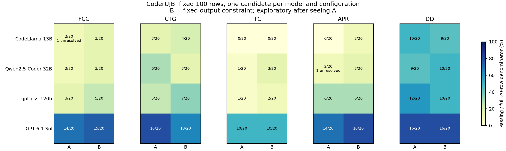

# 固定输出约束：四模型 A/B 探索性比较

A 为已完成的基线；B 只在原始提示前增加一条任务级固定输出约束。公开权重模型沿用 A 的固定权重、引擎和精度；所有模型沿用各自 A 的上下文与输出预算、解码及推理设置。Sol 使用相同 API 模型别名与服务档位，服务端没有提供可独立核验的权重快照。题单仍为同一冻结 100 行，每类 20 行，每题至多生成一次。

规则和提示在 B 生成前冻结，但设计时已经看过 A 的结果。这是后续探索性工程比较，不能称为完整盲测或预注册因果结论。

灰格表示该模型/任务的 B 尚未全部评分；不是零分。已全部评分的格子保留完整 20 题分母，未决数另行标注。

| 模型 | 任务 | A 通过/20 | B 通过/20 | B 已评分 | 有效配对 | 改善 | 退步 | 差值（百分点） | 项目重采样 95% 范围 |
|---|---|---:|---:|---:|---:|---:|---:|---:|---|
| CodeLlama-13B | FCG | 2 | 3 | 20/20 | 19 | 1 | 0 | 5.26 | [0.0, 17.6] |
| CodeLlama-13B | CTG | 3 | 4 | 20/20 | 20 | 2 | 1 | 5.0 | [-20.0, 26.1] |
| CodeLlama-13B | ITG | 0 | 0 | 20/20 | 20 | 0 | 0 | 0.0 | [0.0, 0.0] |
| CodeLlama-13B | APR | 0 | 2 | 20/20 | 20 | 2 | 0 | 10.0 | [0.0, 23.8] |
| CodeLlama-13B | DD | 10 | 9 | 20/20 | 20 | 1 | 2 | -5.0 | [-20.0, 10.0] |
| Qwen2.5-Coder-32B | FCG | 2 | 3 | 20/20 | 20 | 1 | 0 | 5.0 | [0.0, 16.7] |
| Qwen2.5-Coder-32B | CTG | 6 | 3 | 20/20 | 20 | 1 | 4 | -15.0 | [-22.7, -4.5] |
| Qwen2.5-Coder-32B | ITG | 1 | 3 | 20/20 | 20 | 2 | 0 | 10.0 | [0.0, 23.8] |
| Qwen2.5-Coder-32B | APR | 2 | 3 | 20/20 | 19 | 1 | 0 | 5.26 | [0.0, 17.6] |
| Qwen2.5-Coder-32B | DD | 9 | 10 | 20/20 | 20 | 1 | 0 | 5.0 | [0.0, 15.0] |
| gpt-oss-120b | FCG | 3 | 5 | 20/20 | 20 | 2 | 0 | 10.0 | [0.0, 33.3] |
| gpt-oss-120b | CTG | 5 | 7 | 20/20 | 20 | 2 | 0 | 10.0 | [0.0, 18.8] |
| gpt-oss-120b | ITG | 1 | 2 | 20/20 | 20 | 1 | 0 | 5.0 | [0.0, 16.7] |
| gpt-oss-120b | APR | 6 | 6 | 20/20 | 20 | 1 | 1 | 0.0 | [-15.8, 13.6] |
| gpt-oss-120b | DD | 12 | 10 | 20/20 | 20 | 0 | 2 | -10.0 | [-25.0, 0.0] |
| GPT-6.1 Sol | FCG | 14 | 15 | 20/20 | 20 | 2 | 1 | 5.0 | [-15.0, 27.3] |
| GPT-6.1 Sol | CTG | 16 | 13 | 20/20 | 20 | 2 | 5 | -15.0 | [-23.3, 7.7] |
| GPT-6.1 Sol | ITG | 10 | 10 | 20/20 | 20 | 3 | 3 | 0.0 | [-26.3, 22.7] |
| GPT-6.1 Sol | APR | 14 | 16 | 20/20 | 20 | 2 | 0 | 10.0 | [0.0, 26.3] |
| GPT-6.1 Sol | DD | 16 | 16 | 20/20 | 20 | 0 | 0 | 0.0 | [0.0, 0.0] |

改善表示同题 A 失败、B 通过，退步表示 A 通过、B 失败；只在两边都有确定结果时计数。区间按项目整体重采样 10,000 次，种子 20261105，同项目题和 DD 缺陷/修复配对一起移动。完整分母的未知项差值上下界见 JSON。本次只比较同一个模型的 A/B，不把四模型间不同预算的差异解释为工程因果效应。

## 格式与测试效果

“可解析”指官方提取后的 Java 候选能作为一个方法被语法解析，或 DD 原始判别器能解析选项；它不等于编译通过或功能正确。“双方可解析的改善”排除了明显的格式恢复，但仍不是对语义改善的独立因果识别。DD 的“可解析”仅表示原始整段关键词规则能给出标签，不保证标签与回复首选项一致；尤其不能把 DD 的分数变化全部解释为缺陷判断能力变化。

| 模型 | 任务 | A 可解析 | B 可解析 | 格式恢复 | 格式丢失 | 伴随格式恢复的通过改善 | 双方可解析时改善 | 双方可解析时退步 |
|---|---|---:|---:|---:|---:|---:|---:|---:|
| CodeLlama-13B | FCG | 17 | 16 | 1 | 2 | 0 | 1 | 0 |
| CodeLlama-13B | CTG | 12 | 16 | 5 | 1 | 0 | 2 | 0 |
| CodeLlama-13B | ITG | 11 | 13 | 3 | 1 | 0 | 0 | 0 |
| CodeLlama-13B | APR | 6 | 6 | 0 | 0 | 0 | 2 | 0 |
| CodeLlama-13B | DD | 20 | 20 | 0 | 0 | 0 | 1 | 2 |
| Qwen2.5-Coder-32B | FCG | 17 | 18 | 2 | 1 | 0 | 1 | 0 |
| Qwen2.5-Coder-32B | CTG | 18 | 19 | 1 | 0 | 0 | 1 | 4 |
| Qwen2.5-Coder-32B | ITG | 20 | 20 | 0 | 0 | 0 | 2 | 0 |
| Qwen2.5-Coder-32B | APR | 18 | 18 | 0 | 0 | 0 | 1 | 0 |
| Qwen2.5-Coder-32B | DD | 20 | 20 | 0 | 0 | 0 | 1 | 0 |
| gpt-oss-120b | FCG | 17 | 20 | 3 | 0 | 0 | 2 | 0 |
| gpt-oss-120b | CTG | 19 | 16 | 0 | 3 | 0 | 2 | 0 |
| gpt-oss-120b | ITG | 19 | 20 | 1 | 0 | 1 | 0 | 0 |
| gpt-oss-120b | APR | 15 | 18 | 3 | 0 | 0 | 1 | 1 |
| gpt-oss-120b | DD | 20 | 20 | 0 | 0 | 0 | 0 | 2 |
| GPT-6.1 Sol | FCG | 18 | 19 | 2 | 1 | 2 | 0 | 0 |
| GPT-6.1 Sol | CTG | 19 | 16 | 1 | 4 | 1 | 1 | 1 |
| GPT-6.1 Sol | ITG | 20 | 20 | 0 | 0 | 0 | 3 | 3 |
| GPT-6.1 Sol | APR | 17 | 20 | 3 | 0 | 2 | 0 | 0 |
| GPT-6.1 Sol | DD | 20 | 20 | 0 | 0 | 0 | 0 | 0 |

## 提示与运行边界

[冻结规则](freeze.json) · [逐题新增文本及 A/B 提示哈希](prompt-deltas.json) · [基准外合成样例](synthetic-controls.json) · [代码冻结](implementation-freeze.json)

CodeLlama 仍使用 completion。约束以 Java 注释前置，原提示及方法前缀逐字保留；本地分词预检最长 3,179 tokens，低于原 4,096 上限。评分前只移除本轮新增的那段输入前缀，再调用不变的官方 completion 提取器；模型生成的答案没有被改写，A 原有空白和切片偏移也没有修正。chat 模型仍用各自原有模板，只在 user 内容前加同一任务约束。

所有 A 结果保留复用。CodeLlama FCG-116 超时和 Qwen APR-410 初始化未决不重试、不改判；B 的新答案独立评分，如果答案与 A 完全相同，评分缓存按既定规则复用。未修改原始评分器或官方提取器。管理代码修正均单独留痕：补上预先冻结的评分截止检查，并在哈希校验发现 CRLF 被文本读取规范化后改为逐字节读取。受影响的答案在进入评分前已被拦下，没有重生成或修改答案，也没有修改官方提取器和评分规则。[修正记录](implementation-amendments.json)

正式生成上限 400 次，无 B 模型试跑请求；提示组装与解析用基准外合成文本检查。固定模型优先顺序为 CodeLlama、gpt-oss、Qwen、Sol，行顺序沿用 frozen100，Qwen 保留原来的每四行分组及每组随机种子。独立 ROMEO 作业并行生成，本地最多两个 Java 评分进程。预定 07:05 停止新生成，07:10 停止接纳新评分，07:22 前汇总与清理。

## 费用与未决范围

Sol B 已发送 100 次，收到 100 份响应；已知用量估算 $0.559041，保守费用 $0.631235，未知请求预留 $0.000000。发送前硬上界 $4.731661，阶段最多预留 $10，和 A 的费用共享 $30 窗口。费用按实际普通输入、缓存写入、缓存读取和输出计费，推理计入输出；不等于账户最终账单。ROMEO 没有产生付费 API 请求。

[费用与用量](cost.json) · [统一窗口账本](../dataset-audit/窗口预算.json) · [逐题 A/B 及日志路径](paired-results.json) · [进度及队列状态](progress.json) · [PNG 热力图](heatmap-ab.png) · [SVG](heatmap-ab.svg) · [PDF](heatmap-ab.pdf)

本轮未执行 C–E 工程列或 2,239 题全量评测。每类 20 题，单题改变 5 个百分点，只有一次随机生成；项目重采样不覆盖随机种子变化或 API 后端权重变化。显著性和泛化结论都应保守。

实际输入与生成预算使用：

| 模型 | A 输入 | B 输入 | 新增 tokens | 丢弃 tokens | A 输出 | B 输出 | A/B 达上限次数 |
|---|---:|---:|---:|---:|---:|---:|---:|
| CodeLlama-13B | 119494 | 123854 | 4360 | 0 | 25600 | 25600 | 100 / 100 |
| gpt-oss-120b | 85824 | 89504 | 3680 | 0 | 147987 | 89141 | 2 / 1 |
| Qwen2.5-Coder-32B | 80825 | 84525 | 3700 | 0 | 60606 | 18695 | 0 / 0 |
| GPT-6.1 Sol | 78524 | 82204 | 3680 | 0 | 35157 | 36834 | 0 / 0 |

输出 tokens 的口径沿用各模型：CodeLlama/Qwen 为生成序列；gpt-oss/Sol 包含推理及最终答案。不同 tokenizer 的 token 数不直接跨模型比较。[生成用量明细](generation-summary.json)

已评分但未决的行：

- CodeLlama-13B A FCG-116：timeout_unresolved，fixed-test-0；[评分证据](../../evidence/scoring/model/FCG-116-78cb042a/53125eab8958b24862f635537880c1ba1cb2f600af431972c4cbffb60ce4d507/attempt-2/result.json)。
- Qwen2.5-Coder-32B A APR-410：infrastructure_unresolved，unexpected failing test；[评分证据](../../evidence/scoring/model/APR-410-99a9d802/ec4edec12fb1ec10e0e54ce1e86439fac9e17c7d71eb24d5e5be732526987aae/attempt-2/result.json)。

[实际 A/B 输入 token 增量与丢弃记录](actual-input-deltas.json) · [运行与提取完整性核验](integrity.json)
