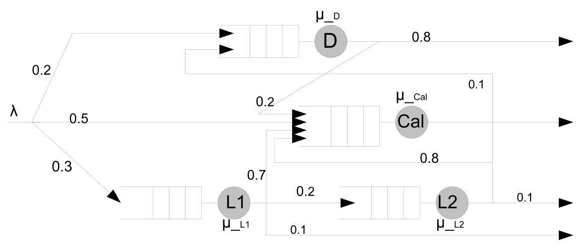
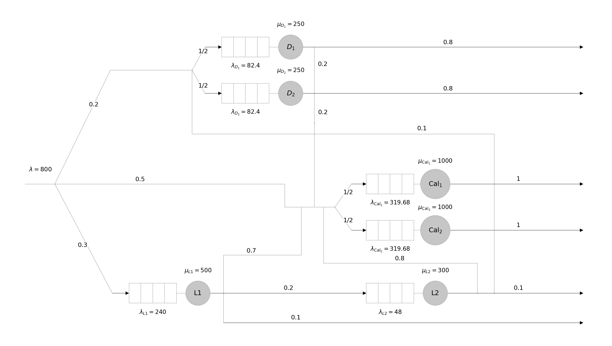
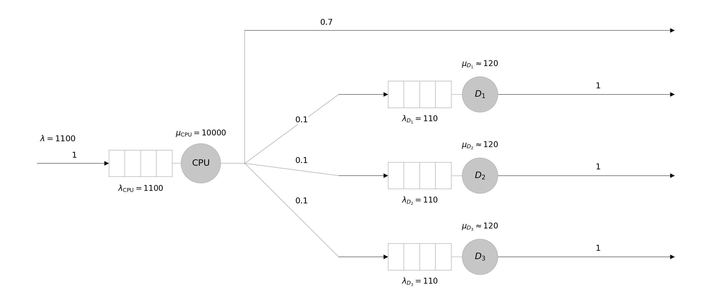
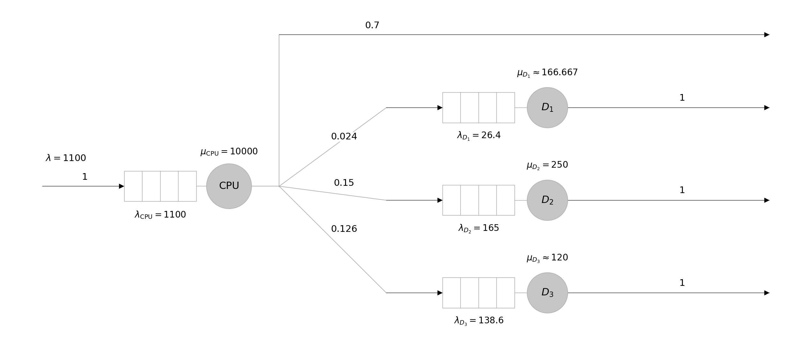

# TD3 — Modélisation mathématique

S. Zertal · Master 2 CHPS

[Sommaire du module](../README.md) · [Énoncé PDF](TD3_2627.pdf) · [Version chinoise](TD3_2627_zh.md)

## Exercice 1 — Réseau de files d’attente

Soit le système modélisé par le réseau de files d’attente de la figure 1. Le flux des instructions alimente le système à un taux $\lambda$. Ces instructions sont dirigées, selon leur type, vers les files correspondantes afin d’y être traitées. Les probabilités de routage, les taux de service des différents serveurs et les autres caractéristiques du modèle sont représentés sur la figure 1.

*Figure 1 — Système modélisé par un réseau de files d’attente.*

Les taux de service du système initial sont :

| Serveur | Taux de service |
|---|---|
| L1 | $\mu_{L1}=500\ \mathrm{instr/s}$ |
| L2 | $\mu_{L2}=300\ \mathrm{instr/s}$ |
| D | $\mu_D=250\ \mathrm{instr/s}$ |
| Cal | $\mu_{\mathrm{Cal}}=1000\ \mathrm{instr/s}$ |

On souhaite calculer les indicateurs de performance de ce système.

### Questions

1. Donnez les conditions de stabilité de ce système.

2. Sachant que $\lambda=800\ \mathrm{instr/s}$, vérifiez la stabilité du système.

3. Quel est le temps d’attente moyen à chacune des files d’attente ?

4. Quel est le temps de réponse moyen à chacune des files d’attente ?

5. Quel est le temps de réponse moyen pour l’instruction la plus longue ? Justifiez votre réponse en décrivant son exécution.

6. Si un serveur est utilisé à plus de $60\%$, on le duplique et on associe une file à chacun des deux serveurs, en leur distribuant équitablement le flux entrant des instructions. Donnez le nouveau modèle issu de l’application de cette règle au modèle de la figure 1.

### Solution

#### 1. Conditions de stabilité

Pour chaque file $i$ :

$$
\rho_i=\frac{\lambda_i}{\mu_i}<1
\quad\Longleftrightarrow\quad\lambda_i<\mu_i.
$$

$$
\lambda_{L1}=0.3\lambda<\mu_{L1}
\quad\Longrightarrow\quad
\lambda<\frac{500}{0.3}\approx1666.7\ \mathrm{instr/s}.
$$

$$
\lambda_{L2}=0.2\lambda_{L1}=0.2\times0.3\lambda=0.06\lambda<\mu_{L2}
\quad\Longrightarrow\quad
\lambda<\frac{300}{0.06}=5000\ \mathrm{instr/s}.
$$

$$
\lambda_D=0.2\lambda+0.1\lambda_{L2}=0.2\lambda+0.006\lambda=0.206\lambda<\mu_D
\quad\Longrightarrow\quad
\lambda<\frac{250}{0.206}\approx1213.6\ \mathrm{instr/s}.
$$

$$
\lambda_{\mathrm{Cal}}=0.5\lambda+0.2\lambda_D+0.7\lambda_{L1}+0.8\lambda_{L2}
=0.7992\lambda<\mu_{\mathrm{Cal}}
\quad\Longrightarrow\quad
\lambda<\frac{1000}{0.7992}\approx1251.3\ \mathrm{instr/s}.
$$

Donc, la condition de stabilité est :

$$
\boxed{\lambda<\min(1666.7,\ 5000,\ 1213.6,\ 1251.3)
=1213.6\ \mathrm{instr/s}.}
$$

#### 2. Stabilité pour $\lambda=800$

$$
(\lambda_{L1},\lambda_{L2},\lambda_D,\lambda_{\mathrm{Cal}})
=(240,48,164.8,639.36)\ \mathrm{instr/s}.
$$

$$
\begin{aligned}
\rho_{L1}&=240/500=0.48<1,\\
\rho_{L2}&=48/300=0.16<1,\\
\rho_D&=164.8/250=0.6592<1,\\
\rho_{\mathrm{Cal}}&=639.36/1000=0.63936<1.
\end{aligned}
$$

Les quatre files sont stables, donc le système est stable.

#### 3. Temps d’attente moyens

Dans le modèle $M/M/1$ du cours :

$$
w_i=\frac{\rho_i}{\mu_i(1-\rho_i)},\qquad\rho_i=\frac{\lambda_i}{\mu_i}.
$$

En millisecondes :

$$
\begin{aligned}
w_{L1}&=\frac{0.48}{500(1-0.48)}\times1000\approx1.8462\ \mathrm{ms},\\
w_{L2}&=\frac{0.16}{300(1-0.16)}\times1000\approx0.6349\ \mathrm{ms},\\
w_D&=\frac{0.6592}{250(1-0.6592)}\times1000\approx7.7371\ \mathrm{ms},\\
w_{\mathrm{Cal}}&=\frac{0.63936}{1000(1-0.63936)}\times1000\approx1.7728\ \mathrm{ms}.
\end{aligned}
$$

#### 4. Temps de réponse moyens

Le temps de réponse comprend l’attente et le service :

$$
r_i=w_i+s_i,\qquad s_i=\frac1{\mu_i}.
$$

$$
\begin{aligned}
r_{L1}&=w_{L1}+\frac{1000}{500}\approx3.8462\ \mathrm{ms},\\
r_{L2}&=w_{L2}+\frac{1000}{300}\approx3.9683\ \mathrm{ms},\\
r_D&=w_D+\frac{1000}{250}\approx11.7371\ \mathrm{ms},\\
r_{\mathrm{Cal}}&=w_{\mathrm{Cal}}+\frac{1000}{1000}\approx2.7728\ \mathrm{ms}.
\end{aligned}
$$

#### 5. Instruction la plus longue

Elle traverse successivement les quatre nœuds :

$$
L1\longrightarrow L2\longrightarrow D\longrightarrow\mathrm{Cal}\longrightarrow\text{Sortie}.
$$

Les temps de réponse étant tous positifs, ce chemin donne le temps moyen le plus long :

$$
\boxed{r_{\mathrm{long}}=r_{L1}+r_{L2}+r_D+r_{\mathrm{Cal}}
\approx22.3243\ \mathrm{ms}.}
$$

#### 6. Duplication des serveurs utilisés à plus de $60\%$

$$
\rho_D=65.92\%>60\%,\qquad
\rho_{\mathrm{Cal}}=63.936\%>60\%.
$$

On duplique D et Cal, avec une file indépendante par serveur et un partage égal du flux entrant :

$$
\begin{aligned}
\lambda_{D_1}=\lambda_{D_2}&=164.8/2=82.4, &\mu_{D_1}=\mu_{D_2}&=250,\\
\lambda_{\mathrm{Cal}_1}=\lambda_{\mathrm{Cal}_2}&=639.36/2=319.68,
&\mu_{\mathrm{Cal}_1}=\mu_{\mathrm{Cal}_2}&=1000.
\end{aligned}
$$

$$
\rho_{D_1}=\rho_{D_2}=32.96\%,\qquad
\rho_{\mathrm{Cal}_1}=\rho_{\mathrm{Cal}_2}=31.968\%.
$$

L1 et L2 conservent leur configuration. Chaque serveur D dirige $0.2$ de son flux vers Cal et $0.8$ vers la sortie ; les serveurs Cal dirigent tout leur flux vers la sortie. Tous les taux du schéma sont en instr/s.

## Exercice 2 — CPU et trois disques

Soit un système composé d’un CPU et de trois disques. On lui soumet des instructions à exécuter à un taux :

$$
\lambda=1100\ \mathrm{instr/s}.
$$

Chaque instruction est automatiquement dirigée vers le CPU, qui l’exécute. Si elle nécessite une entrée/sortie (E/S), le CPU détermine le disque concerné et lui transmet l’instruction.

- Sans E/S, l’exécution se termine immédiatement après le passage par le CPU.
- Avec E/S, l’exécution se termine après le passage par le disque.

Les programmes typiques exécutés sur ce système contiennent **70 % d’instructions ne nécessitant pas d’E/S**. Le CPU exécute en moyenne **$10^4$ instructions par seconde**.

### Partie I — Disques identiques

Les trois disques sont identiques :

| Caractéristique | Valeur pour chaque disque |
|---|---|
| Capacité | 300 GB |
| Temps moyen d’accès | 8,33 ms |

Les données sont uniformément distribuées sur les disques, et les accès sont uniformément distribués sur les données.

#### Questions

1. Donnez le schéma représentant le système par un réseau de files d’attente. Précisez :
   - les taux d’arrivée dans chaque file : $\lambda_{\mathrm{CPU}}$, $\lambda_{\mathrm{Disk1}}$, $\lambda_{\mathrm{Disk2}}$, $\lambda_{\mathrm{Disk3}}$ ;
   - les taux de service : $\mu_{\mathrm{CPU}}$, $\mu_{\mathrm{Disk1}}$, $\mu_{\mathrm{Disk2}}$, $\mu_{\mathrm{Disk3}}$ ;
   - les probabilités de passage sur chaque arc du réseau.

2. Calculez le temps d’attente moyen :
   - d’une instruction ne nécessitant pas d’E/S ;
   - d’une instruction d’E/S ;
   - d’une instruction quelconque.

3. Calculez le temps de réponse moyen :
   - d’une instruction ne nécessitant pas d’E/S ;
   - d’une instruction d’E/S ;
   - d’une instruction quelconque.

#### Solution

##### 1. Réseau de files d’attente

Chaque station est modélisée par une file $M/M/1$. Les taux sont en instr/s ; on utilise $\mu_D\approx120$.

$$
\lambda_{\mathrm{Disk}i}=\lambda p_i,\qquad
\mu_i=\frac1{s_i}.
$$

$$
\lambda_{\mathrm{CPU}}=1100,\qquad
\mu_{\mathrm{CPU}}=10^4.
$$

$$
\lambda_{\mathrm{Disk1}}=\lambda_{\mathrm{Disk2}}=\lambda_{\mathrm{Disk3}}
=1100\times\frac{0.3}{3}=110.
$$

$$
\mu_{\mathrm{Disk1}}=\mu_{\mathrm{Disk2}}=\mu_{\mathrm{Disk3}}
=\frac1{8.33\times10^{-3}}\approx120.
$$

Après le CPU : sortie avec probabilité $0.7$, passage par chaque disque avec probabilité $0.1$. Après chaque disque : sortie avec probabilité $1$.

##### 2. Temps d’attente moyens

$$
\rho_i=\frac{\lambda_i}{\mu_i},\qquad
w_i=\frac{\rho_i}{\mu_i(1-\rho_i)}\quad(\rho_i<1).
$$

$$
\rho_{\mathrm{CPU}}=\frac{1100}{10000}=0.11,\qquad
w_{\mathrm{CPU}}=\frac{0.11}{10000(1-0.11)}\times1000
\approx0.0124\ \mathrm{ms}.
$$

Les trois disques ont le même temps d’attente $w_D$ :

$$
\rho_D=\frac{110}{120}=\frac{11}{12}\approx0.917<1,\qquad
w_D=\frac{11/12}{120(1-11/12)}\times1000
\approx91.67\ \mathrm{ms}.
$$

$$
\begin{aligned}
W_{\mathrm{sans\ E/S}}&=w_{\mathrm{CPU}}\approx0.0124\ \mathrm{ms},\\
W_{\mathrm{E/S}}&=w_{\mathrm{CPU}}+\sum_{i=1}^{3}\frac13w_{\mathrm{Disk}i}\approx91.68\ \mathrm{ms},\\
W_{\mathrm{moy}}&=0.7W_{\mathrm{sans\ E/S}}+0.3W_{\mathrm{E/S}}
\approx27.51\ \mathrm{ms}.
\end{aligned}
$$

##### 3. Temps de réponse moyens

$$
r_i=w_i+s_i,\qquad s_i=\frac1{\mu_i}.
$$

$$
r_{\mathrm{CPU}}=w_{\mathrm{CPU}}+\frac{1000}{10000}\approx0.1124\ \mathrm{ms},
\qquad
r_D=w_D+\frac{1000}{120}\approx100.00\ \mathrm{ms}.
$$

$$
\begin{aligned}
R_{\mathrm{sans\ E/S}}&=r_{\mathrm{CPU}}\approx0.1124\ \mathrm{ms},\\
R_{\mathrm{E/S}}&=r_{\mathrm{CPU}}+\sum_{i=1}^{3}\frac13r_{\mathrm{Disk}i}\approx100.11\ \mathrm{ms},\\
R_{\mathrm{moy}}&=0.7R_{\mathrm{sans\ E/S}}+0.3R_{\mathrm{E/S}}
\approx30.11\ \mathrm{ms}.
\end{aligned}
$$

### Partie II — Disques différents

Les trois disques ont les caractéristiques suivantes :

| Disque | Capacité (GB) | Temps moyen d’accès |
|---|---:|---:|
| Disque 1 | 80 | 6 ms |
| Disque 2 | 500 | 4 ms |
| Disque 3 | 420 | 8,33 ms |

Les données sont distribuées sur les disques **proportionnellement à leurs capacités respectives**, et les accès sont uniformément distribués sur les données.

#### Questions

1. Donnez le schéma représentant le système par un réseau de files d’attente. Précisez :
   - les taux d’arrivée dans chaque file : $\lambda_{\mathrm{CPU}}$, $\lambda_{\mathrm{Disk1}}$, $\lambda_{\mathrm{Disk2}}$, $\lambda_{\mathrm{Disk3}}$ ;
   - les taux de service : $\mu_{\mathrm{CPU}}$, $\mu_{\mathrm{Disk1}}$, $\mu_{\mathrm{Disk2}}$, $\mu_{\mathrm{Disk3}}$ ;
   - les probabilités de passage sur chaque arc du réseau.

2. Calculez le temps d’attente moyen :
   - d’une instruction ne nécessitant pas d’E/S ;
   - d’une instruction d’E/S ;
   - d’une instruction quelconque.

3. Calculez le temps de réponse moyen :
   - d’une instruction ne nécessitant pas d’E/S ;
   - d’une instruction d’E/S ;
   - d’une instruction quelconque.

   Qu’en déduisez-vous par rapport à la configuration de la partie I ?

#### Solution

##### 1. Réseau de files d’attente

Notons $C_i$ la capacité du disque $i$. Pour une instruction d’E/S :

$$
q_i=\frac{C_i}{\sum_{j=1}^3C_j},\qquad
(q_1,q_2,q_3)=\frac{(80,500,420)}{1000}=(0.08,0.50,0.42).
$$

Les probabilités de routage du CPU vers les disques sont donc :

$$
p_i=0.3q_i,\qquad
(p_1,p_2,p_3)=0.3(0.08,0.50,0.42)=(0.024,0.15,0.126).
$$

Après le CPU, la probabilité de sortie reste $0.7$ ; après chaque disque, elle vaut $1$. Les taux d’arrivée et de service sont :

$$
\lambda_{\mathrm{CPU}}=1100,\qquad\mu_{\mathrm{CPU}}=10000,
$$

$$
(\lambda_{\mathrm{Disk1}},\lambda_{\mathrm{Disk2}},\lambda_{\mathrm{Disk3}})
=1100(p_1,p_2,p_3)=(26.4,165,138.6),
$$

$$
(\mu_{\mathrm{Disk1}},\mu_{\mathrm{Disk2}},\mu_{\mathrm{Disk3}})
=\left(\frac1{0.006},\frac1{0.004},\frac1{0.00833}\right)
\approx(166.667,250,120).
$$

Vérification de la stabilité de chaque station :

$$
\begin{aligned}
\rho_{\mathrm{CPU}}&=\frac{1100}{10^4}=0.11<1,\\
\rho_{\mathrm{Disk1}}&=\frac{0.024\times1100}{1000/6}=0.1584<1,\\
\rho_{\mathrm{Disk2}}&=\frac{0.15\times1100}{250}=0.66<1,\\
\rho_{\mathrm{Disk3}}&=\frac{0.126\times1100}{120}=1.155>1.
\end{aligned}
$$

Le disque 3 est saturé ; le système est donc instable.

##### 2. Temps d’attente moyens

Le CPU reste stable, donc :

$$
W_{\mathrm{sans\ E/S}}=w_{\mathrm{CPU}}
=\frac{0.11}{10000(1-0.11)}\times1000\approx0.0124\ \mathrm{ms}.
$$

La file du disque 3 s’accumule ; $42\%$ des instructions d’E/S passent par ce disque. Il n’existe donc pas de temps moyen d’attente stationnaire fini :

$$
\begin{aligned}
W_{\mathrm{E/S}}&=w_{\mathrm{CPU}}+\sum_{i=1}^{3}q_iw_{\mathrm{Disk}i}\to+\infty,\\
W_{\mathrm{moy}}&=0.7W_{\mathrm{sans\ E/S}}+0.3W_{\mathrm{E/S}}\to+\infty.
\end{aligned}
$$

##### 3. Temps de réponse moyens et comparaison

$$
\begin{aligned}
R_{\mathrm{sans\ E/S}}&=r_{\mathrm{CPU}}=w_{\mathrm{CPU}}+\frac{1000}{10000}
\approx0.1124\ \mathrm{ms},\\
R_{\mathrm{E/S}}&=r_{\mathrm{CPU}}+\sum_{i=1}^{3}q_ir_{\mathrm{Disk}i}\to+\infty,\\
R_{\mathrm{moy}}&=0.7R_{\mathrm{sans\ E/S}}+0.3R_{\mathrm{E/S}}\to+\infty.
\end{aligned}
$$

La partie I est stable, avec un temps de réponse moyen global d’environ $30.11\ \mathrm{ms}$. La partie II est instable à cause de la surcharge du disque 3 : répartir les accès uniquement selon la capacité lui attribue trop de requêtes.
