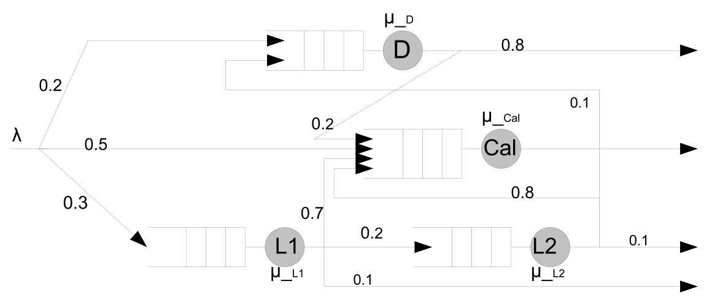
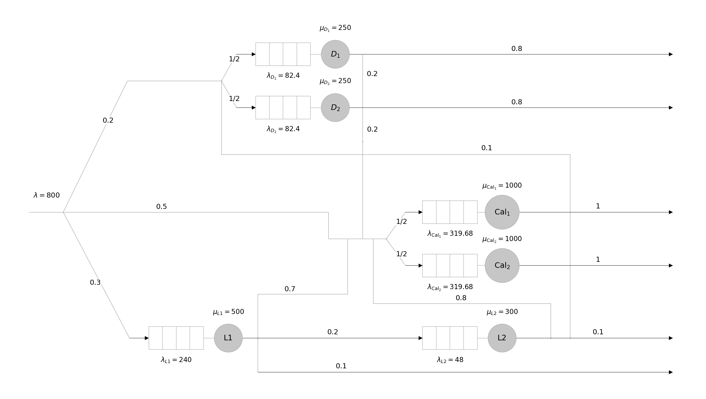
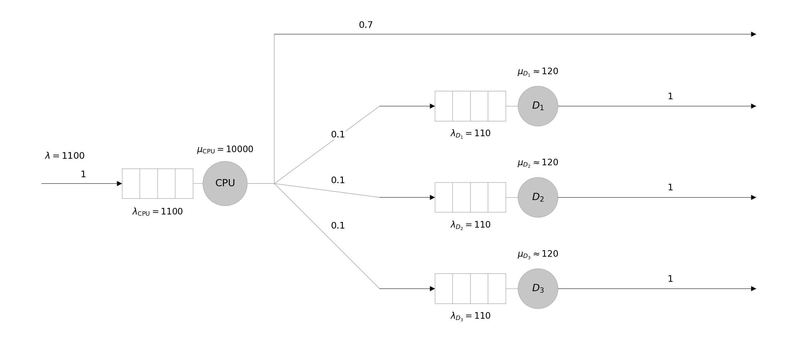
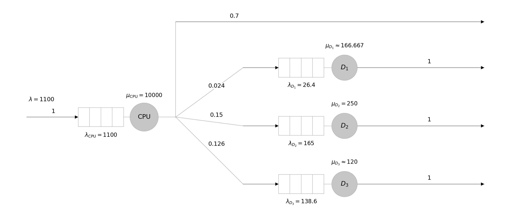

# TD3 — 数学建模

S. Zertal · CHPS 硕士二年级

[课程目录](../README.md) · [原题 PDF](TD3_2627.pdf) · [法语版](TD3_2627.md)

## 练习 1 — 排队网络

考虑图 1 所示排队网络建模的系统。指令流以速率 $\lambda$ 进入系统，各条指令根据类型被送往相应队列接受处理。路由概率、各服务节点的服务率以及模型的其他特征均标在图 1 中。

*图 1 — 系统的排队网络模型。*

初始系统中各服务节点的服务率如下：

| 服务节点 | 服务率 |
|---|---|
| L1 | $\mu_{L1}=500\ \mathrm{instr/s}$ |
| L2 | $\mu_{L2}=300\ \mathrm{instr/s}$ |
| D | $\mu_D=250\ \mathrm{instr/s}$ |
| Cal | $\mu_{\mathrm{Cal}}=1000\ \mathrm{instr/s}$ |

其中，$\mathrm{instr/s}$ 表示每秒处理的指令数。现要求计算该系统的性能指标。

### 问题

1. 给出该系统的稳定性条件。

2. 已知 $\lambda=800\ \mathrm{instr/s}$，判断该系统是否稳定。

3. 各队列中的平均等待时间（temps d’attente moyen）分别是多少？

4. 各排队节点的平均响应时间（temps de réponse moyen）分别是多少？

5. 耗时最长的指令，其平均响应时间是多少？请描述该指令的执行过程，并说明理由。

6. 如果某个服务节点的利用率超过 $60\%$，就复制该服务节点，并为两个服务节点各配置一个独立队列，将进入该节点的指令流均匀分配给两者。将这一规则应用于图 1，给出调整后的模型。

### 解答

#### 1. 稳定性条件

对每个队列 $i$，要求：

$$
\rho_i=\frac{\lambda_i}{\mu_i}<1
\quad\Longleftrightarrow\quad\lambda_i<\mu_i.
$$

$$
\lambda_{L1}=0.3\lambda<\mu_{L1}
\quad\Longrightarrow\quad
\lambda<\frac{500}{0.3}\approx1666.7\ \mathrm{instr/s}.
$$

$$
\lambda_{L2}=0.2\lambda_{L1}=0.2\times0.3\lambda=0.06\lambda<\mu_{L2}
\quad\Longrightarrow\quad
\lambda<\frac{300}{0.06}=5000\ \mathrm{instr/s}.
$$

$$
\lambda_D=0.2\lambda+0.1\lambda_{L2}=0.2\lambda+0.006\lambda=0.206\lambda<\mu_D
\quad\Longrightarrow\quad
\lambda<\frac{250}{0.206}\approx1213.6\ \mathrm{instr/s}.
$$

$$
\lambda_{\mathrm{Cal}}=0.5\lambda+0.2\lambda_D+0.7\lambda_{L1}+0.8\lambda_{L2}
=0.7992\lambda<\mu_{\mathrm{Cal}}
\quad\Longrightarrow\quad
\lambda<\frac{1000}{0.7992}\approx1251.3\ \mathrm{instr/s}.
$$

因此，系统的稳定性条件为：

$$
\boxed{\lambda<\min(1666.7,\ 5000,\ 1213.6,\ 1251.3)
=1213.6\ \mathrm{instr/s}.}
$$

#### 2. 当 $\lambda=800$ 时的稳定性

$$
(\lambda_{L1},\lambda_{L2},\lambda_D,\lambda_{\mathrm{Cal}})
=(240,48,164.8,639.36)\ \mathrm{instr/s}.
$$

$$
\begin{aligned}
\rho_{L1}&=240/500=0.48<1,\\
\rho_{L2}&=48/300=0.16<1,\\
\rho_D&=164.8/250=0.6592<1,\\
\rho_{\mathrm{Cal}}&=639.36/1000=0.63936<1.
\end{aligned}
$$

四个队列均稳定，因此系统稳定。

#### 3. 各队列的平均等待时间

按课程的 $M/M/1$ 模型，等待时间为

$$
w_i=\frac{\rho_i}{\mu_i(1-\rho_i)},\qquad\rho_i=\frac{\lambda_i}{\mu_i}.
$$

换算为毫秒：

$$
\begin{aligned}
w_{L1}&=\frac{0.48}{500(1-0.48)}\times1000\approx1.8462\ \mathrm{ms},\\
w_{L2}&=\frac{0.16}{300(1-0.16)}\times1000\approx0.6349\ \mathrm{ms},\\
w_D&=\frac{0.6592}{250(1-0.6592)}\times1000\approx7.7371\ \mathrm{ms},\\
w_{\mathrm{Cal}}&=\frac{0.63936}{1000(1-0.63936)}\times1000\approx1.7728\ \mathrm{ms}.
\end{aligned}
$$

#### 4. 各节点的平均响应时间

响应时间包含等待与服务：

$$
r_i=w_i+s_i,\qquad s_i=\frac1{\mu_i}.
$$

$$
\begin{aligned}
r_{L1}&=w_{L1}+\frac{1000}{500}\approx3.8462\ \mathrm{ms},\\
r_{L2}&=w_{L2}+\frac{1000}{300}\approx3.9683\ \mathrm{ms},\\
r_D&=w_D+\frac{1000}{250}\approx11.7371\ \mathrm{ms},\\
r_{\mathrm{Cal}}&=w_{\mathrm{Cal}}+\frac{1000}{1000}\approx2.7728\ \mathrm{ms}.
\end{aligned}
$$

#### 5. 耗时最长的指令

该指令依次经过所有四个节点：

$$
L1\longrightarrow L2\longrightarrow D\longrightarrow\mathrm{Cal}\longrightarrow\text{离开}.
$$

各节点响应时间均为正，这条路径的平均响应时间最长：

$$
\boxed{r_{\mathrm{long}}=r_{L1}+r_{L2}+r_D+r_{\mathrm{Cal}}
\approx22.3243\ \mathrm{ms}.}
$$

#### 6. 复制利用率超过 $60\%$ 的节点

$$
\rho_D=65.92\%>60\%,\qquad
\rho_{\mathrm{Cal}}=63.936\%>60\%.
$$

复制 D 和 Cal，各配置两个独立队列，进入对应节点的流量各分一半：

$$
\begin{aligned}
\lambda_{D_1}=\lambda_{D_2}&=164.8/2=82.4, &\mu_{D_1}=\mu_{D_2}&=250,\\
\lambda_{\mathrm{Cal}_1}=\lambda_{\mathrm{Cal}_2}&=639.36/2=319.68,
&\mu_{\mathrm{Cal}_1}=\mu_{\mathrm{Cal}_2}&=1000.
\end{aligned}
$$

$$
\rho_{D_1}=\rho_{D_2}=32.96\%,\qquad
\rho_{\mathrm{Cal}_1}=\rho_{\mathrm{Cal}_2}=31.968\%.
$$

L1、L2 保持原配置；两个 D 节点各以 $0.2$ 转往 Cal、以 $0.8$ 离开，两个 Cal 节点处理后离开。图中速率单位均为 instr/s。

## 练习 2 — CPU 与三个磁盘

一个系统由一个 CPU 和三个磁盘组成。指令以如下速率提交给系统：

$$
\lambda=1100\ \mathrm{instr/s}.
$$

每条指令都先进入 CPU 执行。如果需要输入／输出操作（E/S），CPU 会确定目标磁盘，并将指令送往该磁盘。

- 不需要 E/S 的指令：经过 CPU 后执行结束。
- 需要 E/S 的指令：经过磁盘后执行结束。

在该系统运行的典型程序中，**70% 的指令不需要 E/S**。CPU 平均每秒执行 **$10^4$ 条指令**。

### 第一部分 — 三个相同的磁盘

三个磁盘的配置相同：

| 参数 | 每个磁盘的数值 |
|---|---|
| 容量 | 300 GB |
| 平均访问时间 | 8.33 ms |

数据均匀分布在三个磁盘上，对各数据的访问也是均匀的。

#### 问题

1. 画出该系统的排队网络模型，并标明：
   - 各队列的到达率：$\lambda_{\mathrm{CPU}}$、$\lambda_{\mathrm{Disk1}}$、$\lambda_{\mathrm{Disk2}}$、$\lambda_{\mathrm{Disk3}}$；
   - 各服务节点的服务率：$\mu_{\mathrm{CPU}}$、$\mu_{\mathrm{Disk1}}$、$\mu_{\mathrm{Disk2}}$、$\mu_{\mathrm{Disk3}}$；
   - 网络中每条弧上的转移概率。

2. 分别计算以下三类指令的平均等待时间：
   - 不需要 E/S 的指令；
   - 需要 E/S 的指令；
   - 任意一条指令。

3. 分别计算以下三类指令的平均响应时间：
   - 不需要 E/S 的指令；
   - 需要 E/S 的指令；
   - 任意一条指令。

#### 解答

##### 1. 排队网络

各节点采用 $M/M/1$ 模型。速率单位为 instr/s，以下取 $\mu_D\approx120$。

$$
\lambda_{\mathrm{Disk}i}=\lambda p_i,\qquad
\mu_i=\frac1{s_i}.
$$

$$
\lambda_{\mathrm{CPU}}=1100,\qquad
\mu_{\mathrm{CPU}}=10^4.
$$

$$
\lambda_{\mathrm{Disk1}}=\lambda_{\mathrm{Disk2}}=\lambda_{\mathrm{Disk3}}
=1100\times\frac{0.3}{3}=110.
$$

$$
\mu_{\mathrm{Disk1}}=\mu_{\mathrm{Disk2}}=\mu_{\mathrm{Disk3}}
=\frac1{8.33\times10^{-3}}\approx120.
$$

CPU 后以 $0.7$ 离开，以 $0.1$ 分别进入三个磁盘；每个磁盘处理后以 $1$ 离开。

##### 2. 平均等待时间

$$
\rho_i=\frac{\lambda_i}{\mu_i},\qquad
w_i=\frac{\rho_i}{\mu_i(1-\rho_i)}\quad(\rho_i<1).
$$

$$
\rho_{\mathrm{CPU}}=\frac{1100}{10000}=0.11,\qquad
w_{\mathrm{CPU}}=\frac{0.11}{10000(1-0.11)}\times1000
\approx0.0124\ \mathrm{ms}.
$$

三个磁盘的等待时间相同，记为 $w_D$：

$$
\rho_D=\frac{110}{120}=\frac{11}{12}\approx0.917<1,\qquad
w_D=\frac{11/12}{120(1-11/12)}\times1000
\approx91.67\ \mathrm{ms}.
$$

$$
\begin{aligned}
W_{\mathrm{sans\ E/S}}&=w_{\mathrm{CPU}}\approx0.0124\ \mathrm{ms},\\
W_{\mathrm{E/S}}&=w_{\mathrm{CPU}}+\sum_{i=1}^{3}\frac13w_{\mathrm{Disk}i}\approx91.68\ \mathrm{ms},\\
W_{\mathrm{moy}}&=0.7W_{\mathrm{sans\ E/S}}+0.3W_{\mathrm{E/S}}
\approx27.51\ \mathrm{ms}.
\end{aligned}
$$

##### 3. 平均响应时间

$$
r_i=w_i+s_i,\qquad s_i=\frac1{\mu_i}.
$$

$$
r_{\mathrm{CPU}}=w_{\mathrm{CPU}}+\frac{1000}{10000}\approx0.1124\ \mathrm{ms},
\qquad
r_D=w_D+\frac{1000}{120}\approx100.00\ \mathrm{ms}.
$$

$$
\begin{aligned}
R_{\mathrm{sans\ E/S}}&=r_{\mathrm{CPU}}\approx0.1124\ \mathrm{ms},\\
R_{\mathrm{E/S}}&=r_{\mathrm{CPU}}+\sum_{i=1}^{3}\frac13r_{\mathrm{Disk}i}\approx100.11\ \mathrm{ms},\\
R_{\mathrm{moy}}&=0.7R_{\mathrm{sans\ E/S}}+0.3R_{\mathrm{E/S}}
\approx30.11\ \mathrm{ms}.
\end{aligned}
$$

### 第二部分 — 三个不同的磁盘

三个磁盘的参数如下：

| 磁盘 | 容量（GB） | 平均访问时间 |
|---|---:|---:|
| 磁盘 1 | 80 | 6 ms |
| 磁盘 2 | 500 | 4 ms |
| 磁盘 3 | 420 | 8.33 ms |

数据按各磁盘的**容量比例**分布，对各数据的访问仍然是均匀的。

#### 问题

1. 画出该系统的排队网络模型，并标明：
   - 各队列的到达率： $\lambda_{\mathrm{CPU}}$、$\lambda_{\mathrm{Disk1}}$、$\lambda_{\mathrm{Disk2}}$、$\lambda_{\mathrm{Disk3}}$ ；
   - 各服务节点的服务率： $\mu_{\mathrm{CPU}}$、$\mu_{\mathrm{Disk1}}$、$\mu_{\mathrm{Disk2}}$、$\mu_{\mathrm{Disk3}}$ ；
   - 网络中每条弧上的转移概率。

2. 分别计算以下三类指令的平均等待时间：
   - 不需要 E/S 的指令；
   - 需要 E/S 的指令；
   - 任意一条指令。

3. 分别计算以下三类指令的平均响应时间：
   - 不需要 E/S 的指令；
   - 需要 E/S 的指令；
   - 任意一条指令。

   与第一部分的配置相比，可以得出什么结论？

#### 解答

##### 1. 排队网络

记磁盘容量为 $C_i$，需要 E/S 时访问磁盘 $i$ 的概率为

$$
q_i=\frac{C_i}{\sum_{j=1}^3C_j},\qquad
(q_1,q_2,q_3)=\frac{(80,500,420)}{1000}=(0.08,0.50,0.42).
$$

因此，CPU 转往各磁盘的概率为

$$
p_i=0.3q_i,\qquad
(p_1,p_2,p_3)=0.3(0.08,0.50,0.42)=(0.024,0.15,0.126).
$$

CPU 后仍以 $0.7$ 离开，各磁盘处理后以 $1$ 离开。到达率与服务率为：

$$
\lambda_{\mathrm{CPU}}=1100,\qquad\mu_{\mathrm{CPU}}=10000,
$$

$$
(\lambda_{\mathrm{Disk1}},\lambda_{\mathrm{Disk2}},\lambda_{\mathrm{Disk3}})
=1100(p_1,p_2,p_3)=(26.4,165,138.6),
$$

$$
(\mu_{\mathrm{Disk1}},\mu_{\mathrm{Disk2}},\mu_{\mathrm{Disk3}})
=\left(\frac1{0.006},\frac1{0.004},\frac1{0.00833}\right)
\approx(166.667,250,120).
$$

各节点的稳定性验算：

$$
\begin{aligned}
\rho_{\mathrm{CPU}}&=\frac{1100}{10^4}=0.11<1,\\
\rho_{\mathrm{Disk1}}&=\frac{0.024\times1100}{1000/6}=0.1584<1,\\
\rho_{\mathrm{Disk2}}&=\frac{0.15\times1100}{250}=0.66<1,\\
\rho_{\mathrm{Disk3}}&=\frac{0.126\times1100}{120}=1.155>1.
\end{aligned}
$$

磁盘 3 饱和，因此系统不稳定。

##### 2. 平均等待时间

CPU 保持稳定，因此

$$
W_{\mathrm{sans\ E/S}}=w_{\mathrm{CPU}}
=\frac{0.11}{10000(1-0.11)}\times1000\approx0.0124\ \mathrm{ms}.
$$

磁盘 3 的队列持续积累；$42\%$ 的 E/S 指令进入该磁盘。因此不存在有限的稳态平均等待时间：

$$
\begin{aligned}
W_{\mathrm{E/S}}&=w_{\mathrm{CPU}}+\sum_{i=1}^{3}q_iw_{\mathrm{Disk}i}\to+\infty,\\
W_{\mathrm{moy}}&=0.7W_{\mathrm{sans\ E/S}}+0.3W_{\mathrm{E/S}}\to+\infty.
\end{aligned}
$$

##### 3. 平均响应时间与比较

$$
\begin{aligned}
R_{\mathrm{sans\ E/S}}&=r_{\mathrm{CPU}}=w_{\mathrm{CPU}}+\frac{1000}{10000}
\approx0.1124\ \mathrm{ms},\\
R_{\mathrm{E/S}}&=r_{\mathrm{CPU}}+\sum_{i=1}^{3}q_ir_{\mathrm{Disk}i}\to+\infty,\\
R_{\mathrm{moy}}&=0.7R_{\mathrm{sans\ E/S}}+0.3R_{\mathrm{E/S}}\to+\infty.
\end{aligned}
$$

第一部分稳定，整体平均响应时间约为 $30.11\ \mathrm{ms}$；第二部分因磁盘 3 过载而不稳定。仅按容量分配访问会使磁盘 3 承受过多请求。
