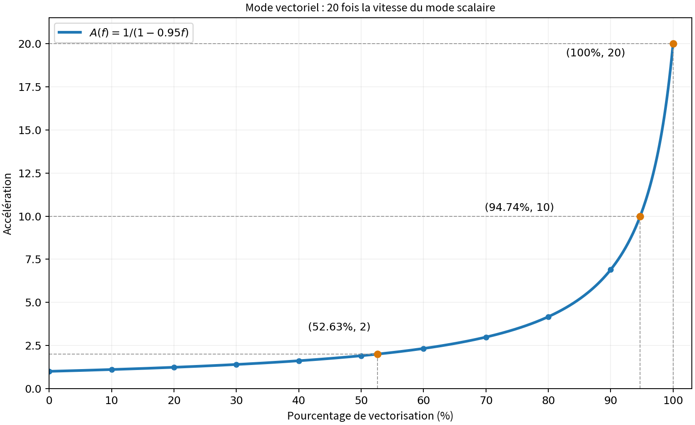
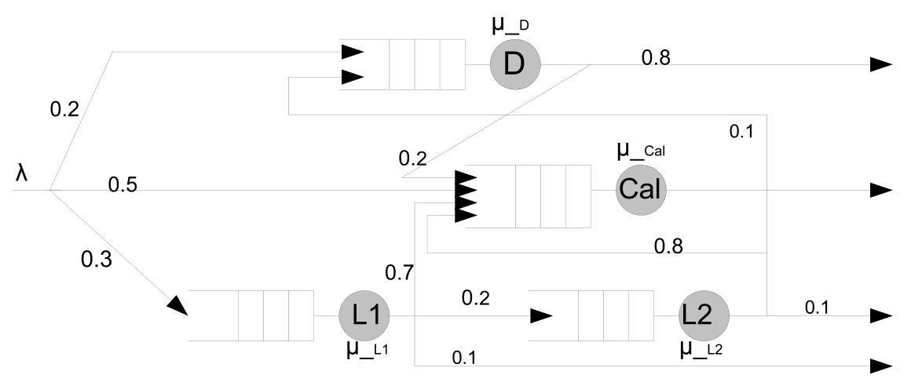
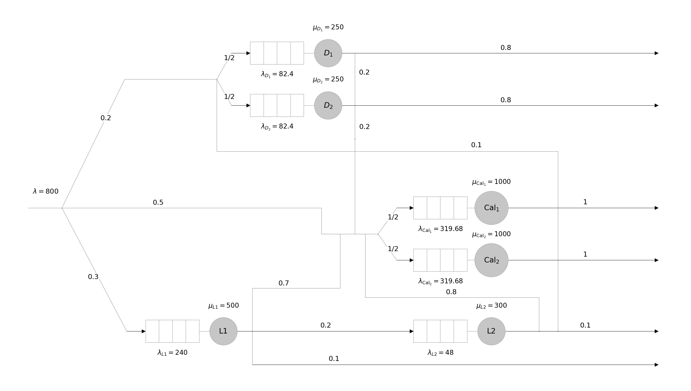
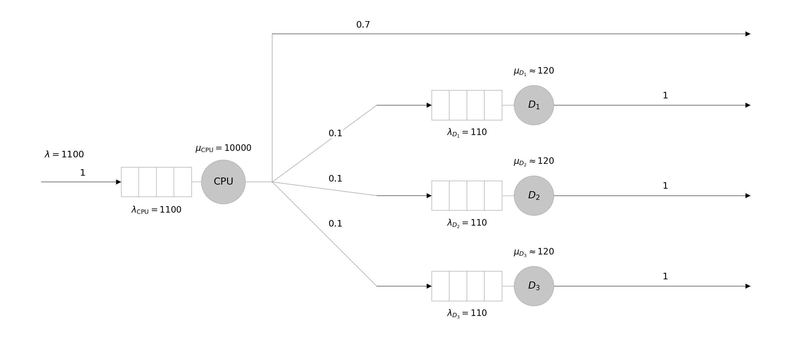
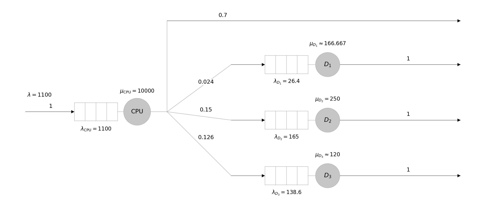
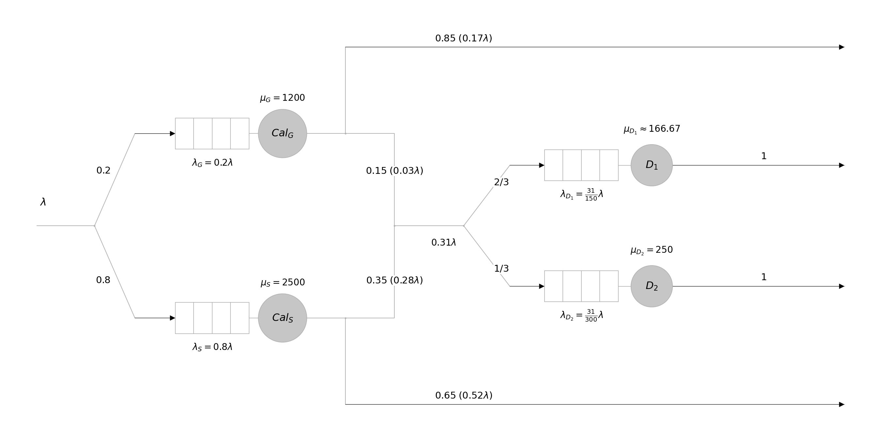
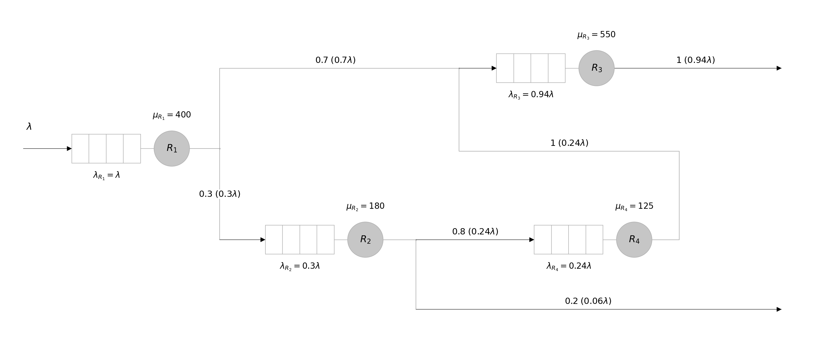

# Évaluation des performances : exercices classés et corrigés 性能评估：TD 与历年试题分类题解合订本

## 01 · Accélération et vectorisation 加速比与向量化

**Index des exercices croisés 交叉题索引：**

- **TD1 §2.2** — questions associées 关联小问：(e)。 Corrigé complet 完整题解：[第 02 类— 2 Ajout d'un coprocesseur 新增浮点协处理器](#exercise-td1-2-2)。
- **Examen 2023 ex.2 2023 年第 2 题** — questions associées 关联小问：Q2。 Corrigé complet 完整题解：[第 02 类— 3 Benchmarks et moyennes 基准程序与平均性能](#exercise-exam2023-2)。
- **TD1 §4.1** — questions associées 关联小问：(a–b)。 Corrigé complet 完整题解：[第 03 类— 1 Cray Y-MP/8](#exercise-td1-4-1)。
- **TD1 §4.2** — questions associées 关联小问：(a–b)。 Corrigé complet 完整题解：[第 03 类— 2 Aliant FX/40](#exercise-td1-4-2)。
- **Examen 2025 ex.1 2025 年第 1 题** — questions associées 关联小问：Q8。 Corrigé complet 完整题解：[第 04 类— 4 Remplacements de ressources 资源替换与投资收益](#exercise-exam2025-1)。

Reconnaître le modèle : taille fixe pour Amdahl, problème agrandi pour Gustafson, amélioration partielle pour la vectorisation. 先识别模型：固定规模用 Amdahl，扩大规模用 Gustafson，局部加速用向量化模型。

**Méthode commune 通用方法：**

$$
S(P)=\frac{T_1}{T_P},\quad E=\frac SP,\quad S_A=\frac1{s+(1-s)/P},\quad S_G=P-(P-1)s_p.
$$

Dans Amdahl, $s$ est mesuré sur le temps séquentiel ; dans Gustafson, $s_p$ est mesuré sur le temps parallèle. Amdahl 的串行比例以串行运行时间为基准，Gustafson 的比例以并行运行时间为基准。

<a id="exercise-td1-1-1"></a>

### 1 Amdahl avec 4 % de séquentiel 串行比例 4%

**Source 来源：** TD1 §1.1, PDF p.1

**Énoncé 题目：** La fraction séquentielle d'une application représente 4% du temps d'exécution sur un processeur. Calculer l'accélération et l'efficacité sur un multiprocesseur de $2^n$ processeurs $2\le n\le7$ . Quelle est la borne supérieure de l'accélération ? 一个应用的串行部分占其在单处理器上执行时间的 4%。计算该应用在配备 $2^n$ 个处理器的多处理器系统上的加速比和并行效率，其中 $2\le n\le7$。加速比的上限是多少？

**Corrigé détaillé 逐步解答：** Le temps relatif vaut $0.04+0.96/P$. Calculer $S$ puis $E$ pour chaque $P$. 相对耗时为 $0.04+0.96/P$，先求加速比，再除以处理器数得到效率。

| P | S | E (%) |
|---|---|---|
| 4 | 3.5714 | 89.29 |
| 8 | 6.2500 | 78.12 |
| 16 | 10.0000 | 62.50 |
| 32 | 14.2857 | 44.64 |
| 64 | 18.1818 | 28.41 |
| 128 | 21.0526 | 16.45 |

$$
\lim_{P\to\infty}S(P)=1/0.04=25.
$$

La borne 25 est une limite, non une valeur atteinte à $P$ fini. 25 是上确界，有限处理器数时达不到。

<a id="exercise-td1-1-2"></a>

### 2 Inverser Amdahl 反求串行比例

**Source 来源：** TD1 §1.2, PDF p.1

**Énoncé 题目：** La mesure des accélérations des programmes A et B fournit les résultats suivants : 测得程序 A 和 B 的加速比如下：

| Procs 处理器数量 | 2 | 3 | 4 | 5 | 6 | 7 | 8 |
| --- | --- | --- | --- | --- | --- | --- | --- |
| $\mathrm{Acc}_A$ | 1.9 | 2.73 | 3.47 | 4.16 | 4.8 | 5.38 | 5.93 |
| $\mathrm{Acc}_B$ | 1.94 | 2.72 | 3.34 | 3.82 | 4.2 | 4.49 | 4.72 |

Calculer la fraction séquentielle pour chacune des exécutions. Comment peut-on décrire le comportement parallèle des deux programmes ? 计算每次执行对应的串行比例。如何描述这两个程序的并行性能表现？ **(Catégorie associée : Karp-Flatt et passage à l'échelle 关联类别：Karp–Flatt 与扩展性)**

**Corrigé détaillé 逐步解答：**

$$
s_\mathrm{eff}(P)=\frac{1/S(P)-1/P}{1-1/P}=\frac{P/S(P)-1}{P-1}.
$$

| P | A : $s_{eff}$ (%) | B : $s_{eff}$ (%) |
|---|---|---|
| 2 | 5.2632 | 3.0928 |
| 3 | 4.9451 | 5.1471 |
| 4 | 5.0913 | 6.5868 |
| 5 | 5.0481 | 7.7225 |
| 6 | 5.0000 | 8.5714 |
| 7 | 5.0186 | 9.3170 |
| 8 | 4.9868 | 9.9274 |

A reste proche de 5 % : ses mesures sont compatibles avec une fraction effective presque constante. Pour B, elle passe de 3.09 % à 9.93 %, signe de coûts croissants absorbés par le modèle. A 的有效串行比例约为 5%，与近似固定比例的模型相符；B 从 3.09% 升至 9.93%，表明模型吸收的额外开销随并行规模增大。

A passe mieux à l'échelle sur les valeurs mesurées. Les temps séquentiels manquent pour classer leurs vitesses absolues ; cette fraction effective ne mesure pas à elle seule le code intrinsèquement séquentiel. 在测得的范围内 A 扩展性更好。缺少两程序各自的串行耗时，尚不能比较绝对速度；有效串行比例也不能单独代表代码固有的串行部分。

<a id="exercise-td1-1-3"></a>

### 3 Expression générale 一般表达式

**Source 来源：** TD1 §1.3(a–c), PDF p.1

**Énoncé 题目：** On supposera qu'une machine parallèle (multiprocesseurs) à $p$ processeurs permet de diviser par $p$ le temps d'exécution d'une fraction de code parallélisé. On appellera $T_1$ le temps d'exécution d'un programme sur un processeur et $T_p$ celui sur $p$ processeurs. 假设一台配备 $p$ 个处理器的并行机器（多处理器系统），能够将代码中可并行部分的执行时间缩短为原来的 $1/p$。记程序在单处理器上的执行时间为 $T_1$，在 $p$ 个处理器上的执行时间为 $T_p$。

**(a)** Sachant que seq est la fraction séquentielle du programme à paralléliser, exprimez l'accélération pour une machine parallèle à $p$ processeurs. Quelle est l'accélération maximale envisageable ? 已知待并行化程序的串行比例为 $\mathrm{seq}$，写出该程序在配备 $p$ 个处理器的并行机器上的加速比表达式。可能达到的最大加速比是多少？

**(b)** Quelle est l'accélération pour une machine dotée d'un très grand nombre de processeurs ? 当机器配备的处理器数量非常大时，加速比是多少？

**(c)** Si seq est inversement proportionnelle à la taille $n$ du code (nombre d'instructions). Calculez alors l'accélération. Quelle est l'accélération pour un très grand code ? 如果 $\mathrm{seq}$ 与代码规模 $n$（指令数量）成反比，计算此时的加速比。当代码规模非常大时，加速比是多少？

**Corrigé détaillé 逐步解答：** Le temps séquentiel $T_1$ se décompose en une partie séquentielle $sT_1$ incompressible et une partie parallélisable $(1-s)T_1$ idéalement répartie à parts égales entre les $P$ processeurs : 串行总耗时 $T_1$ 分为无法分摊的串行部分 $sT_1$，以及理想情况下由 $P$ 个处理器均分的并行部分 $(1-s)T_1$：

$$
T_P=T_1\left[s+\frac{1-s}{P}\right],\quad S=\frac{T_1}{T_P}=\frac{1}{s+(1-s)/P}=\frac{P}{1+(P-1)s}\le P.
$$

(a) « Maximale envisageable » signifie ici **idéale** : on néglige le coût lié à la parallélisation ($C_t(\mathrm{seq},P)=0$, ni communication ni synchronisation), comme le précise l'énoncé (« diviser par $p$ le temps … de la fraction parallélisée »). L'accélération maximale est donc la loi d'Amdahl simple ci-dessus : (a) “可能达到的最大加速比”在本题指**理想加速比**：忽略并行化的额外开销（$C_t(\mathrm{seq},P)=0$，无通信、无同步），这正是题设“并行部分耗时恰好除以 $p$”的含义。因此最大加速比就是上式的简单 Amdahl 定律：

$$
\mathrm{Acc}_{\max}(P)=\frac{1}{\mathrm{seq}+\dfrac{1-\mathrm{seq}}{P}}\;\le P,\qquad\text{alors que réellement 实际上}\quad \mathrm{Acc}(P)=\frac{1}{\mathrm{seq}+\dfrac{1-\mathrm{seq}}{P}+C_t(\mathrm{seq},P)}.
$$

$$
(b)\quad \lim_{P\to\infty}S=\frac{1}{s}\quad(s>0).
$$

À taille de problème fixée, lorsque $P\to\infty$, le temps parallèle $(1-s)T_1/P$ tend vers $0$, mais la fraction séquentielle $s$ subsiste et plafonne l'accélération à $1/s$ (si $s=0$, la borne croît indéfiniment avec $P$). 固定问题规模并增加处理器数时，并行部分耗时趋于 $0$，但串行比例 $s$ 保持不变，故加速比受限于 $1/s$（若 $s=0$，理想加速比随 $P$ 无限增长）。

$$
(c)\quad s=\frac{k}{n}\Longrightarrow S(P,n)=\frac{P}{1+(P-1)k/n}=\frac{nP}{n+k(P-1)},\qquad\lim_{n\to\infty}S(P,n)=P.
$$

La proportionnalité inverse impose une constante $k$ ($s=k/n$) ; la correction du cours prend $k=1$, soit $\mathrm{seq}=1/n$ et $S=\dfrac{1}{1/n+(1-1/n)/P}$, avec la même limite $P$. Contrairement au cas (b), on fixe ici $P$ et on agrandit la taille du code $n\to\infty$ : la fraction séquentielle $s=k/n$ tend vers $0$, de sorte que l'accélération tend vers l'idéal $P$. “反比”应写成 $s=k/n$（$k$ 为常数）；课堂取 $k=1$，即 $s=1/n$，是其中一种特例，极限同样为 $P$。与 (b) 不同，此处固定处理器数 $P$ 并令代码规模 $n\to\infty$：串行比例 $s=k/n$ 趋于 $0$，因此加速比趋于理想值 $P$。

<a id="exercise-td1-1-4"></a>

### 4 Vectorisation 向量化

**Source 来源：** TD1 §1.4(a–d), PDF p.1–2

**Énoncé 题目：** Un mode d'exécution vectoriel est un mode dans lequel on effectue des opérations de haut niveau portant sur des vecteurs au même titre que l'on manipule habituellement des opérations sur de simples scalaires. 向量执行模式允许对向量进行高级运算，就像通常对单个标量进行运算一样。

Pour cet exercice, on considèrera l'amélioration d'une machine liée à l'ajout d'un mode vectoriel. Quand un code s'exécute en mode vectoriel, il est 20 fois plus rapide qu'en mode scalaire. 本题研究为机器增加向量模式所带来的性能提升。当代码以向量模式执行时，其速度是标量模式的 20 倍。

Le pourcentage du nombre d'opérations effectuées en mode vectoriel est appelé pourcentage de vectorisation. 以向量模式执行的运算数量占总运算数量的百分比，称为向量化百分比。

**(a)** Tracez un graphe donnant l'accélération liée au calcul réalisé en mode vectoriel en fonction du pourcentage de vectorisation. 绘制使用向量模式后，加速比随向量化百分比变化的曲线。

**(b)** Quel est le pourcentage de vectorisation nécessaire pour obtenir une accélération de 2 ? 要获得 2 倍加速比，所需的向量化百分比是多少？

**(c)** L'accélération est maximale lorsque la totalité des instructions est effectuée en mode vectoriel. Quel est le pourcentage de vectorisation nécessaire pour obtenir la moitié de cette accélération maximale ? 当所有指令都以向量模式执行时，加速比达到最大值。要获得这一最大加速比的一半，所需的向量化百分比是多少？

**(d)** Le pourcentage de vectorisation mesuré pour les programmes est de 70%. On peut augmenter les performances en doublant la vitesse du mode vectoriel par l'intégration d'un nouveau dispositif matériel. En l'absence d'un tel dispositif, comment pourrait-on assurer les mêmes performances ? 测得程序的向量化百分比为 70%。通过加入一个新的硬件装置，可以将向量模式的执行速度提高到原来的两倍，从而提升性能。如果不使用这个装置，如何达到相同的性能？

**Corrigé détaillé 逐步解答：** En supposant un coût scalaire uniforme par opération, la proportion d'opérations vectorisées $f$ représente aussi la fraction du temps scalaire initial $T_s$. La partie restée en mode scalaire conserve sa durée $(1-f)T_s$, tandis que la partie vectorisée (20 fois plus rapide) voit sa durée divisée par 20, soit $(f/20)T_s$. Le temps relatif vaut donc $(1-f)+f/20$ : 假设每次运算在标量模式下的耗时相同，则向量化运算比例 $f$ 也等于其在原标量总时间 $T_s$ 中所占的比例。非向量化部分耗时仍为 $(1-f)T_s$，向量化部分速度提高为 20 倍，耗时缩短为原来的 $1/20$，即 $(f/20)T_s$，故相对执行时间为 $(1-f)+f/20$：

$$
(a)\quad S(f)=\frac{T_s}{T_v(f)}=\frac1{(1-f)+f/20},\quad 0\le f\le1.
$$

| f (%) | 0 | 20 | 40 | 60 | 70 | 80 | 90 | 100 |
|---|---|---|---|---|---|---|---|---|
| S | 1 | 1.2346 | 1.6129 | 2.3256 | 2.9851 | 4.1667 | 6.8966 | 20 |



$$
(b)\quad S(f)=2\Longleftrightarrow (1-f)+\frac{f}{20}=\frac12\Longrightarrow f=\frac{1-1/2}{1-1/20}=\frac{10}{19}=52.6316\%.
$$

$$
(c)\quad S_{\max}=S(1)=20,\quad S(f)=\frac{S_{\max}}{2}=10\Longrightarrow (1-f)+\frac{f}{20}=\frac1{10}\Longrightarrow f=\frac{18}{19}=94.7368\%.
$$

(d) Avec le nouveau dispositif doublant la vitesse vectorielle (facteur $2\times20=40$) à $f=70\%$, le temps relatif devient : (d) 加入新硬件后，向量模式速度翻倍（即标量模式的 $2\times20=40$ 倍），在 $f=70\%$ 下相对执行时间为：

$$
T_{\mathrm{new}}/T_s=(1-0.70)+0.70/40=0.30+0.0175=0.3175,\quad S_{\mathrm{new}}=1/0.3175=3.149606.
$$

Pour obtenir la même performance sans ce matériel (facteur vectoriel restant égal à 20), il faut que le nouveau taux de vectorisation $f'$ donne exactement le même temps d'exécution relatif pour le même travail : 若不使用新硬件（向量加速倍数仍为 20），要达到相同性能，必须使提高向量化比例至 $f'$ 后的相对执行时间与新硬件相等：

$$
(1-f^{\prime})+f^{\prime}/20=0.3175\Longrightarrow \frac{19}{20}f^{\prime}=0.6825\Longrightarrow f^{\prime}=0.718421.
$$

Sans nouveau matériel, il faut donc porter $f$ de 70 % à 71.8421 % (+1.8421 point, gain global d'environ 5.51 %). 不购买新硬件时，需通过编译器或代码改造将向量化比例从 70% 提升至 71.8421%（增加 1.8421 个百分点，整体性能提升约 5.51%）。

<a id="exercise-exam2025-2"></a>

### 5 Gustafson–Barsis 规模扩展加速比

**Source 来源：** TD1 §3.1–3.2, PDF p.4 ; examen 2025 ex.2 Q1–2, p.2

**Énoncé 题目：**

La métrique de Gustafson–Barsis sert à calculer la capacité d'exécuter un code plus grand dans la même durée d'exécution que le problème initial en utilisant plus de processeurs. Ici, c'est le cas d'un passage du séquentiel (un processeur) à $P$ processeurs ($P>1$) d'un code dont la fraction séquentielle est $seq$. Ce passage s'accompagne d'une accélération de mise à l'échelle (*scaled speedup*), telle que : Gustafson–Barsis 指标用于衡量：使用更多处理器，在与初始问题相同的执行时间内，能够运行多大规模的程序。这里考虑将一个顺序部分比例为 $seq$ 的程序，从顺序执行（1 个处理器）扩展到 $P$ 个处理器（$P>1$）。这一扩展对应的规模扩展加速比为：

$$
Acc(\mathrm{scaled})\leq P+(1-P)\times seq.
$$

**Questions 问题：**

1. Quelle est l'accélération selon Gustafson–Barsis (*scaled speedup*) pour une application s'exécutant sur huit processeurs et qui passe 14 % de son temps à exécuter sa partie séquentielle ? 某应用在 8 个处理器上运行，执行顺序部分的时间占总执行时间的 14%。根据 Gustafson–Barsis 定律，其规模扩展加速比是多少？
2. Quelle est la fraction séquentielle maximale que l'on puisse tolérer pour garder au moins la même accélération (*scaled speedup*) quand le nombre de processeurs passe à dix ? 当处理器数量增加到 10 时，为使规模扩展加速比至少保持与上一问相同的水平，顺序部分的比例最大可以是多少？

**Corrigé détaillé 逐步解答：**

$$
1.\quad S_G(8)=8-7\times0.14=7.02.
$$

$$
2.\quad 10-9s\ge7.02\Longrightarrow s\le\frac{2.98}{9}=0.331111\approx33.1111\%.
$$

Ce sont les valeurs du modèle idéal de Gustafson. Le signe « ≤ » de l'énoncé exprime une borne ; sans hypothèse d'absence de surcoûts, atteindre cette borne n'est pas garanti. 以上为 Gustafson 理想模型值。原题的“≤”表示上界；若不假设额外开销可忽略，不能保证实际达到该值。

## 02 · MIPS, CPI et benchmarks 指令吞吐与基准比较

Calculer des débits en conservant le travail réellement exécuté, puis comparer les durées pour une même tâche. 计算吞吐率时先分清实际执行的工作量；比较同一任务的性能时，以完成时间为依据。

**Formules utiles 常用公式：**

$$
T=\frac{N\,CPI}{f},\quad MIPS=\frac{N}{10^6T}=\frac{f}{10^6CPI},\quad MFLOPS=\frac{N_{FLOP}}{10^6T}.
$$

<a id="exercise-td1-2-1"></a>

### 1 Whetstone 协处理器与软件仿真

**Source 来源：** TD1 §2.1(a–d), PDF p.2–3

**Énoncé 题目：** Un programme de test (Whetstone) contient 195578 opérations flottantes de base par itération. En considérant les types d'opérations flottantes, on obtient la décomposition suivante: 基准测试程序 Whetstone 每次迭代包含 195578 次基本浮点操作。按操作类型划分如下：

| Type d'opération flottante 浮点操作类型 | Nombre 数量 |
| --- | --- |
| Addition 加法 | 82014 |
| Soustraction 减法 | 8229 |
| Multiplication 乘法 | 73220 |
| Division 除法 | 21399 |
| Conversion entier vers flottant 整数转浮点数 | 6006 |
| Comparaison 比较 | 4710 |
| Total 合计 | 195578 |

Whetstone a été exécuté sur une machine M cadencée par une horloge de 16.67 MHz, dotée d'un coprocesseur flottant et utilisant un compilateur Fortran. Ce compilateur permet d'utiliser au choix le coprocesseur ou bien des routines logicielles, selon les options de compilation. Whetstone 在一台时钟频率为 16.67 MHz、配备浮点协处理器的机器 M 上运行，使用 Fortran 编译器。通过选择编译选项，可以让程序使用协处理器，也可以使用软件例程完成浮点操作。

L'exécution d'une seule itération de Whetstone a duré 1.08 s avec le coprocesseur et 13.6 s avec l'option logicielle. On a mesuré un CPI moyen de 10 en utilisant le coprocesseur et de 6 en utilisant l'option logicielle. 执行一次 Whetstone 迭代，使用协处理器时耗时 1.08 s，使用软件方式时耗时 13.6 s。测得两种情况下的平均 CPI（每条指令的平均时钟周期数）分别为 10 和 6。

**(a)** Quel est le nombre de MIPS pour les deux exécutions ? 两种执行方式的 MIPS 分别是多少？

**(b)** Quel est le nombre total d'instructions exécutées dans les deux cas. 两种情况下执行的指令总数分别是多少？

**(c)** En moyenne, combien faut-il d'instructions entières pour calculer chaque opération flottante par logiciel ? 使用软件计算一次浮点操作，平均需要多少条整数指令？

**(d)** Quel est le nombre de MFLOPS pour la machine M avec le coprocesseur flottant exécutant Whetstone (on suppose que toutes les opérations flottantes du tableau précédent comptent pour une opération) ? 机器 M 使用浮点协处理器执行 Whetstone 时，MFLOPS 是多少？假设上表中列出的每次浮点操作均按一次操作计数。

**Corrigé détaillé 逐步解答：**

| Configuration 配置 | MIPS | N instructions 指令数 |
|---|---|---|
| Coprocesseur 协处理器 | 1.667000 | 1800360 |
| Logiciel 软件 | 2.778333 | 37785333.333 |

(a–b) Utiliser la fréquence 16.67 MHz et les CPI 10 et 6 ; les nombres non entiers résultent des mesures arrondies. (a–b) 使用频率 16.67 MHz，CPI 分别取 10 和 6；由已舍入的测量反推，指令数出现小数属于数值近似。

$$
(c)\quad N_h=I+F,\quad N_s=I+YF\Longrightarrow Y=1+\frac{N_s-N_h}{F}\approx184.993.
$$

Ce calcul suppose que chaque opération flottante correspond à une instruction matérielle et que les instructions entières de fond $I$ restent identiques. On obtient environ 185 instructions d'émulation par opération. 这一计算假设每个浮点操作对应一条硬件浮点指令，且两配置的背景整数指令 $I$ 相同，得到每次浮点操作约 185 条仿真指令。

Le supplément par rapport au coprocesseur vaut $(N_s-N_h)/F\approx183.993\approx184$ instructions par opération. C'est $Y-1$, et non le coût complet d'émulation $Y$. 相比协处理器，每次浮点操作净增加 $(N_s-N_h)/F\approx183.993\approx184$ 条指令；它是 $Y-1$，不是完整仿真成本 $Y$。

Si l'on compte toutes les instructions logicielles, fond inclus, le rapport $N_s/F=193.1983$ est le coût total moyen par opération. Ces deux périmètres doivent être distingués ; l'énoncé ne détaille pas le code de fond. 若把软件运行的全部指令都算入，$N_s/F=193.1983$ 是含背景工作的总指令摊销成本。二者统计范围不同；原题没有提供背景代码明细。

$$
(d)\quad MFLOPS=\frac{195578}{1.08\times10^6}=0.181091.
$$

Le coprocesseur est $13.6/1.08=12.5926$ fois plus rapide malgré des MIPS plus faibles. 协处理器的 MIPS 更低，但完成相同任务快 $13.6/1.08=12.5926$ 倍。

<a id="exercise-td1-2-2"></a>

### 2 Ajout d'un coprocesseur 新增浮点协处理器

**Source 来源：** TD1 §2.2(a–e), PDF p.3

**Énoncé 题目：** Votre entreprise a un programme de test qui est considéré comme représentatif de vos applications typiques. Une des stations de travail d'un modèle plus ancien n'a pas d'unité flottante, et doit émuler chaque instruction flottante par une séquence d'instructions entières. Cette station de modèle ancien a un débit de 120 MIPS sur ce programme test. Un vendeur tiers offre un coprocesseur qui est destiné à donner un « coup de fouet » à votre station. Ce coprocesseur exécute chaque instruction flottante sur un processeur dédié (aucune émulation n'est nécessaire). Le débit de l'ensemble station/coprocesseur est 80 MIPS sur le même programme test. Les symboles suivants sont utilisés pour répondre aux questions. 你的公司有一个基准测试程序，被认为能够代表公司的典型应用。一台较旧型号的工作站没有浮点运算单元，必须用一串整数指令来仿真每条浮点指令。这台工作站运行该测试程序时，指令吞吐率为 120 MIPS。 一家第三方供应商提供了一款用于提升工作站性能的协处理器。它使用专门的处理器执行每条浮点指令，无需软件仿真。工作站与协处理器组合运行同一测试程序时，指令吞吐率为 80 MIPS。 回答以下问题时使用这些符号：

| Symbole 符号 | Commentaire 含义 |
| --- | --- |
| $I$ | Nombre d'instructions entières exécutées dans le programme 程序执行的整数指令数量 |
| $F$ | Nombre d'instructions flottantes exécutées dans le programme 程序执行的浮点指令数量 |
| $Y$ | Nombre d'instructions entières pour émuler une instruction flottante 仿真一条浮点指令所需的整数指令数量 |
| $W$ | Temps pour exécuter le programme sur la station seule 仅使用工作站执行程序所需的时间 |
| $B$ | Temps pour exécuter le programme sur l'ensemble station/coprocesseur 使用工作站与协处理器组合执行程序所需的时间 |

**(a)** Écrire la formule du débit MIPS de chaque configuration avec les symboles de la table. Justifiez votre réponse. 使用表中的符号，分别写出两种配置的 MIPS 表达式，并说明理由。

**(b)** Pour la configuration sans coprocesseur, on mesure $F=8\times10^6$ , Y = 50, W = 4. Calculez $I$ en conséquence. 对于没有协处理器的配置，测得 $F=8\times10^6$、$Y=50$、$W=4$。据此计算 $I$。

**(c)** Quelle est la valeur de B ? $B$ 的值是多少？

**(d)** Quel est le débit MFLOPS du système avec le coprocesseur. 配备协处理器的系统，其 MFLOPS 是多少？

**(e)** Votre collègue veut acquérir le coprocesseur même si le débit MIPS pour la configuration l'utilisant est moindre que celui de la station de travail seule. Est-ce que l'estimation de votre collègue est correcte ? Justifiez votre réponse. 尽管使用协处理器后的 MIPS 低于仅使用工作站时的 MIPS，你的同事仍希望购买该协处理器。你同事的判断是否正确？请说明理由。 **(Catégorie associée : Accélération et vectorisation 关联类别：加速比与向量化)**

**Corrigé détaillé 逐步解答：** (a) Par définition, le débit en MIPS vaut $\mathrm{MIPS}=\frac{N_{\mathrm{instr}}}{10^6\times T}$. Sans coprocesseur, chacune des $F$ instructions flottantes est émulée par $Y$ instructions entières, soit un total de $I+YF$ instructions exécutées en un temps $W$. Avec le coprocesseur, les $F$ instructions flottantes sont exécutées directement en matériel sans émulation, soit un total de $I+F$ instructions exécutées en un temps $B$. On obtient donc : (a) 根据定义，$\mathrm{MIPS}=\frac{\text{执行的指令总数}}{10^6\times\text{执行时间}}$。无协处理器时，每条浮点指令需由 $Y$ 条整数指令软件模拟，故执行的指令总数为 $I+YF$，耗时为 $W$；有协处理器时，$F$ 条浮点指令由专用硬件直接执行，无需模拟，故执行的指令总数为 $I+F$，耗时为 $B$。由此得到两式：

$$
120=\frac{I+YF}{10^6W},\qquad80=\frac{I+F}{10^6B}.
$$

$$
(b)\quad I=120\times10^6\times4-50\times8\times10^6=80\times10^6.
$$

$$
(c)\quad B=\frac{80\times10^6+8\times10^6}{80\times10^6}=1.1\ \mathrm{s}.
$$

$$
(d)\quad MFLOPS=\frac{8\times10^6}{1.1\times10^6}=7.272727.
$$

$$
(e)\quad S=W/B=4/1.1=3.636364.
$$

L'achat améliore la vitesse de ce test d'un facteur 3.6364. La baisse des MIPS vient d'un nombre bien moindre d'instructions. Le coût d'achat manque pour juger la rentabilité financière. 该硬件使此测试快约 3.6364 倍，MIPS 下降源于指令总数大幅减少。题面未给购买成本，因此收益判断限于执行性能。

<a id="exercise-exam2023-2"></a>

### 3 Benchmarks et moyennes 基准程序与平均性能

**Source 来源：** Examen 2023 ex.2 Q1–2, p.2

**Énoncé 题目：**

Le tableau suivant regroupe les temps d'exécution (en secondes) et le nombre d'instructions exécutées de cinq benchmarks du même domaine applicatif, sur trois systèmes différents. 下表列出了同一应用领域中的 5 个基准程序在 3 个不同系统上的执行时间（单位：秒），以及各基准程序执行的指令数。

| Benchmark 基准程序 | $Syst_1$ : temps (s) 系统 1 执行时间（s） | $Syst_2$ : temps (s) 系统 2 执行时间（s） | $Syst_3$ : temps (s) 系统 3 执行时间（s） | Nombre d'instructions 指令数 |
|---|---|---|---|---|
| 1 | 33.4 | 28.8 | 28.3 | $1.45\times10^{10}$ |
| 2 | 19.9 | 22.1 | 25.3 | $7.97\times10^9$ |
| 3 | 6.5 | 5.3 | 4.7 | $3.11\times10^9$ |
| 4 | 84.3 | 75.8 | 80.1 | $3.77\times10^{10}$ |
| 5 | 101.1 | 99.4 | 70.2 | $4.56\times10^{10}$ |

On considère que ces benchmarks ont des poids équivalents. 假设这 5 个基准程序的权重相同。

**Questions 问题：**

1. Calculez le temps d'exécution moyen et le MIPS moyen par système. 分别计算每个系统的平均执行时间和平均 MIPS（每秒执行的百万条指令数）。
2. Calculez l'accélération moyenne par système avec le système 3 comme référence. Ces valeurs d'accélérations moyennes reflètent-elles les vraies performances ? Justifiez votre réponse. 以系统 3 为参照，分别计算每个系统的平均加速比。这些平均加速比能否反映真实性能？请说明理由。 **(Catégorie associée : Accélération et vectorisation 关联类别：加速比与向量化)**

**Corrigé détaillé 逐步解答：** Q1. Pour chaque benchmark, $M_{ij}=N_i/(10^6T_{ij})$. Les poids égaux donnent la moyenne arithmétique par benchmark. 第 1 问：先逐项求 $M_{ij}=N_i/(10^6T_{ij})$，等权基准取逐项算术平均。

| Benchmark | Système 1 | Système 2 | Système 3 |
|---|---|---|---|
| 1 | 434.1317 | 503.4722 | 512.3675 |
| 2 | 400.5025 | 360.6335 | 315.0198 |
| 3 | 478.4615 | 586.7925 | 661.7021 |
| 4 | 447.2123 | 497.3615 | 470.6617 |
| 5 | 451.0386 | 458.7525 | 649.5726 |

| Grandeur 指标 | Système 1 | Système 2 | Système 3 |
|---|---|---|---|
| Temps moyen (s) 平均耗时 | 49.0400 | 46.2800 | 41.7200 |
| MIPS moyens 平均MIPS | 442.2693 | 481.4024 | 521.8647 |
| MIPS du lot 整批吞吐 | 444.0457 | 470.5272 | 521.9559 |

Les MIPS du lot sont $\sum N_i/(10^6\sum T_{ij})$ ; ils ne sont pas la moyenne non pondérée des débits. 整批吞吐率为 $\sum N_i/(10^6\sum T_{ij})$，与各基准吞吐率的非加权平均不同。 La moyenne arithmétique décrit des débits de benchmarks à poids égaux ; le débit du lot décrit l'exécution de chaque benchmark une fois. Ces mesures répondent à deux questions différentes et donnent ici le même classement 3 > 2 > 1. 算术平均描述各基准等权时的平均吞吐率，整批吞吐率描述每个基准各运行一次的总体执行；二者回答不同问题，本题排序均为 3 > 2 > 1。

Q2. Référence système 3 : $a_{ij}=T_{i3}/T_{ij}$. 第 2 问：系统 3 为基准，逐项加速比为 $a_{ij}=T_{i3}/T_{ij}$。

| Benchmark | Système 1 | Système 2 | Système 3 |
|---|---|---|---|
| 1 | 0.847305 | 0.982639 | 1.000000 |
| 2 | 1.271357 | 1.144796 | 1.000000 |
| 3 | 0.723077 | 0.886792 | 1.000000 |
| 4 | 0.950178 | 1.056728 | 1.000000 |
| 5 | 0.694362 | 0.706237 | 1.000000 |

| Moyenne 平均口径 | Système 1 | Système 2 | Système 3 |
|---|---|---|---|
| Arithmétique 算术 | 0.897256 | 0.955439 | 1.000000 |
| Géométrique 几何 | 0.875340 | 0.942696 | 1.000000 |
| Lot complet 整批 | 0.850734 | 0.901469 | 1.000000 |

Une moyenne de ratios doit préciser sa convention. La moyenne géométrique convient à un résumé de rapports normalisés ; le ratio des temps totaux décrit une exécution de chaque benchmark. Les valeurs arithmétiques répondent à une moyenne égale des ratios mais ne donnent pas le speedup du lot. 平均加速比须写清口径。几何平均适合汇总归一化比值；总耗时之比对应每个程序各运行一次；比值算术平均对应比值等权，却不等于整批任务的实际加速比。

Pour ce lot, le classement est système 3, puis 2, puis 1. Le benchmark 2 favorise toutefois le système 1 : le classement n'est pas universel. 本组任务整体排序为系统 3、系统 2、系统 1，但基准 2 是系统 1 更快，因此不能把汇总排序视为所有应用的普遍排序。

## 03 · Karp–Flatt et passage à l'échelle Karp–Flatt 与扩展性

**Index des exercices croisés 交叉题索引：**

- **TD1 §1.2** — questions associées 关联小问：Calcul de la fraction effective et commentaire 串行比例计算与并行行为解释（原题未分编号）。 Corrigé complet 完整题解：[第 01 类— 2 Inverser Amdahl 反求串行比例](#exercise-td1-1-2)。

Partir des temps mesurés pour séparer vitesse, efficacité et fraction séquentielle effective. 从实测时间出发，区分加速比、效率与有效串行比例。

**Méthode commune 通用方法：**

$$
S=T_1/T_P,\quad E=S/P,\quad e=\frac{1/S-1/P}{1-1/P}=\frac{PT_P/T_1-1}{P-1}.
$$

Calculer $e$ seulement pour $P>1$. Il absorbe sérialisation et surcoûts observés. 只对 $P>1$ 计算 $e$；它吸收串行化及观测到的并行开销。

<a id="exercise-td1-4-1"></a>

### 1 Cray Y-MP/8

**Source 来源：** TD1 §4.1(a–c), PDF p.4

**Énoncé 题目：** Soit le tableau ci-dessous, regroupant les temps d'exécution mesurés pour un code $P$ durant ses exécutions sur la machine Cray Y-MP/8 avec différents nombres de processeurs. 下表给出程序 $P$ 在 Cray Y-MP/8 机器上使用不同数量的处理器运行时，测得的执行时间。

| Nombre de processeurs P 处理器数量 P | Temps d'exécution (s) 执行时间（s） |
| --- | --- |
| 1 | 2.170 |
| 2 | 1.110 |
| 3 | 0.754 |
| 4 | 0.577 |
| 8 | 0.312 |

**(a)** Calculez l'accélération, l'efficacité et le facteur $e$ de Karp-Flatt pour chacun des quatre cas ($P$ = 2, 3, 4 et 8) 对于 $P=2,3,4,8$ 这四种情况，分别计算加速比、并行效率和 Karp–Flatt 因子 $e$。 **(Catégorie associée : Accélération et vectorisation 关联类别：加速比与向量化)**

**(b)** Que pensez-vous des accélérations et efficacités obtenues ? Argumentez votre réponse. 你如何评价得到的加速比和并行效率？请说明理由。 **(Catégorie associée : Accélération et vectorisation 关联类别：加速比与向量化)**

**(c)** Qu'indiquent les valeurs du facteur $e$ dans ce cas ? 在这个例子中，因子 $e$ 的数值说明了什么？

**Corrigé détaillé 逐步解答：**

| P | T (s) | S | E (%) | e |
|---|---|---|---|---|
| 2 | 1.11 | 1.954955 | 97.7477 | 0.023041 |
| 3 | 0.754 | 2.877984 | 95.9328 | 0.021198 |
| 4 | 0.577 | 3.760832 | 94.0208 | 0.021198 |
| 8 | 0.312 | 6.955128 | 86.9391 | 0.021461 |

Les accélérations augmentent, avec efficacité de 97.75 % à 86.94 %. Le facteur $e$ reste proche de 2.1–2.3 % : les mesures sont compatibles avec une fraction effective presque constante. 加速比持续增大，效率从 97.75% 降至 86.94%；$e$ 约为 2.1%–2.3%，与近似固定的有效串行比例相符。

Cela soutient un bon passage à l'échelle sur la plage mesurée, sans identifier à lui seul la cause des coûts. Une extrapolation idéale donnerait environ 1/0.0214 ≈ 46.7, à condition de conserver ce modèle. 这支持测量范围内扩展良好的判断，但单靠 $e$ 不能定位开销来源。若模型继续成立，理想外推上界约为 $1/0.0214\approx46.7$。

<a id="exercise-td1-4-2"></a>

### 2 Aliant FX/40

**Source 来源：** TD1 §4.2(a–b), PDF p.4–5

**Énoncé 题目：** Soit le tableau ci-dessous, regroupant les temps d'exécution mesurés pour un code $P$ durant ses exécutions sur la machine Aliant FX/40 avec différents nombres de processeurs. 下表给出程序 $P$ 在 Aliant FX/40 机器上使用不同数量的处理器运行时，测得的执行时间。

| Nombre de processeurs P 处理器数量 P | Temps d'exécution (s) 执行时间（s） |
| --- | --- |
| 1 | 66.1 |
| 2 | 34.8 |
| 3 | 24.9 |
| 4 | 20.5 |

**(a)** Calculez l'accélération, l'efficacité et le facteur $e$ de Karp-Flatt pour chacun des trois cas ($P$ = 2, 3 et 4). 对于 $P=2,3,4$ 这三种情况，分别计算加速比、并行效率和 Karp–Flatt 因子 $e$。 **(Catégorie associée : Accélération et vectorisation 关联类别：加速比与向量化)**

**(b)** Interprétez la variation de l'efficacité puis faites de même pour le facteur $e$. 解释并行效率的变化，再解释因子 $e$ 的变化。 **(Catégorie associée : Accélération et vectorisation 关联类别：加速比与向量化)**

**Corrigé détaillé 逐步解答：**

| P | T (s) | S | E (%) | e |
|---|---|---|---|---|
| 2 | 34.8 | 1.899425 | 94.9713 | 0.052950 |
| 3 | 24.9 | 2.654618 | 88.4873 | 0.065053 |
| 4 | 20.5 | 3.224390 | 80.6098 | 0.080182 |

L'efficacité diminue de 94.97 % à 80.61 % tandis que $e$ augmente de 5.295 % à 8.018 %. Les surcoûts effectifs deviennent plus importants avec $P$. 效率从 94.97% 降到 80.61%，$e$ 从 5.295% 增至 8.018%，表明随 $P$ 增大，有效额外成本的影响上升。

Le code peut être inchangé : $e$ n'est pas une mesure directe de sa fraction intrinsèquement séquentielle. Communications, synchronisation et déséquilibre sont des causes à examiner. 代码本身可以未变；$e$ 不是固有串行代码比例的直接测量。通信、同步和负载不均衡是需要进一步检查的原因。

## 04 · Réseaux de files et optimisation 排队网络与资源优化

Établir les flux avant de calculer les temps. Les solutions numériques utilisent des stations M/M/1 dans un réseau ouvert, avec arrivées poissoniennes, services exponentiels, files infinies et routage indépendant. 先求流量，再求时间。数值解采用开放排队网络的 M/M/1 站点模型，假设泊松到达、指数服务、无限队列及独立路由。

**Recette de calcul 解题步骤：**

$$
\lambda_i=e_i+\sum_j\lambda_jp_{ji},\quad v_i=\lambda_i/\lambda,\quad\rho_i=\lambda_i/\mu_i<1.
$$

$$
s_i=1/\mu_i,\quad w_i=\frac{\lambda_i}{\mu_i(\mu_i-\lambda_i)},\quad r_i=\frac1{\mu_i-\lambda_i}=w_i+s_i.
$$

$$
W=\sum_iv_iw_i,\quad S=\sum_iv_is_i,\quad R=\sum_iv_ir_i=W+S,\quad N=\lambda R.
$$

Les poids sont des nombres moyens de visites, pas une normalisation par la somme des arrivées internes. Pour une classe conditionnelle, utiliser ses probabilités de trajet. Vérifier la stabilité de chaque station avant toute formule stationnaire. 权重是每个外部请求的平均访问次数，不能用内部到达率之和归一化。对条件类别使用该类别的路径概率。任何稳态计算之前，都要逐站检查稳定性。

<a id="exercise-td3-1"></a>

### 1 Routage et duplication 路由与服务器复制

**Source 来源：** TD3 ex.1 Q1–6, PDF p.1–2

**Énoncé 题目：** Soit le système modélisé par le réseau de files d'attente de la figure 1. Le flux des instructions alimente le système à un taux $\lambda$. Ces instructions sont dirigées, selon leur type, vers les files correspondantes afin d'y être traitées. Les probabilités de routage, les taux de service des différents serveurs et les autres caractéristiques du modèle sont représentés sur la figure 1. 考虑图 1 所示排队网络建模的系统。指令流以速率 $\lambda$ 进入系统，各条指令根据类型被送往相应队列接受处理。路由概率、各服务节点的服务率以及模型的其他特征均标在图 1 中。



Les taux de service du système initial sont : 初始系统中各服务节点的服务率如下：

| Serveur 服务节点 | Taux de service 服务率 |
|---|---|
| L1 | $\mu_{L1}=500\ \mathrm{instr/s}$ |
| L2 | $\mu_{L2}=300\ \mathrm{instr/s}$ |
| D | $\mu_D=250\ \mathrm{instr/s}$ |
| Cal | $\mu_{\mathrm{Cal}}=1000\ \mathrm{instr/s}$ |

On souhaite calculer les indicateurs de performance de ce système. 其中，$\mathrm{instr/s}$ 表示每秒处理的指令数。现要求计算该系统的性能指标。

**Questions 问题：**

1. Donnez les conditions de stabilité de ce système. 给出该系统的稳定性条件。
2. Sachant que $\lambda=800\ \mathrm{instr/s}$, vérifiez la stabilité du système. 已知 $\lambda=800\ \mathrm{instr/s}$，判断该系统是否稳定。
3. Quel est le temps d'attente moyen à chacune des files d'attente ? 各队列中的平均等待时间（temps d'attente moyen）分别是多少？
4. Quel est le temps de réponse moyen à chacune des files d'attente ? 各排队节点的平均响应时间（temps de réponse moyen）分别是多少？
5. Quel est le temps de réponse moyen pour l'instruction la plus longue ? Justifiez votre réponse en décrivant son exécution. 耗时最长的指令，其平均响应时间是多少？请描述该指令的执行过程，并说明理由。
6. Si un serveur est utilisé à plus de $60\%$, on le duplique et on associe une file à chacun des deux serveurs, en leur distribuant équitablement le flux entrant des instructions. Donnez le nouveau modèle issu de l'application de cette règle au modèle de la figure 1. 如果某个服务节点的利用率超过 $60\%$，就复制该服务节点，并为两个服务节点各配置一个独立队列，将进入该节点的指令流均匀分配给两者。将这一规则应用于图 1，给出调整后的模型。

**Corrigé détaillé 逐步解答：** Q1. Lire les arcs du schéma et additionner tous les flux reçus. 第 1 问：按图中的路由逐项加总输入流量。

$$
\lambda_{L1}=0.3\lambda,\quad\lambda_{L2}=0.2(0.3\lambda)=0.06\lambda,
$$

$$
\lambda_D=0.2\lambda+0.1(0.06\lambda)=0.206\lambda,
$$

$$
\lambda_{Cal}=0.5\lambda+0.7(0.3\lambda)+0.8(0.06\lambda)+0.2(0.206\lambda)=0.7992\lambda.
$$

Condition de stabilité : chaque station doit vérifier $\rho_i=\lambda_i/\mu_i<1$, c'est-à-dire $\lambda<\mu_i/v_i$ pour tout $i$ ; la station la plus contraignante fixe la borne. 稳定性条件：每个节点都须满足 $\rho_i=\lambda_i/\mu_i<1$，即对所有 $i$ 有 $\lambda<\mu_i/v_i$，最严格的节点决定上限。

$$
\lambda<\min\left(\frac{500}{0.3},\frac{300}{0.06},\frac{250}{0.206},\frac{1000}{0.7992}\right)=1213.592233\ \mathrm{instr/s}.
$$

Q2–4. À λ=800, les quatre utilisations sont inférieures à 1 ; le réseau est stable. 第 2–4 问：λ=800 时四个利用率均小于 1，网络稳定。

| Nœud 节点 | $\lambda_i$ | $\mu_i$ | $\rho_i$ | $w_i$ (ms) | $r_i$ (ms) |
|---|---|---|---|---|---|
| L1 | 240.0000 | 500.0000 | 0.480000 | 1.8462 | 3.8462 |
| L2 | 48.0000 | 300.0000 | 0.160000 | 0.6349 | 3.9683 |
| D | 164.8000 | 250.0000 | 0.659200 | 7.7371 | 11.7371 |
| Cal | 639.3600 | 1000.0000 | 0.639360 | 1.7728 | 2.7728 |

Q5. Le trajet à plus grande durée moyenne est $L1 \to L2 \to D \to \mathrm{Cal} \to \text{sortie}$. En effet, une telle instruction subit successivement l'attente et le service dans chacune des quatre files : passage par $L1$, transfert vers $L2$, puis accès au disque $D$ et traitement par l'unité de calcul $\mathrm{Cal}$ avant de quitter le système. D'après la figure 1, ce trajet complet est réalisable (probabilités de transition strictement positives : $0.3\times0.2\times0.1\times0.2>0$). Comme le réseau est sans cycle et que chaque serveur a un temps de réponse moyen strictement positif ($r_i>0$), tout autre trajet possible omet au moins un serveur et sort plus tôt ; le chemin qui traverse les quatre serveurs possède donc nécessairement la durée moyenne maximale. 第 5 问：平均耗时最长的可行路径为 $L1 \to L2 \to D \to \mathrm{Cal} \to \text{出口}$。执行过程为：指令先经过 $L1$，按图示路由转入 $L2$，随后访问磁盘 $D$，再送往计算单元 $\mathrm{Cal}$ 处理，最后离开系统，依次在四个节点经历排队等待与服务。由图 1 可知该路径各段转移概率均大于零（$0.3\times0.2\times0.1\times0.2>0$），路径可达；又因为该排队网络无环，且每个节点的平均响应时间 $r_i>0$，其余所有可行路径都会跳过其中至少一个节点或提前离开，因此完整经过全部四个节点的路径平均耗时必然最大。

$$
r_{\mathrm{long}}=r_{L1}+r_{L2}+r_D+r_{\mathrm{Cal}}=3.846154+3.968254+11.737089+2.772848=22.324344\ \mathrm{ms}.
$$

Par linéarité de l'espérance, comme on calcule le temps de réponse moyen **conditionnellement au choix de ce trajet**, cette instruction visite exactement une fois chacun des quatre serveurs : on additionne donc directement les $r_i$, sans pondérer par les probabilités de routage. 由于此处求的是**已走该路径的指令的条件平均响应时间**，该指令必然依次访问这四个节点各一次，因此由期望的线性性质直接将四个 $r_i$ 相加，无需再乘路由分流概率。

Q6. D et Cal dépassent 60 % ; dupliquer chacun avec une file séparée par serveur et partager leurs arrivées par moitié. 第 6 问：D 与 Cal 超过 60%，分别复制，每台服务器保留独立队列，输入流量各分一半。

| Serveur 服务器 | $\lambda_i$ | $\mu_i$ | $\rho_i$ |
|---|---|---|---|
| D1, D2 | 82.4 | 250 | 0.3296 |
| Cal1, Cal2 | 319.68 | 1000 | 0.31968 |

L1 et L2 restent inchangés. Chaque D envoie 20 % vers le groupe Cal et 80 % vers la sortie. La répartition vers Cal1/Cal2 reste équiprobable. L1、L2 不变；每个 D 将 20% 流量送至 Cal 组、80% 送出口，进入 Cal 组的流量再等分给两台服务器。



Deux files M/M/1 séparées ne sont pas une file commune M/M/2 : les modèles d'attente diffèrent. 两个独立 M/M/1 队列不等于一个公共队列的 M/M/2，不能混用等待公式。

<a id="exercise-td3-2-complete"></a>

### 2 CPU et trois disques CPU 与三个磁盘

**Source 来源：** TD3 ex.2 parties I–II Q1–3, PDF p.2–3

**Énoncé 题目：**

#### Partie I : disques identiques 第一部分：相同磁盘

Soit un système composé d'un CPU et de trois disques. On lui soumet des instructions à exécuter à un taux : 一个系统由一个 CPU 和三个磁盘组成。指令以如下速率提交给系统：

$$
\lambda=1100\ \mathrm{instr/s}.
$$

Chaque instruction est automatiquement dirigée vers le CPU, qui l'exécute. Si elle nécessite une entrée/sortie (E/S), le CPU détermine le disque concerné et lui transmet l'instruction. 每条指令都先进入 CPU 执行。如果需要输入／输出操作（E/S），CPU 会确定目标磁盘，并将指令送往该磁盘。

- Sans E/S, l'exécution se termine immédiatement après le passage par le CPU. 不需要 E/S 的指令：经过 CPU 后执行结束。
- Avec E/S, l'exécution se termine après le passage par le disque. 需要 E/S 的指令：经过磁盘后执行结束。

Les programmes typiques exécutés sur ce système contiennent **70 % d'instructions ne nécessitant pas d'E/S**. Le CPU exécute en moyenne **$10^4$ instructions par seconde**. 在该系统运行的典型程序中，**70% 的指令不需要 E/S**。CPU 平均每秒执行 **$10^4$ 条指令**。

Les trois disques sont identiques : 三个磁盘的配置相同：

| Caractéristique 参数 | Valeur pour chaque disque 每个磁盘的数值 |
|---|---|
| Capacité 容量 | 300 GB |
| Temps moyen d'accès 平均访问时间 | 8.33 ms |

Les données sont uniformément distribuées sur les disques, et les accès sont uniformément distribués sur les données. 数据均匀分布在三个磁盘上，对各数据的访问也是均匀的。

**Questions 问题：**

1. Donnez le schéma représentant le système par un réseau de files d'attente. Précisez : 画出该系统的排队网络模型，并标明：
   - les taux d'arrivée dans chaque file : $\lambda_{\mathrm{CPU}}$, $\lambda_{\mathrm{Disk1}}$, $\lambda_{\mathrm{Disk2}}$, $\lambda_{\mathrm{Disk3}}$ ; 各队列的到达率：$\lambda_{\mathrm{CPU}}$、$\lambda_{\mathrm{Disk1}}$、$\lambda_{\mathrm{Disk2}}$、$\lambda_{\mathrm{Disk3}}$；
   - les taux de service : $\mu_{\mathrm{CPU}}$, $\mu_{\mathrm{Disk1}}$, $\mu_{\mathrm{Disk2}}$, $\mu_{\mathrm{Disk3}}$ ; 各服务节点的服务率：$\mu_{\mathrm{CPU}}$、$\mu_{\mathrm{Disk1}}$、$\mu_{\mathrm{Disk2}}$、$\mu_{\mathrm{Disk3}}$；
   - les probabilités de passage sur chaque arc du réseau. 网络中每条弧上的转移概率。

2. Calculez le temps d'attente moyen : 分别计算以下三类指令的平均等待时间：
   - d'une instruction ne nécessitant pas d'E/S ; 不需要 E/S 的指令；
   - d'une instruction d'E/S ; 需要 E/S 的指令；
   - d'une instruction quelconque. 任意一条指令。

3. Calculez le temps de réponse moyen : 分别计算以下三类指令的平均响应时间：
   - d'une instruction ne nécessitant pas d'E/S ; 不需要 E/S 的指令；
   - d'une instruction d'E/S ; 需要 E/S 的指令；
   - d'une instruction quelconque. 任意一条指令。

#### Partie II : disques différents 第二部分：异构磁盘

Les trois disques ont les caractéristiques suivantes : 三个磁盘的参数如下：

| Disque 磁盘 | Capacité (GB) 容量（GB） | Temps moyen d'accès 平均访问时间 |
|---|---:|---:|
| Disque 1 磁盘 1 | 80 | 6 ms |
| Disque 2 磁盘 2 | 500 | 4 ms |
| Disque 3 磁盘 3 | 420 | 8.33 ms |

Les données sont distribuées sur les disques **proportionnellement à leurs capacités respectives**, et les accès sont uniformément distribués sur les données. 数据按各磁盘的**容量比例**分布，对各数据的访问仍然是均匀的。

**Questions 问题：**

1. Donnez le schéma représentant le système par un réseau de files d'attente. Précisez : 画出该系统的排队网络模型，并标明：
   - les taux d'arrivée dans chaque file : $\lambda_{\mathrm{CPU}}$, $\lambda_{\mathrm{Disk1}}$, $\lambda_{\mathrm{Disk2}}$, $\lambda_{\mathrm{Disk3}}$ ; 各队列的到达率： $\lambda_{\mathrm{CPU}}$、$\lambda_{\mathrm{Disk1}}$、$\lambda_{\mathrm{Disk2}}$、$\lambda_{\mathrm{Disk3}}$ ；
   - les taux de service : $\mu_{\mathrm{CPU}}$, $\mu_{\mathrm{Disk1}}$, $\mu_{\mathrm{Disk2}}$, $\mu_{\mathrm{Disk3}}$ ; 各服务节点的服务率： $\mu_{\mathrm{CPU}}$、$\mu_{\mathrm{Disk1}}$、$\mu_{\mathrm{Disk2}}$、$\mu_{\mathrm{Disk3}}$ ；
   - les probabilités de passage sur chaque arc du réseau. 网络中每条弧上的转移概率。

2. Calculez le temps d'attente moyen : 分别计算以下三类指令的平均等待时间：
   - d'une instruction ne nécessitant pas d'E/S ; 不需要 E/S 的指令；
   - d'une instruction d'E/S ; 需要 E/S 的指令；
   - d'une instruction quelconque. 任意一条指令。

3. Calculez le temps de réponse moyen : 分别计算以下三类指令的平均响应时间：
   - d'une instruction ne nécessitant pas d'E/S ; 不需要 E/S 的指令；
   - d'une instruction d'E/S ; 需要 E/S 的指令；
   - d'une instruction quelconque. 任意一条指令。

   Qu'en déduisez-vous par rapport à la configuration de la partie I ?    与第一部分的配置相比，可以得出什么结论？

**Corrigé détaillé 逐步解答：**

#### Partie I 第一部分

Q1. CPU → sortie avec probabilité 0.7 ; CPU → chaque disque avec probabilité 0.1 ; chaque disque → sortie avec probabilité 1. 第 1 问：CPU 以概率 0.7 送出口，以概率 0.1 分别送往三个磁盘；每个磁盘完成后直接离开。



$$
\lambda_{CPU}=1100,\quad\lambda_{Di}=110,\quad\mu_{CPU}=10000,\quad\mu_D=\frac{1}{8.33\ \mathrm{ms}}\approx120\ \mathrm{accès/s}.
$$

| Nœud 节点 | $\lambda_i$ | $\mu_i$ | $\rho_i$ | $w_i$ (ms) | $r_i$ (ms) |
|---|---|---|---|---|---|
| CPU | 1100.0000 | 10000.0000 | 0.110000 | 0.0124 | 0.1124 |
| D1 | 110.0000 | 120.0000 | 0.916667 | 91.6667 | 100.0000 |
| D2 | 110.0000 | 120.0000 | 0.916667 | 91.6667 | 100.0000 |
| D3 | 110.0000 | 120.0000 | 0.916667 | 91.6667 | 100.0000 |

Q2–3. Toute instruction passe par le CPU ; seules les instructions avec E/S visitent ensuite un disque. 第 2–3 问：每条指令都经过 CPU，只有需要 E/S 的指令随后访问磁盘。

- **Sans E/S (70 %)** : l'instruction quitte le système après le CPU, donc $W_{\text{sans I/O}}=w_{\mathrm{CPU}}$ et $R_{\text{sans I/O}}=r_{\mathrm{CPU}}$. **无 E/S（70%）**：指令在 CPU 后离开，因此等待时间和响应时间分别就是 CPU 的 $w_{\mathrm{CPU}}$ 和 $r_{\mathrm{CPU}}$。
- **Avec E/S (30 %)** : l'instruction visite un seul disque, chacun avec probabilité conditionnelle $1/3$. Les disques étant identiques, leur moyenne vaut $w_D$, et non $3w_D$ ; ainsi $W_{\text{I/O}}=w_{\mathrm{CPU}}+w_D$ et $R_{\text{I/O}}=r_{\mathrm{CPU}}+r_D$. **有 E/S（30%）**：只选一个磁盘，条件概率各为 $1/3$。三个磁盘相同，条件平均仍为 $w_D$，不能相加为 $3w_D$；因此有 I/O 指令的等待、响应时间分别为 CPU 与一个磁盘对应时间之和。
- **Instruction quelconque** : appliquer les probabilités $0.7$ et $0.3$ aux deux classes. Le CPU est toujours visité, tandis qu'un disque n'est visité que dans 30 % des cas. **任意指令**：按两类指令的概率 $0.7$ 和 $0.3$ 求全期望。CPU 为必经节点，所以其时间权重为 1；磁盘仅在 30% 的情况下访问，所以其时间权重为 0.3。

$$
W=0.7W_{\text{sans I/O}}+0.3W_{\text{I/O}}=w_{\mathrm{CPU}}+0.3w_D,\qquad R=0.7R_{\text{sans I/O}}+0.3R_{\text{I/O}}=r_{\mathrm{CPU}}+0.3r_D.
$$

| Classe 类别 | W (ms) | R (ms) |
|---|---|---|
| Sans I/O 无I/O | 0.012360 | 0.112360 |
| Avec I/O 有I/O | 91.679026 | 100.112360 |
| Quelconque 任意 | 27.512360 | 30.112360 |

8.33 ms est l'arrondi de $1/120$ s : on retient $\mu_D=120$, comme la figure et la correction du TD, d'où $R\approx30.11$ ms. En prenant 8.33 ms au pied de la lettre ($\mu_D=120.048$), on obtiendrait $W\approx27.37$ ms et $R\approx29.97$ ms : près de la saturation ($\rho\approx0.92$), un petit écart sur $\mu$ se voit sur le résultat. 8.33 ms 是 $1/120$ s 的舍入值，因此与课件图和 TD 解答一致取 $\mu_D=120$，得 $R\approx30.11$ ms。若严格按 8.33 ms 计算（$\mu_D=120.048$），则 $W\approx27.37$ ms、$R\approx29.97$ ms；接近饱和（$\rho\approx0.92$）时，服务率的微小差异会被放大。

#### Partie II 第二部分

Q1. La capacité totale est $80+500+420=1000\ \mathrm{GB}$. En distinguant la probabilité conditionnelle $q_i$ de choisir le disque $i$ **sachant qu'il y a une E/S** (proportionnelle à la capacité) et la probabilité inconditionnelle $p_i=0.3q_i$ qu'une **instruction quelconque sortant du CPU** aille vers le disque $i$ : 第 1 问：总容量为 $80+500+420=1000\ \mathrm{GB}$。注意区分两个概率向量：$q_i$ 表示**已知指令需要 E/S 的条件下**选中磁盘 $i$ 的条件概率（按容量比例分配），而 $p_i=0.3q_i$ 表示**从 CPU 出来的任意指令**转入磁盘 $i$ 的总转移概率（因此各磁盘到达率为 $\lambda_{D_i}=p_i\lambda$）：

$$
q=(80,500,420)/1000=(0.08,0.50,0.42),\quad p=0.3q=(0.024,0.15,0.126).
$$

$$
\lambda_i=(1100,26.4,165,138.6),\quad\mu_i=(10000,166.666667,250,120).
$$



| Nœud 节点 | $\rho_i$ | État 状态 |
|---|---|---|
| CPU | 0.110000 | Stable 稳定 |
| D1 | 0.158400 | Stable 稳定 |
| D2 | 0.660000 | Stable 稳定 |
| D3 | 1.155000 | Instable 不稳定 |

Q2–3. Le disque 3 reçoit 138.6 instr/s mais ne sert que 120 instr/s : le réseau est instable. Il n'existe pas de W ni de R globaux stationnaires finis. 第 2–3 问：磁盘 3 到达率 138.6，高于服务率 120，网络不稳定，没有有限的全局稳态平均等待时间或响应时间。

$$
W_{sans\ I/O}=0.0123596\ \mathrm{ms},\qquad R_{sans\ I/O}=0.1123596\ \mathrm{ms}.
$$

Ces valeurs restent valables pour la classe sans I/O, qui ne dépend que du CPU stable. La classe I/O emprunte D3 avec probabilité 0.42 ; ses moyennes stationnaires ne sont pas finies. La partie I est donc préférable à λ=1100. 无 I/O 类只经过稳定的 CPU，上述平均值仍成立；I/O 类以概率 0.42 经过 D3，因此其稳态平均时间不有限。λ=1100 时第一部分配置更好。

Les temps propres aux disques D1 et D2 restent calculables : $r_{D1}=[1/(1/0.006-26.4)]\ \mathrm{s}\approx7.1293\ \mathrm{ms}$ ($w_{D1}=1.1293$ ms) et $r_{D2}=[1/(250-165)]\ \mathrm{s}\approx11.7647\ \mathrm{ms}$ ($w_{D2}=7.7647$ ms) ; seul D3 n'a pas de moyenne finie. D1、D2 节点自身的时间仍可计算：$r_{D1}=7.1293$ ms（$w_{D1}=1.1293$ ms），$r_{D2}=11.7647$ ms（$w_{D2}=7.7647$ ms）；只有 D3 没有有限均值。 Pour le temps total conditionnel CPU + disque, ajouter $r_{CPU}=0.11236$ ms (ou $w_{CPU}=0.01236$ ms pour l'attente) aux valeurs du disque. 若求访问指定磁盘的指令总时间，还需加上 CPU 的响应时间 $0.11236$ ms；求总等待时间则加 $0.01236$ ms。

Conclusion : les disques de la partie II sont globalement plus rapides ($\sum\mu_i=536.7$ contre $3\times120=360$ accès/s), mais le placement **proportionnel à la capacité** surcharge D3, le disque le plus lent. Le placement doit tenir compte de la vitesse, pas seulement de la capacité. 结论：第二部分的磁盘总处理能力更强（$\sum\mu_i=536.7$ 对 $3\times120=360$ 次/s），但**按容量**放置数据使最慢的 D3 过载。数据放置必须同时考虑速度，而不能只看容量。

*Pour aller plus loin 延伸：* avec un placement proportionnel aux taux de service ($q_i=\mu_i/\sum\mu_j$), tous les disques ont $\rho=330/536.7=0.615$ ; on obtient $R_{I/O}=14.63$ ms et $R=4.47$ ms ($W=2.69$ ms), contre $R=30.11$ ms dans la partie I. 若按服务率比例放置数据（$q_i=\mu_i/\sum\mu_j$），三盘利用率均为 $0.615$，得 $R_{I/O}=14.63$ ms、$R=4.47$ ms（$W=2.69$ ms），远优于第一部分的 $30.11$ ms。

<a id="exercise-exam2023-1"></a>

### 3 Unités de calcul et disques 双计算单元与磁盘

**Source 来源：** Examen 2023 ex.1 Q1–3, p.1

**Énoncé 题目：**

Soit un système composé de deux unités de calcul : $Cal_G$, en charge du calcul d'ordre général, et $Cal_S$, en charge d'un calcul spécifique, et de deux disques $Disk_1$ et $Disk_2$ servant au stockage des données. Les instructions des codes soumis à ce système passent d'abord par les unités de calcul et se répartissent entre elles selon les proportions de calcul général/spécifique qu'ils contiennent. Les deux unités de calcul ont accès aux données sur les disques. 考虑一个由两个计算单元和两个磁盘组成的系统。$Cal_G$ 负责通用计算，$Cal_S$ 负责专用计算；$Disk_1$ 和 $Disk_2$ 用于存储数据。提交到该系统的程序指令首先经过计算单元，并按照程序中通用计算与专用计算的比例，分配到相应单元。两个计算单元都可以访问磁盘中的数据。

Pour $Cal_G$, 85 % des instructions exécutées se terminent et quittent le système, et le reste accède à l'espace de stockage, tandis que pour $Cal_S$, 65 % des instructions exécutées se terminent et quittent le système, et le reste accède à l'espace de stockage. Les données sont uniformément distribuées sur l'espace de stockage composé par les deux disques et les accès aux disques finalisent l'exécution des instructions. 在 $Cal_G$ 上执行的指令中，85% 执行完毕后直接离开系统，其余指令需要访问存储空间；在 $Cal_S$ 上执行的指令中，65% 执行完毕后直接离开系统，其余指令需要访问存储空间。数据均匀分布在两个磁盘共同组成的存储空间中，指令访问磁盘后即完成执行。

Les codes types exécutés sur ce système contiennent en moyenne 80 % de calcul spécifique. $Cal_G$ exécute $1200\ \mathrm{instr/s}$ alors que $Cal_S$ exécute $2500\ \mathrm{instr/s}$. $Disk_1$ a une capacité de 1 TB avec un temps d'accès moyen de 6 ms, alors que $Disk_2$ n'a que 500 GB avec un temps d'accès moyen de 4 ms. 该系统执行的典型程序平均包含 80% 的专用计算。$Cal_G$ 每秒执行 1200 条指令，$Cal_S$ 每秒执行 2500 条指令。$Disk_1$ 的容量为 1 TB，平均访问时间为 6 ms；$Disk_2$ 的容量只有 500 GB，平均访问时间为 4 ms。

**Questions 问题：**

1. Donnez un schéma pour le système décrit ci-dessus. Il est impératif de détailler les différents serveurs et files associées ainsi que les connexions entre elles. L'ensemble doit être accompagné de labels précisant les fréquences en entrée, les taux de service et les probabilités de répartition. 画出上述系统的模型图。必须详细标出各服务节点及对应队列，以及它们之间的连接关系。图中应标注输入流率、服务率和分流概率。
2. Quelle est la limite supérieure de la fréquence en entrée supportée par ce système pour assurer sa stabilité ? 为保证系统稳定，系统所能承受的输入流率上限是多少？
3. On considère une fréquence d'arrivée initiale de $1000\ \mathrm{instr/s}$ et on change les serveurs pour lesquels le temps moyen d'attente est supérieur au temps moyen de service. Quels sont les serveurs concernés ? Justifiez votre réponse numériquement, étape par étape. 设初始到达率为 $1000\ \mathrm{instr/s}$。如果某个服务节点的平均等待时间大于平均服务时间，就更换该节点。哪些节点需要更换？请逐步给出数值计算并说明理由。

**Corrigé détaillé 逐步解答：** Q1. Avec 1 TB=1000 GB, la capacité donne les probabilités de disques 2/3 et 1/3. 第 1 问：采用 1 TB=1000 GB，按容量分配得到磁盘概率 2/3 与 1/3。 Avec la convention 1 TB=1024 GB, les probabilités deviennent 1024/1524 et 500/1524 ; la borne de Q2 passe à environ 800.2 instr/s et la décision de Q3 ne change pas. 若取 1 TB=1024 GB，概率变为 1024/1524 与 500/1524，第 2 问的上限约为 800.2 instr/s，第 3 问的判定不变。

$$
\lambda_G=0.2\lambda,\quad\lambda_S=0.8\lambda,\quad\lambda_{stock}=(0.2\times0.15+0.8\times0.35)\lambda=0.31\lambda.
$$

$$
\lambda_{D1}=\frac{31}{150}\lambda,\quad\lambda_{D2}=\frac{31}{300}\lambda,\quad\mu=(1200,2500,166.666667,250).
$$



$$
Q2:\quad \lambda<\min\left(6000,3125,\frac{25000}{31},\frac{75000}{31}\right)=806.451613\ \mathrm{instr/s}.
$$

La valeur 806.451613 est la borne supérieure ; l'égalité n'est pas stable. 806.451613 是上确界，取等号时仍不稳定。

Q3. Pour $\lambda=1000\ \mathrm{instr/s}$, calculons étape par étape pour chaque serveur le flux d'entrée $\lambda_i$, le taux d'occupation $\rho_i=\lambda_i/\mu_i$, le temps moyen de service $s_i=1/\mu_i$ et, lorsque le serveur est stable ($\rho_i<1$), le temps moyen d'attente $w_i=\frac{\lambda_i}{\mu_i(\mu_i-\lambda_i)}=\frac{\rho_i}{1-\rho_i}s_i$ afin de comparer numériquement $w_i$ et $s_i$ : 第 3 问：当 $\lambda=1000\ \mathrm{instr/s}$ 时，逐站计算到达率 $\lambda_i$、利用率 $\rho_i=\lambda_i/\mu_i$、平均服务时间 $s_i=1/\mu_i$，并对稳定节点（$\rho_i<1$）求出平均等待时间 $w_i=\frac{\lambda_i}{\mu_i(\mu_i-\lambda_i)}=\frac{\rho_i}{1-\rho_i}s_i$，逐一与 $s_i$ 比较：

| Nœud 节点 | $\lambda_i$ ($\mathrm{instr/s}$) | $\mu_i$ ($\mathrm{instr/s}$) | $\rho_i=\lambda_i/\mu_i$ | $w_i$ (ms) | $s_i=1/\mu_i$ (ms) | Comparaison et décision 比较与判定 |
|---|---:|---:|---:|---:|---:|---|
| $Cal_G$ | 200.0000 | 1200.0000 | 0.166667 | 0.166667 | 0.833333 | $w_G < s_G$ ($\rho_G<0.5$), ne pas changer 无需更换 |
| $Cal_S$ | 800.0000 | 2500.0000 | 0.320000 | 0.188235 | 0.400000 | $w_S < s_S$ ($\rho_S<0.5$), ne pas changer 无需更换 |
| $Disk_1$ | 206.6667 | 166.6667 | 1.240000 | Pas de moyenne stationnaire 无稳态均值 | 6.000000 | Surchargé ($\rho_{D1}\ge1$), à remplacer impérativement 已过载，必须更换 |
| $Disk_2$ | 103.3333 | 250.0000 | 0.413333 | 2.818182 | 4.000000 | $w_{D2} < s_{D2}$ ($\rho_{D2}<0.5$), ne pas changer 无需更换 |

Ainsi, $Cal_G$, $Cal_S$ et $Disk_2$ vérifient tous $w_i < s_i$ (ce qui équivaut en régime stable à $\frac{w_i}{s_i}=\frac{\rho_i}{1-\rho_i}<1 \Longleftrightarrow \rho_i<0.5$) et n'ont pas besoin d'être changés. En revanche, **$Disk_1$ est le seul serveur concerné** : avec $\lambda_{D1}=206.67>\mu_{D1}=166.67$ ($\rho_{D1}=1.24>1$), sa file d'attente diverge et il n'existe pas de moyenne stationnaire finie (ne jamais substituer $\rho>1$ dans la formule stationnaire, ce qui donnerait une valeur négative dépourvue de sens physique). Pour à la fois stabiliser $Disk_1$ et garantir $w_{D1}\le s_{D1}$ ($\rho_{D1,\mathrm{new}}\le0.5$), le nouveau disque doit vérifier : 因此，$Cal_G$、$Cal_S$ 和 $Disk_2$ 的平均等待时间均严格小于平均服务时间（在稳态 $\rho_i<1$ 下，$w_i>s_i \Longleftrightarrow \rho_i>0.5$），均无需更换。**唯一需要更换的节点是 $Disk_1$**：其到达率 $206.67$ 超过服务率 $166.67$（$\rho_{D1}=1.24>1$），队列发散，不存在有限的稳态平均等待时间（切勿将 $\rho>1$ 代入稳态公式算出无物理意义的负数）。若更换后的 $Disk_1$ 既要恢复稳定又要满足 $w_{D1}\le s_{D1}$（即 $\rho_{D1,\mathrm{new}}\le0.5$），则新磁盘服务率需满足：

$$
\mu_{D1,\mathrm{new}}>206.666667\ \mathrm{instr/s}\ \text{(stabilité 稳定)},\qquad \mu_{D1,\mathrm{new}}\ge2\lambda_{D1}=413.333333\ \mathrm{instr/s}\ \text{(soit }s_{D1,\mathrm{new}}\le2.419355\ \mathrm{ms}\text{ pour }w_{D1}\le s_{D1}\text{)}.
$$

Avec $\mu_{D1,\mathrm{new}}=1240/3\approx413.333333$, la nouvelle borne devient $\lambda<\min(6000,3125,2000,2419.35)=2000\ \mathrm{instr/s}$ : le système est alors stable à $\lambda=1000$, et aucun autre serveur ne franchit $\rho=0.5$. 取 $\mu_{D1,\mathrm{new}}=1240/3\approx413.333333$ 时，新上限为 $\lambda<\min(6000,3125,2000,2419.35)=2000\ \mathrm{instr/s}$，系统在 $\lambda=1000$ 时稳定，其余节点的利用率也都低于 0.5。

<a id="exercise-exam2025-1"></a>

### 4 Remplacements de ressources 资源替换与投资收益

**Source 来源：** Examen 2025 ex.1 Q1–9 et sous-questions, p.1–2

**Énoncé 题目：**

On considère un système en charge de traiter un flux de tâches arrivant à une fréquence $\lambda$ exprimée en $\mathrm{instr/s}$. Ce système contient quatre ressources numérotées de $R_1$ à $R_4$, avec des taux de service de $\mu_{R_1}$ à $\mu_{R_4}$ respectivement. On sait que : 考虑一个处理任务流的系统，任务以到达率 $\lambda$ 进入，单位为 $\mathrm{instr/s}$。系统包含 4 个资源，编号为 $R_1$ 至 $R_4$，对应的服务率分别为 $\mu_{R_1}$ 至 $\mu_{R_4}$。已知：

$$
\mu_{R_1}=400\ \mathrm{instr/s},\qquad
\mu_{R_2}=180\ \mathrm{instr/s},\qquad
\mu_{R_3}=550\ \mathrm{instr/s},\qquad
\mu_{R_4}=125\ \mathrm{instr/s}.
$$

Chacune de ces ressources est associée à une file d'attente. 每个资源都关联一个等待队列。

À l'entrée de ce système, la ressource $R_1$ reçoit les tâches à une fréquence $\lambda$ et les dirige vers les ressources de calcul $R_2$ et $R_3$ à hauteur de 30 % et 70 % respectivement. 在系统入口处，资源 $R_1$ 以到达率 $\lambda$ 接收任务，然后按 30% 和 70% 的比例，分别将任务送往计算资源 $R_2$ 和 $R_3$。

À la sortie de la ressource $R_2$, 80 % des instructions sont dirigées vers la ressource $R_4$ et les 20 % qui restent quittent le système. La ressource $R_3$ reçoit également en entrée toutes les instructions issues de la file associée à la ressource $R_4$. Après le passage par la file associée à $R_3$, toutes les instructions quittent le système. 从资源 $R_2$ 离开的指令中，80% 被送往资源 $R_4$，其余 20% 离开系统。资源 $R_3$ 还接收所有来自资源 $R_4$ 所关联队列的指令。指令经过 $R_3$ 所关联的队列后，全部离开系统。

**Questions 问题：**

1. Donnez le schéma en réseau de files d'attente correspondant au système décrit ci-dessus. Il faut mentionner sur votre schéma l'ensemble des ressources ainsi que la valeur de la fréquence des flux sur toutes les transitions (entrée, sortie, intermédiaires). 画出上述系统对应的排队网络图。图中必须标明所有资源，以及每一条转移路径上的流率，包括入口、出口和中间路径。
2. Quelle condition pose-t-on sur la fréquence d'arrivée externe $\lambda$ pour que le système global soit stable ? 为使整个系统稳定，外部到达率 $\lambda$ 需要满足什么条件？
3. Pour le reste des questions, on suppose que $\lambda$ est de $320\ \mathrm{instr/s}$. Le système est-il stable ? 后续各问均假设 $\lambda=320\ \mathrm{instr/s}$。系统是否稳定？
4. Quel est le temps d'attente moyen du système ? Identifiez la ressource qui est majoritairement à l'origine de cette attente. 系统的平均等待时间是多少？指出造成等待时间的主要资源。
5. Pour réduire l'attente dans cette ressource identifiée, on propose de la remplacer par une ressource ayant le même mode de fonctionnement mais avec un taux de service doublé. 为减少在上述资源处的等待时间，拟将其替换为工作方式相同、但服务率加倍的资源。

   (a) Le système reste-t-il stable ? 系统是否仍然稳定？

   (b) Quel est le nouveau temps moyen d'attente au niveau de cette ressource, et celui du système global ? 该资源处新的平均等待时间是多少？整个系统新的平均等待时间是多少？

6. Quel est le temps de service moyen (après changement de la ressource identifiée dans la question précédente) ? Identifiez la ressource qui est majoritairement à l'origine de ce temps. 更换上一问确定的资源后，平均服务时间是多少？指出对这一时间贡献最大的资源。
7. Pour réduire le temps de service de cette ressource identifiée, on la remplace par une autre qui effectue le même service mais trois fois plus vite. 为减少上述资源的服务时间，将其替换为执行相同服务、但速度提高到原来 3 倍的另一资源。

   (a) Quel est le nouveau taux de service de cette nouvelle ressource ? 新资源的服务率是多少？

   (b) Quel est le nouveau temps de service moyen du système global ? 整个系统新的平均服务时间是多少？

8. Après ces deux remplacements, quel est le temps de réponse moyen du système global ? Quelle est l'accélération obtenue par rapport à la version initiale (avant les deux changements) ? 完成这两次替换后，整个系统的平均响应时间是多少？与初始版本（两次更换之前）相比，加速比是多少？ **(Catégorie associée : Accélération et vectorisation 关联类别：加速比与向量化)**
9. Sachant que les deux changements ont augmenté le coût du système global de 0,75 fois sa valeur initiale, est-ce que vous pensez que cet investissement est efficace ? Justifiez votre réponse. 已知这两次更换使整个系统的成本增加了初始成本的 0.75 倍。你认为这项投资是否有效？请说明理由。

**Corrigé détaillé 逐步解答：**

$$
Q1:\quad v=(1,0.3,0.7+0.3\times0.8,0.3\times0.8)=(1,0.3,0.94,0.24).
$$

Flux sur chaque transition 各转移上的流量：entrée → R1 : $\lambda$ ; R1 → R2 : $0.3\lambda$ ; R1 → R3 : $0.7\lambda$ ; R2 → R4 : $0.24\lambda$ ; R2 → sortie : $0.06\lambda$ ; R4 → R3 : $0.24\lambda$ ; R3 → sortie : $0.94\lambda$. Contrôle : sortie totale $0.06\lambda+0.94\lambda=\lambda$. 核对：总流出 $0.06\lambda+0.94\lambda=\lambda$，与输入相等。



$$
Q2:\quad\lambda<\min(400,180/0.3,550/0.94,125/0.24)=400.
$$

Q3. Pour λ=320, toutes les utilisations sont inférieures à 1. 第 3 问：λ=320 时所有站点利用率小于 1，系统稳定。

| Nœud 节点 | $\lambda_i$ | $\mu_i$ | $\rho_i$ | $w_i$ (ms) | $r_i$ (ms) |
|---|---|---|---|---|---|
| R1 | 320.0000 | 400.0000 | 0.800000 | 10.0000 | 12.5000 |
| R2 | 96.0000 | 180.0000 | 0.533333 | 6.3492 | 11.9048 |
| R3 | 300.8000 | 550.0000 | 0.546909 | 2.1947 | 4.0128 |
| R4 | 76.8000 | 125.0000 | 0.614400 | 12.7469 | 20.7469 |

Q4. Pour identifier l'origine de l'attente du système, comparer les contributions $v_iw_i$. 第 4 问：判断整个系统等待的主要来源，应比较 $v_iw_i$。

| Nœud 节点 | $v_i$ | $v_iw_i$ (ms) | $v_is_i$ (ms) |
|---|---|---|---|
| R1 | 1 | 10.000000 | 2.500000 |
| R2 | 0.3 | 1.904762 | 1.666667 |
| R3 | 0.94 | 2.062980 | 1.709091 |
| R4 | 0.24 | 3.059253 | 1.920000 |

$$
W_0=17.026995\ \mathrm{ms},\quad S_0=7.795758\ \mathrm{ms},\quad R_0=24.822752\ \mathrm{ms}.
$$

R1 contribue le plus à W, avec 10 ms par tâche externe. R4 a le plus grand w local, mais seules 24 % des tâches le visitent. R1 对全局 W 的贡献最大，为每个外部任务 10 ms。R4 的单站等待最长，但只有 24% 的任务访问它。

Q5. On double $\mu_1$ à $800\ \mathrm{instr/s}$. Comme la fréquence d'arrivée externe $\lambda=320$ et les probabilités de routage ne changent pas, les flux $\lambda_i$, les nombres moyens de visites $v_i$ et les temps d'attente des autres ressources ($R_2, R_3, R_4$) restent inchangés. (a) Avec $\rho_{1,\mathrm{new}}=320/800=0.4<1$ et les autres $\rho_i<1$, le système reste stable (nouvelle borne globale $\lambda<\min(800,180/0.3,550/0.94,125/0.24)\approx520.833333\ \mathrm{instr/s}$). (b) Seul le temps d'attente en $R_1$ est modifié, et le temps d'attente global $W_1$ s'obtient en remplaçant la contribution $v_1w_1$ par $v_1w_{1,\mathrm{new}}$ : 第 5 问：将 $\mu_1$ 翻倍至 $800\ \mathrm{instr/s}$。由于外部到达率 $\lambda=320$ 与路由概率均未改变，各节点到达率 $\lambda_i$、访问次数 $v_i$ 以及其余资源（$R_2, R_3, R_4$）的排队等待时间均保持不变。(a) 此时 $\rho_{1,\mathrm{new}}=320/800=0.4<1$，其余节点 $\rho_i<1$，系统依然稳定（新的全局稳定上限为 $\lambda<520.833333\ \mathrm{instr/s}$）。(b) 只需重算 $R_1$ 的等待时间，并在全局等待时间中替换 $R_1$ 的加权贡献：

$$
w_{1,\mathrm{new}}=\frac{\lambda_1}{\mu_{1,\mathrm{new}}(\mu_{1,\mathrm{new}}-\lambda_1)}=\frac{320}{800(800-320)}\ \mathrm{s}\approx0.000833333\ \mathrm{s}=0.833333\ \mathrm{ms},
$$

$$
W_1=W_0-v_1w_1+v_1w_{1,\mathrm{new}}=17.026995-1\times10.000000+1\times0.833333=7.860328\ \mathrm{ms}.
$$

Q6. Après ce remplacement, le temps moyen de service de $R_1$ est divisé par 2 ($s_{1,\mathrm{new}}=(1/800)\ \mathrm{s}=1.25\ \mathrm{ms}$, donc $v_1s_{1,\mathrm{new}}=1.25\ \mathrm{ms}$) ; comparons les contributions $v_is_i$ : 第 6 问：第一次更换后，$R_1$ 的平均服务时间减半（$s_{1,\mathrm{new}}=(1/800)\ \mathrm{s}=1.25\ \mathrm{ms}$，故 $v_1s_{1,\mathrm{new}}=1.25\ \mathrm{ms}$），比较各站对全局平均服务时间的贡献 $v_is_i$：

| Nœud 节点 | $v_is_i$ après Q5 (ms) |
|---|---|
| R1 | 1.250000 |
| R2 | 1.666667 |
| R3 | 1.709091 |
| R4 | 1.920000 |

$$
S_1=S_0-v_1s_1+v_1s_{1,\mathrm{new}}=7.795758-2.500000+1.250000=6.545758\ \mathrm{ms}.
$$

La contribution dominante au temps de service est désormais $R_4$, avec $1.92\ \mathrm{ms}$ par tâche externe. 此时对全局服务时间贡献最大的资源是 $R_4$，为每个外部任务 $1.92\ \mathrm{ms}$。

Q7. En remplaçant $R_4$ par une ressource trois fois plus rapide : (a) son nouveau taux de service est triplé, $\mu_{4,\mathrm{new}}=3\times125=375\ \mathrm{instr/s}$ ; (b) son temps de service individuel est divisé par 3 ($s_{4,\mathrm{new}}=(1/375)\ \mathrm{s}\approx2.666667\ \mathrm{ms}$, soit une contribution $v_4s_{4,\mathrm{new}}=0.24\times2.666667=0.64\ \mathrm{ms}$), ce qui met à jour le temps de service global $S_2$ : 第 7 问：将 $R_4$ 替换为速度提高至 3 倍的资源：(a) 新服务率为 $\mu_{4,\mathrm{new}}=3\times125=375\ \mathrm{instr/s}$；(b) $R_4$ 的单次平均服务时间缩短为原来的 $1/3$（$s_{4,\mathrm{new}}=(1/375)\ \mathrm{s}\approx2.666667\ \mathrm{ms}$，加权服务贡献变为 $v_4s_{4,\mathrm{new}}=0.24\times2.666667=0.64\ \mathrm{ms}$），由此更新全局平均服务时间 $S_2$：

$$
S_2=S_1-v_4s_4+v_4s_{4,\mathrm{new}}=6.545758-1.920000+0.640000=5.265758\ \mathrm{ms}.
$$

Q8. **Attention :** l'augmentation de $\mu_4$ à $375\ \mathrm{instr/s}$ ne réduit pas seulement le temps de service, elle diminue aussi l'attente dans la file $R_4$. Il faut donc recalculer $w_{4,\mathrm{new}}$, mettre à jour le temps d'attente global $W_2$, puis additionner $W_2$ et $S_2$ pour obtenir le nouveau temps de réponse global $R_2$ : 第 8 问：**注意**：将 $\mu_4$ 提升至 $375\ \mathrm{instr/s}$ 不仅缩短了服务时间，也同时减小了 $R_4$ 队列中的排队等待时间。因此必须先重算 $w_{4,\mathrm{new}}$ 并更新全局平均等待时间 $W_2$，再由 $R_2=W_2+S_2$ 求得新的全局平均响应时间与加速比：

$$
w_{4,\mathrm{new}}=\frac{\lambda_4}{\mu_{4,\mathrm{new}}(\mu_{4,\mathrm{new}}-\lambda_4)}=\frac{76.8}{375(375-76.8)}\ \mathrm{s}\approx0.000686787\ \mathrm{s}=0.686787\ \mathrm{ms},\qquad v_4w_{4,\mathrm{new}}=0.24\times0.686787=0.164829\ \mathrm{ms},
$$

$$
W_2=W_1-v_4w_4+v_4w_{4,\mathrm{new}}=7.860328-3.059253+0.164829=4.965904\ \mathrm{ms},
$$

$$
R_2=W_2+S_2=4.965904+5.265758=10.231662\ \mathrm{ms},\qquad A=\frac{R_0}{R_2}=\frac{24.822752}{10.231662}=2.426072.
$$

$$
Q9:\quad C_2=1.75C_0,\quad\frac{(Perf/C)_2}{(Perf/C)_0}=\frac{2.426072}{1.75}=1.386327.
$$

Avec la performance définie par l'inverse du temps de réponse à charge fixée, le rapport performance/prix augmente de 38.63 % : l'investissement est favorable selon ce critère. 若在固定负载下以响应时间的倒数定义性能，性能/价格提高 38.63%，按此指标投资有效。

#### Variante si la ressource est choisie par sa durée locale 按单站时延选资源的另一分支

Si « majoritairement » désigne la durée locale maximale : Q4 choisit R4 ; Q5 donne μ4=250 ; Q6 choisit R2 (service 5.555556 ms) ; Q7 donne μ2=540. 若“主要来源”按单站最大时延判断：第 4 问选 R4，第 5 问 μ4=250；第 6 问选 R2（服务 5.555556 ms），第 7 问 μ2=540。

$$
W_2^{local}=12.608781\ \mathrm{ms},\quad S_2^{local}=5.724646\ \mathrm{ms},\quad R_2^{local}=18.333428\ \mathrm{ms}.
$$

Pour cette branche, le speedup vaut 1.353961 et le ratio performance/prix 0.773692 < 1 : investissement défavorable selon ce critère. 此分支的加速比为 1.353961，性能/价格倍数为 0.773692，小于 1，按该指标投资不划算。

Dans cette branche, après Q5, w4=1.773672 ms, W1=14.393423 ms et S1=6.835758 ms. Le réseau reste stable. 此分支第一次更换后，w4=1.773672 ms，W1=14.393423 ms，S1=6.835758 ms，系统仍稳定。

## 05 · Intervalles de confiance 置信区间与测量精密度

Pour une moyenne avec variance inconnue et petit échantillon normal, utiliser Student avec n−1 degrés de liberté. 未知总体方差、小样本且总体近似正态时，对均值使用自由度 n−1 的 Student 区间。

**Méthode commune 通用方法：**

$$
\bar x\pm t_{1-\alpha/2,\,n-1}\frac{s}{\sqrt n},\qquad s^2=\frac1{n-1}\sum_i(x_i-\bar x)^2.
$$

À n et niveau de confiance égaux, la mesure la plus précise est celle dont l'intervalle est le plus étroit, donc dont l'écart type est le plus faible. 样本量与置信水平相同时，区间最窄（即标准差最小）的测量最精密。

<a id="exercise-td4-1"></a>

### 1 Comparer trois systèmes 三个系统的测量比较

**Source 来源：** TD4 ex.1 Q1–2, PDF p.1

**Énoncé 题目：** On souhaite comparer trois systèmes pour l'exécution d'appels de fonctions, plus précisément les opérations `call` et `return`. 比较三个系统执行函数调用的性能，具体考察 `call` 和 `return` 操作。

Le temps d'exécution de ces opérations, en microsecondes ($\mu\mathrm{s}$), est mesuré cinq fois sur chacun des trois systèmes. 在每个系统上测量五次执行时间，单位均为微秒（$\mu\mathrm{s}$）。

| Mesure / test 测量／测试序号 | Système 1 系统 1 | Système 2 系统 2 | Système 3 系统 3 |
|---|---:|---:|---:|
| 1 | 0.0972 | 0.1382 | 0.7966 |
| 2 | 0.0971 | 0.1432 | 0.5300 |
| 3 | 0.0969 | 0.1382 | 0.5152 |
| 4 | 0.1954 | 0.1730 | 0.6675 |
| 5 | 0.0974 | 0.1383 | 0.5298 |

**Questions 问题：**

1. Calculez l'intervalle de confiance à un niveau de confiance de **90 %**, puis de **99 %**, pour chacun des trois systèmes. 分别计算三个系统在 **90%** 和 **99%** 置信水平下的置信区间。
2. Déduisez-en le système de mesure le plus précis des trois. 据此判断三个系统中，哪个系统的测量结果最精确。

**Corrigé détaillé 逐步解答：**

$$
\bar x=\frac15\sum_i x_i,\quad s^2=\frac14\sum_i(x_i-\bar x)^2,\quad SE=s/\sqrt5.
$$

$$
IC_{1-\alpha}=\bar x\pm t_{1-\alpha/2,4}SE,\quad t_{0.95,4}=2.131847,\quad t_{0.995,4}=4.604095.
$$

| Système 系统 | $\bar x$ (μs) | s (μs) | SE (μs) |
|---|---|---|---|
| 1 | 0.116800 | 0.043939 | 0.019650 |
| 2 | 0.146180 | 0.015146 | 0.006774 |
| 3 | 0.607820 | 0.122394 | 0.054736 |

| Système 系统 | IC 90% (μs) | IC 99% (μs) |
|---|---|---|
| 1 | [0.074909, 0.158691] | [0.026329, 0.207271] |
| 2 | [0.131740, 0.160620] | [0.114993, 0.177367] |
| 3 | [0.491131, 0.724509] | [0.355809, 0.859831] |

Q1. Exemple pour le système 1 à 90 % : $0.1168\pm2.131847\times0.01965017=0.1168\pm0.04189114$. 第 1 问示例：系统 1 的 90% 区间为 $0.1168\pm2.131847\times0.01965017=0.1168\pm0.04189114$。

Q2. Le système 2 est le plus précis : même n et même confiance, mais plus petit écart type et intervalle le plus étroit. Ses mesures sont les plus régulières ; le système 1 a en revanche la moyenne la plus faible. 第 2 问：系统 2 最精密。样本量及置信水平相同，其标准差最小，区间最窄，重复测量最稳定；系统 1 则是样本平均时间最短。

Hypothèses : observations indépendantes et population approximativement normale. La mesure élevée du système 1 doit rester dans les données tant qu'aucune cause instrumentale ne justifie son exclusion. 假设各次观测独立且总体近似正态。系统 1 的较大观测值应保留，除非有仪器异常等证据支持排除。

À données fixes, 99 % donne un intervalle plus large que 90 %. La confiance décrit la couverture de la procédure répétée ; l'intervalle vise la moyenne de population, pas une observation future. 同样数据下 99% 区间比 90% 更宽。置信水平描述重复构造区间的长期覆盖率；区间估计总体均值，不是一次未来观测。

## 06 · Tests du khi-deux 卡方拟合优度检验

**Index des exercices croisés 交叉题索引：**

- **TD4 ex.5 TD4 第 5 题** — questions associées 关联小问：Q2。 Corrigé complet 完整题解：[第 07 类— 2 Accès aux cylindres 柱面访问与离散分布](#exercise-cylinders-combined)。
- **Examen 2025 ex.3 2025 年第 3 题** — questions associées 关联小问：Q3–4。 Corrigé complet 完整题解：[第 07 类— 3 Uniformité continue 均匀随机数综合检验](#exercise-exam2025-3)。

Comparer des effectifs observés à des effectifs attendus, puis préciser le domaine de validité de l'approximation. 比较观测频数与理论频数，再判断卡方近似是否适用。

**Méthode commune 通用方法：**

$$
H_0:p_i=p_i^0,\quad H_1:\exists i,p_i\ne p_i^0,\quad E_i=np_i^0,\quad X^2=\sum_i\frac{(O_i-E_i)^2}{E_i}.
$$

$$
\nu=k-1\quad\text{sans paramètre estimé},\qquad X^2>\chi^2_{1-\alpha,\nu}\Longrightarrow\text{rejet}.
$$

Les observations doivent être indépendantes et les effectifs attendus assez grands pour l'approximation. L'alternative du test d'adéquation n'est pas « indépendance » ; le dé du TD suit une loi uniforme discrète sous H0, pas une loi normale. 卡方近似要求独立观测及足够大的期望频数。拟合优度检验的备择是分布不符，不是“相互独立”；骰子的原假设为离散均匀分布，题面写成正态分布是笔误。

<a id="exercise-td4-2"></a>

### 1 Uniformité d'un dé 骰子均匀性

**Source 来源：** TD4 ex.2 application, PDF p.1–2

**Énoncé 题目：**

#### Application — Uniformité des lancers d'un dé 应用 — 检验掷骰子结果的均匀性

On souhaite vérifier si les résultats des lancers d'un dé suivent une **loi uniforme sur les six faces**. On effectue 60 lancers et on constitue six classes correspondant aux six valeurs possibles. 检验掷骰子的结果是否服从**六个面上的离散均匀分布**。共掷骰子 60 次，将结果分为六类。

Sous l'hypothèse d'équiprobabilité, l'effectif attendu est de 10 pour chaque face. 在六个面等概率的假设下，每一面的期望出现次数为 10。

| Face du dé 骰子点数 | Effectif observé 观测次数 | Effectif théorique 理论次数 |
|---|---:|---:|
| 1 | 9 | 10 |
| 2 | 4 | 10 |
| 3 | 18 | 10 |
| 4 | 15 | 10 |
| 5 | 6 | 10 |
| 6 | 8 | 10 |

**Question.** Au seuil de risque $\alpha=5\%$, les observations sont-elles compatibles avec une distribution uniforme ? Qu'en déduisez-vous ? **问题：** 在显著性水平 $\alpha=5\%$ 下，观测结果是否与均匀分布相容？可以得出什么结论？

**Corrigé détaillé 逐步解答：**

$$
H_0:p_1=\cdots=p_6=1/6,\quad E_i=60/6=10,\quad\nu=5.
$$

| Face 点数 | O | E | $(O-E)^2/E$ |
|---|---|---|---|
| 1 | 9 | 10 | 0.1 |
| 2 | 4 | 10 | 3.6 |
| 3 | 18 | 10 | 6.4 |
| 4 | 15 | 10 | 2.5 |
| 5 | 6 | 10 | 1.6 |
| 6 | 8 | 10 | 0.4 |

$$
X^2=14.6>\chi^2_{0.95,5}=11.070498,\qquad p=0.012215.
$$

Au seuil 5 %, rejeter l'équiprobabilité des six faces. La raison physique de l'écart reste à rechercher. 在 5% 水平拒绝六面等概率假设；偏差的具体物理原因仍须另查。

<a id="exercise-td4-3"></a>

### 2 Générateur congruentiel 同余生成器

**Source 来源：** TD4 ex.3, PDF p.3

**Énoncé 题目：** On a généré 1000 valeurs à l'aide du générateur suivant, avec $x_0=1$ : 取初始值 $x_0=1$，使用下列生成器产生 1000 个数：

$$
x_n=(125x_{n-1}+1)\bmod 2^{12}.
$$

Pour les représenter dans $[0,1)$, les entiers sont normalisés par $u_n=x_n/2^{12}$. On construit un histogramme à dix classes de largeur $0.1$. 为将整数结果映射到 $[0,1)$，采用归一化 $u_n=x_n/2^{12}$。将区间分成十个宽度为 $0.1$ 的组，构造直方图。

Le tableau de l'énoncé donne les effectifs suivants : 题目给出的频数如下：

| Classe 组别 | Effectif observé 观测频数 | Effectif théorique 理论频数 |
|---|---:|---:|
| 1 | 100 | 100 |
| 2 | 96 | 100 |
| 3 | 98 | 100 |
| 4 | 85 | 100 |
| 5 | 105 | 100 |
| 6 | 93 | 100 |
| 7 | 97 | 100 |
| 8 | 125 | 100 |
| 9 | 107 | 100 |
| 10 | 94 | 100 |
| **Total** **合计** | **1000** | **1000** |

**Question.** À partir de ce tableau, vérifiez au seuil de risque $\alpha=10\%$ si les observations sont compatibles avec une distribution uniforme sur $[0,1]$. **问题：** 根据该表，在显著性水平 $\alpha=10\%$ 下，检验观测结果是否与 $[0,1]$ 上的均匀分布相容。

**Corrigé détaillé 逐步解答：**

$$
H_0:p_1=\cdots=p_{10}=0.1,\quad E_i=100,\quad\nu=9.
$$

| Classe 组 | O | E | $(O-E)^2/E$ |
|---|---|---|---|
| 1 | 100 | 100 | 0.00 |
| 2 | 96 | 100 | 0.16 |
| 3 | 98 | 100 | 0.04 |
| 4 | 85 | 100 | 2.25 |
| 5 | 105 | 100 | 0.25 |
| 6 | 93 | 100 | 0.49 |
| 7 | 97 | 100 | 0.09 |
| 8 | 125 | 100 | 6.25 |
| 9 | 107 | 100 | 0.49 |
| 10 | 94 | 100 | 0.36 |

$$
X^2=10.38<\chi^2_{0.90,9}=14.683657,\qquad p=0.320607.
$$

Au seuil 10 %, ne pas rejeter la répartition égale entre dix classes. La récurrence avec x0=1 reproduit exactement les effectifs fournis si l'on retient $x_1,\dots,x_{1000}$ (sans $x_0$) ; en incluant $x_0$, les classes 1 et 9 deviendraient 101 et 106. 在 10% 水平不拒绝十组等概率分布。以 x0=1 代入递推式、取 $x_1,\dots,x_{1000}$（不含 $x_0$）时，可精确得到题面频数表；若把 $x_0$ 计入，第 1、9 组将变为 101 与 106。

La normalisation est $u_n=x_n/4096$. Le résultat porte sur les dix fréquences marginales ; la période et les corrélations de la suite demandent d'autres contrôles. 归一化采用 $u_n=x_n/4096$。该结论只针对十组边际频数；序列周期和相关性需要其他检验。

## 07 · Kolmogorov–Smirnov K–S 检验与分布校准

Distinguer distribution continue connue, paramètre estimé et distribution discrète. Les trois situations n'ont pas la même calibration. 区分连续且参数已知、参数从样本估计、离散分布三种情况；它们不能使用同一套临界值。

**Méthode commune 通用方法：**

$$
D^+=\max_i[i/n-F_0(x_{(i)})],\quad D^-=\max_i[F_0(x_{(i)})-(i-1)/n],\quad D=\max(D^+,D^-).
$$

$$
K=\sqrt nD,\quad K^+=\sqrt nD^+,\quad K^-=\sqrt nD^-.
$$

Pour un F0 continu fixé avant observation, utiliser le seuil fini n correspondant. Si la table donne D, ne pas le comparer directement à K. Pour un F0 discret, comparer les fonctions aux deux côtés de chaque saut de manière cohérente ; la simplification continue i/n n'est pas applicable à une liste de catégories pondérées. 连续 F0 必须在观察前确定，才能使用通常的有限 n 临界值。表给 D 时不能直接拿 K 比较。离散分布应一致比较各跳点两侧的函数，不能把连续公式 i/n 直接套在带频数的类别表上。

<a id="exercise-td4-4"></a>

### 1 Durées de vie exponentielles 指数寿命与参数估计

**Source 来源：** TD4 ex.4 Q1–3, PDF p.3–4

**Énoncé 题目：**

#### Application — Durée de vie de cinq appareils 应用 — 五台设备的寿命

Les durées de vie observées, en heures, sont : 五台设备的观测寿命如下，单位为小时：

$$
133,\quad169,\quad8,\quad122,\quad58.
$$

On souhaite savoir si ces durées suivent une loi exponentielle de fonction de répartition : 现要检验寿命是否服从指数分布，其累积分布函数为：

$$
F(x)=1-e^{-\lambda x},\qquad x\geq0,\quad\lambda>0.
$$

**Questions 问题：**

1. Estimez le paramètre $\lambda$. 估计参数 $\lambda$。
2. Posez la ou les hypothèses à tester. 写出需要检验的假设。
3. Comparez la distribution observée à la distribution théorique à l'aide du test de Kolmogorov–Smirnov, au seuil de risque $\alpha=0.05$. Qu'en déduisez-vous ? 在显著性水平 $\alpha=0.05$ 下，使用 K–S 检验比较经验分布与理论分布，并给出结论。

**Corrigé détaillé 逐步解答：** Q1. Pour une loi exponentielle de densité $f(x)=\lambda e^{-\lambda x}$ ($x\ge0$), la vraisemblance de l'échantillon $(x_1,\dots,x_n)$ ($n=5$, $\sum_{i=1}^5 x_i=490\ \mathrm{h}$, $\bar x=98\ \mathrm{h}$) et la log-vraisemblance s'écrivent : 第 1 问：指数分布密度为 $f(x)=\lambda e^{-\lambda x}$（$x\ge0$），样本（$n=5$，$\sum_{i=1}^5 x_i=490\ \mathrm{h}$，样本均值 $\bar x=98\ \mathrm{h}$）的似然函数与对数似然函数为：

$$
L(\lambda)=\prod_{i=1}^5\lambda e^{-\lambda x_i}=\lambda^5e^{-\lambda\sum_{i=1}^5 x_i},\qquad \ell(\lambda)=\ln L(\lambda)=5\ln\lambda-\lambda\sum_{i=1}^5 x_i.
$$

En annulant la dérivée première ($\ell''(\lambda)=-5/\lambda^2<0$ garantissant un maximum global, qui coïncide aussi avec l'estimateur des moments $1/\bar x$) : 令一阶导数为零（二阶导数 $\ell''(\lambda)=-5/\lambda^2<0$ 保证取得唯一极大值，且与矩估计 $\widehat\lambda=1/\bar x$ 一致）：

$$
\ell'(\lambda)=\frac5\lambda-\sum_{i=1}^5 x_i=0\Longrightarrow \widehat\lambda=\frac{5}{\sum_{i=1}^5 x_i}=\frac1{\bar x}=\frac{5}{490}=\frac{1}{98}\approx0.010204082\ \mathrm{h}^{-1}.
$$

Q2. H0 : les durées sont i.i.d. exponentielles pour un certain λ>0 ; H1 : elles ne suivent pas une loi de cette famille. 第 2 问：H0 为寿命独立同分布且属于某个 λ>0 的指数分布族；H1 为不属于该分布族。

Q3. Trier 8, 58, 122, 133, 169 puis utiliser $\widehat F(x)=1-e^{-x/98}$. 第 3 问：排序为 8、58、122、133、169，代入 $\widehat F(x)=1-e^{-x/98}$。

| x (h) | $\widehat F(x)$ | $i/5-\widehat F$ | $\widehat F-(i-1)/5$ |
|---|---|---|---|
| 8 | 0.078390 | 0.121610 | 0.078390 |
| 58 | 0.446690 | -0.046690 | 0.246690 |
| 122 | 0.712030 | -0.112030 | 0.312030 |
| 133 | 0.742605 | 0.057395 | 0.142605 |
| 169 | 0.821736 | 0.178264 | 0.021736 |

$$
D^+=0.178264,\quad D^-=0.312030,\quad D=0.312030,\quad K=0.697720.
$$

La table continue à $n=5$, $\alpha=5\%$ donne $D_{\mathrm{crit}}=0.56327$ (soit $K_{\mathrm{crit}}=\sqrt{5}D_{\mathrm{crit}}\approx1.2595$) : comme $D=0.312030<0.56327$, on ne rejette pas l'hypothèse exponentielle au seuil de 5 %. (Remarque : $\lambda$ étant estimé sur le même échantillon, la table K–S standard à paramètre connu ne calibre qu'approximativement le test ; un calibrage de type Lilliefors par simulation Monte Carlo avec réestimation de $\lambda$ (seuil simulé $D_{0.95}\approx0.44$, $p\approx0.38$) conduit également au non-rejet.) $n=5$、$\alpha=5\%$ 的连续分布表给出 $D_{\mathrm{crit}}=0.56327$（对应 $K_{\mathrm{crit}}\approx1.2595$）：由于 $D=0.312030<0.56327$，在 5% 水平下不拒绝指数分布假设。（注：因 $\lambda$ 由同批样本估计，参数已知的标准 K–S 表仅提供近似查表；考虑参数重估计的 Lilliefors 型 Monte Carlo 校准（模拟临界值 $D_{0.95}\approx0.44$，$p\approx0.38$）同样支持不拒绝结论。）

<a id="exercise-cylinders-combined"></a>

### 2 Accès aux cylindres 柱面访问与离散分布

**Source 来源：** TD4 ex.5 Q1–2, PDF p.4 ; examen 2023 ex.3 Q1–2, p.2

**Énoncé 题目：** Un module de placement intelligent stocke les données d'abord sur les cylindres internes, associés dans l'énoncé aux numéros faibles, puis, selon les disponibilités, sur les cylindres externes, associés aux numéros élevés. On souhaite vérifier si le module remplit sa fonction en observant les numéros des cylindres accédés. 一个智能数据放置模块优先将数据放在题目所称的内部柱面（编号较小），再根据可用空间放入外部柱面（编号较大）。通过记录所访问的柱面编号，判断该模块是否发挥了预期作用。

Les accès observés aux huit cylindres centraux $\mathrm{cyl}_0$ à $\mathrm{cyl}_7$ sont : 对原题所称的八个中心柱面 $\mathrm{cyl}_0$ 至 $\mathrm{cyl}_7$，观测到如下访问次数：

| Numéro de cylindre 柱面编号 | 0 | 1 | 2 | 3 | 4 | 5 | 6 | 7 |
|---|---:|---:|---:|---:|---:|---:|---:|---:|
| Nombre d'accès 访问次数 | 29 | 19 | 18 | 25 | 17 | 10 | 15 | 11 |

**Questions 问题：**

1. Testez l'utilité du module de placement aux seuils de risque de **5 %**, puis de **1 %**, à l'aide du test de Kolmogorov–Smirnov. 分别在 **5%** 和 **1%** 的显著性水平下，使用 K–S 检验判断该数据放置模块是否有效。
2. Pouvez-vous confirmer vos résultats à l'aide d'un test du khi-deux ? 能否使用卡方检验验证上述结果？ **(Catégorie associée : Test du khi-deux 关联类别：卡方拟合优度检验)**

#### Variante de l'examen 2023 2023 年原卷的提问

1. Poser les hypothèses pour tester l'utilité de ce module de placement. 为检验该数据放置模块是否有效，提出相应的统计假设。
2. Vérifier l'utilité de ce module à 5 % de risque et en utilisant le test de Kolmogorov–Smirnov (voir table jointe). Détailler les différentes étapes. 在 5% 的显著性水平下，使用 Kolmogorov–Smirnov 检验判断该模块是否有效（参见附表）。详细说明各个步骤。

**Corrigé détaillé 逐步解答：** Sous l'hypothèse d'accès indépendants, $H_0:p_i=1/8$. Pour la lecture bilatérale de la table, $H_1:F\ne F_0$. Pour rechercher l'effet attendu du module, on considère séparément une alternative directionnelle vers les petits numéros, donc des écarts positifs $F_n-F_0$ ; l'ordre $F(j)\ge F_0(j)$ pour tout $j$, avec au moins une inégalité stricte, décrit cet effet. 假设各次访问独立，$H_0$ 为各柱面概率均为 $1/8$。采用双侧附表时，备择为 $H_1:F\ne F_0$；若专门检验模块预期的“小编号优先”效应，则另外考虑单侧方向，关注 $F_n-F_0$ 的正偏差。所有 $j$ 上 $F(j)\ge F_0(j)$ 且至少一处严格大于，描述了这种偏向。

| Cylindre | O | Cumul 累计 | Fn | F0 | Fn−F0 |
|---|---|---|---|---|---|
| 0 | 29 | 29 | 0.201389 | 0.125 | 0.076389 |
| 1 | 19 | 48 | 0.333333 | 0.250 | 0.083333 |
| 2 | 18 | 66 | 0.458333 | 0.375 | 0.083333 |
| 3 | 25 | 91 | 0.631944 | 0.500 | 0.131944 |
| 4 | 17 | 108 | 0.750000 | 0.625 | 0.125000 |
| 5 | 10 | 118 | 0.819444 | 0.750 | 0.069444 |
| 6 | 15 | 133 | 0.923611 | 0.875 | 0.048611 |
| 7 | 11 | 144 | 1.000000 | 1.000 | 0.000000 |

$$
n=144,\quad D^+=19/144=0.131944,\quad D^-=0,\quad K=\sqrt{144}D=19/12=1.583333.
$$

**Lecture de la table du cours (bilatérale, continue)** : seuils $K_{0.95}\approx1.35810$ ($D_{0.95}\approx0.11318$) et $K_{0.99}\approx1.62762$ ($D_{0.99}\approx0.13564$). Comme $1.35810<K=1.58333<1.62762$ : rejet de $H_0$ à 5 %, non-rejet à 1 %. **课程附表读法（双侧、连续）**：$K_{0.95}\approx1.35810$（$D_{0.95}\approx0.11318$），$K_{0.99}\approx1.62762$（$D_{0.99}\approx0.13564$）。由于 $1.35810<K=1.58333<1.62762$：5% 水平拒绝 $H_0$，1% 水平不拒绝。

Cette lecture est **conservatrice** pour deux raisons. (1) Si l'on choisit l'alternative directionnelle vers les petits numéros, la statistique adaptée est $K^+=\sqrt nD^+$, de seuils asymptotiques $K^+_{1-\alpha}=\sqrt{-\ln\alpha/2}$ : $1.22387$ à 5 % et $1.51743$ à 1 %. (2) $F_0$ est discrète (8 sauts) : la table continue surestime les seuils. 该读法偏**保守**，原因有二：(1) 若选择偏向小编号的单侧备择，对应统计量是 $K^+=\sqrt nD^+$，渐近临界值 $K^+_{1-\alpha}=\sqrt{-\ln\alpha/2}$，5% 为 $1.22387$，1% 为 $1.51743$；(2) $F_0$ 为离散分布（8 个跳点），连续表会高估临界值。

$$
K^+=1.58333>K^+_{0.99}=1.51743,\qquad p_{+,\,\text{exact discret}}\approx0.0022,\qquad p_{\text{bilatéral},\,\text{exact discret}}\approx0.0045.
$$

Avec le test unilatéral ou la calibration discrète exacte (loi multinomiale à 144 essais sous $H_0$), on **rejette $H_0$ à 5 % et à 1 %** ; l'écart observé va dans le sens attendu (petits numéros favorisés). À l'examen, donner la lecture de la table jointe, puis signaler que la décision à 1 % dépend de cette calibration. 采用单侧检验或离散精确校准（$H_0$ 下 144 次试验的多项分布）时，**5% 与 1% 水平均拒绝 $H_0$**，且偏移方向符合预期（偏向小编号）。考试作答时先按附表给出结论，再注明 1% 水平的判定取决于校准方式。

$$
X^2=\sum_{i=0}^7\frac{(O_i-18)^2}{18}=\frac{294}{18}=16.333333,\quad\nu=7,\quad p=0.022239.
$$

Contrôle $\chi^2$ : seuil 5 % $\chi^2_{0.95,7}=14.067140$ (rejet) ; seuil 1 % $\chi^2_{0.99,7}=18.475307$ (non-rejet). Il confirme les décisions de la lecture bilatérale continue aux deux seuils. À 1 %, il diffère du K–S unilatéral et du K–S discret exact : ces tests utilisent des statistiques et des calibrations différentes. Le $\chi^2$ ne tient pas compte de l'ordre des cylindres et ne teste pas à lui seul la direction de l'écart. Ce seul échantillon ne permet pas de comparer les puissances des tests. 卡方检验：5% 临界值为 $14.067140$，拒绝；1% 临界值为 $18.475307$，不拒绝，两个水平下均与连续双侧附表的结论一致。在 1% 水平，它与单侧 K–S、离散精确 K–S 的结论不同，因为所用统计量和校准不同。卡方不考虑柱面顺序，本身不能判断偏移方向；不能依据这一个样本比较检验功效高低。

**Variante 2023** : seule la décision à 5 % est demandée. Toutes les calibrations ci-dessus (table bilatérale, $K^+$ unilatéral, calcul discret exact) rejettent $H_0$ à ce seuil : le module est jugé utile, sans ambiguïté. Pour attribuer l'écart au module lui-même, il faudrait en plus une comparaison avec un groupe témoin. **2023 年卷**：只要求 5% 水平的结论。上述各种校准（双侧附表、单侧 $K^+$、离散精确计算）在该水平都拒绝 $H_0$，因此结论明确：模块有效。若要把偏移归因于模块本身，还需要与对照组比较。

<a id="exercise-exam2025-3"></a>

### 3 Uniformité continue 均匀随机数综合检验

**Source 来源：** Examen 2025 ex.3 Q1–4, p.2

**Énoncé 题目：**

On utilise un générateur de nombres aléatoires uniformément distribués entre 0 et 1 pour générer des traces synthétiques et on souhaite vérifier son uniformité à travers l'échantillon ci-dessous, de taille 20, au seuil de risque de 5 %. 使用一个在 0 到 1 之间生成均匀分布随机数的生成器来生成合成轨迹。现希望利用以下容量为 20 的样本，在 5% 的显著性水平下检验其均匀性。

```text
0.12, 0.45, 0.67, 0.23, 0.89, 0.34, 0.56, 0.78, 0.01, 0.99,
0.41, 0.62, 0.15, 0.73, 0.27, 0.51, 0.84, 0.39, 0.60, 0.95
```

**Questions 问题：**

1. Poser les hypothèses à tester. 提出待检验的统计假设。
2. Effectuer la comparaison de la distribution observée à celle théorique en utilisant le test de Kolmogorov–Smirnov au seuil de risque $\alpha=0.05$. Que déduisez-vous ? 在显著性水平 $\alpha=0.05$ 下，使用 Kolmogorov–Smirnov 检验比较观测分布与理论分布。可以得出什么结论？
3. En découpant l'intervalle $[0,1]$ en cinq classes $[0,0.2[$, $[0.2,0.4[$, $[0.4,0.6[$, $[0.6,0.8[$ et $[0.8,1]$, effectuer la comparaison de la distribution observée à celle théorique en utilisant le test du Khi-deux au seuil de risque $\alpha=0.05$. Que déduisez-vous ? 将区间 $[0,1]$ 划分为 5 组：$[0,0.2)$、$[0.2,0.4)$、$[0.4,0.6)$、$[0.6,0.8)$ 和 $[0.8,1]$。在显著性水平 $\alpha=0.05$ 下，使用 χ²（卡方）检验比较观测分布与理论分布。可以得出什么结论？ **(Catégorie associée : Test du khi-deux 关联类别：卡方拟合优度检验)**
4. Peut-on confirmer l'uniformité du générateur ? Au seuil de risque de 5 %, justifiez votre réponse. 能否确认该生成器具有均匀性？请在 5% 的显著性水平下说明理由。 **(Catégorie associée : Test du khi-deux 关联类别：卡方拟合优度检验)**

**Corrigé détaillé 逐步解答：** Q1. $H_0$ : les observations sont i.i.d. de loi U(0,1) ; $H_1$ : la distribution marginale diffère de U(0,1). Les tests de répartition n'évaluent pas à eux seuls l'indépendance de la suite. 第 1 问：$H_0$ 为样本独立同分布且服从 U(0,1)，$H_1$ 为边际分布不同于 U(0,1)。下述分布检验本身不单独检验序列独立性。

Q2. Trier les vingt valeurs puis calculer les écarts à $F_0(x)=x$. 第 2 问：将二十个数排序，对照 $F_0(x)=x$ 计算两侧偏差。

| i | $x_{(i)}$ | $i/n-x_{(i)}$ | $x_{(i)}-(i-1)/n$ |
|---|---|---|---|
| 1 | 0.01 | 0.040 | 0.010 |
| 2 | 0.12 | -0.020 | 0.070 |
| 3 | 0.15 | 0.000 | 0.050 |
| 4 | 0.23 | -0.030 | 0.080 |
| 5 | 0.27 | -0.020 | 0.070 |
| 6 | 0.34 | -0.040 | 0.090 |
| 7 | 0.39 | -0.040 | 0.090 |
| 8 | 0.41 | -0.010 | 0.060 |
| 9 | 0.45 | 0.000 | 0.050 |
| 10 | 0.51 | -0.010 | 0.060 |
| 11 | 0.56 | -0.010 | 0.060 |
| 12 | 0.60 | 0.000 | 0.050 |
| 13 | 0.62 | 0.030 | 0.020 |
| 14 | 0.67 | 0.030 | 0.020 |
| 15 | 0.73 | 0.020 | 0.030 |
| 16 | 0.78 | 0.020 | 0.030 |
| 17 | 0.84 | 0.010 | 0.040 |
| 18 | 0.89 | 0.010 | 0.040 |
| 19 | 0.95 | 0.000 | 0.050 |
| 20 | 0.99 | 0.010 | 0.040 |

$$
D^+=0.04,\quad D^-=0.09,\quad D=0.09< D_{0.95,20}=0.294075,\quad p_{KS}=0.992055.
$$

Au seuil 5 %, ne pas rejeter U(0,1) par le test K–S bilatéral continu. 连续双侧 K–S 检验在 5% 水平不拒绝 U(0,1)。

Q3. Respecter les bornes semi-ouvertes : 0.60 appartient à la quatrième classe. 第 3 问：按半开区间分组，0.60 归入第 4 组。

| Classe 组 | [0,0.2) | [0.2,0.4) | [0.4,0.6) | [0.6,0.8) | [0.8,1] |
|---|---|---|---|---|---|
| Observé 观测 | 3 | 4 | 4 | 5 | 4 |
| Attendu 期望 | 4 | 4 | 4 | 4 | 4 |

$$
X^2=\frac{(3-4)^2+(5-4)^2}{4}=0.5,\quad\nu=4,\quad\chi^2_{0.95,4}=9.487729.
$$

Comme $X^2=0.5<\chi^2_{0.95,4}=9.487729$, on ne rejette pas l'hypothèse d'uniformité à 5 % (remarque : l'effectif théorique par classe étant $E_i=4<5$, l'approximation du $\chi^2$ est fragile sur un si petit échantillon). 由于 $X^2=0.5<\chi^2_{0.95,4}=9.487729$，在 5% 水平下不拒绝均匀分布假设（注：每组期望频数 $E_i=4<5$，小样本下卡方渐近近似条件较弱）。

Q4. Ces vingt valeurs sont compatibles avec U(0,1) à 5 %. Elles ne suffisent pas à certifier le générateur : il faut encore étudier dépendances, autres tailles d'échantillon et structures multidimensionnelles. 第 4 问：这二十个值在 5% 水平与 U(0,1) 相容；要确认生成器的整体质量，还缺少对序列依赖、其他样本规模及多维结构的检查。

<a id="lexique"></a>

## Lexique d'examen : mots-clés → type d'exercice 考试关键词速查表

Repérer dans l'énoncé les mots-clés ci-dessous, puis aller au type et à l'exercice modèle correspondants. 在题面中找到下列关键词，即可定位题型、第一步计算和对应的例题。

### Accélération, vectorisation, Karp–Flatt 加速比、向量化、Karp–Flatt

| Mots-clés dans l'énoncé 题面关键词 | Type 题型 | Premier réflexe 第一步 | Exercice modèle 例题 |
|---|---|---|---|
| *fraction séquentielle*, *seq*, *accélération*, *efficacité*, *$2^n$ processeurs* | Amdahl 固定规模 | $S=\dfrac1{s+(1-s)/P}$，$E=S/P$ | [01-1](#exercise-td1-1-1) |
| *borne supérieure*, *très grand nombre de processeurs* | Amdahl 极限 | 固定 $s>0$ 时，$\lim_{P\to\infty}S=1/s$；“maximale”需结合题意区分固定 $P$ 的理想值 | [01-1](#exercise-td1-1-1)、[01-3](#exercise-td1-1-3) |
| *accélération maximale envisageable* | 理想 Amdahl | 忽略并行化开销（$C_t=0$）：$S=\dfrac1{\mathrm{seq}+(1-\mathrm{seq})/P}\le P$，不是 $P\to\infty$ 的极限 | [01-3 (a)](#exercise-td1-1-3) |
| *inversement proportionnelle à la taille $n$*, *très grand code* | Amdahl + 规模变化 | $s=k/n$，$n\to\infty\Rightarrow S\to P$ | [01-3](#exercise-td1-1-3) |
| Tableau d'accélérations mesurées + *calculer la fraction séquentielle* 给出加速比反求串行比例 | Amdahl 反解 | $s=\dfrac{P/S-1}{P-1}$ | [01-2](#exercise-td1-1-2) |
| *mode vectoriel*, *pourcentage de vectorisation*, *$k$ fois plus rapide* | 局部加速（Amdahl 型） | $S=\dfrac1{(1-f)+f/k}$ | [01-4](#exercise-td1-1-4) |
| *doubler la vitesse … en l'absence de ce dispositif* | 等效向量化比例 | 令两种方案的相对时间相等，解 $f'$ | [01-4 (d)](#exercise-td1-1-4) |
| *Gustafson–Barsis*, *scaled speedup*, *code plus grand dans la même durée* | Gustafson 扩展规模 | $S=P-(P-1)s$（$s$ 按并行时间计） | [01-5](#exercise-exam2025-2) |
| *temps d'exécution mesurés* pour $P=1,2,\dots$ + *facteur $e$* / *Karp–Flatt* | Karp–Flatt | $S=T_1/T_P$，$e=\dfrac{1/S-1/P}{1-1/P}$ | [03-1](#exercise-td1-4-1)、[03-2](#exercise-td1-4-2) |
| *interprétez la variation de l'efficacité / de $e$* | Karp–Flatt 解读 | $e$ 近似恒定→有效串行比例近似固定；$e$ 增长→有效开销增加，原因需另查 | [03-2](#exercise-td1-4-2) |

### MIPS, CPI, benchmarks 指令吞吐与基准比较

| Mots-clés dans l'énoncé 题面关键词 | Type 题型 | Premier réflexe 第一步 | Exercice modèle 例题 |
|---|---|---|---|
| *MIPS*, *CPI*, *horloge … MHz*, *nombre d'instructions* | 吞吐率换算 | $T=\dfrac{N\cdot CPI}{f}$，$MIPS=\dfrac{f}{10^6CPI}=\dfrac{N}{10^6T}$ | [02-1](#exercise-td1-2-1) |
| *MFLOPS*, *opérations flottantes* | 浮点吞吐率 | $MFLOPS=\dfrac{N_{FLOP}}{10^6T}$ | [02-1](#exercise-td1-2-1)、[02-2](#exercise-td1-2-2) |
| *émuler*, *routines logicielles*, *coprocesseur*, symboles $I,F,Y,W,B$ | 软件仿真 vs 硬件 | 无协处理器 $I+YF$ 条，有协处理器 $I+F$ 条 | [02-1](#exercise-td1-2-1)、[02-2](#exercise-td1-2-2) |
| *MIPS moindre … faut-il acheter ?* | MIPS 陷阱 | 比较同一任务的**时间**，不比 MIPS | [02-2 (e)](#exercise-td1-2-2) |
| *benchmarks*, *poids équivalents*, *temps moyen*, *MIPS moyen* | 基准平均 | 等权时间、MIPS 分别取算术平均；整批 MIPS 为 $\sum N/(10^6\sum T)$ | [02-3](#exercise-exam2023-2) |
| *accélération moyenne … système de référence*, *reflètent-elles les vraies performances ?* | 比值平均 | 先明确口径：等权比值算术平均、归一化比值几何平均、整批总时间之比 | [02-3](#exercise-exam2023-2) |

### Réseaux de files d'attente 排队网络

| Mots-clés dans l'énoncé 题面关键词 | Type 题型 | Premier réflexe 第一步 | Exercice modèle 例题 |
|---|---|---|---|
| *réseau de files d'attente*, *taux d'arrivée $\lambda$*, *taux de service $\mu$*, *probabilités de routage*, *donnez le schéma* | 开放 Jackson 网络 | 逐站流量平衡 $\lambda_i=e_i+\sum_j\lambda_jp_{ji}$，画图标流量 | [04-1](#exercise-td3-1)、[04-4](#exercise-exam2025-1) |
| *condition de stabilité*, *limite supérieure de la fréquence en entrée* | 稳定性上限 | $\lambda<\min_i\mu_i/v_i$（严格小于） | [04-1](#exercise-td3-1)、[04-3](#exercise-exam2023-1) |
| *temps d'attente moyen* (à chaque file / du système) | 排队等待 | $w_i=\dfrac{\rho_i}{\mu_i-\lambda_i}$；系统 $W=\sum v_iw_i$ | [04-1](#exercise-td3-1)、[04-4](#exercise-exam2025-1) |
| *temps de réponse moyen*, *temps de séjour* | 响应时间 | $r_i=\dfrac1{\mu_i-\lambda_i}=w_i+s_i$；系统 $R=\sum v_ir_i$ | [04-1](#exercise-td3-1)、[04-2](#exercise-td3-2-complete) |
| *temps de service moyen* (du système) | 服务时间 | $s_i=1/\mu_i$；系统 $S=\sum v_is_i$ | [04-4 Q6](#exercise-exam2025-1) |
| *instruction la plus longue*, *décrivez son exécution* | 最长路径 | 沿可行路径累加 $r_i$（条件路径，不乘概率） | [04-1 Q5](#exercise-td3-1) |
| *sans E/S / avec E/S / quelconque* | 分类别时间 | 各类按路径求和，任意指令按题给类别概率加权（本题 0.7/0.3） | [04-2](#exercise-td3-2-complete) |
| *temps moyen d'accès … ms*, *capacité*, *données uniformément / proportionnellement distribuées* | 磁盘服务率与分流 | 先将访问时间换成秒，$\mu=1/t_{accès}$；本题均匀访问下分流概率 ∝ 容量 | [04-2](#exercise-td3-2-complete)、[04-3](#exercise-exam2023-1) |
| *utilisé à plus de 60 %*, *on le duplique* | 复制服务器 | 先算 $\rho_i$，超标者分成两条 M/M/1，各分一半流量 | [04-1 Q6](#exercise-td3-1) |
| *temps d'attente supérieur au temps de service* | 等待 vs 服务 | $w_i>s_i\iff\rho_i>0.5$；$\rho\ge1$ 直接判过载 | [04-3 Q3](#exercise-exam2023-1) |
| *majoritairement à l'origine de l'attente / du temps* | 瓶颈识别 | 比较加权贡献 $v_iw_i$ 或 $v_is_i$（另注单站口径） | [04-4 Q4, Q6](#exercise-exam2025-1) |
| *taux de service doublé*, *trois fois plus vite*, *remplacer la ressource* | 资源替换 | 只改该站 $\mu$，**同时**重算其 $w$ 与 $s$ | [04-4 Q5–Q8](#exercise-exam2025-1) |
| *coût … 0,75 fois sa valeur initiale*, *investissement efficace ?* | 性价比 | 加速比 ÷ 成本倍数（$1+0.75$），与 1 比较 | [04-4 Q9](#exercise-exam2025-1) |

### Statistique des mesures 测量统计

| Mots-clés dans l'énoncé 题面关键词 | Type 题型 | Premier réflexe 第一步 | Exercice modèle 例题 |
|---|---|---|---|
| *intervalle de confiance*, *niveau de confiance 90 % / 99 %*, *mesuré cinq fois* | Student 置信区间 | $\bar x\pm t_{1-\alpha/2,n-1}\,s/\sqrt n$ | [05-1](#exercise-td4-1) |
| *système de mesure le plus précis* | 精密度比较 | 区间最窄 / 标准差最小者，不是均值最小者 | [05-1](#exercise-td4-1) |
| *khi-deux*, *effectifs observés / théoriques*, *classes*, *seuil de risque* | 卡方拟合优度 | $E_i=np_i$，$X^2=\sum\frac{(O-E)^2}{E}$，$\nu=k-1$（未估参数）；常规分组拟合时减去估计参数数 $m$ | [06-1](#exercise-td4-2) |
| *dé*, *six faces*, *lancers* | 离散均匀卡方 | $E_i=n/6$，$\nu=5$ | [06-1](#exercise-td4-2) |
| *générateur*, *modulo*, *congruentiel*, *histogramme à dix classes* | 随机数生成器卡方 | $E_i=n/10$，$\nu=9$；只检验边际频数 | [06-2](#exercise-td4-3) |
| *découpant l'intervalle $[0,1]$ en classes* | 连续数据分组卡方 | 注意半开区间归属；检查期望频数是否足够大（通常 $E_i\ge5$） | [07-3 Q3](#exercise-exam2025-3) |
| *Kolmogorov–Smirnov*, *distribution observée vs théorique*, *fonction de répartition* | K–S 检验 | 连续且参数预先给定：排序求 $D^+$、$D^-$，按表的 $D$ 或 $K=\sqrt nD$ 比较 | [07-3](#exercise-exam2025-3) |
| *estimez le paramètre $\lambda$*, *loi exponentielle*, *durée de vie* | 参数估计 + K–S | $\hat\lambda=1/\bar x$，代入拟合 $F$ 算 K–S；标准表仅作课堂近似，正式校准需考虑参数估计 | [07-1](#exercise-td4-4) |
| *cylindres*, *module de placement*, *utilité du module*, *numéros d'accès* | 离散分布 K–S（定向） | 累计频率 $F_n$ vs $F_0$，单侧 $D^+$；可用卡方核对 | [07-2](#exercise-cylinders-combined) |
| *uniformément distribués entre 0 et 1*, *traces synthétiques* | 连续均匀 K–S | $F_0(x)=x$，再按分组做卡方 | [07-3](#exercise-exam2025-3) |
| *posez les hypothèses* | 假设表述 | 写清 $H_0$（分布/参数）与 $H_1$（单侧或双侧） | [07-2](#exercise-cylinders-combined)、[07-3](#exercise-exam2025-3) |
| *peut-on confirmer … ?* | 结论措辞 | 只能“不拒绝 / 相容”，不能“证明 / 确认” | [07-3 Q4](#exercise-exam2025-3) |

### Pièges fréquents 易混淆点

| Confusion 易混 | Distinction 区分方法 |
|---|---|
| Amdahl vs Gustafson | 题面说“同一问题 / 固定规模”用 Amdahl；说“更大的问题、相同时间 / scaled”用 Gustafson。 |
| *attente* vs *réponse* vs *service* | 等待 $w$ = 只排队；服务 $s=1/\mu$；响应 $r=w+s$。 |
| 单站时间 vs 系统时间 | 系统量要乘访问次数 $v_i$ 求和；单站最大不一定是系统瓶颈。 |
| MIPS 高 = 更快？ | 否。不同配置指令数不同，只能比同一任务的执行时间。 |
| K–S vs χ² | K–S 用累计分布、对顺序敏感，可单侧；χ² 只看分组频数，不看顺序，渐近近似需足够大的期望频数（通常要求 $E_i\ge5$）。 |
| 表给 $D$ 还是 $K$ | 表给 $D_{crit}$ 就比 $D$；表给 $K_{crit}$ 就比 $\sqrt nD$，不要混比。 |
| *précis* vs *rapide* | 精密 = 区间窄 / 方差小；快 = 均值小。 |
| $\rho\ge1$ | 不稳定，不存在稳态均值；不能代入 M/M/1 公式得负数。 |
