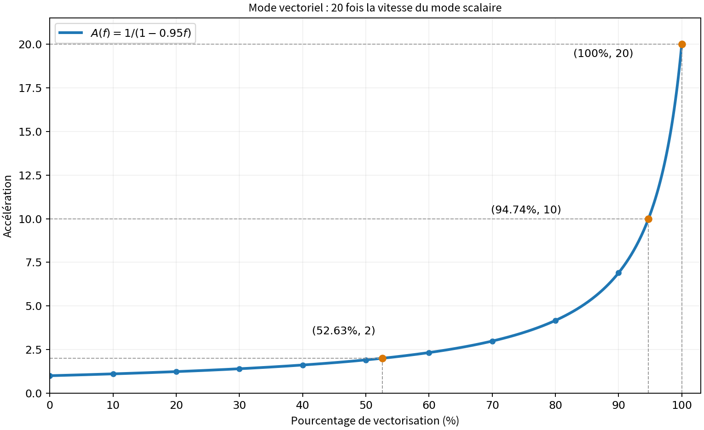

# Accélération et vectorisation 加速比与向量化

## Index des exercices croisés 交叉题索引

Les exercices ci-dessous restent entiers dans leur catégorie principale ; seules les questions associées sont indexées ici. 下列大题完整收录于各自主类别，本处只列相关小问的索引，不重复题干或答案。

- **TD1 §2.2** — questions associées 关联小问：(e)。

  Corrigé complet 完整题解：[《02_指令吞吐与基准比较》— 2 Ajout d'un coprocesseur 新增浮点协处理器](02_指令吞吐与基准比较.md#exercise-td1-2-2)。

- **Examen 2023 ex.2 2023 年第 2 题** — questions associées 关联小问：Q2。

  Corrigé complet 完整题解：[《02_指令吞吐与基准比较》— 3 Benchmarks et moyennes 基准程序与平均性能](02_指令吞吐与基准比较.md#exercise-exam2023-2)。

- **TD1 §4.1** — questions associées 关联小问：(a–b)。

  Corrigé complet 完整题解：[《03_Karp_Flatt与扩展性》— 1 Cray Y-MP/8](03_Karp_Flatt与扩展性.md#exercise-td1-4-1)。

- **TD1 §4.2** — questions associées 关联小问：(a–b)。

  Corrigé complet 完整题解：[《03_Karp_Flatt与扩展性》— 2 Aliant FX/40](03_Karp_Flatt与扩展性.md#exercise-td1-4-2)。

- **Examen 2025 ex.1 2025 年第 1 题** — questions associées 关联小问：Q8。

  Corrigé complet 完整题解：[《04_排队网络与资源优化》— 4 Remplacements de ressources 资源替换与投资收益](04_排队网络与资源优化.md#exercise-exam2025-1)。

Reconnaître le modèle : taille fixe pour Amdahl, problème agrandi pour Gustafson, amélioration partielle pour la vectorisation. 先识别模型：固定规模用 Amdahl，扩大规模用 Gustafson，局部加速用向量化模型。

Corrigés de travail vérifiés, distincts d'un corrigé officiel. Les hypothèses utiles sont précisées avec chaque solution. 本资料为经计算核对的学习题解，不是教师标准答案。各题解答中写明所用假设。

## Méthode commune 通用方法

$$
S(P)=\frac{T_1}{T_P},\quad E=\frac SP,\quad S_A=\frac1{s+(1-s)/P},\quad S_G=P-(P-1)s_p.
$$

Dans Amdahl, s est mesuré sur le temps séquentiel ; dans Gustafson, $s_p$ est mesuré sur le temps parallèle. Amdahl 的串行比例以串行运行时间为基准，Gustafson 的比例以并行运行时间为基准。

## 1 Amdahl avec 4 % de séquentiel 串行比例 4%

Source : TD1 §1.1, PDF p.1 来源：TD1 §1.1, PDF p.1

### Énoncé 题目

La fraction séquentielle d'une application représente 4% du temps d'exécution sur un processeur. Calculer l'accélération et l'efficacité sur un multiprocesseur de $2^n$ processeurs $2\le n\le7$ . Quelle est la borne supérieure de l'accélération ? 一个应用的串行部分占其在单处理器上执行时间的 4%。计算该应用在配备 $2^n$ 个处理器的多处理器系统上的加速比和并行效率，其中 $2\le n\le7$。加速比的上限是多少？

### Corrigé détaillé 逐步解答

Le temps relatif vaut $0.04+0.96/P$. Calculer $S$ puis $E$ pour chaque $P$. 相对耗时为 $0.04+0.96/P$，先求加速比，再除以处理器数得到效率。

| P | S | E (%) |
|---|---|---|
| 4 | 3.5714 | 89.29 |
| 8 | 6.2500 | 78.12 |
| 16 | 10.0000 | 62.50 |
| 32 | 14.2857 | 44.64 |
| 64 | 18.1818 | 28.41 |
| 128 | 21.0526 | 16.45 |

$$
\lim_{P\to\infty}S(P)=1/0.04=25.
$$

La borne 25 est une limite, non une valeur atteinte à $P$ fini. 25 是上确界，有限处理器数时达不到。

## 2 Inverser Amdahl 反求串行比例

Source : TD1 §1.2, PDF p.1 来源：TD1 §1.2, PDF p.1

### Énoncé 题目

La mesure des accélérations des programmes A et B fournit les résultats suivants : 测得程序 A 和 B 的加速比如下：

| Procs 处理器数量 | 2 | 3 | 4 | 5 | 6 | 7 | 8 |
| --- | --- | --- | --- | --- | --- | --- | --- |
| $\mathrm{Acc}_A$ | 1.9 | 2.73 | 3.47 | 4.16 | 4.8 | 5.38 | 5.93 |
| $\mathrm{Acc}_B$ | 1.94 | 2.72 | 3.34 | 3.82 | 4.2 | 4.49 | 4.72 |

Calculer la fraction séquentielle pour chacune des exécutions. Comment peut-on décrire le comportement parallèle des deux programmes ? 计算每次执行对应的串行比例。如何描述这两个程序的并行性能表现？ **(Catégorie associée : Karp-Flatt et passage à l'échelle 关联类别：Karp–Flatt 与扩展性)**

### Corrigé détaillé 逐步解答

$$
s_\mathrm{eff}(P)=\frac{1/S(P)-1/P}{1-1/P}=\frac{P/S(P)-1}{P-1}.
$$

| P | A : $s_{eff}$ (%) | B : $s_{eff}$ (%) |
|---|---|---|
| 2 | 5.2632 | 3.0928 |
| 3 | 4.9451 | 5.1471 |
| 4 | 5.0913 | 6.5868 |
| 5 | 5.0481 | 7.7225 |
| 6 | 5.0000 | 8.5714 |
| 7 | 5.0186 | 9.3170 |
| 8 | 4.9868 | 9.9274 |

A reste proche de 5 % : ses mesures sont compatibles avec une fraction effective presque constante. Pour B, elle passe de 3.09 % à 9.93 %, signe de coûts croissants absorbés par le modèle. A 的有效串行比例约为 5%，与近似固定比例的模型相符；B 从 3.09% 升至 9.93%，表明模型吸收的额外开销随并行规模增大。

A passe mieux à l'échelle sur les valeurs mesurées. Les temps séquentiels manquent pour classer leurs vitesses absolues ; cette fraction effective ne mesure pas à elle seule le code intrinsèquement séquentiel. 在测得的范围内 A 扩展性更好。缺少两程序各自的串行耗时，尚不能比较绝对速度；有效串行比例也不能单独代表代码固有的串行部分。

## 3 Expression générale 一般表达式

Source : TD1 §1.3(a–c), PDF p.1 来源：TD1 §1.3(a–c), PDF p.1

### Énoncé 题目

On supposera qu'une machine parallèle (multiprocesseurs) à p processeurs permet de diviser par $p$ le temps d'exécution d'une fraction de code parallélisé. On appellera $T_1$ le temps d'exécution d'un programme sur un processeur et $T_p$ celui sur p processeurs. 假设一台配备 $p$ 个处理器的并行机器（多处理器系统），能够将代码中可并行部分的执行时间缩短为原来的 $1/p$。记程序在单处理器上的执行时间为 $T_1$，在 $p$ 个处理器上的执行时间为 $T_p$。

**(a)** Sachant que seq est la fraction séquentielle du programme à paralléliser, exprimez l'accélération pour une machine parallèle à p processeurs. Quelle est l'accélération maximale envisageable ? 已知待并行化程序的串行比例为 $\mathrm{seq}$，写出该程序在配备 $p$ 个处理器的并行机器上的加速比表达式。可能达到的最大加速比是多少？

**(b)** Quelle est l'accélération pour une machine dotée d'un très grand nombre de processeurs ? 当机器配备的处理器数量非常大时，加速比是多少？

**(c)** Si seq est inversement proportionnelle à la taille n du code (nombre d'instructions). Calculez alors l'accélération. Quelle est l'accélération pour un très grand code ? 如果 $\mathrm{seq}$ 与代码规模 $n$（指令数量）成反比，计算此时的加速比。当代码规模非常大时，加速比是多少？

### Corrigé détaillé 逐步解答

Le temps séquentiel $T_1$ se décompose en une partie séquentielle $sT_1$ incompressible et une partie parallélisable $(1-s)T_1$ idéalement répartie à parts égales entre les $P$ processeurs : 串行总耗时 $T_1$ 分为无法分摊的串行部分 $sT_1$，以及理想情况下由 $P$ 个处理器均分的并行部分 $(1-s)T_1$：

$$
T_P=T_1\left[s+\frac{1-s}{P}\right],\quad S=\frac{T_1}{T_P}=\frac{1}{s+(1-s)/P}=\frac{P}{1+(P-1)s}\le P.
$$

(a) « Maximale envisageable » signifie ici **idéale** : on néglige le coût lié à la parallélisation ($C_t(\mathrm{seq},P)=0$, ni communication ni synchronisation), comme le précise l'énoncé (« diviser par $p$ le temps … de la fraction parallélisée »). L'accélération maximale est donc la loi d'Amdahl simple ci-dessus : (a) “可能达到的最大加速比”在本题指**理想加速比**：忽略并行化的额外开销（$C_t(\mathrm{seq},P)=0$，无通信、无同步），这正是题设“并行部分耗时恰好除以 $p$”的含义。因此最大加速比就是上式的简单 Amdahl 定律：

$$
\mathrm{Acc}_{\max}(P)=\frac{1}{\mathrm{seq}+\dfrac{1-\mathrm{seq}}{P}}\;\le P,\qquad\text{alors que réellement 实际上}\quad \mathrm{Acc}(P)=\frac{1}{\mathrm{seq}+\dfrac{1-\mathrm{seq}}{P}+C_t(\mathrm{seq},P)}.
$$

$$
(b)\quad \lim_{P\to\infty}S=\frac{1}{s}\quad(s>0).
$$

À taille de problème fixée, lorsque $P\to\infty$, le temps parallèle $(1-s)T_1/P$ tend vers $0$, mais la fraction séquentielle $s$ subsiste et plafonne l'accélération à $1/s$ (si $s=0$, la borne croît indéfiniment avec $P$). 固定问题规模并增加处理器数时，并行部分耗时趋于 $0$，但串行比例 $s$ 保持不变，故加速比受限于 $1/s$（若 $s=0$，理想加速比随 $P$ 无限增长）。

$$
(c)\quad s=\frac{k}{n}\Longrightarrow S(P,n)=\frac{P}{1+(P-1)k/n}=\frac{nP}{n+k(P-1)},\qquad\lim_{n\to\infty}S(P,n)=P.
$$

La proportionnalité inverse impose une constante $k$ ($s=k/n$) ; la correction du cours prend $k=1$, soit $\mathrm{seq}=1/n$ et $S=\dfrac{1}{1/n+(1-1/n)/P}$, avec la même limite $P$. Contrairement au cas (b), on fixe ici $P$ et on agrandit la taille du code $n\to\infty$ : la fraction séquentielle $s=k/n$ tend vers $0$, de sorte que l'accélération tend vers l'idéal $P$. “反比”应写成 $s=k/n$（$k$ 为常数）；课堂取 $k=1$，即 $s=1/n$，是其中一种特例，极限同样为 $P$。与 (b) 不同，此处固定处理器数 $P$ 并令代码规模 $n\to\infty$：串行比例 $s=k/n$ 趋于 $0$，因此加速比趋于理想值 $P$。

## 4 Vectorisation 向量化

Source : TD1 §1.4(a–d), PDF p.1–2 来源：TD1 §1.4(a–d), PDF p.1–2

### Énoncé 题目

Un mode d'exécution vectoriel est un mode dans lequel on effectue des opérations de haut niveau portant sur des vecteurs au même titre que l'on manipule habituellement des opérations sur de simples scalaires. 向量执行模式允许对向量进行高级运算，就像通常对单个标量进行运算一样。

Pour cet exercice, on considèrera l'amélioration d'une machine liée à l'ajout d'un mode vectoriel. Quand un code s'exécute en mode vectoriel, il est 20 fois plus rapide qu'en mode scalaire. 本题研究为机器增加向量模式所带来的性能提升。当代码以向量模式执行时，其速度是标量模式的 20 倍。

Le pourcentage du nombre d'opérations effectuées en mode vectoriel est appelé pourcentage de vectorisation. 以向量模式执行的运算数量占总运算数量的百分比，称为向量化百分比。

**(a)** Tracez un graphe donnant l'accélération liée au calcul réalisé en mode vectoriel en fonction du pourcentage de vectorisation. 绘制使用向量模式后，加速比随向量化百分比变化的曲线。

**(b)** Quel est le pourcentage de vectorisation nécessaire pour obtenir une accélération de 2 ? 要获得 2 倍加速比，所需的向量化百分比是多少？

**(c)** L'accélération est maximale lorsque la totalité des instructions est effectuée en mode vectoriel. Quel est le pourcentage de vectorisation nécessaire pour obtenir la moitié de cette accélération maximale ? 当所有指令都以向量模式执行时，加速比达到最大值。要获得这一最大加速比的一半，所需的向量化百分比是多少？

**(d)** Le pourcentage de vectorisation mesuré pour les programmes est de 70%. On peut augmenter les performances en doublant la vitesse du mode vectoriel par l'intégration d'un nouveau dispositif matériel. En l'absence d'un tel dispositif, comment pourrait-on assurer les mêmes performances ? 测得程序的向量化百分比为 70%。通过加入一个新的硬件装置，可以将向量模式的执行速度提高到原来的两倍，从而提升性能。如果不使用这个装置，如何达到相同的性能？

### Corrigé détaillé 逐步解答

En supposant un coût scalaire uniforme par opération, la proportion d'opérations vectorisées $f$ représente aussi la fraction du temps scalaire initial $T_s$. La partie restée en mode scalaire conserve sa durée $(1-f)T_s$, tandis que la partie vectorisée (20 fois plus rapide) voit sa durée divisée par 20, soit $(f/20)T_s$. Le temps relatif vaut donc $(1-f)+f/20$ : 假设每次运算在标量模式下的耗时相同，则向量化运算比例 $f$ 也等于其在原标量总时间 $T_s$ 中所占的比例。非向量化部分耗时仍为 $(1-f)T_s$，向量化部分速度提高为 20 倍，耗时缩短为原来的 $1/20$，即 $(f/20)T_s$，故相对执行时间为 $(1-f)+f/20$：

$$
(a)\quad S(f)=\frac{T_s}{T_v(f)}=\frac1{(1-f)+f/20},\quad 0\le f\le1.
$$

| f (%) | 0 | 20 | 40 | 60 | 70 | 80 | 90 | 100 |
|---|---|---|---|---|---|---|---|---|
| S | 1 | 1.2346 | 1.6129 | 2.3256 | 2.9851 | 4.1667 | 6.8966 | 20 |

$$
(b)\quad S(f)=2\Longleftrightarrow (1-f)+\frac{f}{20}=\frac12\Longrightarrow f=\frac{1-1/2}{1-1/20}=\frac{10}{19}=52.6316\%.
$$

$$
(c)\quad S_{\max}=S(1)=20,\quad S(f)=\frac{S_{\max}}{2}=10\Longrightarrow (1-f)+\frac{f}{20}=\frac1{10}\Longrightarrow f=\frac{18}{19}=94.7368\%.
$$

(d) Avec le nouveau dispositif doublant la vitesse vectorielle (facteur $2\times20=40$) à $f=70\%$, le temps relatif devient : (d) 加入新硬件后，向量模式速度翻倍（即标量模式的 $2\times20=40$ 倍），在 $f=70\%$ 下相对执行时间为：

$$
T_{\mathrm{new}}/T_s=(1-0.70)+0.70/40=0.30+0.0175=0.3175,\quad S_{\mathrm{new}}=1/0.3175=3.149606.
$$

Pour obtenir la même performance sans ce matériel (facteur vectoriel restant égal à 20), il faut que le nouveau taux de vectorisation $f'$ donne exactement le même temps d'exécution relatif pour le même travail : 若不使用新硬件（向量加速倍数仍为 20），要达到相同性能，必须使提高向量化比例至 $f'$ 后的相对执行时间与新硬件相等：

$$
(1-f^{\prime})+f^{\prime}/20=0.3175\Longrightarrow \frac{19}{20}f^{\prime}=0.6825\Longrightarrow f^{\prime}=0.718421.
$$

Sans nouveau matériel, il faut donc porter $f$ de 70 % à 71.8421 % (+1.8421 point, gain global d'environ 5.51 %). 不购买新硬件时，需通过编译器或代码改造将向量化比例从 70% 提升至 71.8421%（增加 1.8421 个百分点，整体性能提升约 5.51%）。

## 5 Gustafson–Barsis 规模扩展加速比

Source : TD1 §3.1–3.2, PDF p.4 ; examen 2025 ex.2 Q1–2, p.2 来源：TD1 §3.1–3.2, PDF p.4 ; examen 2025 ex.2 Q1–2, p.2

### Énoncé 题目

*Page 2 du sujet. 对应原卷第 2 页。*

La métrique de Gustafson–Barsis sert à calculer la capacité d'exécuter un code plus grand dans la même durée d'exécution que le problème initial en utilisant plus de processeurs. Ici, c'est le cas d'un passage du séquentiel (un processeur) à $P$ processeurs ($P>1$) d'un code dont la fraction séquentielle est $seq$. Ce passage s'accompagne d'une accélération de mise à l'échelle (*scaled speedup*), telle que : Gustafson–Barsis 指标用于衡量：使用更多处理器，在与初始问题相同的执行时间内，能够运行多大规模的程序。这里考虑将一个顺序部分比例为 $seq$ 的程序，从顺序执行（1 个处理器）扩展到 $P$ 个处理器（$P>1$）。这一扩展对应的规模扩展加速比为：

$$
Acc(\mathrm{scaled})\leq P+(1-P)\times seq.
$$

> **Note de transcription :** la photographie utilise $P$ dans le paragraphe et $p$ dans la formule. La transcription uniformise cette notation en $P$ et conserve le signe $\leq$ de l'original. **转录校注：**原图正文用大写 $P$ 表示处理器数，公式中改用小写 $p$；此处统一为大写 $P$，保留原图中的 $\leq$。

#### Questions 问题

1. Quelle est l'accélération selon Gustafson–Barsis (*scaled speedup*) pour une application s'exécutant sur huit processeurs et qui passe 14 % de son temps à exécuter sa partie séquentielle ? 某应用在 8 个处理器上运行，执行顺序部分的时间占总执行时间的 14%。根据 Gustafson–Barsis 定律，其规模扩展加速比是多少？

2. Quelle est la fraction séquentielle maximale que l'on puisse tolérer pour garder au moins la même accélération (*scaled speedup*) quand le nombre de processeurs passe à dix ? 当处理器数量增加到 10 时，为使规模扩展加速比至少保持与上一问相同的水平，顺序部分的比例最大可以是多少？

### Corrigé détaillé 逐步解答

$$
1.\quad S_G(8)=8-7\times0.14=7.02.
$$

$$
2.\quad 10-9s\ge7.02\Longrightarrow s\le\frac{2.98}{9}=0.331111\approx33.1111\%.
$$

Ce sont les valeurs du modèle idéal de Gustafson. Le signe « ≤ » de l'énoncé exprime une borne ; sans hypothèse d'absence de surcoûts, atteindre cette borne n'est pas garanti. 以上为 Gustafson 理想模型值。原题的“≤”表示上界；若不假设额外开销可忽略，不能保证实际达到该值。

