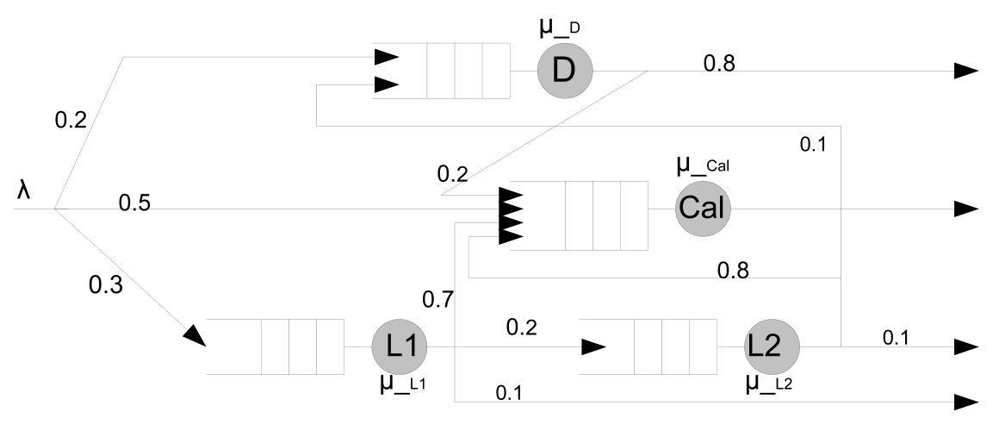
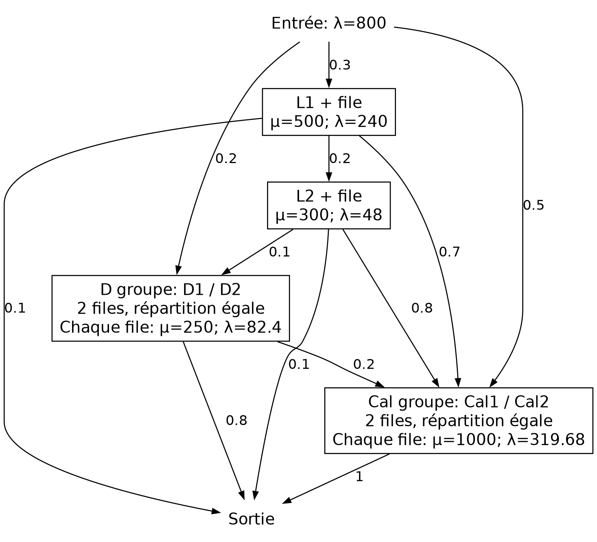
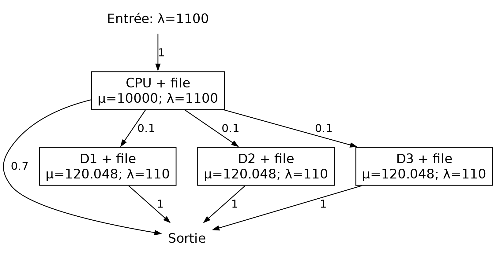
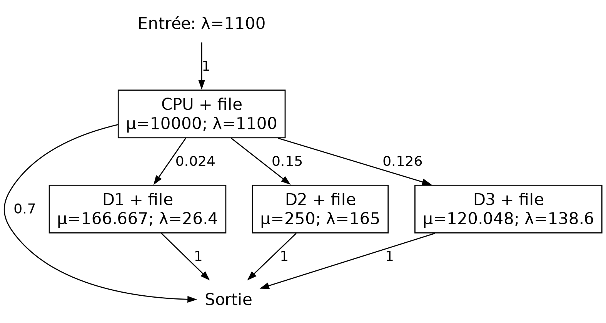
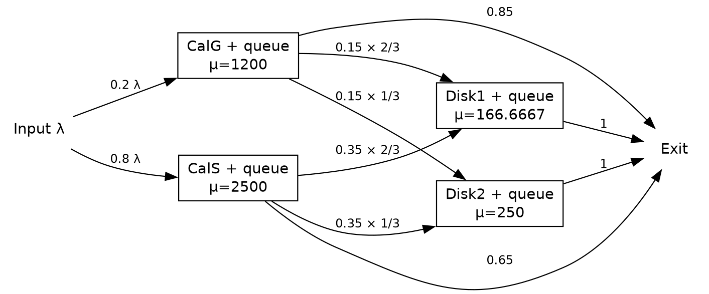
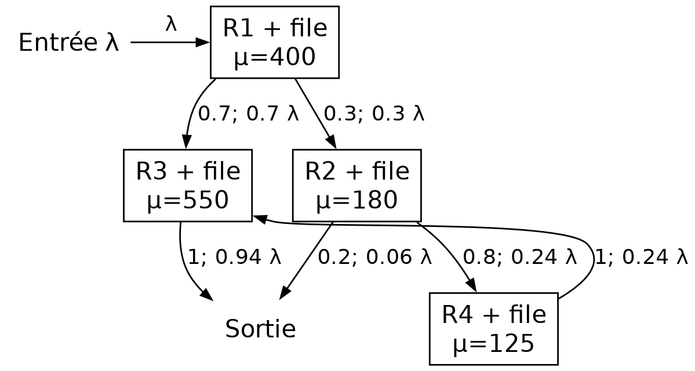

# Réseaux de files et optimisation 排队网络与资源优化

Établir les flux avant de calculer les temps. Les solutions numériques utilisent des stations M/M/1 indépendantes au sens du modèle de réseau ouvert, avec arrivées poissoniennes, services exponentiels, files infinies et routage indépendant. 先求流量，再求时间。数值解采用开放排队网络的 M/M/1 站点模型，假设泊松到达、指数服务、无限队列及独立路由。

Corrigés de travail vérifiés, distincts d'un corrigé officiel. Les hypothèses utiles sont précisées avec chaque solution. 本资料为经计算核对的学习题解，不是教师标准答案。各题解答中写明所用假设。

## Recette de calcul 解题步骤

$$
\lambda_i=e_i+\sum_j\lambda_jp_{ji},\quad v_i=\lambda_i/\lambda,\quad\rho_i=\lambda_i/\mu_i<1.
$$

$$
s_i=1/\mu_i,\quad w_i=\frac{\lambda_i}{\mu_i(\mu_i-\lambda_i)},\quad r_i=\frac1{\mu_i-\lambda_i}=w_i+s_i.
$$

$$
W=\sum_iv_iw_i,\quad S=\sum_iv_is_i,\quad R=\sum_iv_ir_i=W+S,\quad N=\lambda R.
$$

Les poids sont des nombres moyens de visites, pas une normalisation par la somme des arrivées internes. Pour une classe conditionnelle, utiliser ses probabilités de trajet. Vérifier la stabilité de chaque station avant toute formule stationnaire. 权重是每个外部请求的平均访问次数，不能用内部到达率之和归一化。对条件类别使用该类别的路径概率。任何稳态计算之前，都要逐站检查稳定性。

## 1 Routage et duplication 路由与服务器复制

Source : TD3 ex.1 Q1–6, PDF p.1–2 来源：TD3 ex.1 Q1–6, PDF p.1–2

### Énoncé 题目

Soit le système modélisé par le réseau de files d'attente de la figure 1. Le flux des instructions alimente le système à un taux $\lambda$. Ces instructions sont dirigées, selon leur type, vers les files correspondantes afin d'y être traitées. Les probabilités de routage, les taux de service des différents serveurs et les autres caractéristiques du modèle sont représentés sur la figure 1. 考虑图 1 所示排队网络建模的系统。指令流以速率 $\lambda$ 进入系统，各条指令根据类型被送往相应队列接受处理。路由概率、各服务节点的服务率以及模型的其他特征均标在图 1 中。

Les taux de service du système initial sont : 初始系统中各服务节点的服务率如下：

| Serveur 服务节点 | Taux de service 服务率 |
|---|---|
| L1 | $\mu_{L1}=500\ \mathrm{instr/s}$ |
| L2 | $\mu_{L2}=300\ \mathrm{instr/s}$ |
| D | $\mu_D=250\ \mathrm{instr/s}$ |
| Cal | $\mu_{\mathrm{Cal}}=1000\ \mathrm{instr/s}$ |

On souhaite calculer les indicateurs de performance de ce système. 其中，$\mathrm{instr/s}$ 表示每秒处理的指令数。现要求计算该系统的性能指标。

#### Questions 问题

1. Donnez les conditions de stabilité de ce système. 给出该系统的稳定性条件。

2. Sachant que $\lambda=800\ \mathrm{instr/s}$, vérifiez la stabilité du système. 已知 $\lambda=800\ \mathrm{instr/s}$，判断该系统是否稳定。

3. Quel est le temps d'attente moyen à chacune des files d'attente ? 各队列中的平均等待时间（temps d'attente moyen）分别是多少？

4. Quel est le temps de réponse moyen à chacune des files d'attente ? 各排队节点的平均响应时间（temps de réponse moyen）分别是多少？

5. Quel est le temps de réponse moyen pour l'instruction la plus longue ? Justifiez votre réponse en décrivant son exécution. 耗时最长的指令，其平均响应时间是多少？请描述该指令的执行过程，并说明理由。

6. Si un serveur est utilisé à plus de $60\%$, on le duplique et on associe une file à chacun des deux serveurs, en leur distribuant équitablement le flux entrant des instructions. Donnez le nouveau modèle issu de l'application de cette règle au modèle de la figure 1. 如果某个服务节点的利用率超过 $60\%$，就复制该服务节点，并为两个服务节点各配置一个独立队列，将进入该节点的指令流均匀分配给两者。将这一规则应用于图 1，给出调整后的模型。

### Corrigé détaillé 逐步解答

Q1. Lire les arcs du schéma et additionner tous les flux reçus. 第 1 问：按图中的路由逐项加总输入流量。

$$
\lambda_{L1}=0.3\lambda,\quad\lambda_{L2}=0.2(0.3\lambda)=0.06\lambda,
$$

$$
\lambda_D=0.2\lambda+0.1(0.06\lambda)=0.206\lambda,
$$

$$
\lambda_{Cal}=0.5\lambda+0.7(0.3\lambda)+0.8(0.06\lambda)+0.2(0.206\lambda)=0.7992\lambda.
$$

$$
\lambda<\min\left(\frac{500}{0.3},\frac{300}{0.06},\frac{250}{0.206},\frac{1000}{0.7992}\right)=1213.592233\ {\rm instr/s}.
$$

Q2–4. À λ=800, les quatre utilisations sont inférieures à 1 ; le réseau est stable. 第 2–4 问：λ=800 时四个利用率均小于 1，网络稳定。

| Nœud 节点 | $\lambda_i$ | $\mu_i$ | $\rho_i$ | $w_i$ (ms) | $r_i$ (ms) |
|---|---|---|---|---|---|
| L1 | 240.0000 | 500.0000 | 0.480000 | 1.8462 | 3.8462 |
| L2 | 48.0000 | 300.0000 | 0.160000 | 0.6349 | 3.9683 |
| D | 164.8000 | 250.0000 | 0.659200 | 7.7371 | 11.7371 |
| Cal | 639.3600 | 1000.0000 | 0.639360 | 1.7728 | 2.7728 |

Q5. Le trajet à plus grande durée moyenne est L1 → L2 → D → Cal → sortie. 第 5 问：平均耗时最长的可行路径为 L1 → L2 → D → Cal → 出口。

$$
r_{long}=3.846154+3.968254+11.737089+2.772848=22.324344\ {\rm ms}.
$$

Il s'agit d'une moyenne conditionnelle au trajet, pas d'une borne sur la durée aléatoire d'une instruction. 这里比较的是不同路径的平均响应时间，不是单个请求随机耗时的最大上界。

Q6. D et Cal dépassent 60 % ; dupliquer chacun avec une file séparée par serveur et partager leurs arrivées par moitié. 第 6 问：D 与 Cal 超过 60%，分别复制，每台服务器保留独立队列，输入流量各分一半。

| Serveur 服务器 | $\lambda_i$ | $\mu_i$ | $\rho_i$ |
|---|---|---|---|
| D1, D2 | 82.4 | 250 | 0.3296 |
| Cal1, Cal2 | 319.68 | 1000 | 0.31968 |

L1 et L2 restent inchangés. Chaque D envoie 20 % vers le groupe Cal et 80 % vers la sortie. La répartition vers Cal1/Cal2 reste équiprobable. L1、L2 不变；每个 D 将 20% 流量送至 Cal 组、80% 送出口，进入 Cal 组的流量再等分给两台服务器。

Deux files M/M/1 séparées ne sont pas une file commune M/M/2 : les modèles d'attente diffèrent. 两个独立 M/M/1 队列不等于一个公共队列的 M/M/2，不能混用等待公式。

## 2 CPU et trois disques CPU 与三个磁盘

Source : TD3 ex.2 parties I–II Q1–3, PDF p.2–3 来源：TD3 ex.2 parties I–II Q1–3, PDF p.2–3

### Énoncé 题目

#### Partie I : disques identiques 第一部分：相同磁盘

Soit un système composé d'un CPU et de trois disques. On lui soumet des instructions à exécuter à un taux : 一个系统由一个 CPU 和三个磁盘组成。指令以如下速率提交给系统：

$$
\lambda=1100\ \mathrm{instr/s}.
$$

Chaque instruction est automatiquement dirigée vers le CPU, qui l'exécute. Si elle nécessite une entrée/sortie (E/S), le CPU détermine le disque concerné et lui transmet l'instruction. 每条指令都先进入 CPU 执行。如果需要输入／输出操作（E/S），CPU 会确定目标磁盘，并将指令送往该磁盘。

- Sans E/S, l'exécution se termine immédiatement après le passage par le CPU. 不需要 E/S 的指令：经过 CPU 后执行结束。
- Avec E/S, l'exécution se termine après le passage par le disque. 需要 E/S 的指令：经过磁盘后执行结束。

Les programmes typiques exécutés sur ce système contiennent **70 % d'instructions ne nécessitant pas d'E/S**. Le CPU exécute en moyenne **$10^4$ instructions par seconde**. 在该系统运行的典型程序中，**70% 的指令不需要 E/S**。CPU 平均每秒执行 **$10^4$ 条指令**。

Les trois disques sont identiques : 三个磁盘的配置相同：

| Caractéristique 参数 | Valeur pour chaque disque 每个磁盘的数值 |
|---|---|
| Capacité 容量 | 300 GB |
| Temps moyen d'accès 平均访问时间 | 8,33 ms 8.33 ms |

Les données sont uniformément distribuées sur les disques, et les accès sont uniformément distribués sur les données. 数据均匀分布在三个磁盘上，对各数据的访问也是均匀的。

#### Questions 问题

1. Donnez le schéma représentant le système par un réseau de files d'attente. Précisez : 画出该系统的排队网络模型，并标明：
   - les taux d'arrivée dans chaque file : $\lambda_{\mathrm{CPU}}$, $\lambda_{\mathrm{Disk1}}$, $\lambda_{\mathrm{Disk2}}$, $\lambda_{\mathrm{Disk3}}$ ; 各队列的到达率：$\lambda_{\mathrm{CPU}}$、$\lambda_{\mathrm{Disk1}}$、$\lambda_{\mathrm{Disk2}}$、$\lambda_{\mathrm{Disk3}}$；
   - les taux de service : $\mu_{\mathrm{CPU}}$, $\mu_{\mathrm{Disk1}}$, $\mu_{\mathrm{Disk2}}$, $\mu_{\mathrm{Disk3}}$ ; 各服务节点的服务率：$\mu_{\mathrm{CPU}}$、$\mu_{\mathrm{Disk1}}$、$\mu_{\mathrm{Disk2}}$、$\mu_{\mathrm{Disk3}}$；
   - les probabilités de passage sur chaque arc du réseau. 网络中每条弧上的转移概率。

2. Calculez le temps d'attente moyen : 分别计算以下三类指令的平均等待时间：
   - d'une instruction ne nécessitant pas d'E/S ; 不需要 E/S 的指令；
   - d'une instruction d'E/S ; 需要 E/S 的指令；
   - d'une instruction quelconque. 任意一条指令。

3. Calculez le temps de réponse moyen : 分别计算以下三类指令的平均响应时间：
   - d'une instruction ne nécessitant pas d'E/S ; 不需要 E/S 的指令；
   - d'une instruction d'E/S ; 需要 E/S 的指令；
   - d'une instruction quelconque. 任意一条指令。

#### Partie II : disques différents 第二部分：异构磁盘

Les trois disques ont les caractéristiques suivantes : 三个磁盘的参数如下：

| Disque 磁盘 | Capacité (GB) 容量（GB） | Temps moyen d'accès 平均访问时间 |
|---|---:|---:|
| Disque 1 磁盘 1 | 80 | 6 ms |
| Disque 2 磁盘 2 | 500 | 4 ms |
| Disque 3 磁盘 3 | 420 | 8,33 ms 8.33 ms |

Les données sont distribuées sur les disques **proportionnellement à leurs capacités respectives**, et les accès sont uniformément distribués sur les données. 数据按各磁盘的**容量比例**分布，对各数据的访问仍然是均匀的。

#### Questions 问题

1. Donnez le schéma représentant le système par un réseau de files d'attente. Précisez : 画出该系统的排队网络模型，并标明：
   - les taux d'arrivée dans chaque file : $\lambda_{\mathrm{CPU}}$, $\lambda_{\mathrm{Disk1}}$, $\lambda_{\mathrm{Disk2}}$, $\lambda_{\mathrm{Disk3}}$ ; 各队列的到达率： $\lambda_{\mathrm{CPU}}$、$\lambda_{\mathrm{Disk1}}$、$\lambda_{\mathrm{Disk2}}$、$\lambda_{\mathrm{Disk3}}$ ；
   - les taux de service : $\mu_{\mathrm{CPU}}$, $\mu_{\mathrm{Disk1}}$, $\mu_{\mathrm{Disk2}}$, $\mu_{\mathrm{Disk3}}$ ; 各服务节点的服务率： $\mu_{\mathrm{CPU}}$、$\mu_{\mathrm{Disk1}}$、$\mu_{\mathrm{Disk2}}$、$\mu_{\mathrm{Disk3}}$ ；
   - les probabilités de passage sur chaque arc du réseau. 网络中每条弧上的转移概率。

2. Calculez le temps d'attente moyen : 分别计算以下三类指令的平均等待时间：
   - d'une instruction ne nécessitant pas d'E/S ; 不需要 E/S 的指令；
   - d'une instruction d'E/S ; 需要 E/S 的指令；
   - d'une instruction quelconque. 任意一条指令。

3. Calculez le temps de réponse moyen : 分别计算以下三类指令的平均响应时间：
   - d'une instruction ne nécessitant pas d'E/S ; 不需要 E/S 的指令；
   - d'une instruction d'E/S ; 需要 E/S 的指令；
   - d'une instruction quelconque. 任意一条指令。

   Qu'en déduisez-vous par rapport à la configuration de la partie I ?    与第一部分的配置相比，可以得出什么结论？

### Corrigé détaillé 逐步解答

#### Partie I 第一部分

Q1. CPU → sortie avec probabilité 0.7 ; CPU → chaque disque avec probabilité 0.1 ; chaque disque → sortie avec probabilité 1. 第 1 问：CPU 以概率 0.7 送出口，以概率 0.1 分别送往三个磁盘；每个磁盘完成后直接离开。

$$
\lambda_{CPU}=1100,\quad\lambda_{Di}=110,\quad\mu_{CPU}=10000,\quad\mu_D=1/0.00833=120.048019.
$$

| Nœud 节点 | $\lambda_i$ | $\mu_i$ | $\rho_i$ | $w_i$ (ms) | $r_i$ (ms) |
|---|---|---|---|---|---|
| CPU | 1100.0000 | 10000.0000 | 0.110000 | 0.0124 | 0.1124 |
| D1 | 110.0000 | 120.0480 | 0.916300 | 91.1921 | 99.5221 |
| D2 | 110.0000 | 120.0480 | 0.916300 | 91.1921 | 99.5221 |
| D3 | 110.0000 | 120.0480 | 0.916300 | 91.1921 | 99.5221 |

Q2–3. Une instruction I/O ne choisit qu'un disque : moyenner sur ces disques, sans les additionner comme trois visites. 第 2–3 问：一条 I/O 指令只经过一个磁盘，应对三个磁盘取条件平均，不能把三个磁盘都当作必经节点相加。

| Classe 类别 | W (ms) | R (ms) |
|---|---|---|
| Sans I/O 无I/O | 0.012360 | 0.112360 |
| Avec I/O 有I/O | 91.204462 | 99.634462 |
| Quelconque 任意 | 27.369990 | 29.968990 |

$$
W_{I/O}=w_{CPU}+w_D,\quad W=w_{CPU}+0.3w_D,\quad R=r_{CPU}+0.3r_D.
$$

Si l'on arrondit d'abord μD à 120, on trouve W≈27.512360 ms et R≈30.112360 ms. Les valeurs principales ci-dessus conservent exactement 8.33 ms ; près de la saturation, l'arrondi de μ amplifie l'écart. 若先把磁盘服务率舍入为 120，可得 W≈27.512360 ms、R≈30.112360 ms。上表则保留题面 8.33 ms；接近饱和时，服务率的提前舍入会放大结果差异。

#### Partie II 第二部分

$$
q=(80,500,420)/1000=(0.08,0.50,0.42),\quad p=0.3q=(0.024,0.15,0.126).
$$

$$
\lambda_i=(1100,26.4,165,138.6),\quad\mu_i=(10000,166.666667,250,120.048019).
$$

| Nœud 节点 | $\rho_i$ | État 状态 |
|---|---|---|
| CPU | 0.110000 | Stable 稳定 |
| D1 | 0.158400 | Stable 稳定 |
| D2 | 0.660000 | Stable 稳定 |
| D3 | 1.154538 | Instable 不稳定 |

Q2–3. Le disque 3 reçoit 138.6 instr/s mais ne sert que 120.048 instr/s : le réseau est instable. Il n'existe pas de W ni de R globaux stationnaires finis. 第 2–3 问：磁盘 3 到达率 138.6，高于服务率 120.048，网络不稳定，没有有限的全局稳态平均等待时间或响应时间。

$$
W_{sans\ I/O}=0.0123596\ {\rm ms},\qquad R_{sans\ I/O}=0.1123596\ {\rm ms}.
$$

Ces valeurs restent valables pour la classe sans I/O, qui ne dépend que du CPU stable. La classe I/O emprunte D3 avec probabilité 0.42 ; ses moyennes stationnaires ne sont pas finies. La partie I est donc préférable à λ=1100. 无 I/O 类只经过稳定的 CPU，上述平均值仍成立；I/O 类以概率 0.42 经过 D3，因此其稳态平均时间不有限。λ=1100 时第一部分配置更好。

## 3 Unités de calcul et disques 双计算单元与磁盘

Source : Examen 2023 ex.1 Q1–3, p.1 来源：Examen 2023 ex.1 Q1–3, p.1

### Énoncé 题目

*Page 1 du sujet. 对应原卷第 1 页。*

Soit un système composé de deux unités de calcul : $Cal_G$, en charge du calcul d'ordre général, et $Cal_S$, en charge d'un calcul spécifique, et de deux disques $Disk_1$ et $Disk_2$ servant au stockage des données. Les instructions des codes soumis à ce système passent d'abord par les unités de calcul et se répartissent entre elles selon les proportions de calcul général/spécifique qu'ils contiennent. Les deux unités de calcul ont accès aux données sur les disques. 考虑一个由两个计算单元和两个磁盘组成的系统。$Cal_G$ 负责通用计算，$Cal_S$ 负责专用计算；$Disk_1$ 和 $Disk_2$ 用于存储数据。提交到该系统的程序指令首先经过计算单元，并按照程序中通用计算与专用计算的比例，分配到相应单元。两个计算单元都可以访问磁盘中的数据。

Pour $Cal_G$, 85 % des instructions exécutées se terminent et quittent le système, et le reste accède à l'espace de stockage, tandis que pour $Cal_S$, 65 % des instructions exécutées se terminent et quittent le système, et le reste accède à l'espace de stockage. Les données sont uniformément distribuées sur l'espace de stockage composé par les deux disques et les accès aux disques finalisent l'exécution des instructions. 在 $Cal_G$ 上执行的指令中，85% 执行完毕后直接离开系统，其余指令需要访问存储空间；在 $Cal_S$ 上执行的指令中，65% 执行完毕后直接离开系统，其余指令需要访问存储空间。数据均匀分布在两个磁盘共同组成的存储空间中，指令访问磁盘后即完成执行。

Les codes types exécutés sur ce système contiennent en moyenne 80 % de calcul spécifique. $Cal_G$ exécute $1200\ \mathrm{instr/s}$ alors que $Cal_S$ exécute $2500\ \mathrm{instr/s}$. $Disk_1$ a une capacité de 1 TB avec un temps d'accès moyen de 6 ms, alors que $Disk_2$ n'a que 500 GB avec un temps d'accès moyen de 4 ms. 该系统执行的典型程序平均包含 80% 的专用计算。$Cal_G$ 每秒执行 1200 条指令，$Cal_S$ 每秒执行 2500 条指令。$Disk_1$ 的容量为 1 TB，平均访问时间为 6 ms；$Disk_2$ 的容量只有 500 GB，平均访问时间为 4 ms。

#### Questions 问题

1. Donnez un schéma pour le système décrit ci-dessus. Il est impératif de détailler les différents serveurs et files associées ainsi que les connexions entre elles. L'ensemble doit être accompagné de labels précisant les fréquences en entrée, les taux de service et les probabilités de répartition. 画出上述系统的模型图。必须详细标出各服务节点及对应队列，以及它们之间的连接关系。图中应标注输入流率、服务率和分流概率。

2. Quelle est la limite supérieure de la fréquence en entrée supportée par ce système pour assurer sa stabilité ? 为保证系统稳定，系统所能承受的输入流率上限是多少？

3. On considère une fréquence d'arrivée initiale de $1000\ \mathrm{instr/s}$ et on change les serveurs pour lesquels le temps moyen d'attente est supérieur au temps moyen de service. Quels sont les serveurs concernés ? Justifiez votre réponse numériquement, étape par étape. 设初始到达率为 $1000\ \mathrm{instr/s}$。如果某个服务节点的平均等待时间大于平均服务时间，就更换该节点。哪些节点需要更换？请逐步给出数值计算并说明理由。

### Corrigé détaillé 逐步解答

Q1. Avec 1 TB=1000 GB, la capacité donne les probabilités de disques 2/3 et 1/3. 第 1 问：采用 1 TB=1000 GB，按容量分配得到磁盘概率 2/3 与 1/3。

$$
\lambda_G=0.2\lambda,\quad\lambda_S=0.8\lambda,\quad\lambda_{stock}=(0.2\times0.15+0.8\times0.35)\lambda=0.31\lambda.
$$

$$
\lambda_{D1}=\frac{31}{150}\lambda,\quad\lambda_{D2}=\frac{31}{300}\lambda,\quad\mu=(1200,2500,166.666667,250).
$$

$$
Q2:\quad \lambda<\min\left(6000,3125,\frac{25000}{31},\frac{75000}{31}\right)=806.451613\ {\rm instr/s}.
$$

La valeur 806.451613 est la borne supérieure ; l'égalité n'est pas stable. 806.451613 是上确界，取等号时仍不稳定。

| Nœud 节点 | $\lambda_i$ à 1000 | $\rho_i$ |
|---|---|---|
| CalG | 200.000000 | 0.166667 |
| CalS | 800.000000 | 0.320000 |
| D1 | 206.666667 | 1.240000 |
| D2 | 103.333333 | 0.413333 |

Q3. Disk1 est déjà surchargé : sa moyenne stationnaire d'attente n'existe pas, et il doit être remplacé pour stabiliser le réseau. Les autres stations ont ρ<1/2, donc w<s. 第 3 问：Disk1 已过载，其稳态平均等待时间不存在，必须更换以恢复稳定；其他站点均满足 ρ<1/2，故 w<s。

$$
\frac{w_i}{s_i}=\frac{\rho_i}{1-\rho_i},\quad w_i>s_i\Longleftrightarrow\rho_i>1/2\quad(\rho_i<1).
$$

$$
\mu_{D1,new}>206.666667\ \text{pour stabilité},\qquad\mu_{D1,new}\ge413.333333\ \text{pour }w\le s.
$$

Un accès moyen au plus égal à 2.419355 ms satisfait le second objectif. Ne pas substituer ρ>1 dans une formule stable : cela produirait un temps négatif sans signification. 若还要求等待不超过服务，平均访问时间须不大于 2.419355 ms。不能把 ρ>1 代入稳态公式，得到的负时间没有意义。

## 4 Remplacements de ressources 资源替换与投资收益

Source : Examen 2025 ex.1 Q1–9 et sous-questions, p.1–2 来源：Examen 2025 ex.1 Q1–9 et sous-questions, p.1–2

### Énoncé 题目

*Questions 1 à 5 : page 1 ; questions 6 à 9 : page 2. 第 1–5 问对应原卷第 1 页，第 6–9 问对应原卷第 2 页。*

On considère un système en charge de traiter un flux de tâches arrivant à une fréquence $\lambda$ exprimée en $\mathrm{instr/s}$. Ce système contient quatre ressources numérotées de $R_1$ à $R_4$, avec des taux de service de $\mu_{R_1}$ à $\mu_{R_4}$ respectivement. On sait que : 考虑一个处理任务流的系统，任务以到达率 $\lambda$ 进入，单位为 $\mathrm{instr/s}$。系统包含 4 个资源，编号为 $R_1$ 至 $R_4$，对应的服务率分别为 $\mu_{R_1}$ 至 $\mu_{R_4}$。已知：

$$
\mu_{R_1}=400\ \mathrm{instr/s},\qquad
\mu_{R_2}=180\ \mathrm{instr/s},\qquad
\mu_{R_3}=550\ \mathrm{instr/s},\qquad
\mu_{R_4}=125\ \mathrm{instr/s}.
$$

Chacune de ces ressources est associée à une file d'attente. 每个资源都关联一个等待队列。

À l'entrée de ce système, la ressource $R_1$ reçoit les tâches à une fréquence $\lambda$ et les dirige vers les ressources de calcul $R_2$ et $R_3$ à hauteur de 30 % et 70 % respectivement. 在系统入口处，资源 $R_1$ 以到达率 $\lambda$ 接收任务，然后按 30% 和 70% 的比例，分别将任务送往计算资源 $R_2$ 和 $R_3$。

À la sortie de la ressource $R_2$, 80 % des instructions sont dirigées vers la ressource $R_4$ et les 20 % qui restent quittent le système. La ressource $R_3$ reçoit également en entrée toutes les instructions issues de la file associée à la ressource $R_4$. Après le passage par la file associée à $R_3$, toutes les instructions quittent le système. 从资源 $R_2$ 离开的指令中，80% 被送往资源 $R_4$，其余 20% 离开系统。资源 $R_3$ 还接收所有来自资源 $R_4$ 所关联队列的指令。指令经过 $R_3$ 所关联的队列后，全部离开系统。

#### Questions 问题

1. Donnez le schéma en réseau de files d'attente correspondant au système décrit ci-dessus. Il faut mentionner sur votre schéma l'ensemble des ressources ainsi que la valeur de la fréquence des flux sur toutes les transitions (entrée, sortie, intermédiaires). 画出上述系统对应的排队网络图。图中必须标明所有资源，以及每一条转移路径上的流率，包括入口、出口和中间路径。

2. Quelle condition pose-t-on sur la fréquence d'arrivée externe $\lambda$ pour que le système global soit stable ? 为使整个系统稳定，外部到达率 $\lambda$ 需要满足什么条件？

3. Pour le reste des questions, on suppose que $\lambda$ est de $320\ \mathrm{instr/s}$. Le système est-il stable ? 后续各问均假设 $\lambda=320\ \mathrm{instr/s}$。系统是否稳定？

4. Quel est le temps d'attente moyen du système ? Identifiez la ressource qui est majoritairement à l'origine de cette attente. 系统的平均等待时间是多少？指出造成等待时间的主要资源。

5. Pour réduire l'attente dans cette ressource identifiée, on propose de la remplacer par une ressource ayant le même mode de fonctionnement mais avec un taux de service doublé. 为减少在上述资源处的等待时间，拟将其替换为工作方式相同、但服务率加倍的资源。

   (a) Le système reste-t-il stable ? 系统是否仍然稳定？

   (b) Quel est le nouveau temps moyen d'attente au niveau de cette ressource, et celui du système global ? 该资源处新的平均等待时间是多少？整个系统新的平均等待时间是多少？

6. Quel est le temps de service moyen (après changement de la ressource identifiée dans la question précédente) ? Identifiez la ressource qui est majoritairement à l'origine de ce temps. 更换上一问确定的资源后，平均服务时间是多少？指出对这一时间贡献最大的资源。

7. Pour réduire le temps de service de cette ressource identifiée, on la remplace par une autre qui effectue le même service mais trois fois plus vite. 为减少上述资源的服务时间，将其替换为执行相同服务、但速度提高到原来 3 倍的另一资源。

   (a) Quel est le nouveau taux de service de cette nouvelle ressource ? 新资源的服务率是多少？

   (b) Quel est le nouveau temps de service moyen du système global ? 整个系统新的平均服务时间是多少？

8. Après ces deux remplacements, quel est le temps de réponse moyen du système global ? Quelle est l'accélération obtenue par rapport à la version initiale (avant les deux changements) ? 完成这两次替换后，整个系统的平均响应时间是多少？与初始版本（两次更换之前）相比，加速比是多少？ **(Catégorie associée : Accélération et vectorisation 关联类别：加速比与向量化)**

9. Sachant que les deux changements ont augmenté le coût du système global de 0,75 fois sa valeur initiale, est-ce que vous pensez que cet investissement est efficace ? Justifiez votre réponse. 已知这两次更换使整个系统的成本增加了初始成本的 0.75 倍。你认为这项投资是否有效？请说明理由。

### Corrigé détaillé 逐步解答

$$
Q1:\quad v=(1,0.3,0.7+0.3\times0.8,0.3\times0.8)=(1,0.3,0.94,0.24).
$$

$$
Q2:\quad\lambda<\min(400,180/0.3,550/0.94,125/0.24)=400.
$$

Q3. Pour λ=320, toutes les utilisations sont inférieures à 1. 第 3 问：λ=320 时所有站点利用率小于 1，系统稳定。

| Nœud 节点 | $\lambda_i$ | $\mu_i$ | $\rho_i$ | $w_i$ (ms) | $r_i$ (ms) |
|---|---|---|---|---|---|
| R1 | 320.0000 | 400.0000 | 0.800000 | 10.0000 | 12.5000 |
| R2 | 96.0000 | 180.0000 | 0.533333 | 6.3492 | 11.9048 |
| R3 | 300.8000 | 550.0000 | 0.546909 | 2.1947 | 4.0128 |
| R4 | 76.8000 | 125.0000 | 0.614400 | 12.7469 | 20.7469 |

Q4. Pour identifier l'origine de l'attente du système, comparer les contributions $v_iw_i$. 第 4 问：判断整个系统等待的主要来源，应比较 $v_iw_i$。

| Nœud 节点 | $v_i$ | $v_iw_i$ (ms) | $v_is_i$ (ms) |
|---|---|---|---|
| R1 | 1 | 10.000000 | 2.500000 |
| R2 | 0.3 | 1.904762 | 1.666667 |
| R3 | 0.94 | 2.062980 | 1.709091 |
| R4 | 0.24 | 3.059253 | 1.920000 |

$$
W_0=17.026995\ {\rm ms},\quad S_0=7.795758\ {\rm ms},\quad R_0=24.822752\ {\rm ms}.
$$

R1 contribue le plus à W, avec 10 ms par tâche externe. R4 a le plus grand w local, mais seules 24 % des tâches le visitent. R1 对全局 W 的贡献最大，为每个外部任务 10 ms。R4 的单站等待最长，但只有 24% 的任务访问它。

Q5. Doubler μ1 à 800 ; les arrivées ne changent pas. Le réseau reste stable, avec λ<520.833333. 第 5 问：将 μ1 翻倍至 800，到达率不变；网络仍稳定，新的稳定条件为 λ<520.833333。

$$
w_{1,new}=\frac{320}{800(800-320)}=0.833333\ {\rm ms},\quad W_1=7.860328\ {\rm ms}.
$$

Q6. Après ce remplacement, comparer les contributions au service moyen, $v_is_i$. 第 6 问：第一次更换后，比较各站对平均服务的贡献 $v_is_i$。

| Nœud 节点 | $v_is_i$ après Q5 (ms) |
|---|---|
| R1 | 1.250000 |
| R2 | 1.666667 |
| R3 | 1.709091 |
| R4 | 1.920000 |

$$
S_1=6.545758\ {\rm ms}.
$$

La contribution dominante est R4, soit 1.92 ms par tâche externe. R4 的服务贡献最大，为每个外部任务 1.92 ms。

$$
Q7:\quad\mu_{4,new}=3\times125=375,\quad S_2=5.265758\ {\rm ms}.
$$

$$
Q8:\quad W_2=4.965904\ {\rm ms},\quad R_2=W_2+S_2=10.231662\ {\rm ms},\quad A=R_0/R_2=2.426072.
$$

$$
Q9:\quad C_2=1.75C_0,\quad\frac{(Perf/C)_2}{(Perf/C)_0}=\frac{2.426072}{1.75}=1.386327.
$$

Avec la performance définie par l'inverse du temps de réponse à charge fixée, le rapport performance/prix augmente de 38.63 % : l'investissement est favorable selon ce critère. 若在固定负载下以响应时间的倒数定义性能，性能/价格提高 38.63%，按此指标投资有效。

#### Variante si la ressource est choisie par sa durée locale 按单站时延选资源的另一分支

Si « majoritairement » désigne la durée locale maximale : Q4 choisit R4 ; Q5 donne μ4=250 ; Q6 choisit R2 (service 5.555556 ms) ; Q7 donne μ2=540. 若“主要来源”按单站最大时延判断：第 4 问选 R4，第 5 问 μ4=250；第 6 问选 R2（服务 5.555556 ms），第 7 问 μ2=540。

$$
W_2^{local}=12.608781\ {\rm ms},\quad S_2^{local}=5.724646\ {\rm ms},\quad R_2^{local}=18.333428\ {\rm ms}.
$$

Pour cette branche, le speedup vaut 1.353961 et le ratio performance/prix 0.773692 < 1 : investissement défavorable selon ce critère. 此分支的加速比为 1.353961，性能/价格倍数为 0.773692，小于 1，按该指标投资不划算。

Dans cette branche, après Q5, w4=1.773672 ms, W1=14.393423 ms et S1=6.835758 ms. Le réseau reste stable. 此分支第一次更换后，w4=1.773672 ms，W1=14.393423 ms，S1=6.835758 ms，系统仍稳定。

