# IMMC CC1 核心概念专讲

前四章可以沿两条线学习：**一条研究材料怎样运动和变形，另一条研究材料内部怎样传力并满足平衡。** 运动学中的位置、速度、变形和变形率相互关联；力学中的应力、面力、主应力和边界条件也相互关联。理解这些联系，比逐个记住符号更容易应对题目的变化。

2024、2025 两份 CC1 的第二大题各有 11 个小问，都研究一个方向伸长、另一个方向收缩的运动。下面用同一个例子把它们串起来，再讲清应力与平衡。复习重点依据这两份试卷和前四章 CM、TD；“20% 的概念带动 80% 的理解”是学习思路，具体考试覆盖率不能由两份试卷确定。

| 核心观念 | 要能回答的问题 | 主要对应材料 |
|---|---|---|
| 跟踪粒子与观察位置 | 求导时到底固定什么？ | CM1、TD1、两份 CC1 第二大题 |
| 相邻粒子的几何变化 | 长度、角度、体积分别怎么看？ | CM2、TD2、两份 CC1 第二大题 |
| 变形状态与变形速率 | 已经变了多少、现在变得多快？ | CM2、两份 CC1 第二大题及选择题 |
| 应力作用在一个面上 | 为什么必须先给面法向？ | CM3、TD3、两份 CC1 第三大题及选择题 |
| 内部平衡与表面条件 | 材料内部和边界各满足什么？ | CM4、TD4、两份 CC1 第三大题 |

正文以中文解释，保留法语题目中常见的术语和简短作答句。粗体 $\mathbf F$ 表示变换梯度，$\mathbf I$ 表示单位矩阵。以下记号会反复用到：

| 记号 | 怎样读 |
|---|---|
| $\mathbf e_i$ | 沿第 $i$ 个坐标轴的单位向量 |
| $\mathbf A^{\mathsf T}$ | 矩阵转置，把行列互换 |
| $\det\mathbf A$，$\operatorname{tr}\mathbf A$ | 行列式；迹，即所有对角元之和 |
| $\operatorname{diag}(a,b,c)$ | 对角元为 $a,b,c$、其余元为零的矩阵 |
| $\dot a$ | $da/dt$，点表示时间导数；物质场上的点表示跟随粒子求导 |
| $\nabla_X\mathbf u$，$\nabla_x\mathbf V$ | 分别对初始坐标、当前坐标求导组成的梯度矩阵 |

## 1 跟踪一个粒子与观察一个位置

### 先分清坐标表示什么

想象在橡胶片上画一个红点。拉伸橡胶片时，红点移动，但始终是同一个红点。

用 $\mathbf X$ 记录红点在初始时刻的位置，并把它作为粒子的标签。用 $\mathbf x$ 记录它此刻的位置。于是运动映射写成

$$
\mathbf x=\boldsymbol\varphi(t,\mathbf X).
$$

固定 $\mathbf X$、改变时间，就能画出这个粒子的轨迹。这是拉格朗日描述（description lagrangienne）。

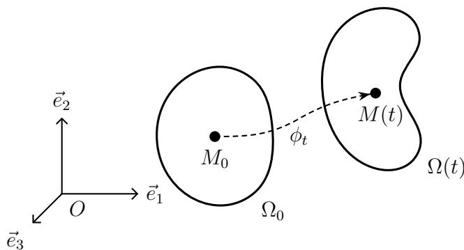

**读图。** 左边的 $\Omega_0$ 是初始构形，右边的 $\Omega(t)$ 是当前构形。$M_0$ 与 $M(t)$ 对应同一个粒子，它们的位置坐标分别是 $\mathbf X$ 和 $\mathbf x$。虚线箭头表示两个构形中粒子的对应关系；粒子实际走过的轨迹，要由所有时刻的位置共同确定。

另一种观察方式是站在固定空间位置，看此刻经过这里的材料速度是多少。速度场写成 $\mathbf V(t,\mathbf x)$，这是欧拉描述（description eulérienne）。相同空间位置在不同时刻可以由不同粒子占据。

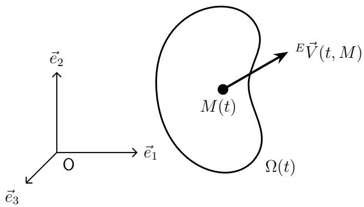

**读图。** 这次直接在当前构形中的位置 $M$ 上标出速度箭头，问“此刻经过这里的粒子速度是多少”。图中速度符号左上角的 $E$ 标明欧拉描述；速度向量以当前时间和当前位置为自变量。

**判断描述方式，要看自变量的含义。** 写作 $\mathbf V(t,\mathbf x)$ 的速度场是欧拉场；同一个速度也可以用粒子标签表示为 $\mathbf v_L(t,\mathbf X)$。

### 从位置求速度为什么要先固定粒子

假设一维运动为

$$
x=(1+\alpha t)X,\qquad \alpha>0,\quad t\ge0.
$$

跟踪同一个粒子，$X$ 固定，所以它的速度为

$$
v_L(t,X)=\left.\frac{\partial x}{\partial t}\right|_X=\alpha X.
$$

这已经是正确的粒子速度。若题目要求欧拉速度，还需要消去初始坐标。由运动映射得

$$
X=\frac{x}{1+\alpha t},
\qquad
V(t,x)=\frac{\alpha}{1+\alpha t}x.
$$

两种表达描述同一个运动，只是用来标识速度的自变量不同。反过来，题目给出 $V(t,x)$ 而要求运动映射，就解

$$
\frac{dx(t,X)}{dt}=V\bigl(t,x(t,X)\bigr),
\qquad x(0,X)=X.
$$

初始条件把每一条解与它对应的粒子联系起来，不能省略。

### 定常速度场中也可能有加速度

取一维速度场 $V(x)=kx$，其中 $k>0$ 是常数，单位为 $\mathrm{s^{-1}}$。固定位置的速度不随时间变化，因此速度场定常（stationnaire）。但在 $x>0$ 的区域，粒子往更大的 $x$ 运动时，会进入速度更大的位置，所以仍然加速。

沿粒子运动对速度求导，链式法则给出

$$
a=\frac{d}{dt}V(t,x(t))
=\frac{\partial V}{\partial t}
+\frac{\partial V}{\partial x}\frac{dx}{dt}
=\frac{\partial V}{\partial t}+V\frac{\partial V}{\partial x}.
$$

本例中 $a=0+(kx)k=k^2x$。三维对应的物质加速度是

$$
\mathbf a=\frac{\partial\mathbf V}{\partial t}
+(\mathbf V\cdot\nabla_x)\mathbf V.
$$

其中第一项来自固定位置上的时间变化，第二项来自粒子移动到不同位置。法语作答可以写：*Un écoulement stationnaire peut avoir une accélération convective non nulle.*

### 轨迹与流线各固定什么

轨迹（trajectoire）固定粒子，观察它在一段时间内走过的路。流线（ligne de courant）固定时刻，画出沿该时刻速度箭头方向延伸的曲线。定常运动中二者的几何曲线重合；非定常运动中需要分别判断，也可能恰好重合。

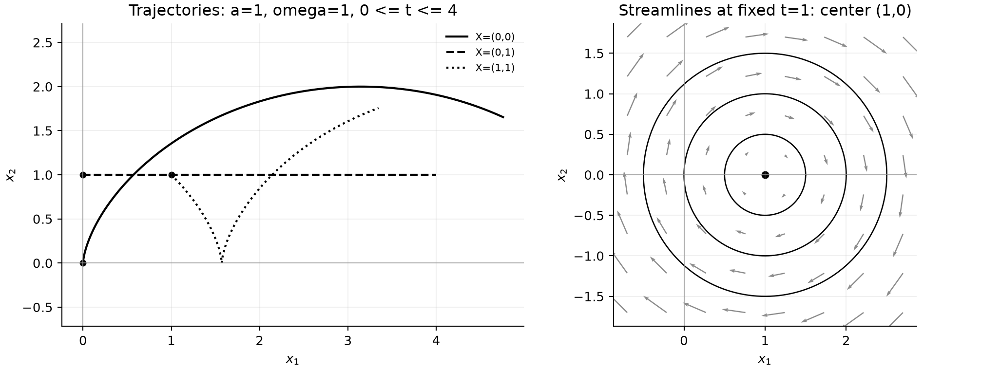

**读图。** 左图的每条曲线跟踪一个给定初始位置的粒子，时间从 0 变化到 4；右图固定 $t=1$，沿这个时刻的速度方向画圆形流线。两边来自同一个运动，却回答不同的问题。画轨迹时固定粒子，画流线时固定时刻。

对应练习：[TD1 练习 1](TD/中文版/TD1_运动学_2024-2025.md)、[2024 CC1 第二大题](Examen/中文版/CC1_2024-10-23_题目与解答.md)、[2025 CC1 第二大题](Examen/中文版/CC1_2025-10-15_题目与解答.md)。

## 2 用相邻粒子理解变形

### 变换梯度描述一根小线段的变化

在材料里取两个相邻粒子。它们初始相隔 $d\mathbf X$，当前相隔 $d\mathbf x$。在同一时刻对运动映射作局部线性近似，得到

$$
d\mathbf x=\mathbf F\,d\mathbf X,
\qquad F_{ij}=\frac{\partial x_i}{\partial X_j}.
$$

矩阵的第 $j$ 列告诉你：原先沿第 $j$ 个坐标轴的一根单位线段，在局部被映射成什么向量。矩阵乘向量，就是按原线段的方向组合这些列。

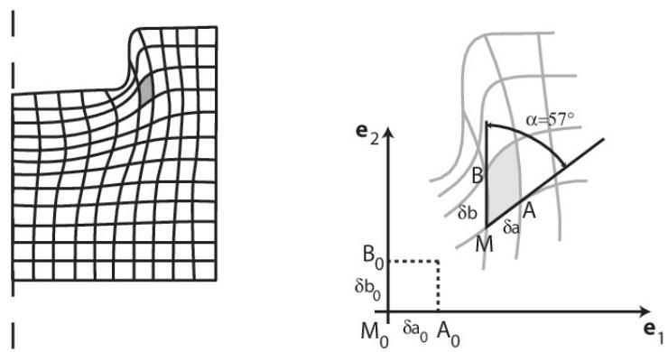

**读图。** 右图下方的 $M_0A_0$、$M_0B_0$ 是初始的两条垂直小线段，变形后成为上方的 $MA$、$MB$。它们的长度和夹角都可能改变。$\mathbf F$ 给出每条初始线段的当前向量；随后计算 $\mathbf C$、$\mathbf E$，就能衡量这些长度与夹角变化。左图还说明，不同位置的小网格可以变得不一样，因此 $\mathbf F$ 一般可以随位置变化。

例如

$$
\mathbf F=\begin{pmatrix}2&0&0\\0&1/2&0\\0&0&1\end{pmatrix}
$$

把第一方向线段拉长到 2 倍，第二方向缩到 $1/2$，第三方向不变。初始单位正方形变成宽 2、高 $1/2$ 的矩形。

### 行列式管体积 不能独自判断形状

微小平行六面体的体积缩放倍数是

$$
J=\det\mathbf F,
\qquad dv=J\,dV_0.
$$

在前面的例子中，$J=2\times(1/2)\times1=1$。体积不变，但形状明显改变。

因此，看到 $J=1$，可以回答“相对于参考构形等体积”；若要判断形状，还需要检查长度和角度。法语常用句是：*Le volume est conservé, mais la forme peut changer.*

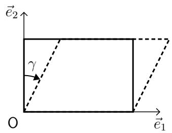

**读图。** 这是另一个等体积变形例子：简单剪切。上层比下层多向右移动，实线矩形变成虚线平行四边形。底边和高度保持不变，面积不变；第三方向也保持不变时，体积不变。但原来的直角已改变，所以存在变形。它与前面一向伸长、另一向收缩的运动，都能说明 $J=1$ 允许形状变化。

### 为什么应变需要计算转置相乘

线段的长度平方等于它与自身的点积。因此

$$
|d\mathbf x|^2
=(\mathbf Fd\mathbf X)^{\mathsf T}(\mathbf Fd\mathbf X)
=d\mathbf X^{\mathsf T}\mathbf F^{\mathsf T}\mathbf Fd\mathbf X.
$$

这解释了右 Cauchy–Green 张量的定义

$$
\mathbf C=\mathbf F^{\mathsf T}\mathbf F.
$$

减去初始长度平方，便得到 Green–Lagrange 应变与长度变化的关系：

$$
|d\mathbf x|^2-|d\mathbf X|^2
=2d\mathbf X^{\mathsf T}\mathbf E d\mathbf X,
\qquad \boxed{\mathbf E=\frac{\mathbf C-\mathbf I}{2}}.
$$

所以 $\mathbf E$ 衡量的是长度平方及夹角关系的改变。对初始单位方向 $\mathbf N$，伸长比 $\lambda$ 满足

$$
\lambda^2=\mathbf N^{\mathsf T}\mathbf C\mathbf N
=1+2\mathbf N^{\mathsf T}\mathbf E\mathbf N.
$$

例如沿第一方向拉长到 2 倍，$E_{11}=(2^2-1)/2=3/2$。工程应变则是 $(L-L_0)/L_0=1$。题目问“应变”时，必须先确认采用哪一种定义。

### 刚体旋转可以改变方向而不产生应变

刚体旋转矩阵 $\mathbf Q$ 满足 $\mathbf Q^{\mathsf T}\mathbf Q=\mathbf I$。若 $\mathbf F=\mathbf Q$，则

$$
\mathbf C=\mathbf I,\qquad \mathbf E=\mathbf0.
$$

线段方向虽然改变，长度和相互夹角都保持不变。因此 $\mathbf F\ne\mathbf I$ 本身不足以证明发生了变形。均匀平移则在求空间导数时消失，直接给出 $\mathbf F=\mathbf I$。

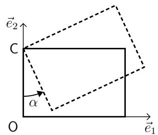

**读图。** 实线矩形绕点 $C$ 转到虚线位置，每条边的方向改变，边长和边之间的夹角都保持不变。这里应检查“线段是否被拉长、夹角是否改变”，而不能只看“线段是否转了方向”。图中的转角为 $\alpha$，与试卷中表示速率常数的 $\alpha$ 含义不同。

### 小变形公式省略了什么

位移为 $\mathbf u=\mathbf x-\mathbf X$，记 $\mathbf H=\nabla_X\mathbf u$，则 $\mathbf F=\mathbf I+\mathbf H$。代入精确应变公式：

$$
\mathbf E=\frac12\left(\mathbf H+\mathbf H^{\mathsf T}
+\mathbf H^{\mathsf T}\mathbf H\right).
$$

当位移梯度各分量都很小时，二次项可以忽略，于是

$$
\mathbf E\simeq\boldsymbol\varepsilon,
\qquad \boldsymbol\varepsilon=\frac{\mathbf H+\mathbf H^{\mathsf T}}2.
$$

这要求局部伸缩、剪切和转角都足够小。对二维 $90^\circ$ 刚体旋转，精确应变是零，但形式上算出的 $\operatorname{sym}(\mathbf Q-\mathbf I)=-\mathbf I$，说明此时线性近似失效。

课件中的小扰动假设 HPP 还要求位移相对于物体尺寸足够小，以便近似重合初始区域和当前区域。**应变线性化需要检查位移梯度；区域近似重合还需要检查位移大小。**

对应练习：[TD2 练习 1 的简单剪切与练习 2 的刚体旋转](TD/中文版/TD2_变形_2026-2027.md)。把这两个运动放在一起比较，最容易理解体积、形状和旋转之间的区别。

## 3 用速度差理解变形速率

### 已经拉长与正在拉长是两回事

把橡皮筋拉长后保持不动：相对于初始状态，应变可以非零；此刻各点速度为零，所以变形率为零。$\mathbf E$ 描述当前相对于参考构形的变形，$\mathbf D$ 描述此刻的局部变形速率。

邻近位置相隔 $d\mathbf x$，速度差约为

$$
d\mathbf V=\mathbf Ld\mathbf x,
\qquad L_{ij}=\frac{\partial V_i}{\partial x_j}.
$$

将速度梯度分解为对称和反对称两部分：

$$
\mathbf L=\mathbf D+\boldsymbol\Omega,
\qquad
\mathbf D=\frac{\mathbf L+\mathbf L^{\mathsf T}}2,
\qquad
\boldsymbol\Omega=\frac{\mathbf L-\mathbf L^{\mathsf T}}2.
$$

对称部分描述局部伸缩和剪切的速率，反对称部分描述局部刚体旋转率。为什么长度变化只需要 $\mathbf D$？因为

$$
\frac{d}{dt}|d\mathbf x|^2
=2d\mathbf x^{\mathsf T}\mathbf Dd\mathbf x,
$$

反对称矩阵满足 $d\mathbf x^{\mathsf T}\boldsymbol\Omega d\mathbf x=0$，不贡献瞬时长度变化。

$\mathbf F,\mathbf C,\mathbf E,\boldsymbol\varepsilon$ 都无量纲；$\mathbf L,\mathbf D,\boldsymbol\Omega$ 的单位为 $\mathrm{s^{-1}}$。一般有限运动中，$\mathbf D$ 与 $\dot{\mathbf E}$ 不能直接画等号，它们分别按当前构形和参考构形度量；准确关系是 $\dot{\mathbf E}=\mathbf F^{\mathsf T}\mathbf D\mathbf F$。

### 三种运动性质分别检查

| 法语术语 | 检查公式 | 物理意思 |
|---|---|---|
| Stationnaire 定常 | $\partial_t\mathbf V=\mathbf0$，固定 $\mathbf x$ 求导 | 同一空间位置的速度不随时间改变 |
| Incompressible 不可压缩运动 | $\operatorname{div}\mathbf V=0$ | 随材料运动的小体积没有瞬时变化 |
| Irrotationnel 无旋 | $\operatorname{curl}\mathbf V=\mathbf0$ | 局部旋转率为零，等价于 $\boldsymbol\Omega=0$ |

散度与体积比之间的精确关系是

$$
\dot J=J\operatorname{div}\mathbf V.
$$

如果从初始时刻起始终有 $\operatorname{div}\mathbf V=0$，且 $J(0)=1$，就能得到整个过程 $J(t)=1$。仅在某个时刻散度为零，只说明那一刻体积变化率为零。

质量守恒进一步给出

$$
\rho\bigl(t,\boldsymbol\varphi(t,\mathbf X)\bigr)J(t,\mathbf X)=\rho_0(\mathbf X).
$$

所以 $J=1$ 时，同一粒子的密度保持初始值。不同粒子的初始密度仍然可以不同，不能由此推出整个空间密度均匀。

## 4 用一个例子串起两份 CC1 的运动学

### 一个方向伸长 另一个方向收缩

设初始时刻 $a(0)=1$，且 $a(t)>0$，运动为

$$
x_1=a(t)X_1,\qquad x_2=\frac{X_2}{a(t)},\qquad x_3=X_3.
$$

初始单位方块在第一方向变为长 $a$，在第二方向变为长 $1/a$。以下结果都来自这一个几何图像。

**求轨迹。** 固定一个粒子的 $\mathbf X$。若它从 $(1,1,0)$ 出发，则当前位置为 $(a,1/a,0)$，满足 $x_1x_2=1$，沿双曲线运动。沿曲线走哪一段、朝哪个方向，还由 $a(t)$ 和时间区间决定。

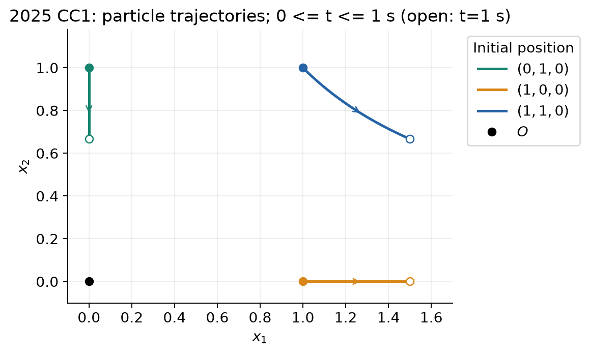

图中采用 2025 卷的 $a=1+\alpha t$，取 $\alpha=0.5\,\mathrm{s^{-1}}$、$0\le t\le1\,\mathrm s$。实心点为初始位置，空心点为 $t=1\,\mathrm s$ 的位置。每条曲线都跟踪同一个粒子；箭头标出运动方向。

**求变换与应变。** 固定时间，对初始坐标求导：

$$
\mathbf F=\operatorname{diag}(a,a^{-1},1),\qquad J=1,
$$

$$
\mathbf E=\frac12\operatorname{diag}(a^2-1,a^{-2}-1,0).
$$

矩阵已经对角化，三个坐标轴就是一组主方向，对角元就是对应的主应变。$a>1$ 时，第一方向伸长，第二方向收缩，第三方向长度不变。

**求欧拉速度。** 先固定粒子求导：

$$
\left.\frac{\partial\mathbf x}{\partial t}\right|_{\mathbf X}
=\left(\dot a X_1,-\frac{\dot a}{a^2}X_2,0\right).
$$

再用 $X_1=x_1/a$、$X_2=ax_2$ 换回当前坐标，记 $k(t)=\dot a/a$，得到

$$
\mathbf V=k(t)(x_1,-x_2,0).
$$

**求速率与运动性质。** 对当前坐标求导：

$$
\mathbf L=\mathbf D=k(t)\operatorname{diag}(1,-1,0),
\qquad \boldsymbol\Omega=\mathbf0.
$$

所以散度 $k-k=0$，旋度也为零。它等体积、无旋，但只要 $k\ne0$ 就仍在发生形状变化。定常与否要另外检查 $k(t)$ 是否随时间改变。

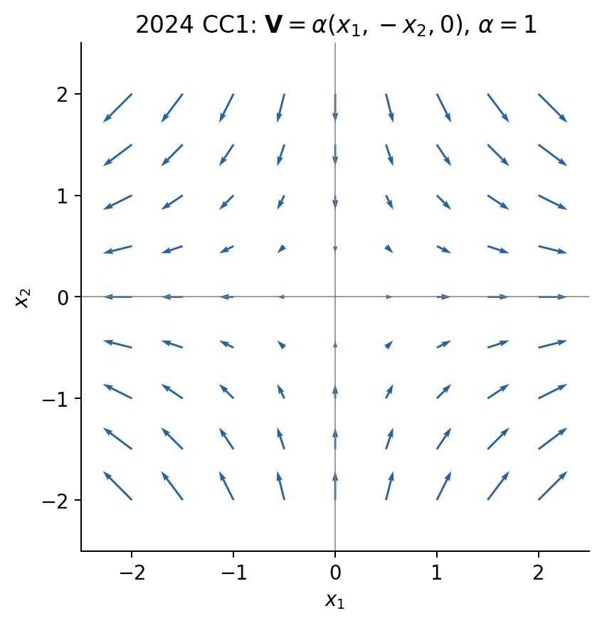

**读图。** 第一方向的箭头背离原点，第二方向的箭头朝向原点，显示出“一向伸长、另一向收缩”。图中每支箭头表示同一时刻、对应位置上的速度；它们一起构成速度场。图取 $\alpha=1$ 作示意，并延拓到全平面展示对称结构；2024 题设的材料区域在第一象限。

### 两份试卷只是在时间规律上作了变化

| 结果 | 2024 CC1 | 2025 CC1 |
|---|---|---|
| 题目给定 | $\mathbf V=\alpha(x_1,-x_2,0)$ | $\mathbf x=((1+\alpha t)X_1,X_2/(1+\alpha t),X_3)$ |
| 伸长倍数 $a(t)$ | 解粒子运动方程得到 $e^{\alpha t}$ | 直接读出 $1+\alpha t$ |
| 速率系数 $k=\dot a/a$ | $\alpha$ | $\alpha/(1+\alpha t)$ |
| 体积与局部旋转 | $J=1$，$\boldsymbol\Omega=0$ | $J=1$，$\boldsymbol\Omega=0$ |
| 定常性 | $k$ 为常数，定常 | $k$ 随时间改变，非定常 |
| 早期近似 | $e^{\alpha t}\simeq1+\alpha t$ | $a=1+\alpha t$ |

两份题都取常数 $\alpha>0$，其单位为 $\mathrm{s^{-1}}$。当 $\alpha t\ll1$ 时，两种运动的首阶近似一致：

$$
\boldsymbol\varepsilon\simeq
\alpha t\operatorname{diag}(1,-1,0).
$$

2025 卷中要分清精确计算和首阶展开。令 $q=\alpha t$，则精确位移梯度为

$$
\mathbf H=\operatorname{diag}\left(q,-\frac{q}{1+q},0\right).
$$

形式上取其对称部分得到的迹为 $q^2/(1+q)$，属于二阶小量；按 HPP 只保留首阶后，$\boldsymbol\varepsilon\simeq\operatorname{diag}(q,-q,0)$，迹在首阶为零。这与精确的 $J=1$ 相容。

重做这两道大题时，可以先合上解答，按“粒子位置—局部线段—体积与应变—速度—变形率—性质”的顺序推一遍。哪个步骤推不出，就回到前面对应的概念。

## 5 用一个面理解应力

### 在材料内部切一刀

取一根正在受拉的杆，在中间假想切开。左半段受到右半段的作用力，右半段受到左半段的作用力。截面上单位面积的力，就是牵引向量，也称应力向量（vecteur contrainte）。

同一个位置可以沿不同方向切开，不同截面上的牵引一般不同。因此给定位置以后，还需要用单位法向量 $\mathbf n$ 指定截面方向。

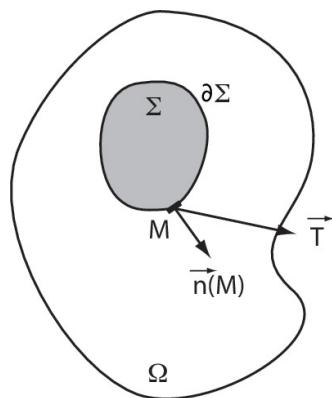

**读图。** 灰色的 $\Sigma$ 是从整体 $\Omega$ 中选出的一块材料，$\partial\Sigma$ 是它的边界。在边界点 $M$，$\mathbf n$ 指向这块材料外侧，$\mathbf T$ 表示周围材料对它的牵引。牵引可以斜着作用，因此需要继续分成法向与切向部分。

柯西关系把这件事写成

$$
\boxed{\mathbf T(\mathbf n)=\boldsymbol\sigma\mathbf n.}
$$

$\boldsymbol\sigma$ 是该点的应力张量（tenseur des contraintes），$\mathbf T$ 是某个方向截面上的牵引向量。两者的单位都为 Pa，但一个是二阶张量，一个是向量。换到法向相反的同一个截面，$\mathbf T(-\mathbf n)=-\mathbf T(\mathbf n)$，对应两侧材料的相互作用。

矩阵中 $\sigma_{ij}$ 的含义也由此确定：**在法向为 $\mathbf e_j$ 的面上，牵引沿 $\mathbf e_i$ 的分量。** 所以 $\boldsymbol\sigma\mathbf e_j$ 就是矩阵第 $j$ 列。

普通 Cauchy 连续介质不含独立偶应力时，角动量平衡给出 $\sigma_{ij}=\sigma_{ji}$。这允许补全题目给出的上三角矩阵，但不要求非对角元为零。

### 先算牵引 再分法向与切向

沿用 TD3 练习 1 的应力，单位为 MPa：

$$
\boldsymbol\sigma=
\begin{pmatrix}2&0&3\\0&1&0\\3&0&0\end{pmatrix}.
$$

在法向为 $\mathbf e_1$ 的截面上，取第一列：

$$
\mathbf T=2\mathbf e_1+3\mathbf e_3.
$$

沿法向的标量分量为 $\sigma_n=\mathbf n\cdot\mathbf T=2$ MPa。因此法向牵引向量是 $2\mathbf e_1$ MPa，切向牵引向量是 $3\mathbf e_3$ MPa。

一般情况下同样分两步：

$$
\sigma_n=\mathbf n\cdot\mathbf T,
\qquad
\mathbf T_{\mathrm{切}}=\mathbf T-\sigma_n\mathbf n.
$$

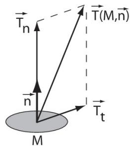

**读图。** 灰色小面是所选截面，$\mathbf n$ 垂直于它。斜箭头 $\mathbf T(M,\mathbf n)$ 是总牵引；沿法向的 $\mathbf T_n$ 与沿截面的 $\mathbf T_t$ 相加，得到总牵引。图中的 $\mathbf T_n=\sigma_n\mathbf n$ 是向量，正文中的 $\sigma_n$ 是它的有符号标量分量。虚线构成向量相加的平行四边形。

切向牵引大小为 $\tau=\|\mathbf T_{\mathrm{切}}\|$。如果题目指定一个单位切向量 $\mathbf t$，则沿它的有符号分量为 $\mathbf t\cdot\mathbf T$。大小非负，有符号分量则可以为负。

再看法向为 $\mathbf e_2$ 的面，取第二列得到 $\mathbf T=\mathbf e_2$ MPa，没有切向分量。**同一个应力张量，在一个面上可以有剪切，在另一个面上可以没有剪切。**

### 主应力就是只有法向牵引时的数值

若某个面的牵引恰好沿法向，则

$$
\boldsymbol\sigma\mathbf n=\lambda\mathbf n.
$$

这正是特征值方程。因此主方向（direction principale）是应力张量的特征向量方向，主应力（contrainte principale）是相应特征值。求主应力的目的，是找出没有切向牵引的截面方向，并用这些方向更清楚地描述应力状态。

例如纯剪切应力取 $\tau>0$：

$$
\boldsymbol\sigma=
\begin{pmatrix}0&\tau&0\\\tau&0&0\\0&0&0\end{pmatrix}.
$$

对 $\mathbf n_+=(\mathbf e_1+\mathbf e_2)/\sqrt2$，直接相乘得 $\boldsymbol\sigma\mathbf n_+=\tau\mathbf n_+$。对 $\mathbf n_-=(\mathbf e_1-\mathbf e_2)/\sqrt2$，则有 $\boldsymbol\sigma\mathbf n_-=-\tau\mathbf n_-$。第三方向对应零。

所以三个主应力为 $(\tau,-\tau,0)$，面内主方向相对于原坐标轴转了 $45^\circ$。原坐标下的剪切，在主方向上表现为一拉一压。

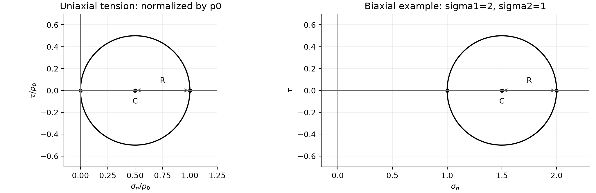

**读图。** 横轴是法向应力 $\sigma_n$，纵轴是有符号切应力 $\tau$。改变截面方向，对应的点沿圆移动；落在横轴上的点满足 $\tau=0$，所以给出相应的面内主应力。左图是按 $p_0$ 归一化的单轴拉伸，面内主应力为 $p_0$ 和 0；右图取面内主应力 2、1 作示例。两图只描述法向在面内旋转的截面；计算三维 Tresca 时仍要保留厚度方向的零主应力。

对应练习：[TD3 练习 1、2](TD/中文版/TD3_应力_2026-2027.md)，以及 [2025 CC1 第 1.7、1.8 问](Examen/中文版/CC1_2025-10-15_题目与解答.md)。

### 偏应力保留各方向受力的差异

将三个正应力的平均值记为 $\sigma_m=\operatorname{tr}\boldsymbol\sigma/3$。减去各方向都相同的部分，得到偏应力（déviateur des contraintes）：

$$
\boxed{\mathbf s=\boldsymbol\sigma-\sigma_m\mathbf I.}
$$

例如 $\boldsymbol\sigma=\operatorname{diag}(6,3,0)$ MPa，平均值为 3 MPa，于是 $\mathbf s=\operatorname{diag}(3,0,-3)$ MPa。偏应力的迹为零；对角元仍然可以非零。

von Mises 与 Tresca 都衡量主应力之间的差异。拿到三个主应力后，可以直接计算：

$$
\sigma_{\mathrm{VM}}
=\sqrt{\frac{(\sigma_1-\sigma_2)^2+(\sigma_2-\sigma_3)^2+(\sigma_3-\sigma_1)^2}{2}},
$$

$$
\sigma_{\mathrm{Tr}}=\sigma_{\max}-\sigma_{\min}.
$$

若给的是矩阵分量，von Mises 也可写成 $\sigma_{\mathrm{VM}}=\sqrt{3\mathbf s:\mathbf s/2}$，其中 $\mathbf s:\mathbf s=\sum_{i,j}s_{ij}^2$。非对角的两个对称位置都要计入求和。

这些等效应力用于与材料的相应屈服阈值比较。最大切应力为 $\tau_{\max}=\sigma_{\mathrm{Tr}}/2$，与 Tresca 等效应力相差一个因子 2。

| 应力状态 | 三个主应力 | von Mises | Tresca |
|---|---|---|---|
| 单轴拉伸 $S>0$ | $(S,0,0)$ | $S$ | $S$ |
| 纯剪切 $\tau>0$ | $(\tau,-\tau,0)$ | $\sqrt3\tau$ | $2\tau$ |
| 静水压力 $p>0$ | $(-p,-p,-p)$ | $0$ | $0$ |

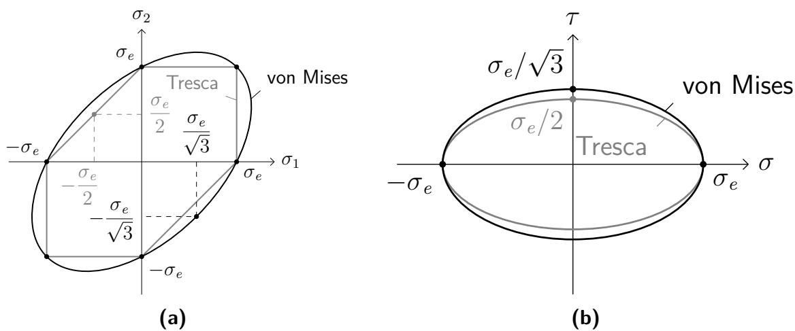

**读图。** $\sigma_e$ 是单轴拉伸的屈服应力。左图在平面应力条件下，以两个面内主应力为坐标，画出等效应力达到 $\sigma_e$ 的边界；边界内部满足相应屈服判据的弹性域条件。右图以拉伸应力 $\sigma$ 和剪应力 $\tau$ 为坐标。只看 $\sigma=0$ 的纯剪切位置，就能读出 von Mises 的剪切屈服阈值 $\sigma_e/\sqrt3$ 与 Tresca 的 $\sigma_e/2$，对应上表中的 $\sqrt3\tau$ 和 $2\tau$。

静水压力的三个主应力相同，偏应力为零。因此在 von Mises 屈服模型下，单独的静水压力不会触发该模型的塑性屈服；材料仍可能发生弹性体积变化。

平面应力的第三个主应力是零，比较时必须保留。例如三个主应力为 $(3,5,0)$ MPa，则 Tresca 是 $5-0=5$ MPa。只比较两个面内值会得到 2 MPa，从而漏掉真正的最大差。

## 6 用平衡方程与边界条件解力学题

### 平衡方程来自任意一小块材料的受力

先看横截面积恒定的一维杆，取长度 $dx$ 的小段。右截面应力为 $\sigma_{xx}(x+dx)$，左截面的牵引沿相反方向，合起来产生约为

$$
\bigl[\sigma_{xx}(x+dx)-\sigma_{xx}(x)\bigr]A
\simeq \frac{d\sigma_{xx}}{dx}A\,dx
$$

的力。再加上单位体积外力 $f_v$ 对这小段的作用，静力平衡给出

$$
\frac{d\sigma_{xx}}{dx}A\,dx+f_vA\,dx=0.
$$

除以小段体积，就是一维的 $d\sigma_{xx}/dx+f_v=0$。三维写成

$$
\boxed{\operatorname{div}\boldsymbol\sigma+\mathbf f_v=\mathbf0.}
$$

应力在不同位置的差异产生局部合力，再与体积力平衡。这也解释了为什么方程中出现空间导数。

动态问题需要保留惯性项，写成 $\operatorname{div}\boldsymbol\sigma+\mathbf f_v=\rho\mathbf a$。若题目给的是单位质量外力 $\mathbf b$，需要换成 $\mathbf f_v=\rho\mathbf b$。

在直角坐标下，第一个平衡分量为

$$
\partial_{x_1}\sigma_{11}
+\partial_{x_2}\sigma_{12}
+\partial_{x_3}\sigma_{13}+f_{v,1}=0.
$$

第二、第三个分量分别对矩阵第二、第三行作同样处理。应力除以长度的单位是 $\mathrm{Pa/m}=\mathrm{N/m^3}$，与 $\mathbf f_v$ 一致。

### 边界条件需要逐个表面检查

内部平衡成立之后，还要让材料表面受到题目规定的牵引：

$$
\boxed{\boldsymbol\sigma\mathbf n=\mathbf T_d.}
$$

这里 $\mathbf n$ 是**从材料内部指向材料外部**的单位法向。对带孔圆盘，外圆周的法向是 $+\mathbf e_r$，内孔壁则是 $-\mathbf e_r$，因为孔内不属于材料。

| 边界情况 | 条件 | 解释 |
|---|---|---|
| 自由表面 | $\boldsymbol\sigma\mathbf n=\mathbf0$ | 这个面没有外加牵引 |
| 压力为 $p$ 的表面 | $\boldsymbol\sigma\mathbf n=-p\mathbf n$ | 压力指向材料内部 |
| 给定面力密度 | $\boldsymbol\sigma\mathbf n=\mathbf T_d$ | 向量的各分量都须满足 |

验证边界时，顺序是“确定这个表面的法向—计算 $\boldsymbol\sigma\mathbf n$—代入表面方程—与载荷比较”。求内部散度时，仍使用体内完整的应力表达式，不能提前套用只在边界成立的关系。

法语作答可写：*À l'intérieur, le champ vérifie l'équilibre local. Sur chaque frontière, on vérifie la condition de traction avec la normale extérieure.*

### 2024 卷说明应力可以非零而局部合力为零

2024 CC1 第三题给定

$$
\boldsymbol\sigma=A
\begin{pmatrix}
R^2-x^2-3y^2&2xy&0\\
2xy&R^2-3x^2-y^2&0\\
0&0&0
\end{pmatrix}.
$$

取散度第一分量：

$$
\partial_x\sigma_{xx}+\partial_y\sigma_{xy}
=-2Ax+2Ax=0.
$$

第二分量同样抵消，第三分量为零，因此无体积力时局部平衡成立。散度为零允许各应力分量随位置变化。

上下表面法向为 $\pm\mathbf e_z$，应力第三列为零，所以牵引为零。侧面法向为 $(x/R,y/R,0)$，相乘得到

$$
\mathbf T=\frac A R(R^2-x^2-y^2)(x,y,0).
$$

侧面满足 $x^2+y^2=R^2$，故侧面牵引也为零。但圆柱轴线上应力为 $\operatorname{diag}(AR^2,AR^2,0)$，当 $A\ne0$ 时非零。

这就是自应力场（champ d'autocontraintes）的静力学特征：外加体积力和表面牵引为零，内部仍存在相互平衡的应力。若要进一步确定它能否在某种材料和历史下实现，还需要本构与相容性信息。

### 2025 卷说明自由孔壁上仍可有环向应力

为避免与变换梯度 $\mathbf F$ 混淆，这里把 [2025 CC1 第三题](Examen/中文版/CC1_2025-10-15_题目与解答.md)中的载荷参数 $F$ 暂记为 $S$，单位仍为 Pa。给定径向应力

$$
\sigma_{rr}=\frac S2\left(1-\frac{R^2}{r^2}\right),
\qquad \sigma_{r\theta}=0.
$$

孔壁 $r=R$ 的法向是 $-\mathbf e_r$，且 $\sigma_{rr}(R)=0$，所以孔壁牵引为零。外缘 $r=R_e$ 的径向牵引与题目给定的 $S/2$ 相差相对量 $(R/R_e)^2$，需要题设的 $R\ll R_e$ 近似。

场轴对称、无剪应力、无体积力时，柱坐标下的径向平衡为

$$
\frac{d\sigma_{rr}}{dr}
+\frac{\sigma_{rr}-\sigma_{\theta\theta}}r=0.
$$

柱坐标的基向量随位置改变，所以出现第二项。由此解出

$$
\sigma_{\theta\theta}
=\sigma_{rr}+r\frac{d\sigma_{rr}}{dr}
=\frac S2\left(1+\frac{R^2}{r^2}\right).
$$

孔壁上 $\sigma_{rr}=0$，但 $\sigma_{\theta\theta}=S$。后者表示沿环向传递的内应力，不影响法向为径向的孔壁是否自由。

当 $S>0$，三个主应力满足

$$
\sigma_{\theta\theta}\ge\sigma_{rr}\ge\sigma_{zz}=0.
$$

所以 Tresca 等效应力为 $\sigma_{\theta\theta}-0$，在孔边达到最大值 $S$。这把“平面应力—自由边界—局部平衡—主应力—屈服指标”连成一条完整解题链。

对应练习：[TD4 练习 1 的体力与边界条件、练习 2 的内外法向](TD/中文版/TD4_平衡方程_2026-2027.md)，以及两份 CC1 的第三大题。

### 从单位面积的力走到合力与力矩

应力与牵引都是单位面积的力。求某个表面 $\mathcal S$ 上的合力，需要积分；求对点 $O$ 的力矩，再乘力臂：

$$
\mathbf R=\int_{\mathcal S}\boldsymbol\sigma\mathbf n\,dS,
\qquad
\mathbf M_O=\int_{\mathcal S}\overrightarrow{OM}\times
(\boldsymbol\sigma\mathbf n)\,dS.
$$

| 表达式 | 单位 |
|---|---|
| $\boldsymbol\sigma\mathbf n$ | $\mathrm{Pa}=\mathrm{N/m^2}$ |
| $\overrightarrow{OM}\times(\boldsymbol\sigma\mathbf n)$ | $\mathrm{Pa\,m}=\mathrm{N/m}$ |
| $\int_{\mathcal S}\boldsymbol\sigma\mathbf n\,dS$ | $\mathrm N$ |
| $\int_{\mathcal S}\overrightarrow{OM}\times(\boldsymbol\sigma\mathbf n)\,dS$ | $\mathrm{N\,m}$ |

2024、2025 卷的单位选择题分别考了未积分与已积分的表达式，必须看清有没有 $dS$。另外，给定合力只约束面力的积分，通常不能唯一确定每个点的牵引分布。

## 7 用几道短题检查是否真正理解

先读左列，尝试用一句话解释，再看右列。能解释原因以后，再练运算速度。

| 判断题 | 答案与原因 |
|---|---|
| $J=1$ 就没有变形？ | 不成立。$\mathbf F=\operatorname{diag}(2,1/2,1)$ 等体积，但改变形状。 |
| $\mathbf F\ne\mathbf I$ 就一定产生应变？ | 不成立。刚体旋转可以有 $\mathbf F\ne\mathbf I$、$\mathbf E=0$。 |
| $\mathbf E=0$ 就一定能用 HPP？ | 不成立。大转角刚体旋转的精确应变为零，但位移梯度不小。 |
| 定常运动的加速度一定为零？ | 不成立。对流项可以非零，如 $V=kx$ 时 $a=k^2x$。 |
| 无旋运动一定不变形？ | 不成立。$\mathbf V=k(x_1,-x_2,0)$ 无旋，但 $k\ne0$ 时 $\mathbf D\ne0$。 |
| 从初始时刻起散度始终为零，且 $J(0)=1$，能推出整个过程 $J=1$？ | 成立。由 $\dot J=J\operatorname{div}\mathbf V=0$，体积比保持初始值。 |
| 不可压缩运动的密度一定空间均匀？ | 不成立。各粒子可以保持彼此不同的初始密度。 |
| 自由表面上整个应力张量都为零？ | 不成立。该面的牵引为零，其他方向的应力可以存在。 |
| 应力主方向所对应的截面上，切向牵引为零？ | 成立。该方向满足 $\boldsymbol\sigma\mathbf n=\lambda\mathbf n$，牵引只沿法向。 |
| 偏应力的对角元全为零？ | 不成立。要求的是迹为零，各对角元减去平均应力即可。 |
| 平面应力的 Tresca 只比较两个面内主应力？ | 不成立。厚度方向的零主应力也参与比较。 |

再做三次短计算，每次写出计算步骤和一句物理解释：

1. 取 $a=3/2$，由第 4 节的运动求 $\mathbf F,J,\mathbf E$。应得到 $J=1$，$\mathbf E=\operatorname{diag}(5/8,-5/18,0)$，说明等体积伸缩。
2. 取 $\boldsymbol\sigma=\operatorname{diag}(4,0,0)$ MPa，$\mathbf n=(1,1,0)/\sqrt2$。应得到 $\mathbf T=(2\sqrt2,0,0)$ MPa，$\sigma_n=2$ MPa，$\mathbf T_{\mathrm{切}}=(\sqrt2,-\sqrt2,0)$ MPa，切向大小为 2 MPa。单轴拉伸在斜面上也可以产生切向牵引。
3. 取三个主应力为 $(6,3,0)$ MPa。偏应力主值为 $(3,0,-3)$ MPa，von Mises 为 $3\sqrt3$ MPa，Tresca 为 6 MPa。检查你是否保留了第三个主应力。

## 8 按概念依赖安排复习

第一遍读第 1 至 4 节，然后重做两份 CC1 的第二大题。2025 卷从运动映射出发，2024 卷从速度场出发，恰好练习两个方向的转换。

第二遍读第 5 节，做 TD3 练习 1。每次先指定法向，再求牵引与分解，最后求主应力和等效应力。随后读第 6 节，做 TD4 的体力、内外边界问题及两份 CC1 第三大题。

最后做两份卷子的选择题。判断某个结论是否“必然”成立时，优先找物理反例，例如等体积拉伸、刚体旋转、定常但有加速度的运动、自由表面上仍然存在的面内应力。

这份专讲先覆盖两份 CC1 中反复出现的概念。继续补充时，按 TD 查缺：TD2 的方向应变、应变计与相容性，TD3 的 Mohr 圆，TD4 的合力与力矩。第四章热力学和能量部分仍需按今年教师给定范围复习。

## 9 对照材料

| 材料 | 用途 |
|---|---|
| [CM1 运动学](CM/第01章.md) | 描述方式、物质导数、轨迹与流线 |
| [CM2 变形](CM/第02章.md) | $\mathbf F,\mathbf C,\mathbf E$、HPP、变形率 |
| [CM3 内力与应力](CM/第03章.md) | 牵引、主应力、偏应力、屈服指标 |
| [CM4 基本原理](CM/第04章.md) | 质量守恒、动量平衡、边界条件 |
| [TD1](TD/中文版/TD1_运动学_2024-2025.md)、[TD2](TD/中文版/TD2_变形_2026-2027.md) | 运动、变形与刚体旋转的对比例子 |
| [TD3](TD/中文版/TD3_应力_2026-2027.md)、[TD4](TD/中文版/TD4_平衡方程_2026-2027.md) | 面力、主应力、平衡与边界练习 |
| [2024 CC1 中法解答](Examen/中文版/CC1_2024-10-23_题目与解答.md) | 从速度场出发的运动学、自应力场 |
| [2025 CC1 中法解答](Examen/中文版/CC1_2025-10-15_题目与解答.md) | 从运动映射出发的运动学、带孔圆盘 |
| [阅读索引](中文版阅读索引.md) | 其他课件、公式表与考试原卷入口 |
