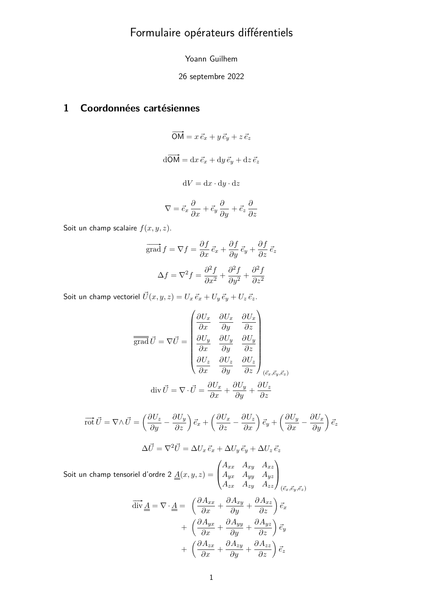
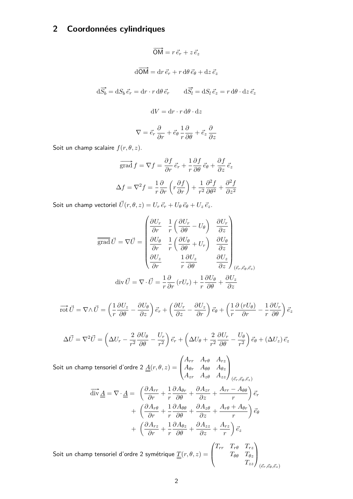
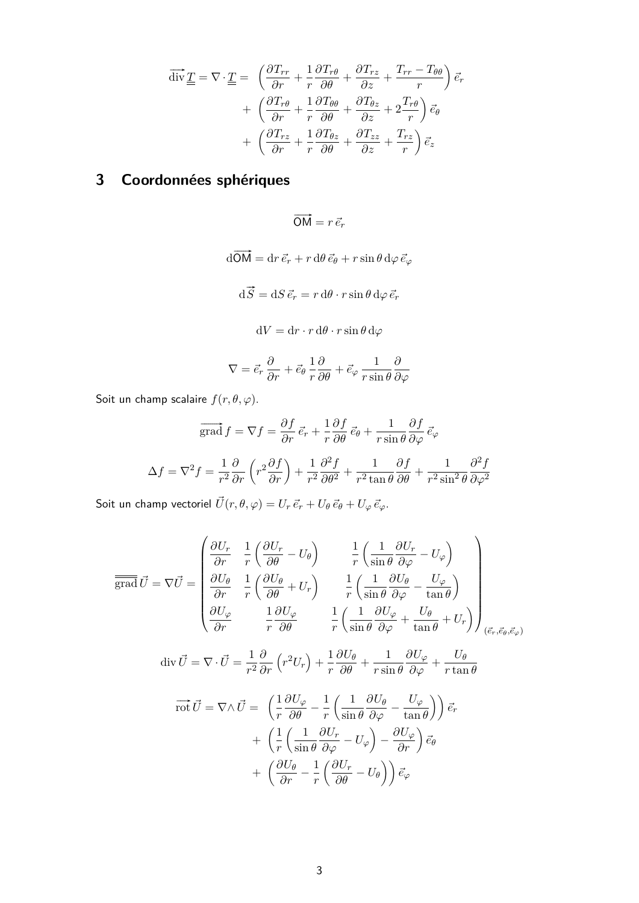
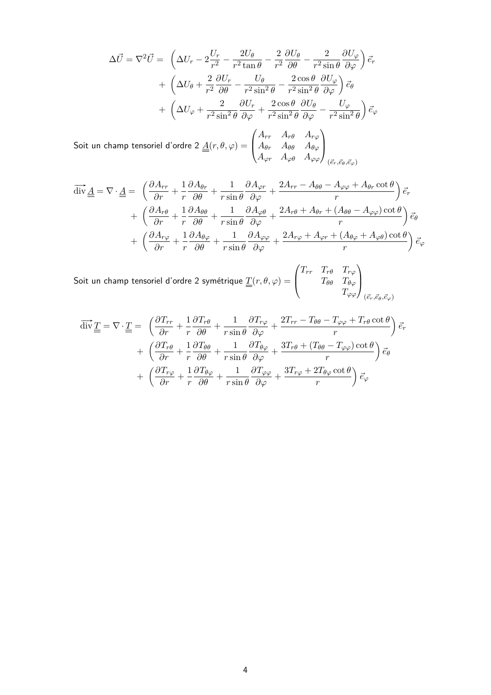

# 微分算子表：中文使用说明与原公式

原表：[微分算子表 PDF](../Formulaire_operateurs_differentiels.pdf)，共四页，原图全部附在下面。向量梯度按列方向求导：$(\nabla\mathbf U)_{ij}=\partial U_i/\partial x_j$。

| 法语 | 中文 |
|---|---|
| coordonnées cartésiennes / cylindriques / sphériques | 直角坐标 / 柱坐标 / 球坐标 |
| champ scalaire / vectoriel / tensoriel d'ordre 2 | 标量场 / 向量场 / 二阶张量场 |
| grad / div / rot / Laplacien | 梯度 / 散度 / 旋度 / Laplace 算子 |
| tenseur symétrique | 对称张量；只写上三角时须补齐下三角 |

## 第 1 页：直角坐标

**Coordonnées cartésiennes.** La base est fixe : les opérateurs se calculent par dérivation des composantes. La convention utilisée est celle du gradient dont les colonnes correspondent aux directions de dérivation.

基底固定，可逐分量求导：

$$\nabla f=(f_{,x},f_{,y},f_{,z}),\quad
\operatorname{div}\mathbf U=U_{x,x}+U_{y,y}+U_{z,z},$$
$$\operatorname{rot}\mathbf U=(U_{z,y}-U_{y,z},\ U_{x,z}-U_{z,x},\ U_{y,x}-U_{x,y}),$$
$$\Delta f=f_{,xx}+f_{,yy}+f_{,zz},\qquad
(\operatorname{div}\mathbf A)_i=A_{ij,j}.$$

## 第 2 页：柱坐标

**Coordonnées cylindriques.** Les vecteurs de base radial et orthoradial dépendent de l’angle. Le gradient d’un vecteur doit donc tenir compte de leurs dérivées. L’axisymétrie n’annule pas les termes géométriques : pour un déplacement radial, la déformation circonférentielle vaut le déplacement divisé par le rayon. L’équilibre radial contient également la différence entre contraintes radiale et circonférentielle.

坐标为 $(r,\theta,z)$，位置 $\mathbf x=r\mathbf e_r+z\mathbf e_z$。角向基底随 $\theta$ 变化，故向量梯度不能简单地只对三个分量求偏导。

$$\nabla f=f_{,r}\mathbf e_r+\frac{f_{,\theta}}r\mathbf e_\theta+f_{,z}\mathbf e_z,$$
$$\operatorname{div}\mathbf U=\frac1r(rU_r)_{,r}+\frac1rU_{\theta,\theta}+U_{z,z},\quad
\Delta f=\frac1r(rf_{,r})_{,r}+\frac{f_{,\theta\theta}}{r^2}+f_{,zz}.$$

轴对称 $\partial_\theta=0$ 不意味着所有几何项为零。例如仅有 $u_r=u(r)$ 时，$\varepsilon_{rr}=u'$、$\varepsilon_{\theta\theta}=u/r$；径向静力平衡为
$\sigma_{rr}'+(\sigma_{rr}-\sigma_{\theta\theta})/r+f_r=0$。

## 第 3 页：球坐标中的梯度、散度、旋度

**Coordonnées sphériques : gradient, divergence et rotationnel.** Le support emploie un angle polaire et un angle azimutal, avec les facteurs d’échelle indiqués ci-dessous. Conserver ces conventions avant de réutiliser les opérateurs d’un autre formulaire.

原表采用 $(r,\theta,\varphi)$，$\theta$ 为极角，$\varphi$ 为方位角。尺度因子分别为 $1,r,r\sin\theta$：

$$\nabla f=f_{,r}\mathbf e_r+\frac{f_{,\theta}}r\mathbf e_\theta+\frac{f_{,\varphi}}{r\sin\theta}\mathbf e_\varphi,$$
$$\operatorname{div}\mathbf U=\frac1{r^2}(r^2U_r)_{,r}
+\frac1{r\sin\theta}(\sin\theta U_\theta)_{,\theta}+\frac1{r\sin\theta}U_{\varphi,\varphi},$$
$$\Delta f=\frac1{r^2}(r^2f_{,r})_{,r}+\frac1{r^2\sin\theta}(\sin\theta f_{,\theta})_{,\theta}
+\frac{f_{,\varphi\varphi}}{r^2\sin^2\theta}.$$

## 第 4 页：球坐标向量 Laplace 算子和张量散度

**Laplacien vectoriel et divergence d’un tenseur en coordonnées sphériques.** Le laplacien vectoriel comporte des couplages dus à la variation de la base ; on ne peut pas appliquer séparément le laplacien scalaire aux composantes puis les recombiner sans ces termes. L’identité gradient–divergence et double rotationnel donne une autre méthode. En symétrie sphérique, l’équilibre se réduit à l’équation radiale partagée ci-dessous.

向量 Laplace 算子包含基底变化产生的耦合项，不等于把标量 Laplace 算子分别作用在三个球坐标分量后直接拼起来。计算时可用原表，或使用恒等式 $\Delta\mathbf U=\nabla(\operatorname{div}\mathbf U)-\operatorname{rot}(\operatorname{rot}\mathbf U)$。

球对称应力 $\boldsymbol\sigma=\operatorname{diag}(\sigma_r,\sigma_t,\sigma_t)$ 的径向平衡简化为

$$\frac{d\sigma_r}{dr}+\frac2r(\sigma_r-\sigma_t)+f_r=0.$$

