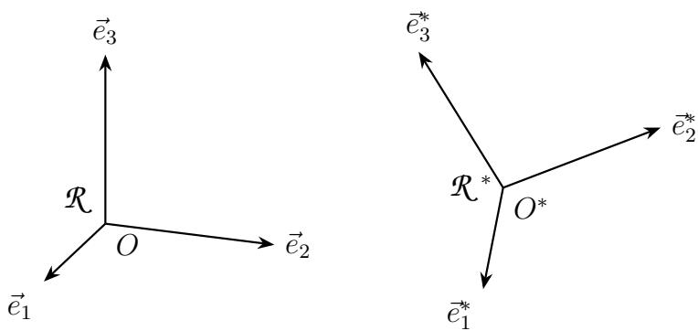
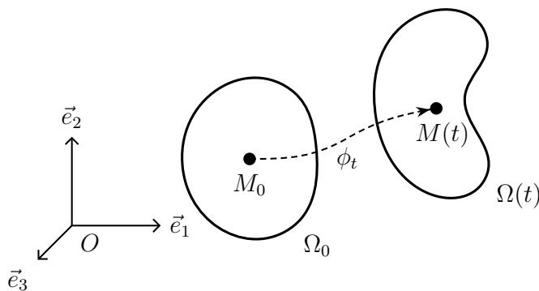
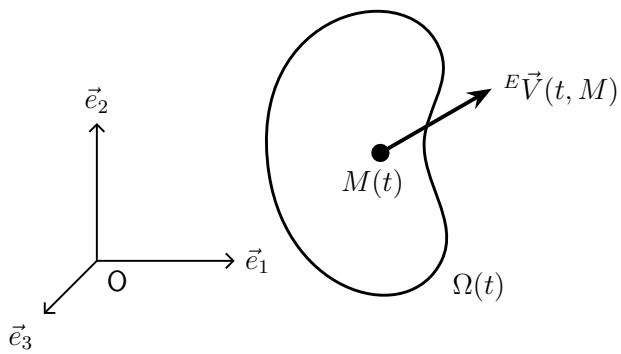

# 第1章 连续介质的运动学（Cinématique des milieux continus）

原课件：[Chap 1 PDF](IMMC_CM_Chap1_2025-2026.pdf) · [法文文本](IMMC_CM_Chap1_2025-2026.md) · 课堂转录 [cour1](cour1.md)

**开卷查阅。** 已知速度场先看 §1.2.1 的“描述转换”；求加速度看式 (1.22)、(1.27)；判断运动性质看式 (1.29)–(1.31)；刚体运动看式 (1.34)–(1.35)。

| 题目要做什么 | 起手式与判断依据 |
|---|---|
| 欧拉速度 → 运动映射 | 解 $\dot{\mathbf x}=\mathbf V(t,\mathbf x)$，加上 $\mathbf x(0,\mathbf X)=\mathbf X$ |
| 运动映射 → 欧拉速度 | 固定 $\mathbf X$ 对时间求导，再用逆映射把 $\mathbf X$ 换成 $\mathbf x$ |
| 欧拉加速度 | $\mathbf a=\partial_t\mathbf V+(\nabla_x\mathbf V)\mathbf V$；稳态也可能有加速度 |
| 轨迹 / 流线 | 轨迹固定粒子并改变时间；流线固定时刻，解 $d\mathbf x\times\mathbf V=0$ |
| 稳态 / 不可压缩 / 无旋 | 分别检查 $\partial_t\mathbf V=0$、$\operatorname{div}\mathbf V=0$、$\operatorname{rot}\mathbf V=0$ |

记号统一：速查表中用粗体简记向量（课件正文记作 $\vec{V}$、$\overline{\overline{\operatorname{grad}}}_M$、$\mathbb{Q}$ 等）；$\mathbf X$（或 $M_0$）为参考坐标，$\mathbf x$（或 $M$）为当前坐标；$\nabla_x\mathbf V$（即课件中的二阶梯度张量 $\overline{\overline{\operatorname{grad}}}_M[{}^E\vec{V}]$）的第 $(i,j)$ 个分量为 $\partial V_i/\partial x_j$。物质导数沿同一粒子取值，不能直接用固定空间点的时间偏导代替。

Ce chapitre donne l’essentiel des concepts et outils nécessaires à la description et la caractérisation de la cinématique des Milieux Continus. Il s’agit de donner une représentation du mouvement (la cinématique), en termes de déplacement ou de vitesse, selon le contexte.

本章提供描述和表征连续介质运动学所需的基本概念和工具。其目的是根据具体情境，用位移或速度等方式给出运动（即运动学）的表述。

**先抓住本章的问题。** 老师从可变形物体出发：物体可以整体平移、旋转，也可以改变内部质点之间的距离与方向。要讨论“有没有变形”，第一步得先说清每个质点在什么时刻、相对于哪个观察者位于哪里。本章先建立这套描述运动的语言；如何从运动中量出变形，留到第 2 章。泡沫、结构和流体都可以用这条思路分析，只是后续采用的模型不同。

## 1.1 时间与空间中的定位（Repérage dans le temps et l'espace）

### 1.1.1 时间的概念（La notion de temps）

En mécanique classique, l’espace des instants est schématisé par un espace affine $\mathcal{T}$ orienté de dimension 1 sur $\mathbb{R}$. À chaque évènement instantané, on associe un élément $t$ de $\mathcal{T}$ qui est l’instant où il se produit. Une datation galiléenne est une application affine strictement croissante de $\mathcal{T}$ dans $\mathbb{R}$.

在经典力学中，瞬时空间被表示为一个一维实数域 $\mathbb{R}$ 上的定向仿射空间 $\mathcal{T}$。每一个瞬时事件都与 $\mathcal{T}$ 中的一个元素 $t$ 相对应，该元素表示事件发生的时刻。伽利略时间测定是一个从 $\mathcal{T}$ 到 $\mathbb{R}$ 的严格递增仿射映射。

Si l’on fixe une origine des instants (instant « zéro » $t_0$, très souvent $t_0 = 0$) et une unité de durée $\vec{u}$ (vecteur non nul orienté dans le sens positif), à chaque instant $t$ on peut associer sa date $\tau$ telle que :

如果我们固定一个时间原点（即“零时刻” $t_0$，通常取 $t_0 = 0$）以及一个持续时间单位向量 $\vec{u}$（非零且指向正方向），则对于每一个时刻 $t$，可以关联其标量日期 $\tau$，满足：

$$
\overrightarrow{t_0t} = \tau \vec{u} \tag{1.1}
$$

Si ces ingrédients (non intrinsèques) sont choisis une fois pour toutes, on peut confondre $t$ et $\tau$ ; c’est ce que nous ferons dans la suite.

若上述非内在的量（时间原点与时间单位）一经选定，我们便可混同 $t$ 与 $\tau$，后续中将默认如此处理。

**读法。** $t_0$ 是人为选的计时起点，$\vec u$ 规定“一个时间单位”和正方向；选定后，日常计算便直接用实数 $t$。老师特别说明这段抽象定义只为建立记号，后面主要关心初始时刻与当前时刻的对应。

### 1.1.2 观察者的概念（La notion d'observateur）

Un observateur (on emploie aussi la terminologie espace d’observateur ou repère d’espace) correspond à la modélisation des corps solides suffisamment peu déformables pour que l’on puisse les considérer comme *parfaitement rigides* : les distances des différentes particules sont constantes par rapport au temps.

观察者（也称观察者空间或空间参考系）是对变形足够小、可以视为*完全刚体*（*parfaitement rigides*）的固体的建模：各质点之间的距离不随时间变化。

Un espace d’observateur est schématisé par un espace affine euclidien $\mathcal{E}$ (muni d’un produit scalaire) orienté de dimension 3. En général, le solide $\Sigma$ associé n’est qu’une partie (bornée) de $\mathcal{E}$ ; les autres points de $\mathcal{E}$ sont liés au solide $\Sigma$. En pratique, on introduit donc un espace tel que $\mathcal{E}$ par solide à modéliser.

一个观察者空间可抽象为带有内积的三维定向欧几里得仿射空间 $\mathcal{E}$。通常，与之关联的固体 $\Sigma$ 只占据 $\mathcal{E}$ 的一部分（有界子集），$\mathcal{E}$ 的其他点都固连于 $\Sigma$。在实践中，我们为每一个要建模的固体引入一个这样的空间 $\mathcal{E}$。

**课堂例子：房间里的气流。** 可以把房间当作观察空间，在其中选择固定的原点和坐标轴，再记录空气质点的位置、速度或某个固定点的温度。房间本身并不是待跟踪的空气质点；“观察者”回答的是**相对于谁测量**。换用一个移动或旋转的观察者，同一质点的坐标和速度可能改变，所以速度记号中要写明参考系 $\mathcal{R}$。

Un observateur $\mathcal{E}$ étant donné, il est facile de définir un point $M$ en mouvement par rapport à $\mathcal{E}$ par la donnée d’une application de $\mathcal{T}$ dans $\mathcal{E}$ qui à $t$ associe $M(t)$ :

给定一个观察者 $\mathcal{E}$，可以用一个从 $\mathcal{T}$ 到 $\mathcal{E}$、把 $t$ 映到 $M(t)$ 的映射，来定义相对于 $\mathcal{E}$ 运动的点 $M$：

$$
\mathcal{T} \rightarrow \mathcal{E} : t \mapsto M(t) \tag{1.2}
$$

Si l’on choisit une origine $O$ dans $\mathcal{E}$, on peut décrire le mouvement de $M$ par la fonction vectorielle :

若在 $\mathcal{E}$ 中选定一个原点 $O$，则可用向量函数描述点 $M$ 的运动：

$$
\mathcal{T} \rightarrow \mathbf{E} : t \mapsto \overrightarrow{OM}(t) \tag{1.3}
$$

où $\mathbf{E}$ est l’espace vectoriel associé à $\mathcal{E}$.

其中 $\mathbf{E}$ 表示与仿射空间 $\mathcal{E}$ 关联的向量空间。

Si l’on choisit une base (généralement orthonormée) dans $\mathbf{E} : \mathcal{B} = (\vec{e}_1, \vec{e}_2, \vec{e}_3)$, le mouvement est décrit par la donnée de 3 fonctions scalaires :

若在 $\mathbf{E}$ 中选定一个基（通常为正交归一基）$\mathcal{B} = (\vec{e}_1, \vec{e}_2, \vec{e}_3)$，则运动可由三个标量函数描述：

$$
\mathcal{T} \rightarrow \mathbb{R} : t \mapsto x_i(t), \quad (i = 1, 2, 3) \tag{1.4}
$$

qui sont les fonctions coordonnées de $\overrightarrow{OM}(t)$ dans la base $\mathcal{B}$ ou encore du point $M(t)$ dans le repère orthonormé direct $\mathcal{R} = (O; \mathcal{B})$. Si ce repère est choisi une fois pour toutes, on confond souvent l’observateur $\mathcal{E}$, le solide qui lui est associé et le repère $\mathcal{R}$.

这些函数为 $\overrightarrow{OM}(t)$ 在基 $\mathcal{B}$ 中的坐标函数，或等价地，是点 $M(t)$ 在右手正交归一坐标系 $\mathcal{R} = (O; \mathcal{B})$ 中的坐标。若该坐标系一经选定，则常将观察者 $\mathcal{E}$、与之相关的固体及坐标系 $\mathcal{R}$ 视为同一实体。

在固定的正交基中，$\overrightarrow{OM}=x_i\vec e_i$ 是 $x_1\vec e_1+x_2\vec e_2+x_3\vec e_3$ 的简写：重复指标 $i$ 要从 1 加到 3，这就是课堂引入的 **Einstein 求和约定**。后文写张量分量、梯度和散度时也会用到它。求时间导数时要留意所选基是否固定；式 (1.5)–(1.6) 在固定基下可以直接逐项求导。

La vitesse de $M$ dans $\mathcal{R}$ est définie par :

点 $M$ 在参考系 $\mathcal{R}$ 中的速度定义为：

$$
\vec{V}(t, M/\mathcal{R}) = \frac{\mathrm{d}}{\mathrm{d}t} \overrightarrow{OM}(t) = \dot{x}_1(t)\vec{e}_1 + \dot{x}_2(t)\vec{e}_2 + \dot{x}_3(t)\vec{e}_3 \tag{1.5}
$$

et son accélération par :

其加速度定义为：

$$
\vec{\Gamma}(t, M/\mathcal{R}) = \frac{\mathrm{d}^2}{\mathrm{d}t^2} \overrightarrow{OM}(t) = \ddot{x}_1(t)\vec{e}_1 + \ddot{x}_2(t)\vec{e}_2 + \ddot{x}_3(t)\vec{e}_3 \tag{1.6}
$$

*Figure 1.1 – Composition des vitesses（图 1.1：速度合成）*

#### 备注 1.1（Remarque 1.1）

**Remarque 1.1** *La véritable difficulté de la cinématique est de relier les mouvements d’un « même point » dans différents observateurs. C’est l’objet de la composition des mouvements que nous supposerons ici connue du lecteur (mais que nous n’utiliserons que très peu dans la suite de ce cours). Si $\mathcal{R} = (O; \vec{e}_1, \vec{e}_2, \vec{e}_3)$ et $\mathcal{R}^* = (O^*; \vec{e}_1^*, \vec{e}_2^*, \vec{e}_3^*)$ sont deux espaces d’observateur, on a (cf. figure 1.1) :*

运动学的真正困难在于将“同一点”在不同观察者中的运动联系起来。这便是运动合成问题的研究对象（在此假设读者已熟悉，但在后续课程中仅少量使用）。若 $\mathcal{R} = (O; \vec{e}_1, \vec{e}_2, \vec{e}_3)$ 与 $\mathcal{R}^* = (O^*; \vec{e}^*_1, \vec{e}^*_2, \vec{e}^*_3)$ 为两个观察者空间，则有（见图 1.1）：

$$
\vec{V}(t, M/\mathcal{R}) = \vec{V}(t, M/\mathcal{R}^*) + \left[ \vec{V}(t, O^*/\mathcal{R}) + \vec{\Omega}(t, \mathcal{R}^*/\mathcal{R}) \wedge \overrightarrow{O^*M} \right] \tag{1.7}
$$

## 1.2 连续介质的概念（La notion de milieu continu）

L’objet est ici de décrire les mouvements des corps physiques déformables par rapport à un observateur $\mathcal{E}$ (ou repère $\mathcal{R}$) donné. Le parti pris de la Mécanique des Milieux Continus est de regarder les corps physiques à une échelle dite macroscopique qui ignore volontairement la structure discrète de la matière. Ainsi, nous supposerons que, à chaque instant $t$, le corps physique que l’on veut étudier occupe un domaine « continu » de l’espace $\mathcal{E}$. Avec cette approche, on peut considérer que chaque particule constituant le milieu continu occupe une partition du volume matériel, dont la taille caractéristique minimale est de l’ordre de $10^{-8}\,\mathrm{m}$ à $10^{-9}\,\mathrm{m}$.

此处的目标是描述可变形物体相对于给定观察者 $\mathcal{E}$（或坐标系 $\mathcal{R}$）的运动。连续介质力学（Mécanique des Milieux Continus, MMC）的基本假设是：在所谓“宏观”尺度下研究物理体，忽略物质的离散结构。因此我们假设，在任意时刻 $t$，待研究的物理体占据空间 $\mathcal{E}$ 中的一个“连续”区域。在这种处理下，每一个构成连续介质的质点都占据一个物质体积单元，其特征最小尺度约为 $10^{-8}\,\mathrm{m}$ 至 $10^{-9}\,\mathrm{m}$。

**连续是建模尺度的选择。** 老师用物体与稀薄气体作对照：从结构尺寸观察一块泡沫，可以把密度、速度等量视为随位置连续变化；放大到原子间隙，或研究极稀薄环境，连续近似就需要重新检验。上面的 $10^{-8}$–$10^{-9}\,\mathrm m$ 是课件给出的示意尺度，不是所有材料与环境通用的最小体积单元。这里的“质点”是连续体模型中的小物质部分，也不是单个原子。

#### 备注 1.2（Remarque 1.2）

**Remarque 1.2** *La notion de domaine « continu » peut bien sûr être définie rigoureusement d’un point de vue mathématique en utilisant des notions topologiques. Nous nous contenterons ici, pour cette première approche, de considérations intuitives.*

“连续域”的概念当然可以从数学角度利用拓扑定义严格描述。但在此初步介绍中，我们仅从直观角度出发加以理解。

### 1.2.1 运动及其表示（Le mouvement et ses représentations）

#### 拉格朗日描述（Description lagrangienne）

Pour décrire le mouvement, on se donne l’application vectorielle $\phi$ décrivant la transformation du milieu :

为描述运动，定义一个映射 $\phi$ 表示介质的变换：

$$
\phi : [0, T] \times \Omega_0 \rightarrow \mathcal{E} , \quad (t, M_0) \mapsto M = \phi(t, M_0) \tag{1.8}
$$

$[0, T]$ est l’intervalle d’étude, et $\Omega_0$ la configuration à l’instant initial $t_0$, c’est-à-dire le domaine occupé par le milieu continu à cet instant $t_0$ (cf. figure 1.2). On parle aussi de « configuration initiale », (ou configuration de référence, voire parfois configuration non déformée). **Dans la description lagrangienne, les grandeurs physiques sont définies en des points attachés à la matière, potentiellement mobiles.**

其中 $[0, T]$ 为研究的时间区间，$\Omega_0$ 为初始时刻 $t_0$ 的构型（配置），即连续介质在 $t_0$ 时刻所占据的区域（见图 1.2）。此构型也称为“初始构型”、“参考构型”或有时称为“未变形构型”。**在拉格朗日描述中，物理量定义在随物质绑定、可能发生运动的质点（物质点）上。**

**怎样读 $\phi$？** 给一个初始标签 $M_0$ 和一个时间 $t$，它返回**同一质点**当时的位置 $M$。老师把这比作给每个质点贴标签、让网格随物质移动。$\phi$ 是一般的运动映射，通常不是线性映射；“固定 $t$，遍历所有 $M_0$”得到整块物体的当前构型，“固定 $M_0$，让 $t$ 变化”得到一个质点的轨迹。不要把这两种固定变量的操作混在一起。

Plaçons nous à $t$ fixé. L’ensemble des points $M = \phi(t, M_0)$ lorsque $M_0$ décrit $\Omega_0$ est noté $\Omega(t)$ et est appelé « configuration à l’instant $t$ » (cf. figure 1.2). On parle aussi de configuration actuelle, courante, voire parfois déformée. C’est l’image de $\Omega_0$ par l’application partielle :

固定某一时刻 $t$。当 $M_0$ 遍历 $\Omega_0$ 时，所有点 $M = \phi(t, M_0)$ 的集合记作 $\Omega(t)$，称为“时刻 $t$ 的构型”（见图 1.2）。也可称为“当前构型”、“瞬时构型”或有时称为“变形构型”。它是 $\Omega_0$ 经偏映射 $\phi_t$ 的像：

$$
\phi_t : M_0 \mapsto \phi(t, M_0) \tag{1.9}
$$

La configuration $\Omega(t)$ (ou aussi notée $\Omega_t$ ou $\Omega$ en abrégé), correspond donc aux positions des particules du domaine d’étude à l’instant $t$.

因此，构型 $\Omega(t)$（或记作 $\Omega_t$，简写为 $\Omega$）对应于时刻 $t$ 研究域内所有质点的位置。

*Figure 1.2 – Description lagrangienne : position actuelle des particules（图 1.2：拉格朗日描述下质点的当前位置）*

#### 轨迹（Trajectoires）

Plaçons nous maintenant à $M_0$ fixé. L’ensemble des points $M(t) = \phi(t, M_0)$ pour $t \in [0, T]$ est la trajectoire de la particule $M$, qui à l’instant initial se trouvait en $M_0$. Selon le contexte, on écrira indifféremment :

现在固定 $M_0$。当 $t \in [0, T]$ 时，点 $M(t) = \phi(t, M_0)$ 的集合即为初始时刻位于 $M_0$ 的质点 $M$ 的轨迹。根据上下文，可无差别地写作：

$$
\overrightarrow{OM}(t) = \vec{\phi}(t, \overrightarrow{OM_0}) \qquad \vec{M}(t) = \vec{\phi}(t, \vec{M}_0) \qquad M(t) = \phi(t, M_0) \tag{1.10}
$$

ou même, en coordonnées (pour $i = 1, 2, 3$) :

或以坐标形式表示（对 $i = 1, 2, 3$）：

$$
x_i(t) = \phi_i(t, X_1, X_2, X_3) \quad \text{ou, selon les notations（或按记号写作），} \quad x_i(t) = \phi_i(t, x^0_1, x^0_2, x^0_3) \tag{1.11}
$$

Il est évident que l’on peut écrire :

显然有：

$$
\vec{M}_0 = \vec{\phi}(t=0, \overrightarrow{OM_0}) \quad \text{et（且）} \quad X_i = \phi_i(t=0, X_1, X_2, X_3) \tag{1.12}
$$

#### 备注 1.3（Remarque 1.3）

**Remarque 1.3** *La fonction $\phi$ doit être supposée suffisamment régulière. Cela a des conséquences sur les valeurs que peut prendre le Jacobien (déterminant de la matrice Jacobienne), qui ici correspond au déterminant du gradient de l’application de transformation $\phi$, c’est-à-dire $J(t, M_0) = \det\left[\overline{\overline{\operatorname{grad}}}\,\phi(t, M_0)\right]$. Cela traduit le rapport entre le volume actuel (instant $t$) et initial (instant $t_0$) d’une particule que l’on suit dans son mouvement. Par exemple, on peut imposer, en plus du naturel $J(t=0)=1$ :*

*— $\phi$ est deux fois dérivable par rapport au temps (sauf en un nombre fini d’instants, pour traiter les chocs) ;*

*— à $t$ fixé, $M_0 \mapsto \phi(t, M_0)$ est une bijection qui conserve l’orientation : $M = \phi_t(M_0)$ et $M_0 = \phi_t^{-1}(M) \Longrightarrow J(t, M_0) \neq 0$ ;*

*— $\phi$ est continûment dérivable par rapport aux variables d’espace $\Longrightarrow J$ est continu. Par conséquent, en tenant compte de $J(t=0)=1$ et $J(t, M_0) \neq 0$, on arrive à $J(t, M_0) > 0$.*

*D’autres cadres de régularité peuvent être utiles pour des raisons plus complexes (existence de solutions par exemple), mais ces considérations sortent du cadre d’un cours d’initiation à la MMC !*

映射 $\phi$ 必须假设具有足够的光滑性。这对其雅可比行列式（Jacobian，即雅可比矩阵的行列式）可取的值有直接影响；此处它对应于变换映射 $\phi$ 的梯度张量的行列式，即 $J(t, M_0) = \det\left[\overline{\overline{\operatorname{grad}}}\,\phi(t, M_0)\right]$。它反映了随运动跟踪的同一质点在当前时刻（时刻 $t$）与初始时刻（时刻 $t_0$）的体积之比。例如，除自然条件 $J(t=0)=1$ 外，还可施加如下要求：

- $\phi$ 对时间二阶可导（除有限多个时刻外，用以处理冲击/激波情形）；
- 对固定的 $t$，$M_0 \mapsto \phi(t, M_0)$ 是保定向双射：$M = \phi_t(M_0)$ 且 $M_0 = \phi_t^{-1}(M) \Longrightarrow J(t, M_0) \neq 0$；
- $\phi$ 对空间变量连续可导 $\Longrightarrow J$ 连续。因此，结合 $J(t=0)=1$ 与 $J(t, M_0) \neq 0$，可得 $J(t, M_0) > 0$。

出于更复杂的原因（例如解的存在性），有时需要其他光滑性框架，但这些考虑超出了连续介质力学导论课的范围。

> **数学严谨性补充（关于原课件第二条）：** 严格来说，仅由“$C^1$ 双射”并不能推出雅可比行列式 $J \neq 0$（例如 $x \mapsto x^3$ 是 $\mathbb{R}$ 上的 $C^1$ 保定向双射，但在 $0$ 处导数为零）。要保证 $J(t, M_0) \neq 0$，数学上应要求 $\phi_t$ 是 **$C^1$ 微分同胚（difféomorphisme）**，即逆映射 $\phi_t^{-1}$ 也连续可微；再结合 $J$ 连续与 $J(t=0)=1$ 即可严格推出 $J(t, M_0) > 0$。

**为什么看行列式？** 想象把初始构型里一个很小的体积单元映到当前构型：$J=\det\left[\overline{\overline{\operatorname{grad}}}\,\phi\right]$ 给出它的有向体积缩放比。$J=2$ 对应局部体积变为原来的两倍；$J>0$ 表示物质不发生体积坍缩（$J=0$）或穿透翻转（$J<0$）。老师用“不能连续地把右手变成镜中的左手”帮助理解保定向。

#### 备注 1.4（Remarque 1.4）

**Remarque 1.4** *Dans la description lagrangienne, toute grandeur physique est décrite par une fonction de $(t, M_0)$ qui représente la valeur à l’instant $t$ de la grandeur au point $M(t)$, position à $t$ de la particule qui à l’instant initial était en $M_0$. Par exemple, on a :*

在拉格朗日描述中，任意物理量都用 $(t, M_0)$ 的函数描述，表示初始时刻位于 $M_0$ 的质点在时刻 $t$ 到达位置 $M(t)$ 时该物理量的取值。例如：

*— pour la vitesse（对于速度）：*

$$
\vec{V}(t, M_0) = \frac{\partial}{\partial t}\vec{\phi}(t, M_0) \tag{1.13}
$$

*— pour l’accélération（对于加速度）：*

$$
\vec{\Gamma}(t, M_0) = \frac{\partial^2}{\partial t^2}\vec{\phi}(t, M_0) \tag{1.14}
$$

#### 欧拉描述（Description eulérienne）

Ici on ne privilégie pas de configuration particulière. La cinématique est décrite par la donnée à chaque instant $t$ de la vitesse (par rapport au repère $\mathcal{R}$) de la particule qui se trouve en $M(t)$ à l’instant $t$ : ${}^E\vec{V}(t, M)$, où $t$ et $M$ sont deux variables indépendantes (cf. figure 1.3). Dans ce type de description on parle plutôt d’écoulement que de mouvement. **Dans la description eulérienne, les grandeurs physiques sont définies en des points fixes du repère (ou référentiel).**

在欧拉描述中，不偏重任何特定构型。运动学通过给出每个时刻 $t$ 位于点 $M(t)$ 处的质点的速度（相对于参考系 $\mathcal{R}$）${}^E\vec{V}(t, M)$ 来描述，其中 $t$ 与 $M$ 是两个独立变量（见图 1.3）。在这种描述下，我们通常谈论“流动”（écoulement）而非“运动”（mouvement）。**在欧拉描述中，物理量定义在参考系中的固定空间点上。**

**课堂对照：车载 GPS 与路边测速仪。** GPS 跟着一辆车，持续记录“这辆车在哪里”，对应以初始质点 $M_0$ 为标签的拉格朗日描述；路边仪器固定在位置 $M$，记录此刻经过的车的速度，对应欧拉描述。固定空间点处先后经过的通常是不同质点，所以欧拉场 ${}^E\vec V(t,M)$ 不能直接读成“同一质点随时间的速度变化”。温度探针固定在房间里测气流，也属于后者。

*Figure 1.3 – Description eulérienne : vitesses actuelle des particules（图 1.3：欧拉描述下质点的当前速度）*

#### 两种描述的等价性（Équivalence entre les deux descriptions）

Tout champ matériel peut être décrit via les descriptions eulérienne ou lagrangienne. Comme $\phi$ est une application bijective, elle est inversible, donc pour une fonction scalaire, notée $f$ en description lagrangienne, notée ${}^Ef$ en description eulérienne, on a les équivalences :

任何物质场都可以通过欧拉描述或拉格朗日描述来表示。由于 $\phi$ 是双射映射，故可逆；因此对于任意标量函数（拉格朗日描述记为 $f$，欧拉描述记为 ${}^Ef$），有如下等价关系：

$$
{}^Ef(t, M) = f\left[t, \phi_t^{-1}(M)\right] \tag{1.15}
$$

$$
f(t, M_0) = {}^Ef\left[t, \phi_t(M_0)\right] = {}^Ef\left[t, \phi(t, M_0)\right] \tag{1.16}
$$

Il est néanmoins important de retenir que $f$ et ${}^Ef$ :

— sont deux applications différentes ;

— mais représentent la même grandeur physique avec la même valeur pour une même particule.

但务必牢记，$f$ 与 ${}^Ef$：

- 是两个不同的映射（函数）；
- 但代表同一个物理量，且对同一个质点取相同的数值。

这里的“等价”指**给定可逆运动映射时可以换变量**：要问当前点 $M$ 上的欧拉值，先用 $\phi_t^{-1}$ 找出经过此处的质点原先是谁，再读取其拉格朗日值。两个函数的自变量不同，不能在固定 $M$ 和固定 $M_0$ 之间直接画等号。

#### 两种描述之间的转换（Passage d’une description à l’autre）

1. Si on connait la description lagrangienne du mouvement, il est facile de déterminer le champ eulérien des vitesses :

1. 若已知运动的拉格朗日描述，很容易求出欧拉速度场（先对 $t$ 求偏导，再代入 $M_0 = \phi_t^{-1}(M)$）：

$$
{}^E\vec{V}(t, M) = \vec{V}\left(t, \phi_t^{-1}(M)\right) = \vec{V}(t, M_0) = \frac{\partial}{\partial t}\vec{\phi}(t, M_0) \tag{1.17}
$$

2. La connaissance de ${}^E\vec{V}(t, M)$ et de la configuration initiale $\Omega_0$ permet (sous réserve de régularité) de reconstruire la fonction $\phi$ de la représentation lagrangienne.

2. 若已知欧拉速度场 ${}^E\vec{V}(t, M)$ 及初始构型 $\Omega_0$，则（在满足光滑性条件下）可重建拉格朗日表示中的映射 $\phi$：

$$
\vec{V}(t, M_0) = \frac{\partial}{\partial t}\vec{\phi}(t, M_0) \quad \text{et（且）} \quad \vec{V}(t, M_0) = {}^E\vec{V}(t, M) = {}^E\vec{V}\left[t, \phi(t, M_0)\right] \tag{1.18}
$$

Cela implique donc de résoudre l’équation différentielle :

因此需要求解如下带初值条件的微分方程：

$$
\frac{\partial}{\partial t}\vec{\phi}(t, M_0) = {}^E\vec{V}\left[t, \phi(t, M_0)\right] \quad \text{avec les conditions initiales（初值条件）} \quad \phi(t_0, M_0) = M_0 \tag{1.19}
$$

**用一个一维例子走一遍。** 若 $x(t,X)=X+ct$，跟踪初始标签 $X$ 得到的拉格朗日速度是 $\partial_t x=c$；换成当前坐标 $x$ 后，欧拉速度场仍为 $v^E(t,x)=c$。反过来，只给 $v^E=c$，还必须给初始条件 $x(0,X)=X$，才能把 $\dot x=c$ 积分为 $x(t,X)=X+ct$。更一般的速度场也按式 (1.19) 建立常微分方程组，而不能只把 $x$ 改写成 $X$。

#### 欧拉描述下的时间导数（Dérivée par rapport au temps en représentation eulérienne）

<u>Cas d’une fonction scalaire（标量函数的情形）：</u>

Soit $f$ une grandeur physique et ses représentations lagrangienne et eulérienne :

设 $f$ 为某物理量，其拉格朗日表示与欧拉表示分别为：

$$
f(t, M_0) \quad ; \quad {}^Ef(t, M) \tag{1.20}
$$

On peut relier les différentes dérivées temporelles comme suit :

可将不同的时间导数联系如下（固定质点 $M_0$，沿轨迹 $M = \phi(t, M_0)$ 求导）：

$$
\frac{\mathrm{d}}{\mathrm{d}t}\left[{}^Ef(t, M)\right] = \frac{\partial}{\partial t}\left[{}^Ef(t, \phi(t, M_0))\right] = \frac{\partial}{\partial t}f(t, M_0) \tag{1.21}
$$

On a :

由复合函数求导可得：

$$
\frac{\mathrm{d}}{\mathrm{d}t}\left[{}^Ef(t, M)\right] = \frac{\partial}{\partial t}\left[{}^Ef\right] + \frac{\partial}{\partial M}\left[{}^Ef\right]\frac{\partial M}{\partial t} = \underbrace{\frac{\partial}{\partial t}\left[{}^Ef\right]}_{\text{dérivée locale（局部导数）}} + \underbrace{\overrightarrow{\operatorname{grad}}_M\left[{}^Ef\right] \cdot {}^E\vec{V}}_{\text{terme convectif（对流项）}} \tag{1.22}
$$

Pour une représentation eulérienne, et pour la distinguer de la dérivée partielle en temps, cette dérivée est appelée *dérivée particulaire* ou encore *dérivée totale par rapport au temps*.

在欧拉描述下，为了与对时间的偏导数区分，这个导数称为**物质导数**（*dérivée particulaire*，也叫随体导数或质点导数），或对时间的**全导数**（*dérivée totale par rapport au temps*）。

**课堂要点：道路每天都一样，车仍会减速。** 老师设想车流经过道路收窄处：路边观察者看到的空间速度分布可以不随时间变化，即 $\partial_t v^E=0$；一辆车沿路前进却进入速度较低的区域，仍有加速度。这正是对流项 $v^E\partial_x v^E$ 的作用。比如在 $v^E(x)=v_0-kx$ 的一段路上（$k>0$，且只看 $v^E>0$ 的位置），随车加速度为 $\mathrm dv^E/\mathrm dt=-kv^E<0$。这是帮助读式 (1.22) 的简化算例，并非交通流的完整模型。

<u>Démonstration（证明）：</u>

On part de l’expression de la différentielle de la fonction $f$ :

从函数 ${}^Ef$ 的全微分表达式出发：

$$
\mathrm{d}\left[{}^Ef(t, M)\right] = \frac{\partial}{\partial t}\left[{}^Ef(t, M)\right]\,\mathrm{d}t + \frac{\partial}{\partial M}\left[{}^Ef(t, M)\right]\,\mathrm{d}M \tag{1.23}
$$

> **译注：** 原 PDF 式 (1.23) 左边排印成 $\mathrm{d}[{}^Ef(t\,\mathrm{d}M)]$，按全微分定义应为 $\mathrm{d}[{}^Ef(t, M)]$，上式已更正。

On divise par $\mathrm{d}t$

两边除以 $\mathrm{d}t$：

$$
\frac{\mathrm{d}}{\mathrm{d}t}\left[{}^Ef(t, M)\right] = \frac{\partial}{\partial t}\left[{}^Ef(t, M)\right] + \frac{\partial}{\partial M}\left[{}^Ef(t, M)\right]\frac{\mathrm{d}M}{\mathrm{d}t} \tag{1.24}
$$

On fait apparaître le gradient eulérien et la vitesse eulérienne :

引入欧拉梯度与欧拉速度 $\mathrm{d}M/\mathrm{d}t = {}^E\vec{V}$，证毕（CQFD）：

$$
\frac{\mathrm{d}}{\mathrm{d}t}\left[{}^Ef(t, M)\right] = \frac{\partial}{\partial t}\left[{}^Ef(t, M)\right] + \overrightarrow{\operatorname{grad}}_M\left[{}^Ef(t, M)\right] \cdot {}^E\vec{V} \qquad \text{CQFD} \tag{1.25}
$$

<u>Généralisation（推广）：</u>

Ce type de relation s’étend sans grande difficulté à tous les types de grandeurs. Par exemple, on a :

这类关系可以毫无困难地推广到各类物理量（如向量、张量）。例如对加速度有：

$$
\vec{\Gamma}(t, M_0) = \frac{\partial}{\partial t}\left[\vec{V}(t, M_0)\right] = \frac{\mathrm{d}}{\mathrm{d}t}\left[{}^E\vec{V}(t, M)\right] = \frac{\partial}{\partial t}\left[{}^E\vec{V}\right] + \frac{\partial}{\partial M}\left[{}^E\vec{V}\right]\frac{\partial M}{\partial t} \tag{1.26}
$$

$$
\vec{\Gamma}(t, M_0) = \frac{\partial}{\partial t}\left[{}^E\vec{V}\right] + \overline{\overline{\operatorname{grad}}}_M\left[{}^E\vec{V}\right] \cdot {}^E\vec{V} \tag{1.27}
$$

> **注：** 式 (1.27) 右端完全由欧拉变量 $(t, M)$ 写出，即欧拉加速度场 ${}^E\vec{\Gamma}(t, M)$；其中 $\overline{\overline{\operatorname{grad}}}_M\left[{}^E\vec{V}\right]$（常简记为 $\nabla_M\,{}^E\vec{V}$）是二阶速度梯度张量，它与向量 ${}^E\vec{V}$ 的缩并 $\left(\overline{\overline{\operatorname{grad}}}_M\left[{}^E\vec{V}\right] \cdot {}^E\vec{V}\right)_i = \frac{\partial V_i}{\partial x_j}V_j$ 给出对流加速度。

#### 备注 1.5（Remarque 1.5）

**Remarque 1.5** *En pratique, on note souvent de la même façon la représentation lagrangienne et la représentation eulérienne d’une même grandeur physique. Ce sont alors le contexte et les variables utilisées $(t, M_0)$ ou $(t, M)$ qui précisent la représentation utilisée. Ainsi, si $M = \phi(t, M_0)$, on peut écrire : $f(t, M_0) = f(t, M)$. Dans le membre de gauche, il s’agit d’une représentation lagrangienne, dans celui de droite d’une représentation eulérienne.*

在实践中，同一物理量的拉格朗日表示和欧拉表示常用同一个符号，由上下文和所用变量 $(t, M_0)$ 或 $(t, M)$ 来区分所用的表示。例如若 $M=\phi(t,M_0)$，可以写 $f(t,M_0)=f(t,M)$：等号左边是拉格朗日表示，右边是欧拉表示。

#### 备注 1.6（Remarque 1.6）

**Remarque 1.6** *La dérivée totale par rapport au temps de $f$ est souvent notée $\dot{f}$. On a donc $\dot{f} = \frac{\partial}{\partial t}f$ en représentation lagrangienne et $\dot{f} = \frac{\mathrm{d}}{\mathrm{d}t}f$ en représentation eulérienne.*

$f$ 对时间的全导数（物质导数）常记为 $\dot{f}$。因此在拉格朗日描述下 $\dot{f} = \frac{\partial}{\partial t}f$，而在欧拉描述下 $\dot{f} = \frac{\mathrm{d}}{\mathrm{d}t}f$。

#### 流线（Lignes de courant）

**Définition 1.1** *Les lignes de courant à un instant $t$ fixé sont les enveloppes du champ eulérien des vitesses à cet instant. On peut les calculer en posant l’équation :*

**定义 1.1** 在固定时刻 $t$，流线是该时刻欧拉速度场 ${}^E\vec{V}(t, M)$ 的包络线（即处处与该时刻速度向量相切的曲线）。可通过建立如下方程求解：

$$
\mathrm{d}\vec{M} \wedge {}^E\vec{V} = \vec{0} \tag{1.28}
$$

流线是**固定一个时刻**后处处与速度场相切的曲线；轨迹则是**固定一个质点**后记录它跨越时间的位置。稳态流中两者重合；反过来，仅凭画出的线重合不能断定速度场不随时间变化。例如 $\vec v(t,x,y)=(a(t),0)$ 且 $a(t)>0$ 时，每个时刻的流线和每个质点的轨迹都沿水平直线，速度大小仍可随时间变化。

#### 特殊运动（Mouvements particuliers）

**Stationnaire** un mouvement est dit stationnaire (ou permanent) si le champ eulérien des vitesses est indépendant du temps.

- **稳态运动（Stationnaire / permanent）**：若欧拉速度场与时间无关，则称该运动为稳态（或定常）运动：

$$
\frac{\partial {}^E\vec{V}}{\partial t} = 0 \quad \Longleftrightarrow \quad \text{mouvement stationnaire（稳态运动）} \tag{1.29}
$$

**Incompressible** un mouvement est dit incompressible si la divergence du champ eulérien des vitesses est nulle.

- **不可压缩运动（Incompressible）**：若欧拉速度场的散度为零，则称该运动为不可压缩运动：

$$
\operatorname{div} {}^E\vec{V} = 0 \quad \Longleftrightarrow \quad \text{mouvement incompressible（不可压缩运动）} \tag{1.30}
$$

**Irrotationnel** un mouvement est dit irrotationnel si le rotationnel du champ eulérien des vitesses est nul.

- **无旋运动（Irrotationnel）**：若欧拉速度场的旋度为零，则称该运动为无旋运动：

$$
\overrightarrow{\operatorname{rot}}\,{}^E\vec{V} = 0 \quad \Longleftrightarrow \quad \text{mouvement irrotationnel（无旋运动）} \tag{1.31}
$$

#### 备注 1.7（Remarque 1.7）

**Remarque 1.7** *Pour un mouvement stationnaire, les trajectoires sont aussi les lignes de courant. Néanmoins, si les trajectoires et lignes de courant sont confondues, le mouvement n’est pas forcément stationnaire.*

对于稳态运动，轨迹同时也是流线。然而，若轨迹与流线重合，运动并不一定是稳态的。

**三个词分别检查不同性质。** 稳态看欧拉速度是否随时间变化；不可压缩看物质小体积是否保持不变；无旋看局部旋转速率。不可压缩不等于“不变形”：把一摞扑克牌顶层横向推开，体积可以不变，层间夹角却改变。刚体运动必然保持体积，但可以旋转、加速，不一定稳态或无旋。

### 1.2.2 刚体的情形（Cas des corps rigides）

Un milieu continu a un mouvement de corps rigide (ou solide rigide) si et seulement si on a, en représentation lagrangienne :

当且仅当在拉格朗日表示下满足下式时，连续介质做刚体运动：

$$
\forall M, N : \overrightarrow{M(t)N(t)} = \mathbb{Q}(t) \cdot \overrightarrow{M_0 N_0} \tag{1.32}
$$

où $\mathbb{Q}(t)$ est une isométrie directe <a href="#note-1">1</a> (on parle aussi d’opérateur orthogonal, positif ou direct) :

其中 $\mathbb{Q}(t)$ 是直接等距变换<a href="#note-1">1</a>（也称正的或直接的正交算子）：

$$
\mathbb{Q}(t)^{\mathsf{T}} \mathbb{Q}(t) = \mathbb{I} \qquad \text{et（且）} \qquad \det(\mathbb{Q}(t)) = 1 \tag{1.33}
$$

**如何判断是否为刚体运动？** 选任意两枚物质标记，看它们之间的向量：若整个运动中只由同一个旋转 $\mathbb{Q}(t)$ 改变方向，长度不变，就没有内部变形。$\mathbb{Q}^{\mathsf{T}}\mathbb{Q}=\mathbb{I}$ 保长度和角度，$\det \mathbb{Q}=1$ 排除镜像翻转。这里说的是**运动的性质**：一块本来可以变形的泡沫，也可以在某段时间里只做平移或转动。

*Remarque de typographie : pour l’opérateur « transposé », on utilise ici la notation anglo-saxonne $\mathbb{M}^{\mathsf{T}}$, au lieu de la notation française ${}^{\mathsf{t}}\mathbb{M}$.*

*排版注记：对于“转置”算子，此处采用英美记号 $\mathbb{M}^{\mathsf{T}}$，而不采用法式记号 ${}^{\mathsf{t}}\mathbb{M}$。*

La représentation lagrangienne du mouvement d’un corps rigide est donc de la forme :

因此，刚体运动的拉格朗日表示具有如下形式：

$$
\overrightarrow{OM}(t) = \vec{\alpha}(t) + \mathbb{Q}(t) \cdot \overrightarrow{OM_0} \tag{1.34}
$$

Pour un corps rigide, on a :

对于刚体，有：

$$
\forall M, N : \vec{V}(t, N) = \vec{V}(t, M) + \vec{\omega}(t) \wedge \overrightarrow{M(t)N(t)} \tag{1.35}
$$

où le vecteur $\vec{\omega}(t)$, qui ne dépend que du temps, est le vecteur rotation instantanée. Le champ eulérien des vitesses d’un corps rigide est donc déterminé dès que l’on connait, à tout instant $t$, la vitesse d’un point du corps rigide et le vecteur $\vec{\omega}(t)$.

其中仅依赖于时间的向量 $\vec{\omega}(t)$ 是**瞬时转动向量（瞬时角速度向量）**。因此，只要在任意时刻 $t$ 已知刚体上某一点的速度和向量 $\vec{\omega}(t)$，刚体的欧拉速度场就完全确定了。

## 附注（Notes）

**1.** Une isométrie est une transformation qui conserve les distances et donc les angles. Elle est directe (ou positive) si elle conserve aussi l’orientation. Dans une base orthonormée, la matrice d’une isométrie est une matrice orthogonale c’est-à-dire une matrice dont l’inverse est égal à la transposée. Elle est directe (ou positive) si son déterminant est égal à 1.

等距变换是保持距离从而也保持角度的变换；若它同时还保持空间定向，则称为“直接”（或“正”）等距变换。在正交归一基下，等距变换的矩阵是正交矩阵，即其逆等于其转置的矩阵；若其行列式等于 $1$，则为直接（或正）等距变换。
