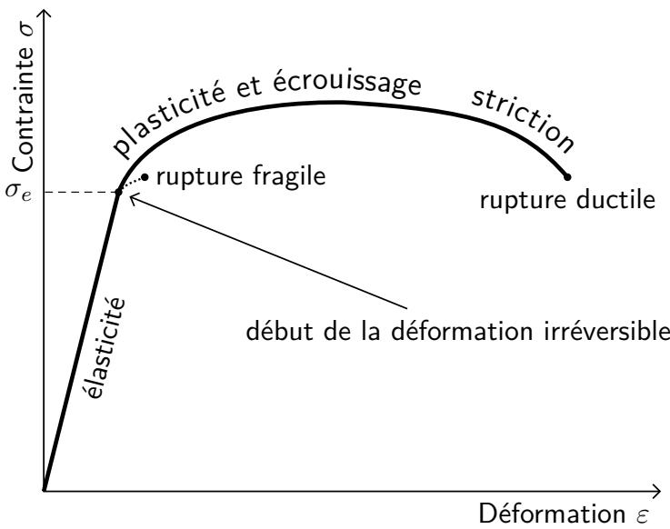
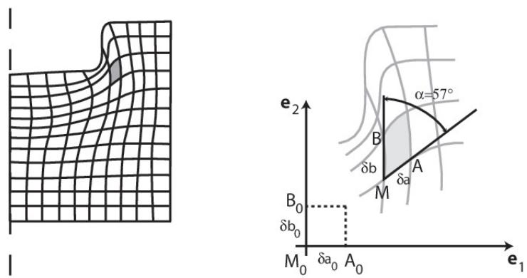
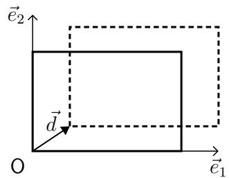
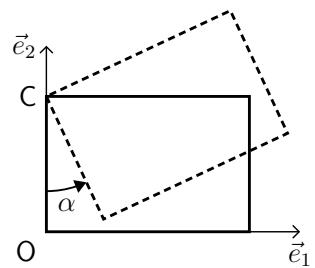
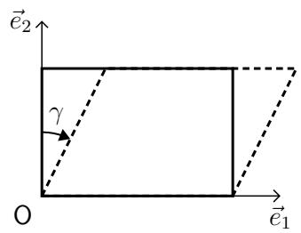
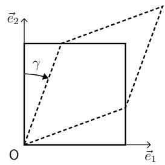
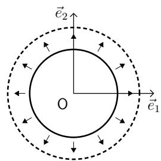
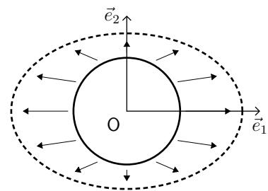

# 第2章 连续介质的变形（Chapitre 2 --- Déformations des milieux continus）

原课件：[Chap 2 PDF](IMMC_CM_Chap2_2025-2026.pdf) · [法文文本](IMMC_CM_Chap2_2025-2026.md) · 课堂转录 [cour2](cour2.md)

**开卷查阅。** 先分清“相对初始构形的累计变形”和“当前瞬间的变形速率”。前者对 $\mathbf X$ 求导，后者对 $\mathbf x$ 求导。

| 已知量 / 所求量 | 计算方法 | 单位 |
|---|---|---|
| 运动映射 $\mathbf x(t,\mathbf X)$ → $\mathbf F$ | $F_{ij}=\partial x_i/\partial X_j$ | 无量纲 |
| 长度、夹角与有限应变 | $\mathbf C=\mathbf F^{\mathsf{T}}\mathbf F$，$\mathbf E=(\mathbf C-\mathbf I)/2$ | 无量纲 |
| 体积比 | $J=\det\mathbf F$，$\mathrm{d}v=J\,\mathrm{d}V_0$ | 无量纲 |
| 位移 → 线性化应变 | $\mathbf H=\nabla_X\mathbf u$，$\boldsymbol\varepsilon=(\mathbf H+\mathbf H^{\mathsf{T}})/2$；用于真实应变近似时须 $\|\mathbf H\|\ll1$ | 无量纲 |
| 速度 → 两种速率 | $\mathbf L=\nabla_x\mathbf V$，$\mathbf D=(\mathbf L+\mathbf L^{\mathsf{T}})/2$，$\boldsymbol\Omega=(\mathbf L-\mathbf L^{\mathsf{T}})/2$ | $\mathrm{s}^{-1}$ |

> **记号对照说明：** 上方速查表采用通用粗体简记以便快速检索；下文正文与原课件严格统一：二阶张量/算子记作空心体 $\mathbb{F}, \mathbb{C}, \mathbb{E}, \mathbb{I}, \mathbb{O}, \mathbb{A}, \mathbb{D}$ 或粗体希腊字母 $\boldsymbol{\varepsilon}, \boldsymbol{\omega}, \boldsymbol{\Omega}$，二阶梯度算子带双上划线 $\overline{\overline{\operatorname{grad}}}$，旋度向量算子带箭头 $\overrightarrow{\operatorname{rot}}$，微分算子用正体 $\mathrm{d}$，转置记作 $^{\mathsf{T}}$。表中的体积比 $J=\det\mathbb{F}$ 详见第 1 章与第 4 章。

主应变与主方向来自应变矩阵的特征值和单位特征向量。刚体转动有 $\mathbb{F}\ne\mathbb{I}$，但 $\mathbb{C}=\mathbb{I}$、$\mathbb{E}=\mathbb{O}$；不可压缩只要求体积不变，并不排除形状变化。

## 2.1 变形的概念（La notion de déformation）

On va introduire ici une première façon de caractériser la déformation d’un milieu continu, en se plaçant en représentation lagrangienne.

L’objectif est de définir des outils mathématiques permettant de caractériser (et si possible de mesurer) la « déformation » d’un milieu continu au cours de son mouvement : variation des distances, des angles, etc. Il s’agit d’un problème difficile auquel nous n’apporterons ici que des réponses partielles mais qui seront suffisantes dans de très nombreuses situations.

我们将在此引入表征连续介质变形的第一种方式，采用拉格朗日表示（représentation lagrangienne）。

目标是定义数学工具，用来刻画（并在可能的情况下测量）连续介质在运动过程中“变形”的程度：例如距离、角度等的变化。这是一个困难的问题，我们在此仅给出部分答案，但这些答案在许多情形下已经足够。

**先观察，再计算。** 两个质点一起平移，虽然位置都变了，它们的间距却可以不变；三个质点围成的角度若变了，就能看出剪切或畸变。因此本章前半段先比较相邻物质点的**长度和夹角**，建立依赖初始配置的变形度量。老师随后才转向欧拉视角的变形速率（2.2 节）。

### 2.1.1 变换梯度（Gradient de transformation）

On a vu qu’il existe une application vectorielle, appelée transformation et notée $\vec{\phi}$, telle que $\overrightarrow{OM}=\vec{\phi}(\overrightarrow{OM_0})$. En différenciant cette relation, on obtient :

我们已经看到，存在一个向量映射，称为*变换*（transformation），记作 $\vec{\phi}$，使得 $\overrightarrow{OM} = \vec{\phi}(\overrightarrow{OM_0})$。对这个关系进行微分，可得：

$$
\mathrm{d}\overrightarrow{OM} =
\bigl(\overline{\overline{\operatorname{grad}}}\,\vec{\phi}\bigr)\cdot \mathrm{d}\overrightarrow{OM_0}
= \mathbb{F} \cdot \mathrm{d}\overrightarrow{OM_0}
\tag{2.1}
$$

$$
\text{avec（其中）}\quad
\mathbb{F} =
\frac{\partial\bigl[\vec{\phi}(\overrightarrow{OM_0})\bigr]}{\partial \overrightarrow{OM_0}}
= \frac{\partial \overrightarrow{OM}}{\partial \overrightarrow{OM_0}}
= \overline{\overline{\operatorname{grad}}}\,\vec{\phi}
\tag{2.2}
$$

où $\mathbb{F}$ est l’opérateur gradient <a href="#note-1">1</a> de transformation (sans unité). Il est égal à :

— l’identité $\mathbb{I}$ en l’absence de déformation ; sans rotation de type corps rigide, mais avec potentiellement une translation de type corps rigide ;

— une isométrie vectorielle directe <a href="#note-2">2</a> en l’absence de déformation mais avec potentiellement une rotation de type corps rigide et/ou une translation de type corps rigide ;

— un opérateur (ou tenseur) **symétrique** ($\mathbb{F}^{\mathsf{T}} = \mathbb{F}$) en l’absence de rotation.

其中 $\mathbb{F}$ 是**变换梯度算子**<a href="#note-1">1</a>（无量纲）。它等于：

- 在没有变形、没有刚体类型旋转，但可能存在刚体类型平移时，为恒等算子 $\mathbb{I}$；

- 在没有变形，但可能存在刚体类型的旋转和/或刚体类型的平移时，为*正定向等距向量算子*<a href="#note-2">2</a>；

- 在没有旋转时，为一个**对称**算子（或张量）（$\mathbb{F}^{\mathsf{T}} = \mathbb{F}$）。

**它为什么是矩阵？** $\vec{\phi}$ 给出三个当前位置坐标，$F_{ij}=\partial x_i/\partial X_j$ 记录初始坐标 $X_j$ 变化一点时，当前位置的第 $i$ 个坐标怎样变化。于是邻近质点间的小向量满足 $\mathrm{d}\vec{x}=\mathbb{F}\,\mathrm{d}\vec{X}$。$\mathbb{F}$ 比单个质点的位移多提供了“邻居之间如何相对移动”的信息，但 $\mathbb{F}$ 本身还同时含有刚体旋转；不能把 $\mathbb{F}-\mathbb{I}$ 在任何运动下都叫作变形。第 3 项中“没有旋转”指有限变换极分解中的旋转部分为 $\mathbb{I}$（此时 $\mathbb{F}$ 为对称正定的纯伸长算子），不是只检查某一时刻的速度旋度。

例如，纯平移 $\vec{x}=\vec{X}+\vec{b}(t)$ 给出 $\mathbb{F}=\mathbb{I}$；刚体转动 $\vec{x}=\mathbb{Q}(t)\vec{X}+\vec{b}(t)$ 给出 $\mathbb{F}=\mathbb{Q}$。两者都没有内部变形，却不要求 $\mathbb{F}$ 总等于 $\mathbb{I}$。这也解释了为什么下一节要用 $\mathbb{F}^{\mathsf{T}}\mathbb{F}$ 消去刚体转动的影响。

### 2.1.2 一种变形的度量（Une mesure de déformation）

#### 初始与当前长度平方的比较（Comparaison des longueurs au carré initiale et actuelle）

On se place en représentation lagrangienne. On considère deux particules $M$ et $N$ d’un milieu continu et l’on cherche à comparer $\lVert\overrightarrow{MN}\rVert$ à $\lVert\overrightarrow{M_0N_0}\rVert$.

On va se placer uniquement d’un point de vue *local*, c’est-à-dire que l’on supposera que $N_0$ est infiniment proche de $M_0$.

Calcul préliminaire : On a $\vec{M} = \vec{\phi}(t, M_0)$ et $\vec{N} = \vec{\phi}(t, N_0)$. Au voisinage de $M_0$, on a donc <a href="#note-3">3</a> :

我们采用拉格朗日表示。考虑连续介质中的两质点 $M$ 与 $N$，希望比较 $\|\overrightarrow{MN}\|$ 与 $\|\overrightarrow{M_0N_0}\|$。

我们只从*局部*角度进行讨论，也就是说假设 $N_0$ 与 $M_0$ 无限接近。

预备计算：有 $\vec{M} = \vec{\phi}(t, M_0)$ 和 $\vec{N} = \vec{\phi}(t, N_0)$。在 $M_0$ 的邻域内，有<a href="#note-3">3</a>：

$$
\vec{N} = \vec{\phi}(t, N_0) =
\vec{\phi}(t, M_0) +
\underbrace{\frac{\partial \vec{\phi}}{\partial \vec{M}_0}(t, M_0)}_{\text{opérateur gradient }\mathbb{F}(t,M_0)\text{（梯度算子）}}\, \overrightarrow{M_0N_0}+
\underbrace{\cdots}_{\text{termes négligés（忽略的高阶项）}}\tag{2.3}
$$

> **导读提示：** 这里的“局部”很关键：$\mathbb{F}(t,M_0)$ 描述的是 $M_0$ 附近**无限短**物质线段的变化。若两点相隔很远、变换在中间又不均匀，就不能直接用某一点的 $\mathbb{F}$ 乘整段距离。老师先把两点靠近，再做一阶展开，正是为下面的长度比较建立适用条件。

On en déduit facilement que, au premier ordre :

于是很容易得到，一阶近似下：

$$
\overrightarrow{ON}
= \overrightarrow{OM} + \mathbb{F}(t, M_0)\,\overrightarrow{M_0N_0}
\tag{2.4}
$$

ce qui donne :

从而：

$$
\overrightarrow{MN}
= \overrightarrow{MO} + \overrightarrow{ON}
= \mathbb{F}(t, M_0)\,\overrightarrow{M_0N_0}
\tag{2.5}
$$

Les longueurs au carré, initiale et actuelle, valent donc :

初始与当前的长度平方分别为：

$$
\bigl\|\overrightarrow{MN}\bigr\|^2
= \overrightarrow{MN}^{\mathsf{T}}\,\overrightarrow{MN}
= (\mathbb{F}\,\overrightarrow{M_0N_0})^{\mathsf{T}}\,\mathbb{F}\,\overrightarrow{M_0N_0}
= \overrightarrow{M_0N_0}^{\mathsf{T}} \mathbb{F}^{\mathsf{T}} \mathbb{F}\,\overrightarrow{M_0N_0}
\tag{2.6}
$$

$$
\bigl\|\overrightarrow{M_0N_0}\bigr\|^2
= \overrightarrow{M_0N_0}^{\mathsf{T}}\,\overrightarrow{M_0N_0}
= \overrightarrow{M_0N_0}^{\mathsf{T}} \mathbb{I}\,\overrightarrow{M_0N_0}
\tag{2.7}
$$

et donc :

因此：

$$
\overrightarrow{MN}^{\mathsf{T}}\,\overrightarrow{MN} -
\overrightarrow{M_0N_0}^{\mathsf{T}}\,\overrightarrow{M_0N_0} =
\overrightarrow{M_0N_0}^{\mathsf{T}}
\bigl[\mathbb{F}^{\mathsf{T}} \mathbb{F} - \mathbb{I}\bigr]
\overrightarrow{M_0N_0}
\tag{2.8}
$$

#### 右 Cauchy--Green 伸长算子（Opérateur des dilatations de Cauchy-Green droit）

**Définition 2.1** L’opérateur :

**定义 2.1** 算子：

$$
\mathbb{C}(t, M_0) = \mathbb{F}^{\mathsf{T}} \mathbb{F}
\tag{2.9}
$$

est appelé opérateur (ou tenseur) des dilatations de Cauchy-Green droit (sans unité).

称为**右 Cauchy--Green 伸长算子（或张量）**（无量纲）。

Il possède les propriétés suivantes :

— $\mathbb{C}$ est un opérateur symétrique <a href="#note-4">4</a> ;

— les composantes $C_{ij}\ \forall i = j$ correspondent aux dilatations au carré selon la direction *initialement* orientée selon $\vec{e}_i$ (c’est-à-dire dans la configuration initiale) ;

— les composantes $C_{ij}\ \forall i \neq j$ correspondent aux variations d’angles entre les fibres *initialement* alignées avec les directions des vecteurs $\vec{e}_i$ et $\vec{e}_j$ (initialement orthogonales) ;

— $\mathbb{C}=\mathbb{I}\ \forall t,M_0 \Longleftrightarrow$ le milieu continu suit un mouvement de corps rigide.

它具有以下性质：

- $\mathbb{C}$ 是对称算子<a href="#note-4">4</a>；

- 分量 $C_{ij}$（$\forall i=j$）对应于沿*最初*朝向 $\vec{e}_i$ 的方向（即在初始配置中）上的伸长平方；

- 分量 $C_{ij}$（$\forall i\neq j$）对应于*最初*分别沿向量 $\vec{e}_i$ 与 $\vec{e}_j$ 方向排列（且初始时相互正交）的纤维之间角度的变化；

- $\mathbb{C} = \mathbb{I}\ \forall t, M_0 \Longleftrightarrow$ 连续介质做刚体运动。

**别把“伸长比例”和 $C_{ii}$ 当成同一个数。** 初始沿第 $i$ 个基向量的短线段，若当前长度是原来的 $\lambda_i$ 倍，则 $C_{ii}=\lambda_i^2$。课堂用泡沫长度加倍来提问：伸长比例是 $\lambda_i=2$，而 $C_{ii}=4$；$\mathbb{C}$ 保留了初始状态对应的单位项。非对角项涉及原本正交的线段在变形后夹角的余弦，同时还乘上各自伸长比例，不能只把它读成“角度数值”。

#### Green--Lagrange 变形算子（Opérateur de déformations Green-Lagrange）

**Définition 2.2** L’opérateur :

**定义 2.2** 算子：

$$
\mathbb{E}(t, M_0)
= \frac{1}{2}\bigl[\mathbb{F}^{\mathsf{T}} \mathbb{F} - \mathbb{I}\bigr]
= \frac{1}{2}[\mathbb{C} - \mathbb{I}]
\tag{2.10}
$$

est appelé opérateur (ou tenseur) des déformations de Green-Lagrange (sans unité).

称为**Green--Lagrange 变形算子（或张量）**（无量纲）。

Il possède les propriétés suivantes :

— $\mathbb{E}$ est un opérateur symétrique ;

— les composantes $E_{ij}\ \forall i = j$ correspondent aux écarts relatifs des longueurs au carré selon la direction *initialement* orientée selon $\vec{e}_i$ (c’est-à-dire dans la configuration initiale) ;

— les composantes $E_{ij}\ \forall i \neq j$ correspondent aux variations d’angles entre les fibres *initialement* alignées avec les directions des vecteurs $\vec{e}_i$ et $\vec{e}_j$ (initialement orthogonales) ;

— $\mathbb{E}=\mathbb{O}\ \forall t,M_0 \Longleftrightarrow$ le milieu continu suit un mouvement de corps rigide.

它具有以下性质：

- $\mathbb{E}$ 是对称算子；

- 分量 $E_{ij}$（$\forall i=j$）对应于沿*最初*朝向 $\vec{e}_i$ 的方向（即在初始配置中）上的长度平方相对偏差（精确而言，是长度平方相对增量的**一半**，即 $E_{ii}=(\lambda_i^2-1)/2$，其中 $\lambda_i$ 为该方向的伸长比）；

- 分量 $E_{ij}$（$\forall i\neq j$）对应于*最初*分别沿向量 $\vec{e}_i$ 与 $\vec{e}_j$ 方向排列（且初始时相互正交）的纤维之间角度的变化；

- $\mathbb{E} = \mathbb{O}$（零算子）$\forall t, M_0 \Longleftrightarrow$ 连续介质做刚体运动。

**把三个常用数值放在一起。** 一维拉伸中若 $\lambda=L/L_0=1.5$，工程应变是 $(L-L_0)/L_0=0.5$，而 Green--Lagrange 应变是 $E=(\lambda^2-1)/2=0.625$；两者只在小变形时近似相等。$\mathbb{E}$ 比较的是**长度平方**，计算时以式 (2.10) 为准，不能把 $50\%$ 直接填入 $\mathbb{E}$。在这个一维算例中，若 $\lambda=1$，则 $C=1$、$E=0$；三维刚体转动也满足 $\mathbb{C}=\mathbb{I}$、$\mathbb{E}=\mathbb{O}$。

### 2.1.3 小扰动假设 HPP（Hypothèse des Petites Perturbations）

Introduisons comme nouvelle grandeur le déplacement $\vec{u}(t, M_0) = \overrightarrow{M_0M}(t)$. Ce champ vectoriel est continu à tout instant $t$ et pour tout point $M_0 \in \Omega_0$. On a donc :

现在引入一个新的量：位移 $\vec{u}(t, M_0) = \overrightarrow{M_0M}(t)$。该向量场在任意时刻 $t$ 和对所有点 $M_0 \in \Omega_0$ 都是连续的。因此有：

$$
\begin{aligned}
\vec{M}(t) &= \vec{M}_0 + \vec{u}(t, M_0)\\[0.3em]
\mathbb{F}(t, M_0)
&= \mathbb{I} + \frac{\partial \vec{u}}{\partial M_0}(t, M_0)
= \mathbb{I} + \overline{\overline{\operatorname{grad}}}\,\vec{u}
= \mathbb{I} + \nabla \vec{u}\\[0.3em]
\mathbb{E}(t, M_0)
&= \frac{1}{2}\left[
\frac{\partial \vec{u}}{\partial M_0} +
\left(\frac{\partial \vec{u}}{\partial M_0}\right)^{\mathsf{T}} + \left(\frac{\partial \vec{u}}{\partial M_0}\right)^{\mathsf{T}}
\frac{\partial \vec{u}}{\partial M_0}
\right]\\
\mathbb{E}(t, M_0)
&= \frac{1}{2}\Bigl[\overline{\overline{\operatorname{grad}}}\,\vec{u} + \bigl(\overline{\overline{\operatorname{grad}}}\,\vec{u}\bigr)^{\mathsf{T}} + \bigl(\overline{\overline{\operatorname{grad}}}\,\vec{u}\bigr)^{\mathsf{T}}\,\overline{\overline{\operatorname{grad}}}\,\vec{u} \Bigr]\\
\mathbb{E}(t, M_0)
&= \frac{1}{2}\Bigl[\nabla \vec{u} + (\nabla \vec{u})^{\mathsf{T}} + (\nabla \vec{u})^{\mathsf{T}} \nabla \vec{u}
\Bigr]
\end{aligned}
\tag{2.11}
$$

On peut linéariser $\mathbb{E}$ en négligeant le dernier terme sous l’Hypothèse des Petites Perturbations (HPP), qui regroupe deux sous-hypothèses :

— les déplacements sont « petits » (ou infinitésimaux) par rapport aux dimensions du domaine $\Omega_0$, soit $\|\vec{u}\| \ll \text{diamètre}(\Omega_0)$, ce qui indique que les configurations initiale $\Omega_0$ et courante $\Omega(t)$ peuvent être confondues ;

— les transformations sont « petites » (ou infinitésimales), soit $\bigl\|\overline{\overline{\operatorname{grad}}}\,\vec{u}\bigr\| \ll 1$ où $\|\mathbb{A}\|$ s’interprète ici comme la norme « infini » $\|\mathbb{A}\|=\max_{i,j}|A_{ij}|$.

在**小扰动假设（HPP）**下，我们可以通过忽略最后一项来线性化 $\mathbb{E}$。HPP 包含两个子假设：

- 位移相对于区域 $\Omega_0$ 的尺寸来说是“很小的”（或称无穷小的），即 $\|\vec{u}\| \ll \text{diamètre}(\Omega_0)$，这表明初始配置 $\Omega_0$ 与当前配置 $\Omega(t)$ 可以近似视为重合；

- 变换是“很小的”（或无穷小的），即 $\bigl\|\overline{\overline{\operatorname{grad}}}\,\vec{u}\bigr\| \ll 1$，其中 $\|\mathbb{A}\|$ 在这里解释为“无穷”范数（即分量绝对值最大值范数，不要与按行求和定义的算子无穷范数混淆）：$\|\mathbb{A}\| = \max_{i,j} |A_{ij}|$。

**为何不能只检查应变小不小？** 精确式 (2.11) 中的二次项在 $\|\nabla\vec{u}\|\ll1$ 时才可忽略。二维刚体旋转 $90^\circ$ 的例子很能暴露问题：取 $\mathbb{F}=\mathbb{Q}=\begin{pmatrix}0&-1\\1&0\end{pmatrix}$，则精确的 $\mathbb{E}=(\mathbb{Q}^{\mathsf{T}}\mathbb{Q}-\mathbb{I})/2=\mathbb{O}$；但 $\boldsymbol{\varepsilon}=\operatorname{sym}(\mathbb{Q}-\mathbb{I})=-\mathbb{I}$，误报了变形。物体明明没被拉长，只是转了很大的角度。大幅**均匀平移**则有 $\nabla\vec{u}=\mathbb{O}$，在线性化应变公式中仍给出零；不过若还要把初始和当前空间区域近似重合，课件列出的“小位移”条件仍须单独检查。两种“小”服务于不同近似，不能互相替代。

#### 备注 2.1（Remarque 2.1）

**Remarque 2.1** L’hypothèse de *petites* transformations (ou transformations infinitésimales) elle-même implique que :

— les déformations sont *petites* (ou infinitésimales) : $\|\mathbb{E}\| \ll 1$ ;

— les rotations sont *petites* (ou infinitésimales) : $\|\boldsymbol{\omega}\| \ll 1$ ($\boldsymbol{\omega}$ correspond à la partie antisymétrique de $\overline{\overline{\operatorname{grad}}}\,\vec{u}$).

Néanmoins, comme il s’agit d’une implication, et non d’une équivalence, la réciproque est donc fausse. C’est-à-dire que « petites déformations » n’implique pas forcément « petites transformations ».

**备注 2.1** “*小*变换”（或无穷小变换）这一假设本身蕴含：

- 变形是*小的*（或无穷小的）：$\|\mathbb{E}\| \ll 1$；

- 旋转是*小的*（或无穷小的）：$\|\boldsymbol{\omega}\| \ll 1$（$\boldsymbol{\omega}$ 对应于 $\overline{\overline{\operatorname{grad}}}\,\vec{u}$ 的反对称部分）。

然而，因为这只是蕴含关系而非等价关系，其逆命题是错误的。也就是说，“小变形”并不必然意味着“小变换”。

On obtient ainsi la déformation linéarisée, exprimée par son tenseur $\boldsymbol{\varepsilon}$ (sans unité) :

这样就得到线性化变形，用其张量 $\boldsymbol{\varepsilon}$（无量纲）表示：

$$
\boldsymbol{\varepsilon}(t, M_0)
= \frac{1}{2}\left[\frac{\partial \vec{u}}{\partial M_0}+\left(\frac{\partial \vec{u}}{\partial M_0}\right)^{\mathsf{T}}\right]
= \frac{1}{2}\Bigl[\overline{\overline{\operatorname{grad}}}\,\vec{u}+ \bigl(\overline{\overline{\operatorname{grad}}}\,\vec{u}\bigr)^{\mathsf{T}}\Bigr]
= \frac{1}{2}\bigl[\nabla \vec{u}+ (\nabla \vec{u})^{\mathsf{T}}\bigr]
\tag{2.12}
$$

#### 笛卡尔坐标中的表达式（Expression en coordonnées cartésiennes）

On se place dans une base orthonormée $\mathcal{B} = \left(\vec{e}_1, \vec{e}_2, \vec{e}_3\right)$. On pose :

我们选取一个正交归一基 $\mathcal{B} = (\vec{e}_1,\vec{e}_2,\vec{e}_3)$。记：

$$
\vec{u}(t, M_0) = u_1(t, M_0)\,\vec{e}_1+ u_2(t, M_0)\,\vec{e}_2+ u_3(t, M_0)\,\vec{e}_3
\tag{2.13}
$$

ou encore en notation matricielle :

或用矩阵记号写为：

$$
\vec{u} =
\begin{bmatrix}
u_1\\
u_2\\
u_3
\end{bmatrix}_{(\vec{e}_1,\vec{e}_2,\vec{e}_3)}
\tag{2.14}
$$

On utilisera aussi la notation $\frac{\partial \bullet}{\partial X_i} = \bullet_{,i}$ pour désigner la dérivation partielle par rapport à la $i$e coordonnée de $M_0$. On a (avec des notations évidentes <a href="#note-5">5</a>) :

我们还将使用记号 $\frac{\partial \bullet}{\partial X_i} = \bullet_{,i}$ 来表示对 $M_0$ 的第 $i$ 个坐标的偏导。于是（采用显然的记法<a href="#note-5">5</a>）：

$$
\begin{aligned}
x_i &= X_i + u_i(t, X_1, X_2, X_3)\\
F_{ij} &= \delta_{ij} + u_{i,j}\\
E_{ij} &= \frac{1}{2}\left[u_{i,j} + u_{j,i} + \sum_{k=1}^3 u_{k,i}u_{k,j}\right]
\end{aligned}
\tag{2.15}
$$

Quant à la déformation linéarisée, on l’obtient en négligeant le dernier terme :

至于线性化变形，我们通过忽略最后一项得到：

$$
\varepsilon_{ij} = \frac{1}{2}\bigl[u_{i,j} + u_{j,i}\bigr]
\tag{2.16}
$$

Lorsqu’on est dans le cadre HPP, on parle souvent de « déformation de l’ingénieur », il s’agit d’une vision simplifiée. Cette déformation correspond aux valeurs diagonales du tenseur de déformation linéarisé $\boldsymbol{\varepsilon}$, correspondant aux différentes directions. Cela s’interprète comme la variation relative de longueur.

在 HPP 框架下，人们常谈到“工程变形”（déformation de l’ingénieur），这是一种简化视角。该变形对应于线性化变形张量 $\boldsymbol{\varepsilon}$ 在各个方向上的对角分量。它可以解释为长度的相对变化：

$$
\varepsilon = \frac{\Delta L}{L_0} = \frac{L - L_0}{L_0}
$$

**读分量。** $\varepsilon_{11}=\partial u_1/\partial X_1$ 是沿第一方向的微小相对伸长；$\varepsilon_{12}=(\partial u_1/\partial X_2+\partial u_2/\partial X_1)/2$ 与两个方向的相对剪切有关。工程上常用的剪切应变 $\gamma_{12}=2\varepsilon_{12}$，不要把符号 $\gamma$ 与张量分量直接混为一谈。这里的“工程应变” $\Delta L/L_0$ 与精确 Green--Lagrange 应变在小变形时才近似相同。

#### 变形的相容性（Compatibilité des déformations）

Le champ de déformation linéarisé $\boldsymbol{\varepsilon}$ dérivant du champ de déplacement $\vec{u}$, lui-même continu, sa forme est cadrée. La continuité du champ de déformation est assurée par un jeu d’équations appelées « équations de compatibilité » (des déformations) :

由于线性化变形场 $\boldsymbol{\varepsilon}$ 导出自本身连续的位移场 $\vec{u}$，其形式是受约束的。变形场的连续性（相容性）由一组称为“（变形）相容性方程”（équations de compatibilité des déformations）的方程所保证：

$$
\operatorname{rot}\left(\operatorname{rot}\boldsymbol{\varepsilon}^{\mathsf{T}}\right) = \mathbb{O}
\qquad\Longleftrightarrow\qquad
\omega_{ij,kl} = \omega_{ij,lk}
\qquad\text{avec（其中）}\quad
\omega_{ij,k} = \varepsilon_{ik,j} - \varepsilon_{jk,i}
\tag{2.17}
$$

$$
\text{soit（即）}\quad
\boxed{\varepsilon_{ik,jl} - \varepsilon_{jk,il} = \varepsilon_{il,jk} - \varepsilon_{jl,ik}}
\tag{2.18}
$$

$$
\text{ou encore（或写作）}\quad
\varepsilon_{ik,jl} + \varepsilon_{jl,ik}
= \varepsilon_{il,jk} + \varepsilon_{jk,il}
\tag{2.19}
$$

$$
\text{ou encore（或写作）}\quad
\varepsilon_{ij,kl} + \varepsilon_{kl,ij}
= \varepsilon_{ik,jl} + \varepsilon_{jl,ik}
\tag{2.20}
$$

> **数学严谨性补充：** 原文第 2 句表述为“变形场的连续性由相容性方程保证”，更准确地说，在假定 $\boldsymbol{\varepsilon}$ 本身足够光滑（$C^2$）的前提下，Saint-Venant 相容性方程 (2.17)–(2.20) 真正检验的是**给定对称张量场 $\boldsymbol{\varepsilon}$ 的局部可积性**——即是否存在一个单值、连续的位移场 $\vec{u}$（在单连通区域上全局存在），使得 $\boldsymbol{\varepsilon}=\frac{1}{2}[\nabla\vec{u}+(\nabla\vec{u})^{\mathsf{T}}]$，使得变形后的微元能够无裂缝、无重叠地拼接成连续体。此外，由于 $\boldsymbol{\varepsilon}$ 是对称张量，式 (2.17) 中的 $\operatorname{rot}\bigl(\operatorname{rot}\boldsymbol{\varepsilon}^{\mathsf{T}}\bigr)$ 与 $\operatorname{rot}\bigl((\operatorname{rot}\boldsymbol{\varepsilon})^{\mathsf{T}}\bigr)$ 等价。

**为什么还要“相容”？** 一个对称应变张量在三维有 6 个独立分量，但它们不能任意指定，因为它们必须来自同一个连续位移场的 3 个分量。相容方程检查这些空间导数能否彼此配合。课堂给出一个省事的充分情形：若每个 $\varepsilon_{ij}$ 都是空间坐标的常数或仿射函数，所有二阶空间导数都为零，式 (2.18)–(2.20) 自动成立。这只说明**局部微分相容条件**通过；在非单连通等更复杂区域上恢复全局单值位移场，还须考虑边界和拓扑条件。

### 2.1.4 变形的一些实际方面（Aspects pratiques sur les déformations）

#### 变形的数量级（Ordre de grandeur des déformations）

Une courbe de traction classique est présentée en figure 2.1, avec les domaines de déformation élastique et irréversible (plastique). À cela s’ajoute quelques ordres de grandeurs :

一条典型的拉伸曲线示于图 2.1，其中展示了弹性变形区和不可逆（塑性）变形区。除此之外，还给出一些数量级：

Figure 2.1 – Courbe de traction classique pour un matériau de type acier ductile (en trait plein) et de type fragile (pointillé).

图 2.1 – 延性钢材类材料（实线）和脆性材料（虚线）的典型拉伸曲线。（图中标示出弹性区、塑性区——含塑性与加工硬化、缩颈——以及延性/脆性断裂区域；$\sigma_e$ 表示不可逆变形的起始应力。）

— élasticité pour les aciers : $10^{-4}$ à $10^{-2}$ (soit 0,01 % à 1 %) ;

— plasticité pour les aciers : $10^{-2}$ à $10^{-1}$ (soit 1 % à 10 %) ;

— mise en forme des aciers : $10^{-1}$ ou plus (soit 10 % ou plus) ;

— béton en compression à la rupture : $10^{-3}$ (soit 0,1 %).

- 钢材的弹性区：$10^{-4}$ 到 $10^{-2}$（即 0.01% 到 1%）；

- 钢材的塑性区：$10^{-2}$ 到 $10^{-1}$（即 1% 到 10%）；

- 钢材的成形过程：$10^{-1}$ 或更大（即 10% 或以上）；

- 混凝土在压缩破坏时的变形：$10^{-3}$（即 0.1%）。

**怎样读图 2.1？** 横轴是变形，纵轴是应力。老师强调，“脆”主要指材料在破坏前能积累的不可逆变形很少，并不是“施加一点力就必然断”；“延性”则指越过弹性阶段后仍能继续发生明显塑性变形。钢材和混凝土的数值只是课件给出的数量级，实际界限取决于材料、加载方式和所用应变定义。课程后续主要使用弹性范围内的模型，不把图中塑性段当成线弹性计算可直接覆盖的范围。

#### 变形的实验测量方法（Méthodes expérimentales de mesure des déformations）

— méthode des grilles (cf. figure 2.2) : on a $E_{11} = \frac{1}{2} \left[ \frac{\delta a^2}{\delta a_0^2} - 1 \right]$ et $E_{12} = \frac{1}{2} \frac{\delta a \cdot \delta b}{\delta a_0 \cdot \delta b_0} \cos \alpha$ ;

— capteur de déplacement ;

— jauges de déformation ;

— corrélation d’images 2D (mesure du champ de déplacement (discret) puis calcul du gradient) ;

— diffraction des rayons X ;

— etc.

- **网格法**（méthode des grilles，参见图 2.2）：有 $E_{11} = \frac{1}{2}\left[\frac{\delta a^2}{\delta a_0^2} - 1\right]$ 以及 $E_{12} = \frac{1}{2}\,\frac{\delta a \cdot \delta b}{\delta a_0 \cdot \delta b_0}\cos\alpha$（其中 $\delta a_0, \delta b_0$ 为初始正交网格两方向的微段长度，$\delta a, \delta b$ 为当前微段长度，$\alpha$ 为两方向当前的夹角）；

- 位移传感器（capteur de déplacement）；

- 应变片 / 应变计（jauges de déformation）；

- 2D 图像相关方法（corrélation d’images 2D，先测量离散的位移场，然后计算梯度）；

- X 射线衍射（diffraction des rayons X）；

- 等等。

Figure 2.2 – Principe de la méthode des grilles.

图 2.2 – 网格法原理示意图。

**测量方法的共同目标。** 网格法与图像相关法先观察材料表面点如何移动，再由相邻点的距离、夹角或位移梯度估计变形；贴在表面的单个应变计主要给出一个位置、一个方向的信息，要组合多个方向才能重建更多分量。X 射线衍射则利用晶面间距的变化获取另一尺度上的信息。测到位移、测到局部应变、测到晶格间距并不是同一种原始数据，比较结果时要说明测量尺度与推断步骤。

#### 一些基本运动（Quelques mouvements de base）

(a) Translation uniforme, ici d’un vecteur $\vec{d}$.

(a) 均匀平移，此处平移向量为 $\vec{d}$。

(b) Rotation uniforme, ici de centre $C$ et d’angle $\alpha$.

(b) 均匀旋转（刚体旋转），此处旋转中心为 $C$，旋转角为 $\alpha$。

(c) Glissement simple, ici d’angle $\gamma$.

(c) 简单滑移（简单剪切），此处滑移角为 $\gamma$。

(d) Glissement pur, ici d’angle $\gamma$.

(d) 纯滑移（纯剪切），此处滑移角为 $\gamma$。

(e) Dilatation isotrope ($\lambda_1=\lambda_2$).

(e) 各向同性膨胀（$\lambda_1 = \lambda_2$）。

(f) Dilatation anisotrope ($\lambda_1 = 1{,}5\,\lambda_2$).

(f) 各向异性膨胀（$\lambda_1 = 1{,}5\,\lambda_2$）。

Figure 2.3 – Description schématique de mouvements particuliers.

图 2.3 – 若干特殊运动的示意描述。

**把图 2.3 当作辨认练习。** (a) 原点 $O$ 与基向量 $\vec{e}_1,\vec{e}_2$ 下整个图形沿 $\vec{d}$ 刚体式平移；(b) 平面内绕中心 $C$ 刚体旋转角度 $\alpha$——(a)、(b) 只改变整体位置或方向，均无变形。(c) 简单滑移像把一摞扑克牌的上端横向推开，一组平行线彼此发生相对剪切位移，原先垂直的两条材料线不再垂直，即使面积可以保持不变也发生了变形；(d) 纯滑移中两个方向的线段共同向对角方向偏转 $\gamma$，与 (c) 的单向推移方式不同，不能据此说所有线段都“无伸缩”；(e)、(f) 则比较两个主方向的伸长比例是否相同（$\lambda_1=\lambda_2$ 对 $\lambda_1=1{,}5\,\lambda_2$）。判断时先盯住同一对物质点的间距和原本相交的材料线夹角，不要只看轮廓有没有平移。课堂在“simple shear / pure shear”的命名上也提醒它们是惯用名称，具体运动仍应由变换式或图形判断。

## 2.2 变形速率（Le taux de déformation）

On va introduire ici une autre façon de caractériser la « déformation » d’un milieu continu en se plaçant en représentation eulérienne, c’est-à-dire sans configuration de référence particulière.

这里我们将引入另一种表征连续介质“变形”的方式，这次采用欧拉表示（représentation eulérienne），即不依赖某个特定的参考配置。

### 2.2.1 速度场的梯度（Gradient du champ de vitesse）

On se place toujours d’un point de vue local au voisinage d’un point $M$ et à un instant $t$ donné. Pour un point $N$ voisin de $M$, en développant au premier ordre, on a :

我们仍然从点 $M$ 邻域的局部角度，并在给定时刻 $t$ 下进行讨论。对于 $M$ 邻近的一点 $N$，展开到一阶，有：

$$
\vec{V}(t, N) =
\vec{V}(t, M) +
\underbrace{\frac{\partial \vec{V}}{\partial \vec{M}}(t, M)}_{\text{gradient de la vitesse（速度的梯度）}}
\,\overrightarrow{MN} +
\underbrace{\cdots}_{\text{termes négligés（忽略的高阶项）}}
\tag{2.21}
$$

L’opérateur $\frac{\partial \vec{V}}{\partial M}(t, M)$ est le gradient eulérien <a href="#note-6">6</a> du champ de vitesse en $M$ et à l’instant $t$.

Usuellement, on décompose le gradient en la somme de sa partie symétrique et de sa partie antisymétrique :

算子 $\frac{\partial \vec{V}}{\partial M}(t, M)$ 是速度场在点 $M$、时刻 $t$ 的**欧拉梯度**<a href="#note-6">6</a>。

通常，我们将梯度分解为其对称部分与反对称部分之和：

$$
\frac{\partial \vec{V}}{\partial \vec{M}}(t, M)
= \mathbb{D}(t, M) + \boldsymbol{\Omega}(t, M)
\tag{2.22}
$$

$$
\mathbb{D}(t, M)
= \frac{1}{2}\left[ \frac{\partial \vec{V}}{\partial M}(t, M) + \left(\frac{\partial \vec{V}}{\partial M}(t, M)\right)^{\mathsf{T}} \right]
\qquad\text{matrice symétrique（对称矩阵）}
\tag{2.23}
$$

$$
\boldsymbol{\Omega}(t, M)
= \frac{1}{2}\left[\frac{\partial \vec{V}}{\partial M}(t, M)-\left(\frac{\partial \vec{V}}{\partial M}(t, M)\right)^{\mathsf{T}}\right]
\qquad
\begin{array}{l}
\text{matrice antisymétrique (diagonale nulle, termes hors-diagonale opposés)}\\
\text{（反对称矩阵：对角元为零，非对角元互为相反数）}
\end{array}
\tag{2.24}
$$

avec, par exemple :

例如，有：

$$
\boldsymbol{\Omega} =
\begin{bmatrix}
0   & -\omega_3 &  \omega_2 \\
\omega_3 & 0   & -\omega_1 \\
-\omega_2 & \omega_1 & 0
\end{bmatrix}
\qquad\text{avec（其中）}\qquad
\begin{cases}
\omega_k = \omega_k(t, M) = -\dfrac{1}{2}\,\varepsilon_{ijk}\,\Omega_{ij}\\[0.4em]
\Omega_{ij} = -\,\varepsilon_{ijk}\,\omega_k
\end{cases}
\tag{2.25}
$$

où $\vec{\omega}$ est le vecteur taux de rotation et $\varepsilon_{ijk}$ est le symbole de Levi-Civita (cf. annexe B).

其中 $\vec{\omega}$ 为**旋转速率向量**（vecteur taux de rotation），$\varepsilon_{ijk}$ 为 Levi-Civita 符号（参见附录 B）。

### 2.2.2 刚体的情形（Cas d'un corps rigide）

Si le voisinage de $M$ a, par rapport au repère $\mathcal{R}$, un mouvement de corps rigide, on a :

若 $M$ 的邻域相对于参考系 $\mathcal{R}$ 做刚体运动，则有：

$$
\vec{V}(t, N) =
\vec{V}(t, M) + \vec{\omega}(t) \wedge \overrightarrow{M(t)N(t)}
\tag{2.26}
$$

Si $M$ et $N$ sont suffisamment proches :

若 $M$ 与 $N$ 足够接近：

$$
\overrightarrow{MN} = \mathrm{d}\vec{M}
\quad\Rightarrow\quad
\frac{\mathrm{d}\overrightarrow{MN}}{\mathrm{d}t} =
\frac{\mathrm{d}}{\mathrm{d}t}(\mathrm{d}\vec{M})
\overset{\text{Th. de Schwarz（Schwarz 定理）}}{=}
\mathrm{d}\vec{V}(t, M)
\tag{2.27}
$$

Or :

然而（另一方面）：

$$
\frac{\mathrm{d}\overrightarrow{MN}}{\mathrm{d}t}
= \frac{\mathrm{d}\overrightarrow{MO}}{\mathrm{d}t} + \frac{\mathrm{d}\overrightarrow{ON}}{\mathrm{d}t}
= -\,\vec{V}(t, M) + \vec{V}(t, N)
\quad\overset{(2.26)}{\Longrightarrow}\quad
\frac{\mathrm{d}\overrightarrow{MN}}{\mathrm{d}t}
= \vec{\omega}(t)\wedge \overrightarrow{M(t)N(t)}
\tag{2.28}
$$

Soit :

即：

$$
\mathrm{d}\vec{V}(t, M)
= \vec{\omega}(t) \wedge \overrightarrow{M(t)N(t)}
= \vec{\omega}(t) \wedge \mathrm{d}\vec{M}
\tag{2.29}
$$

Et donc :

因此：

$$
\mathrm{d}\vec{V}(t, M)
= \vec{\omega}(t)\wedge \mathrm{d}\vec{M}
\qquad\text{soit（即）}\qquad
\frac{\partial \vec{V}}{\partial M}(t, M)
= \overline{\overline{\operatorname{grad}}}_M\,\vec{V}(t, M)
= \vec{\omega}(t)\wedge
\tag{2.30}
$$

Le gradient de vitesse se décomposant en partie symétrique $\mathbb{D}$ et anti-symétrique $\boldsymbol{\Omega}$, on en déduit :

由于速度梯度分解为对称部分 $\mathbb{D}$ 与反对称部分 $\boldsymbol{\Omega}$，由此可得：

$$
\mathbb{D}(t, M) = 0
\quad\text{et（且）}\quad
\boldsymbol{\Omega}(t, M) = \vec{\omega}(t)\wedge
\tag{2.31}
$$

### 2.2.3 变形速率与旋转速率的定义（Définition du taux de déformation et taux de rotation）

**Définition 2.3** L’opérateur $\mathbb{D}$, partie symétrique du gradient des vitesses, est appelé opérateur taux de déformation en $M$ à l’instant $t$, exprimé en $\mathrm{s}^{-1}$.

**定义 2.3** 算子 $\mathbb{D}$，即速度梯度的对称部分，称为在点 $M$、时刻 $t$ 的**变形速率算子**（opérateur taux de déformation），单位为 $\mathrm{s}^{-1}$：

$$
\mathbb{D}(t, M) =
\frac{1}{2}\left[\frac{\partial \vec{V}}{\partial M}(t, M) +
\left(\frac{\partial \vec{V}}{\partial M}(t, M)\right)^{\mathsf{T}} \right]
= \frac{1}{2}\Bigl[\overline{\overline{\operatorname{grad}}}\,\vec{V} + \bigl(\overline{\overline{\operatorname{grad}}}\,\vec{V}\bigr)^{\mathsf{T}}\Bigr]
\tag{2.32}
$$

#### 与变换梯度的联系（Lien avec le gradient de la transformation）

$$
\frac{\partial \vec{V}}{\partial M} = \dot{\mathbb{F}}\,\mathbb{F}^{-1} \;;\qquad
\mathbb{D} = \frac{1}{2}\bigl[\dot{\mathbb{F}}\,\mathbb{F}^{-1} + \mathbb{F}^{-\mathsf{T}}\dot{\mathbb{F}}^{\mathsf{T}}\bigr] \;;\qquad
\dot{\mathbb{E}} = \mathbb{F}^{\mathsf{T}} \mathbb{D} \mathbb{F}
\tag{2.33}
$$

> **公式解读：** 式 (2.33) 架起了拉格朗日有限应变与欧拉变形速率之间的桥梁。由 $\mathrm{d}\vec{x} = \mathbb{F}\,\mathrm{d}\vec{X}$ 对时间求物质导数，得 $\mathrm{d}\vec{V} = \dot{\mathbb{F}}\,\mathrm{d}\vec{X} = \dot{\mathbb{F}}\,\mathbb{F}^{-1}\,\mathrm{d}\vec{x}$，故欧拉速度梯度为 $\frac{\partial\vec{V}}{\partial M} = \dot{\mathbb{F}}\,\mathbb{F}^{-1}$，其对称部分即 $\mathbb{D}$。再对 $\mathbb{E} = \frac{1}{2}(\mathbb{F}^{\mathsf{T}}\mathbb{F} - \mathbb{I})$ 求物质导数，即得 $\dot{\mathbb{E}} = \mathbb{F}^{\mathsf{T}}\mathbb{D}\mathbb{F}$——注意一般情况下 $\dot{\mathbb{E}} \neq \mathbb{D}$，只有在线性化小扰动（$\mathbb{F} \approx \mathbb{I}$）下才有 $\dot{\boldsymbol{\varepsilon}} \approx \mathbb{D}$。

#### 与刚体运动的联系（Lien avec les mouvements de corps rigide）

Si, à un instant $t$, on a $\mathbb{D} = 0$ en tout point $M$ de $\Omega(t)$, alors le champ des vitesses est un torseur, c’est-à-dire un champ de la forme :

如果在某一时刻 $t$，在 $\Omega(t)$ 的所有点 $M$ 处都有 $\mathbb{D} = 0$，则速度场是一个**旋量场**（torseur），即具有如下形式的场：

$$
\vec{V}(t, M)
= \vec{A}(t) + \vec{\omega}(t)\wedge \overrightarrow{OM}
\tag{2.34}
$$

Si cette propriété est vraie pour tout $t$ (ou seulement sur un intervalle de temps $[t_1, t_2]$), alors le milieu continu a un mouvement de corps rigide (éventuellement seulement sur cet intervalle de temps $[t_1, t_2]$).

若这一性质对所有 $t$（或仅在某个时间区间 $[t_1,t_2]$ 上）成立，则该连续介质做刚体运动（可能仅在该时间区间 $[t_1,t_2]$ 上）。

**Remarque 2.2** On peut montrer que :

**备注 2.2** 可以证明：

$$
\vec{\omega} = \frac{1}{2}\,\overrightarrow{\operatorname{rot}}\,\vec{V}(M)
\tag{2.35}
$$

**Définition 2.4** L’opérateur $\boldsymbol{\Omega}$, partie anti-symétrique du gradient des vitesses, est appelé opérateur taux de rotation en $M$ à l’instant $t$.

**定义 2.4** 算子 $\boldsymbol{\Omega}$，即速度梯度的反对称部分，称为在点 $M$、时刻 $t$ 的**旋转速率算子**（opérateur taux de rotation）：

$$
\boldsymbol{\Omega}(t, M) =
\frac{1}{2}\left[\frac{\partial \vec{V}}{\partial M}(t, M) - \left(\frac{\partial \vec{V}}{\partial M}(t, M)\right)^{\mathsf{T}}\right]
= \frac{1}{2}\Bigl[\overline{\overline{\operatorname{grad}}}\,\vec{V} - \bigl(\overline{\overline{\operatorname{grad}}}\,\vec{V}\bigr)^{\mathsf{T}}\Bigr]
\tag{2.36}
$$

### 2.2.4 特殊流动（Écoulements particuliers）

#### 不可压流动（Incompressible）

**Incompressible** : un écoulement est dit incompressible SSI :

**不可压（Incompressible）**：称一个流动为不可压的，当且仅当（SSI）：

$$
\operatorname{div}^E \vec{V} = \operatorname{Tr}\left(\overline{\overline{\operatorname{grad}}}^E \vec{V}\right) = \operatorname{Tr}\mathbb{D} = 0
$$

#### 稳态流动（Stationnaire）

**Stationnaire** : un écoulement est dit stationnaire (ou permanent) SSI son champ de vitesse eulérien est indépendant du temps $t$ :

**稳态（Stationnaire）**：称一个流动为稳态的（或定常的，permanent），当且仅当其欧拉速度场与时间 $t$ 无关：

$$
\frac{\partial^E \vec{V}}{\partial t} = \vec{0}
$$

#### 无旋流动（Irrotationnel）

**Irrotationnel** : un écoulement est dit irrotationnel SSI :

**无旋（Irrotationnel）**：称一个流动为无旋的，当且仅当：

$$
\overrightarrow{\operatorname{rot}}^E \vec{V} = \vec{0}
$$

#### 层流（Laminaire）

**Laminaire** : un écoulement est dit laminaire en l’absence de turbulence, lorsque le fluide l’écoule par couches qui glissent les unes par rapport aux autres (sans se croiser) et épouse les formes des solides autour desquels il s’écoule. On fait très souvent la **simplification abusive** selon laquelle : écoulement laminaire $\implies \overline{\overline{\operatorname{grad}}}\,\vec{V} \cdot \vec{V}$ négligeable.

**层流（Laminaire）**：在没有湍流的情况下，当流体以彼此相对滑移（互不交叉）的流体层形式流动，并紧贴其所绕过的固体外形时，称该流动为层流。人们非常经常地做出如下**不当简化**（**simplification abusive**）：层流 $\implies \overline{\overline{\operatorname{grad}}}\,\vec{V} \cdot \vec{V}$ 可忽略。

> **不能仅由“层流”推出惯性或对流项可忽略。** 层流描述流动的有序性；是否可以忽略对流项 $\bigl(\overline{\overline{\operatorname{grad}}}\,\vec{V}\bigr)\cdot\vec{V}$，还需要比较惯性与其他项的量级（或看几何上速度沿流线是否确实不变，如充分发展的平行管流）。原课件特意将这一推断标粗为“**simplification abusive**”（不当简化），考试中不要把它当作无条件成立的一般结论。

#### 蠕动流（Rampant）

**Rampant** : un écoulement est dit rampant lorsqu’il est pénible, difficile à mettre en mouvement et facile à arrêter, si bien qu’on peut complètement **négliger les effets des forces d’inertie**, notamment ceux générés par le terme convectif $\overline{\overline{\operatorname{grad}}}\,\vec{V} \cdot \vec{V}$.

**蠕动流（Rampant）**：当流动十分迟滞、难以启动且容易停止，以至于我们可以完全**忽略惯性力的效应**——尤其是对流项 $\overline{\overline{\operatorname{grad}}}\,\vec{V} \cdot \vec{V}$ 所产生的效应时，称该流动为蠕动流（斯托克斯流）。

> **物理量级辨析：** 蠕动流（écoulement rampant）是在所研究尺度上黏性力远大于惯性力的流动近似，对应极小的雷诺数（$\mathrm{Re} \ll 1$）。判断依据是无量纲量级比较，不能仅凭“速度看起来慢”或“流动为层流”。只有在该近似成立时，动量方程中的惯性项才可相对于黏性项等忽略。

## 附注（Notes）

**1.** En coordonnées cartésiennes orthonormées, l’opérateur gradient lagrangien est représenté par une matrice $3 \times 3$ dont les éléments sont les dérivées partielles : $\partial\bullet/\partial X_j$.

在正交归一笛卡尔坐标中，拉格朗日梯度算子由一个 $3\times 3$ 矩阵表示，其元素为偏导数：$\partial \bullet / \partial X_j$。

**2.** Une isométrie vectorielle directe (ou positive) correspond à un opérateur orthogonal ou autrement dit, une matrice de rotation. Si tel est le cas pour $\mathbb{F}$, on a $\mathbb{F}^{\mathsf{T}}\mathbb{F}=\mathbb{I}$ et $\det\mathbb{F}=1$.

一个正定向（或称“正的”）等距向量算子，对应于一个正交算子，或者说是一个旋转矩阵。若 $\mathbb{F}$ 属于此情形，则有 $\mathbb{F}^{\mathsf{T}} \mathbb{F} = \mathbb{I}$ 且 $\det \mathbb{F} = 1$。

**3.** Cette formule est analogue à la formule des accroissements finis.

这条公式类似于有限增量公式（la formule des accroissements finis）。

**4.** Dans une base orthonormée, la matrice d’un opérateur symétrique est une matrice symétrique (i.e. égale à sa transposée).

在正交归一基中，一个对称算子的矩阵是对称矩阵（即等于其转置矩阵）。

**5.** $\delta_{ij}$ est l’élément $(i,j)$ de la matrice identité : $\delta_{ij}=0$ si $i\ne j$ et $\delta_{ij}=1$ si $i=j$.

$\delta_{ij}$ 为单位矩阵的 $(i,j)$ 元素：若 $i\neq j$ 则 $\delta_{ij}=0$，若 $i=j$ 则 $\delta_{ij}=1$。

**6.** En coordonnées cartésiennes orthonormées l’opérateur gradient est représenté par une matrice $3 \times 3$ dont les éléments sont les dérivées partielles : $\partial\bullet/\partial x_j$.

在正交归一笛卡尔坐标中，梯度算子由一个 $3\times 3$ 矩阵表示，其元素为偏导数：$\partial \bullet / \partial x_j$。
