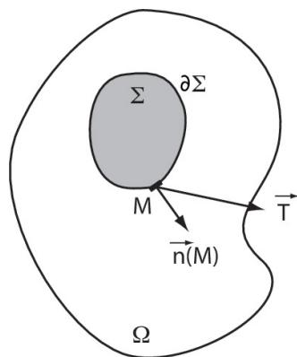
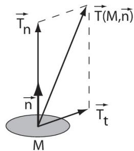
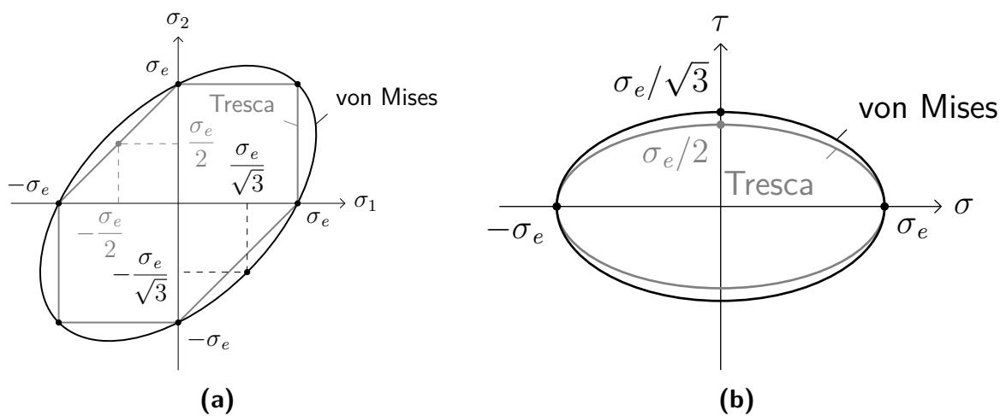

# 第3章 内力的示意——应力的概念（Schématisation des efforts intérieurs – Notion de contrainte）

原课件：[Chap 3 PDF](IMMC_CM_Chap3_2025-2026.pdf) · [法文文本](IMMC_CM_Chap3_2025-2026.md)

**开卷查阅。** 给定应力矩阵后，先确认单位和所在基底，再按“求牵引 → 分解 → 主应力 → 强度准则”处理。

| 所求量 | 公式与用法 |
|---|---|
| 面上的应力向量 / 牵引（vecteur contrainte） | $\vec{T}=\boldsymbol{\sigma}\vec{n}$，$\vec{n}$ 必须是外法向单位向量 |
| 法向与切向分量 | 法向正应力标量 $\sigma_n = T_n = \vec{n}\cdot\vec{T} = \vec{n}\cdot\boldsymbol{\sigma}\cdot\vec{n}$，法向应力向量 $\vec{T}_n=\sigma_n\vec{n}$；切向应力向量 $\vec{T}_t=\vec{T}-\vec{T}_n$，切应力大小为 $T_t=\|\vec{T}_t\|$ |
| 主应力、主方向 | 解 $\det(\boldsymbol{\sigma}-\sigma\mathbb{I})=0$，再解 $(\boldsymbol{\sigma}-\sigma_i\mathbb{I})\vec{n}_i=\vec{0}$ 并归一化 |
| 球形部分与应力偏量 | $\boldsymbol{\sigma}^S = \frac{1}{3}\operatorname{Tr}(\boldsymbol{\sigma})\mathbb{I} = -p\mathbb{I}$，$\boldsymbol{\sigma}^D = \boldsymbol{\sigma}-\frac{1}{3}\operatorname{Tr}(\boldsymbol{\sigma})\mathbb{I}$，满足 $\operatorname{Tr}(\boldsymbol{\sigma}^D)=0$ |
| von Mises 等效应力 | $\sigma_{VM}=\sqrt{\frac{3}{2}\boldsymbol{\sigma}^D:\boldsymbol{\sigma}^D}$；主应力形式见式 (3.28) |
| Tresca 等效应力 | $\sigma_{Tr}=\max_{i,j}|\sigma_i-\sigma_j|=2\tau_{\max}$；**平面应力也须保留第三主应力 $0$** |

单位：应力、面力密度（牵引）为 $\mathrm{Pa}$（$\mathrm{N\cdot m^{-2}}$）；体积力密度为 $\mathrm{N\cdot m^{-3}}$；合力为 $\mathrm{N}$；合力矩为 $\mathrm{N\cdot m}$。符号约定：拉应力为正、压应力为负；流体压力边界条件表现为表面牵引 $\vec{T}=\boldsymbol{\sigma}\vec{n}=-p\vec{n}$（注意区分于体内静水应力状态 $\boldsymbol{\sigma}=-p\mathbb{I}$）。

Dans le cadre de la mécanique des systèmes de solides rigides, il n’est pas utile de schématiser les efforts intérieurs à chaque solide (appelés aussi efforts de cohésion). En Mécanique des Milieux Continus déformables, cette impasse n’est plus possible. L’objet de ce chapitre est d’introduire une schématisation précise de ces efforts intérieurs.

在刚体系统力学的框架下，通常不必为每一个固体单独示意其内部作用力（也称为内聚力）。然而，在可变形连续介质力学中，不再可能绕开这一问题。本章的目的是引入对这些内部作用力的精确示意。

## 3.1 外力的示意回顾（Rappels sur la schématisation des efforts extérieurs）

### 3.1.1 旋量的概念（Notion de torseur）

**Définition 3.1** Un torseur est par définition un champ de vecteur $M \mapsto \vec{H}(M)$ équiprojectif, c’est-à-dire tel que :

**定义 3.1** 一个旋量（torseur）按定义是一个等投影（équiprojectif）向量场 $M \mapsto \vec{H}(M)$，即满足：

$$
\forall M, \forall N : \vec{H}(M) \cdot \overrightarrow{MN} = \vec{H}(N) \cdot \overrightarrow{MN} \tag{3.1}
$$

On démontre alors qu’il existe un unique vecteur $\vec{R}$, appelé résultante du torseur, tel que :

由此可证明存在唯一一个向量 $\vec{R}$，称为该旋量的**合力**（résultante），使得：

$$
\forall M, \forall N : \vec{H}(N) = \vec{H}(M) + \vec{R} \wedge \overrightarrow{MN} \tag{3.2}
$$

Le vecteur $\vec{H}(M)$ est aussi appelé moment en $M$ du torseur.

向量 $\vec{H}(M)$ 也称为该旋量在点 $M$ 处的**力矩**（moment）。

Un torseur est entièrement déterminé par la donnée de sa résultante et de son moment en un point $M$ : ces deux vecteurs constituent les éléments de réduction en $M$ du torseur.

一个旋量完全由其合力以及在某一点 $M$ 处的力矩所确定：这两个向量构成了该旋量在点 $M$ 处的**化简要素**（éléments de réduction）：

$$
\left\{
\begin{array}{c}
\vec{R} \\
\vec{H}(M)
\end{array}
\right\}_M
$$

Les opérations classiques (c’est-à-dire addition, soustraction, égalité, etc.) portant sur deux torseurs $\mathcal{T}_1$ et $\mathcal{T}_2$ consistent à effectuer ces mêmes opérations sur leurs éléments de réduction, **exprimés au même point**. Par exemple :

对两个旋量 $\mathcal{T}_1$ 与 $\mathcal{T}_2$ 进行的常规运算（即加法、减法、相等等），在于对它们**均在同一点处表示**的化简要素执行相同的运算。例如：

$$
\mathcal{T}_1 + \mathcal{T}_2 =
\left\{
\begin{array}{c}
\vec{R}_1 + \vec{R}_2 \\
\vec{H}_1(A) + \vec{H}_2(A)
\end{array}
\right\}_A
=
\left\{
\begin{array}{c}
\vec{R}_1 + \vec{R}_2 \\
\vec{H}_1(A) + \vec{H}_2(B) + \vec{R}_2 \wedge \overrightarrow{BA}
\end{array}
\right\}_A \tag{3.3}
$$

**Définition 3.2** Un glisseur est un torseur pour lequel il existe au moins un point $A$ où le moment est nul. Le moment est alors nul en tout point de la droite $(A, \vec{R})$ si la résultante est non nulle et en tout point de l’espace si elle est nulle (dans ce cas, le torseur est le torseur nul).

**定义 3.2** **滑动矢量**（glisseur，或称力旋量）是至少存在一个点 $A$ 使其力矩为零的旋量。若合力非零，则力矩在直线 $(A, \vec{R})$ 上的所有点处均为零；若合力为零，则在空间所有点处力矩均为零（此时该旋量为零旋量）。

### 3.1.2 质点的情况（Cas d’un point matériel）

Soit $M$ un point matériel de masse $m$. Les effets de l’environnement extérieur sur $M$ peuvent très souvent être schématisés par une unique « force appliquée en $M$ », c’est-à-dire de façon précise par un torseur (glisseur) dont les éléments de réduction en $M$ sont :
- résultante $\vec{F}$ ;
- moment nul $\vec{0}$.

设 $M$ 为质量为 $m$ 的质点。外界环境对 $M$ 的作用通常可以简化示意为单个“作用在点 $M$ 的力”，即精确地表示为一个在点 $M$ 处化简要素如下的旋量（滑动矢量）：
- 合力 $\vec{F}$；
- 零力矩 $\vec{0}$。

Si le repère $\mathcal{R}$ est galiléen<a href="#note-1">1</a>, le principe fondamental de la dynamique (PFD) donne :

若参考系 $\mathcal{R}$ 为伽利略参考系<a href="#note-1">1</a>，则动力学基本原理（PFD）给出：

$$
m \frac{\mathrm{d}^2 \overrightarrow{OM}}{\mathrm{d}t^2} = \vec{F} \tag{3.4}
$$

### 3.1.3 刚体的情况（Cas d’un corps rigide $\Sigma$）

Sur un corps rigide, les effets de l’environnement extérieur sont généralement schématisés par les trois types d’efforts décrits ci-dessous.

对于一个刚体 $\Sigma$，外界环境的作用通常可由下述三类力来示意。

#### 体积力（Efforts volumiques）

Certains efforts peuvent être schématisés par la donnée dans $\Sigma$ (ou sur une partie volumique de $\Sigma$) d’une densité volumique d’effort $M \mapsto \vec{f}_v(M)$. Le torseur associé à ce type d’effort a pour éléments de réduction en un point quelconque $A$ :

某些力可以通过在 $\Sigma$ 内（或 $\Sigma$ 的某一体积部分上）给定一个体积力密度场 $M \mapsto \vec{f}_v(M)$ 来示意。与这类力相关联的旋量在任意点 $A$ 处的化简要素为：

$$
\left\{
\begin{array}{c}
\vec{R} = \displaystyle \int_{\Sigma} \vec{f}_v(M) \, \mathrm{d}V \\
\vec{H}(A) = \displaystyle \int_{\Sigma} \overrightarrow{AM} \wedge \vec{f}_v(M) \, \mathrm{d}V
\end{array}
\right\}_A \quad \text{exprimés en（单位为）} \quad \left\{\begin{array}{c} \mathrm{N} \\ \mathrm{N}\cdot\mathrm{m} \end{array}\right\} \tag{3.5}
$$

Par exemple, les efforts de pesanteur sont de ce type. La densité volumique d’effort $\vec{f}_v$ s’exprime en $\mathrm{N} \cdot \mathrm{m}^{-3}$.

例如，重力作用就属于这一类型。体积力密度 $\vec{f}_v$ 的单位为 $\mathrm{N} \cdot \mathrm{m}^{-3}$。

#### 表面力（Efforts surfaciques）

Certains efforts peuvent être schématisés par la donnée, sur la frontière $\partial\Sigma$ (ou sur une partie de la frontière) d’une densité surfacique de force $M \mapsto \vec{T}(M)$. Le torseur associé à ce type d’effort a pour éléments de réduction en un point quelconque $A$ :

某些力可以通过在边界 $\partial\Sigma$ 上（或部分边界上）给定一个面力密度场 $M \mapsto \vec{T}(M)$ 来示意。与这类力相关联的旋量在任意点 $A$ 处的化简要素为：

$$
\left\{
\begin{array}{c}
\vec{R} = \displaystyle \int_{\partial \Sigma} \vec{T}(M)\, \mathrm{d}S \\
\vec{H}(A) = \displaystyle \int_{\partial \Sigma} \overrightarrow{AM} \wedge \vec{T}(M)\, \mathrm{d}S
\end{array}
\right\}_A \quad \text{exprimés en（单位为）} \quad \left\{\begin{array}{c} \mathrm{N} \\ \mathrm{N}\cdot\mathrm{m} \end{array}\right\} \tag{3.6}
$$

Par exemple, les efforts (de type pression) exercés par un fluide sur un solide sont de ce type. La densité surfacique d’effort $\vec{T}$ s’exprime en $\mathrm{N} \cdot \mathrm{m}^{-2}$.

例如，流体对固体施加的（压力型）作用力就属于这一类型。面力密度 $\vec{T}$ 的单位为 $\mathrm{N} \cdot \mathrm{m}^{-2}$。

#### 集中力（Efforts concentrés）

En un point $C$ d’un solide, on se donne une force $\vec{F}$ et un moment $\vec{H}(C)$. Le torseur associé a alors pour éléments de réduction en $C$ :

在固体的某一点 $C$ 处，给定一个力 $\vec{F}$ 和一个力矩 $\vec{H}(C)$。与之相关联的旋量在点 $C$ 处的化简要素为：

$$
\left\{
\begin{array}{c}
\vec{F} \\
\vec{H}(C)
\end{array}
\right\}_C \quad \text{exprimés en（单位为）} \quad \left\{\begin{array}{c} \mathrm{N} \\ \mathrm{N}\cdot\mathrm{m} \end{array}\right\} \tag{3.7}
$$

#### 刚体的动力学基本原理回顾（Rappel du PFD pour un solide）

Si le repère $\mathcal{R}$ est galiléen, le principe fondamental de la dynamique appliqué à $\Sigma$ donne :

若参考系 $\mathcal{R}$ 为伽利略参考系，则将动力学基本原理（PFD）应用于刚体 $\Sigma$ 给出：

$$
\text{Torseur dynamique de } \Sigma = \text{Torseur des efforts extérieurs appliqués à } \Sigma
$$

$$
\Sigma \text{ 的动力学旋量} = \text{作用于 } \Sigma \text{ 的外力旋量}
$$

c’est-à-dire, pour les types d’efforts considérés ici :

即对于此处考虑的各类作用力（合力形式与点 $A$ 处的力矩形式）：

$$
\int_{\Sigma} \rho \, \vec{\Gamma}(M/\mathcal{R})\, \mathrm{d}V
=
\int_{\Sigma} \vec{f}_v(M)\, \mathrm{d}V
+ \int_{\partial \Sigma} \vec{T}(M)\, \mathrm{d}S
+ \vec{F}
\tag{3.8}
$$

$$
\int_{\Sigma} \overrightarrow{AM} \wedge \rho \, \vec{\Gamma}(M/\mathcal{R})\, \mathrm{d}V
=
\int_{\Sigma} \overrightarrow{AM} \wedge \vec{f}_v(M)\, \mathrm{d}V
+ \int_{\partial \Sigma} \overrightarrow{AM} \wedge \vec{T}(M)\, \mathrm{d}S
+ \left( \vec{H}(C) + \overrightarrow{AC} \wedge \vec{F} \right)
\tag{3.9}
$$

où $\rho$ désigne la masse volumique<a href="#note-2">2</a>, le plus souvent exprimée en $\mathrm{kg} \cdot \mathrm{m}^{-3}$.

其中 $\rho$ 表示质量密度<a href="#note-2">2</a>，通常以 $\mathrm{kg}\cdot\mathrm{m}^{-3}$ 为单位。

### 3.1.4 连续介质的情况（Cas d’un milieu continu）

Pour décrire les effets de l’environnement extérieur sur un milieu continu $\Omega$, nous utiliserons principalement deux types de schématisations :
- des efforts surfaciques schématisés par la donnée, sur la frontière $\partial\Omega$ (ou sur une partie de la frontière), d’une densité surfacique de force $M \mapsto \vec{T}(M)$. Ces efforts sont, selon les cas, donnés ou inconnus. Lorsqu’ils sont donnés, on les notera $\vec{T}_d$.
- des efforts volumiques schématisés par la donnée dans $\Omega$ (ou sur une partie volumique de $\Omega$) d’une densité volumique d’effort $M \mapsto \vec{f}_v(M)$. En général, ces efforts sont des données du problème. On les notera alors $\vec{f}_d$.

为描述外界环境对连续介质 $\Omega$ 的作用，我们主要采用以下两种示意方式：
- **表面力：** 通过在边界 $\partial \Omega$（或其一部分）上给定面力密度场 $M \mapsto \vec{T}(M)$ 来示意。视具体情况，这些力可以是已知的或未知的；当它们已知时，记为 $\vec{T}_d$。
- **体积力：** 通过在域 $\Omega$（或其某一体积部分）内给定体积力密度场 $M \mapsto \vec{f}_v(M)$ 来示意。通常这些力是问题的已知数据，此时记为 $\vec{f}_d$。

**Remarque 3.1** *Au moins dans un premier temps, nous exclurons la possibilité des efforts concentrés appliqués sur un milieu continu. La prise en compte de tels efforts conduit le plus souvent à des difficultés mathématiques hors du programme. Néanmoins, dans le cas particulier des milieux de type « poutre », ce type d’effort peut être pris en compte.*

**备注 3.1** *至少在初步阶段，我们排除在连续介质上施加集中力的可能性。考虑此类作用力通常会导致超出本课程大纲范围的数学困难（奇异性）。不过，在“梁”型介质这一特殊情况下，可以将此类作用力纳入考虑。*

**Remarque 3.2** *On se limitera ici à l’étude des milieux classiques dits « de Cauchy » pour lesquels aucune densité volumique de moments n’est introduite. Des modèles plus fins, et plus complexes, sont aussi disponibles, mais hors du cadre de ce cours.*

**备注 3.2** *此处仅限于研究被称为“柯西（Cauchy）介质”的经典连续介质，即不引入任何体积力矩密度。更精细、更复杂的模型（如广义连续介质）也是存在的，但超出了本课程的范围。*

## 3.2 内力的示意（Schématisation des efforts intérieurs）

### 3.2.1 基本假设（Hypothèses de base）

Considérons une partie $\Sigma$ de $\Omega$ de frontière $\partial\Sigma$ intérieur à $\Omega$ (cf. figure 3.1). On va schématiser les efforts intérieurs à $\Omega$ en schématisant les efforts de la partie $\Omega - \Sigma$ sur la partie $\Sigma$. On fait les deux hypothèses suivantes :
- les efforts de $\Omega - \Sigma$ sur $\Sigma$ sont uniquement des efforts surfaciques définis sur $\partial\Sigma$ par une densité surfacique d’efforts $\vec{T}$,
- on suppose que, en un point $M$ donné de $\partial\Sigma$, la densité $\vec{T}$ ne dépend que de l’orientation de l’élément de surface de $\partial\Sigma$ en $M$ et donc que $\vec{T}$ ne dépend que du vecteur normal extérieur unité $\vec{n}(M)$ en $M$ à $\partial\Sigma$ :

考虑连续介质 $\Omega$ 的一个子域 $\Sigma$，其边界 $\partial \Sigma$ 位于 $\Omega$ 内部（见图 3.1）。我们通过示意 $\Omega - \Sigma$ 部分对 $\Sigma$ 部分的作用力，来示意 $\Omega$ 内部的内力。为此作如下两条假设：
- $\Omega - \Sigma$ 对 $\Sigma$ 的作用力仅为定义在 $\partial \Sigma$ 上的**表面力**，由面力密度向量 $\vec{T}$ 表征；
- 假设在 $\partial \Sigma$ 上给定的点 $M$ 处，面力密度 $\vec{T}$ 仅取决于 $\partial \Sigma$ 在点 $M$ 处面元的取向，因而仅取决于 $\partial \Sigma$ 在点 $M$ 处的外法向单位向量 $\vec{n}(M)$：

$$
\vec{T} = \vec{T}(M, \vec{n}(M))
\tag{3.10}
$$

*Figure 3.1 – Schématisation des efforts intérieurs / 图 3.1：内力的示意*

### 3.2.2 应力算子（Opérateur des contraintes）

#### 柯西基本定理（Théorème fondamental (Cauchy)）

**Théorème 3.1** Il existe un opérateur linéaire $\boldsymbol{\sigma}$ aussi appelé tenseur des contraintes de Cauchy, défini en tout point $M$ de $\Omega$, tel que :

**定理 3.1** 存在一个定义在 $\Omega$ 的每一点 $M$ 处的线性算子 $\boldsymbol{\sigma}$（也称为**柯西应力张量**），使得：

$$
\vec{T}(M, \vec{n}) = \boldsymbol{\sigma}(M) \vec{n} = \boldsymbol{\sigma}(M) \cdot \vec{n}
\tag{3.11}
$$

**Définition 3.3** L’opérateur $\boldsymbol{\sigma}(M)$ est appelé opérateur des contraintes au point $M$.

**定义 3.3** 算子 $\boldsymbol{\sigma}(M)$ 称为点 $M$ 处的**应力算子**。

**Définition 3.4** Le vecteur $\vec{T}(M, \vec{n})$ est appelé vecteur contrainte en $M$ dans la direction $\vec{n}$.

**定义 3.4** 向量 $\vec{T}(M, \vec{n})$ 称为点 $M$ 处在方向 $\vec{n}$ 上的**应力向量**（或面力向量/牵引向量）。

#### 应力算子的对称性（Symétrie de l’opérateur des contraintes）

L’opérateur $\boldsymbol{\sigma}(M)$ est symétrique : $\boldsymbol{\sigma}(M) = [\boldsymbol{\sigma}(M)]^{\mathsf{T}}$.

应力算子 $\boldsymbol{\sigma}(M)$ 是对称的：$\boldsymbol{\sigma}(M) = [\boldsymbol{\sigma}(M)]^{\mathsf{T}}$。

### 3.2.3 应力算子在一点的性质（Étude de l’opérateur des contraintes en un point）

#### 物理量纲（Dimension physique）

Les composantes de $\boldsymbol{\sigma}$ ont la dimension d’une pression : force par unité de surface. L’unité de mesure est donc le Pascal ($\mathrm{Pa}$) ou les unités dérivées : $\mathrm{MPa}$, $\mathrm{GPa}$. Cela correspond à des $\mathrm{N} \cdot \mathrm{m}^{-2}$. Physiquement, la force élémentaire exercée par $\Omega-\Sigma$ sur $\Sigma$ sur un élément de surface $\mathrm{d}S$ est :

应力算子 $\boldsymbol{\sigma}$ 的各分量具有压力的量纲：单位面积上的力。因此其度量单位为帕斯卡（$\mathrm{Pa}$）或其导出单位：$\mathrm{MPa}$、$\mathrm{GPa}$，对应于 $\mathrm{N} \cdot \mathrm{m}^{-2}$。物理上，$\Omega - \Sigma$ 在微元面积 $\mathrm{d}S$ 上对 $\Sigma$ 施加的微元力为：

$$
\mathrm{d}\vec{f} = \boldsymbol{\sigma} \vec{n}\, \mathrm{d}S = \boldsymbol{\sigma} \cdot \vec{n}\, \mathrm{d}S
\tag{3.12}
$$

À titre d’exemples, voici quelques ordres de grandeurs :
- la pression atmosphérique : $p_a = 1\,\mathrm{atm} = 1{,}01325\,\mathrm{bar} = 101325\,\mathrm{Pa} \approx 0{,}1\,\mathrm{MPa}$
- pneu de vélo de course : $p \approx 6\,\mathrm{bar}$ à $10\,\mathrm{bar}$
- limite élastique d’un acier doux : $200\,\mathrm{MPa}$ à $250\,\mathrm{MPa}$

作为示例，以下给出几个常见的数量级：
- 大气压强：$p_a = 1\,\mathrm{atm} = 1.01325\,\mathrm{bar} = 101325\,\mathrm{Pa} \approx 0.1\,\mathrm{MPa}$
- 公路自行车轮胎气压：$p \approx 6\,\mathrm{bar}$ 至 $10\,\mathrm{bar}$
- 低碳钢（软钢）的屈服极限：$200\,\mathrm{MPa}$ 至 $250\,\mathrm{MPa}$

#### 法向应力与切向应力（Contrainte normale – Contrainte tangentielle）

**Définition 3.5** On appelle contrainte normale dans la direction $\vec{n}$ la projection du vecteur contrainte sur $\vec{n}$ (figure 3.2) :

**定义 3.5** 方向 $\vec{n}$ 上的**法向应力**定义为应力向量在 $\vec{n}$ 上的投影（见图 3.2）：

$$
\vec{T}_n = T_n \vec{n} = (\vec{n}^{\mathsf{T}} \boldsymbol{\sigma} \vec{n}) \vec{n} = (\vec{n} \cdot \boldsymbol{\sigma} \cdot \vec{n}) \vec{n}
\tag{3.13}
$$

**Définition 3.6** On appelle contrainte tangentielle dans la direction $\vec{n}$ la projection du vecteur contrainte sur le plan orthogonal à $\vec{n}$ (figure 3.2) :

**定义 3.6** 方向 $\vec{n}$ 上的**切向应力**定义为应力向量在与 $\vec{n}$ 正交的平面上的投影（见图 3.2）：

$$
\vec{T}_t = \boldsymbol{\sigma} \vec{n} - \vec{T}_n = \boldsymbol{\sigma} \cdot \vec{n} - \vec{T}_n
\tag{3.14}
$$

*Figure 3.2 – Contrainte normale et contrainte tangentielle / 图 3.2：法向应力与切向应力*

**Remarque 3.3** *On utilise aussi pour le couple contraintes normale et tangentielle $(T_n, T_t)$ parfois les notations $(\sigma_n, \sigma_t)$ ou $(\sigma, \tau)$.*

**备注 3.3** *对于法向应力与切向应力构成的数对 $(T_n, T_t)$，有时也采用记号 $(\sigma_n, \sigma_t)$ 或 $(\sigma, \tau)$。*

**Remarque 3.4** *On utilise aussi parfois le terme « contrainte de cisaillement » ou « cisaillement » à la place de contrainte tangentielle.*

**备注 3.4** *有时也使用术语“剪应力”（contrainte de cisaillement）或简称“剪切”（cisaillement）来代替切向应力。*

#### 应力互等定理（Réciprocité des contraintes）

On a, pour toutes directions $\vec{n}_1$ et $\vec{n}_2$ :

对于任意两个方向 $\vec{n}_1$ 和 $\vec{n}_2$，有：

$$
\vec{n}_2^{\mathsf{T}} \boldsymbol{\sigma} \vec{n}_1 = \vec{n}_1^{\mathsf{T}} \boldsymbol{\sigma} \vec{n}_2
\quad \Longleftrightarrow \quad
\vec{n}_2 \cdot \boldsymbol{\sigma} \cdot \vec{n}_1 = \vec{n}_1 \cdot \boldsymbol{\sigma} \cdot \vec{n}_2
\tag{3.15}
$$

#### 球形部分与应力偏量（Partie sphérique et déviateur des contraintes）

On peut décomposer le tenseur des contraintes (comme tout autre tenseur) en parties sphérique et déviatorique, ce qui constitue une base tensorielle.

我们可以将应力张量（如同任何其他二阶张量一样）分解为球形部分和偏量部分，这构成了一组张量分解基。

La partie sphérique des contraintes $\boldsymbol{\sigma}^S$, correspondant au $3^{\text{e}}$ invariant de ce tenseur, reliée à la pression hydrostatique $p$, est définie par :

应力的球形部分 $\boldsymbol{\sigma}^S$（原文写为对应于该张量的第 3 不变量），与静水压力 $p$ 相关联，定义为：

$$
\boldsymbol{\sigma}^S = \operatorname{sphe}(\boldsymbol{\sigma}) = \frac{1}{3} \operatorname{Tr}(\boldsymbol{\sigma})\, \mathbb{I} = -p\,\mathbb{I}
\quad \Longrightarrow \quad
p = -\frac{\operatorname{Tr}(\boldsymbol{\sigma})}{3}
\tag{3.16}
$$

> **原课件勘误：** 原 PDF 将球形部分表述为关联于“第 3 不变量（$3^{\text{e}}$ invariant）”，实为笔误。张量的迹 $\operatorname{Tr}(\boldsymbol{\sigma}) = I_1$ 是**第 1 不变量**，而第 3 不变量为行列式 $\det(\boldsymbol{\sigma}) = I_3$。

La partie déviatorique, ou plus communément le déviateur des contraintes, noté $\boldsymbol{\sigma}^D$, est défini par :

偏量部分，或更常称为**应力偏量**（déviateur des contraintes），记为 $\boldsymbol{\sigma}^D$，定义为：

$$
\boldsymbol{\sigma}^D = \operatorname{dev}(\boldsymbol{\sigma})
= \boldsymbol{\sigma} - \frac{1}{3} \operatorname{Tr}(\boldsymbol{\sigma})\, \mathbb{I}
\tag{3.17}
$$

Il vérifie $\operatorname{Tr}(\boldsymbol{\sigma}^D) = 0$.

它满足 $\operatorname{Tr}(\boldsymbol{\sigma}^D) = 0$。

#### 主方向与主应力（Directions principales – Contraintes principales）

**Définition 3.7** On appelle direction principale<a href="#note-3">3</a> de contrainte tout vecteur unitaire $\vec{n}$ tel que :

**定义 3.7** 满足下式的任意单位向量 $\vec{n}$ 称为应力的**主方向**<a href="#note-3">3</a>：

$$
\boldsymbol{\sigma} \vec{n} = \sigma \vec{n} \quad \Longleftrightarrow \quad \boldsymbol{\sigma} \cdot \vec{n} = \sigma \vec{n}
\tag{3.18}
$$

Étant donné qu’en 3D, il existe, pour tout tenseur de contraintes $\boldsymbol{\sigma}$, 3 contraintes principales, on a :

鉴于在三维空间中，对于任意应力张量 $\boldsymbol{\sigma}$ 均存在 3 个主应力，因此有：

$$
\boldsymbol{\sigma} \vec{n}_i = \sigma_i \vec{n}_i \quad \Longleftrightarrow \quad \boldsymbol{\sigma} \cdot \vec{n}_i = \sigma_i \vec{n}_i \quad \forall i = 1, 2, 3
\tag{3.19}
$$

**Définition 3.8** Le réel $\sigma_i$ est appelé contrainte principale<a href="#note-4">4</a> dans la direction $\vec{n}_i$.

**定义 3.8** 实数 $\sigma_i$ 称为方向 $\vec{n}_i$ 上的**主应力**<a href="#note-4">4</a>。

Il existe toujours au moins une base orthonormée $(\vec{n}_1, \vec{n}_2, \vec{n}_3)$ de directions principales. Dans cette base, la matrice de $\boldsymbol{\sigma}$ est diagonale et les éléments diagonaux sont les contraintes principales.

总存在至少一组由主方向构成的标准正交基 $(\vec{n}_1, \vec{n}_2, \vec{n}_3)$。在该基底下，$\boldsymbol{\sigma}$ 的矩阵为对角矩阵，且对角线元素即为主应力：

$$
[\boldsymbol{\sigma}]_{(\vec{n}_1,\vec{n}_2,\vec{n}_3)} =
\begin{bmatrix}
\sigma_1 & 0 & 0 \\
0 & \sigma_2 & 0 \\
0 & 0 & \sigma_3
\end{bmatrix}
$$

### 3.2.4 常见的特殊应力算子（Opérateurs des contraintes particuliers）

Pour chacun des états des contraintes particuliers listés ici, les composantes peuvent être dépendantes du temps et de l’espace.

对于此处列出的每一种特殊应力状态，其各分量均可以依赖于时间和空间。

#### 球形应力算子（Opérateur sphérique）

**Définition 3.9** Un opérateur de contrainte est sphérique s’il est de la forme :

**定义 3.9** 若应力算子具有如下形式，则称其为**球形应力算子**（球形应力状态）：

$$
\boldsymbol{\sigma} = \sigma \mathbb{I} =
\begin{bmatrix}
\sigma & 0 & 0 \\
0 & \sigma & 0 \\
0 & 0 & \sigma
\end{bmatrix}_{(\vec{e}_1,\vec{e}_2,\vec{e}_3)}
\tag{3.20}
$$

#### 单轴应力算子（Opérateur uniaxial）

**Définition 3.10** Un opérateur de contrainte est uniaxial dans la direction $\vec{e}_1$, s’il est de la forme :

**定义 3.10** 若应力算子具有如下形式，则称其为沿 $\vec{e}_1$ 方向的**单轴应力算子**（单轴应力状态）：

$$
\boldsymbol{\sigma} =
\begin{bmatrix}
\sigma_{11} & 0 & 0 \\
0 & 0 & 0 \\
0 & 0 & 0
\end{bmatrix}_{(\vec{e}_1,\vec{e}_2,\vec{e}_3)}
\tag{3.21}
$$

On parle aussi traction (ou compression selon le signe de $\sigma_{11}$) uniaxiale ou traction pure.

根据 $\sigma_{11}$ 的正负号，也称为单轴拉伸（或单轴压缩），或纯拉伸。

#### 平面应力算子（Opérateur de type plan）

**Définition 3.11** Un opérateur de contrainte est de type plan dans le plan orthogonal à $\vec{e}_1$ s’il est de la forme :

**定义 3.11** 若应力算子具有如下形式，则称其为与 $\vec{e}_1$ 正交的平面内的**平面型应力算子**（平面应力状态）：

$$
\boldsymbol{\sigma} =
\begin{bmatrix}
0 & 0 & 0 \\
0 & \sigma_{22} & \sigma_{23} \\
0 & \sigma_{23} & \sigma_{33}
\end{bmatrix}_{(\vec{e}_1,\vec{e}_2,\vec{e}_3)}
\tag{3.22}
$$

> **注：** 平面应力状态下，作用在法向为 $\vec{e}_1$ 的面上的法向与切向应力分量均为零，仅保留垂直于 $\vec{e}_1$ 的面内应力分量。需注意它仍是三维张量，必有一个主应力为零（在用 Tresca 准则时不可漏掉 $0$）；且“平面应力”并不意味着 $\vec{e}_1$ 方向的线应变 $\varepsilon_{11}$ 为零。

#### 反平面应力算子（Opérateur de type antiplan）

**Définition 3.12** Un opérateur de contrainte est de type antiplan dans la direction $\vec{e}_1$ s’il est de la forme :

**定义 3.12** 若应力算子具有如下形式，则称其为沿 $\vec{e}_1$ 方向的**反平面型应力算子**（反平面应力状态）：

$$
\boldsymbol{\sigma} =
\begin{bmatrix}
\sigma_{11} & \sigma_{12} & \sigma_{13} \\
\sigma_{12} & 0 & 0 \\
\sigma_{13} & 0 & 0
\end{bmatrix}_{(\vec{e}_1,\vec{e}_2,\vec{e}_3)}
\tag{3.23}
$$

> **注：** 此处原课件给出的反平面应力形式包含了纵向正应力分量 $\sigma_{11}$ 以及沿 $\vec{e}_1$ 方向的两个出平面剪应力分量 $\sigma_{12}, \sigma_{13}$，而垂直于 $\vec{e}_1$ 的面内分量 $\sigma_{22}=\sigma_{33}=\sigma_{23}=0$。

#### 纯剪切应力算子（Opérateur de type cisaillement pur）

**Définition 3.13** Un opérateur de contrainte est de cisaillement pur dans le plan $(\vec{e}_1, \vec{e}_2)$ s’il est de la forme :

**定义 3.13** 若应力算子具有如下形式，则称其为 $(\vec{e}_1, \vec{e}_2)$ 平面内的**纯剪切应力算子**（纯剪切应力状态）：

$$
\boldsymbol{\sigma} =
\begin{bmatrix}
0 & \tau & 0 \\
\tau & 0 & 0 \\
0 & 0 & 0
\end{bmatrix}_{(\vec{e}_1,\vec{e}_2,\vec{e}_3)}
\tag{3.24}
$$

**Remarque 3.5** *Exprimé dans sa base principale, en effectuant une simple rotation de $45^{\circ}$, il peut être exprimé comme suit (avec $\vec{n}_3 = \vec{e}_3$) :*

**备注 3.5** *在其主轴基底下（只需绕 $\vec{n}_3 = \vec{e}_3$ 旋转 $45^{\circ}$），该算子可表示为如下形式：*

$$
\boldsymbol{\sigma} =
\begin{bmatrix}
\tau & 0 & 0 \\
0 & -\tau & 0 \\
0 & 0 & 0
\end{bmatrix}_{(\vec{n}_1,\vec{n}_2,\vec{n}_3)}
\tag{3.25}
$$

**Définition 3.14** Un opérateur de contrainte est de torsion pure selon l’axe $\vec{e}_z$ si, dans le ***repère cylindrique***, il est de la forme :

**定义 3.14** 若在***圆柱坐标系*** $(\vec{e}_r, \vec{e}_\theta, \vec{e}_z)$ 下应力算子具有如下形式，则称其为绕 $\vec{e}_z$ 轴的**纯扭转应力算子**（注意切应力位于 $(\vec{e}_\theta, \vec{e}_z)$ 截面而非 $(r,\theta)$ 面）：

$$
\boldsymbol{\sigma} =
\cancel{\begin{bmatrix}
0 & \tau & 0 \\
\tau & 0 & 0 \\
0 & 0 & 0
\end{bmatrix}_{(\vec{e}_r,\vec{e}_\theta,\vec{e}_z)}}
\begin{bmatrix}
0 & 0 & 0 \\
0 & 0 & \tau \\
0 & \tau & 0
\end{bmatrix}_{(\vec{e}_r,\vec{e}_\theta,\vec{e}_z)}
\tag{3.26}
$$

### 3.2.5 符号约定（Convention）

Nous suivrons la convention la plus répandue stipulant qu’une contrainte de traction est positive alors qu’une contrainte de compression est négative.

我们遵循最通用的符号约定：**拉应力为正，压应力为负。**

## 3.3 基本的结构设计准则（Critères élémentaires de dimensionnement）

### 3.3.1 等效应力的概念（Contraintes équivalentes）

Les propriétés des matériaux en termes de limite élastique, sont données sous forme de scalaire (homogène à une contrainte ou pression). Afin de pouvoir comparer un état de contrainte en un point particulier avec cette limite en traction, souvent notée $\sigma_e$ (ou $\sigma_y$ pour les anglo-saxons), il est nécessaire de définir des contraintes équivalentes. Il s’agit de fonctions transformant un état de contraintes, sous forme tensorielle, en une valeur de contrainte scalaire.

材料在弹性极限（屈服极限）方面的性能通常以标量形式给出（量纲与应力或压力相同）。为了能够将某一点处的应力状态与这一常记为 $\sigma_e$（在英美文献中记为 $\sigma_y$）的拉伸屈服极限进行比较，必须定义**等效应力**（contraintes équivalentes）。它是将张量形式的应力状态转换为标量应力值的函数。

### 3.3.2 von Mises 准则（Critère de von Mises）

Il s’agit d’un critère énergétique construit à partir de l’expression de l’énergie élastique déviatorique. Il est assez adapté aux métaux et alliages ductiles.

这是一个基于偏弹性应变能表达式建立的能量型准则，非常适合于金属及延展性（韧性）合金。

**Définition 3.15** La contrainte équivalente de von Mises, notée $\sigma_{VM}$, s’exprime à partir du déviateur des contraintes, plus précisément comme son second invariant :

**定义 3.15** von Mises 等效应力记为 $\sigma_{VM}$，由应力偏量表出，更准确地说是由其第二不变量表出：

$$
\sigma_{VM} = \sqrt{\frac{3}{2} \, \operatorname{Tr}(\boldsymbol{\sigma}^D \boldsymbol{\sigma}^D)}
= \sqrt{\frac{3}{2}\, \boldsymbol{\sigma}^D : \boldsymbol{\sigma}^D}
= \sqrt{\frac{3}{2} \, \sigma^D_{ij}\sigma^D_{ij}}
= \sqrt{\frac{3}{2}\boldsymbol{\sigma} : \boldsymbol{\sigma} - \frac{(\operatorname{Tr}\boldsymbol{\sigma})^2}{2}}
\tag{3.27}
$$

> **注：** 若记应力偏量的第二不变量为 $J_2 = \frac{1}{2}\boldsymbol{\sigma}^D : \boldsymbol{\sigma}^D$，则 $\sigma_{VM} = \sqrt{3J_2}$。

Cette contrainte équivalente peut également être formulée à partir des contraintes principales :

该等效应力也可以用主应力表示为：

$$
\sigma_{VM} =
\sqrt{\frac{(\sigma_1 - \sigma_2)^2 + (\sigma_2 - \sigma_3)^2 + (\sigma_1 - \sigma_3)^2}{2}}
\tag{3.28}
$$

Le critère de von Mises est défini par :

von Mises 准则定义为：

$$
\sigma_{VM} \leqslant \sigma_e
\tag{3.29}
$$

où $\sigma_e$ est la limite élastique du matériau en traction.

其中 $\sigma_e$ 为材料的拉伸弹性极限（屈服极限）。

**Remarque 3.6** *La partie sphérique (ou hydrostatique) des contraintes n’intervient donc pas dans l’expression de $\sigma_{VM}$. Cela implique qu’avec ce critère, un chargement hydrostatique, même de forte intensité, ne provoque pas de déformation irréversible, comme la plasticité ou rupture).*

**备注 3.6** *因此，应力的球形（或静水）部分不出现在 $\sigma_{VM}$ 的表达式中。这意味着在该准则下，即使是高强度的静水载荷也不会引起不可逆变形（如塑性或断裂）。*

> **注：** 该准则仅反映偏应力引起的畸变能屈服机制，并不意味着真实材料在极端静水拉/压下不会发生其他机制的破坏（如空洞成核或压碎）。

### 3.3.3 Tresca 准则（Critère de Tresca）

Il s’agit d’un critère basé sur la contrainte de cisaillement maximale $\tau_{\max}$, obtenue en un point de l’espace, en explorant l’ensemble des facettes et directions de sollicitation. À l’aide d’une analyse graphique avec le tri-cercle de Mohr (non abordé ici), on montre que cela correspond à la moitié du plus grand écart entre les contraintes principales.

这是一个基于空间某一点处遍历所有截面及作用方向所获得的最大剪应力 $\tau_{\max}$ 的准则。借助莫尔（Mohr）三圆的图解分析（此处不作介绍），可以证明这对应于各主应力之间最大差值的一半：

$$
\tau_{\max} =
\max_{\substack{\|\vec{t}\|=1, \\ \|\vec{n}\|=1, \\ \vec{n}\cdot\vec{t}=0}}
\left|\vec{t} \cdot \boldsymbol{\sigma} \cdot \vec{n}\right|
= \max_{i,j} \left|\frac{\sigma_i - \sigma_j}{2}\right|
\tag{3.30}
$$

**Définition 3.16** On appelle contrainte équivalente de Tresca le scalaire $\sigma_{Tr}$ défini par :

**定义 3.16** 称由下式定义的标量 $\sigma_{Tr}$ 为 Tresca 等效应力：

$$
\sigma_{Tr} = \max_{i,j} |\sigma_i - \sigma_j|
\tag{3.31}
$$

où les $\sigma_i$ sont les valeurs propres de $\boldsymbol{\sigma}$, c’est-à-dire les contraintes principales de $\boldsymbol{\sigma}$.

其中 $\sigma_i$ 为 $\boldsymbol{\sigma}$ 的特征值，即 $\boldsymbol{\sigma}$ 的主应力。

Le critère de Tresca est défini indifféremment par :

Tresca 准则可等价地定义为：

$$
\sigma_{Tr} \leqslant \sigma_e
\quad \text{ou（或）} \quad
\tau_{\max} \leqslant \tau_e
\tag{3.32}
$$

où $\tau_e$ est la limite élastique du matériau en cisaillement, qui correspond généralement à $\sigma_e / 2$.

其中 $\tau_e$ 为材料的剪切弹性极限（剪切屈服极限），通常对应于 $\sigma_e / 2$。

> **注：** 在 Tresca 模型中，由单轴拉伸屈服极限 $\sigma_e$ 标定可得 $\tau_e = \sigma_e / 2$；若采用 von Mises 准则，纯剪切屈服极限则为 $\tau_e = \sigma_e / \sqrt{3}$，两种准则不可混用。

### 3.3.4 Rankine 准则（Critère de Rankine）

Pour les matériaux fragiles ou quasi-fragiles (comme le béton, le verre, la fonte, etc.), on peut se baser sur le critère de Rankine qui suppose que le seuil de limite d’élasticité est atteint lorsque l’une des valeurs propres est égale à la contrainte à la rupture : $\sigma_R$. La contrainte équivalente et le critère associé sont définis comme suit :

对于脆性或准脆性材料（如混凝土、玻璃、铸铁等），可以基于 Rankine 准则，该准则假设当应力张量的某一个特征值（主应力）达到断裂应力 $\sigma_R$ 时，即达到弹性极限阈值。其等效应力及相应的准则定义如下：

$$
\sigma_{Ra} = \max_i (\sigma_i)
\qquad \text{et（且）} \qquad
\sigma_{Ra} \leqslant \sigma_R
\tag{3.33}
$$

> **注：** 此处给出的是仅校核最大拉主应力的形式；若问题还给出了抗压强度，则需另外校核压缩侧。

### 3.3.5 强度设计条件（Dimensionnement）

On dimensionne vis-à-vis d’un critère et donc d’une contrainte équivalente $\sigma_{eq}$ (par exemple von Mises $\sigma_{VM}$ ou Tresca $\sigma_{Tr}$), en imposant :

针对选定的准则及相应的等效应力 $\sigma_{eq}$（例如 von Mises 等效应力 $\sigma_{VM}$ 或 Tresca 等效应力 $\sigma_{Tr}$）进行结构尺寸设计（强度校核）时，要求满足：

$$
\sigma_{VM} \leqslant \frac{\sigma_e}{C_s}
\quad \text{ou（或）} \quad
\sigma_{Tr} \leqslant \frac{\sigma_e}{C_s} = \frac{2\tau_e}{C_s}
\tag{3.34}
$$

où $\sigma_e$ est la limite élastique du matériau en traction (aussi appelée résistance élastique), $\tau_e$ la limite élastique du matériau en cisaillement et $C_s \geqslant 1$ est le coefficient de sécurité.

其中 $\sigma_e$ 为材料的拉伸弹性极限（也称为弹性抗力/屈服强度），$\tau_e$ 为材料的剪切弹性极限，$C_s \geqslant 1$ 为安全系数。

### 3.3.6 平面应力下两种准则的比较（Comparaison des deux critères en contrainte plane）

Supposons que $\boldsymbol{\sigma}$ est un opérateur plan qui, dans une base principale, s’écrit :
- en traction biaxiale : $\boldsymbol{\sigma} = \begin{bmatrix} \sigma_1 & 0 & 0 \\ 0 & \sigma_2 & 0 \\ 0 & 0 & 0 \end{bmatrix}_{(\vec{e}_1, \vec{e}_2, \vec{e}_3)}$
- et, en traction-cisaillement : $\boldsymbol{\sigma} = \begin{bmatrix} \sigma & \tau & 0 \\ \tau & 0 & 0 \\ 0 & 0 & 0 \end{bmatrix}_{(\vec{e}_1, \vec{e}_2, \vec{e}_3)}$

假设 $\boldsymbol{\sigma}$ 为平面应力算子，在相应基底下分别写为：
- **双轴拉伸（主方向基底下）：** $\boldsymbol{\sigma} = \begin{bmatrix} \sigma_1 & 0 & 0 \\ 0 & \sigma_2 & 0 \\ 0 & 0 & 0 \end{bmatrix}_{(\vec{e}_1, \vec{e}_2, \vec{e}_3)}$
- **拉伸—剪切组合：** $\boldsymbol{\sigma} = \begin{bmatrix} \sigma & \tau & 0 \\ \tau & 0 & 0 \\ 0 & 0 & 0 \end{bmatrix}_{(\vec{e}_1, \vec{e}_2, \vec{e}_3)}$

En traction biaxiale, le critère de Tresca donne $\max(|\sigma_1|, |\sigma_2|, |\sigma_1 - \sigma_2|) \leqslant \sigma_e$ et le critère de von Mises $\sigma_1^2 + \sigma_2^2 - \sigma_1\sigma_2 \leqslant \sigma_e$. La figure 3.3a permet, dans le plan $(\sigma_1, \sigma_2)$, de comparer les deux critères.

在双轴拉伸下，Tresca 准则给出 $\max(|\sigma_1|, |\sigma_2|, |\sigma_1 - \sigma_2|) \leqslant \sigma_e$，而 von Mises 准则给出 $\sigma_1^2 + \sigma_2^2 - \sigma_1\sigma_2 \leqslant \sigma_e^2$。图 3.3a 给出了在 $(\sigma_1, \sigma_2)$ 平面内对这两种准则的比较。

> **原课件勘误：** 原 PDF 在双轴拉伸的 von Mises 准则不等式右侧漏印了平方，写成了 $\sigma_1^2 + \sigma_2^2 - \sigma_1\sigma_2 \leqslant \sigma_e$；按量纲一致性及式 (3.28)–(3.29)，正确形式应为 $\sigma_1^2 + \sigma_2^2 - \sigma_1\sigma_2 \leqslant \sigma_e^2$（或等价地 $\sqrt{\sigma_1^2 + \sigma_2^2 - \sigma_1\sigma_2} \leqslant \sigma_e$）。

En traction-cisaillement, le critère de Tresca donne $\sqrt{\sigma^2 + 4\tau^2} \leqslant \sigma_e$ et le critère de von Mises donne $\sqrt{\sigma^2 + 3\tau^2} \leqslant \sigma_e$. La figure 3.3b permet, dans le plan $(\sigma, \tau)$, de comparer les deux critères.

在拉伸—剪切组合下，Tresca 准则给出 $\sqrt{\sigma^2 + 4\tau^2} \leqslant \sigma_e$，而 von Mises 准则给出 $\sqrt{\sigma^2 + 3\tau^2} \leqslant \sigma_e$。图 3.3b 给出了在 $(\sigma, \tau)$ 平面内对这两种准则的比较。

*Figure 3.3 – Comparaisons des deux critères en (a) traction biaxiale et (b) traction-cisaillement / 图 3.3：两种准则在 (a) 双轴拉伸与 (b) 拉伸—剪切下的比较*

**Remarque 3.7** *On peut alors observer que pour une même limite élastique $\sigma_e$, le domaine élastique défini par le critère de Tresca est plus restreint que celui de von Mises. On dit alors que le critère Tresca est davantage conservatif. En revanche von Mises permet de gommer les discontinuités (coins) que peut produire Tresca.*

**备注 3.7** *由此可以观察到，对于相同的弹性极限 $\sigma_e$，Tresca 准则所定义的弹性域比 von Mises 准则更为狭窄。因此我们称 Tresca 准则更为**保守**（偏向安全）。反之，von Mises 准则能够消除 Tresca 准则屈服面上可能产生的奇异角点（不光滑处）。*

## 附注（Notes）

**1.** En mécanique, on postule l’existence d’au moins un repère galiléen $\mathcal{R}$ (tous les autres repères galiléens sont alors en translation rectiligne uniforme par rapport à $\mathcal{R}$). Du point de vue pratique, les repères utilisés comme « galiléens » sont des approximations et dépendent des applications envisagées. Par exemple, pour de nombreuses expériences simples de laboratoire, un repère lié à la terre peut être considéré comme « galiléen ». Par contre, pour interpréter la célèbre expérience du pendule de Foucault, ce repère ne peut plus être considéré comme galiléen !

在力学中，我们公设至少存在一个伽利略参考系 $\mathcal{R}$（所有其他伽利略参考系均相对于 $\mathcal{R}$ 作匀速直线平移运动）。从实际应用的角度来看，被当作“伽利略参考系”使用的参考系都是近似的，取决于所考虑的具体应用。例如，对于许多简单的实验室实验，与地球固连的参考系可以视为“伽利略参考系”。相反，若要解释著名的傅科摆（pendule de Foucault）实验，该参考系就不再能被视为伽利略参考系了！

**2.** $\int_\Sigma\rho\vec{\Gamma}(M/\mathcal{R})\,\mathrm{d}V$ est la résultante dynamique ; $\int_\Sigma\overrightarrow{AM}\wedge\rho\vec{\Gamma}(M/\mathcal{R})\,\mathrm{d}V$ est le moment dynamique en $A$. Les deux égalités précédentes sont souvent appelées « théorèmes généraux de la dynamique » ; en fait, il s’agit simplement d’une autre écriture du PFD !

$\int_\Sigma\rho\vec{\Gamma}(M/\mathcal{R})\,\mathrm{d}V$ 为**动力学合力**（résultante dynamique）；$\int_\Sigma\overrightarrow{AM}\wedge\rho\vec{\Gamma}(M/\mathcal{R})\,\mathrm{d}V$ 为点 $A$ 处的**动力学力矩**（moment dynamique）。上述两个等式即式 (3.8)–(3.9) 常被称为“动力学普遍定理”；事实上，这仅仅是动力学基本原理（PFD）的另一种写法！

**3.** Les directions principales sont donc les directions propres (vecteurs propres) de l’opérateur linéaire $\boldsymbol{\sigma}$.

因此，主方向就是线性算子 $\boldsymbol{\sigma}$ 的特征方向（特征向量）。

**4.** Les contraintes principales sont donc les valeurs propres de l’opérateur linéaire $\boldsymbol{\sigma}$.

因此，主应力就是线性算子 $\boldsymbol{\sigma}$ 的特征值。
