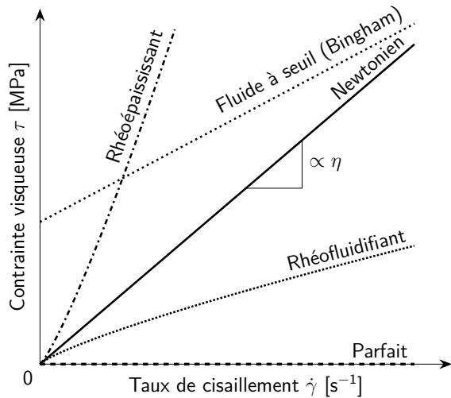
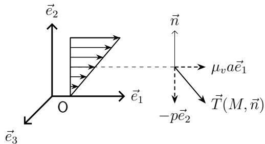

# 第5章本构关系

原课件：[Chap 5 PDF](IMMC_CM_Chap5_2025-2026.pdf) · [法文文本](IMMC_CM_Chap5_2025-2026.md)

Les équations établies aux chapitres précédents sont très générales. L’objet de ce chapitre est d’introduire de nouvelles relations, appelées relations de comportement afin de prendre en compte les propriétés des différents types de milieux continus : milieux déformables « solides » ou « fluides ». Ces nouvelles relations ne se déduisent pas des grands principes de la physique (même si elles sont construites de façon à respecter ces principes). En d’autres termes, ce ne sont pas des « lois physiques » mais des choix de modélisation. Il s’agit de relations au niveau local, entre cause et effet, bien différentes des lois de conservation.

Dans cet exposé élémentaire, nous nous intéressons aux relations de comportement utilisées dans la modélisation des milieux continus les plus simples : solides élastiques, fluides parfaits et fluides classiques.

前几章建立的方程都是非常一般的。本章的目的是引入新的关系，称为**本构关系（relations de comportement）**，以便考虑不同类型连续介质的特性：可变形的"固体"或"流体"。这些新关系并不是从物理学基本原理推导出来的（尽管它们的形式是为了满足这些原理），换句话说，它们不是"物理定律"，而是一种**建模选择**。这是局部层面的因果关系，与守恒定律有很大不同。

在本章的基础介绍中，我们只研究最简单的连续介质模型的本构关系：**弹性固体、理想流体和经典流体。**

## 5.1弹性固体（Solides élastiques）

### 5.1.1一般性（Généralités）

Les milieux continus élastiques sont des milieux qui gardent en mémoire une configuration privilégiée $\Omega _ { 0 }$ . L’opérateur des contraintes de Piola-Kirchhoff S, en un point et à un instant donné, ne dépend que de la déformation subie entre l’état naturel et l’état actuel, en ce point et à cet instant.

Les déformations sont mesurées à partir de cette configuration $\Omega _ { 0 }$ par l’opérateur de Green-Lagrange $\mathbb { E } ( t , M _ { 0 } )$ . La relation de comportement d’un milieu élastique est donc de la forme :

弹性连续介质是具有一个**特定参考构型** $\Omega_0$ 的介质。Piola-Kirchhoff 应力算子 $S$ 在某一点 $(t, M_0)$ 处只取决于该点从自然状态到当前状态之间的**变形**。

变形由 Green--Lagrange 算子 $E(t, M_0)$ 相对于参考配置 $\Omega_0$ 来度量。弹性介质的本构关系因此写作：

$$
S(t, M_0) = G[E(t, M_0)]
\tag{5.1}
$$

où $\mathcal { G }$ est un opérateur caractéristique du matériau.

其中 $G$ 是材料的特征算子。

### 5.1.2线性弹性（Élasticité linéaire）

Pour de très nombreuses applications, on peut supposer que l’application $\mathcal { G }$ est linéaire. On remplace alors la notation $\mathcal { G }$ par $\kappa$ :

在许多应用中，可以假设算子 $G$ 是线性的。在这种情况下，记作 $K$：

$$
S(t, M_0) = K[E(t, M_0)]
\tag{5.2}
$$

L’opérateur $\kappa$ est appelé « opérateur de Hooke » du matériau <a href="#note-1">1</a>.

算子 $K$ 被称为**材料的胡克算子（opérateur de Hooke）**。

即： 

$$
K[E_1 + E_2] = K[E_1] + K[E_2], \quad K[\alpha E] = \alpha K[E].
$$

### 5.1.3各向同性弹性（Élasticité isotrope）

Très souvent, le milieu peut être considéré comme isotrope : schématiquement, le comportement est indépendant de la direction de la sollicitation, ce qui se traduit mathématiquement par la propriété <a href="#note-2">2</a> :

通常情况下，可以认为介质是**各向同性**的，也就是说其力学行为与加载方向无关。这一性质可以数学表达为：

$$
\forall Q \text{ （正交算子）}, \quad \forall E, \quad G[QEQ^T] = QG[E]Q^T
\tag{5.3}
$$

En élasticité isotrope, la relation de comportement élastique (linéaire ou non) est de la forme <a href="#note-3">3</a> :

在各向同性弹性中，无论是否线性，其表示形式为（原 PDF 的首项漏写了单位张量 $I$，否则标量与二阶张量不能相加）：

$$
S = \ell_0(I_1, I_2, I_3)I + \ell_1(I_1, I_2, I_3)E + \ell_2(I_1, I_2, I_3)E^2
\tag{5.4}
$$

> **Erratum dimensionnel (PDF, p. 2, formule 5.4).** Le PDF omet $\mathbb I$ après le coefficient scalaire $\ell_0$ ; son addition à deux tenseurs serait indéfinie. L’identité est rétablie ci-dessus.

où $\begin{array} { r } { I _ { n } \overset { \mathrm { i c i } } { = } I _ { n } ( \mathbb { E } ) = \frac { 1 } { n } \operatorname { T r } [ \mathbb { E } ^ { n } ( t , M _ { 0 } ) ] } \end{array}$ pour $n = 1 , 2 , 3$ et où $\ell _ { 0 } , \ell _ { 1 } , \ell _ { 2 }$ sont des fonctions plus ou moins arbitraires, fortement liées à la thermodynamique.

其中： 

$$
I_n(E) = \frac{1}{n} \mathrm{Tr}[E^n(t, M_0)], \quad n = 1,2,3,
$$

 而 $\ell_0,\ell_1,\ell_2$ 是与热力学密切相关的函数。

**Élasticité linéaire isotrope**

#### 线性各向同性弹性

Si l’élasticité est à la fois linéaire et isotrope, on a :

若弹性同时为线性且各向同性，则有： 

$$
S(t, M_0) = \lambda \, \mathrm{Tr}[E(t, M_0)] I + 2\mu E(t, M_0)
\tag{5.5}
$$

où $\lambda$ et $\mu$ sont des coefficients (indépendants des invariants $I _ { n } )$ appelés coefficients de Lamé. Plus précisément, λ est le premier coefficient de Lamé et $\mu$ le second coefficient de Lamé (ou plus communément le module de cisaillement), tous deux exprimés en Pa (ou plus communé- ment MPa, voire GPa).

其中 $\lambda$ 和 $\mu$ 是材料常数，称为**Lamé 常数**：

- $\lambda$：第一 Lamé 常数；

- $\mu$：第二 Lamé 常数（又称**剪切模量**）。

它们以帕（Pa）为单位（通常为 MPa 或 GPa）。

### 5.1.4小扰动弹性（Élasticité en petites perturbations）

On suppose que l’on se place dans le cadre de l’Hypothèse des Petites Perturbations (HPP), dont on rappelle le cadre de validité :

— les déplacements $\vec{u}$ sont petits devant les dimensions de la structure : $\lVert \vec { u } \rVert \ll [ V ( \Omega ) ] ^ { 1 / 3 }$

— les transformations sont infinitésimales : $\left\| { \overline{\overline{\operatorname{grad}}} } { \vec { u } } \right\| = \left\| { \frac { \partial { \vec { u } } } { \partial M _ { 0 } } } \right\| \ll 1$

On a alors, sous réserve de validité de cette hypothèse, comme une « équivalence » entre les descriptions eulérienne et lagrangienne :

假设在**小扰动假设（Hypothèse des Petites Perturbations, HPP）**下成立，其适用条件为：

- 位移 $\vec{u}$ 远小于结构的尺寸：$\|\vec{u}\| \ll [V(\Omega)]^{1/3}$；

- 变换为无穷小：$\|\nabla \vec{u}\| = \left\|\frac{\partial \vec{u}}{\partial M_0}\right\| \ll 1$。

在此假设下，欧拉描述与拉格朗日描述可认为是等价的： 

$$
\Omega(t) \approx \Omega_0, \quad M(t) \approx M_0, \quad F \approx I,
\quad
\frac{\partial}{\partial M} \approx \frac{\partial}{\partial M_0},
\quad
\frac{d}{dt} \approx \frac{\partial}{\partial t},
$$

$$
E \approx \varepsilon(\vec{u}), \quad S \approx \sigma
\tag{5.6}
$$

Tableau 5.1 – Quelques ordres de grandeur de propriétés élastiques de matériaux solides usuels. Des variations plus ou moins fortes peuvent apparaitre pour certains matériaux, en fonction des nuances.

| Matériau | Module d’Young $E$ (MPa) | Coef. de Poisson $\nu$ (sans unité) | Module de cisaillement $\mu$ (ou $G$) (MPa) | Limite élastique $\sigma_e$ (ou $R_e$, $\sigma_y$) (MPa) |
|---|---:|---:|---:|---:|
| Acier doux | 210 000 | 0,3 | 79 000 | 250 |
| Aluminium | 70 000 | 0,34 | 26 000 | 400 |
| Titane | 115 000 | 0,33 | 41 000 | 200 |
| Verre | 70 000 | 0,2 | 24 500 | 40 |
| Béton | 30 000 | 0,2 | 12 500 | 20 |
| Plexiglas | 3000 | 0,4 | 1100 | 80 |
| Caoutchouc | 2 | 0,5 | 0,67 | 20 |

Dans ces conditions, la relation de comportement élastique linéaire (ou loi de Hooke), s’écrit :

#### 表 5.1

一些常见固体材料的弹性性质数量级。 对于某些材料，性质可能随成分略有变化。

::: center
  **材料**                 **杨氏模量 $E$ (MPa)**   **泊松比 $\nu$**   **剪切模量 $\mu$ (MPa)**   **屈服极限 $\sigma_e$ (MPa)**
  ----------------------- ------------------------ ------------------ -------------------------- -------------------------------
  低碳钢                           210000                 0.30                  79000                          250
  铝                               70000                  0.34                  26000                          400
  钛                               115000                 0.33                  41000                          200
  玻璃                             70000                  0.20                  24500                          40
  混凝土                           30000                  0.20                  12500                          20
  有机玻璃（Plexiglas）             3000                  0.40                   1100                          80
  橡胶                               2                    0.50                   0.67                          20
:::

在这些条件下，线性弹性（胡克定律）的本构关系写作： 

$$
\sigma(t, M) = K : \varepsilon(t, M)
\tag{5.7}
$$

Dans le cas d’un comportement élastique linéaire et isotrope, elle devient :

若材料为线性且各向同性，则： 

$$
\sigma = K : \varepsilon = \lambda \, \mathrm{Tr}(\varepsilon) I + 2\mu \varepsilon
\tag{5.8}
$$

On peut également écrire la relation de comportement inverse :

其逆关系为： 

$$
\varepsilon = K^{-1} : \sigma = \frac{1+\nu}{E}\sigma - \frac{\nu}{E}\mathrm{Tr}(\sigma) I
\tag{5.9}
$$

où $E$ est le module d’Young, exprimé en Pa (voire MPa ou GPa) et ν le coefficient de Poisson, sans dimension. On a comme équivalence avec les coefficients de Lamé λ et $\mu$ :

其中：

- $E$ 为杨氏模量（单位 Pa 或 MPa、GPa）；

- $\nu$ 为泊松比（无量纲）。

与 Lamé 常数 $\lambda$、$\mu$ 的关系如下： 

$$
2\mu = \frac{E}{1+\nu}, \quad
\lambda = \frac{\nu E}{(1+\nu)(1-2\nu)}, \quad
E = \mu \frac{3\lambda + 2\mu}{\lambda + \mu}, \quad
\nu = \frac{\lambda}{2(\lambda + \mu)}
\tag{5.10}
$$

Remarque 5.1 Dans le cas particulier où $\nu = 1 / 2$ , nous sommes en présence d’un matériau élastique incompressible et la relation de comportement inverse devient :

#### 注 5.1

若 $\nu = 1/2$，则材料为**不可压缩弹性体**，此时逆关系变为： 

$$
\varepsilon = \frac{1}{2\mu}\sigma_D,
\quad \text{其中} \quad
\mathrm{Tr}(\varepsilon) = \mathrm{Tr}(\nabla \vec{u}) = \mathrm{div}\, \vec{u} = 0
\tag{5.11}
$$

### 5.1.5均匀性（Homogénéité）

En général, en élasticité linéaire, l’opérateur de Hooke dépend du point considéré dans le matériau :

一般而言，在线性弹性中，胡克算子依赖于材料中的位置： 

$$
K = K(M_0) \quad \text{或在小扰动假设下} \quad K = K(M_0) = K(M)
\tag{5.12}
$$

Définition 5.1 Un matériau élastique est homogène si son opérateur de Hooke est indépendant du point M auquel il est exprimé.

**定义 5.1**若材料的胡克算子与位置 $M$ 无关，则称该弹性材料为**均匀的（homogène）**。

### 5.1.6各向同性热弹性（Thermoélasticité isotrope）

Les relations étudiées ci-dessus sont valables uniquement en isotherme i.e. à température constante (ou plus exactement, en négligeant les effets des variations de température). On peut tenir compte de façon simple d’une variation de température $\delta T ( t , M ) = T ( M t , ) - T _ { 0 } ( M )$ donnée sur $\Omega$ en utilisant la relation de comportement suivante (en HPP) :

前述关系只在**等温条件**（恒温）下有效，即忽略温度变化的影响。 若考虑温度变化 $\delta T(t, M) = T(M_t) - T_0(M)$，则在小扰动假设下，弹性本构关系修正为：

$$
\sigma = K : \varepsilon^{el} = K : (\varepsilon - \varepsilon^d)
= K : (\varepsilon - \varepsilon^{th})
= \lambda\, \mathrm{Tr}(\varepsilon - \varepsilon^{th}) I + 2\mu(\varepsilon - \varepsilon^{th})
\tag{5.13}
$$

avec $\varepsilon _ { e l }$ la déformation élastique, $\varepsilon = \varepsilon ( \vec { u } )$ la déformation totale et $\varepsilon _ { t h }$ la déformation thermique, qui peut s’exprimer comme suit :

其中： 

$$
\varepsilon^{el} = \text{弹性应变}, \quad
\varepsilon = \varepsilon(\vec{u}) = \text{总应变}, \quad
\varepsilon^{th} = \text{热应变}.
$$

热应变可表示为： 

$$
\varepsilon^{th} = \frac{\alpha_v}{3}\delta T\, I
\quad \Rightarrow \quad
\mathrm{Tr}(\varepsilon^{th}) = \alpha_v \delta T
\tag{5.14}
$$

où $\alpha _ { v }$ est le coefficient de dilatation thermique volumique. On peut alors aussi écrire :

其中 $\alpha_v$ 为体膨胀系数。 于是也可以写作： 

$$
\sigma = \lambda \mathrm{Tr}(\varepsilon) I + 2\mu \varepsilon - \frac{3\lambda + 2\mu}{3} \alpha_v \delta T\, I
= K : \varepsilon - K\alpha_v \delta T\, I
\tag{5.15}
$$

avec $K$ le module de compressibilité (hydrostatique) défini par $3 K = 3 \lambda + 2 \mu = E / ( 1 - 2 \nu )$ (scalaire), à ne pas confondre avec l’opérateur de Hooke K.

Remarque 5.2 On peut également exprimer la déformation thermique à partir du coefficient de dilatation thermique linéique α, ce qui donne :

其中 $K$ 为体积压缩模量（又称体积模量）： 

$$
3K = 3\lambda + 2\mu = \frac{E}{1-2\nu}
$$

 注意不要与胡克算子 $K$ 混淆。

#### 注 5.2

若用线膨胀系数 $\alpha$ 表示，则： 

$$
\varepsilon^{th} = \alpha \delta T I
\quad \Rightarrow \quad
\mathrm{Tr}(\varepsilon^{th}) = 3\alpha \delta T
\tag{5.16}
$$

Soit, au final la relation de comportement thermoélastique devient :

最终的热弹性本构关系可写为： 

$$
\sigma = K : \varepsilon - 3K\alpha \delta T I
\tag{5.17}
$$

## 5.2流体（Fluides）

### 5.2.1一般性（Généralités）

Il existe deux grandes classes de fluides :

1. les fluides compressibles (essentiellement les gaz) ;

2. les fluides incompressibles ou quasi-incompressibles (essentiellement les liquides).

Un milieu est incompressible si et seulement si $\rho ( t , M ) = \rho _ { 0 } ( M _ { 0 } )$ . Il résulte alors de l’équation de continuité que div $\vec { V } = 0$ . Et, généralement, on suppose alors que $\rho _ { 0 }$ est indépendant du point (hypothèse d’homogénéité). Dans chaque catégorie, le fluide considéré peut être visqueux ou non visqueux.

Définition 5.2 Un fluide est un milieu dont la relation de comportement est de la forme :

流体主要分为两大类：

1.  可压缩流体（主要是气体）；

2.  不可压缩或近似不可压缩流体（主要是液体）。

若介质满足 $\rho(t, M) = \rho_0(M_0)$，则称为**不可压缩**。 由连续性方程可得：$\mathrm{div}\,\vec{V} = 0$。 通常在这种情况下，还假设 $\rho_0$ 与空间位置无关（即**均匀性假设**）。

在每一类中，流体又可分为**黏性**或**无黏性**流体。

**定义 5.2**流体是一种介质，其本构关系为： 

$$
\sigma(t, M) = L[D(t, M)]
\tag{5.18}
$$

où $\mathcal { L }$ est un opérateur linéaire et isotrope caractéristique du fluide considéré.

La forme générale d’une relation de comportement d’un fluide est donc :

 原课件此处把 $L$ 写成“线性且各向同性”算子；但紧随其后的 (5.19) 允许系数随 $D$ 的不变量变化，一般是非线性映射。因此 (5.18) 与 (5.19) 不能无附加条件地视为等价；(5.18) 应理解为本讲义考虑的一类特殊本构假设。

若采用当前课件的各向同性、局部依赖 $D$ 的表示，则可写为（原 PDF 同样漏写首项的 $I$）： 

$$
\sigma = \ell_0(I_1, I_2, I_3)I + \ell_1(I_1, I_2, I_3)D + \ell_2(I_1, I_2, I_3)D^2
\tag{5.19}
$$

> **Erratum dimensionnel (PDF, p. 5, formule 5.19).** Même omission de $\mathbb I$ dans le terme sphérique $\ell_0$. L’expression (5.19) peut être non linéaire puisque ses coefficients dépendent des invariants ; elle n’est donc pas équivalente à la définition linéaire (5.18) sans hypothèse supplémentaire.

où $\begin{array} { r } { I _ { n } = \frac { 1 } { n } \operatorname { T r } [ \mathbb { D } ^ { n } ( t , M ) ] } \end{array}$ pour $n = 1 , 2 , 3$ et où $\ell _ { 0 } , \ell _ { 1 } , \ell _ { 2 }$ sont des fonctions arbitraires.

 其中： 

$$
I_n = \frac{1}{n}\mathrm{Tr}[D^n(t, M)], \quad n=1,2,3,
$$

 而 $\ell_0, \ell_1, \ell_2$ 为与材料性质相关的函数。

### 5.2.2理想流体（Fluides parfaits）

Ce type de fluide est caractérisé par un état de contrainte sphérique en tout point $\left( \sigma ^ { D } = 0 \right)$ La relation de comportement est donc de la forme :

理想流体的特征是：在任意点处的应力状态为球对称（即 $\sigma_D = 0$）。 因此，其本构关系为： 

$$
\sigma = -p I
\tag{5.20}
$$

où $p$ est la pression dans le fluide. La détermination du champ de contrainte $\boldsymbol { \sigma } ( t , M )$ se ramène à la détermination de la seule fonction scalaire $p ( t , M )$ . Une autre façon d’écrire la relation de comportement est donc d’écrire simplement :

 其中 $p$ 为流体中的压力。 此时，求解应力场 $\sigma(t, M)$ 等价于确定标量场 $p(t, M)$。 也可以写为： 

$$
\sigma_D = 0
\tag{5.21}
$$

**Fluide parfait compressible**

#### 可压缩理想流体

Pour obtenir complètement le comportement de ce type de fluide, il faut se donner une fonction $p = g ( \rho , T )$ où $T$ est la température. La fonction g ne peut être quelconque ; elle doit vérifier les principes de la thermodynamique. Si l’on a $p = g ( \rho )$ , on dit que le fluide parfait est barotrope. Ce type de fluide ne sera pas abordé dans le cours.

要完全描述可压缩理想流体的行为，需要给定状态方程 $p = g(\rho, T)$， 其中 $T$ 为温度。函数 $g$ 必须满足热力学原理。 若 $p = g(\rho)$，则称该流体为**定压流体（barotrope）**。 本课程不讨论此类流体。

**Fluide parfait incompressible**

#### 不可压缩理想流体

Pour les fluides parfaits incompressibles $( \operatorname { d i v } { \vec { V } } = 0 )$ , la pression $p \ ( \sigma = - p \mathbb { I } )$ est une inconnue qui devra être déterminée au cours de la résolution du problème. Une autre façon d’écrire la relation de comportement est donc d’écrire simplement :

对于不可压缩理想流体（$\mathrm{div}\, \vec{V} = 0$），压力 $p$ 是未知量， 需要在求解问题过程中确定。 其本构关系可简写为： 

$$
\sigma_D = 0, \quad \text{且} \quad \mathrm{div}\, \vec{V} = 0
\tag{5.22}
$$

### 5.2.3牛顿黏性流体（Fluide visqueux newtonien）

Les fluides visqueux newtoniens sont aussi appelés fluides classiques. Un fluide newtonien est fluide dont la relation de comportement (contrainte – vitesse de déformation) est linéaire. Cela implique que la viscosité (facteur de proportionnalité entre contrainte et vitesse de déformation) est constante, spécifiquement indépendante de la vitesse de sollicitation. Un comparatif de comportement avec les autres catégories de fluides est présenté en figure 5.1.

黏性流体若满足应力与变形速率线性关系，即为**牛顿流体（fluide newtonien）**。 这种线性关系意味着：黏度为常数，与剪切速率无关。 因此牛顿流体又称为**经典流体**。

（图 5.1 所示比较了理想流体、牛顿流体与非牛顿流体的典型应力--剪切速率关系。）

*图 5.1：理想流体、牛顿流体和非牛顿流体。*

**Fluide visqueux newtonien compressible**

#### 可压缩牛顿流体

Un fluide visqueux newtonien compressible a une relation de comportement de la forme :

可压缩牛顿流体的本构关系为： 

$$
\sigma = -p I + \lambda_v \mathrm{Tr}(D) I + 2\mu_v D
\tag{5.23}
$$

avec $p = g ( \rho , T ) . ~ \lambda _ { v }$ et $\mu _ { v }$ sont des coefficients positifs constants donnés, caractéristiques du fluide considéré, exprimés en $\mathsf { P a } \cdot \mathsf { s } . \mu _ { v }$ est appelé viscosité dynamique et $\lambda _ { v }$ est appelé seconde viscosité (ou viscosité de volume). Il est aussi fréquent de noter la viscosité dynamique $\eta$ ou tout simplement $\mu$

Quelques ordres de grandeur de viscosités dynamiques :

— eau à $2 0 ^ { \circ } \mathsf { C }$ et 1 bar à 100 bar : $\mu _ { v } = 1 0 ^ { - 3 } \mathsf { P a } \cdot \mathsf { s }$

— sang à $2 0 ^ { \circ } \mathsf { C } : 2 \times 1 0 ^ { - 3 } \mathsf { P a } \cdot \mathsf { s } \text{ à }9 \times 1 0 ^ { - 3 } \mathsf { P a } \cdot \mathsf { s }$

— miel à $2 0 ^ { \circ } \mathsf { C } : 2 \mathsf { P a } \cdot \mathsf { s } \text{ à } 1 0 \mathsf { P a } \cdot \mathsf { s }$

— manteau inférieur à $3 0 0 0 ^ { \circ } \mathsf { C } \text{ à } 4 0 0 0 ^ { \circ } \mathsf { C } : 1 0 ^ { 2 1 } \mathsf { P a } \cdot \mathsf { s } \text{ à } 2 \times 1 0 ^ { 2 1 } \mathsf { P a } \cdot \mathsf { s }$

Figure 5.1 – Fluides parfait, Newtonien et non Newtoniens

**Fluide visqueux newtonien incompressible**

Ce sont des milieux incompressibles $( \operatorname { T r } \mathbb { D } = \operatorname { d i v } \vec { V } = 0 )$ dont la relation de comportement est de la forme :

 其中：

- $p = g(\rho, T)$；

- $\lambda_v$、$\mu_v$ 为常数（单位 Pa·s）；

- $\mu_v$：**动力黏度（viscosité dynamique）**；

- $\lambda_v$：**第二黏度或体积黏度（viscosité de volume）**。

动力黏度常用符号 $\eta$ 或简写为 $\mu$。

#### 常见流体的动力黏度数量级：

- 水（20℃, 1 bar）或 100 bar：$\mu_v = 10^{-3}$ Pa·s；

- 血液（20℃）：$2\times10^{-3}$ ～ $9\times10^{-3}$ Pa·s；

- 蜂蜜（20℃）：2 ～ 10 Pa·s；

- 地幔（3000--4000℃）：$10^{21}$ ～ $2\times10^{21}$ Pa·s。

#### 不可压缩牛顿流体

若介质为不可压缩（$\mathrm{Tr}D = \mathrm{div}\,\vec{V} = 0$），其本构关系为： 

$$
\sigma = -p I + 2\mu_v D
\tag{5.24}
$$

où la pression $p$ est une inconnue à déterminer et $\mu _ { v }$ la viscosité dynamique, déjà définie précédemment. On peut aussi écrire la relation de comportement sous la forme :

 其中压力 $p$ 为未知量，$\mu_v$ 为动力黏度。 也可写作： 

$$
\sigma_D = 2\mu_v D
\tag{5.25}
$$

Interprétation du coefficient $\mu _ { v }$

Considérons un écoulement stationnaire de glissement simple défini par le champ de vitesse :

#### 动力黏度系数 $\mu_v$ 的物理意义

*图 5.2：动力黏度系数的物理意义。*

考虑一个稳态简单剪切流动，速度场为： 

$$
\vec{V} = a x_2 \vec{e}_1
$$

 则有： 

$$
D = \frac{a}{2}
\begin{pmatrix}
0 & 1 & 0\\
1 & 0 & 0\\
0 & 0 & 0
\end{pmatrix},
\quad
\sigma =
\begin{pmatrix}
-p & \mu_v a & 0\\
\mu_v a & -p & 0\\
0 & 0 & -p
\end{pmatrix}
\tag{5.26}
$$

 于是： 

$$
\vec{T}(M, \vec{e}_2) = \mu_v a \vec{e}_1 - p \vec{e}_2
\tag{5.27}
$$

Le terme $\mu _ { v } a \vec { e } _ { 1 }$ schématise le frottement interne des couches de fluide les unes sur les autres (figure 5.2).

Figure 5.2 – Interprétation du coefficient $\mu _ { v }$ .

Remarque 5.3 Dans ce module, nous nous focaliserons sur les fluides visqueux newtoniens incompressibles.

**Notes**

**1.** On a donc $\mathcal{K}[\mathbb{E}_1+\mathbb{E}_2]=\mathcal{K}[\mathbb{E}_1]+\mathcal{K}[\mathbb{E}_2]$ et $\mathcal{K}[\alpha\mathbb{E}]=\alpha\mathcal{K}[\mathbb{E}]$.

**2.** L’opérateur $\mathbb{Q}\mathbb{E}\mathbb{Q}^{\mathsf{T}}$ est appelé opérateur tourné de $\mathbb{E}$ par $\mathbb{Q}$. La matrice de $\mathbb{E}$ dans la base des $(\vec{X}_i)$ est égale à la matrice de $\mathbb{Q}\mathbb{E}\mathbb{Q}^{\mathsf{T}}$ dans la base des $(\mathbb{Q}\vec{X}_i)$, appelée base tournée de la base des $(\vec{X}_i)$ par $\mathbb{Q}$.

**3.** Si la relation est de la forme indiquée, il est facile de vérifier l’isotropie. La réciproque, plus délicate, sera admise.

项 $\mu_v a \vec{e}_1$ 表示流体相邻层之间的**内摩擦力**，即黏性效应。

#### 注 5.3

在本模块中，我们主要研究**不可压缩牛顿黏性流体**。
