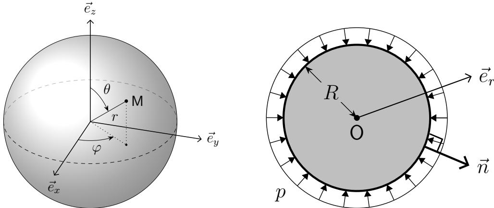
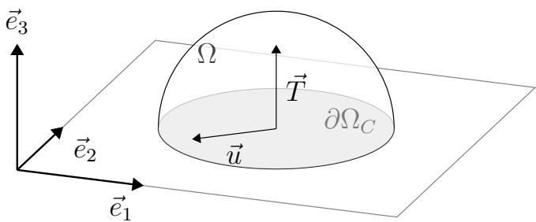
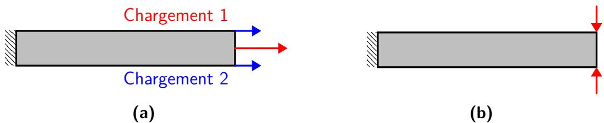
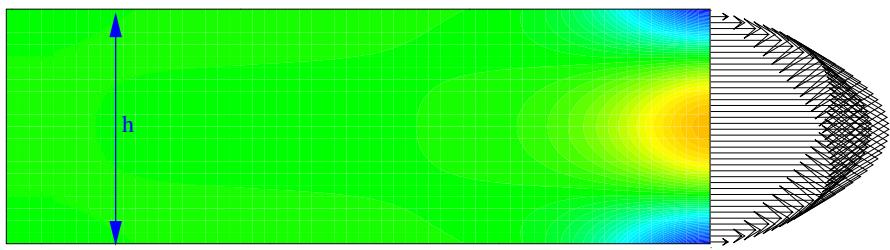
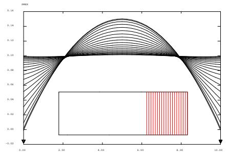
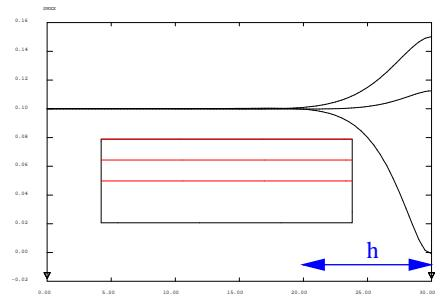
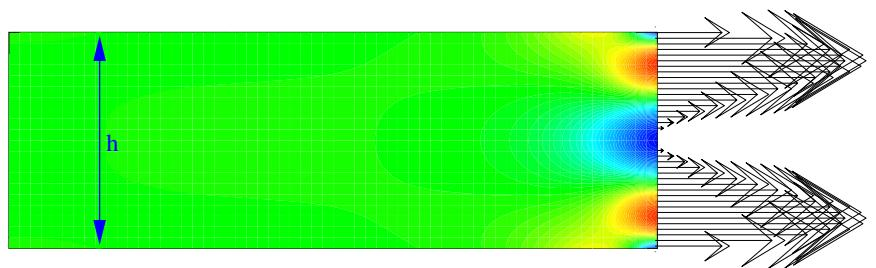
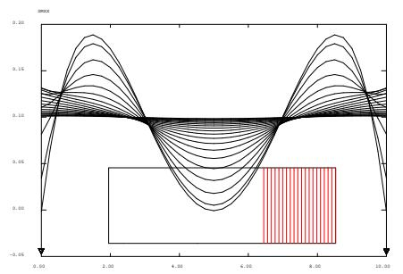
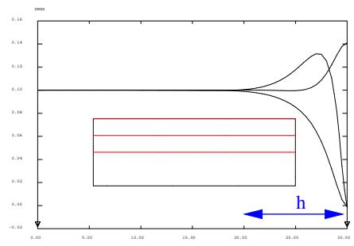

# 第6章 线弹性问题（Problème d’élasticité linéaire solide : formulation, résolution et propriétés）

原课件：[Chap 6 PDF](IMMC_CM_Chap6_2025-2026.pdf) · [法文文本](IMMC_CM_Chap6_2025-2026.md)

On se place dans le cadre des hypothèses des petites perturbations (HPP). Dans ces conditions, la relation de comportement élastique linéaire s’écrit $\sigma ( t , M ) = \mathbf { K } : \varepsilon ( t , M )$ . Si le matériau est homogène, K est indépendant de M. Si le matériau est non homogène, on notera K(M). Par contre, dans ce cours, on supposera toujours que K est indépendant du temps <a href="#note-17">17</a>.

我们置身于小扰动假设（HPP, Hypothèses des Petites Perturbations）的框架下。 在这种条件下，线性弹性本构关系写作：

$$
\sigma(t, M) = K : \varepsilon(t, M)
$$

 如果材料是均质的，$K$ 与点 $M$ 无关；如果材料是非均质的，则记作 $K(M)$。 在本课程中，我们始终假设 $K$ 与时间无关[^1]。

## 6.1 胡克算子的性质（Propriétés de l’opérateur de Hooke）

## 线性（Linéarité）

L’opérateur de Hooke K est un opérateur linéaire de $L _ { S } ( { \bf E } ^ { 3 } )$ (espace des tenseurs symétriques du second ordre) dans lui-même <a href="#note-18">18</a> : à tout opérateur symétrique de ${ \bf E } ^ { 3 }$ , il associe un opérateur symétrique de ${ \bf E } ^ { 3 }$

胡克算子 $K$ 是一个从 $LS(E^3)$（即二阶对称张量空间）到其自身的线性算子[^2]： 它把 $E^3$ 上的任意对称算子映射为另一个对称算子。

$$
\forall \, \varepsilon_1, \varepsilon_2, \quad
K : (\varepsilon_1 + \varepsilon_2) = K : \varepsilon_1 + K : \varepsilon_2,
\quad
\text{且} \quad
\forall \varepsilon, \alpha, \quad
K : (\alpha \varepsilon) = \alpha K : \varepsilon
\tag{6.1}
$$

---

## 对称性（Symétrie）

L’opérateur K est un opérateur symétrique <a href="#note-19">19</a> :

算子 $K$ 是一个对称算子[^3]：

$$
\forall \varepsilon_1, \forall \varepsilon_2, \quad
\mathrm{Tr}[\varepsilon_1 \, K : \varepsilon_2] =
\mathrm{Tr}[\varepsilon_2 \, K : \varepsilon_1]
\quad \text{或等价地} \quad
\varepsilon_1 : K : \varepsilon_2 = \varepsilon_2 : K : \varepsilon_1
\tag{6.2}
$$

La symétrie de K entraîne l’existence d’une énergie interne appelée énergie de déformation élastique.

$K$ 的对称性意味着存在一个内部能量，称为**弹性变形能（énergie de déformation élastique）**。

---

## 正定性（Caractère défini positif）

L’opérateur K est symétrique défini positif :

算子 $K$ 是对称正定的：

$$
\forall \varepsilon, \quad
\mathrm{Tr}[\varepsilon K : \varepsilon]
= \varepsilon : K : \varepsilon \ge 0 ;
\quad
\mathrm{Tr}[\varepsilon K : \varepsilon] = 0
\iff \varepsilon = O
\tag{6.3}
$$

L’opérateur K est donc inversible et l’opérateur inverse ${ \bf K } ^ { { - 1 } }$ est linéaire, symétrique et défini positif.

因此，算子 $K$ 是可逆的，其逆算子 $K^{-1}$ 也是线性的、对称的、并且正定的。

# 6.2 弹性问题的强形式（Formulation forte d'un problème d'élasticité）

On se place dans un premier temps en statique.

在这一节中，我们首先考虑**静态**情形。

## 6.2.1 已知条件（Données）

Un milieu continu occupe dans l’état naturel un domaine Ω. On se donne aussi :

des liaisons avec l’extérieur : encastrement, appui, etc

Pour simplifier, on suppose que l’on se donne le champ de déplacement sur une partie $\partial \Omega _ { u }$ de la frontière ∂Ω de Ω :

一个连续介质在自然状态下占据区域 $\Omega$。 此外，还给定：

- 与外界的连接条件（约束、支座等）；

- 为简化，假设在边界 $\partial\Omega$ 的一部分 $\partial\Omega_u$ 上给定位移场：

$$
\vec{u} = \vec{u}_d \quad \forall M \in \partial\Omega_u
\tag{6.4}
$$

des efforts extérieurs

1. une densité volumique de force $\vec { f } _ { d }$ dans Ω ;

2. une densité surfacique de force $\vec { T _ { d } }$ sur la partie $\partial \Omega _ { T } = \partial \Omega - \partial \Omega _ { u }$

la relation de comportement élastique linéaire

L’opérateur de Hooke K est donc donné.

- 外部载荷：

  1.  体力密度 $\vec{f}_d$，定义于 $\Omega$；

  2.  面力密度 $\vec{T}_d$，定义于 $\partial\Omega_T = \partial\Omega - \partial\Omega_u$。

- 线性弹性本构关系：胡克算子 $K$ 已知。

---

## 6.2.2 未知量（Inconnues）

On applique le chargement et l’on veut connaître l’état final de la structure une fois le chargement appliqué. Les inconnues principales sont :

— le champ de déplacement $\vec { u } ( M )$ en tout point ;

— le champ de contrainte $\sigma ( M )$ en tout point.

Il est à noter que les efforts de liaison sur $\partial \Omega _ { u }$ sont aussi des inconnues. Nous les considérons ici comme des inconnues secondaires. Nous reviendrons sur ce point ultérieurement.

加载施加后，我们希望确定结构在加载后的最终状态。 主要未知量为：

- 位移场 $\vec{u}(M)$；

- 应力场 $\boldsymbol{\sigma}(M)$。

此外，$\partial\Omega_u$ 上的约束反力也是未知量，但它们被视为**次要未知量**，稍后将回到这一点。

---

## 6.2.3 问题方程（Équations du problème）

Le problème peut être formulé de la façon suivante : trouver $\vec { u } ( M )$ et $\sigma ( M )$ tels que :

— le champ de déplacement $\vec { u } ( M )$ vérifie les équations de liaison et est compatible <a href="#note-20">20</a>

问题可表述为：求 $\vec{u}(M)$ 与 $\boldsymbol{\sigma}(M)$，使得：

1.  位移场 $\vec{u}(M)$ 满足约束条件并是兼容的：

$$
\vec{u} = \vec{u}_d \quad \forall M \in \partial\Omega_u
\quad \text{[约束方程]}
\tag{6.5}
$$

$$
\boldsymbol{\varepsilon}(\vec{u}) =
\frac{1}{2} \left(
\nabla \vec{u} + (\nabla \vec{u})^{T}
\right)
\quad \forall M \in \Omega
\quad \text{[兼容性方程]}
\tag{6.6}
$$

Cela implique que $\vec{u}$ est compatible : continu, régulier<a href="#note-21">21</a>, fini (physique).

On dit que $\vec { u }$ est Cinématiquement Admissible (CA). L’espace $\mathcal { U } _ { a d }$ représente l’ensemble des champs CA (i.e. satisfaisant les équations CA).

— le champ de contrainte $\sigma$ vérifie les équations d’équilibre :

从而 $\vec{u}$ 是连续、正则[^4]且有限（物理上合理）的。

这类位移场称为**运动学可容（Cinématiquement Admissible, CA）**。 $U_{ad}$ 表示所有 CA 位移场的集合。

2.  应力场 $\boldsymbol{\sigma}$ 满足平衡方程：

$$
\mathrm{div}\,\boldsymbol{\sigma} + \vec{f}_d = \vec{0}
 \forall M \in \Omega
 \text{（局部或内部平衡）}
\tag{6.7}
$$

$$
\boldsymbol{\sigma} \cdot \vec{n} = \vec{T}_d
 \forall M \in \partial\Omega_T
 \text{（边界平衡条件）}
\tag{6.8}
$$

On dit que $\sigma$ est Statiquement Admissible (SA). L’espace $S _ { a d }$ représente l’ensemble des champs $\mathsf { S A }$ (i.e. satisfaisant les équations $\mathsf { S A } )$

— le champ de contrainte $\sigma$ et le champ de déformation $\varepsilon ( \vec { u } )$ sont liés par la relation de comportement :

这样的应力场称为**静力学可容（Statiquement Admissible, SA）**。 $S_{ad}$ 表示所有 SA 应力场的集合。

3.  应力场与应变场满足本构关系：

$$
\boldsymbol{\sigma} = K : \boldsymbol{\varepsilon}(\vec{u})
\quad \forall M \in \Omega
\tag{6.9}
$$

---

## 6.2.4 约束反力的确定（Détermination des efforts de liaison）

Supposons connue « la » solution $( \vec { u } , \sigma )$ du problème précédent. Alors, on peut calculer les efforts de liaison $\vec { T }$ sur $\partial \Omega _ { u }$ par :

若前述问题的解 $(\vec{u}, \boldsymbol{\sigma})$ 已知，则可在 $\partial\Omega_u$ 上计算约束反力：

$$
\vec{T} = \boldsymbol{\sigma} \cdot \vec{n}
\quad \forall M \in \partial\Omega_u
\tag{6.10}
$$

---

## 6.2.5 动态扩展（Extension à la dynamique）

En dynamique, les données $\vec { u } _ { d } , ~ \vec { f } _ { d }$ et $\vec { T _ { d } }$ sont fonctions du temps t et du point M. Les inconnues $\vec { u } ( t , M )$ et $\sigma ( t , M )$ sont aussi fonctions du temps t et du point M. Le problème devient : trouver $\vec { u } ( t , M )$ et $\boldsymbol { \sigma } ( t , M )$ tels que :

— le champ de déplacement $\vec{u}$ vérifie les équations de liaison :

在动力学情况下，$\vec{u}_d, \vec{f}_d, \vec{T}_d$ 均为时间 $t$ 与位置 $M$ 的函数。 相应地，未知量 $\vec{u}(t, M)$ 与 $\boldsymbol{\sigma}(t, M)$ 也依赖于 $t$ 与 $M$。 问题变为：求 $\vec{u}(t, M)$ 与 $\boldsymbol{\sigma}(t, M)$，使得：

1.  位移场满足边界条件：

$$
\vec{u}(t, M) = \vec{u}_d(t, M)
\quad \forall t \in [0, T], \, \forall M \in \partial\Omega_u
\tag{6.11}
$$

— le champ de contrainte $\sigma$ vérifie les équations d’équilibre :

2.  应力场满足平衡方程：

$$
\begin{aligned}
\mathrm{div}\,\boldsymbol{\sigma}(t, M) + \vec{f}_d(t, M)
&= \rho \, \vec{\Gamma}(t, M)
&& \forall t \in [0, T], \, \forall M \in \Omega
\\
\boldsymbol{\sigma}(t, M)\vec{n}
&= \vec{T}_d(t, M)
&& \forall t \in [0, T], \, \forall M \in \partial\Omega_T

\end{aligned} \tag{6.12}
$$

— le champ de contrainte $\sigma$ et le champ de déformation $\varepsilon ( \vec { u } )$ sont liés par la relation de comportement :

3.  本构关系：

$$
\boldsymbol{\sigma}(t, M) = K : \boldsymbol{\varepsilon}(\vec{u})(t, M)
\quad \forall t \in [0, T], \, \forall M \in \Omega
\tag{6.13}
$$

— le champ $\vec{u}$ vérifie les conditions initiales :

4.  初始条件：

$$
\vec{u}(0, M) = \vec{u}_0(M),
\qquad
\dot{\vec{u}}(0, M) = \vec{V}_0(M)
\quad \forall M \in \Omega
\tag{6.14}
$$

# 6.3 弹性问题的求解（Résolution de problèmes d'élasticité）

## 6.3.1 直接法（Par approche directe）

Même lorsque qu’une solution analytique existe, il n’est en général pas possible de la déterminer facilement. On procède par un algorithme de type essai/erreur dans lequel ont commence par faire une hypothèse sur la forme de la solution. En suivant ce procédé, il existe deux approches : dans la première, on commence par faire une hypothèse sur la forme du déplacement et dans la seconde sur le champ de contrainte.

即使存在解析解，通常也难以直接求得。 因此常采用一种**试算--修正（essai/erreur）**的算法： 先对解的形式作出假设，然后检验其满足条件的程度。 根据假设的出发点不同，存在两种直接方法：

- 以**位移场**形式为出发假设；

- 以**应力场**形式为出发假设。

---

### 基于位移的直接法（Approche directe en déplacement）

1. Poser le problème.

2. Choix d’une forme de champ de déplacement $\vec { u }$ cinématiquement admissible par observation des propriétés du problème (symétries et invariances, à la fois de la géométrie et du chargement).

3. Calcul du champ de déformation $\varepsilon$.

4. Calcul du champ de contrainte $\sigma$ , après soustraction de la déformation donnée $\varepsilon_d$ si problème anisotherme.

5. Vérification de l’admissibilité statique de $\sigma .$ . Si ce n’est pas le cas, on retourne à l’étape 2.

Exemple : sphère sous pression On considère une sphère pleine de rayon R soumise à un chargement statique constitué uniquement d’une pression $p$ sur sa surface extérieure. Elle est constituée d’un matériau élastique linéaire et isotrope caractérisé par ses coefficients de Lamé λ et $\mu$

Figure 6.1 – Problème de la sphère sous pression.

1. Le problème est : trouver $( \vec { u } , \sigma )$ tels que

— Admissibilité cinématique :

• Pas de conditions aux limites en déplacement

• $\varepsilon(\vec{u})=\frac12\left(\overline{\overline{\operatorname{grad}}}\,\vec{u}+\overline{\overline{\operatorname{grad}}}^{\mathsf{T}}\,\vec{u}\right)$

— Admissibilité statique :

$\overrightarrow { \mathrm { d i v } } \sigma = \overrightarrow { 0 } \qquad \forall M \in \Omega$ (forces de volume négligées car non spécifiées)

$$
\bullet \quad \sigma \cdot \vec {n} = \vec {T _ {d}} \quad \forall M \in \partial \Omega_ {T} \quad \text { i.e.   pour } r = R \quad \Longrightarrow \quad \sigma (r = R) \cdot \vec {e} _ {r} = - p \cdot \vec {e} _ {r}
$$

— Relation de comportement :

$$
\bullet \sigma = \mathbf {K}: \varepsilon = \lambda (\operatorname{Tr} \varepsilon) \mathbb {I} + 2 \mu \varepsilon
$$

2. Choix d’une forme de champ de déplacement : compte-tenu de la symétrie sphérique du problème, on se place dans un système de coordonnées sphériques et on fait l’hypothèse que le champ de déplacement est de la forme :

$$
\vec {u} (r, \theta , \varphi) = u _ {r} (r) \vec {e} _ {r} \quad \Longrightarrow \quad \frac {\partial u _ {r}}{\partial r} = \frac {\mathrm{d} u _ {r}}{\mathrm{d} r}
$$

3. Calcul du champ de déformation : $\varepsilon ( \vec { u } ) = \frac { 1 } { 2 } \left( \overline { { \overline { { \mathrm { g r a d } } } } } \vec { u } + \overline { { \overline { { \mathrm { g r a d } } } } } ^ { \mathsf { T } } \vec { u } \right)$

$$
\begin{array}{r l r} \varepsilon_ {r r} = \frac {\mathrm{d} u _ {r}}{\mathrm{d} r} & ; \quad \varepsilon_ {\theta \theta} = \frac {u _ {r}}{r}; \quad \varepsilon_ {\varphi \varphi} = \frac {u _ {r}}{r} \\ & \varepsilon_ {r \theta} = \varepsilon_ {r \varphi} = \varepsilon_ {\theta \varphi} = 0 \end{array}
$$

4. Calcul du champ de contrainte : $\begin{array} { r } { \sigma = \lambda ( \operatorname { T r } \varepsilon ) \mathbb { I } + 2 \mu \varepsilon } \end{array}$

$$
\sigma_ {r r} = (\lambda + 2 \mu) \frac {\mathrm{d} u _ {r}}{\mathrm{d} r} + 2 \lambda \frac {u _ {r}}{r}; \quad \sigma_ {\theta \theta} = \sigma_ {\varphi \varphi} = \lambda \frac {\mathrm{d} u _ {r}}{\mathrm{d} r} + 2 (\lambda + \mu) \frac {u _ {r}}{r}
$$

$$
\sigma_ {r \theta} = \sigma_ {r \varphi} = \sigma_ {\theta \varphi} = 0
$$

5. Admissibilité statique de $\sigma$ :

— Équilibre local : $\overrightarrow { \mathrm { d i v } } \sigma = \vec { 0 }$

$$
\left[ \frac {\mathrm{d} \sigma_ {r r}}{\mathrm{d} r} + \frac {1}{r} (2 \sigma_ {r r} - \sigma_ {\theta \theta} - \sigma_ {\varphi \varphi}) \right] \vec {e} _ {r} = (\lambda + 2 \mu) \left[ \frac {\mathrm{d} ^ {2} u _ {r}}{\mathrm{d} r ^ {2}} + \frac {2}{r} \frac {\mathrm{d} u _ {r}}{\mathrm{d} r} - 2 \frac {u _ {r}}{r ^ {2}} \right] \vec {e} _ {r} = \vec {0}
$$

soit, en projetant sur $\vec { e _ { r } }$ :

$$
\begin{array}{r l} & {\frac {\mathrm{d} ^ {2} u _ {r}}{\mathrm{d} r ^ {2}} + \frac {2}{r} \frac {\mathrm{d} u _ {r}}{\mathrm{d} r} - 2 \frac {u _ {r}}{r ^ {2}} = \frac {\mathrm{d}}{\mathrm{d} r} \left(\frac {\mathrm{d} u _ {r}}{\mathrm{d} r} + \frac {2}{r} u _ {r}\right) = \frac {\mathrm{d}}{\mathrm{d} r} \left[ \frac {1}{r ^ {2}} \left(r ^ {2} \frac {\mathrm{d} u _ {r}}{\mathrm{d} r} + 2 r u _ {r}\right) \right] = 0} \\ & {\qquad \frac {\mathrm{d}}{\mathrm{d} r} \left[ \frac {1}{r ^ {2}} \frac {\mathrm{d}}{\mathrm{d} r} (r ^ {2} u _ {r}) \right] = 0 \quad \Longrightarrow \quad u _ {r} (r) = C _ {1} r + \frac {C _ {2}}{r ^ {2}}} \end{array}
$$

Remarque 6.1 Il est aussi possible, pour effectuer la résolution de cette équation différentielle, de supposer que la forme de la solution est un polynôme et donc de partir d’une solution de type $u ( r ) = r ^ { \alpha }$ . Il reste à injecter cette forme dans l’équation différentielle et de résoudre le polynôme caractéristique pour obtenir les différentes valeurs de α compatibles avec l’équation différentielle, ce qui donnera les degrés différents termes du polynôme. Cela donne :

$$
\begin{array}{r l} & {\frac {\mathrm{d} ^ {2} u _ {r}}{\mathrm{d} r ^ {2}} + \frac {2}{r} \frac {\mathrm{d} u _ {r}}{\mathrm{d} r} - 2 \frac {u _ {r}}{r ^ {2}} = 0 \quad \xrightarrow {u (r) = r ^ {\alpha}} \quad \alpha (\alpha - 1) r ^ {\alpha - 2} + 2 \alpha r ^ {\alpha - 2} - 2 r ^ {\alpha - 2} = 0} \\ & {\qquad \Longrightarrow \quad [ \alpha (\alpha - 1) + 2 \alpha - 2 ] r ^ {\alpha - 2} = 0 \quad \xrightarrow {r ^ {\alpha} \neq 0} \quad \alpha (\alpha - 1) + 2 \alpha - 2 = 0} \\ & {\Longrightarrow \quad (\alpha - 1) (\alpha + 2) = 0 \quad \Longrightarrow \quad \alpha = \{1; - 2 \} \quad \Longrightarrow \quad u _ {r} (r) = C _ {1} r + \frac {C _ {2}}{r ^ {2}}} \end{array}
$$

Le point $r = 0$ appartenant au domaine, il faut nécessairement $C _ { 2 } = 0$ donc

$$
u _ {r} (r) = C _ {1} r
$$

— Conditions aux limites :

$$
\sigma_ {r r} (r = R) = - p = (3 \lambda + 2 \mu) C _ {1} \quad \Longrightarrow \quad C _ {1} = - \frac {p}{3 \lambda + 2 \mu}
$$

La solution est donc :

$$
\vec {u} = - \frac {p r}{3 \lambda + 2 \mu} \vec {e _ {r}} \qquad ; \qquad \sigma_ {r r} = \sigma_ {\theta \theta} = \sigma_ {\varphi \varphi} = - p \qquad ; \qquad \sigma_ {r \theta} = \sigma_ {r \varphi} = \sigma_ {\theta \varphi} = 0
$$

1.  明确问题；

2.  根据问题的几何和载荷对称性与不变性，选择一个**运动学可容**的位移场假设；

3.  计算应变场 $\boldsymbol{\varepsilon}$；

4.  若存在非等温问题，则在计算应力场前需扣除给定的热应变 $\boldsymbol{\varepsilon}_d$；

5.  计算应力场 $\boldsymbol{\sigma}$；

6.  检查 $\boldsymbol{\sigma}$ 的**静力学可容性**。若不满足，则返回第 2 步重新假设。

---

#### 示例：受压球体（Sphère sous pression）

*图 6.1：受压球体问题。*

考虑一个半径为 $R$ 的实心球，表面承受静态均匀外压 $p$。 材料为线性各向同性弹性体，其拉梅常数为 $\lambda$ 与 $\mu$。

1.  问题：求 $(\vec{u}, \boldsymbol{\sigma})$，使得

**运动学可容性：**

- 无位移边界条件；

- $\boldsymbol{\varepsilon}(\vec{u}) = \dfrac{1}{2} (\nabla \vec{u} + \nabla^T \vec{u})$。

**静力学可容性：**

- $\mathrm{div}\, \boldsymbol{\sigma} = \vec{0} \quad \forall M \in \Omega$（体力忽略）；

- $\boldsymbol{\sigma} \cdot \vec{n} = \vec{T}_d \quad \forall M \in \partial\Omega_T$， 即 $r = R \Rightarrow \boldsymbol{\sigma}(r=R)\cdot \vec{e}_r = -p \vec{e}_r$。

**本构关系：**

$$
\boldsymbol{\sigma} = K : \boldsymbol{\varepsilon}
= \lambda (\mathrm{Tr}\,\boldsymbol{\varepsilon}) I + 2\mu \boldsymbol{\varepsilon}
$$

2.  由于球体几何和载荷的球对称性，采用球坐标系，假设位移场仅径向：

$$
\vec{u}(r, \theta, \varphi) = u_r(r)\,\vec{e}_r
\quad \Rightarrow \quad
\frac{\partial u_r}{\partial r} = \frac{du_r}{dr}
$$

3.  计算应变分量：

$$
\varepsilon_{rr} = \frac{du_r}{dr}, \qquad
\varepsilon_{\theta\theta} = \varepsilon_{\varphi\varphi} = \frac{u_r}{r}, \qquad
\varepsilon_{r\theta} = \varepsilon_{r\varphi} = \varepsilon_{\theta\varphi} = 0
$$

4.  由本构关系得应力分量：

$$
\sigma_{rr} = (\lambda + 2\mu)\frac{du_r}{dr} + 2\lambda\frac{u_r}{r}, \qquad
\sigma_{\theta\theta} = \sigma_{\varphi\varphi} = \lambda\frac{du_r}{dr} + 2(\lambda + \mu)\frac{u_r}{r}
$$

5.  检查静力平衡：

$$
\mathrm{div}\, \boldsymbol{\sigma} = 0
\Rightarrow
\frac{d\sigma_{rr}}{dr} + \frac{1}{r}(2\sigma_{rr} - \sigma_{\theta\theta} - \sigma_{\varphi\varphi}) = 0
$$

 代入上式可得：

$$
(\lambda + 2\mu)
\left(
\frac{d^2u_r}{dr^2} + \frac{2}{r}\frac{du_r}{dr} - \frac{2u_r}{r^2}
\right) = 0
$$

 即

$$
\frac{d^2u_r}{dr^2} + \frac{2}{r}\frac{du_r}{dr} - \frac{2u_r}{r^2} = 0
$$

6.  其通解为：

$$
u_r(r) = C_1 r + \frac{C_2}{r^2}
$$

 因为 $r=0$ 属于区域内部，为避免奇异性，必须 $C_2=0$。 故：

$$
u_r(r) = C_1 r
$$

7.  边界条件：

$$
\sigma_{rr}(r=R) = -p = (3\lambda + 2\mu)C_1
\quad \Rightarrow \quad
C_1 = -\frac{p}{3\lambda + 2\mu}
$$

8.  最终解为：

$$
\vec{u} = -\frac{pr}{3\lambda + 2\mu} \vec{e}_r,
\qquad
\sigma_{rr} = \sigma_{\theta\theta} = \sigma_{\varphi\varphi} = -p,
\qquad
\sigma_{r\theta} = \sigma_{r\varphi} = \sigma_{\theta\varphi} = 0
$$

---

### 基于应力的直接法（Approche directe en contrainte）

1. Poser le problème.

2. Choix d’une forme de champ de contrainte $\sigma$ statiquement admissible par observation des propriétés du problème (symétries et invariances, à la fois de la géométrie et du chargement).

3. Calcul du champ de déformation $\varepsilon$.

4. Calcul du champ de déplacement $\vec { u }$ par intégration de $\varepsilon$. Si la compatibilité des déformations n’est pas vérifiée, retour à l’étape 2.

5. Vérification de l’admissibilité cinématique de $\vec{u}$. Si ce champ n’est pas admissible on retourne à l’étape 2.

Exemple : traction pure On considère le problème de traction pure suivant. Le domaine étudié Ω est parallélépipède rectangle. Les normales à ses faces sont alignées avec les vecteurs de la base orthonormée directe $( \vec { e } _ { 1 } , \vec { e } _ { 2 } , \vec { e } _ { 3 } )$ . La surface latérale, notée $S _ { l a t }$ , est le regroupement des deux faces normales à $\vec { e } _ { 2 }$ et des deux normales à $\vec { e } _ { 3 }$ . Elle est libre d’effort. La face $S _ { + }$ de normale sortante $\vec { e } _ { 1 }$ est soumise à une densité surfacique de charge $f _ { s } \vec { e } _ { 1 }$ . La face $S _ { - }$ de normale sortante $- \vec { e } _ { 1 }$ est soumise à une densité surfacique de charge $- f _ { s } { \vec { e } } _ { 1 } . \ f _ { s }$ est un paramètre de charge donné. Le matériau est élastique linéaire de paramètres $E$ et ν. On se place dans l’hypothèse des petites perturbations et les effets dynamiques sont négligés.

**1. Posons le problème :**

$$
\overrightarrow {\mathrm{div}} \sigma = \vec {0} \quad \forall M \in \Omega
$$

(équation d’équilibre SA)

$$
\boldsymbol {\sigma} \cdot (\pm \vec {e _ {2}}) = \boldsymbol {\sigma} \pm \vec {e _ {3}} = \vec {0} \quad \forall M \in S _ {l a t}
$$

(condition aux limites SA)

$$
\sigma \cdot \vec {e} _ {1} = f _ {s} \vec {e} _ {1} \quad \forall M \in S _ {+}
$$

(condition aux limites SA)

$$
\boldsymbol {\sigma} \cdot (- \vec {e} _ {1}) = - f _ {s} \vec {e} _ {1} \quad \forall M \in S _ {-}
$$

(condition aux limites SA)

$$
\varepsilon = \frac {1}{2} \left(\overline {{\overline {{\mathrm{grad}}}}}   \vec {u} + \overline {{\overline {{\mathrm{grad}}}}} ^ {\mathsf {T}} \vec {u}\right) \quad \forall M \in \Omega
$$

(équation HPP CA)

$$
\varepsilon = \frac {1 + \nu}{E} \sigma - \frac {\nu}{E} (\mathrm{Tr} \sigma) \mathbb {I} \quad \forall M \in \Omega
$$

(relation de comportement)

2. Choix d’une forme de champ de contrainte : compte tenu des conditions aux limites, et par expérience, on suppose

$$
\sigma = \left( \begin{array}{c c c} \sigma & 0 & 0 \\ 0 & 0 & 0 \\ 0 & 0 & 0 \end{array} \right)
$$

où σ est un scalaire à définir. Ce champ est tel que :

$\overrightarrow { \mathrm { d i v } } \sigma = \vec { 0 }$

$\boldsymbol { \sigma } \cdot \vec { e } _ { 1 } = f _ { s } \vec { e } _ { 1 }$ uniquement si $\sigma = f _ { s }$

• toutes les autres conditions d’admissibilité statique

3. Calcul du champ de déformation :

$$
\varepsilon = \frac {f _ {s}}{E} \left( \begin{array}{c c c} 1 & 0 & 0 \\ 0 & - \nu & 0 \\ 0 & 0 & - \nu \end{array} \right)
$$

4. Calcul du champ de déplacement (cf. formulaire d’intégration du TD) :

$$
\vec {u} (M) = \frac {f _ {s}}{E} \left( \begin{array}{c} x _ {1} \\ - \nu x _ {2} \\ - \nu x _ {3} \end{array} \right) + \left( \begin{array}{c} \lambda_ {1} \\ \lambda_ {2} \\ \lambda_ {3} \end{array} \right) + \left( \begin{array}{c} p \\ q \\ r \end{array} \right) \wedge \left( \begin{array}{c} x _ {1} \\ x _ {2} \\ x _ {3} \end{array} \right)
$$

où les paramètres du mouvement de corps rigide sont $\lambda _ { 1 } , \lambda _ { 2 } , \lambda _ { 3 }$ pour la partie translation et p, q, r pour la partie rotation. En dérivant ce champ, on retombe sur $\varepsilon$ calculé précédemment, il est donc bien compatible.

5. Il n’y a pas de conditions aux limites cinématiques, donc la solution obtenue jusque là est correcte. Néanmoins, comme on le verra par la suite, elle est définie à un mouvement de corps rigide près (translation + rotation) et n’est donc pas unique en déplacement.

1.  明确问题；

2.  根据几何与载荷的对称性与边界条件，选择一个**静力学可容**的应力场假设；

3.  计算应变场；

4.  由应变积分求得位移场；若变形不兼容，则返回第 2 步；

5.  检查位移场的运动学可容性，若不满足，同样返回第 2 步。

---

#### 示例：纯拉伸（Traction pure）

考虑如下纯拉伸问题。区域 $\Omega$ 为矩形平行六面体。 其各面法向与正交基 $(\vec{e}_1, \vec{e}_2, \vec{e}_3)$ 对齐。 侧表面 $S_{\text{lat}}$ 为法向为 $\vec{e}_2$ 和 $\vec{e}_3$ 的四个面之并，且为自由面（无外力）。 出射法向为 $\vec{e}_1$ 的面 $S^+$ 受面力密度 $f_s \vec{e}_1$； 而法向为 $-\vec{e}_1$ 的面 $S^-$ 受 $-f_s \vec{e}_1$。 材料为线性各向同性弹性体，参数为 $E$ 与 $\nu$，忽略动态效应。

1.  问题方程：

$$
\begin{aligned}
\mathrm{div}\,\boldsymbol{\sigma} &= \vec{0} && \forall M \in \Omega
&& \text{(平衡方程 SA)}
\\
\boldsymbol{\sigma}\cdot(\pm\vec{e}_2) &= \boldsymbol{\sigma}\cdot(\pm\vec{e}_3) = \vec{0}
&& \forall M \in S_{\text{lat}}
\\
\boldsymbol{\sigma}\cdot\vec{e}_1 &= f_s \vec{e}_1 && \forall M \in S^+
\\
\boldsymbol{\sigma}\cdot(-\vec{e}_1) &= -f_s \vec{e}_1 && \forall M \in S^-
\end{aligned}
$$

本构关系：

$$
\boldsymbol{\varepsilon} = \frac{1+\nu}{E}\,\boldsymbol{\sigma}
- \frac{\nu}{E}(\mathrm{Tr}\,\boldsymbol{\sigma})I
$$

2.  由边界条件与经验，可假设应力场：

$$
\boldsymbol{\sigma} =
\begin{pmatrix}
\sigma & 0 & 0\\
0 & 0 & 0\\
0 & 0 & 0
\end{pmatrix},
\quad \text{其中 } \sigma = f_s
$$

 此时：

$$
\mathrm{div}\,\boldsymbol{\sigma} = 0,
\quad \boldsymbol{\sigma}\cdot\vec{e}_1 = f_s \vec{e}_1,
\quad \text{其他条件均满足。}
$$

3.  对应应变场：

$$
\boldsymbol{\varepsilon} = \frac{f_s}{E}
\begin{pmatrix}
1 & 0 & 0\\
0 & -\nu & 0\\
0 & 0 & -\nu
\end{pmatrix}
$$

4.  由积分得位移场（参考积分公式）：

$$
\vec{u}(M) = \frac{f_s}{E}
\begin{pmatrix}
x_1 \\ -\nu x_2 \\ -\nu x_3
\end{pmatrix}
+
\begin{pmatrix}
\lambda_1 \\ \lambda_2 \\ \lambda_3
\end{pmatrix}
+
\begin{pmatrix}
p \\ q \\ r
\end{pmatrix}
\wedge
\begin{pmatrix}
x_1 \\ x_2 \\ x_3
\end{pmatrix}
$$

 其中 $\lambda_i$ 表示平移部分，$(p, q, r)$ 表示刚体转动部分。 该位移场满足兼容性。

5.  由于无位移边界条件，解在位移上仅确定到一个刚体运动（平移+转动）。

## 6.3.2 统一方程（Équations unifiées --- Navier ou Beltrami）

### Navier 方程（Équations de Navier）

Afin de trouver directement un champ de déplacement tel que le champ de contrainte associé sera en équilibre, on peut combiner toutes les équations en volume du problème (équilibre, RdC et HPP) en une seule de la manière suivante, sous l’hypothèse d’un matériau élastique, homogène et isotrope

Remarque 6.2 En résumé, la démonstration de ces équations se résumé au processus suivant :

— écriture de l’équation d’équilibre ;

— injection de la relation de comportement;

— utilisation de la forme linéarisée du tenseur de déformation (HPP) ;

— utilisation du théorème de Schwarz;

— utilisation d’identité d’algèbre (vectorielle et tensorielle).

L’équation d’équilibre s’écrit :

为了直接求得一个位移场，使其对应的应力场自动满足平衡条件， 可以将平衡方程、材料本构关系及小扰动假设（HPP）结合成一个统一的方程， 前提是假设材料为**线性、均质且各向同性**的弹性体。

::: remark
**推导概要：**

1.  写出平衡方程；

2.  代入本构关系；

3.  利用小扰动下的线性化应变张量形式；

4.  应用 Schwarz 定理；

5.  使用向量与张量代数恒等式。
:::

平衡方程写作：

$$
\mathrm{div}\,\boldsymbol{\sigma} + \vec{f}_d = \rho\,\vec{\Gamma}
\tag{6.15}
$$

Cette relation valable quel que soit le milieu peut être transposée en terme de déformation si on utilise la loi de comportement (isotrope) du solide :

对于任意连续介质，此式均成立。 若采用各向同性本构关系：

$$
\boldsymbol{\sigma} = 2\mu \boldsymbol{\varepsilon} + \lambda (\mathrm{Tr}\,\boldsymbol{\varepsilon}) I
\tag{6.16}
$$

On peut de même exprimer le tenseur des déformations à l’aide du gradient du déplacement :

并利用位移梯度表示应变：

$$
\boldsymbol{\varepsilon} = \frac{1}{2} \left( \nabla\vec{u} + \nabla^T\vec{u} \right)
\tag{6.17}
$$

En écriture indicielle, l’équation d’équilibre peut donc se réécrire :

以指标记法重写（6.15）式：

$$
\sigma_{ij,j} + f_i = 2\mu \varepsilon_{ij,j} + \lambda (\varepsilon_{kk}\delta_{ij})_{,j} + f_i
= 2\mu \varepsilon_{ij,j} + \lambda \varepsilon_{kk,j}\delta_{ij} + f_i = \rho \Gamma_i
\tag{6.18}
$$

or, on a $2 \varepsilon _ { i j } = u _ { i , j } + u _ { j , i }$ et $\varepsilon _ { k k } = u _ { k } ,$ k

由于 $2\varepsilon_{ij} = u_{i,j} + u_{j,i}$，且 $\varepsilon_{kk} = u_{k,k}$，可得：

$$
2\mu \varepsilon_{ij,j} + \lambda \varepsilon_{kk,j}\delta_{ij} + f_i
= \mu(u_{i,j} + u_{j,i})_{,j} + \lambda u_{k,kj}\delta_{ij} + f_i
= \mu u_{i,jj} + \mu u_{j,ij} + \lambda u_{k,ki} + f_i = \rho \Gamma_i
\tag{6.19}
$$

Sachant que $\delta _ { i j }$ est non nul ${ \mathsf { S S l } } \ i \ \ i = \ j$ , on obtient $u _ { k , k j } \delta _ { i j } = u _ { k , k i }$ et par le théorème de Schwarz $u _ { j , i j } = u _ { j , j i }$

依据 Schwarz 定理 ($u_{j,ij} = u_{j,ji}$)，可写为：

$$
\mu u_{i,jj} + (\lambda + \mu) u_{k,ki} + f_i = \rho \Gamma_i
\tag{6.20}
$$

soit :

因此得到：

$$
\mu \, \Delta \vec{u} + (\lambda + \mu)\,\nabla(\mathrm{div}\,\vec{u}) + \vec{f}_d = \rho\,\vec{\Gamma}
\tag{6.21}
$$

En développant ${ \overrightarrow { \mathrm { g r a d } } } ( \mathrm { d i v } { \vec { u } } ) = \Delta \vec { u } + \overrightarrow { \mathrm { r o t } } \overrightarrow { \mathrm { r o t } } { \vec { u } } ,$ cette relation peut également s’exprimer selon :

若利用向量恒等式 $\nabla(\mathrm{div}\,\vec{u}) = \Delta \vec{u} + \nabla\times(\nabla\times \vec{u})$， 该式亦可改写为：

$$
(\lambda + 2\mu)\,\Delta \vec{u} + (\lambda + \mu)\,\nabla\times(\nabla\times \vec{u}) + \vec{f}_d = \rho\,\vec{\Gamma}
\tag{6.22}
$$

ou encore

或等价地：

$$
(\lambda + 2\mu)\,\nabla(\mathrm{div}\,\vec{u}) - \mu\,\nabla\times(\nabla\times \vec{u}) + \vec{f}_d = \rho\,\vec{\Gamma}
\tag{6.23}
$$

Les trois équations 6.21, 6.22 et 6.23 sont appelées équations de Navier. Elles sont totalement équivalentes. Le choix de l’utilisation de l’une plutôt que de l’autre repose uniquement sur des considérations de simplicité des expressions, notamment dans les cas où des termes peuvent être nuls.

La méthodologie à suivre, lors de l’utilisation de l’équation de Navier, est la suivante :

1. Poser le problème.

2. Choix d’une forme de champ de déplacement $\vec{u}$ cinématiquement admissible par observation des propriétés du problème (symétries et invariances, à la fois de la géométrie et du chargement).

3. Résolution de l’équation de Navier (sous une forme pertinente) pour obtenir la forme du déplacement.

4. Calcul du champ de déformation $\varepsilon$.

5. Calcul du champ de contrainte $\sigma$.

6. Vérification de l’admissibilité statique de $\sigma$ (conditions aux limites uniquement car l’équilibre local est inclus dans Navier). Si ce n’est pas le cas, on retourne à l’étape 2.

以上三式（6.21）、（6.22）与（6.23）即为**Navier 方程**， 三者完全等价。 选用哪种形式取决于计算的便利性与是否存在可简化的项。

**Remarque 6.3 On peut également écrire les équations de Navier dans le cas anisotherme, en tenant compte de la déformation thermique**

#### 使用方法：

1.  建立问题；

2.  根据几何与载荷对称性选择一个运动学可容的位移场假设；

3.  解 Navier 方程以求得位移分布；

4.  计算应变场；

5.  计算应力场；

6.  检查应力的静力学可容性（仅边界条件需验证，因为局部平衡已包含在 Navier 方程中）。

::: remark
Navier 方程亦可推广至**非等温**情形，只需在应变中加入热应变项。
:::

---

**Équations de Beltrami (hors-programme)**

### Beltrami 方程（Équations de Beltrami）

Pour garantir la compatibilité du champ de déformation dès les choix de forme du tenseur des contraintes, on peut chercher à traduire les conditions de compatibilité sur les composantes des contraintes. La recherche d’une forme différentielle sur les termes du tenseur des contraintes passe par l’expression des équations de compatibilité. On rappelle que le champ de déformation d’un milieu continu doit vérifier :

（此部分为扩展内容，非课程核心要求。）

为保证应变场在假设应力形式下仍保持兼容，可将兼容性条件直接作用于应力分量。 根据小扰动假设，应变需满足：

$$
\varepsilon_{ij,kl} + \varepsilon_{kl,ij} = \varepsilon_{ik,jl} + \varepsilon_{jl,ik}
\tag{6.24}
$$

Ceci induit six équations non colinéaires. À noter que la symétrie de $\varepsilon$ associée au théorème de Schwarz, plusieurs formes de ces équations existent. On conserve les six équations en posant $k = l$ , soit :

该式给出六个独立方程。由于 $\varepsilon_{ij}$ 对称及 Schwarz 定理，可取简化形式：

$$
\varepsilon_{ij,kk} + \varepsilon_{kk,ij} = \varepsilon_{ik,jk} + \varepsilon_{jk,ik}
\tag{6.25}
$$

On utilise ensuite la loi de comportement duale :

代入本构关系：

$$
\boldsymbol{\varepsilon} = \frac{1+\nu}{E}\,\boldsymbol{\sigma} - \frac{\nu}{E}\,(\mathrm{Tr}\,\boldsymbol{\sigma})I
\tag{6.26}
$$

Cela donne en indiciel :

以指标形式展开：

$$
\varepsilon_{ij} = \frac{1+\nu}{E}\sigma_{ij} - \frac{\nu}{E}\sigma_{kk}\delta_{ij}
\tag{6.27}
$$

On identifie les expressions dans l’équation de compatibilité :

$$
\varepsilon_{ij,kk} = \frac{1+\nu}{E}\sigma_{ij,kk} - \frac{\nu}{E}\sigma_{ll,kk}\delta_{ij}
\tag{6.28}
$$

$$
\varepsilon_{kk,ij} = \frac{1-2\nu}{E}\sigma_{kk,ij}
\tag{6.29}
$$

$$
\varepsilon_{ik,jk} = \frac{1+\nu}{E}\sigma_{ik,jk} - \frac{\nu}{E}\sigma_{ll,ij}
\tag{6.30}
$$

$$
\varepsilon_{jk,ik} = \frac{1+\nu}{E}\sigma_{jk,ik} - \frac{\nu}{E}\sigma_{ll,ij}
\tag{6.31}
$$

L’équation (6.25) donne donc :

将以上代入（6.25），先得到尚未合并同类项的式子：

$$
\frac{1+\nu}{E}\sigma_{ij,kk}-\frac{\nu}{E}\sigma_{ll,kk}\delta_{ij}
+\frac{1-2\nu}{E}\sigma_{kk,ij}
=\frac{1+\nu}{E}(\sigma_{ik,jk}+\sigma_{jk,ik})
-\frac{2\nu}{E}\sigma_{ll,ij}. \tag{6.32}
$$

合并同类项得：

$$
(1+\nu)\sigma_{ij,kk} - \nu\sigma_{ll,kk}\delta_{ij} + \sigma_{kk,ij} =
(1+\nu)(\sigma_{ik,jk} + \sigma_{jk,ik})
\tag{6.33}
$$

On transforme ensuite cette expression de manière à y introduire les forces volumiques $\vec { f } _ { d }$ à travers l’équation d’équilibre statique $( \overrightarrow { \mathrm { d i v } } \sigma + \overrightarrow { f _ { d } } = \overrightarrow { 0 } )$ . On reconnaît ainsi :

利用静力平衡方程 $\mathrm{div}\,\boldsymbol{\sigma}+\vec f_d=\vec0$，对其分量再求导：

$$
\sigma_{ik,jk}=(\sigma_{ik,k})_{,j}=-f_{i,j},\qquad
\sigma_{jk,ik}=(\sigma_{jk,k})_{,i}=-f_{j,i}. \tag{6.34}
$$

soit :

代入后有：

$$
(1+\nu)\sigma_{ij,kk} - \nu\sigma_{ll,kk}\delta_{ij} + \sigma_{kk,ij}
+ (1+\nu)(f_{i,j} + f_{j,i}) = 0
\tag{6.35}
$$

Cette première équation différentielle en contrainte est généralement transformée de manière à remplacer le terme $\sigma _ { l l , k k }$

Prenons le cas particulier $i = j$ , on procède à une sommation sur cet indice (attention : $\delta _ { i i } = 3 ! )$

取 $i=j$ 并求和，得到：

$$
(1+\nu)\sigma_{ii,kk} - 3\nu\sigma_{ll,kk} + \sigma_{kk,ii} + 2(1+\nu)f_{i,i} = 0
\tag{6.36}
$$

$\sigma _ { i i , k k }$ a alors le même sens que $\sigma _ { l l , k k }$ et $\sigma _ { k k , i i }$ . On obtient finalement :

 从而：

$$
\sigma_{ll,kk} = -\frac{1+\nu}{1-\nu}\,f_{i,i}
\tag{6.37}
$$

relation qu’on introduit dans la forme générale, simplifiée de $( 1 + \nu )$

将其代回（6.35），得到 Beltrami 方程的通式：

$$
\sigma_{ij,kk} + \frac{\nu}{1-\nu}f_{k,k}\delta_{ij} + \frac{1}{1+\nu}\sigma_{kk,ij}
+ (f_{i,j} + f_{j,i}) = 0
\tag{6.38}
$$

On obtient six équations, nommées les équations de Beltrami. Ces équations s’écrivent sous forme vectorielle :

以向量形式表示：

$$
\Delta \boldsymbol{\sigma}
+ \frac{\nu}{1-\nu}(\mathrm{div}\,\vec{f}_d) I
+ \frac{1}{1+\nu}\nabla\nabla(\mathrm{Tr}\,\boldsymbol{\sigma})
+ \nabla \vec{f}_d + (\nabla \vec{f}_d)^T = \mathbf{0}
\tag{6.39}
$$

Elles présentent l’intérêt de se simplifier dans un certain nombre de configurations. En particulier, dans le cas où les forces volumiques sont uniformes (ce qui est généralement le cas), on obtient :

若体力 $\vec{f}_d$ 均匀，则简化为：

$$
\Delta \boldsymbol{\sigma}
+ \frac{1}{1+\nu}\nabla\nabla(\mathrm{Tr}\,\boldsymbol{\sigma}) = \mathbf{0}
\quad \text{或} \quad
\sigma_{ij,kk} + \frac{1}{1+\nu}\sigma_{kk,ij} = 0
\tag{6.40}
$$

Remarque 6.4 On peut également écrire les équations de Beltrami dans le cas anisotherme, en tenant compte de la déformation thermique

::: remark
Beltrami 方程亦可推广至非等温情形，其中应变需包含热膨胀项。
:::

# 6.4 热弹性（Thermoélasticité）

## 6.4.1 一般性说明（Généralités）

On se donne une variation de température $\delta T ( t , M )$ obtenue en résolvant sur la structure un problème de thermique (conservation de l’énergie) et engendrant une déformation d’origine thermique $\varepsilon _ { t h }$ . On utilise la relation de comportement en thermoélasticité (cf. section 5.1.6), reliant la contrainte à la déformation élastique $\varepsilon _ { e l }$

设在结构上已经通过热学问题（能量守恒）求得温度变化场 $\delta T(t, M)$， 该温度变化会产生一项**热引起的应变** $\boldsymbol{\varepsilon}^{\mathrm{th}}$。

在热弹性本构关系中（参见第 5.1.6 节），应力与**弹性应变** $\boldsymbol{\varepsilon}^{\mathrm{el}}$ 相联系：

$$
\boldsymbol{\sigma} = K : \boldsymbol{\varepsilon}^{\mathrm{el}}
= K : (\boldsymbol{\varepsilon} - \boldsymbol{\varepsilon}_d)
$$

 其中

$$
\boldsymbol{\varepsilon}_d = \boldsymbol{\varepsilon}^{\mathrm{th}}
= \alpha_v \, \frac{\delta T}{3} \, I
$$

 于是可写为

$$
\boldsymbol{\sigma}
= 2\mu \boldsymbol{\varepsilon} + \bigl(\lambda \, \mathrm{Tr}\,\boldsymbol{\varepsilon}
- K \alpha_v \delta T \bigr) I
\tag{6.41}
$$

## 6.4.2 自由结构的情形（Cas d'une structure libre）

On considère une structure libre Ω soumise à une variation de température uniforme $\delta T ( M ) = T _ { 0 }$ . La solution (triviale) est donnée par :

考虑一自由结构区域 $\Omega$，仅受**均匀**的温度变化：

$$
\delta T(M) = T_0
$$

 此时（显然的）解为：

$$
\boldsymbol{\varepsilon}^{\mathrm{th}} = \alpha_v T_0 \frac{1}{3} I
\quad \Longrightarrow \quad
\vec{u} = \alpha_v T_0 \frac{1}{3}\,\overrightarrow{OM},
\qquad
\boldsymbol{\varepsilon}^{\mathrm{el}} = \mathbf{0},
\qquad
\boldsymbol{\varepsilon} = \alpha_v T_0 \frac{1}{3} I,
\qquad
\boldsymbol{\sigma} = \mathbf{0}
\tag{6.42}
$$

## 6.4.3 完全约束结构的情形（Cas d'une structure bloquée）

On considère une structure Ω telle que sur ∂Ω, on a $\vec { u } _ { d } = \vec { 0 }$ et on la suppose soumise à une variation de température uniforme $\delta T ( M ) = T _ { 0 }$ . On vérifie que la solution est de la forme :

考虑一结构区域 $\Omega$，在其整个边界 $\partial\Omega$ 上位移被约束为零：

$$
\vec{u}_d = \vec{0} \quad \text{在 } \partial\Omega
$$

 并受到**均匀**温度变化：

$$
\delta T(M) = T_0
$$

 可验证解具有如下形式：

$$
\vec{u} = \vec{w} + \alpha_v \frac{T_0}{3}\,\overrightarrow{OM}
\tag{6.43}
$$

avec $\vec { w }$ solution du problème d’élasticité avec des conditions en déplacement sur toute la frontière : 0

 其中 $\vec{w}$ 是一个**纯弹性**问题的解，该问题在整个边界上给定位移：

$$
\vec{w} = -\alpha_v \frac{T_0}{3}\,\overrightarrow{OM}
\quad \forall M \in \partial\Omega
$$

 并且满足

$$
\mathrm{div}\,\boldsymbol{\sigma} = \vec{0},
\qquad
\boldsymbol{\sigma} = \lambda \,\mathrm{Tr}[\boldsymbol{\varepsilon}(\vec{w})]\,I
+ 2\mu\,\boldsymbol{\varepsilon}(\vec{w})
\tag{6.44}
$$

## 6.4.4 非等温 Navier 方程（Équations de Navier anisothermes）

L’équation d’équilibre s’écrit :

平衡方程写作：

$$
\mathrm{div}\,\boldsymbol{\sigma} + \vec{f}_d = \rho\,\vec{\Gamma}
\tag{6.45}
$$

En écriture indicielle, l’équation d’équilibre peut donc se réécrire :

采用指标记法，上式可重写为：

$$
\sigma_{ij,j} + f_i
= 2\mu \varepsilon_{ij,j}
+ \lambda (\varepsilon_{kk}\delta_{ij})_{,j}
- (K \alpha_v \delta T \delta_{ij})_{,j}
+ f_i
= \rho \Gamma_i
\tag{6.46}
$$

Le terme supplémentaire − $\mathbf { \nabla } \cdot ( K \alpha _ { v } \delta T \delta _ { i j } ) _ { , j }$ donne :

$$
- (K \alpha_ {v} \delta T) _ {, i} = - K \alpha_ {v} (T - T _ {0}) _ {, i} = - K \alpha_ {v} T _ {, i}
$$

ce qui correspond à $-K\alpha_v\overrightarrow{\operatorname{grad}}T$.

L’équation de Navier anisotherme prend donc les 3 formes suivantes <a href="#note-22">22</a> :

其中额外项

$$
-(K \alpha_v \delta T \delta_{ij})_{,j}
$$

 给出：

$$
-(K \alpha_v \delta T)_{,i}
= -K \alpha_v (T - T_0)_{,i}
= -K \alpha_v T_{,i}
$$

 即向量形式的 $-K \alpha_v \nabla T$。

因此，**非等温** Navier 方程可以写成以下三种等价形式[^5]：

$$
\mu\,\Delta \vec{u}
+ (\lambda + \mu)\,\nabla(\mathrm{div}\,\vec{u})
- K \alpha_v \nabla T
+ \vec{f}_d
= \rho\,\vec{\Gamma}
\tag{6.47}
$$

$$
(\lambda + 2\mu)\,\Delta \vec{u}
+ (\lambda + \mu)\,\nabla \times (\nabla \times \vec{u})
- K \alpha_v \nabla T
+ \vec{f}_d
= \rho\,\vec{\Gamma}
\tag{6.48}
$$

$$
(\lambda + 2\mu)\,\nabla(\mathrm{div}\,\vec{u})
- \mu\,\nabla \times (\nabla \times \vec{u})
- K \alpha_v \nabla T
+ \vec{f}_d
= \rho\,\vec{\Gamma}
\tag{6.49}
$$

# 6.5 平衡方程的整体形式（Formulation globale des équations d'équilibre）

## 6.5.1 零运动学可容位移场（Champ de déplacement cinématiquement admissible à zéro）

Définition 6.1 On dit qu’un champ de déplacement $\vec { u } ^ { \star }$ est Cinématiquement Admissible à Zéro (CAZ) si et seulement si :

**定义 6.1** 若位移场 $\vec{u}^{\star}$ 满足

$$
\vec{u}^{\star} = \vec{0} \quad \forall M \in \partial\Omega_u,
\tag{6.50}
$$

L’ensemble des champs de déplacement CAZ est un espace vectoriel $\mathcal { U } _ { 0 }$ :

 则称 $\vec{u}^{\star}$ 为**零运动学可容位移场**（Cinématiquement Admissible à Zéro, CAZ）。

所有 CAZ 位移场构成的集合记作

$$
U_0 = \bigl\{\,\vec{u}^{\star} \,\bigm|\,
\vec{u}^{\star} \text{ 正则，且 } \vec{u}^{\star} = \vec{0} \ \forall M \in \partial\Omega_u \,\bigr\}.
\tag{6.51}
$$

Remarque 6.5 La conséquence directe est que pour tous champs CA $\vec{u}$ et $\vec{v}$ et tout champ $C A Z \vec { u } ^ { \star }$ , on peut écrire :

::: remark
直接推论：对任意运动学可容位移场 $\vec{u}, \vec{v}$ 与任意 CAZ 位移场 $\vec{u}^{\star}$， 可以写成

$$
\vec{v} = \vec{u} + \vec{u}^{\star}
\quad \text{或等价地} \quad
\vec{u}^{\star} = \vec{v} - \vec{u}.
\tag{6.52}
$$

:::

## 6.5.2 基本定理（整体平衡）（Théorème fondamental --- équilibre global）

Théorème 6.1 Si un champ de contrainte $\sigma$ vérifie les équations d’équilibre :

**定理 6.1** 若应力场 $\boldsymbol{\sigma}$ 满足平衡方程

$$
\operatorname{div}\boldsymbol{\sigma} + \vec{f}_d = \vec{0}
\quad \forall M \in \Omega,
\qquad
\boldsymbol{\sigma}\cdot\vec{n} = \vec{T}_d
\quad \forall M \in \partial\Omega_T,
\tag{6.53}
$$

alors on a <a href="#note-23">23</a> :

 则有

$$
\int_{\Omega} \boldsymbol{\sigma} : \boldsymbol{\varepsilon}(\vec{u}^{\star}) \,\mathrm{d}V
= \int_{\Omega} \vec{f}_d \cdot \vec{u}^{\star} \,\mathrm{d}V
+ \int_{\partial\Omega_T} \vec{T}_d \cdot \vec{u}^{\star} \,\mathrm{d}S,
\quad \forall \vec{u}^{\star} \in U_0.
\tag{6.54}
$$

Cette équation d’équilibre global, traduit le fait que le travail des efforts intérieurs dans les déformations d’un champ de déplacement admissible à zéro est égal au travail des efforts extérieurs dans ce champ de déplacement.

该整体平衡式表明： 在任一 CAZ 位移场中，**内力在变形中的功**等于**外力在该位移场中的功**。

（在合适的正则性假设下，可证明该性质的逆命题。）

## 6.5.3 位移型变分形式（Formulation variationnelle en déplacement）

Si $\vec{u}$ est solution du problème d’élasticité, le champ de contrainte associé ${ \boldsymbol { \sigma } } = \mathbf { K } : \varepsilon ( { \vec { u } } )$ est statiquement admissible donc, en remplaçant dans l’équation 6.54 :

若 $\vec{u}$ 为弹性问题的解，则其对应应力场

$$
\boldsymbol{\sigma} = K : \boldsymbol{\varepsilon}(\vec{u})
$$

 是静力学可容的。将其代入式 6.54 得

$$
\int_{\Omega} \bigl[\,K : \boldsymbol{\varepsilon}(\vec{u})\,\bigr]
: \boldsymbol{\varepsilon}(\vec{u}^{\star}) \,\mathrm{d}V
=
\int_{\Omega} \vec{f}_d \cdot \vec{u}^{\star} \,\mathrm{d}V
+ \int_{\partial\Omega_T} \vec{T}_d \cdot \vec{u}^{\star} \,\mathrm{d}S,
\quad \forall \vec{u}^{\star} \in U_0.
\tag{6.55}
$$

# 6.6 静态解的存在与唯一性（Existence et unicité des solutions en statique）

## 6.6.1 良定问题（Problème bien posé）

En MMC, on dit qu’un problème d’élasticité est bien posé <a href="#note-24">24</a> si une solution existe, est unique et dépend continûment des données, dans les espaces fonctionnels choisis.

La partition des conditions aux limites ci-dessous spécifie les données à fournir ; elle ne garantit pas, à elle seule, existence, unicité ni stabilité. En tout point de la frontière ∂Ω et pour toute composante i du repère, on impose la composante i, soit du déplacement $\vec{u}$ via ${ \vec { u } } _ { d } ,$ soit de la densité surfacique d’effort $\vec { T }$ via $\vec { T _ { d } }$ . Il n’existe aucun point où ni l’une ni l’autre n’est imposée.

Cela se traduit mathématiquement, quel que soit le type de repère choisi, par :

按照 Hadamard 的定义，弹性问题**良定**要求解存在、唯一，并且在选定的函数空间与范数下连续依赖于载荷和边界数据。原课件的脚注把第三条误解为位移场自身具有 $C^1$ 正则性；这不足以推出稳定性。以下边界条件划分规定了每个分量给定位移还是表面力，但仅凭划分本身不能保证上述三条。

数学上，对任一坐标基 $\{\vec{e}_i\}$，有

$$
\forall i,\
\begin{cases}
\vec{u}\cdot\vec{e}_i = u_{d i} & \forall M \in \partial\Omega_{u i},\\[2mm]
\boldsymbol{\sigma}\cdot\vec{n}\cdot\vec{e}_i = T_{d i} & \forall M \in \partial\Omega_{T i},
\end{cases}
\quad\text{且}\quad
\begin{cases}
\partial\Omega_{u i} \cup \partial\Omega_{T i} = \partial\Omega,\\
\partial\Omega_{u i} \cap \partial\Omega_{T i} = \varnothing.
\end{cases}
\tag{6.56}
$$

## 6.6.2 唯一性分析（Étude de l'unicité）

Si $( \vec { u } _ { 1 } , \sigma _ { 1 } )$ et $( \vec { u } _ { 2 } , \sigma _ { 2 } )$ sont deux solutions, on peut montrer que :

若 $(\vec{u}_1, \boldsymbol{\sigma}_1)$ 与 $(\vec{u}_2, \boldsymbol{\sigma}_2)$ 均为同一问题的解，则可证明

$$
\boldsymbol{\varepsilon}(\vec{u}_1) = \boldsymbol{\varepsilon}(\vec{u}_2),
\qquad
\boldsymbol{\sigma}_1 = \boldsymbol{\sigma}_2.
\tag{6.57}
$$

On a donc unicité de la solution en déformations et en contraintes.

Si, de plus, on a une frontière de surface non nulle sur laquelle les déplacements sont fixés, c’est-à-dire

$$
\left\{\varepsilon (\vec {u}) = 0 \quad \mathsf {e t} \quad \vec {u} = \vec {0} \quad \forall M \in \partial \Omega_ {u} \right\}
$$

alors on a aussi $\vec { u } _ { 1 } = \vec { u } _ { 2 }$ , car dans ce cas les mouvements de corps rigides seront alors bloqués.

Remarque 6.6 On a :

$$
\varepsilon (\vec {u}) = 0 \quad \Longleftrightarrow \quad \vec {u} = \vec {\lambda} _ {0} + \vec {\omega} _ {0} \wedge \overrightarrow {O M}
$$

avec $\vec { \lambda } _ { 0 }$ et $\vec { \omega } _ { 0 }$ vecteurs constants (translation de CR et rotation de CR au point O). Posons :

$$
\mathcal {U} _ {C R} = \left\{\vec {u} / \varepsilon (\vec {u}) = 0 e t \vec {u} \in \mathcal {U} _ {a d} \right\} = \left\{\vec {u} / \vec {u} = \vec {\lambda} _ {0} + \vec {\omega} _ {0} \wedge \overrightarrow {O M} e t \vec {u} \in \mathcal {U} _ {a d} \right\}
$$

Il y a unicité de la solution si et seulement si $\mathcal { U } _ { C R } = \{ 0 \}$ , c’est-à-dire que les mouvements de corps rigides sont bloqués.

因此，应变场与应力场的解是**唯一**的。

若此外边界上存在一部分 $\partial\Omega_u$ 具有非零面积，并在其上给定位移边界条件，即

$$
\boldsymbol{\varepsilon}(\vec{u}) = \mathbf{0}
\quad\text{且}\quad
\vec{u} = \vec{0} \quad \forall M \in \partial\Omega_u,
$$

 则可以证明位移场也唯一：$\vec{u}_1 = \vec{u}_2$，因为刚体运动在此情形下被完全约束。

::: remark
若

$$
\boldsymbol{\varepsilon}(\vec{u}) = \mathbf{0}
\quad \Longleftrightarrow \quad
\vec{u} = \vec{\lambda}_0 + \vec{\omega}_0 \wedge \overrightarrow{OM},
$$

 其中 $\vec{\lambda}_0$ 与 $\vec{\omega}_0$ 为常向量（分别表示刚体平移与绕点 $O$ 的刚体转动），则设

$$
U_{\mathrm{CR}}
= \bigl\{\,
\vec{u} \,\bigm|\,
\boldsymbol{\varepsilon}(\vec{u}) = \mathbf{0},\ \vec{u} \in U_{ad}
\,\bigr\}
= \bigl\{\,
\vec{u} \,\bigm|\,
\vec{u} = \vec{\lambda}_0 + \vec{\omega}_0 \wedge \overrightarrow{OM},\
\vec{u} \in U_{ad}
\,\bigr\}.
$$

 当且仅当 $U_{\mathrm{CR}} = \{\vec{0}\}$（即所有刚体运动被阻止）时，解在位移上是唯一的。
:::

## 6.6.3 存在性分析（Étude de l'existence）

**Cas sans mouvement de corps rigide (où $\mathcal { U } _ { C R } = \{ 0 \} )$**

Dans cette situation, il n’y a pas de difficultés autres que d’ordre mathématique : en choisissant les bons espaces mathématiques, il existe toujours une solution et donc une seule. C’est le cas par exemple dès que $\partial \Omega _ { u }$ a une mesure surfacique non nulle.

Cas sans déplacements donnés (où $\partial \Omega _ { u } = \emptyset )$

Une condition nécessaire et suffisante d’existence de solution est :

### 无刚体运动情形（$U_{\mathrm{CR}} = \{\vec{0}\}$）

在这种情形下，除了纯数学上的技术问题外，不会带来额外困难： 只要选取合适的函数空间，解总是存在且唯一。 例如，当 $\partial\Omega_u$ 具有非零面积时，就满足此类情形。

### 无位移边界条件情形（$\partial\Omega_u = \varnothing$）

此时解存在的充要条件为：

$$
\forall \vec{u}^{\star} \ \text{使得 } \boldsymbol{\varepsilon}(\vec{u}^{\star}) = \mathbf{0},\quad
\int_{\Omega} \vec{f}_d \cdot \vec{u}^{\star} \,\mathrm{d}V
+ \int_{\partial\Omega_T} \vec{T}_d \cdot \vec{u}^{\star} \,\mathrm{d}S = 0.
\tag{6.58}
$$

ou sous forme équivalente :

等价地，可以写成**力与力矩的平衡条件**：

$$
\int_{\Omega} \vec{f}_d \,\mathrm{d}V
+ \int_{\partial\Omega_T} \vec{T}_d \,\mathrm{d}S = \vec{0},
\qquad
\int_{\Omega} \overrightarrow{OM} \wedge \vec{f}_d \,\mathrm{d}V
+ \int_{\partial\Omega_T} \overrightarrow{OM} \wedge \vec{T}_d \,\mathrm{d}S = \vec{0}.
\tag{6.59}
$$

## 6.6.4 更一般的边界条件（Généralisation à d'autres types de conditions aux limites）

En pratique, il peut exister des situations un peu plus complexes que la situation simple où la frontière ∂Ω est subdivisée en deux parties :

— une partie $\partial \Omega _ { u }$ où le déplacement est imposé ;

— une partie $\partial \Omega _ { T }$ où la densité surfacique de force est donnée.

Considérons l’exemple d’un solide déformable élastique en contact sur une partie $\partial \Omega _ { c }$ de ∂Ω avec un obstacle plan parfaitement rigide orthogonal à $\vec{e}_3$ . Sur la partie $\partial \Omega _ { T } = \partial \Omega - \partial \Omega _ { c }$ les efforts surfaciques $\vec { T _ { d } }$ sont donnés.

Si le contact est supposé persistant <a href="#note-25">25</a> et sans frottement sur $\partial \Omega _ { c }$ , il faut imposer :

— la nullité de la projection du déplacement sur $\vec { e } _ { 3 }$ :

*图 6.2：与刚性平面的无摩擦接触。*

在实际问题中，边界 $\partial\Omega$ 的划分往往比简单的 "位移已知部分 $\partial\Omega_u$ 与力已知部分 $\partial\Omega_T$" 更复杂。

考虑如下例子： 一个线弹性可变形固体，在边界的一部分 $\partial\Omega_c$ 上与一个刚性平面接触，该平面法向为 $\vec{e}_3$。 在其余边界部分 $\partial\Omega_T = \partial\Omega - \partial\Omega_c$ 上，给定表面力密度 $\vec{T}_d$。

若在 $\partial\Omega_c$ 上假定**持续接触且无摩擦**，必须满足：

- 位移在法向方向上的投影为零：

$$
\vec{u}\cdot\vec{e}_3 = 0;
\tag{6.60}
$$

— la nullité des projections de la densité surfacique de force sur $\vec { e } _ { 1 }$ et $\vec { e } _ { 2 }$ :

- 表面力在切向方向的投影为零：

$$
\vec{T}\cdot\vec{e}_1 = 0,
\qquad
\vec{T}\cdot\vec{e}_2 = 0.
\tag{6.61}
$$

Par contre, les projections du déplacement sur $\vec { e } _ { 1 }$ et sur $\vec { e } _ { 2 }$ sont des inconnues et la projection de la densité surfacique de force sur $\vec { e } _ { 3 }$ est une inconnue secondaire.

Figure 6.2 – Contact sans frottement avec un plan rigide.

Dans ce cas, on montre que les conditions nécessaires et suffisantes d’existence de solutions sont :

然而，$\vec{u}$ 在 $\vec{e}_1$ 与 $\vec{e}_2$ 方向上的投影为未知量； 而 $\vec{T}$ 在 $\vec{e}_3$ 方向上的投影则为次要未知量。

在这种情况下，解存在的充要条件为：

$$
\vec{e}_i \cdot
\left(
\int_{\Omega} \vec{f}_d \,\mathrm{d}\Omega
+ \int_{\partial\Omega_T} \vec{T}_d \,\mathrm{d}S
\right) = 0
\quad (i = 1,2),
$$

$$
\vec{e}_3 \cdot
\left(
\int_{\Omega} \overrightarrow{OM} \wedge \vec{f}_d \,\mathrm{d}\Omega
+ \int_{\partial\Omega_T} \overrightarrow{OM} \wedge \vec{T}_d \,\mathrm{d}S
\right) = 0.
\tag{6.62}
$$

Si ces conditions sont remplies, la solution est unique en contrainte (et en déformation) et le champ de déplacement est défini à un champ de la forme $a _ { 0 } ^ { 1 } { \vec { e } } _ { 1 } + a _ { 0 } ^ { 2 } { \vec { e } } _ { 2 } + \omega _ { 0 } { \vec { e } } _ { 3 } \wedge \overrightarrow { O M }$ près.

Remarque 6.7 La condition de contact sans frottement correspond à une condition de symé- trie, souvent employée pour réduire la taille du problème et bloquer une partie des mouvements de corps rigides.

Remarque 6.8 On peut aussi opter pour des conditions de périodicité pour bloquer ces mouvements de corps rigides

若上述条件成立，则解在应力（与应变）上是唯一的； 位移场则在如下刚体运动之差上不唯一：

$$
a_1^0 \vec{e}_1 + a_2^0 \vec{e}_2 + \omega_0 \vec{e}_3 \wedge \overrightarrow{OM}.
$$

::: remark
"无摩擦接触"条件在本质上是**对称条件**，常用来减小求解区域规模，并阻止部分刚体运动。
:::

::: remark
也可以通过施加**周期性条件**来阻止刚体运动。
:::

# 6.7 建模原理（Principes de modélisation）

## 6.7.1 Saint-Venant 原理（Principe de Saint-Venant）

Tant que le torseur d’actions résultant est identique sur une partie de la frontière, la solution du problème loin des conditions aux limites (là où sont appliqués les efforts) ne varie pas en fonction de la manière dont sont appliqués ces efforts (distribution). Ce principe s’applique aussi pour les modèle poutre (1D).

La longueur d’influence L, dans le cas d’un effort ponctuel est de l’ordre de 1 à 3 fois la plus grande dimension de la section (ici h). Ce principe permet de traiter les cas où l’on représente les efforts par des forces ponctuelles que la MMC ne saurait pas traiter.

Exemple d’une poutre console chargée en différents points : cf. figure 6.3a

⇒ Il est logique de considérer que loin de l’extrémité de la poutre, les efforts et déformations seront les mêmes dans les deux cas de chargements.

Exemple d’une poutre console chargée en 2 points , forces opposées dans la même ligne d’action : cf. figure 6.3b

⇒ On peut considérer que loin de l’extrémité, il n’y a pas de déformation, il est clair que l’état du solide à proximité des points d’application des efforts sera mal représenté.

Figure 6.3 – Exemples de chargement sur poutre console.

La figure 6.4 présente les résultats d’une simulation numérique d’un chargement de traction pure sur une poutre avec un chargement réparti non uniforme sur l’extrémité. On remarque que la répartition des contraintes axiales devient rapidement uniforme dans la section à mesure qu’on s’éloigne de la zone d’application des efforts.

Figure 6.4 – Traction pure : premier chargement.

Figure 6.5 – Traction pure : second chargement.

Pour une seconde répartition d’effort (cf. figure 6.5) dont le torseur résultant est le même que celui de la première, on retrouve les mêmes résultats sachant que l’état de contrainte loin du bord est le même que pour le premier chargement.

L’état de contrainte interne ne dépend donc que du torseur résultant des efforts appliqués. Le champ des contraintes ne dépend de cette répartition qu’en proximité du bord (à une distance inférieure à l’épaisseur h).

在边界的一部分上，只要外力系的合力及合力矩相同，远离施力边界处的应力和变形对载荷的具体分布不敏感。它同样用于一维梁模型。点力影响的典型长度约为截面最大尺寸 $h$ 的 1–3 倍；施力点附近不能据此认为局部应力相同。课件借此说明，把分布载荷等效为点力时应保持距离条件。

对悬臂梁，课件先比较两种施力位置，再讨论同一直线上的反向力；远离施力端时，其合力系决定主要响应，局部端部效应仍不同。

*图 6.3：悬臂梁加载实例。*

*图 6.4：第一次纯拉伸加载。*

*图 6.5：第二次纯拉伸加载。*

第一组非均匀端部牵引的数值图（图 6.4）显示轴向应力沿梁长逐渐趋于截面均匀；第二组施力分布（图 6.5）虽在端部不同，但合力系相同，远处的应力结果接近。

## 6.7.2 数据的线性性与叠加（Linéarité par rapport aux données – Superposition）

On se contentera ici de donner un exemple. La généralisation à d’autres situations est simple. Considérons un milieu continu élastique Ω et fixons une décomposition de sa frontière ∂Ω en deux parties $\partial \Omega _ { u }$ et $\partial \Omega _ { T }$ . Considérons les deux problèmes suivants :

**Problème 1**

Trouver $\vec { u } _ { 1 } ( M )$ et $\sigma _ { 1 } ( M )$ tels que :

— le champ de déplacement $\vec { u } _ { 1 }$ vérifie les équations de liaison :

在同一个线弹性体和同一边界划分下，分别考虑载荷数据 $(\vec u_{d1},\vec f_{d1},\vec T_{d1})$ 与 $(\vec u_{d2},\vec f_{d2},\vec T_{d2})$。第一组解 $(\vec u_1,\boldsymbol{\sigma}_1)$ 满足：

$$
\vec u_1=\vec u_{d1}\quad\text{在 }\\partial\Omega_u. \tag{6.63}
$$

— le champ de contrainte $\sigma _ { 1 }$ vérifie les équations d’équilibre :

$$
\operatorname{div}\boldsymbol{\sigma}_1+\vec f_{d1}=\vec0\quad\text{在 }\Omega,\qquad
\boldsymbol{\sigma}_1\vec n=\vec T_{d1}\quad\text{在 }\\partial\Omega_T. \tag{6.64}
$$

— le champ de contrainte $\sigma _ { 1 }$ et le champ de déformation $\varepsilon ( \vec { u } _ { 1 } )$ sont liés par la relation de comportement :

$$
\boldsymbol{\sigma}_1=\mathbf K:\boldsymbol\varepsilon(\vec u_1)\quad\text{在 }\Omega. \tag{6.65}
$$

**Problème 2**

Trouver $\vec { u } _ { 2 } ( M )$ et $\sigma _ { 2 } ( M )$ tels que :

— le champ de déplacement $\vec { u } _ { 2 }$ vérifie les équations de liaison :

第二组解相应满足：

$$
\vec u_2=\vec u_{d2}\quad\text{在 }\\partial\Omega_u. \tag{6.66}
$$

— le champ de contrainte $\sigma _ { 2 }$ vérifie les équations d’équilibre :

$$
\operatorname{div}\boldsymbol{\sigma}_2+\vec f_{d2}=\vec0\quad\text{在 }\Omega,\qquad
\boldsymbol{\sigma}_2\vec n=\vec T_{d2}\quad\text{在 }\\partial\Omega_T. \tag{6.67}
$$

— le champ de contrainte $\sigma _ { 2 }$ et le champ de déformation $\varepsilon ( \vec { u } _ { 2 } )$ sont liés par la relation de comportement :

$$
\boldsymbol{\sigma}_2=\mathbf K:\boldsymbol\varepsilon(\vec u_2)\quad\text{在 }\Omega. \tag{6.68}
$$

Il s’agit du principe de superposition.

Si $\left( \vec { u } _ { 1 } , \sigma _ { 1 } \right) \in \left( \vec { u } _ { 2 } , \sigma _ { 2 } \right)$ sont les solutions des problèmes précédents, alors $( \vec { u } _ { 3 } , \sigma _ { 3 } ) = ( \vec { u } _ { 1 } , \sigma _ { 1 } ) +$ $( \vec { u } _ { 2 } , \sigma _ { 2 } )$ est la solution du problème : trouver $\vec { u } ( M )$ et $\sigma ( M )$ tels que :

— le champ de déplacement $\vec{u}$ vérifie les équations de liaison :

由于平衡方程、边界关系和本构关系在此均为线性的，$\vec u=\vec u_1+\vec u_2$、$\boldsymbol{\sigma}=\boldsymbol{\sigma}_1+\boldsymbol{\sigma}_2$ 是合并载荷问题的解：

$$
\vec u=\vec u_{d1}+\vec u_{d2}\quad\text{在 }\\partial\Omega_u. \tag{6.69}
$$

— le champ de contrainte $\sigma$ vérifie les équations d’équilibre :

$$
\operatorname{div}\boldsymbol{\sigma}+\vec f_{d1}+\vec f_{d2}=\vec0\quad\text{在 }\Omega,\qquad
\boldsymbol{\sigma}\vec n=\vec T_{d1}+\vec T_{d2}\quad\text{在 }\\partial\Omega_T. \tag{6.70}
$$

— le champ de contrainte $\sigma$ et le champ de déformation $\varepsilon ( \vec { u } )$ sont liés par la relation de comportement :

$$
\boldsymbol{\sigma}=\mathbf K:\boldsymbol\varepsilon(\vec u)\quad\text{在 }\Omega. \tag{6.71}
$$

## 6.7.3 近似求解（Résolution approchée）

**Principe**

Le principe de la résolution approchée est de chercher une approximation du déplacement dans un sous espace vectoriel de l’espace vectoriel des solutions cinématiquement admissibles (souvent CAZ mais pas forcément). Ce sous espace est engendré par une base de fonctions choisies :

选取有限维试探空间的基函数：

$$
(\vec\phi_1,\ldots,\vec\phi_N). \tag{6.72}
$$

de telle manière qu’on cherche une solution approchée dans cette base :

若位移边界条件为齐次，令近似位移为：

$$
\vec u_{\mathrm{app}}=\sum_{i=1}^{N}q_i\vec\phi_i. \tag{6.73}
$$

En utilisant la propriété qui dit que pour qu’une condition soit vraie pour tous les vecteurs d’un espace vectoriel, il faut et il suffit qu’elle soit vraie pour tous les vecteurs de base, la formulation variationnelle (6.55) devient :

对每个基函数测试位移型变分方程 (6.55)，得到：

$$
\int_\Omega[\mathbf K:\boldsymbol\varepsilon(\vec u_{\mathrm{app}})]:\boldsymbol\varepsilon(\vec\phi_i),\mathrm dV
=\int_{\\partial\Omega_T}\vec T_d\cdot\vec\phi_i,\mathrm dS+\int_\Omega\vec f_d\cdot\vec\phi_i,\mathrm dV,\quad i=1,\ldots,N. \tag{6.74}
$$

soit, en remplaçant $\vec { u } _ { \mathsf { a p p } }$ par son expression (avec les indices $j$ au lieu de i, déjà utilisés) :

代入近似展开式：

$$
\int_\Omega\left[\mathbf K:\boldsymbol\varepsilon!\left(\sum_{j=1}^{N}q_j\vec\phi_j\right)\right]:\boldsymbol\varepsilon(\vec\phi_i),\mathrm dV
=\int_{\\partial\Omega_T}\vec T_d\cdot\vec\phi_i,\mathrm dS+\int_\Omega\vec f_d\cdot\vec\phi_i,\mathrm dV. \tag{6.75}
$$

Or étant donné que $\varepsilon$ est linéaire <a href="#note-26">26</a>, K est linéaire défini positif et que les quantités $q _ { j }$ sont des constantes scalaires :

应变和 Hooke 算子是线性的，$q_j$ 是常数，因此：

$$
\sum_{j=1}^{N}\left(\int_\Omega[\mathbf K:\boldsymbol\varepsilon(\vec\phi_i)]:\boldsymbol\varepsilon(\vec\phi_j),\mathrm dV\right)q_j
=\int_{\\partial\Omega_T}\vec T_d\cdot\vec\phi_i,\mathrm dS+\int_\Omega\vec f_d\cdot\vec\phi_i,\mathrm dV. \tag{6.76}
$$

> **Erratum de quantificateur (PDF, p. 17, formules 6.74–6.76).** Le PDF imprime « $\forall\Omega$ », alors que le domaine $\Omega$ est fixé. Seul l’indice de test $i=1,\ldots,N$ varie.

L’ensemble de ces N équations correspond au système linéaire de taille $N \times N$

将 $N$ 个方程写成线性系统：

$$
[K]\{q\}=\{F\}. \tag{6.77}
$$

où $[ K ]$ est la matrice de raideur. Elle est symétrique ; elle est définie positive et inversible si le sous-espace discret élimine les mouvements rigides et si les fonctions de base sont linéairement indépendantes. Sinon, elle peut être singulière. Ses termes sont :

矩阵和载荷向量的分量分别是：

$$
K_{ij}=\int_\Omega[\mathbf K:\boldsymbol\varepsilon(\vec\phi_i)]:\boldsymbol\varepsilon(\vec\phi_j),\mathrm dV. \tag{6.78}
$$

et $\{ F \}$ le vecteur des forces généralisées dont les composantes sont

$$
F_i=\int_{\\partial\Omega_T}\vec T_d\cdot\vec\phi_i,\mathrm dS+\int_\Omega\vec f_d\cdot\vec\phi_i,\mathrm dV. \tag{6.79}
$$

La résolution du système 6.77 conduit à l’obtention des scalaires $q _ { i }$ et donc à l’expression de la solution approchée dans la base d’approximation.

Remarque 6.9 la méthode de Galerkin est une alternative qui consiste à superposer une solution Cinématiquement Admissible $\vec { u } _ { 0 }$ avec une combinaison de solutions Cinématiquement Admissibles à Zéro $\vec { \phi _ { i } }$

求得 $q_i$ 后，即得近似位移。若位移边界条件非齐次，应先找一个满足条件的 $\vec u_0$，再叠加零边界位移基函数：

$$
\vec u_{\mathrm{app}}=\vec u_0+\sum_{i=1}^{N}q_i\vec\phi_i. \tag{6.80}
$$

**Notes**

**17.** Cela revient à négliger toutes les variations en temps des caractéristiques élastiques des matériaux.

**18.** L’espace $L_S(\mathbf{E}^{3})$ est de dimension 6.

**19.** $\mathbf{K}$ est donc un élément de $L_S[L_S(\mathbf{E}^{3})]$ qui est un espace vectoriel de dimension 21.

**20.** Le champ de déformation est issu d’une dérivation en espace du champ de déplacement, lorsqu’il est connu ou sa forme supposée. Dans ce cas la régularité du champ de déplacement suffit. Si c’est le champ de déformation qui est connu ou sa forme supposée, il doit permettre de remonter, par intégration, à un champ de déplacement. Ceci est cadrée par les équations de compatibilité, engendrées par le cadre HPP (cf. formulaire d’intégration).

**21.** $\vec{u}$ est 2 fois continûment dérivable (en espace), par morceaux dans le cas de matériaux collés.

**22.** Car pour tout champ de vecteurs $\vec{V}$, on a $\overrightarrow{\operatorname{rot}}(\overrightarrow{\operatorname{rot}}\vec{V})=\overrightarrow{\operatorname{grad}}(\operatorname{div}\vec{V})-\Delta\vec{V}$.

**23.** Sous réserve de se placer dans le bon cadre de régularité, on peut aussi démontrer la réciproque de cette propriété.

**24.** Selon Hadamard, mathématicien français (1865-1923), un problème est bien posé d’un point de vue mathématique s’il respecte 3 conditions : (1) une solution existe, (2) la solution est unique et (3) cette dernière dépend de façon continue des données. **Erratum théorique :** la troisième condition porte sur la continuité de l’application « données du problème → solution » dans des normes précisées. Le fait qu’un champ de déplacement donné soit $C^1$ en espace ne suffit pas à assurer cette dépendance continue.

**25.** La principale difficulté (qui ne sera pas abordée) pour résoudre ce type de problème est de déterminer la partie $\partial\Omega_c$ une fois que le chargement est appliqué car elle peut être très différente de la zone de contact dans l’état naturel en l’absence de chargement.

**26.** $\varepsilon(\vec{u})$ est linéaire car $\varepsilon(\vec{u}_1+\vec{u}_2)=\varepsilon(\vec{u}_1)+\varepsilon(\vec{u}_2)$ et $\varepsilon(\alpha\vec{u})=\alpha\varepsilon(\vec{u})$.

原课件称最后一种写法为 Galerkin 方法。严格说，Galerkin 指试探与检验空间的选择，而 $\vec u_0$ 是处理非齐次位移边界条件的一个提升；两者可以一起使用。
