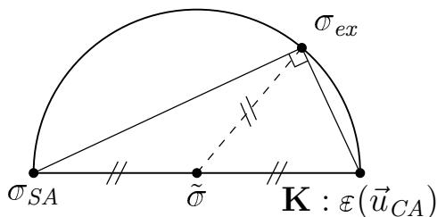

# 第 8 章 弹性力学中的能量定理（Les théorèmes de l’énergie en élasticité）

原课件：[Chap 8 PDF](IMMC_CM_Chap8_2024-2025.pdf) · [法文文本](IMMC_CM_Chap8_2024-2025.md)

**Objectifs**

Mettre en place de nouvelles formulations pour un problème d’élasticité bien adaptées à la recherche de solutions approchées.

**Hypothèses**

On se place en statique, sous les hypothèses HPP. Le comportement est élastique linéaire (non nécessairement homogène ou isotrope) :

本章以静力学、小扰动假设和线弹性为前提，构造便于近似求解的变分形式。Hooke 算子 $\mathbf K$ 可随位置变化，也不必各向同性：

$$
\boldsymbol\sigma=\mathbf K:\boldsymbol\varepsilon(\vec u). \tag{8.1}
$$

**Domaines d’application**

On va étudier dans un premier temps l’élasticité 3D, mais ces méthodes s’appliquent à bien d’autres problèmes :

— calculs de poutres élastiques droites ou courbes ;

— calculs de plaques ou de coques ;

— calculs en élasticité bidimensionnelle (DP ou CP) ;

— conduction thermique stationnaire ;

— etc

**Rappel de la formulation du problème**

Trouver $( \vec { u } , \sigma )$ tels que :

— Équations de liaison

方法可用于三维弹性，也可延伸至梁、板、壳、二维弹性和稳态热传导。

求解的场 $(\vec u,\boldsymbol\sigma)$ 应满足位移边界条件、平衡方程、牵引边界条件及本构关系：

$$
\vec u=\vec u_d\quad(M\in\partial\Omega_u),\qquad\vec u\text{ 还需具有适当正则性}. \tag{8.2}
$$

— Équations d’équilibre

$$
\operatorname{div}\boldsymbol\sigma+\vec f_d=\vec0\quad(M\in\Omega),\qquad
\boldsymbol\sigma\vec n=\vec T_d\quad(M\in\partial\Omega_T). \tag{8.3}
$$

$$
\sigma \vec {n} = \vec {T _ {d}} \quad \forall M \in \partial \Omega_ {T}
$$

— Relation de comportement

$$
\boldsymbol\sigma=\mathbf K:\boldsymbol\varepsilon(\vec u). \tag{8.4}
$$

On notera $( \vec { u } _ { e x } , \sigma _ { e x } )$ la solution de ce problème (solution unique en contrainte et unique en déplacement si la frontière $\partial \Omega _ { u }$ est de mesure non nulle).

记真实解为 $(\vec u_{ex},\boldsymbol\sigma_{ex})$。在适当条件下，应力唯一；位移的唯一性还需消去刚体运动。

## 8.1 可容许场回顾（Champs admissibles (rappels)）

### 8.1.1 运动学可容位移（Champs de déplacement cinématiquement admissibles）

Définition 8.1 Un champ de déplacement $\vec{u}$ est dit Cinématiquement Admissible (en abrégé CA) si et seulement si il vérifie les équations de liaisons cinématiques (8.2).

Définition 8.2 Un champ de déplacement $\vec { u } ^ { \star }$ est dit Cinématiquement Admissible à Zéro (en abrégé CAZ) si et seulement si il vérifie les équations de liaisons pour des données nulles :

**定义 8.1**：满足 (8.2) 的位移场称为运动学可容（CA）。**定义 8.2**：位移边界数据为零的场称为零运动学可容（CAZ）：

$$
\vec u^\star=\vec0\quad(M\in\partial\Omega_u),\qquad\vec u^\star\text{ 具有适当正则性}. \tag{8.5}
$$

> **Erratum de notation (PDF, p. 2, formule 8.5).** Le PDF imprime $\vec u$ alors que la définition porte sur le champ CAZ $\vec u^\star$ ; l’astérisque est rétabli ci-dessus.

Proposition 8.1 Si deux champs de déplacement $\vec { u } _ { 1 }$ et $\vec { u } _ { 2 }$ sont CA, leur différence $\vec { u } _ { 1 } - \vec { u } _ { 2 }$ est CAZ.

Proposition 8.2 Si $\vec { u } _ { 0 }$ est un champ CA particulier, tous les autres sont de la forme $\vec { u } =$ $\vec { u } _ { 0 } + \vec { u } ^ { \star }$ avec $\vec { u } ^ { \star }$ CAZ.

— L’espace affine (de dimension infinie) des champs CA est noté $\mathcal { U } _ { a d }$

— L’espace vectoriel (de dimension infinie) des champs $\mathsf { C A Z }$ est noté $\mathcal { U } _ { 0 }$

原 PDF 的 (8.5) 左边写成 $\vec u$，但本段明确讨论 $\vec u^\star$；此处按定义统一符号。两个 CA 场之差是 CAZ；给定一个 CA 场 $\vec u_0$ 后，所有 CA 场可写为 $\vec u_0+\vec u^\star$。CA 场构成仿射空间 $\mathcal U_{ad}$，CAZ 场构成向量空间 $\mathcal U_0$。

### 8.1.2 静力学可容应力（Champs de contrainte statiquement admissibles）

Définition 8.3 Un champ de contrainte $\sigma$ est dit Statiquement Admissible (en abrégé SA) si et seulement si il vérifie les équations d’équilibre (8.3).

Définition 8.4 Un champ de contrainte $\boldsymbol { \sigma } ^ { \star }$ est dit Statiquement Admissible à Zéro (en abrégé SAZ) si et seulement si il vérifie les équations d’équilibre pour des données nulles :

**定义 8.3**：满足 (8.3) 的应力场称为静力学可容（SA）。**定义 8.4**：载荷数据均为零时的场称为零静力学可容（SAZ）：

$$
\operatorname{div}\boldsymbol\sigma^\star=\vec0\quad(M\in\Omega),\qquad
\boldsymbol\sigma^\star\vec n=\vec0\quad(M\in\partial\Omega_T). \tag{8.6}
$$

Proposition 8.3 Si deux champs de contrainte $\sigma _ { 1 }$ et $\sigma _ { 2 }$ sont SA , leur différence $\sigma _ { 1 } - \sigma _ { 2 }$ est SAZ.

Proposition 8.4 Si $\sigma _ { 0 }$ est un champ SA particulier, tous les autres sont de la forme $\sigma =$ $\sigma _ { 0 } + \sigma ^ { \star }$ avec $\sigma ^ { \star } \ S A Z .$

— L’espace affine (de dimension infinie) des champs $\mathsf { S A }$ est noté $S _ { a d }$

— L’espace vectoriel (de dimension infinie) des champs $\mathsf { S A Z }$ est noté $\mathcal{S}_0$

两个 SA 场之差是 SAZ；给定 $\boldsymbol\sigma_0\in\mathcal S_{ad}$ 后，任意 SA 场为 $\boldsymbol\sigma_0+\boldsymbol\sigma^\star$，其中 $\boldsymbol\sigma^\star\in\mathcal S_0$。

### 8.1.3 正交性（Une propriété d’orthogonalité）

Soit S l’espace des champs de contrainte.

Proposition 8.5 $\langle\sigma_1,\sigma_2\rangle_{\mathcal{S}}$ est un produit scalaire sur $\mathcal{S}$ avec :

$$
\left<   \sigma_ {1}, \sigma_ {2} \right> _ {\mathcal {S}} = \int_ {\Omega} \mathrm{Tr} \left[ \sigma_ {1} \mathbf {K} ^ {- 1}: \sigma_ {2} \right] \mathrm{d} V = \int_ {\Omega} \sigma_ {1}: \mathbf {K} ^ {- 1}: \sigma_ {2} \mathrm{d} V
$$

Proposition 8.6 $\| \sigma \| _ { \mathcal { S } }$ est une norme sur $\mathcal{S}$ avec :

$$
\left\| \sigma \right\| _ {\mathcal {S}} = \left[ \int_ {\Omega} \operatorname{Tr} \left(\sigma \mathbf {K} ^ {- 1}: \sigma\right) \mathrm{d} V \right] ^ {1 / 2} = \left[ \int_ {\Omega} \sigma : \mathbf {K} ^ {- 1}: \sigma \mathrm{d} V \right] ^ {1 / 2}
$$

Théorème 8.7 Si $\vec { u } ^ { \star }$ est $C A Z$ et si $\sigma ^ { \star }$ est $S A Z ,$ on a :

在应力场空间 $\mathcal S$ 上，用逆 Hooke 算子定义内积与范数：

$$
\langle\boldsymbol\sigma_1,\boldsymbol\sigma_2\rangle_{\mathcal S}
=\int_\Omega\boldsymbol\sigma_1:\mathbf K^{-1}:\boldsymbol\sigma_2\,\mathrm dV,
\qquad\|\boldsymbol\sigma\|_{\mathcal S}=\sqrt{\langle\boldsymbol\sigma,\boldsymbol\sigma\rangle_{\mathcal S}}.
$$

这里要求 $\mathbf K$ 对对称应力空间正定且可逆。若 $\vec u^\star$ 是 CAZ、$\boldsymbol\sigma^\star$ 是 SAZ，分部积分并利用零边界项得到：

$$
\int_\Omega\boldsymbol\sigma^\star:\boldsymbol\varepsilon(\vec u^\star)\,\mathrm dV=0. \tag{8.7}
$$

Les champs de contrainte $\boldsymbol { \sigma } ^ { \star }$ et $\mathbf { K } : \varepsilon ( \vec { u } ^ { \star } )$ sont donc orthogonaux.

因此 $\boldsymbol\sigma^\star$ 与 $\mathbf K:\boldsymbol\varepsilon(\vec u^\star)$ 在上述应力内积下正交。

## 8.2 以本构关系误差重述问题（Nouvelle formulation du problème）

**8.2.1 Formulation globale de la relation de comportement**

Proposition 8.8 La relation de comportement (8.4) est vérifiée presque partout dans $\Omega$ si et seulement si $\|\sigma-\mathbf K:\varepsilon(\vec u)\|_{\mathcal S}=0$. Sous une hypothèse de continuité des champs, elle vaut alors partout.

> **Précision théorique (PDF, p. 3, proposition 8.8).** Une norme intégrale nulle donne en général une égalité presque partout ; l’égalité en chaque point demande une régularité supplémentaire.

## 8.2.2 Erreur en relation de comportement

Un couple $( \vec { u } , \sigma )$ est appelé solution approchée admissible du problème d’élasticité si $\vec { u }$ est CA et si $\sigma$ est $\mathsf { S A }$

Pour un tel couple, seule la relation de comportement (8.4) n’est pas vérifiée.

Définition 8.5 On appelle erreur en relation de comportement associée au couple admissible $( \vec { u } , \sigma )$ la grandeur (de type contrainte) $\boldsymbol { \sigma } - \mathbf { K } : \boldsymbol { \varepsilon } ( \vec { u } )$

La norme $e = \| \boldsymbol { \sigma } - \mathbf { K } : \boldsymbol { \varepsilon } ( \vec { u } ) \| _ { \mathcal { S } }$ permet d’évaluer la qualité de la solution approchée admissible. $( \vec { u } , \sigma )$ est donc solution du problème d’élasticité si et seulement si $\vec{u}$ est CA, $\sigma$ est SA , et $e = 0$

**8.2.3 Un premier problème de minimisation**

Posons :

$$
\begin{array}{l} \Psi (\vec {u}, \sigma) = \frac {1}{2} \| \sigma - \mathbf {K}: \varepsilon (\vec {u}) \| _ {\mathcal {S}} ^ {2} = \frac {1}{2} \langle \sigma - \mathbf {K}: \varepsilon (\vec {u}), \sigma - \mathbf {K}: \varepsilon (\vec {u}) \rangle_ {\mathcal {S}} \\ = \frac {1}{2} \int_ {\Omega} [ \sigma - \mathbf {K}: \varepsilon (\vec {u}) ]: \mathbf {K} ^ {- 1}: [ \sigma - \mathbf {K}: \varepsilon (\vec {u}) ]   \mathrm{d} V \end{array}
$$

et considérons le problème de minimisation :

对 CA 位移和 SA 应力组成的场对，唯一可能尚未满足的是本构关系。其本构误差为 $\boldsymbol\sigma-\mathbf K:\boldsymbol\varepsilon(\vec u)$。若该误差的 $\mathcal S$ 范数为零，则本构关系几乎处处成立；在适当连续性假设下可说处处成立。

定义非负目标：

$$
\Psi(\vec u,\boldsymbol\sigma)=\frac12\|\boldsymbol\sigma-\mathbf K:\boldsymbol\varepsilon(\vec u)\|_{\mathcal S}^2
=\frac12\int_\Omega[\boldsymbol\sigma-\mathbf K:\boldsymbol\varepsilon(\vec u)]:\mathbf K^{-1}:[\boldsymbol\sigma-\mathbf K:\boldsymbol\varepsilon(\vec u)]\,\mathrm dV.
$$

课件的第一种最小化形式是：

$$
(\vec u_{ex},\boldsymbol\sigma_{ex})\in\operatorname*{arg\,min}_{\vec u\in\mathcal U_{ad},\,\boldsymbol\sigma\in\mathcal S_{ad}}\Psi(\vec u,\boldsymbol\sigma). \tag{8.8}
$$

Proposition 8.9 La solution $( \vec { u } _ { e x } , \sigma _ { e x } )$ d’un problème d’élasticité est solution du problème de minimisation (8.8).

Réciproquement si la solution du problème (8.8) correspond à un minimum nul, c’est la solution du problème d’élasticité.

真实解使 $\Psi=0$。反过来，只有在最小值为零且可达到时，该极小化解才是弹性问题的真实解。

## 8.3 能量定理（Les théorèmes de l’énergie）

### 8.3.1 解耦（Propriété de découplage）

Proposition 8.10 Pour $\vec{u}$ CA et pour $\sigma$ SA on $\textit { a } \Psi ( \vec { u } , \sigma ) = E _ { p } ( \vec { u } ) + E _ { c } ( \sigma )$ avec

由 8.1.3 的正交性，$\Psi$ 在 CA/SA 场对上拆为位移势能与应力补能之和：

$$
\begin{aligned}
E_p(\vec u)&=\frac12\int_\Omega\boldsymbol\varepsilon(\vec u):\mathbf K:\boldsymbol\varepsilon(\vec u)\,\mathrm dV
-\int_\Omega\vec f_d\cdot\vec u\,\mathrm dV-\int_{\partial\Omega_T}\vec T_d\cdot\vec u\,\mathrm dS,\\
E_c(\boldsymbol\sigma)&=\frac12\int_\Omega\boldsymbol\sigma:\mathbf K^{-1}:\boldsymbol\sigma\,\mathrm dV
-\int_{\partial\Omega_u}(\boldsymbol\sigma\vec n)\cdot\vec u_d\,\mathrm dS.
\end{aligned} \tag{8.9}
$$

$$
E _ {c} (\boldsymbol {\sigma}) = \frac {1}{2} \int_ {\Omega} \boldsymbol {\sigma}: \mathbf {K} ^ {- 1}: \boldsymbol {\sigma} \mathrm{d} V - \int_ {\partial \Omega_ {u}} \boldsymbol {\sigma} \vec {n} \cdot \vec {u} _ {d} \mathrm{d} S
$$

On a donc :

$$
\min_{\vec u\in\mathcal U_{ad},\,\boldsymbol\sigma\in\mathcal S_{ad}}\Psi
=\min_{\vec u\in\mathcal U_{ad}}E_p(\vec u)+\min_{\boldsymbol\sigma\in\mathcal S_{ad}}E_c(\boldsymbol\sigma). \tag{8.10}
$$

### 8.3.2 最小势能定理（Théorème de l’énergie potentielle）

Théorème 8.11 La solution exacte en déplacement $\vec { u } _ { e x }$ est solution du problème de minimisation :

真实位移使 $E_p$ 在 CA 场中最小：

$$
\vec u_{ex}\in\operatorname*{arg\,min}_{\vec u\in\mathcal U_{ad}}E_p(\vec u). \tag{8.11}
$$

Interprétation des termes de l’énergie potentielle $E _ { p }$

— Le terme

$$
\frac {1}{2} \int_ {\Omega} \varepsilon (\vec {u}): \mathbf {K}: \varepsilon (\vec {u}) \mathrm{d} V
$$

correspond à l’énergie de déformation (élastique) exprimée en déplacement.

— Le terme

$$
\int_ {\Omega} \vec {f} _ {d} \cdot \vec {u} \mathrm{d} V + \int_ {\partial \Omega_ {T}} \vec {T} _ {d} \cdot \vec {u} \mathrm{d} S
$$

correspond au travail des efforts extérieurs donnés dans un déplacement CA.

Remarque 8.1 Une fois résolu le problème précédent, la solution en contrainte $\sigma _ { e x }$ se calcule par la relation de comportement.

$E_p$ 的第一项是弹性应变能，后两项是给定体力和面力做功的负值。求得位移后，由本构关系计算真实应力。

### 8.3.3 从势能导出整体平衡（Exploitation du théorème de l’énergie potentielle）

Posons $\vec { u } = \vec { u } _ { e x } + \lambda \vec { u } ^ { \star }$ avec λ réel arbitraire et $\vec { u } ^ { \star } \in \mathcal { U } _ { 0 }$ . Les conditions de minimisation de l’énergie potentielle s’obtiennent en écrivant que :

令 $\vec u=\vec u_{ex}+\lambda\vec u^\star$，$\vec u^\star\in\mathcal U_0$，则：

$$
\left.\frac{\mathrm d}{\mathrm d\lambda}E_p(\vec u_{ex}+\lambda\vec u^\star)\right|_{\lambda=0}=0
\quad(\forall\vec u^\star\in\mathcal U_0). \tag{8.12}
$$

On a donc pour tout $\vec { u } ^ { \star } \in \mathcal { U } _ { 0 }$

展开得到：

$$
\int_\Omega\boldsymbol\varepsilon(\vec u_{ex}):\mathbf K:\boldsymbol\varepsilon(\vec u^\star)\,\mathrm dV
=\int_\Omega\vec f_d\cdot\vec u^\star\,\mathrm dV
+\int_{\partial\Omega_T}\vec T_d\cdot\vec u^\star\,\mathrm dS. \tag{8.13}
$$

Si on remplace $\mathbf { K } : \varepsilon ( \vec { u } _ { e x } )$ par $\sigma _ { e x } ,$ on retrouve la formulation globale de l’équilibre.

代入 $\boldsymbol\sigma_{ex}=\mathbf K:\boldsymbol\varepsilon(\vec u_{ex})$，便回到整体平衡的弱形式。

### 8.3.4 最小补能定理（Théorème de l’énergie complémentaire）

Théorème 8.12 La solution exacte en contrainte $\sigma _ { e x }$ est solution du problème de minimisation :

真实应力使 $E_c$ 在 SA 场中最小：

$$
\boldsymbol\sigma_{ex}\in\operatorname*{arg\,min}_{\boldsymbol\sigma\in\mathcal S_{ad}}E_c(\boldsymbol\sigma). \tag{8.14}
$$

Interprétation des termes de l’énergie complémentaire $E _ { c }$

— Le terme

$$
\frac {1}{2} \int_ {\Omega} \boldsymbol {\sigma}: \mathbf {K} ^ {- 1}: \boldsymbol {\sigma} \mathrm{d} V
$$

correspond à l’énergie de déformation (élastique) exprimée en contrainte.

— Le terme

$$
\int_ {\partial \Omega_ {u}} \sigma \vec {n} \cdot \vec {u} _ {d} \mathrm{d} S
$$

correspond au travail des efforts de liaison SA dans le déplacement imposé.

Remarque 8.2 Une fois résolu le problème précédent, la déformation $\varepsilon _ { e x }$ se calcule par la relation de comportement inverse et le champ de déplacement $\vec { u } _ { e x }$ par intégration.

补能第一项是用应力表示的弹性应变能；第二项是反力在给定位移上做功的负值。得到应力后，用逆本构关系求应变，再积分求位移。

## 8.4 补充性质（Propriétés complémentaires）

### 8.4.1 真实能量的上下界（Encadrement de l’énergie exacte）

Soit $\left( \vec { u } _ { C A } , \sigma _ { S A } \right)$ un couple de solutions admissibles et $( \vec { u } _ { e x } , \sigma _ { e x } )$ le couple de solutions exactes. On a :

对于任意 CA 位移 $\vec u_{CA}$ 和 SA 应力 $\boldsymbol\sigma_{SA}$：

$$
-E_c(\boldsymbol\sigma_{SA})\leq-E_c(\boldsymbol\sigma_{ex})
=E_p(\vec u_{ex})\leq E_p(\vec u_{CA}). \tag{8.15}
$$

所以真实势能在左侧的 $-E_c(\boldsymbol\sigma_{SA})$ 和右侧的 $E_p(\vec u_{CA})$ 之间。特别地，$E_c(\boldsymbol\sigma_{SA})\geq E_c(\boldsymbol\sigma_{ex})$。

### 8.4.2 应力空间中的勾股定理（Théorème de Pythagore dans l’espace des contraintes $\boldsymbol { S }$）

Soit $\left( \vec { u } _ { C A } , \sigma _ { S A } \right)$ un couple de solutions admissibles et $( \vec { u } _ { e x } , \sigma _ { e x } )$ le couple de solutions exactes.

Proposition 8.13 Théorème de Prager-Synge (équivalent de Pythagore) :

Prager–Synge 定理：

$$
\|\boldsymbol\sigma_{SA}-\mathbf K:\boldsymbol\varepsilon(\vec u_{CA})\|_{\mathcal S}^{2}
=\|\boldsymbol\sigma_{ex}-\boldsymbol\sigma_{SA}\|_{\mathcal S}^{2}
+\|\boldsymbol\sigma_{ex}-\mathbf K:\boldsymbol\varepsilon(\vec u_{CA})\|_{\mathcal S}^{2}. \tag{8.16}
$$

Figure 8.1 – Théorème de Pythagore dans l’espace des contraintes.

Par conséquent, on a les majorations :

*图 8.1：应力空间中的勾股关系。*

两条直角边的长度均不超过斜边长度，因此：

$$
\begin{aligned}
\|\boldsymbol\sigma_{ex}-\boldsymbol\sigma_{SA}\|_{\mathcal S}&\leq\|\boldsymbol\sigma_{SA}-\mathbf K:\boldsymbol\varepsilon(\vec u_{CA})\|_{\mathcal S},\\
\|\boldsymbol\sigma_{ex}-\mathbf K:\boldsymbol\varepsilon(\vec u_{CA})\|_{\mathcal S}&\leq\|\boldsymbol\sigma_{SA}-\mathbf K:\boldsymbol\varepsilon(\vec u_{CA})\|_{\mathcal S}.
\end{aligned} \tag{8.17}
$$

Si on pose $\widetilde { \boldsymbol { \sigma } } = \frac { \boldsymbol { \sigma } _ { S A } + \mathbf { K } : \varepsilon ( \vec { u } _ { C A } ) } { 2 }$ , on a aussi :

再令 $\widetilde{\boldsymbol\sigma}=[\boldsymbol\sigma_{SA}+\mathbf K:\boldsymbol\varepsilon(\vec u_{CA})]/2$。直角三角形斜边中点到直角顶点的距离为斜边的一半，故：

$$
\|\boldsymbol\sigma_{ex}-\widetilde{\boldsymbol\sigma}\|_{\mathcal S}
=\frac12\|\boldsymbol\sigma_{SA}-\mathbf K:\boldsymbol\varepsilon(\vec u_{CA})\|_{\mathcal S}. \tag{8.18}
$$
