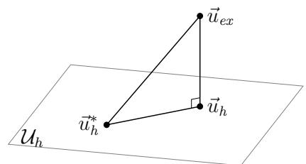
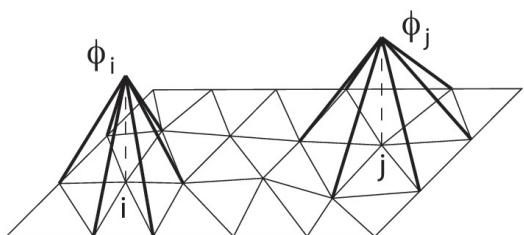

# 位移有限元法导论

原课件：[Chap 9 PDF](IMMC_CM_Chap9_2024-2025.pdf) · [法文文本](IMMC_CM_Chap9_2024-2025.md)

On se limitera aux méthodes d’éléments finis dites « en déplacement » pour les problèmes d’élasticité, qui sont fondées sur le théorème de l’énergie potentielle.

我们将只讨论针对弹性问题的、所谓"**位移型**"的有限元方法，这类方法都是建立在**势能定理**基础上的。原文中说的是 "méthodes d'éléments finis dites « en déplacement » pour les problèmes d'élasticité, qui sont fondées sur le théorème de l'énergie potentielle."，这里我们完整保留这一思想：未知量选位移，能量做变分。

## 9.1 基本原则（Principes de base）

### 9.1.1 假设（Hypothèses）

On considère ici un problème d’élasticité en 3D. Dans un premier temps, pour simplifier, on suppose que le champ de déplacement est imposé nul sur une partie de la frontière $\partial \Omega _ { u } .$ , de mesure non nulle. Cela implique que les mouvements de corps rigide sont forcément bloqués.

Avec cette hypothèse, notée H, la solution exacte en déplacement $\vec { u } _ { e x }$ est unique et les champs CA sont les éléments de l’espace vectoriel $\mathcal { U } _ { a d }$

我们在这里考虑一个三维（3D）的弹性问题。为了便于讲解，先作如下简化假设：

- 在边界的一部分记作 $\partial \Omega_u$ 上，位移场被强制规定为零；

- 这部分边界的测度是非零的；

- 这样可以保证刚体运动被完全约束住。

原文把这个假设记作 $H$。在这个假设之下，**位移的精确解**记作 $\vec{u}_{ex}$，它是唯一的；而所谓的"CA"场（champs cinématiquement admissibles，运动学可接受的位移场）就是向量空间 

$$
U_{ad}
$$

 的元素。

### 9.1.2 精确问题（Problème exact）

Rappelons que $\vec { u } _ { e x }$ est la solution (unique ici) du problème de minimisation :

回顾一下精确问题的变分形式。精确位移 $\vec{u}_{ex}$ 是下面这个最小化问题的解： 

$$
\min_{\vec{u} \in U_{ad}} E_p(\vec{u})
\quad\Longleftrightarrow\quad
\vec{u}_{ex} = \arg\min_{\vec{u} \in U_{ad}} E_p(\vec{u}) .
\tag{9.1}
$$

Une fois le champ $\vec { u } _ { e x }$ déterminé, la contrainte associée $\sigma _ { e x }$ s’obtient en utilisant la relation de comportement :

即原文的式 (9.1)。

一旦位移场 $\vec{u}_{ex}$ 被求出，**对应的应力**通过**本构关系**给出： 

$$
\sigma_{ex} = K : \varepsilon(\vec{u}_{ex}) ,
\tag{9.2}
$$

 这就是原文的式 (9.2)，其中 $K$ 是材料刚度张量，$\varepsilon(\cdot)$ 是小变形下的应变算子，":" 是双点积。

### 9.1.3 离散化后的近似问题------近似解（Problème approché discrétisé – solution approchée）

**Formulation**

#### 形式化.

L’idée de base est de minimiser l’énergie potentielle, non pas sur l’espace $\mathcal { U } _ { a d }$ entier mais sur un sous-espace $\mathcal { U } _ { h }$ de $\mathcal { U } _ { a d }$ de dimension finie N. Le problème approché est donc :

基本思想不是在整个可行空间 $U_{ad}$ 上去极小化势能，而是只在它的一个**有限维子空间** $U_h \subset U_{ad}$ 上做最小化，这个子空间的维数是有限的，记作 $N$。

因此近似问题写作： 

$$
\min_{\vec{u} \in U_h} E_p(\vec{u})
\quad\Longleftrightarrow\quad
\vec{u}_h = \arg\min_{\vec{u} \in U_h} E_p(\vec{u}) .
\tag{9.3}
$$

La solution de ce problème, notée ${ \vec { u } } _ { h }$ , est une approximation de $\vec { u } _ { e x }$ . Pour obtenir une approximation de la contrainte, on utilise la relation de comportement : $\boldsymbol { \sigma } _ { h } = \mathbf { K } : \varepsilon ( \vec { u } _ { h } )$

这里的解 $\vec{u}_h$ 是精确解 $\vec{u}_{ex}$ 的一个近似。为了得到应力的近似，仍然使用本构关系： 

$$
\sigma_h = K : \varepsilon(\vec{u}_h).
$$

**Écriture des conditions de minimisation**

#### 最小化条件的写法.

Soit $( \vec { \phi } _ { 1 } , \vec { \phi } _ { 2 } , \ldots , \vec { \phi } _ { N } )$ une base de $\mathcal { U } _ { h }$ (constituée de champs de déplacement CA, tous linéairement indépendants). Alors tous les champs $\vec{u}$ de $\mathcal { U } _ { h }$ sont de la forme :

设 

$$
(\vec{\varphi}_1, \vec{\varphi}_2, \dots, \vec{\varphi}_N)
$$

 是一组 $U_h$ 的基（原文中说"constituée de champs de déplacement CA, tous linéairement indépendants"，即它们是运动学可接受的位移场，并且线性无关）。那么，对 $U_h$ 中的所有位移场 $\vec{u}$，都可以写成 

$$
\vec{u}(M) = \sum_{i=1}^N u_i \, \vec{\varphi}_i(M) \quad \text{(其中 \(u_i\) 是实数)}.
\tag{9.4}
$$

Proposition 9.1 Pour les champs $\vec { u } \in \mathcal { U } _ { h }$ , l’énergie potentielle est de la forme :

::: proposition
**命题 1** (命题 9.1). *对于所有 $\vec{u} \in U_h$，势能可以写成下面的二次型形式： 

$$
E_p(\{U\}) = \frac{1}{2} \{U\}^T [K] \{U\} - \{F\}^T \{U\},
\tag{9.5}
$$

avec

• {U} : Vecteur des degrés de liberté (inconnues du problème), de dimension N et d’éléments :

 其中*

- *$\{U\}$ 是自由度向量（也是问题的未知向量），维度为 $N$，其分量为 

$$
\{U\} = [u_1, u_2, \dots, u_N]^T ;
\tag{9.6}
$$

$[ K ]$ : Matrice de rigidité (symétrique), de taille $N \times N$ et d’éléments :

*

- *$[K]$ 是**刚度矩阵**（对称的），大小为 $N \times N$，其元素为 

$$
K_{ij} = \int_{\Omega} \varepsilon(\vec{\varphi}_i) : K : \varepsilon(\vec{\varphi}_j) \, dV ;
\tag{9.7}
$$

$\{ F \}$ : Vecteur de force généralisée (ou second membre), de dimension N et d’éléments :

*

- *$\{F\}$ 是**广义力（或右端项）向量**，维数也是 $N$，其分量为 

$$
F_i = \int_{\Omega} \vec{f_d} \cdot \vec{\varphi}_i \, dV
+ \int_{\partial \Omega_T} \vec{T_d} \cdot \vec{\varphi}_i \, dS .
\tag{9.8}
$$

Sous les hypothèses H précédentes, les conditions de minimisation donnent :

*
:::

在前述假设 $H$ 下，最小化条件给出经典的有限元代数方程： 

$$
[K]\{U\} = \{F\}.
\tag{9.9}
$$

**Détermination de la solution approchée**

#### 近似解的确定.

Sous les hypothèses H précédentes, la matrice $[ K ]$ est régulière. Le système $[ K ] \left\{ U \right\} =$ $\{ F \}$ admet donc une solution unique $\{ U _ { h } \} = [ u _ { h 1 } , u _ { h 2 } , \ldots , u _ { h N } ] ^ { \mathsf { T } }$ . La solution est alors :

在假设 $H$ 下，矩阵 $[K]$ 是正则的（即可逆的）。因此，系统 

$$
[K]\{U\} = \{F\}
$$

 存在唯一解，记作 

$$
\{U_h\} = [u_{h1}, u_{h2}, \dots, u_{hN}]^T.
$$

 于是近似位移和近似应力为： 

$$
\vec{u}_h(M) = \sum_{i=1}^N u_{hi} \, \vec{\varphi}_i(M)
\quad \text{且} \quad
\sigma_h(M) = \sum_{i=1}^N u_{hi} \, K : \varepsilon[\vec{\varphi}_i(M)] .
\tag{9.10}
$$

### 9.1.4 补充性质（Propriétés complémentaires）

**Origine des approximations**

#### 近似的来源.

Le couple approché $( \vec { u } _ { h } , \sigma _ { h } )$ vérifie les liaisons cinématiques et la relation de comportement. L’approximation porte donc sur les équations d’équilibre ; celles-ci ne sont pas vérifiées par $\sigma _ { h }$

Proposition 9.2 La contrainte $\sigma _ { h }$ est telle que :

近似对来说 $(\vec{u}_h, \sigma_h)$，它们**满足运动学约束**，也**满足本构关系**。因此，近似主要是体现在**平衡方程**上：$\sigma_h$ 一般并不严格满足整体平衡。

::: proposition
**命题 2** (命题 9.2). *近似应力 $\sigma_h$ 满足 

$$
\forall \vec{u}_h^\ast \in U_h,\quad
\int_{\Omega} \sigma_h : \varepsilon(\vec{u}_h^\ast) \, dV
=
\int_{\Omega} \vec{f_d} \cdot \vec{u}_h^\ast \, dV
+
\int_{\partial \Omega_T} \vec{T_d} \cdot \vec{u}_h^\ast \, dS .
\tag{9.11}
$$

C’est une forme affaiblie de l’équilibre vérifié par la contrainte exacte $\sigma _ { e x }$ :

*
:::

这是一种**弱意义**下的平衡条件；原文说"C'est une forme affaiblie de l'équilibre..."。

而精确应力 $\sigma_{ex}$ 则满足 

$$
\forall \vec{u}^\star \in U_{ad},\quad
\int_{\Omega} \sigma_{ex} : \varepsilon(\vec{u}^\star) \, dV
=
\int_{\Omega} \vec{f_d} \cdot \vec{u}^\star \, dV
+
\int_{\partial \Omega_T} \vec{T_d} \cdot \vec{u}^\star \, dS .
\tag{9.12}
$$

On dit que $\sigma _ { h }$ vérifie l’équilibre au sens (faible) des éléments finis.

也就是说，我们常说的"$\sigma_h$ 以有限元意义（弱意义）满足平衡"。

**Interprétation dans l’espace des champs CA**

#### 在 CA 位移场空间中的解释.

Posons

$$
\langle \vec {u} _ {1}, \vec {u} _ {2} \rangle_ {\mathcal {U}} = \int_ {\Omega} \varepsilon (\vec {u} _ {1}): \mathbf {K}: \varepsilon (\vec {u} _ {2}) \mathrm{d} V \quad \mathsf {e t} \quad \| \vec {u} \| _ {\mathcal {U}} = \left[ \int_ {\Omega} \varepsilon (\vec {u}): \mathbf {K}: \varepsilon (\vec {u}) \mathrm{d} V \right] ^ {1 / 2}
$$

On définit ainsi un produit scalaire et une norme sur U.

Proposition 9.3 Pour tout $\vec { u } _ { h } ^ { * } \in \mathcal { U } _ { h }$ , on a l’orthogonalité (Figure 9.1) :

定义内积 

$$
\langle \vec{u}_1, \vec{u}_2 \rangle_U
=
\int_{\Omega} \varepsilon(\vec{u}_1) : K : \varepsilon(\vec{u}_2) \, dV
$$

 以及相应的范数 

$$
\|\vec{u}\|_U
=
\left[
\int_{\Omega} \varepsilon(\vec{u}) : K : \varepsilon(\vec{u}) \, dV
\right]^{1/2}.
$$

::: proposition
**命题 3** (命题 9.3). *对所有 $\vec{u}_h^\ast \in U_h$ 都有正交关系 

$$
\langle \vec{u}_{ex} - \vec{u}_h,\, \vec{u}_h - \vec{u}_h^\ast \rangle_U = 0 ,
\tag{9.13}
$$

Par conséquent, pour tout $\vec { u } _ { h } ^ { * } \in \mathcal { U } _ { h }$

 因而 

$$
\|\vec{u}_{ex} - \vec{u}_h\|_U \le \|\vec{u}_{ex} - \vec{u}_h^\ast\|_U .
\tag{9.14}
$$

c’est-à-dire que la solution approchée ${ \vec { u } } _ { h }$ est le champ de $\mathcal { U } _ { h }$ le plus « proche » de $\vec { u } _ { e x }$ au sens de la norme $\| \bullet \| _ { \mathcal { U } }$

Figure 9.1 – Interprétation dans l’espace des déplacements CA.

**Bases adaptées aux méthodes d’éléments finis**

La détermination de la matrice de rigidité nécessite a priori $N ( N + 1 ) / 2$ calculs d’inté- grales sur toute la structure ce qui conduit, quand N est grand, à des calculs importants. Pour simplifier ces calculs, l’idée est de choisir les champs $\vec { \phi _ { i } }$ de la base de façon à ce qu’ils ne soient non nuls que sur une petite partie de la structure. Ainsi de nombreux termes $K _ { i j }$ sont nuls et ne sont pas calculés. Pour les termes non nuls, l’intégrale ne porte que sur un petit nombre d’éléments. C’est ce type de propriété qui distingue une méthode d’éléments finis d’une méthode de Ritz-Galerkin classique.

En 2D, on choisit comme sous-espace $\mathcal { U } _ { h }$ le sous-espace des fonctions continues sur le domaine et affines par triangle (plus généralement polynomiales par morceaux). En introduisant un maillage, les fonctions de forme valent 1 en un noeud particulier du maillage et 0 en tous les autres noeuds (Figure 9.2).

Figure 9.2 – Fonctions de base dans un maillage par des triangles

**9.2 Traitement général des conditions aux limites**

L’objet est de donner les méthodes d’utilisation de la MEF lorsque les hypothèses H précédentes ne sont plus vérifiées.

**9.2.1 Cas où il n’y a pas de déplacement imposé**

D’une manière générale, la matrice [K] est singulière s’il existe dans $\left\{ U _ { h } \right\}$ des champs non nuls qui sont à déformation nulle (modes rigides). Si c’est le cas, la charge généralisée $\{ F \}$ doit être orthogonale au noyau de [K] ; sinon le problème n’a pas de solution. En pratique, des considérations purement mécaniques permettent de vérifier cette propriété. Pour résoudre le système, on bloque des degrés de liberté (ddl) de façon à rendre le système régulier. Ensuite, une fois qu’une solution particulière est calculée, on peut lui ajouter un mode rigide arbitraire.

**9.2.2 Cas d’un déplacement imposé non nul**

Plusieurs méthodes peuvent être employées pour imposer des contraintes liées à un déplacement imposé non nul (ou nul) :

— méthode d’élimination dans laquelle on résout le système directement en remplaçant les valeurs imposées par leur valeur ;

— méthode de pénalisation ;

— méthode des multiplicateurs de Lagrange.

**Méthode des multiplicateurs de Lagrange**

Cette méthode est un moyen très général pour résoudre les problèmes d’optimisation sous contraintes (c’est aussi une méthode très efficace pour construire de nouvelles formulations pour les problèmes de mécanique).

On considère le problème de minimisation sous contrainte suivant :

*
:::

这说明：$\vec{u}_h$ 是 $U_h$ 中在该能量型范数意义下离真解最近的场。

#### 图示说明.

原文的 Figure 9.1 表示：大空间里是真解 $\vec{u}_{ex}$，子空间是 $U_h$，$\vec{u}_h$ 是把 $\vec{u}_{ex}$ 投影到子空间上的结果，且对任意别的有限元场 $\vec{u}_h^\ast$ 都有最优性。

*Figure 9.1 — 在位移 CA 空间中的解释。图片来自教师版第 9 章。*

#### 适用于有限元的基.

刚度矩阵 $[K]$ 按定义要算 $N(N+1)/2$ 个积分，当 $N$ 很大时计算量会很大。为了简化计算，我们选择那些**仅在局部非零**的基函数（也就是常说的形函数），这样很多 $K_{ij}$ 根本就是 0，不用算；而非零的那些，积分也只是局部做。

在 2D 的情况下，我们通常选取这样的 $U_h$：在整个域上连续、在每个三角形上是仿射（一次）的，或者更一般是分片多项式。通过网格，每个形函数在自己的节点上取 1，在其他所有节点处取 0。原文的 Figure 9.2 就是这个意思。

*Figure 9.2 — 三角形网格中的基函数。图片来自教师版第 9 章。*

## 边界条件的一般处理

本节的目的是：当前面那个假设 $H$ 不再满足时，有限元方法怎么用。

### 没有位移强加的情况

一般来说，如果在 $\{U_h\}$ 中存在变形为零的非零位移场（也就是刚体模态），那么矩阵 $[K]$ 是**奇异**的。如果出现这种情形，那么载荷向量 $\{F\}$ 必须与 $[K]$ 的核正交，否则问题就**无解**。在实践中，我们通常用力学上的考虑来检查这个正交性。

为了求解这个系统，我们会**锁定**（或说**阻止**）一部分自由度，使系统变成正则的，然后求出一个特解；之后如果需要，还可以在这个特解上**加上一个任意刚体模态**。

### 有非零位移强加的情况

当要在某些自由度上强制一个位移（可以是零，也可以是非零）时，可以采用多种方法：

- **直接消元法**：直接在系统中把那些被强制的位移用它们的值代掉；

- **罚函数法**；

- **拉格朗日乘子法**。

下面重点介绍的是拉格朗日乘子法，因为它是一个非常通用的、能处理带约束优化问题的方法，也很适合构造力学问题的新形式。

#### 拉格朗日乘子法.

考虑下面这个带约束的最小化问题： 

$$
\min_{[C]\{U\} = \{\beta\}} E_p(\{U\})
\tag{9.15}
$$

où $[ C ] \left\{ U \right\} = \left\{ \beta \right\}$ traduit des contraintes linéaires sur la variable d’optimisation $\{ U \}$ , avec :

$- \textrm { } [ C ]$ : matrice de taille $p \times N$

— {β} : vecteur de dimension p

Soit $E_p$ une fonction définie sur un espace vectoriel de dimension finie $N$. On définit le lagrangien :

 这里 $[C]\{U\} = \{\beta\}$ 表示对变量 $\{U\}$ 施加的线性约束，其中：

- $[C]$ 是一个大小为 $p \times N$ 的矩阵；

- $\{\beta\}$ 是一个维数为 $p$ 的向量。

设 $f$ 是一个把维数为 $N$ 的向量空间 $E$ 映到实数域 $\mathbb{R}$ 的应用。我们定义： 

$$
f(\{U\}, \{\Lambda\}) = E_p(\{U\}) + \{\Lambda\}^T \big( [C]\{U\} - \{\beta\} \big) .
\tag{9.16}
$$

Proposition 9.4 $S i \left\{ U _ { e x } \right\}$ est la solution du problème, il existe un vecteur $\{ \Lambda \}$ de $\mathbb { R } ^ { p }$ tel que :

$$
\nabla E_p(\{U_{ex}\}) + [C]^{\mathsf T}\{\Lambda\}=0
$$

> **Erratum théorique (PDF, p. 3, proposition 9.4).** Le PDF écrit $\partial f(U_{ex})/\partial U=C^T\Lambda$, alors que $f$ vient de désigner le lagrangien. Pour le signe choisi en (9.16), la condition correcte est $\nabla E_p(U_{ex})+C^T\Lambda=0$ ; il faut aussi $CU_{ex}=\beta$.

Le lagrangien est stationnaire au couple solution-multiplicateur :

::: proposition
**命题 4** (命题 9.4). *如果 $\{U_{ex}\}$ 是上面这个有约束的最小化问题的解，那么存在一个向量 $\{\Lambda\} \in \mathbb{R}^p$，使得 

$$
\nabla E_p(\{U_{ex}\}) + [C]^T\{\Lambda\}=0,\qquad [C]\{U_{ex}\}=\{\beta\}.
$$

*
:::

原 PDF 将下式误写成对位移和乘子同时求极小；若约束残差非零，拉格朗日函数对乘子是无界的。应理解为以下鞍点形式（内层对乘子取上确界，外层对位移取下确界）： 

$$
\min_{\{U\}}\;\sup_{\{\Lambda\}} f(\{U\},\{\Lambda\}) .
\tag{9.17}
$$

> **Erratum théorique (PDF, p. 3, formule 9.17).** Le PDF minimise simultanément en $U$ et $\Lambda$. Pour tout $U$ non admissible ($CU\ne\beta$), la dépendance affine en $\Lambda$ rend cette fonction non bornée inférieurement ; la minimisation conjointe n’existe donc pas. La formulation ci-dessus donne le problème contraint et ses conditions de point selle, sous les hypothèses usuelles d’existence.

Les conditions de stationnarité sont :

求极值的条件是 

$$
\frac{\partial f}{\partial \{U\}} = 0
\Longrightarrow\quad
[K]\{U\} - \{F\} + [C]^T \{\Lambda\} = 0 \tag{9.18}
$$

$$
\frac{\partial f}{\partial \{\Lambda\}} = 0
\Longrightarrow\quad
[C]\{U\} - \{\beta\} = 0 . \tag{9.19}
$$

On résout donc le système :

因此我们需要解的线性系统是 

$$
\begin{bmatrix}
[K] & [C]^T \\
[C] & 0
\end{bmatrix}
\begin{bmatrix}
\{U\} \\
\{\Lambda\}
\end{bmatrix}
=
\begin{bmatrix}
\{F\} \\
\{\beta\}
\end{bmatrix} .
\tag{9.20}
$$

Qui peut se réécrire de manière condensée :

也可以写成比较紧凑的形式： 

$$
\hat{[K]}\, \hat{\{U\}} = \hat{\{F\}} ,
\tag{9.21}
$$

avec

 其中 

$$
\hat{[K]} =
\begin{bmatrix}
[K] & [C]^T \\
[C] & 0
\end{bmatrix},
\quad
\hat{\{U\}} =
\begin{bmatrix}
\{U\} \\
\{\Lambda\}
\end{bmatrix},
\quad
\hat{\{F\}} =
\begin{bmatrix}
\{F\} \\
\{\beta\}
\end{bmatrix}.
\tag{9.22}
$$

Remarque 9.1 Les composantes de {Λ} peuvent s’interpréter comme des efforts de réaction.

Remarque 9.2 La matrice $[ \hat { K } ]$ est symétrique mais n’est pas définie positive. La résolution du système doit donc se faire avec un algorithme ne nécessitant pas cette propriété.

Posons :

::: remark
**备注 1** (备注 9.1). *向量 $\{\Lambda\}$ 的分量可以理解成**反力**。*
:::

::: remark
**备注 2** (备注 9.2). *矩阵 $\hat{[K]}$ 是对称的，但**不是正定的**。因此在数值求解时，应使用不要求正定性的算法。*
:::

原文还把拉格朗日函数写成： 

$$
L(\{U\}; \{\Lambda\})
= \frac{1}{2} \{U\}^T [K] \{U\}
- \{F\}^T \{U\}
+ \{\Lambda\}^T \big( [C]\{U\} - \{\beta\} \big) ,
\tag{9.23}
$$

Cette fonction est appelée un Lagrangien. Le système précédent traduit les conditions d’extrémalité du Lagrangien.

 上面的系统正是这个拉格朗日函数的驻值条件。

## 9.3 形函数（Fonctions de forme）

### 9.3.1 性质（Propriétés）

— continues (mais leurs dérivées sont souvent discontinues d’un élément à l’autre) ;

— non nulles que sur les éléments contenant leur nœud d’attache (et, donc, nulles dans tous les autres éléments) ;

— d’amplitude égale à 1 à leur nœud d’attache et 0 à tous les autres nœuds du maillage.

Les fonctions de forme permettent d’exprimer le déplacement $\vec { u } ( M )$ en tout point M d’un élément, en fonction des déplacements discrétisés aux nœuds de l’éléménts. Par exemple pour un élément 2D triangulaire à 3 nœuds (linéaire) :

形函数（fonctions de forme）要满足以下性质：

- 在整个域上是连续的（但它们的导数往往在单元之间是不连续的）；

- 只在包含其附着节点的那些单元上为非零（因此在其他所有单元上为零）；

- 在它的节点处取值为 1，在所有其他节点处取值为 0。

形函数的作用，是用单元节点上的离散位移来表示单元内任意一点的位移 $\vec{u}(M)$。例如，对一个**二维三角形三节点（线性）单元**： 

$$
\vec{u}(M) =
\begin{pmatrix}
u(M) \\
v(M)
\end{pmatrix}
\quad \Longrightarrow \quad
\{q^e\} =
\begin{bmatrix}
u_1 \\
v_1 \\
u_2 \\
v_2 \\
u_3 \\
v_3
\end{bmatrix}.
\tag{9.24}
$$

也就是说，这个单元有 3 个节点，每个节点 2 个自由度，一共 6 个局部自由度。

### 9.3.2 一维杆单元 (1D) 的近似（Approximation sur un élément barre (1D)）

**Approximation du déplacement**

#### 位移的近似.

Dans un élément barre (1D), c’est-à-dire ne travaillant qu’en traction-compression, le déplacement longitudinal peut s’exprimer dans le repère local de l’élément :

在一维杆单元（只在拉压下工作）中，把位移写在单元的局部坐标中： 

$$
\vec{u}_e(x) = u(x)\, \vec{e}_x,
\quad \text{且} \quad
u_e(x) = a x + b,
$$

 并满足端部位移条件 

$$
\begin{cases}
u(x=0) = u_1, \\
u(x=L_e) = u_2,
\end{cases}
\tag{9.25}
$$

où $u _ { 1 }$ et $u _ { 2 }$ sont les valeurs des déplacements aux nœuds définissant l’élément. On parle aussi de degrés de liberté ou d’inconnues nodales. Dans un problème de thermique, il s’agira des températures aux nœuds.

Le vecteur de degrés de libertés local à cet élémént est donc :

 其中 $u_1, u_2$ 是定义该单元的两个节点的位移。它们也叫做这个单元的**节点自由度**或**节点未知量**。如果是热传导问题，这两个量就是节点温度。

该单元的**局部自由度向量**为 

$$
\{q^e\} =
\begin{pmatrix}
u_1 \\
u_2
\end{pmatrix}.
\tag{9.26}
$$

On peut exprimer le déplacement local comme une interpolation linéaire de ces degrés de liberté et ainsi faire apparaitre les fonctions de forme de l’élément (propres à chaque nœud) :

我们可以把单元内的位移写成这两个自由度的**线性插值**，从而显式引入形函数： 

$$
u_e(x)
=
\left(1 - \frac{x}{L_e}\right) u_1
+
\left(\frac{x}{L_e}\right) u_2,
\tag{9.27}
$$

Ces fonctions de forme sont définies une fois pour toute lors de la formulation de l’élément de référence.

 其中 

$$
N_1(x) = 1 - \frac{x}{L_e}, \qquad
N_2(x) = \frac{x}{L_e}
$$

 是这个单元的两个形函数。

用矩阵形式写成 

$$
u_e(x)
=
\big[\, N_1(x) \quad N_2(x) \,\big]
\begin{pmatrix}
u_1 \\
u_2
\end{pmatrix}
= [N] \{q^e\},
\tag{9.28}
$$

où [N] est la matrice des fonctions de forme de l’élément avec :

— autant de lignes que dimensions de l’élément ;

— autant de colonnes que de degrés de libertés (inconnues nodales) dans l’élément.

 其中 $[N]$ 称为**单元形函数矩阵**：

- 它的行数等于该单元的位移分量数（1D 中为 1）；

- 它的列数等于该单元的节点自由度数（本例为 2）。

**Approximation de la déformation**

#### 变形的近似.

Pour exprimer la déformation dans l’élément, il faut passer par une dérivation par rapport à l’espace. Celle s’effectue donc sur les fonctions de forme :

要写出该单元中的应变，就要对位移关于空间坐标求导，也就是对形函数求导。1D 情形下，只有一个应变分量 $\varepsilon_{xx}$。原文写成 

$$
\varepsilon(x)\stackrel{\mathrm{1D}}{=}[\varepsilon_{xx}(M)]
\quad\Longrightarrow\quad \varepsilon(x)=[\varepsilon_e(x)]. \tag{9.29}
$$

$$
\varepsilon_e(x)=\frac{\partial u_e(x)}{\partial x}
=N_{1,x}(x)u_1+N_{2,x}(x)u_2.
$$

 作者还把它写成了矩阵形式 

$$
\varepsilon_e(x) = [D][N] \{q^e\} = [B] \{q^e\},
\tag{9.30}
$$

où [D] est la matrice de dérivation avec :

— autant de lignes que de composantes d’un tenseur symétrique ;

— autant de colonnes que de dimensions.

On a alors :

 其中 

$$
[D] = \begin{bmatrix} \dfrac{\partial}{\partial x} \end{bmatrix},
\quad
[B] = [D][N]
=
\begin{bmatrix}
\dfrac{\partial N_1}{\partial x} & \dfrac{\partial N_2}{\partial x}
\end{bmatrix}.
\tag{9.31}
$$

> **Erratum dimensionnel (PDF, p. 5, formule 9.31).** Le PDF imprime $[B]$ en colonne $2\times1$ ; les formules (9.28), (9.30) et (9.32) exigent une ligne $1\times2$, puisque $[B]\{q_e\}$ est un scalaire.

原 PDF 在 (9.31) 把 $[B]$ 排成了两行一列。由 $[N]=[N_1\;N_2]$ 是 $1\times2$ 行矩阵且 $\{q^e\}$ 是 $2\times1$ 列向量可知，$[B]$ 必须是 $1\times2$ 行矩阵；上式已按矩阵维度改正。

**Approximation de la contrainte**

#### 应力的近似.

Toujours dans le cas de l’élément barre, on peut exprimer la contrainte longitudinale à partir de la déformation :

依然在一维杆单元中，应力和应变的关系是 

$$
\sigma(M) = K : \varepsilon \quad \text{在 1D 下变为} \quad \sigma = E \varepsilon_{xx}.
$$

 于是有 

$$
\sigma(M) = E \varepsilon_e(x) = E [B] \{q^e\}.
\tag{9.32}
$$

**Approximation de l’énergie potentielle**

#### 势能的近似.

原文这里起了一个小标题 "Approximation de l'énergie potentielle"，用于说明如何把上面得到的 

$$
u_e(x) = [N]\{q^e\}, \quad
\varepsilon_e(x) = [B]\{q^e\}, \quad
\sigma_e(x) = E [B]\{q^e\}
$$

 代回到单元的能量表达式中，从而可以得到单元刚度矩阵，再在 9.4 里做装配。原文在这一版里没有再显式写出公式，但按照标准有限元写法，一个 1D 杆单元的刚度可以写成 

$$
k^e = \int_0^{L_e} [B]^T E [B] \, A \, dx,
$$

 若材料、截面均匀，则 

$$
k^e = \frac{EA}{L_e}
\begin{bmatrix}
1 & -1 \\
-1 & 1
\end{bmatrix}.
$$

 这一段我保留在这里，方便你课堂讲的时候接下去说。

## 9.4 装配（Assemblage）

L’assemblage consiste à rassembler la contribution :

— de chaque élément à la rigidité globale pour construire la matrice de rigidité globale du domaine, notée $[ K ]$

— de chaque partie du chargement pour construire le vecteur de forces nodales (ou vecteur de forces généralisées), noté $\{ F \}$

Ceci dans le but de déterminer les valeurs des degrés de libertés, c’est-à-dire chaque composante des déplacements en chaque nœud, rassemblés dans le vecteur de déplacements nodaux (ou vecteur de déplacements généralisés), noté $\{ U \}$ , et ce en inversant le système :

装配（assemblage）的作用，是把每一个单元对整体结构的贡献"拼"起来：

- 把每个单元的刚度贡献汇总起来，构造出整个域的**整体刚度矩阵** $[K]$；

- 把每一部分载荷的贡献汇总起来，构造出**整体的节点力（或广义力）向量** $\{F\}$。

这样我们就能够确定所有节点的自由度（也就是所有节点的位移分量），即未知量 $\{U\}$，通过求解下面这个系统： 

$$
[K] \{U\} = \{F\}.
\tag{9.33}
$$

这就是原文最后的式 (9.33)。
