# 按主题题库 · 完整版

## 1　Cinématique · 运动学（题库）

### Notions préalables · 运动学基本概念

#### A · Trajectoires, lignes de courant, stationnarité · 轨迹、流线与稳态

##### 1. L'idée en une phrase · 一句话

**Trajectoire :** le chemin suivi par **une particule** au cours du temps, obtenu en intégrant $\dot x_i=V_i(t,\vec M)$ avec $x_i(0)=X_i$. **Ligne de courant :** à **un instant fixé**, la courbe tangente en chaque point à la vitesse. Le mouvement est **stationnaire** si le champ **eulérien** ne contient pas $t$ ; alors trajectoires et lignes de courant sont confondues. 轨迹：**一个粒子** 随时间走过的路线，由 $\dot x_i=V_i$、$x_i(0)=X_i$ 积分得到。流线：**固定某一时刻**，处处与速度相切的曲线。**欧拉速度场不含 $t$** 就是稳态，这时轨迹和流线重合。

直觉：轨迹像夜里给一辆车拍长时间曝光的照片，照片上那条光带就是它一路开过的路线。流线像在某一瞬间给整条路上所有车的车头方向拍一张快照，再把这些方向连成线。如果路况一直不变（稳态），每辆车都顺着快照上的线开，两张图画出来是同一组线；如果路况在变（非稳态），车开到半路时方向已经换了，两张图就不一样。

##### 2. Formules · 公式

| | Trajectoire · 轨迹 | Ligne de courant · 流线 |
|---|---|---|
| 看的是 | 一个粒子，$t$ 在变 | 某一时刻 $t$，空间里所有点 |
| 方程 | $\dfrac{\mathrm dx_i}{\mathrm dt}=V_i(t,\vec M)$，$x_i(0)=X_i$ | $\dfrac{\mathrm dx_1}{V_1}=\dfrac{\mathrm dx_2}{V_2}$，$t$ 当常数 |
| 结果 | 运动映射 $x_i=\phi_i(X_1,X_2,X_3,t)$，代入起点后消去 $t$ | 曲线族 $f(x_1,x_2,t)=C$ |

- **Stationnaire · 稳态：** $\dfrac{\partial\vec V}{\partial t}=\vec0$，也就是欧拉场 $\vec V(t,\vec M)$ 里不显含 $t$。
- **稳态 ⇒ 轨迹 = 流线。** 非稳态时两者一般不同。

**积分的步骤（解题步骤 ④A、⑤）：**

1. 写出常微分方程组 $\dot x_i=V_i(t,\vec x)$ 和初始条件 $x_i(0)=X_i$。
2. 先解只含 $t$ 或只含自己的分量。常用的两个：$\dot x=f(t)\Rightarrow x=X+\int_0^tf(s)\,\mathrm ds$；$\dot x=ax\Rightarrow x=Xe^{at}$。
3. 把已经求出的 $x_j(t)$ 代进其余分量再积分。这时 $x_j$ 是 $t$ 的函数，不是常数。
4. 两项检查：令 $t=0$ 应得 $x_i=X_i$；对 $t$ 求导、再换回 $x_i$，应得题给速度。
5. 求某个粒子的轨迹：把它的起点代入 $X_i$，得到参数方程，再消去 $t$；注明起点、运动方向，只画 $t\ge0$ 的那一段。
6. 求流线：$t$ 固定，积分 $\mathrm dx_1/V_1=\mathrm dx_2/V_2$。

**最小例子：** $\vec V(t,\vec M)=k\,x_1\vec e_1$（$k$ 为常数）。

- 方程：$\dot x_1=kx_1$，$\dot x_2=0$，$\dot x_3=0$。
- 积分：$x_1=X_1e^{kt}$，$x_2=X_2$，$x_3=X_3$。
- 检查：$t=0$ 时 $x_1=X_1$；$\dot x_1=kX_1e^{kt}=kx_1$，回到题给速度。
- 欧拉场 $kx_1\vec e_1$ 不含 $t$，所以是稳态。轨迹是平行于 $\vec e_1$ 的直线 $x_2=X_2$；流线方程 $\mathrm dx_2=0$ 给出同样的直线 $x_2=$ 常数，两者重合。

注意：粒子的速度 $kX_1e^{kt}$ 一直在变，但这不影响"稳态"的判断。

##### 3. Règle de reconnaissance · 判别规则

**稳态只看欧拉场 $\vec V(t,\vec M)$ 是否显含 $t$；稳态时轨迹与流线重合。**

#### B · Dérivée particulaire, accélération · 物质导数与加速度

##### 1. L'idée en une phrase · 一句话

La **dérivée particulaire** $\frac{\mathrm dB}{\mathrm dt}$ est le taux de variation de $B$ **en suivant la particule** ; en eulérien elle vaut $\frac{\partial B}{\partial t}$ (variation sur place) **plus un terme convectif** (la particule se déplace vers un endroit où $B$ est différent). L'accélération est la dérivée particulaire de la vitesse. 物质导数 $\frac{\mathrm dB}{\mathrm dt}$ 是**跟着粒子走** 时 $B$ 的变化率；用欧拉场写，它等于"原地随时间的变化" $\frac{\partial B}{\partial t}$ **加上对流项** （粒子跑到了 $B$ 不同的地方）。加速度就是速度的物质导数。

直觉：你开车从郊区进城，车外温度在变。一部分原因是这一天在升温（就算你停着不动也会感到，这是 $\partial T/\partial t$）；另一部分原因是城里本来就比郊区热，你开过去了（这是对流项）。就算这一天气温完全不变（稳态），你开进城还是会感到变热。加速度也一样：速度场不随时间变，粒子照样可以有加速度。

##### 2. Formules · 公式

| | 拉格朗日（已知 $x_i=\phi_i(\vec M_0,t)$） | 欧拉（已知 $\vec V(t,\vec M)$） |
|---|---|---|
| 物质导数 | $\dfrac{\partial B}{\partial t}$，$\vec M_0$ 固定 | $\dfrac{\mathrm dB}{\mathrm dt}=\dfrac{\partial B}{\partial t}+\overrightarrow{\operatorname{grad}}B\cdot\vec V$ |
| 加速度 $\vec\gamma$ | $\dfrac{\partial^2\vec x}{\partial t^2}$，$\vec M_0$ 固定 | $\dfrac{\partial\vec V}{\partial t}+\overrightarrow{\operatorname{grad}}\vec V\,\vec V$，分量 $\gamma_i=\partial_tV_i+\sum_jV_j\,\partial_jV_i$ |

- $\partial_t\vec V$ 叫**局部项** （terme local），$\overrightarrow{\operatorname{grad}}\vec V\,\vec V$ 叫**对流项** （terme convectif）。$\overrightarrow{\operatorname{grad}}\vec V$ 的第 $i$ 行是 $V_i$ 对 $x_1,x_2,x_3$ 的偏导，用它去乘列向量 $\vec V$。
- 两种算法结果相同，只是变量不同：把 $\vec x=\phi(t,\vec M_0)$ 代入欧拉结果，就得到拉格朗日结果。
- **质量守恒的两种欧拉写法** （物质导数的应用）：

$$\frac{\partial\rho}{\partial t}+\operatorname{div}(\rho\vec V)=0\iff\frac{\mathrm d\rho}{\mathrm dt}+\rho\operatorname{div}\vec V=0 .$$
  展开 $\operatorname{div}(\rho\vec V)=\rho\operatorname{div}\vec V+\overrightarrow{\operatorname{grad}}\rho\cdot\vec V$，再用 $\frac{\mathrm d\rho}{\mathrm dt}=\frac{\partial\rho}{\partial t}+\overrightarrow{\operatorname{grad}}\rho\cdot\vec V$，两式就一样。拉格朗日写法 $\rho J=\rho_0$ 在概念 D 讲。

**最小例子：** $\vec V(t,\vec M)=k\,x_1\vec e_1$（概念 A 的例子，$x_1=X_1e^{kt}$）。

- 欧拉：局部项 $\partial_t\vec V=\vec0$（场不含 $t$）；对流项 $\gamma_1=V_1\,\partial_1V_1=(kx_1)(k)=k^2x_1$。所以 $\vec\gamma=k^2x_1\vec e_1$。
- 拉格朗日：$\dfrac{\partial^2}{\partial t^2}\bigl(X_1e^{kt}\bigr)=k^2X_1e^{kt}=k^2x_1$，结果相同。

这个运动是稳态，加速度却不为零：粒子往外走，走到的地方速度更大，所以它在加速。

##### 3. Règle de reconnaissance · 判别规则

**欧拉加速度 = 局部项 + 对流项；稳态只让局部项为零，对流项照样存在。**

#### C · Gradient de la transformation $\mathbb F$, corps rigide · 变换梯度 F 与刚体运动

##### 1. L'idée en une phrase · 一句话

**$\mathbb F$ transporte un petit segment matériel :** $\mathrm d\vec x=\mathbb F\,\mathrm d\vec X$, avec $F_{ij}=\partial x_i/\partial X_j$. Un **corps rigide** (milieu indéformable) ne fait que **translater et tourner** : $\vec x=\vec c(t)+\mathbb Q(t)\vec X$, donc $\mathbb F=\mathbb Q$. $\mathbb F$ 把一根小的物质线段 $\mathrm d\vec X$ 变成 $\mathrm d\vec x$，$F_{ij}=\partial x_i/\partial X_j$。**刚体** （不可变形介质）只会**平移和转动**：$\vec x=\vec c(t)+\mathbb Q(t)\vec X$，所以 $\mathbb F=\mathbb Q$。

直觉：在一块橡皮上画一个小箭头 $\mathrm d\vec X$。把橡皮拉一拉、搓一搓、转一转，这个小箭头就变成了新的箭头 $\mathrm d\vec x$。$\mathbb F$ 就是"把旧箭头变成新箭头的机器"，写出来是一个 $3\times3$ 矩阵。如果只是把橡皮拿在手里挪个位置、转个方向，箭头的长度和箭头之间的夹角都不变，只是指向变了：这时 $\mathbb F$ 是转动矩阵 $\mathbb Q$，它不等于 $\mathbb I$，但橡皮并没有变形。

##### 2. Formules · 公式

| 量 | 公式 | 说明 |
|---|---|---|
| 运动映射 | $x_i=\phi_i(X_1,X_2,X_3,t)$ | 拉格朗日描述（主干 1） |
| 变换梯度 | $F_{ij}=\dfrac{\partial x_i}{\partial X_j}$ | 第 $i$ 行 = $x_i$ 对 $X_1,X_2,X_3$ 的偏导；无量纲；$t=0$ 时 $\mathbb F=\mathbb I$ |
| 线元 | $\mathrm d\vec x=\mathbb F\,\mathrm d\vec X$ | $\mathbb F$ 的第 $j$ 列 = 初始沿 $\vec e_j$ 的小箭头变成了什么 |
| 位移 | $\vec u=\vec x-\vec X$，$\overrightarrow{\operatorname{grad}}_X\vec u=\mathbb F-\mathbb I$ | 即 $\mathbb F=\mathbb I+\overrightarrow{\operatorname{grad}}_X\vec u$，可互相检查 |
| 刚体运动 | $\vec x=\vec c(t)+\mathbb Q(t)\vec X$，$\mathbb Q^{\mathsf T}\mathbb Q=\mathbb I$，$\det\mathbb Q=1$ | $\mathbb F=\mathbb Q$；平移 $\vec c(t)$ 不进 $\mathbb F$ |
| 运动分解 | 不可变形 = 平移 + 转动；可变形 = 平移 + 转动 + 变形 | 不可变形 vs 可变形 |

**怎么算 $\mathbb F$（解题步骤 ⑦ 第 1 步）：**

1. 先确认手上是运动映射（大写 $X_i$）。题目给的是欧拉速度时，要先积分出运动映射（概念 A），不能对 $x_j$ 求导。
2. 第 $i$ 行：把 $x_i$ 依次对 $X_1$、$X_2$、$X_3$ 求偏导，$t$ 当常数。
3. 检查：$t=0$ 时得到 $\mathbb I$；只依赖 $t$ 的项（整体平移）求导为零，不进 $\mathbb F$。
4. 写上 « sans dimension »。已知位移时用 $\mathbb F=\mathbb I+\overrightarrow{\operatorname{grad}}_X\vec u$ 再核对一次（⑦ 第 5 步）。

**最小例子：**

(a) 简单剪切 $x_1=X_1+\gamma X_2$，$x_2=X_2$，$x_3=X_3$（$\gamma$ 为常数）。第 1 行是 $\partial x_1/\partial X_1=1$、$\partial x_1/\partial X_2=\gamma$、$\partial x_1/\partial X_3=0$；第 2、3 行就是 $\mathbb I$ 的行：
$$\mathbb F=\begin{pmatrix}1&\gamma&0\\0&1&0\\0&0&1\end{pmatrix}=\mathbb I+\gamma\,\vec e_1\otimes\vec e_2 .$$
取 $\gamma=1$：沿 $\vec e_1$ 的小箭头 $\mathbb F\vec e_1=\vec e_1$，没变；沿 $\vec e_2$ 的小箭头 $\mathbb F\vec e_2=\vec e_1+\vec e_2$，长度从 1 变成 $\sqrt2$，而且不再和 $\vec e_1$ 垂直。长度和角度都变了：**有变形**。核对：$\vec u=\gamma X_2\vec e_1$，$\overrightarrow{\operatorname{grad}}_X\vec u=\gamma\,\vec e_1\otimes\vec e_2=\mathbb F-\mathbb I$。

(b) 刚体转动（绕 $\vec e_3$ 转角 $\theta$）$x_1=X_1\cos\theta-X_2\sin\theta$，$x_2=X_1\sin\theta+X_2\cos\theta$，$x_3=X_3$：
$$\mathbb F=\mathbb Q=\begin{pmatrix}\cos\theta&-\sin\theta&0\\\sin\theta&\cos\theta&0\\0&0&1\end{pmatrix},\qquad\mathbb Q^{\mathsf T}\mathbb Q=\mathbb I,\quad\det\mathbb Q=1 .$$
取 $\theta=90^\circ$：$\mathbb F\vec e_1=\vec e_2$，$\mathbb F\vec e_2=-\vec e_1$。两个小箭头都转了 $90^\circ$，长度仍是 1，仍然互相垂直：**没有变形**。可是 $\mathbb F-\mathbb I=\begin{pmatrix}-1&-1&0\\1&-1&0\\0&0&0\end{pmatrix}\ne\mathbb O$，位移也不为零。再加一个平移 $\vec c(t)$，$\mathbb F$ 仍是 $\mathbb Q$。

所以 **$\mathbb F\ne\mathbb I$ 不等于有变形**，转动就是反例。哪些量"必然"说明有变形，主干 2 详讲。

##### 3. Règle de reconnaissance · 判别规则

**可变形介质 = 平移 + 转动 + 变形；不可变形（刚体）= 平移 + 转动，$\mathbb F=\mathbb Q$。刚体运动必定保体积、必定无变形；平移、转动都只是"可能有"。**

#### D · Jacobien $J$ et variation de volume · 雅可比 J 与体积变化

##### 1. L'idée en une phrase · 一句话

**$J=\det\mathbb F$ est le facteur de volume :** un petit volume $\mathrm dV_0$ devient $\mathrm dV=J\,\mathrm dV_0$. La masse ne change pas, donc **$\rho J=\rho_0$**. **$J=\det\mathbb F$ 是体积放大倍数**：小体积 $\mathrm dV_0$ 变成 $\mathrm dV=J\,\mathrm dV_0$。质量不变，所以 **$\rho J=\rho_0$**。

直觉：一块面团，质量不会变。把它擀开、发酵到原来的 2 倍体积（$J=2$），同样多的面摊在 2 倍的空间里，每立方厘米的面只剩一半，密度变成 $\rho_0/2$。体积变大，密度就变小，两者的乘积 $\rho J$ 始终等于 $\rho_0$。$J=1$ 就是体积不变（isochore），这时每个粒子的密度也不变。

##### 2. Formules · 公式

| 量 | 公式 | 说明 |
|---|---|---|
| 雅可比 | $J=\det\mathbb F$ | 无量纲；$t=0$ 时 $J=1$ |
| 体积比 | $\dfrac{\mathrm dV}{\mathrm dV_0}=J$ | 解题步骤 ⑦ 第 2 步 |
| 体积相对变化 | $\dfrac{\mathrm dV-\mathrm dV_0}{\mathrm dV_0}=J-1$ | 不是 $\operatorname{tr}\mathbb F$，也不是 $J$ 本身；HPP 下近似为 $\operatorname{tr}\boldsymbol\varepsilon$（概念 F） |
| 保体积（isochore） | $J=1$ | 不可压缩的拉格朗日写法；欧拉写法 $\operatorname{div}\vec V=0$ 见主干 2 |
| 质量守恒（拉格朗日） | $\rho\,\mathrm dV=\rho_0\,\mathrm dV_0$ ⇒ $\rho J=\rho_0$ | 解题步骤 ⑦ 第 6 步；欧拉写法见概念 B |
| 符号 | $J>0$ | $J=0$ 把体积压成零，$J<0$ 是镜像翻转，真实运动都不可能 |

**怎么算 $J$：** 对角或三角矩阵，$J$ = 对角元之积；平面运动（$x_3=X_3$）只算左上 $2\times2$ 块的行列式 $F_{11}F_{22}-F_{12}F_{21}$。

**最小例子：** （$\gamma$、$\lambda>0$ 为常数）

| 运动 | $\mathbb F$ | $J$ | 密度 $\rho=\rho_0/J$ |
|---|---|---|---|
| 简单剪切 $x_1=X_1+\gamma X_2$ | $\begin{pmatrix}1&\gamma&0\\0&1&0\\0&0&1\end{pmatrix}$（上三角） | $1\cdot1\cdot1=1$ | $\rho_0$ |
| 单轴伸长 $x_1=\lambda X_1$ | $\operatorname{diag}(\lambda,1,1)$ | $\lambda$ | $\rho_0/\lambda$ |
| 各向膨胀 $\vec x=\lambda\vec X$ | $\lambda\,\mathbb I$ | $\lambda^3$ | $\rho_0/\lambda^3$ |

代入 $\lambda=2$：单轴伸长时体积变成 2 倍，密度减半；各向膨胀时三个方向都拉长 2 倍，体积变成 $2^3=8$ 倍，密度只剩 $\rho_0/8$。

简单剪切把单位正方形推成底为 1、高为 1 的平行四边形，面积还是 1，所以 $J=1$。但概念 C 已经看到它把 $\vec e_2$ 方向的小箭头拉长到 $\sqrt2$：**体积不变，形状变了**。$J=1$ 不等于没有变形。

##### 3. Règle de reconnaissance · 判别规则（解题步骤表 A 的 $\mathbb F$, $J$ 列）

**体积只看 $\det\mathbb F$：$J=1$ 保体积；$J>1$ 体积变大、密度变小；$\rho J=\rho_0$。**

#### E · Tenseur de Green–Lagrange $\mathbb E$ · Green–Lagrange 应变 E

##### 1. L'idée en une phrase · 一句话

Le tenseur de **Green–Lagrange** $\mathbb E=\frac12(\mathbb F^{\mathsf T}\mathbb F-\mathbb I)$ mesure **comment changent les longueurs (termes diagonaux) et les angles (termes extra-diagonaux)** ; il est **nul pour un mouvement de corps rigide** et **sans dimension**. Green–Lagrange 应变 $\mathbb E$ 衡量**长度怎么变（对角元）、角度怎么变（非对角元）**；刚体运动时 $\mathbb E=\mathbb O$；它没有单位。

直觉：在一块橡皮上画一个小方格，然后拉它、扭它。如果只是把橡皮整块平移或转一下，小方格的边长和直角都不变，这时"没有变形"，$\mathbb E=\mathbb O$。只要有一条边变长或变短，或者原来的直角不再是直角，$\mathbb E$ 就不为零。$\mathbb F$（概念 C）会被转动"骗到"（转动时 $\mathbb F\ne\mathbb I$），$\mathbb E$ 不会，因为它只比较长度和角度。

##### 2. Formules · 公式

| 量 | 公式 | 说明 |
|---|---|---|
| 右 Cauchy–Green 张量 | $\mathbb C=\mathbb F^{\mathsf T}\mathbb F$ | $C_{ij}$ = $\mathbb F$ 第 $i$ 列与第 $j$ 列的点积；对称 |
| Green–Lagrange 应变 | $\mathbb E=\frac12(\mathbb C-\mathbb I)$ | 无量纲；刚体运动 $\mathbb F=\mathbb Q$，$\mathbb C=\mathbb Q^{\mathsf T}\mathbb Q=\mathbb I$，所以 $\mathbb E=\mathbb O$ |
| 用位移写 | $\mathbb E=\frac12\bigl(\overrightarrow{\operatorname{grad}}\vec u+\overrightarrow{\operatorname{grad}}^{\mathsf T}\vec u+\overrightarrow{\operatorname{grad}}^{\mathsf T}\vec u\,\overrightarrow{\operatorname{grad}}\vec u\bigr)$ | 去掉最后的二次项就是小变形应变 $\boldsymbol\varepsilon$（概念 F） |
| 伸长比（长度比） | $\lambda=\dfrac{L}{L_0}$，沿 $\vec e_i$：$\lambda_i=\sqrt{1+2E_{ii}}$ | 是比值，不是应变；不变形时 $\lambda=1$ |
| 工程应变 | $\dfrac{\Delta L}{L_0}=\lambda-1$ | 无量纲，压缩为负 |
| GL 应变（一维） | $E_{11}=\frac12(\lambda^2-1)$ | 小变形时 $\approx\lambda-1$，变形大时差别明显 |
| 角度 | $\cos\theta=\dfrac{2E_{12}}{\sqrt{1+2E_{11}}\sqrt{1+2E_{22}}}$ | $\theta$ 是原来沿 $\vec e_1$、$\vec e_2$ 的两条边变形后的夹角；$E_{12}=0$ ⇔ 仍为直角 |
| 主应变 | $\mathbb E$ 的特征值与特征向量 | 某行某列只剩对角元 ⇒ 该方向直接是主方向（解题步骤 ⑧） |

**最小例子 1（一根杆）：** 杆从 $L_0=1\,\mathrm m$ 拉到 $L=1{,}2\,\mathrm m$。

- 伸长比：$\lambda=1{,}2/1=1{,}2$（只是长度之比，不是应变）。
- 工程应变：$\lambda-1=0{,}2=20\,\%$（无量纲，不是 20 cm）。
- GL 应变：$\frac12(\lambda^2-1)=\frac12(1{,}44-1)=0{,}22$。

同一根杆，两种应变已经差了 10 %，所以题目问哪一种就算哪一种。

**最小例子 2（简单剪切，看非对角元）：** $x_1=X_1+kX_2$，$x_2=X_2$，$x_3=X_3$，取 $k=0{,}5$。

$$\mathbb F=\begin{pmatrix}1&k&0\\0&1&0\\0&0&1\end{pmatrix},\quad
\mathbb C=\mathbb F^{\mathsf T}\mathbb F=\begin{pmatrix}1&k&0\\k&1+k^2&0\\0&0&1\end{pmatrix},\quad
\mathbb E=\frac12\begin{pmatrix}0&k&0\\k&k^2&0\\0&0&0\end{pmatrix}=\begin{pmatrix}0&0{,}25&0\\0{,}25&0{,}125&0\\0&0&0\end{pmatrix}.$$

- $E_{11}=0$：沿 $\vec e_1$ 的边长度不变（$\lambda_1=1$）。
- $E_{22}=0{,}125$：沿 $\vec e_2$ 的边变长，$\lambda_2=\sqrt{1{,}25}\approx1{,}118$（这条边被斜着拉长了）。
- $E_{12}=0{,}25\ne0$：原来的直角变了，$\cos\theta=\dfrac{0{,}5}{1\times\sqrt{1{,}25}}\approx0{,}447$，$\theta\approx63{,}4^\circ$，直角减小了约 $26{,}6^\circ$（正好是 $\arctan k$）。
- 第 3 行、第 3 列只剩对角元 0：$\vec e_3$ 是主方向，主应变为 0，不用算（另外两个主应变是 $2\times2$ 块的特征值 $\approx0{,}320$ 和 $-0{,}195$）。

##### 3. Règle de reconnaissance · 判别规则

**先算伸长比 $\lambda=L/L_0$，再按题目问的那一种换算：工程应变 $\lambda-1$，GL 应变 $\frac12(\lambda^2-1)$；应变一定没有单位。**

#### F · Déformations linéarisées $\boldsymbol\varepsilon$ (HPP) · 小变形应变 ε

##### 1. L'idée en une phrase · 一句话

Sous l'**HPP** (petits déplacements **et** petit gradient de déplacement), on remplace $\mathbb E$ par $\boldsymbol\varepsilon=\frac12(\overrightarrow{\operatorname{grad}}\vec u+\overrightarrow{\operatorname{grad}}^{\mathsf T}\vec u)$, **partie symétrique** du gradient de déplacement : **diagonale = allongement relatif**, **hors diagonale = demi-variation d'angle**, **trace = variation relative de volume**. 小扰动（HPP：位移小**而且** 位移梯度小）下，用 $\boldsymbol\varepsilon$ 代替 $\mathbb E$，它是位移梯度的**对称部分**：**对角元 = 相对伸长**，**非对角元 = 角度变化的一半**，**迹 = 体积相对变化**。

直觉：钢梁、桥这类结构受力时只变形千分之几。这时 $\mathbb E$ 里的平方项（千分之几的平方，百万分之几）小到可以扔掉，只剩线性的部分，计算一下子简单很多，这个线性部分就是 $\boldsymbol\varepsilon$。代价是：$\boldsymbol\varepsilon$ 只在"变形小、转动也小"时才准，物体一旦转了大角度，它就会算出并不存在的"应变"。

##### 2. Formules · 公式

| 量 | 公式 | 说明 |
|---|---|---|
| HPP 条件 1 | $\lVert\vec u\rVert\ll$ 物体尺寸 | 欧拉 ≈ 拉格朗日，$X_i$ 和 $x_i$ 可以不分 |
| HPP 条件 2 | $\lVert\overrightarrow{\operatorname{grad}}\vec u\rVert\ll1$ | 要化成题目参数：最大项是 $\alpha t$ ⇒ $\alpha t\ll1$；是 $t/\tau$ ⇒ $t\ll\tau$；刚体转动 ⇒ 转角 $\lvert\theta\rvert\ll1$ |
| 位移梯度 | $\overrightarrow{\operatorname{grad}}\vec u=\mathbb F-\mathbb I$，$(\overrightarrow{\operatorname{grad}}\vec u)_{ij}=\partial u_i/\partial X_j$ | $\vec u=\vec x-\vec X$ |
| 小变形应变 | $\boldsymbol\varepsilon=\frac12(\overrightarrow{\operatorname{grad}}\vec u+\overrightarrow{\operatorname{grad}}^{\mathsf T}\vec u)$ | 对称部分；无量纲；$\mathbb E=\boldsymbol\varepsilon+\frac12\overrightarrow{\operatorname{grad}}^{\mathsf T}\vec u\,\overrightarrow{\operatorname{grad}}\vec u\approx\boldsymbol\varepsilon$ |
| 小转动 | $\boldsymbol\omega=\frac12(\overrightarrow{\operatorname{grad}}\vec u-\overrightarrow{\operatorname{grad}}^{\mathsf T}\vec u)$ | 反对称部分，表示小刚体转动，不是变形；$\overrightarrow{\operatorname{grad}}\vec u=\boldsymbol\varepsilon+\boldsymbol\omega$ |
| 物理意义 | $\varepsilon_{ii}$ = 沿 $\vec e_i$ 的相对伸长；$\varepsilon_{ij}=\frac12\gamma_{ij}$（$\gamma_{ij}$ = 原直角的减少量，弧度） | 应变计读到的就是某个方向的相对伸长（解题步骤的表 B） |
| 体积相对变化 | 精确：$\det\mathbb F-1$；HPP：$\operatorname{tr}\boldsymbol\varepsilon=\operatorname{tr}\overrightarrow{\operatorname{grad}}\vec u=\operatorname{div}\vec u$ | 来自 $\det(\mathbb I+\overrightarrow{\operatorname{grad}}\vec u)\approx1+\operatorname{tr}\overrightarrow{\operatorname{grad}}\vec u$ |

**相容性（一句话）：** 反过来，随便给一个 $\boldsymbol\varepsilon$ 场，只有满足协调方程时才能积分出位移 $\vec u$（线性的 $\boldsymbol\varepsilon$ 场总是协调的），而且 $\vec u$ 只能定到"差一个刚体位移"（解题步骤的表 B）。

**最小例子：** 小的简单剪切 $\vec u=kX_2\,\vec e_1$，取 $k=0{,}01$。

$$\overrightarrow{\operatorname{grad}}\vec u=\begin{pmatrix}0&k&0\\0&0&0\\0&0&0\end{pmatrix}
=\underbrace{\begin{pmatrix}0&k/2&0\\k/2&0&0\\0&0&0\end{pmatrix}}_{\boldsymbol\varepsilon}
+\underbrace{\begin{pmatrix}0&k/2&0\\-k/2&0&0\\0&0&0\end{pmatrix}}_{\boldsymbol\omega}.$$

- $\varepsilon_{11}=\varepsilon_{22}=0$：沿 $\vec e_1$、$\vec e_2$ 的边（一阶近似下）不伸不缩。
- $\varepsilon_{12}=0{,}005$：原来的直角减小了 $\gamma_{12}=2\varepsilon_{12}=0{,}01\,\mathrm{rad}\approx0{,}57^\circ$。
- $\operatorname{tr}\boldsymbol\varepsilon=0$：体积不变。
- $\boldsymbol\omega\ne\mathbb O$：小方格整体还顺时针转了 $k/2=0{,}005\,\mathrm{rad}$，这部分不算变形。
- 对照精确值：$\mathbb E$ 只多出 $E_{22}=k^2/2=5\times10^{-5}$，比 $0{,}005$ 小两个数量级，所以 $\mathbb E\approx\boldsymbol\varepsilon$。

再看一个对角的：$\vec u=0{,}001\,X_1\vec e_1$，则 $\varepsilon_{11}=0{,}001$，即沿 $\vec e_1$ 伸长 0,1 %，体积也增加 $\operatorname{tr}\boldsymbol\varepsilon=0{,}1\,\%$。

##### 3. Règle de reconnaissance · 判别规则

**体积相对变化：精确是 $\det\mathbb F-1$，HPP 下是 $\operatorname{tr}\boldsymbol\varepsilon=\operatorname{tr}\overrightarrow{\operatorname{grad}}\vec u=\operatorname{div}\vec u$。$\boldsymbol\varepsilon$ 只看位移梯度的对称部分，反对称部分是小转动。**

### Méthode · 运动学大题的解题步骤

#### ① Que donne l'énoncé ? · 看题目给了什么（草稿上做）

- Notations : $\vec X=(X_1,X_2,X_3)$ position initiale ($t=0$), $\vec x=(x_1,x_2,x_3)$ position courante. 记号：$\vec X$ 是初始坐标，$\vec x$ 是当前坐标。
- On donne la **transformation** $x_i=\phi_i(X_1,X_2,X_3,t)$ (majuscules $X$) : description lagrangienne. $\mathbb F$, $\mathbb E$ et le déplacement s'obtiennent en dérivant ; la vitesse eulérienne demande « dériver puis inverser » (étape ④ B). 给运动映射（大写 $X$）：拉格朗日描述；F、E 直接求导；欧拉速度要求导后反解。
- On donne le **champ de vitesse** $\vec V(x_1,x_2,x_3,t)$ (minuscules $x$) : description eulérienne. $\mathbb D$, $\boldsymbol\Omega$ et les caractéristiques se calculent directement ; pour $\mathbb F$, $\mathbb E$ il faut d'abord intégrer la transformation (étape ④ A). 给速度场（小写 $x$）：欧拉描述；D、Ω、运动特征直接算；F、E 要先积分出运动映射。

#### ② Unités des constantes · 常数的单位

*Préciser les unités (la dimension) des constantes*

- Chaque terme d'une vitesse est en $\mathrm{m\,s^{-1}}$ ; coordonnées en m, temps en s : égaliser les unités terme à terme. 速度每一项都是 $\mathrm{m\,s^{-1}}$，逐项令单位相等。
- L'argument d'une exponentielle, d'un cosinus ou d'un logarithme est sans dimension : $e^{\alpha t}$, $\cos\omega t$ ⇒ $[\alpha]=[\omega]=\mathrm s^{-1}$. 指数、三角、对数里面无量纲。
- Dans une transformation, un facteur multipliant $X_i$ est sans dimension ($x_i$ et $X_i$ sont des longueurs). 运动映射中乘在 $X_i$ 前的因子无量纲。

| Forme · 形式 | Unités · 单位 |
|---|---|
| $V=\alpha x$，$V=x/\tau$ | $[\alpha]=\mathrm s^{-1}$，$[\tau]=\mathrm s$ |
| $V=v\,t/\tau$ | $[v]=\mathrm{m\,s^{-1}}$，$[\tau]=\mathrm s$ |
| $V=\gamma\,t\,x$ | $[\gamma]=\mathrm s^{-2}$ |
| $x=X(1+\alpha t)$，$x=Xe^{\alpha t}$ | $[\alpha]=\mathrm s^{-1}$ |
| $x_1=X_1+\alpha t^2X_2$ | $[\alpha]=\mathrm s^{-2}$ |

**法语答题句**

L'argument de l'exponentielle est sans dimension, donc $\alpha$ s'exprime en $\mathrm s^{-1}$. 指数无量纲，所以 α 的单位是 s⁻¹。

Chaque terme de la vitesse est en $\mathrm{m\cdot s^{-1}}$ : $v$ est une vitesse ($\mathrm{m\cdot s^{-1}}$) et $\tau$ un temps ($\mathrm s$). 速度每项都是 m·s⁻¹，所以 v 是速度、τ 是时间。

#### ③ Tracer le champ de vitesse ou la transformée d'une figure · 画速度场、画变形后的图形

*Tracer la forme du champ des vitesses à $t=0$ et $t=\tau$ ; représenter la transformée du carré*

- **Champ de vitesse :** calculer $\vec V$ sur une grille $3\times3$ ($x_1,x_2\in\{-1,0,1\}$), dessiner des flèches à l'échelle, une figure par instant. Identifier la structure : vitesse selon une direction et proportionnelle à l'autre coordonnée → cisaillement ; dirigée vers / depuis l'origine → extension-contraction ; autour de l'origine → rotation ; uniforme → translation. Un terme ne dépendant que de $t$ translate toute la figure. 速度场：网格逐点算、画箭头；按结构判断剪切、伸缩、转动、平移；只依赖 $t$ 的项只是整体平移。
- **Transformée d'une figure :** appliquer la transformation aux sommets. Une transformation linéaire envoie droites sur droites et parallélogrammes sur parallélogrammes : calculer les sommets puis relier. Configuration initiale en pointillés, courante en trait plein. 图形的像：顶点代入运动映射，连线；初始虚线、当前实线。

**法语答题句**

Les transformées des coins s'obtiennent en appliquant $\vec\phi(t,\cdot)$ aux positions initiales : le carré devient un parallélogramme (ici un rectangle). 角点的像由运动映射算出，正方形变成平行四边形（这里是矩形）。

À $t=0$ le champ est un cisaillement : la vitesse est selon $\vec e_2$ et proportionnelle à $x_1$ ; à $t=\tau$ s'ajoute une translation uniforme. $t=0$ 是剪切，$t=\tau$ 再叠加均匀平移。

#### ④ Changement de description · 两种描述互换

*Donner la description lagrangienne (eulérienne) du mouvement*

**A. Eulérien → lagrangien : intégrer** $\dot x_i(t)=V_i(t,\vec x)$, $x_i(0)=X_i$. Intégrer d'abord les composantes qui ne dépendent que de $t$ ou d'elles-mêmes, puis reporter dans les autres. 欧拉 → 拉格朗日：解常微分方程组；先解只依赖 $t$ 或只依赖自己的分量，再代入其余分量。

| Équation · 方程 | Solution（$x(0)=X$）· 解 |
|---|---|
| $\dot x=f(t)$ | $x=X+\int_0^tf(s)\,\mathrm ds$ |
| $\dot x=a\,x$ | $x=Xe^{at}$ |
| $\dot x=a(t)\,x$ | $x=X\exp\int_0^ta(s)\,\mathrm ds$ |
| $\dot x=a\,x+b$ ($b$ constant) | $x=\bigl(X+\frac ba\bigr)e^{at}-\frac ba$ |
| $\dot x_2=c\,x_1(t)$, $x_1(t)$ connu · 已求出 | $x_2=X_2+c\int_0^tx_1(s)\,\mathrm ds$ |
| $\dot x_1=\omega x_2$, $\dot x_2=-\omega x_1+h(t)$ (type rotation · 转动型) | dériver encore · 再求导 : $\ddot x_2+\omega^2x_2=\dot h$ ; $A\cos\omega t+B\sin\omega t$ + solution particulière ; $x_2(0)=X_2$, $\dot x_2(0)=-\omega X_1+h(0)$ |

**B. Lagrangien → eulérien : dériver, puis inverser.** 拉格朗日 → 欧拉：先求导，再反解。

1. Dériver par rapport à $t$ à $\vec X$ fixé : vitesse lagrangienne. 固定 $\vec X$ 对 $t$ 求导。
2. Inverser la transformation : $\vec X(\vec x,t)$ ; forme diagonale $x_i=X_ig_i(t)$ ⇒ $X_i=x_i/g_i(t)$. 反解运动映射。
3. Reporter pour éliminer tous les $X_i$. Résultat utile : $x_i=X_ig_i(t)$ ⇒ $V_i=\frac{\dot g_i}{g_i}x_i$ ; $g=e^{at}$ donne $V_i=ax_i$ (indépendant de $t$), $g=1+at$ donne $V_i=\frac a{1+at}x_i$ (dépend de $t$). 代回消掉 $X_i$；常用结果：指数型不含 $t$，$1+at$ 型含 $t$。

**Deux vérifications · 两项检查 :** à $t=0$ on retrouve $x_i=X_i$ ; en dérivant et en revenant aux $x_i$ on retrouve la vitesse donnée. $t=0$ 回到 $X_i$；求导换回 $x_i$ 应得题给速度。

**法语答题句**

On construit le système $\dot x_i=V_i(t,\vec x)$ avec les conditions initiales $x_i(0)=X_i$, que l'on intègre successivement : $x_1=\dots$, puis $x_2=\dots$ 建立 ODE 组并依次积分。

On dérive les équations de trajectoires par rapport au temps à $\vec X$ fixé, puis on exprime $\vec X$ en fonction de $\vec x$ : on obtient le champ eulérien $\vec V(t,\vec x)=\dots$ 拉→欧先求导再用 $\vec x$ 表示 $\vec X$。

Vérification : à $t=0$ on retrouve $x_i=X_i$. 检查 $t=0$。

#### ⑤ Trajectoires, lignes de courant · 轨迹、流线

*Déterminer (et tracer) la trajectoire de la particule initialement en $O$ ; les lignes de courant*

- **Trajectoire** (une particule suivie) : remplacer $\vec X$ par le point initial, puis éliminer $t$. Si deux composantes sont des puissances de $t$, utiliser le rapport $x_2/x_1$. Indiquer le point de départ, le sens de parcours, le signe des coordonnées pour $t\ge0$. 轨迹：代入初始点得参数方程，再消去 $t$；标起点、方向，注意 $t\ge0$ 时的正负。
- **Ligne de courant** (instant fixé) : $\dfrac{\mathrm dx_1}{V_1}=\dfrac{\mathrm dx_2}{V_2}$, $t$ traité comme une constante. 流线：固定 $t$ 积分。
- Mouvement stationnaire : trajectoires, lignes de courant et lignes d'émission sont confondues. 稳态时轨迹、流线、脉线重合。

**法语答题句**

La trajectoire du point initialement en $O$ s'obtient en posant $X_1=X_2=X_3=0$ ; en éliminant $t$, on obtient $x_2=f(x_1)$. 令初始坐标为 0 得原点粒子的轨迹，消去 $t$。

Le mouvement étant stationnaire, trajectoires et lignes de courant sont confondues. 稳态时轨迹与流线重合。

#### ⑥ Accélération · 加速度

*Calculer l'accélération en descriptions lagrangienne et eulérienne*

- Lagrangienne : $\vec\gamma=\dfrac{\partial^2\vec x}{\partial t^2}$ à $\vec X$ fixé. 拉格朗日：对 $t$ 求二阶导。
- Eulérienne : $\vec\gamma=\dfrac{\partial\vec V}{\partial t}+\overrightarrow{\operatorname{grad}}\vec V\cdot\vec V$, soit $\gamma_i=\partial_tV_i+\sum_jV_j\,\partial_jV_i$. Les deux résultats coïncident via $\vec x=\vec\phi(t,\vec X)$. 欧拉：局部项 + 对流项；两种结果换算后一致。
- Rotation rigide $\vec V=\omega(-x_2,x_1,0)$ : $\vec\gamma=-\omega^2(x_1,x_2,0)$, centripète. 刚体转动的加速度向心。

#### ⑦ Gradient de la transformation $\mathbb F$, jacobien $J$, Green–Lagrange $\mathbb E$ · 变换梯度、雅可比、Green–Lagrange 应变

*Calculer le tenseur gradient de la transformation $\mathbb F$ et le tenseur de Green–Lagrange $\mathbb E$ ; leurs unités ; la variation relative de volume*

1. $\mathbb F$ : la ligne $i$ contient les dérivées de $x_i$ par rapport à $X_1,X_2,X_3$, $F_{ij}=\partial x_i/\partial X_j$. Contrôle : $\mathbb F=\mathbb I$ à $t=0$. 第 $i$ 行是 $x_i$ 对 $X_j$ 的偏导；$t=0$ 时为单位阵。
2. $J=\det\mathbb F$ (matrice triangulaire : produit des termes diagonaux) ; $\dfrac{\mathrm dV}{\mathrm dV_0}=J$, variation relative de volume $J-1$. $J=1$ : transformation isochore. 体积比为 $J$，相对变化 $J-1$；$J=1$ 等体积。
3. $\mathbb C=\mathbb F^{\mathsf T}\mathbb F$ : $C_{ij}$ = produit scalaire des colonnes $i$ et $j$ ; le résultat est symétrique. $C_{ij}$ 是第 $i$、$j$ 列的点积。
4. $\mathbb E=\frac12(\mathbb C-\mathbb I)$. $\mathbb F$, $J$, $\mathbb C$, $\mathbb E$ sont **sans dimension**. 都无量纲。
5. Si le déplacement est connu : $\mathbb F=\mathbb I+\overrightarrow{\operatorname{grad}}_0\vec u$ (vérification croisée). 已知位移时可互相检查。
6. Conservation de la masse $\rho J=\rho_0$ : si $J=1$, la masse volumique de chaque particule est constante. $J=1$ 时每个粒子的密度不变。

**法语答题句**

Le tenseur gradient de la transformation est $\mathbb F=\partial\vec x/\partial\vec X=\dots$ ; il est sans dimension. Le tenseur de Green–Lagrange s'écrit $\mathbb E=\frac12(\mathbb F^{\mathsf T}\mathbb F-\mathbb I)=\dots$ ; ses composantes sont sans dimension. F 与 E 无量纲。

$J=\det\mathbb F=\mathrm dV/\mathrm dV_0=1$ : la transformation est isochore (variation relative de volume nulle) et, par conservation de la masse $\rho J=\rho_0$, la masse volumique de chaque particule reste constante. $J=1$：等体积，由质量守恒每个粒子的密度不变。

#### ⑧ Longueurs, angles, déformations principales · 长度、角度、主应变

*Accroissement du carré de la longueur d'un vecteur ; déformations et directions principales*

- Élément $\mathrm d\vec X=\mathrm dl_0\,\vec\tau$ : $\mathrm dl^2-\mathrm dl_0^2=2\,\mathrm dl_0^2\,\vec\tau\cdot\mathbb E\vec\tau$ ; dans le plan, $\vec\tau=(\cos\varphi,\sin\varphi,0)$ et $\vec\tau\cdot\mathbb E\vec\tau=E_{11}\cos^2\varphi+2E_{12}\sin\varphi\cos\varphi+E_{22}\sin^2\varphi$. 线元长度平方的增量。
- Allongement $\lambda_i=\sqrt{1+2E_{ii}}$, soit $E_{ii}=\frac12(\lambda_i^2-1)$ ; déformation de l'ingénieur $\lambda-1$. 伸长比与 Green–Lagrange 分量的关系；工程应变 $\lambda-1$。
- Angle entre $\vec e_1$, $\vec e_2$ initialement orthogonaux : $\cos\theta=\dfrac{2E_{12}}{\sqrt{1+2E_{11}}\sqrt{1+2E_{22}}}$. Termes diagonaux : longueurs ; termes extra-diagonaux : angles. 对角元管长度，非对角元管角度。
- **Directions principales :** une ligne et une colonne réduites au terme diagonal donnent directement une direction principale (« sans calcul »). Pour le bloc $2\times2$ $\begin{pmatrix}a&b\\b&c\end{pmatrix}$ : 主方向：只剩对角元的那个方向直接是主方向；其余 2×2 块用公式：

$$\lambda_\pm=\frac{a+c}2\pm\sqrt{\Bigl(\frac{a-c}2\Bigr)^2+b^2},\qquad\vec n_\pm\propto(b,\ \lambda_\pm-a).$$
  Contrôles : directions orthogonales ; $\lambda_++\lambda_-=a+c$, $\lambda_+\lambda_-=ac-b^2$. 检查：两方向正交，和与积分别等于迹和行列式。

**法语答题句**

La direction $\vec e_3$ est principale ($\mathbb E\vec e_3=\vec0$), de déformation principale nulle. $\vec e_3$ 是主方向、主应变为 0。

Les directions principales sont orthogonales et restent orthogonales après transformation : il n'y a pas de glissement entre elles. 主方向两两正交，变形后仍正交，没有滑移。

#### ⑨ Déplacement, déformations linéarisées $\boldsymbol\varepsilon$, conditions de l'HPP · 位移、线性化应变、小扰动条件

*Calculer le déplacement et son gradient ; sous l'HPP, calculer $\boldsymbol\varepsilon$ ; à quelles conditions est-ce valable ?*

1. $\vec u=\vec x-\vec X$, exprimé avec les coordonnées initiales $X_i$. 位移用初始坐标写。
2. $\overrightarrow{\operatorname{grad}}\vec u=\partial u_i/\partial X_j=\mathbb F-\mathbb I$.
3. $\boldsymbol\varepsilon=\frac12\bigl(\overrightarrow{\operatorname{grad}}\vec u+\overrightarrow{\operatorname{grad}}^{\mathsf T}\vec u\bigr)$ ; lien avec $\mathbb E$ : $\mathbb E=\boldsymbol\varepsilon+\frac12\overrightarrow{\operatorname{grad}}^{\mathsf T}\vec u\,\overrightarrow{\operatorname{grad}}\vec u$. ε 是位移梯度的对称部分；E 比 ε 多一个二次项。
4. **Deux conditions HPP :** $\|\overrightarrow{\operatorname{grad}}\vec u\|\ll1$, traduite avec les paramètres de l'énoncé ; $\|\vec u\|$ petit devant les dimensions du solide. HPP 写两条：位移梯度小（化成题中参数的条件）；位移远小于物体尺寸。

| Plus grand terme de $\overrightarrow{\operatorname{grad}}\vec u$ · 最大项 | Condition · 条件 |
|---|---|
| $t/\tau$ | $t\ll\tau$ |
| $\alpha t$, $e^{\alpha t}-1$, $\frac1{1+\alpha t}-1$ | $\alpha t\ll1$ |
| rotation rigide $\mathbb Q-\mathbb I$ · 刚体转动 | angle $\lvert\theta\rvert\ll1$ |

5. Sens physique : $\varepsilon_{ii}$ allongement relatif ; $\varepsilon_{ij}$ demi-glissement ($\gamma_{ij}=2\varepsilon_{ij}$) ; $\operatorname{tr}\boldsymbol\varepsilon=\operatorname{div}\vec u\approx\Delta V/V_0$. 对角元是相对伸长，非对角元是半滑移，迹是体积相对变化。

**法语答题句**

Sous l'HPP on linéarise : $\boldsymbol\varepsilon=\frac12(\overrightarrow{\operatorname{grad}}\vec u+\overrightarrow{\operatorname{grad}}^{\mathsf T}\vec u)=\dots$ 小扰动下线性化。

L'HPP est valable si $\|\overrightarrow{\operatorname{grad}}\vec u\|\ll1$, ce qui se traduit ici par $t\ll\tau$, et si les déplacements restent petits devant les dimensions du domaine. Les termes du second ordre de $\mathbb E$ sont alors négligeables et $\mathbb E\simeq\boldsymbol\varepsilon$. 条件：位移梯度远小于 1（这里即 $t\ll\tau$），位移小；此时 E ≈ ε。

#### ⑩ Taux de déformation $\mathbb D$, taux de rotation $\boldsymbol\Omega$ · 变形率、旋转率

*Calculer le tenseur des taux de déformation $\mathbb D$ et des taux de rotation $\boldsymbol\Omega$, préciser leurs unités, commenter*

1. Ligne $i$ de $\overrightarrow{\operatorname{grad}}\vec V$ : dérivées de $V_i$ par rapport à $x_1,x_2,x_3$ ($V_2$ contenant $x_1$ → ligne 2, colonne 1). Les termes ne dépendant que de $t$ n'y contribuent pas. 第 $i$ 行是 $V_i$ 的偏导；只依赖 $t$ 的项不进梯度。
2. $\mathbb D=\frac12(\overrightarrow{\operatorname{grad}}\vec V+\overrightarrow{\operatorname{grad}}^{\mathsf T}\vec V)$, $\boldsymbol\Omega=\frac12(\overrightarrow{\operatorname{grad}}\vec V-\overrightarrow{\operatorname{grad}}^{\mathsf T}\vec V)$, en $\mathrm s^{-1}$. 对称部分与反对称部分，单位 s⁻¹。
3. Commentaires : $\mathbb D=\mathbb O$ → pas de déformation à cet instant ; $\boldsymbol\Omega=\mathbb O$ → irrotationnel ; $\operatorname{tr}\mathbb D=0$ → isochore ; $\overrightarrow{\operatorname{grad}}\vec V$ déjà symétrique → $\mathbb D=\overrightarrow{\operatorname{grad}}\vec V$, $\boldsymbol\Omega=\mathbb O$. 评论：D 为零无变形；Ω 为零无旋；迹为零等体积。
4. Vecteur rotation $\vec\omega=\frac12\overrightarrow{\operatorname{rot}}\vec V$ ; mouvement plan : $\vec\omega=\frac12(\partial_1V_2-\partial_2V_1)\vec e_3$. 角速度向量。
5. Comparaison avec $\boldsymbol\varepsilon$ : $\boldsymbol\varepsilon$ est une déformation cumulée (sans dimension), $\mathbb D$ un taux instantané ($\mathrm s^{-1}$) ; sous l'HPP $\mathbb D\approx\partial\boldsymbol\varepsilon/\partial t$, et pour un gradient constant et $t$ petit, $\boldsymbol\varepsilon\approx t\,\mathbb D$. ε 是累计应变，D 是瞬时速率；小时间下 $\boldsymbol\varepsilon\approx t\,\mathbb D$。

**法语答题句**

$\mathbb D$ est la partie symétrique du gradient des vitesses : $\mathbb D=\dots$ ; ses composantes s'expriment en $\mathrm s^{-1}$. D 是速度梯度的对称部分，单位 s⁻¹。

Le gradient des vitesses est symétrique, donc $\boldsymbol\Omega=\mathbb O$ : le milieu se déforme sans rotation. $\operatorname{tr}\mathbb D=0$ : la déformation se fait à volume constant. 梯度对称则 Ω = 0，只变形不转动；迹为零则等体积。

#### ⑪ Caractéristiques du mouvement · 运动特征

*Préciser les caractéristiques du mouvement (stationnaire, incompressible, irrotationnel, rigide)*

Toujours avec la vitesse **eulérienne** ; répondre « oui / non + la formule qui le justifie ». 全部用欧拉速度判断，每项写"是 / 否 + 依据的式子"。

| Propriété · 性质 | Critère · 判据 |
|---|---|
| stationnaire · 稳态 | $\partial\vec V/\partial t=\vec0$ (pas de $t$ explicite · 欧拉场不显含 $t$) |
| incompressible (isochore) · 不可压缩 | $\operatorname{div}\vec V=\operatorname{tr}\mathbb D=0$ ⇔ $J=1$ |
| irrotationnel · 无旋 | $\overrightarrow{\operatorname{rot}}\vec V=\vec0$ ⇔ $\boldsymbol\Omega=\mathbb O$ |
| corps rigide · 刚体 | $\mathbb D=\mathbb O$ à tout instant ⇔ $\mathbb E=\mathbb O$ |
| uniforme · 均匀 | $\overrightarrow{\operatorname{grad}}\vec V=\mathbb O$ |
| plan · 平面 | $V_3=0$, indépendant de $x_3$ |

$\overrightarrow{\operatorname{rot}}\vec V=(\partial_2V_3-\partial_3V_2,\ \partial_3V_1-\partial_1V_3,\ \partial_1V_2-\partial_2V_1)$ ; $\operatorname{div}\vec V$ ne dérive $V_i$ que par rapport à $x_i$. 旋度公式；散度只对同编号坐标求导。

**法语答题句**

Le mouvement est stationnaire car le champ eulérien ne dépend pas explicitement du temps ; il est incompressible car $\operatorname{div}\vec V=\operatorname{tr}\mathbb D=0$ ; il est irrotationnel car $\overrightarrow{\operatorname{rot}}\vec V=\vec0$ ; ce n'est pas un mouvement de corps rigide car $\mathbb D\neq\mathbb O$. 稳态（欧拉场不含 t）、不可压缩（散度为零）、无旋（旋度为零）、非刚体（D ≠ 0）。

#### ⑫ Type de mouvement ; comparaison avec le glissement simple · 运动类型；与简单剪切比较

*De quel type de mouvement s'agit-il ? Quelles similarités et différences avec un glissement simple ?*

Nommer le type à l'aide de la table A (extension, dilatation, cisaillement pur, glissement simple, rotation, translation). Pour comparer, calculer d'abord $\operatorname{div}\vec V$, $\boldsymbol\Omega$, les trajectoires et les directions principales : 先对照查表 A 说出类型；比较前先算出散度、Ω、轨迹、主方向。

| | Glissement simple · 简单剪切 $\vec V=\dot\gamma x_2\vec e_1$ | Cisaillement pur · 纯剪切 $\vec V=a(x_1,-x_2,0)$ |
|---|---|---|
| plan, isochore · 平面、等体积 | oui · 是 | oui · 是 |
| rotation · 转动 | rotationnel, $\boldsymbol\Omega\ne\mathbb O$ · 有旋 | irrotationnel, $\boldsymbol\Omega=\mathbb O$ · 无旋 |
| trajectoires · 轨迹 | droites parallèles · 平行直线 | hyperboles $x_1x_2=X_1X_2$ · 双曲线 |
| directions principales · 主方向 | à $\pm45^\circ$, tournent avec $t$ · 随时间转 | axes fixes · 沿坐标轴固定 |

Glissement simple = cisaillement pur + rotation de corps rigide. Si le mouvement étudié n'est pas isochore (extension…), « isochore » passe dans les différences. 简单剪切 = 纯剪切 + 刚体转动；若本题不等体积，把"等体积"挪到不同点。

**法语答题句**

Similitudes : les deux mouvements sont plans et isochores ($\det\mathbb F=1$). Différences : le glissement simple est rotationnel ($\boldsymbol\Omega\neq\mathbb O$) et ses trajectoires sont des droites parallèles, alors que ce mouvement est irrotationnel, à trajectoires hyperboliques et à directions principales fixes. 相同：平面、等体积；不同：简单剪切有旋、轨迹为平行直线，本题无旋、轨迹为双曲线、主方向固定。

#### Table A　Mouvements élémentaires · 基本运动对照

($c=\cos\theta$, $s=\sin\theta$, $\theta=\omega t$ ; $g(t)>0$ : $g=e^{at}$ stationnaire, $g=1+at$ non stationnaire.) $g=e^{at}$ 时稳态，$g=1+at$ 时非稳态。

| Mouvement · 运动 | Transformation · 运动映射 | Vitesse eulérienne · 欧拉速度 | $\mathbb F$, $J$ | $\mathbb E$ | $\mathbb D$, $\boldsymbol\Omega$ | Propriétés · 性质 |
|---|---|---|---|---|---|---|
| translation · 平移 | $\vec x=\vec X+\vec c(t)$ | $\dot{\vec c}(t)$ | $\mathbb I$, 1 | $\mathbb O$ | $\mathbb O$, $\mathbb O$ | rigide, uniforme · 刚体、均匀 |
| rotation autour de $\vec e_3$ · 转动 | $x_1=X_1c-X_2s$, $x_2=X_1s+X_2c$ | $\omega(-x_2,x_1,0)$ | $\mathbb Q$, 1 | $\mathbb O$ | $\mathbb O$ ; $\Omega_{21}=-\Omega_{12}=\omega$ | rigide, stationnaire, rotationnel, trajectoires circulaires · 刚体、稳态、有旋、圆轨迹 |
| extension uniaxiale · 单轴伸长 | $x_1=\lambda(t)X_1$ | $\frac{\dot\lambda}\lambda x_1\vec e_1$ | $\operatorname{diag}(\lambda,1,1)$, $\lambda$ | $E_{11}=\frac12(\lambda^2-1)$ | $D_{11}=\frac{\dot\lambda}\lambda$, $\mathbb O$ | volume variable, irrotationnel · 体积变、无旋 |
| dilatation · 各向膨胀 | $\vec x=\lambda(t)\vec X$ | $\frac{\dot\lambda}\lambda\vec x$ | $\lambda\mathbb I$, $\lambda^3$ | $\frac12(\lambda^2-1)\mathbb I$ | $\frac{\dot\lambda}\lambda\mathbb I$, $\mathbb O$ | volume variable, irrotationnel · 体积变、无旋 |
| exponentiel diagonal · 对角指数 | $x_i=X_ie^{a_it}$ | $V_i=a_ix_i$ | $\operatorname{diag}(e^{a_it})$, $e^{(a_1+a_2+a_3)t}$ | $\frac12(e^{2a_it}-1)$ | $\operatorname{diag}(a_i)$, $\mathbb O$ | stationnaire, irrotationnel ; isochore si $\sum a_i=0$ |
| cisaillement pur · 纯剪切 | $x_1=gX_1$, $x_2=X_2/g$ | $\frac{\dot g}g(x_1,-x_2,0)$ | $\operatorname{diag}(g,\frac1g,1)$, 1 | diagonal | diagonal, trace nulle ; $\mathbb O$ | isochore, irrotationnel ; point d'arrêt · 等体积、无旋、驻点流 |
| glissement simple · 简单剪切 | $x_1=X_1+\gamma(t)X_2$ | $\dot\gamma x_2\vec e_1$ | $\mathbb I+\gamma\vec e_1\otimes\vec e_2$, 1 | $\frac12\begin{pmatrix}0&\gamma&0\\\gamma&\gamma^2&0\\0&0&0\end{pmatrix}$ | $D_{12}=\Omega_{12}=\frac{\dot\gamma}2$ | isochore, rotationnel, droites parallèles · 等体积、有旋 |

Mouvement de corps rigide : $\vec x=\vec c(t)+\mathbb Q(t)\vec X$ ($\mathbb Q$ orthogonale, $\det\mathbb Q=1$), $\vec V(\vec x)=\vec V(\vec x_0)+\vec\omega\wedge(\vec x-\vec x_0)$. Corps rigide = translation + rotation ; milieu déformable = translation + rotation + déformation. 刚体运动 = 平移 + 转动；可变形介质 = 平移 + 转动 + 变形。

#### Table B　Jauges, compatibilité, déplacement à partir des déformations · 应变计、协调、由应变求位移

**Rosette :** jauge d'angle $\phi$ : $\varepsilon(\phi)=\varepsilon_{xx}\cos^2\phi+2\varepsilon_{xy}\sin\phi\cos\phi+\varepsilon_{yy}\sin^2\phi$. Si la figure donne des angles entre jauges voisines, les cumuler. 应变计：方向 φ 上的读数公式；图上若是相邻夹角，先累加成绝对角度。

| Disposition · 布置 | Résultat · 结果 |
|---|---|
| $0^\circ,45^\circ,90^\circ$ | $\varepsilon_{xx}=\varepsilon_0$，$\varepsilon_{yy}=\varepsilon_{90}$，$\varepsilon_{xy}=\varepsilon_{45}-\frac12(\varepsilon_0+\varepsilon_{90})$ |
| $0^\circ,120^\circ,240^\circ$ | $\varepsilon_{xx}=\varepsilon_0$，$\varepsilon_{xy}=\frac{\varepsilon_{240}-\varepsilon_{120}}{\sqrt3}$，$\varepsilon_{yy}=\frac{2(\varepsilon_{120}+\varepsilon_{240})-\varepsilon_0}3$ |

**Compatibilité (plan) :** $\dfrac{\partial^2\varepsilon_{11}}{\partial x_2^2}+\dfrac{\partial^2\varepsilon_{22}}{\partial x_1^2}=2\dfrac{\partial^2\varepsilon_{12}}{\partial x_1\partial x_2}$. Des déformations linéaires sont toujours compatibles ; vérifier dès qu'il y a des termes en $x^2$. 平面协调条件；线性应变一定协调，含 $x^2$ 的要检查。

**Déplacement à partir de $\boldsymbol\varepsilon$ · 由应变求位移 :**

1. Intégrer les termes diagonaux : $u_1=\int\varepsilon_{11}\,\mathrm dx_1+f_1(x_2,x_3)$, de même pour $u_2$, $u_3$. 对角元积分，积分"常数"是其余变量的函数。
2. Reporter dans $2\varepsilon_{ij}=u_{i,j}+u_{j,i}$ pour trouver les $f_i$ ; une contradiction signifie « non compatible ». 代入非对角元定出 $f_i$；出现矛盾就是不协调。
3. Ajouter un déplacement de corps rigide $\vec c+\vec\theta_0\wedge\vec x$, fixé par les conditions en déplacement. 加刚体位移，由位移边界条件确定。
4. Vérifier les six composantes. 代回检查六个分量。

**法语答题句**

Le champ de déformation vérifie la condition de compatibilité ; il dérive donc d'un champ de déplacement, défini à un mouvement de corps rigide près. 满足协调条件 ⇒ 存在位移（差一个刚体运动）。

Ce champ n'est pas compatible : $\varepsilon_{11,22}+\varepsilon_{22,11}\neq2\varepsilon_{12,12}$, il n'existe pas de déplacement associé. 不满足 ⇒ 不存在对应的位移场。

### Exercice 1.1 · Mouvement de rotation, déformation · 刚体旋转与变形

**考点**　descriptions, $\mathbb F$, $\mathbb E$, $\boldsymbol\varepsilon$, condition HPP

#### Énoncé · 题面

On se place dans un espace euclidien $\mathbf E$ muni de la base orthonormée $(\vec e_1,\vec e_2,\vec e_3)$. Les relations suivantes définissent le mouvement de rotation de solide rigide (à la vitesse de rotation $\omega$), autour de l'axe $(O,\vec e_3)$, d'un cylindre $\Omega$ (figure 2.1). $\vec X$ et $\vec x$ désignent respectivement les positions spatiales aux instants initial ($t=0$) et courant : 圆柱 $\Omega$ 绕轴 $(O,\vec e_3)$ 以角速度 $\omega$ 做刚体转动。

$$x_1=X_1\cos\theta-X_2\sin\theta,\qquad x_2=X_1\sin\theta+X_2\cos\theta,\qquad x_3=X_3,$$
où $\theta=\omega t$ désigne l'angle de rotation à l'instant $t$. $\theta=\omega t$ 是时刻 $t$ 的转角，运动映射如上。

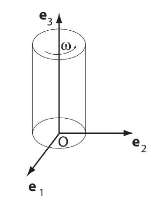

#### Question 1.1.1

*Donner les descriptions lagrangienne et eulérienne de ce mouvement (déjà abordé dans le TD1).* 给出拉格朗日描述和欧拉描述。

**答案**

Lagrangienne : les relations données. Eulérienne : $\vec V=\dot{\vec x}$ à $\vec X$ fixé puis $\vec X=\mathbb Q^{\mathsf T}\vec x$ : $\vec V=\omega(-x_2\vec e_1+x_1\vec e_2)$, $\vec\gamma=-\omega^2(x_1\vec e_1+x_2\vec e_2)$.

**Détail · 推导**

- 拉格朗日速度对 $\vec X$ 固定求导：$\dot x_1=\omega(-X_1\sin\theta-X_2\cos\theta)=-\omega x_2$，$\dot x_2=\omega(X_1\cos\theta-X_2\sin\theta)=\omega x_1$，$\dot x_3=0$。由于转动矩阵 $\mathbb Q$ 正交，直接用 $\vec X=\mathbb Q^{\mathsf T}\vec x$ 即可反解（不必写开三角恒等式就能识别出上式）。
- 欧拉加速度用物质导数计算：$\partial_t\vec V=\vec0$（定常），$\overrightarrow{\operatorname{grad}}\vec V=\begin{pmatrix}0&-\omega&0\\\omega&0&0\\0&0&0\end{pmatrix}$，对流项 $\overrightarrow{\operatorname{grad}}\vec V\cdot\vec V=-\omega^2(x_1\vec e_1+x_2\vec e_2)$。加速度始终指向转轴（向心加速度），大小 $\omega^2 r$（$r=\sqrt{x_1^2+x_2^2}$）。

#### Question 1.1.2

*Calculer le tenseur gradient de la transformation $\mathbb F$, puis le tenseur des déformations de Green-Lagrange $\mathbb E$. Commenter le résultat obtenu.* 求 $\mathbb F$ 和 $\mathbb E$，并评论。

**答案**

$\mathbb F=\mathbb Q=\begin{pmatrix}\cos\theta&-\sin\theta&0\\\sin\theta&\cos\theta&0\\0&0&1\end{pmatrix}$ ; $\mathbb E=\frac12(\mathbb Q^{\mathsf T}\mathbb Q-\mathbb I)=\mathbb O$ : aucune déformation, quel que soit $\theta$ ; $\mathbb E$ est insensible aux rotations de corps rigide.

**Détail · 推导**

$\mathbb Q$ 正交，$\mathbb Q^{\mathsf T}\mathbb Q=\mathbb I$，所以 $\mathbb E=\mathbb O$。有限应变正确地识别出"刚体运动没有变形"，即使转角很大。

#### Question 1.1.3

*En faisant l'hypothèse des petites perturbations, donner le tenseur des déformations linéarisé $\boldsymbol\varepsilon$.* 在小扰动假设下给出线性化应变 $\boldsymbol\varepsilon$。

**答案**

$\vec u=\vec x-\vec X=(\mathbb Q-\mathbb I)\vec X$, $\overrightarrow{\operatorname{grad}}\vec u=\mathbb F-\mathbb I$, $\boldsymbol\varepsilon=\frac12(\overrightarrow{\operatorname{grad}}\vec u+\overrightarrow{\operatorname{grad}}^{\mathsf T}\vec u)=\operatorname{diag}(\cos\theta-1,\ \cos\theta-1,\ 0)$ : non nul alors qu'il n'y a pas de déformation.

**Détail · 推导**

$\overrightarrow{\operatorname{grad}}\vec u=\mathbb Q-\mathbb I=\begin{pmatrix}\cos\theta-1&-\sin\theta&0\\\sin\theta&\cos\theta-1&0\\0&0&0\end{pmatrix}$。对称化后，反对称部分（$\pm\sin\theta$）互相抵消，只剩下对角元 $\cos\theta-1$。这说明线性化应变对有限刚体转动会给出“虚假的压缩应变”。

#### Question 1.1.4

*Quelle est l'hypothèse à formuler sur $\theta$ pour que l'hypothèse HPP soit effectivement vérifiée ?* $\theta$ 满足什么条件时 HPP 成立？

**答案**

HPP : $\|\overrightarrow{\operatorname{grad}}\vec u\|=\|\mathbb Q-\mathbb I\|\ll1$ et $\|\vec u\|\ll L$ (domaine borné), soit $|\theta|\ll1$ ; alors $\cos\theta-1\approx-\frac{\theta^2}2$ est du second ordre et $\boldsymbol\varepsilon\approx\mathbb O$ au premier ordre.

**Détail · 推导**

小扰动假设（HPP）要求位移梯度和无量纲位移都足够小：当 $|\theta|\ll 1$ 时，$\sin\theta\approx\theta$ 为一阶小量，而 $\cos\theta-1\approx-\theta^2/2$ 为二阶小量，在一次线性化中可以略去，从而 $\boldsymbol\varepsilon\approx\mathbb O$ 与无变形一致；当转角很大时，必须使用有限应变 $\mathbb E$。

### Exercice 1.2 · Cinématique d'un milieu continu déformable · 可变形介质运动学

**考点**　figure transformée, $\mathbb F$, $\mathbb E$, $\vec u$, $\boldsymbol\varepsilon$, type de mouvement, Euler, $\mathbb D$, $\boldsymbol\Omega$, caractéristiques

#### Énoncé · 题面

Soit $(O,\vec e_1,\vec e_2,\vec e_3)$ le référentiel cartésien orthonormé d'étude. On s'intéresse au mouvement d'un milieu continu, pour $t\geqslant0$, représenté par les équations de trajectoires suivantes : 运动由拉格朗日轨迹方程给出：

$$x_1(t,X_1,X_2,X_3)=X_1,\qquad x_2(t,X_1,X_2,X_3)=X_2\exp(\alpha t),\qquad x_3(t,X_1,X_2,X_3)=X_3,$$
où $\alpha$ est une constante positive donnée, $t$ est la variable temporelle, $(x_1,x_2,x_3)$ les coordonnées d'une particule dans la configuration actuelle (ou déformée) et $(X_1,X_2,X_3)$ ses coordonnées dans la configuration initiale, c'est-à-dire à $t=0$.

$$x_1=X_1,\qquad x_2=X_2e^{\alpha t},\qquad x_3=X_3,\qquad \alpha>0 .$$

#### Question 1.2.1

*Soit le carré de côté $\eta$, défini à $t=0$ par $0\le X_1\le\eta$, $0\le X_2\le\eta$, $X_3=0$. Calculer les transformées des points correspondant à ses coins. Tracer ses configurations initiale $\Omega_0$ et courante $\Omega$ (à $t=1$ s).* 正方形四个角的像，画初始与当前构形（$t=1\,$s）

**答案**

À $t=1\ \mathrm s$ (avec $\alpha$ en $\mathrm s^{-1}$), dans le plan $x_3=0$ : $A=\vec0$, $B=\eta\vec e_1$, $C=\eta(\vec e_1+e^{\alpha\cdot 1\ \mathrm s}\vec e_2)$, $D=\eta e^{\alpha\cdot 1\ \mathrm s}\vec e_2$ : le carré devient un rectangle étiré selon $\vec e_2$.

**Détail · 推导**

把四个角代入运动映射（$t=1\,\mathrm s$，此时指数 $\alpha t$ 在数值上等于 $\alpha$ 取 $\mathrm s^{-1}$ 时的数值，记作 $e^{\alpha}$），且 $x_3=X_3=0$ 保持共面：

| 初始点 | 坐标 $(X_1,X_2)$ | 当前点 |
|---|---|---|
| $A_0$ | $(0,0)$ | $A=(0,0)$ |
| $B_0$ | $(\eta,0)$ | $B=(\eta,0)$ |
| $C_0$ | $(\eta,\eta)$ | $C=(\eta,\eta e^{\alpha})$ |
| $D_0$ | $(0,\eta)$ | $D=(0,\eta e^{\alpha})$ |

正方形沿 $\vec e_2$ 拉长为 $\eta\times\eta e^{\alpha}$ 的矩形，$\vec e_1$ 方向尺寸不变，直角保持为直角。

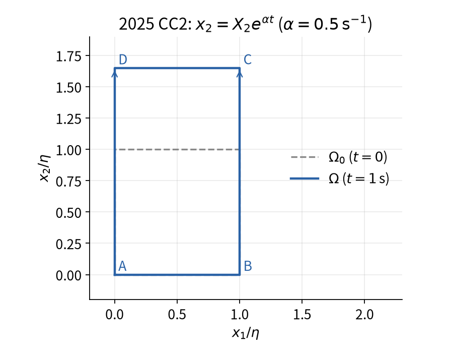

#### Question 1.2.2

*Calculer le tenseur gradient de transformation $\mathbf F$, puis le tenseur des déformations de Green–Lagrange $\mathbf E$.* 求 $\mathbb F$ 与 Green–Lagrange 应变 $\mathbb E$

**答案**

$$\mathbb F=\frac{\partial\vec x}{\partial\vec X}=\operatorname{diag}(1,e^{\alpha t},1),\qquad
\mathbb E=\tfrac12(\mathbb F^{\mathsf T}\mathbb F-\mathbb I)=\frac{e^{2\alpha t}-1}{2}\begin{pmatrix}0&0&0\\0&1&0\\0&0&0\end{pmatrix}.$$

**Détail · 推导**

$\mathbb F$ 的第 $i$ 行第 $j$ 列是 $\partial x_i/\partial X_j$。只有 $\partial x_2/\partial X_2=e^{\alpha t}$ 不是 1。$\mathbb F$ 对角，所以 $\mathbb F^{\mathsf T}\mathbb F=\operatorname{diag}(1,e^{2\alpha t},1)$，减去 $\mathbb I$ 再除以 2 即得 $\mathbb E$。两者都无量纲。$E_{22}$ 与伸长比 $\lambda_2=e^{\alpha t}$ 的关系是 $E_{22}=(\lambda_2^2-1)/2$。

#### Question 1.2.3

*Calculer le vecteur déplacement $\mathbf u$ et son gradient.* 求位移向量 $\vec u$ 及其梯度

**答案**

$$\vec u=\overrightarrow{OM}-\overrightarrow{OM_0}=X_2\,(e^{\alpha t}-1)\,\vec e_2,\qquad
\overrightarrow{\operatorname{grad}}_X\vec u=\frac{\partial\vec u}{\partial\vec X}=(e^{\alpha t}-1)\begin{pmatrix}0&0&0\\0&1&0\\0&0&0\end{pmatrix}=\mathbb F-\mathbb I .$$

**Détail · 推导**

位移是"当前位置减初始位置"，用拉格朗日变量写出；对 $\vec X$ 求导得到拉格朗日位移梯度，恒有 $\overrightarrow{\operatorname{grad}}_X\vec u=\mathbb F-\mathbb I$，可用来检查。

#### Question 1.2.4

*Calculer le tenseur des déformations linéarisées $\boldsymbol\varepsilon$ puis préciser dans quelles conditions ce dernier est valide.* 线性化应变 $\boldsymbol\varepsilon$ 及其适用条件

**答案**

$\boldsymbol\varepsilon=\frac12(\overrightarrow{\operatorname{grad}}\vec u+\overrightarrow{\operatorname{grad}}^{\mathsf T}\vec u)=(e^{\alpha t}-1)\,\vec e_2\otimes\vec e_2\approx\alpha t\,\vec e_2\otimes\vec e_2$. Valable sous l’HPP : $\|\overrightarrow{\operatorname{grad}}\vec u\|\ll1$ et $\|\vec u\|\ll L$ (domaine borné), soit $|e^{\alpha t}-1|\ll1$, i.e. $\alpha t\ll1$ ($t\ll1/\alpha$).

**Détail · 推导**

$$\boldsymbol\varepsilon=(e^{\alpha t}-1)\begin{pmatrix}0&0&0\\0&1&0\\0&0&0\end{pmatrix}\approx\alpha t\begin{pmatrix}0&0&0\\0&1&0\\0&0&0\end{pmatrix}.$$

条件是小扰动（HPP）：一方面要求位移梯度小（$\|\overrightarrow{\operatorname{grad}}\vec u\|\ll1\iff |e^{\alpha t}-1|\ll1$），另一方面要求有界域上位移远小于特征尺度 $L$（$|e^{\alpha t}-1|\,|X_2|\ll L$，对尺寸为 $L$ 的物体同样归结为 $|e^{\alpha t}-1|\ll1$）。因为 $e^{\alpha t}-1\approx\alpha t$，所以等价于 $\alpha t\ll1$，即 $t\ll1/\alpha$。此时 $E_{22}=\frac{e^{2\alpha t}-1}{2}\approx\alpha t\approx\varepsilon_{22}$，两种应变一致。

#### Question 1.2.5

*De quel type de mouvement s’agit-il ? Quelle est l’unité de $\alpha$ ?* 运动类型和 $\alpha$ 的单位

**答案**

Il s’agit d’une dilatation (extension) d’un facteur $\exp(\alpha t)$ selon $\vec e_2$. L’exposant est sans dimension, donc $\alpha$ s’exprime en $\mathrm s^{-1}$.

**Détail · 推导**

沿 $\vec e_2$ 的单轴伸长（extension / dilatation），伸长比 $e^{\alpha t}$；指数必须无量纲，故 $[\alpha]=\mathrm s^{-1}$。

#### Question 1.2.6

*Déterminer la description eulérienne de ce mouvement.* 欧拉描述

**答案**

$V_2=\dot x_2=\alpha X_2e^{\alpha t}=\alpha x_2$, donc $\vec V(t,M)=\alpha x_2\,\vec e_2$.

**Détail · 推导**

先对时间求导得拉格朗日速度 $\dot x_1=0$、$\dot x_2=\alpha X_2e^{\alpha t}$、$\dot x_3=0$，再用 $X_2=x_2e^{-\alpha t}$ 反解消去初始坐标：

$$\vec V(t,M)=\alpha x_2\,\vec e_2 .$$

这是"拉格朗日 → 欧拉"方向的标准做法：**先求导、后反解**。与 2024 CC2 练习 2（题库 1.8）相反，那里是"欧拉 → 拉格朗日"，要**解常微分方程**。

#### Question 1.2.7

*Calculer le tenseur des taux de déformation $\mathbf D$ et de rotation $\boldsymbol\Omega$. Commenter.* 变形率 $\mathbb D$ 与旋转率 $\boldsymbol\Omega$

**答案**

$\overrightarrow{\operatorname{grad}}\vec V=\alpha\,\vec e_2\otimes\vec e_2$ est symétrique : $\mathbb D=\alpha\,\vec e_2\otimes\vec e_2$ et $\boldsymbol\Omega=\mathbb O$. Le milieu se déforme sans rotation.

**Détail · 推导**

$$\overrightarrow{\operatorname{grad}}\vec V=\alpha\begin{pmatrix}0&0&0\\0&1&0\\0&0&0\end{pmatrix},\qquad \mathbb D=\overrightarrow{\operatorname{grad}}\vec V,\qquad \boldsymbol\Omega=\mathbb O .$$

速度梯度本身对称，所以对称部分就是它自己，反对称部分为零：介质有变形、无旋转。$\mathbb D$ 的单位是 $\mathrm s^{-1}$。

#### Question 1.2.8

*Préciser les caractéristiques de ce mouvement (incompressible, stationnaire, irrotationnel).* 运动特征（不可压缩？稳态？无旋？）

**答案**

- $\operatorname{div}\vec V=\alpha\ne0$ : pas incompressible ;
- $\vec V$ ne dépend pas de $t$ en eulérien : stationnaire ;
- $\overrightarrow{\operatorname{rot}}\vec V=\vec0$ : irrotationnel.

**Détail · 推导**

可压缩（体积按 $J=e^{\alpha t}$ 增大）、**稳态**（欧拉速度场不显含 $t$，虽然每个粒子的速度 $\alpha X_2e^{\alpha t}$ 在变）、无旋。"稳态"一定要用欧拉场判断。

### Exercice 1.3 · Méthode des grilles · 网格法

**考点**　sens géométrique de $\mathbb E$ (longueurs, angles)

#### Énoncé · 题面

On mesure les déformations d'un lopin d'acier par la méthode des grilles. La figure 4.1 montre la configuration déformée de l'éprouvette, ainsi que le carré au voisinage de $M_0$ avant et après déformation (côtés initiaux $\delta a_0$, $\delta b_0$ ; côtés déformés $\delta a$, $\delta b$ ; angle $\alpha=57^\circ$ entre les côtés déformés). 用网格法测钢坯的变形。图 4.1 给出试件变形后的样子，以及 $M_0$ 附近小正方形变形前后的形状：初始边长 $\delta a_0,\delta b_0$，变形后 $\delta a,\delta b$，变形后两边夹角 $\alpha=57^\circ$。

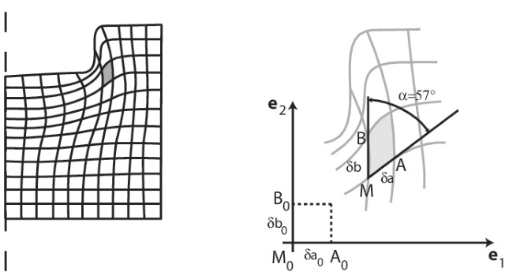

#### Question 1.3.1

*À partir des mesures de longueurs et d'angles, calculer les composantes de l'opérateur des déformations de Green-Lagrange $\mathbb E$, relatif au point $M_0$ dans la base $(\vec e_1,\vec e_2)$.* 由长度和角度的测量值计算 $M_0$ 处 Green–Lagrange 应变的分量。

**答案**

Avec $\lambda_a=\frac{\delta a}{\delta a_0}$, $\lambda_b=\frac{\delta b}{\delta b_0}$ : $E_{11}=\frac12(\lambda_a^2-1)$, $E_{22}=\frac12(\lambda_b^2-1)$, $E_{12}=E_{21}=\frac12\lambda_a\lambda_b\cos\alpha$ ($\alpha=57^\circ$).

**Détail · 推导**

从有限应变的几何定义出发（$\mathrm d\vec x_1\cdot\mathrm d\vec x_2-\mathrm d\vec X_1\cdot\mathrm d\vec X_2=2\,\mathrm d\vec X_1\cdot\mathbb E\,\mathrm d\vec X_2$），其中 $\mathbb C=\mathbb F^{\mathsf T}\mathbb F$ 是右 Cauchy–Green 变形张量。初始正方形沿坐标轴取两条微元边 $\mathrm d\vec a_0=\delta a_0\vec e_1$、$\mathrm d\vec b_0=\delta b_0\vec e_2$，变形后成为 $\mathrm d\vec a=\mathbb F\mathrm d\vec a_0$（长度 $\delta a$）与 $\mathrm d\vec b=\mathbb F\mathrm d\vec b_0$（长度 $\delta b$），夹角为 $\alpha=57^\circ$：
- 长度平方：$C_{11}=\|\mathbb F\vec e_1\|^2=(\delta a/\delta a_0)^2=\lambda_a^2$，同理 $C_{22}=\lambda_b^2$；
- 夹角点积：$C_{12}=\mathbb F\vec e_1\cdot\mathbb F\vec e_2=\lambda_a\lambda_b\cos\alpha$（初始正交点积为 $0$，变形后不再正交，出现剪切分量）。

再由 $\mathbb E=\frac12(\mathbb C-\mathbb I)$ 得上述三分量（数值上 $\cos57^\circ\approx0.545$，边长比 $\lambda_a,\lambda_b$ 需在原题图上用尺量取）。注意面内网格法同样只给出面内分量 $(E_{11},E_{22},E_{12})$。

### Exercice 1.4 · Mesure des déformations à l'aide de jauges · 应变计测量

**考点**　rosette, composantes de $\boldsymbol\varepsilon$, direction principale

#### Énoncé · 题面

L'extensométrie est la technique permettant de déterminer les composantes du tenseur des déformations par mesure en un point quelconque de la surface libre. Ceci est réalisé à l'aide de jauges de déformation (fil de résistance proportionnelle à sa longueur). Les composantes de l'opérateur des contraintes sont ensuite déduites en utilisant la relation de comportement. 应变测量：在自由表面上某点用应变计测出应变张量的分量，再由本构求应力。

Trois jauges de déformation (I, II et III) disposées en rosette autour du point $O$ de la surface d'un solide mesurent les trois allongements unitaires suivant trois directions à $120^\circ$ ($\alpha=0^\circ$ ; $\beta=120^\circ$ ; $\gamma=120^\circ$). Les mesures obtenues donnent : 三片应变计 I、II、III 在表面点 $O$ 周围组成应变花，相邻方向间隔 $120^\circ$（$\beta,\gamma$ 是相邻夹角，三个方向相对 $x$ 轴为 $0^\circ,120^\circ,240^\circ$），读数如下。

$$\varepsilon_I=0{,}5\times10^{-4},\qquad\varepsilon_{II}=2\times10^{-4},\qquad\varepsilon_{III}=2\times10^{-4}.$$

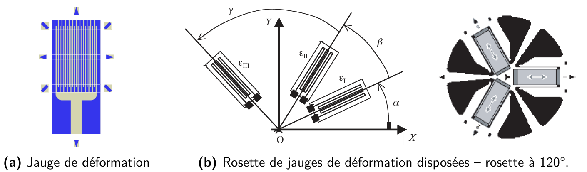

#### Question 1.4.1

*Calculer les composantes du tenseur des déformations $\boldsymbol\varepsilon$ au point $O$, dans le repère $(O,\vec e_x,\vec e_y)$. Déterminer la direction du plan pour laquelle le taux d'allongement unitaire est maximal. Donner sa valeur.* 求 $O$ 点的应变分量；求伸长率最大的方向及其值。

**答案**

$\varepsilon(\phi)=\varepsilon_{xx}\cos^2\phi+2\varepsilon_{xy}\sin\phi\cos\phi+\varepsilon_{yy}\sin^2\phi$ pour $\phi=0^\circ,120^\circ,240^\circ$ : $\varepsilon_{xx}=\varepsilon_I=0{,}5\times10^{-4}$, $\varepsilon_{xy}=\frac{\varepsilon_{III}-\varepsilon_{II}}{\sqrt3}=0$, $\varepsilon_{yy}=\frac{2(\varepsilon_{II}+\varepsilon_{III})-\varepsilon_I}3=2{,}5\times10^{-4}$, soit dans le plan $(O,\vec e_x,\vec e_y)$ :

$$\boldsymbol\varepsilon_{\text{plan}}=\begin{pmatrix}0{,}5&0\\0&2{,}5\end{pmatrix}\times10^{-4}\quad(\text{les mesures en surface ne donnent pas }\varepsilon_{zz}).$$
$\boldsymbol\varepsilon_{\text{plan}}$ est diagonal : l'allongement unitaire maximal vaut $2{,}5\times10^{-4}$ dans la direction $\vec e_y$.

**Détail · 推导**

- 关键审题：题中 $\alpha=0^\circ$ 是第 I 片与 $x$ 轴夹角，而 $\beta=120^\circ$、$\gamma=120^\circ$ 是**相邻两片的夹角**（见图 3.1b），所以三片的绝对方向角依次为 $0^\circ$、$120^\circ$、$240^\circ$。
- 依次代入单向线应变公式 $\varepsilon(\phi)=\vec n\cdot\boldsymbol\varepsilon\vec n=\varepsilon_{xx}\cos^2\phi+2\varepsilon_{xy}\sin\phi\cos\phi+\varepsilon_{yy}\sin^2\phi$：
  - $\phi=0^\circ$：$\cos0^\circ=1,\ \sin0^\circ=0\implies \varepsilon_I=\varepsilon_{xx}$；
  - $\phi=120^\circ$：$\cos120^\circ=-\frac12,\ \sin120^\circ=\frac{\sqrt3}2\implies \varepsilon_{II}=\frac14\varepsilon_{xx}-\frac{\sqrt3}2\varepsilon_{xy}+\frac34\varepsilon_{yy}$；
  - $\phi=240^\circ$：$\cos240^\circ=-\frac12,\ \sin240^\circ=-\frac{\sqrt3}2\implies \varepsilon_{III}=\frac14\varepsilon_{xx}+\frac{\sqrt3}2\varepsilon_{xy}+\frac34\varepsilon_{yy}$。
- 后两式相减消去 $\varepsilon_{xx},\varepsilon_{yy}$ 得 $\varepsilon_{xy}=0$，相加再代入 $\varepsilon_{xx}$ 得 $\varepsilon_{yy}=2.5\times10^{-4}$。面内应变矩阵已对角化，$\vec e_x,\vec e_y$ 就是主方向，最大正应变沿 $\vec e_y$。表面测量只得到面内三个分量，$\varepsilon_{zz}$ 需借助平面应力本构才能求出（见 1.5.3）。

#### Question 1.4.2

*Que mesurerait-on si les jauges étaient disposées avec un angle de $45^\circ$ entre elles ($\alpha=0^\circ$ ; $\beta=45^\circ$ ; $\gamma=45^\circ$) ?* 若相邻夹角改为 $45^\circ$，会测得什么？

**答案**

Directions $0^\circ$, $45^\circ$, $90^\circ$ : $\varepsilon_{0}=0{,}5\times10^{-4}$, $\varepsilon_{45}=\frac{\varepsilon_{xx}+\varepsilon_{yy}}2+\varepsilon_{xy}=1{,}5\times10^{-4}$, $\varepsilon_{90}=2{,}5\times10^{-4}$.

**Détail · 推导**

$45^\circ$ 方向：$\cos^2=\sin^2=\frac12$，$2\sin\cos=1$，所以 $\varepsilon_{45}=\frac{\varepsilon_{xx}+\varepsilon_{yy}}2+\varepsilon_{xy}$。

### Exercice 1.5 · Rosette à 60° · 60° 应变花

**考点**　rosette, composantes, déformations et directions principales

#### Énoncé · 题面

Une rosette de trois jauges orientées à $0^\circ$, $60^\circ$ et $120^\circ$ de l'axe $x$, collée sur la surface libre d'un solide, donne : 贴在自由表面上的应变花，三片方向分别与 $x$ 轴成 $0^\circ$、$60^\circ$、$120^\circ$，读数如下。

$$\varepsilon_{0}=3\times10^{-4},\qquad\varepsilon_{60}=1\times10^{-4},\qquad\varepsilon_{120}=-1\times10^{-4}.$$

#### Question 1.5.1

*Calculer $\varepsilon_{xx}$, $\varepsilon_{yy}$ et $\varepsilon_{xy}$.* 求面内三个应变分量。

**答案**

$\varepsilon_{xx}=\varepsilon_0=3\times10^{-4}$ ; $\varepsilon_{60}+\varepsilon_{120}=\frac12\varepsilon_{xx}+\frac32\varepsilon_{yy}$ ⇒ $\varepsilon_{yy}=-1\times10^{-4}$ ; $\varepsilon_{60}-\varepsilon_{120}=\sqrt3\,\varepsilon_{xy}$ ⇒ $\varepsilon_{xy}=\frac2{\sqrt3}\times10^{-4}\approx1{,}15\times10^{-4}$.

**Détail · 推导**

$\varepsilon(60^\circ)=\frac14\varepsilon_{xx}+\frac{\sqrt3}2\varepsilon_{xy}+\frac34\varepsilon_{yy}$，$\varepsilon(120^\circ)=\frac14\varepsilon_{xx}-\frac{\sqrt3}2\varepsilon_{xy}+\frac34\varepsilon_{yy}$；相加、相减分别求出 $\varepsilon_{yy}$、$\varepsilon_{xy}$。

#### Question 1.5.2

*Déterminer les déformations principales dans le plan et leurs directions.* 求面内主应变及其方向。

**答案**

$\varepsilon_{1,2}=\frac{\varepsilon_{xx}+\varepsilon_{yy}}2\pm\sqrt{\Bigl(\frac{\varepsilon_{xx}-\varepsilon_{yy}}2\Bigr)^2+\varepsilon_{xy}^2}=\Bigl(1\pm\frac4{\sqrt3}\Bigr)\times10^{-4}$, soit $3{,}31\times10^{-4}$ et $-1{,}31\times10^{-4}$. $\tan2\theta=\frac{2\varepsilon_{xy}}{\varepsilon_{xx}-\varepsilon_{yy}}=\frac1{\sqrt3}$ ⇒ $\theta=15^\circ$ pour $\varepsilon_1$ ($\vec n_1=\cos15^\circ\vec e_x+\sin15^\circ\vec e_y$) et $\theta=105^\circ$ pour $\varepsilon_2$ ($\vec n_2=-\sin15^\circ\vec e_x+\cos15^\circ\vec e_y$).

**Détail · 推导**

- 用 Mohr 圆 / $2\times 2$ 对称矩阵特征值公式：中心（平均值）$\frac{\varepsilon_{xx}+\varepsilon_{yy}}2=1\times10^{-4}$，半径 $\sqrt{\bigl(\frac{3-(-1)}2\bigr)^2+\bigl(\frac2{\sqrt3}\bigr)^2}=\sqrt{4+\frac43}=\frac4{\sqrt3}\approx2.31$（单位 $10^{-4}$）。
- 由 $\tan2\theta=\frac1{\sqrt3}$ 得 $2\theta=30^\circ$ 或 $210^\circ$，即 $\theta=15^\circ$ 或 $105^\circ$。判断哪个角对应 $\varepsilon_1$：因为 $\varepsilon_{xx}>\varepsilon_{yy}$ 且 $\varepsilon_{xy}>0$，直接代回 $\varepsilon(15^\circ)=1+2\cos30^\circ+\frac2{\sqrt3}\sin30^\circ=1+\sqrt3+\frac1{\sqrt3}=1+\frac4{\sqrt3}=\varepsilon_1$，所以最大主方向与 $x$ 轴成 $15^\circ$（第一象限）。

#### Question 1.5.3

*Peut-on déterminer $\varepsilon_{zz}$ avec ces mesures ?* 能否由这些测量求出 $\varepsilon_{zz}$？

**答案**

Non, pas sans loi de comportement : les jauges ne mesurent que dans le plan. Avec un matériau élastique isotrope en contraintes planes ($\sigma_{zz}=0$) : $\varepsilon_{zz}=-\frac\nu{1-\nu}(\varepsilon_{xx}+\varepsilon_{yy})=-\frac{2\nu}{1-\nu}\times10^{-4}$.

**Détail · 推导**

自由表面法向无载荷，故 $\sigma_{zz}=0$；代入线弹性各向同性 Hooke 定律 $\sigma_{zz}=\lambda(\varepsilon_{xx}+\varepsilon_{yy}+\varepsilon_{zz})+2\mu\varepsilon_{zz}=0$，解出 $\varepsilon_{zz}=-\frac{\lambda}{\lambda+2\mu}(\varepsilon_{xx}+\varepsilon_{yy})$。利用 Lamé 常数换算关系 $\frac{\lambda}{\lambda+2\mu}=\frac{\nu}{1-\nu}$ 及本题 $\varepsilon_{xx}+\varepsilon_{yy}=2\times10^{-4}$，即得上式。

### Exercice 1.6 · Mouvement de glissement simple · 简单剪切运动

**考点**　trajectoires, transformée d'une figure, $\mathbb F$, $\mathbb E$, déformations principales, longueurs, volume, rotation rigide

#### Énoncé · 题面

Soit $(O,\vec e_1,\vec e_2,\vec e_3)$ un repère orthonormé où le point $O$ est considéré comme fixe. Soit un milieu continu ayant un mouvement défini par le champ de vitesses :

$$\vec V(M)=\alpha\,\vec e_1\,\bigl(\vec e_2\cdot\overrightarrow{OM}\bigr)=\alpha x_2\,\vec e_1,$$
où $\alpha$ est une constante positive donnée. $O$ 为固定点的正交坐标系中，连续介质的速度场为 $\vec V=\alpha x_2\vec e_1$，$\alpha$ 为给定正常数（简单剪切流）。

#### Question 1.6.1

*Quelles sont les trajectoires et lignes de courant de ce mouvement ?* 这个运动的轨迹和流线是什么？

**答案**

Le mouvement est stationnaire : trajectoires et lignes de courant sont confondues. $\dot x_1=\alpha x_2$, $\dot x_2=\dot x_3=0$ ⇒ $x_1=X_1+\alpha tX_2$, $x_2=X_2$, $x_3=X_3$ : droites parallèles à $\vec e_1$ ; les points de $x_2=0$ sont immobiles.

**Détail · 推导**

速度场不显含 $t$，稳态，所以轨迹、流线（和脉线）重合。积分：$x_2$、$x_3$ 不变，$x_1$ 以速度 $\alpha X_2$ 匀速运动。离 $x_2=0$ 越远，粒子走得越快。

#### Question 1.6.2

*On considère à l'instant $t=0$ le carré $OA_0B_0C_0$, de côté $\eta$, avec $\overrightarrow{OA_0}=\eta\vec e_1$, $\overrightarrow{OB_0}=\eta\vec e_2$. Quelle est la transformée de ce carré à l'instant $t$ ?* $t=0$ 时边长 $\eta$ 的正方形 $OA_0B_0C_0$ 在时刻 $t$ 变成什么？

**答案**

$O\to O$, $A=\eta\vec e_1$, $B=\eta(\alpha t\,\vec e_1+\vec e_2)$, $C=\eta\bigl((1+\alpha t)\vec e_1+\vec e_2\bigr)$ : un parallélogramme de même base $\eta$ et de même hauteur $\eta$, donc de même aire $\eta^2$.

**Détail · 推导**

注意题设顶点顺序：$\overrightarrow{OA_0}=\eta\vec e_1$、$\overrightarrow{OB_0}=\eta\vec e_2$，因此对角顶点是 $C_0=\eta(\vec e_1+\vec e_2)$（绕边界顺序实为 $O\to A_0\to C_0\to B_0$）。将四个顶点代入映射 $x_1=X_1+\alpha tX_2,\ x_2=X_2$：底边 $OA$ 不动，上边 $B_0C_0$ 整体沿 $\vec e_1$ 平移 $\alpha t\eta$，正方形变成底和高原仍为 $\eta$ 的平行四边形，面积 $\eta^2$ 不变。

#### Question 1.6.3

*On considère à l'instant $t=0$ un cube dont une face correspond au carré $OA_0B_0C_0$. Quelle est la transformée de ce cube à l'instant $t$ ?* 以该正方形为一个面的立方体在时刻 $t$ 变成什么？

**答案**

Les sommets $X_3=\eta$ se transforment de la même manière ($x_3=X_3$) : le cube devient un parallélépipède oblique de même volume $\eta^3$.

**Détail · 推导**

第三方向不受影响，每个水平截面都做同样的剪切，体积不变（见题库 1.6.7）。

#### Question 1.6.4

*Rappeler la définition du tenseur de transformation et donner son expression.* 复述变换梯度的定义并给出表达式。

**答案**

$\mathrm d\vec x=\mathbb F\,\mathrm d\vec X$, $\mathbb F=\frac{\partial\vec x}{\partial\vec X}=\overrightarrow{\operatorname{grad}}_X\vec\phi$ ; ici $\mathbb F=\begin{pmatrix}1&\alpha t&0\\0&1&0\\0&0&1\end{pmatrix}=\mathbb I+\alpha t\,\vec e_1\otimes\vec e_2$.

**Détail · 推导**

$F_{ij}=\partial x_i/\partial X_j$：第 $i$ 行是 $x_i$ 对 $X_1,X_2,X_3$ 的偏导。只有 $\partial x_1/\partial X_2=\alpha t$ 非平凡。

#### Question 1.6.5

*Rappeler la définition du tenseur de déformation de Green-Lagrange et calculer son expression. Déterminer les déformations principales et les directions principales de déformation.* 复述 Green–Lagrange 应变的定义并计算；求主应变和主方向。

**答案**

$\mathbb E=\frac12(\mathbb F^{\mathsf T}\mathbb F-\mathbb I)=\frac12\begin{pmatrix}0&\alpha t&0\\\alpha t&(\alpha t)^2&0\\0&0&0\end{pmatrix}$, avec $\mathrm dl^2-\mathrm dl_0^2=2\,\mathrm d\vec X\cdot\mathbb E\,\mathrm d\vec X$.
Valeurs propres : $E_1=0$ (direction $\vec e_3$), $E_{2,3}=\frac{\alpha t}4\bigl(\alpha t\mp\sqrt{(\alpha t)^2+4}\bigr)$ ; pour $t>0$, directions principales $\propto\bigl(2,\ \alpha t\mp\sqrt{(\alpha t)^2+4},\ 0\bigr)$ (à $t=0$, $\mathbb E=\mathbb O$ et toute direction est principale).

**Détail · 推导**

- $\mathbb C=\mathbb F^{\mathsf T}\mathbb F=\begin{pmatrix}1&\alpha t&0\\\alpha t&1+(\alpha t)^2&0\\0&0&1\end{pmatrix}$。对角元管长度变化，非对角元管角度变化。
- $\vec e_3$ 那一行一列只有 0，直接是主方向，主值 0。
- 记 $k=\alpha t\ge 0$，其余 $2\times2$ 块 $\frac12\begin{pmatrix}0&k\\k&k^2\end{pmatrix}$ 的特征方程为 $(-\lambda)(\frac{k^2}2-\lambda)-\frac{k^2}4=0$，即 $4\lambda^2-2k^2\lambda-k^2=0$，解得 $\lambda=\frac k4\bigl(k\pm\sqrt{k^2+4}\bigr)$；两根一正一负，和为 $k^2/2$（迹），积为 $-k^2/4$（行列式）。
- 当 $t>0$（$k>0$）时，将特征值 $\lambda_\pm=\frac k4\bigl(k\pm\sqrt{k^2+4}\bigr)$ 代入特征方程第一行 $-\lambda n_1+\frac k2n_2=0$，得 $n_2=\frac{2\lambda_\pm}{k}n_1=\frac{k\pm\sqrt{k^2+4}}2n_1$；取 $n_1=2$ 即得与 $\lambda_\pm$ 一一对应的两正交主方向 $\vec n_\pm\propto\bigl(2,\ k\pm\sqrt{k^2+4},\ 0\bigr)$（小 $k$ 时趋近与 $\vec e_1$ 成 $\pm45^\circ$）。$t=0$ 时 $\mathbb E=\mathbb O$，任意方向都是主方向。

#### Question 1.6.6

*Calculer l'accroissement du carré de la longueur de $\mathrm d\vec M_0=\mathrm dl_0\,\vec\tau$, où $\vec\tau$ est un vecteur unitaire du plan $(\vec e_1,\vec e_2)$ tel que $\varphi=(\vec e_1,\vec\tau)$.* 求方向角 $\varphi$ 的线元长度平方的增量。

**答案**

$\mathrm dl^2-\mathrm dl_0^2=2\,\mathrm dl_0^2\,\vec\tau\cdot\mathbb E\vec\tau=\mathrm dl_0^2\,\alpha t\,(\sin2\varphi+\alpha t\sin^2\varphi)$.

**Détail · 推导**

$\vec\tau=(\cos\varphi,\sin\varphi,0)$，$\vec\tau\cdot\mathbb E\vec\tau=E_{11}\cos^2\varphi+2E_{12}\sin\varphi\cos\varphi+E_{22}\sin^2\varphi=\frac{\alpha t}2\bigl(2\sin\varphi\cos\varphi+\alpha t\sin^2\varphi\bigr)$。$\varphi=0$（沿 $\vec e_1$）长度不变；$\varphi=\pi/2$ 时 $\mathrm dl^2=\mathrm dl_0^2(1+(\alpha t)^2)$，竖直线元被拉斜变长。

#### Question 1.6.7

*Soit un cube élémentaire de côtés $\mathrm d\vec a_0$, $\mathrm d\vec b_0$ et $\mathrm d\vec c_0$ ; déterminer la variation de volume entre l'état non déformé et l'état déformé.* 求微元立方体变形前后的体积变化。

**答案**

$\mathrm dV=(\mathbb F\mathrm d\vec a_0,\mathbb F\mathrm d\vec b_0,\mathbb F\mathrm d\vec c_0)=\det\mathbb F\,\mathrm dV_0=\mathrm dV_0$, soit $\mathrm dV-\mathrm dV_0=0$ : pas de variation de volume ($J=1$, isochore).

**Détail · 推导**

体积是三条边的混合积，变形后每条边乘以 $\mathbb F$，所以体积乘以 $\det\mathbb F$。上三角矩阵行列式为对角元之积，等于 1。

#### Question 1.6.8

*Décrire le mouvement d'un milieu continu dont le champ de vitesses est $\vec V=\alpha\,\vec e_1(\vec e_2\cdot\overrightarrow{OM})-\alpha\,\vec e_2(\vec e_1\cdot\overrightarrow{OM})$.* 描述速度场为 $\alpha x_2\vec e_1-\alpha x_1\vec e_2$ 的运动。

**答案**

$\vec V=\alpha x_2\vec e_1-\alpha x_1\vec e_2$ : $\overrightarrow{\operatorname{grad}}\vec V=\begin{pmatrix}0&\alpha&0\\-\alpha&0&0\\0&0&0\end{pmatrix}$ antisymétrique, $\mathbb D=\mathbb O$ : rotation de corps rigide autour de $O\vec e_3$, de vitesse angulaire $-\alpha\vec e_3$ ; trajectoires circulaires.

**Détail · 推导**

速度梯度反对称 ⇒ $\mathbb D=\mathbb O$ ⇒ 变形率为零，属于刚体运动（$\mathbb E=\mathbb O$，且定常、不可压缩）。由 $\boldsymbol\Omega\vec e_1=-\alpha\vec e_2=(-\alpha\vec e_3)\wedge\vec e_1$ 或 $\frac12\overrightarrow{\operatorname{rot}}\vec V=\frac12(-\alpha-\alpha)\vec e_3=-\alpha\vec e_3$，可知绕 $O\vec e_3$ 顺时针匀速转动，粒子沿以 $O\vec e_3$ 为轴的圆周运动。对照题库 1.6.1，简单剪切 $\vec V_s=\alpha x_2\vec e_1$ 的局部角速度是 $-\frac{\alpha}{2}\vec e_3$，其速度梯度的反对称部分正好等于本问刚体转动速度梯度的一半。

### Exercice 1.7 · Glissement simple non stationnaire · 非定常简单剪切

**考点**　unités, $\mathbb F$, $\mathbb E$, Euler, $\mathbb D$, $\boldsymbol\Omega$, HPP, lien $\boldsymbol\varepsilon$–$\mathbb D$

#### Énoncé · 题面

On considère le mouvement défini en description lagrangienne par

$$x_1=X_1+\alpha t^2X_2,\qquad x_2=X_2,\qquad x_3=X_3,$$
où $\alpha$ est une constante positive. 拉格朗日描述如上，$\alpha$ 为正常数。

#### Question 1.7.1

*Quelle est l'unité de $\alpha$ ?* $\alpha$ 的单位？

**答案**

$\alpha t^2X_2$ est une longueur et $X_2$ aussi : $\alpha t^2$ est sans dimension, $[\alpha]=\mathrm s^{-2}$.

**Détail · 推导**

乘在 $X_2$ 前的因子必须无量纲。注意这里是 $t^2$，单位是 $\mathrm s^{-2}$ 而不是 $\mathrm s^{-1}$。

#### Question 1.7.2

*Calculer $\mathbb F$, $J$ et $\mathbb E$.* 求 $\mathbb F$、$J$、$\mathbb E$。

**答案**

$\mathbb F=\mathbb I+\alpha t^2\,\vec e_1\otimes\vec e_2$, $J=1$ (isochore), $\mathbb E=\frac12\begin{pmatrix}0&\alpha t^2&0\\\alpha t^2&\alpha^2t^4&0\\0&0&0\end{pmatrix}$.

**Détail · 推导**

与 TD2 练习 1 相同，只是剪切量 $k=\alpha t^2$ 随时间二次增长。三角矩阵行列式为 1。

#### Question 1.7.3

*Donner la description eulérienne des vitesses.* 给出欧拉速度场。

**答案**

$\vec V=\frac{\partial\vec x}{\partial t}\Big|_{\vec X}=2\alpha tX_2\,\vec e_1$ ; comme $X_2=x_2$ : $\vec V(\vec x,t)=2\alpha t\,x_2\,\vec e_1$.

**Détail · 推导**

求导后反解：$x_2=X_2$，直接替换。

#### Question 1.7.4

*Calculer $\mathbb D$ et $\boldsymbol\Omega$. Le mouvement est-il stationnaire, incompressible, irrotationnel ?* 求 $\mathbb D$、$\boldsymbol\Omega$；判断运动特征。

**答案**

$\overrightarrow{\operatorname{grad}}\vec V=2\alpha t\,\vec e_1\otimes\vec e_2$ : $\mathbb D=\alpha t(\vec e_1\otimes\vec e_2+\vec e_2\otimes\vec e_1)$, $\boldsymbol\Omega=\alpha t(\vec e_1\otimes\vec e_2-\vec e_2\otimes\vec e_1)$, en $\mathrm s^{-1}$. Non stationnaire ($t$ explicite), incompressible ($\operatorname{tr}\mathbb D=0$), rotationnel ($\boldsymbol\Omega\neq\mathbb O$).

**Détail · 推导**

速度梯度只有 $(1,2)$ 元 $2\alpha t$，对称部分和反对称部分各占一半。

#### Question 1.7.5

*Sous l'HPP, donner $\boldsymbol\varepsilon$ et la condition de validité. Comparer $\frac{\partial\boldsymbol\varepsilon}{\partial t}$ et $\mathbb D$.* HPP 下求 $\boldsymbol\varepsilon$ 及适用条件；比较 $\partial\boldsymbol\varepsilon/\partial t$ 与 $\mathbb D$。

**答案**

$\vec u=\alpha t^2X_2\vec e_1$, $\boldsymbol\varepsilon=\frac{\alpha t^2}2(\vec e_1\otimes\vec e_2+\vec e_2\otimes\vec e_1)$, valable sous l'HPP si $\|\overrightarrow{\operatorname{grad}}\vec u\|\ll1$ et $\|\vec u\|\ll L$ (domaine borné), soit $\alpha t^2\ll1$ ($t\ll1/\sqrt\alpha$). $\frac{\partial\boldsymbol\varepsilon}{\partial t}=\alpha t(\vec e_1\otimes\vec e_2+\vec e_2\otimes\vec e_1)=\mathbb D$.

**Détail · 推导**

由 $\overrightarrow{\operatorname{grad}}_X\vec u=\alpha t^2\vec e_1\otimes\vec e_2$，要求有界域上位移小且梯度小，均给出 $\alpha t^2\ll1$。一般情形下由链式法则有 $\dot{\mathbb F}=\mathbb L\mathbb F$（其中 $\mathbb L=\overrightarrow{\operatorname{grad}}_x\vec V$），从而 $\partial\boldsymbol\varepsilon/\partial t=\operatorname{sym}(\dot{\mathbb F})=\operatorname{sym}(\mathbb L\mathbb F)$，通常只在 HPP（$\mathbb F\approx\mathbb I$）下近似等于 $\mathbb D=\operatorname{sym}(\mathbb L)$（对照 1.10.10：即使 $\mathbb D$ 在时空上均为常量，只要 $\mathbb L\mathbb F\neq\mathbb L$，两者仍不严格相等）。本题由于 $x_2=X_2$ 且 $\vec V$ 仅沿 $\vec e_1$ 并只依赖 $x_2$（即 $\mathbb L(\mathbb F-\mathbb I)=\mathbb O$），使得 $\dot{\mathbb F}=\mathbb L$ 对一切 $t$ 恒成立，因而 $\partial\boldsymbol\varepsilon/\partial t=\mathbb D$ 严格成立。$\mathbb E$ 比 $\boldsymbol\varepsilon$ 多了 $E_{22}=\frac{\alpha^2t^4}2$，在 $\alpha t^2\ll1$ 时是二阶小量。

### Exercice 1.8 · Cinématique d'un milieu continu · 连续介质运动学

**考点**　unités, tracé, $\mathbb D$, Lagrange, trajectoire, $\mathbb F$, $\mathbb E$, volume, HPP, caractéristiques

#### Énoncé · 题面

Soit $(O,\vec e_1,\vec e_2,\vec e_3)$ le référentiel cartésien orthonormé d'étude. On s'intéresse au mouvement d'un milieu continu, représenté par le champ eulérien des vitesses $\vec V(M,t)$ suivant :

$$\vec V(M,t)=-\frac{vt}\tau\,\vec e_1-\frac{x_1}\tau\,\vec e_2,$$
où $v$ et $\tau$ sont des constantes positives données (dont les unités ne sont pas précisées), $t$ est la variable temporelle, et $M$ est un point de coordonnées $(x_1,x_2,x_3)$ dans la configuration actuelle (ou déformée). 研究由上述欧拉速度场描述的连续介质运动，$v$、$\tau$ 为给定正常数（未给单位），$M$ 是当前构形中坐标为 $(x_1,x_2,x_3)$ 的点。

#### Question 1.8.1

*En quelle(s) unité(s) s'expriment les constantes $v$ et $\tau$ ?* 常数 $v$、$\tau$ 的单位是什么？

**答案**

$\frac{x_1}\tau$ est une vitesse : $[\tau]=\frac{\mathrm m}{\mathrm{m\,s^{-1}}}=\mathrm s$ ; $\frac{vt}\tau$ est une vitesse et $\frac t\tau$ est sans dimension : $[v]=\mathrm{m\,s^{-1}}$.

**Détail · 推导**

速度的每一项都是 $\mathrm{m\,s^{-1}}$。第二项是长度除以 $\tau$，所以 $\tau$ 是时间；第一项中 $t/\tau$ 无量纲，所以 $v$ 是速度。

#### Question 1.8.2

*Tracer, dans le plan $(O, \mathbf e_1, \mathbf e_2)$, la forme du champ des vitesses à $t = 0$ et à $t = \tau$. À $t = 0$, type de mouvement observe-t-on ?* 画 $t=0$ 与 $t=\tau$ 时的速度场

**答案**

$\vec V(M,0)=-\frac{x_1}{\tau}\vec e_2$ (glissement simple : vitesse selon $\vec e_2$ proportionnelle à $x_1$) ; $\vec V(M,\tau)=-v\vec e_1-\frac{x_1}{\tau}\vec e_2$ (même glissement simple plus une translation uniforme selon $-\vec e_1$).

**Détail · 推导**

$t=0$ 时速度只有 $\vec e_2$ 分量，大小正比于 $x_1$：$x_1<0$ 向上、$x_1>0$ 向下、$x_1=0$ 静止，是简单剪切流（glissement simple）。$t=\tau$ 时再叠加一个均匀的 $-v\vec e_1$ 平移。

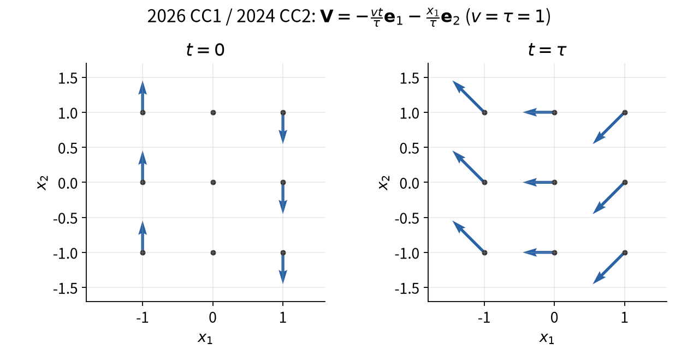

#### Question 1.8.3

*Calculer le tenseur du taux de déformation D. Quelles sont les unités de ses composantes ?* 变形率 $\mathbb D$ 及其单位

**答案**

$\overrightarrow{\operatorname{grad}}\vec V=-\frac1\tau\,\vec e_2\otimes\vec e_1$, donc $\mathbb D=-\dfrac{1}{2\tau}\begin{pmatrix}0&1&0\\1&0&0\\0&0&0\end{pmatrix}$, en $\mathrm s^{-1}$.

**Détail · 推导**

唯一非零的导数是 $\partial V_2/\partial x_1=-1/\tau$（$-vt/\tau$ 不含空间坐标，对梯度没有贡献）。$\overrightarrow{\operatorname{grad}}\vec V$ 只有 $(2,1)$ 元；对称化后 $\mathbb D$ 的 $(1,2)$、$(2,1)$ 元都是 $-1/(2\tau)$。单位 $\mathrm s^{-1}$。

#### Question 1.8.4

*Déterminer la représentation lagrangienne $x_i=f_i(X_1,X_2,X_3,t)$, où les $X_i$ sont les coordonnées initiales à $t=0$.* 拉格朗日描述

**答案**

$$x_1=X_1-\frac{vt^2}{2\tau},\qquad x_2=X_2-\frac{X_1t}{\tau}+\frac{vt^3}{6\tau^2},\qquad x_3=X_3 .$$

**Détail · 推导**

速度场就是轨迹的时间导数，得到常微分方程组

$$\dot x_1=-\frac{vt}{\tau},\qquad \dot x_2=-\frac{x_1}{\tau},\qquad \dot x_3=0,\qquad x_i(0)=X_i .$$

**按依赖关系的顺序积分：** 先解只含 $t$ 的 $x_1$：$x_1=X_1-\frac{vt^2}{2\tau}$；把它代入 $x_2$ 的方程：$\dot x_2=-\frac{X_1}{\tau}+\frac{vt^2}{2\tau^2}$，再积分并用 $x_2(0)=X_2$ 定常数，得上式。

#### Question 1.8.5

*En déduire l’expression, et tracer, la trajectoire du point initialement à l’origine O du repère.* 原点处粒子的轨迹

**答案**

$x_1(O,t)=-\frac{vt^2}{2\tau}$, $x_2(O,t)=\frac{vt^3}{6\tau^2}$, $x_3=0$ ($t\ge0$). En éliminant $t=\sqrt{-\frac{2\tau x_1}{v}}$ ($x_1\le0$), on obtient la parabole semi-cubique :

$$x_2=\frac{\sqrt{2}}{3\sqrt{v\tau}}(-x_1)^{3/2}\qquad(x_1\le0,\ x_3=0).$$

**Détail · 推导**

令 $X_1=X_2=X_3=0$ 得参数方程；将 $x_2$ 与 $x_1$ 相比，得到的是原点到粒子当前位置的**连线（割线）斜率** $x_2/x_1=-\frac{t}{3\tau}$（仍含时间 $t$，并非曲线的笛卡尔方程；而轨迹在该点的**切线斜率**为 $\mathrm dx_2/\mathrm dx_1=\dot x_2/\dot x_1=-\frac{t}{2\tau}$）。真正消去 $t$ 要用 $t=\sqrt{-2\tau x_1/v}$（$x_1\le0$），代入 $x_2$ 得 $x_2=\frac{v}{6\tau^2}\bigl(-\frac{2\tau x_1}{v}\bigr)^{3/2}=\frac{\sqrt{2}}{3\sqrt{v\tau}}(-x_1)^{3/2}$，无量纲化即图题所示的 $\frac{x_2}{v\tau}=\frac{\sqrt{2}}{3}\bigl(-\frac{x_1}{v\tau}\bigr)^{3/2}$，是一条半立方抛物线，粒子向左上方运动。

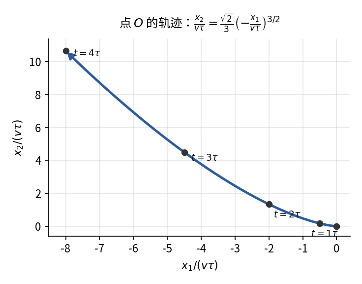

#### Question 1.8.6

*Calculer l’opérateur gradient de la transformation F, ainsi que l’opérateur des déformations de Green-Lagrange E. Quelles sont les unités des composantes de ces deux tenseurs ?* 变换梯度 $\mathbb F$ 与 Green–Lagrange 应变 $\mathbb E$，及其单位

**答案**

$$\mathbb F=\begin{pmatrix}1&0&0\\-\frac t\tau&1&0\\0&0&1\end{pmatrix},\qquad
\mathbb E=\frac12(\mathbb F^{\mathsf T}\mathbb F-\mathbb I)=\frac{t}{2\tau}\begin{pmatrix}\frac t\tau&-1&0\\-1&0&0\\0&0&0\end{pmatrix},$$

tous deux sans dimension.

**Détail · 推导**

对拉格朗日描述求 $\partial x_i/\partial X_j$，只有 $\partial x_2/\partial X_1=-t/\tau$ 不平凡。$\mathbb F^{\mathsf T}\mathbb F$ 的 $(1,1)$ 元为 $1+(t/\tau)^2$，$(1,2)$、$(2,1)$ 元为 $-t/\tau$。这是剪切量 $\gamma=-t/\tau$ 的简单剪切。

#### Question 1.8.7

*Déterminer la variation relative de volume du milieu continu au cours du temps.* 体积相对变化

**答案**

$\dfrac{\mathrm dV}{\mathrm dV_0}=\det\mathbb F=1$, donc $\dfrac{\mathrm dV-\mathrm dV_0}{\mathrm dV_0}=0$ : mouvement isochore.

**Détail · 推导**

$\mathbb F$ 是下三角矩阵，行列式等于对角元之积 $=1$，体积不变（isochore）。与 $\operatorname{div}\vec V=\operatorname{tr}\mathbb D=0$ 一致。

#### Question 1.8.8

*Sous l’HPP, calculer le tenseur des déformations linéarisées $\boldsymbol\varepsilon$. À quelles conditions cette hypothèse est-elle valable ici ?* HPP 下的线性化应变及适用条件

**答案**

$$\vec u=-\frac t\tau\begin{pmatrix}\frac{vt}{2}\\X_1-\frac{vt^2}{6\tau}\\0\end{pmatrix},\quad
\overrightarrow{\operatorname{grad}}_X\vec u=-\frac t\tau\,\vec e_2\otimes\vec e_1,\quad
\boldsymbol\varepsilon=-\frac{t}{2\tau}\begin{pmatrix}0&1&0\\1&0&0\\0&0&0\end{pmatrix}.$$

HPP : $\|\overrightarrow{\operatorname{grad}}\vec u\|\ll1\Rightarrow t\ll\tau$ (transformations infinitésimales) et $\|\vec u\|\ll L$ sur $\Omega_0$ (petits déplacements, dépend de $v$ et de la taille $L$ du domaine).

**Détail · 推导**

位移 $\vec u=\vec x-\vec X$，其中 $u_2=-\frac{X_1t}{\tau}+\frac{vt^3}{6\tau^2}=-\frac t\tau\bigl(X_1-\frac{vt^2}{6\tau}\bigr)$。用积分得到的轨迹检查位移。展开后的 $t^3$ 项为正，提出 $-t/\tau$ 后括号内两项都具有长度量纲。$t^3$ 项对 $\vec X$ 的导数为零，因此 $\overrightarrow{\operatorname{grad}}_X\vec u$ 只保留剪切项。

HPP 包含两个条件，考场作答需写全：

1. **小变换**：$\|\overrightarrow{\operatorname{grad}}\vec u\|\ll1\iff|t/\tau|\ll1\iff t\ll\tau$。也可以表述为 $\mathbb E$ 中的二阶项 $\frac12\overrightarrow{\operatorname{grad}}^{\mathsf T}\vec u\cdot\overrightarrow{\operatorname{grad}}\vec u$（量级 $t^2/\tau^2$）远小于一阶项（量级 $t/\tau$），结论同为 $t\ll\tau$。
2. **小位移**：$\|\vec u\|\ll L$（相对物体特征尺寸 $L$ 很小），这取决于 $v$ 和区域 $\Omega_0$ 的大小。

此时 $\mathbb E\approx\boldsymbol\varepsilon$：$\mathbb E$ 中的 $t^2/(2\tau^2)$ 项可以略去。

#### Question 1.8.9

*Quelles sont les caractéristiques de ce mouvement ?* 这个运动有哪些特征？

**答案**

Non stationnaire : $\frac{\partial\vec V}{\partial t}=-\frac v\tau\vec e_1\neq\vec0$ ; incompressible : $\operatorname{div}\vec V=0$ ($J=1$) ; rotationnel : $\overrightarrow{\operatorname{rot}}\vec V=-\frac1\tau\vec e_3\neq\vec0$ ; avec déformation ($\mathbb D\neq\mathbb O$) : ce n'est pas un mouvement rigide.

**Détail · 推导**

全部用欧拉速度判断：显含 $t$ ⇒ 非稳态；$\partial_1V_1+\partial_2V_2=0$ ⇒ 不可压缩，与题库 1.8.7 的 $\det\mathbb F=1$ 一致；旋度第三分量 $\partial_1V_2-\partial_2V_1=-\frac1\tau$ ⇒ 有旋；$\mathbb D\ne\mathbb O$ ⇒ 有变形。它是简单剪切叠加一个随时间加速的平移。

### Exercice 1.9 · Mouvement de glissement pur · 纯剪切式伸缩运动

**考点**　unités, trajectoires, $\mathbb F$, $\mathbb E$, principales, HPP, Euler, $\mathbb D$, $\boldsymbol\Omega$, tracé, caractéristiques, comparaison

#### Énoncé · 题面

On considère le mouvement plan d'un milieu continu défini par la représentation suivante en description lagrangienne, dans la base cartésienne $(\vec e_1,\vec e_2,\vec e_3)$ : 运动映射为

$$x_1(t)=(1+\alpha t)X_1,\qquad x_2(t)=\frac{X_2}{1+\alpha t},\qquad x_3(t)=X_3,$$
où $\alpha$ est une constante strictement positive. On désigne par $(x_1,x_2,x_3)$ les composantes du vecteur position $\overrightarrow{OM}(t)$ d'une particule à l'instant $t$, et par $(X_1,X_2,X_3)$ les composantes du vecteur position $\overrightarrow{OM_0}$ de cette même particule à l'instant initial $t_0=0$. Pour les exemples et tracés, on prendra $t=1$ s et $\alpha=1/2$ (on ne précise pas l'unité de $\alpha$ !). 初始时刻为 $t=0$；作图取 $t=1\ \mathrm s$、$\alpha=1/2$。下文记 $a=1+\alpha t$。

$$x_1=(1+\alpha t)X_1,\quad x_2=\frac{X_2}{1+\alpha t},\quad x_3=X_3,\qquad\alpha>0.$$

#### Question 1.9.1

*En quelle unité s’exprime la constante $\alpha$ ?* $\alpha$ 的单位

**答案**

$x_1/X_1=1+\alpha t$ est sans dimension, donc $\alpha t$ aussi : $[\alpha]=\mathrm s^{-1}$, soit $\alpha=0{,}5\ \mathrm s^{-1}$ ; à $t=1$ s, $a=1+\alpha t=3/2$.

**Détail · 推导**

$x_1$ 和 $X_1$ 都是长度，因此比例 $x_1/X_1=1+\alpha t$ 必须无量纲。常数 1 无量纲，能与它相加的 $\alpha t$ 也必须无量纲：

$$[\alpha t]=1
\quad\Longrightarrow\quad [\alpha]=\mathrm{s^{-1}}.$$

所以题给的数值应完整写为 $\alpha=0.5\,\mathrm{s^{-1}}$。在 $t=1\,\mathrm s$ 时，

$$a=1+\alpha t=1+\frac12=\frac32,$$

表示第一方向的长度放大到初始的 $3/2$，第二方向缩为初始的 $2/3$。$a$ 是无量纲伸长比，不是一个长度。

#### Question 1.9.2

*Tracer sur le même graphe l’allure des trajectoires des particules initialement en $O=(0,0,0)$, $A_0=(1,0,0)$, $B_0=(0,1,0)$ et $C_0=(1,1,0)$.* 画四个初始点的轨迹

**答案**

$O$ reste fixe ; $A$ : $(a,0,0)$, s'éloigne sur l'axe $x_1$ ; $B$ : $(0,1/a,0)$, se rapproche de $O$ sur l'axe $x_2$ ; $C$ : $(a,1/a,0)$, décrit l'hyperbole $x_1x_2=1$.

**Détail · 推导**

轨迹由“固定同一个初始位置 $\vec X$，让时间变化”得到。把四个初始点依次代入映射：

| 粒子 | 任意时刻的位置 | $t=1\,\mathrm s,\ \alpha=0.5\,\mathrm{s^{-1}}$ 时 |
|---|---|---|
| $O$ | $(0,0,0)$，一直静止 | $(0,0,0)$ |
| $A$ | $(a,0,0)$，沿正 $x_1$ 轴向外 | $(3/2,0,0)$ |
| $B$ | $(0,a^{-1},0)$，沿正 $x_2$ 轴向原点 | $(0,2/3,0)$ |
| $C$ | $(a,a^{-1},0)$，向右下方运动 | $(3/2,2/3,0)$ |

对 $C$ 消去时间，有 $x_1x_2=a\,a^{-1}=1$，所以轨迹是双曲线 $x_2=1/x_1$。对 $t\ge0$，$a\ge1$，只沿从 $(1,1)$ 开始、向右下方的分支前进。

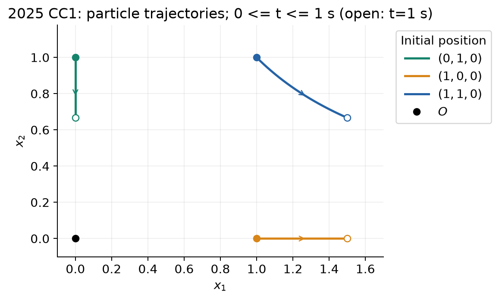

图取 $0\le t\le1\,\mathrm s$；实心点为初始位置，空心点为题目指定的 $t=1\,\mathrm s$ 位置。画轨迹时应标出方向和起点，不要把它画成“同一时刻各位置的速度箭头”。

#### Question 1.9.3

*Déterminer l’expression du tenseur gradient de transformation $\mathbf F$ et son déterminant. Que peut-on en déduire sur la variation de volume d’une particule ?* 求 $\mathbf F$ 与行列式，并解释体积

**答案**

$\mathbb F=\operatorname{diag}(a,a^{-1},1)$, $J=\det\mathbb F=1$ : le volume de chaque particule est conservé (transformation isochore).

**Détail · 推导**

变换梯度把初始线元映射成当前线元，按参考坐标求导：

$$F_{ij}=\frac{\partial x_i}{\partial X_j}.$$

求这个导数时 $t$ 固定，所以 $a=1+\alpha t$ 对 $\vec X$ 来说是常数。由 $x_1=aX_1$、$x_2=X_2/a$、$x_3=X_3$ 得

$$\mathbb F=
\begin{pmatrix}
\partial_{X_1}x_1&\partial_{X_2}x_1&\partial_{X_3}x_1\\
\partial_{X_1}x_2&\partial_{X_2}x_2&\partial_{X_3}x_2\\
\partial_{X_1}x_3&\partial_{X_2}x_3&\partial_{X_3}x_3
\end{pmatrix}
=\begin{pmatrix}a&0&0\\0&a^{-1}&0\\0&0&1\end{pmatrix}.$$

对角矩阵的行列式为对角元乘积：

$$J=\det\mathbb F=a\times a^{-1}\times1=1.$$

因此 $\mathrm dv=J\,\mathrm dV_0=\mathrm dV_0$，每个物质微元的体积严格保持不变。第一方向拉长，第二方向恰好按相反比例缩短，第三方向不变。**保持体积并不表示 $\mathbb F=\mathbb I$，也不表示形状没有改变。**

#### Question 1.9.4

*Déterminer l’expression du tenseur de déformation de Green–Lagrange $\mathbf E$.* 求 Green–Lagrange 应变

**答案**

$\mathbb E=\frac12(\mathbb F^{\mathsf T}\mathbb F-\mathbb I)=\frac12\operatorname{diag}(a^2-1,\ a^{-2}-1,\ 0)$, avec $a=1+\alpha t$.

**Détail · 推导**

Green–Lagrange 应变由参考构形与当前构形的线元长度变化定义。计算时依次做“转置、相乘、减单位阵、除以 2”：

$$\mathbb C=\mathbb F^{\mathsf T}\mathbb F
=\begin{pmatrix}a^2&0&0\\0&a^{-2}&0\\0&0&1\end{pmatrix},$$

$$\boxed{\mathbb E=\frac12(\mathbb C-\mathbb I)
=\frac12\begin{pmatrix}
a^2-1&0&0\\
0&a^{-2}-1&0\\
0&0&0
\end{pmatrix}.}$$

例如原先沿 $\vec e_1$ 的单位长度线元，变形后长度为 $a$，长度平方从 1 变成 $a^2$，所以 $E_{11}=(a^2-1)/2$；第二方向同理。

在 $t=0$ 时 $a=1$，应有 $\mathbb E=\mathbb O$。在指定的 $t=1\,\mathrm s$ 时，$a=3/2$，可检查

$$\mathbb E=\operatorname{diag}\left(\frac58,-\frac5{18},0\right).$$

一个方向为正、另一个为负，符合第一方向伸长、第二方向收缩的几何图像。这里求的是有限应变，不能直接用 $\mathbb F-\mathbb I$ 代替。

#### Question 1.9.5

*Déterminer les expressions des déformations principales et les directions associées.* 求主应变与方向

**答案**

$\mathbb E$ est diagonal : $E_1=\frac{a^2-1}2>0$ selon $\vec e_1$, $E_2=\frac{a^{-2}-1}2<0$ selon $\vec e_2$, $E_3=0$ selon $\vec e_3$ (pour $t>0$) ; à $t=0$ toutes sont nulles et toute direction est principale.

**Détail · 推导**

主应变是应变张量的特征值，方向满足 $\mathbb E\vec n=E_{\mathrm{pr}}\vec n$。上一问的矩阵已经对角化，因此不必再解特征多项式：每条坐标轴就是一个主方向，对角元就是对应主应变。

将 $a=1+\alpha t$ 展开：

$$\begin{aligned}
E_1&=\frac{a^2-1}{2}
=\frac{\alpha t(2+\alpha t)}2
&&\leftrightarrow\ \vec e_1,\\
E_2&=\frac{a^{-2}-1}{2}
=\frac{1-(1+\alpha t)^2}{2(1+\alpha t)^2}
=-\frac{\alpha t(2+\alpha t)}{2(1+\alpha t)^2}
&&\leftrightarrow\ \vec e_2,\\
E_3&=0
&&\leftrightarrow\ \vec e_3.
\end{aligned}$$

对 $t>0$，有 $E_1>0$、$E_2<0$、$E_3=0$，分别对应伸长、收缩、长度不变。这里下标按坐标方向命名，并未按特征值从大到小排序。

#### Question 1.9.6

*Quel est le domaine de validité de l’Hypothèse des Petites Perturbations ? Calculer le tenseur des déformations linéarisées $\boldsymbol\varepsilon$, ainsi que sa trace. Commenter.* 小扰动有效范围、线性化应变及其迹

**答案**

HPP si $\|\overrightarrow{\operatorname{grad}}\vec u\|\ll1$ et $\|\vec u\|\ll L$ (domaine borné), soit $\alpha t\ll1$ ($t\ll1/\alpha$). $\vec u=\bigl(\alpha tX_1,\ -\frac{\alpha t}{1+\alpha t}X_2,\ 0\bigr)$, d'où :

$$\boldsymbol\varepsilon=\operatorname{diag}\Bigl(\alpha t,\ -\frac{\alpha t}{1+\alpha t},\ 0\Bigr)\approx\alpha t\operatorname{diag}(1,-1,0) ;$$
la trace vaut $\operatorname{tr}\boldsymbol\varepsilon=\frac{(\alpha t)^2}{1+\alpha t}\approx0$ au premier ordre, cohérent avec l'incompressibilité ($J=1$).

**Détail · 推导**

**先求位移，再检查能否忽略二阶项。** 位移是当前位置减初始位置。记无量纲小参数 $q=\alpha t$，于是 $a=1+q$，有

$$\vec u=\vec x-\vec X
=\left(qX_1,\ -\frac q{1+q}X_2,\ 0\right),$$

$$\mathbb H=\overrightarrow{\operatorname{grad}}_X\vec u
=\operatorname{diag}\left(q,-\frac q{1+q},0\right).$$

精确有限应变与位移梯度的关系为

$$\mathbb E=\frac12\left(\mathbb H+\mathbb H^{\mathsf T}
+\mathbb H^{\mathsf T}\mathbb H\right).$$

小扰动假设（HPP）要求位移梯度足够小（$\|\mathbb H\|\ll1$，从而略去二次项）且有界域上位移远小于特征尺度 $L$（$\|\vec u\|\ll L$）。对本题 $t\ge0$，第一项大小为 $q$，另一项的绝对值不超过 $q$，在有界域上条件即归结为

$$\boxed{\alpha t\ll1,\qquad t\ll1/\alpha.}$$

**线性化应变的定义**是去掉上述二次项后，取

$$\boldsymbol\varepsilon=\frac12(\mathbb H+\mathbb H^{\mathsf T})
=\operatorname{diag}\left(q,-\frac q{1+q},0\right).$$

若将精确位移直接代入这一定义，迹为

$$\operatorname{tr}\boldsymbol\varepsilon
=q-\frac q{1+q}=\frac{q^2}{1+q}.$$

这个数并非严格为零，但它是二阶小量。既然正在保留一阶近似，还可以一致地展开 $(1+q)^{-1}\simeq1-q$，从而

$$\boxed{\boldsymbol\varepsilon
\simeq q\,\operatorname{diag}(1,-1,0),\qquad
\operatorname{tr}\boldsymbol\varepsilon\simeq0.}$$

因此，**“把精确位移代入线性化应变定义”与“将结果进一步截断到 $q$ 的一阶”是两个步骤**：直接写 $\operatorname{tr}\boldsymbol\varepsilon=0$ 是在一阶截断意义下成立的，不能把它理解成对任意时间的精确等式。

一阶小应变的迹近似表示相对体积变化，因而零迹与本题等体积相符；有限变形下判断体积仍应使用 $\det\mathbb F$。此外，题目给作图用的 $\alpha t=1/2$ 不属于明确的 $\alpha t\ll1$ 范围，作图参数本身不意味着 HPP 成立。

#### Question 1.9.7

*Montrer que le champ eulérien des vitesses (c’est-à-dire la représentation eulérienne de ce mouvement) s’écrit :* 证明欧拉速度场等于下式。

$$\mathbf V^E(t,\mathbf x)=\frac{\alpha}{1+\alpha t}(x_1\mathbf e_1-x_2\mathbf e_2).$$

**答案**

À $\vec X$ fixé : $\vec V=\alpha X_1\vec e_1-\frac{\alpha X_2}{a^2}\vec e_2$ ; avec $X_1=x_1/a$, $X_2=ax_2$ : $\vec V^E(t,\vec x)=\frac\alpha{1+\alpha t}(x_1\vec e_1-x_2\vec e_2)$.

**Détail · 推导**

欧拉速度要回答“当前位于 $\vec x$ 处的粒子，速度是多少”。转换分两步。

**第一步，固定粒子标签 $\vec X$，对位置求时间导数。** 因为 $\dot a=\alpha$，

$$\begin{aligned}
V_1^{L}(t,\vec X)&=\frac{\mathrm d}{\mathrm dt}(aX_1)=\alpha X_1,\\
V_2^{L}(t,\vec X)&=\frac{\mathrm d}{\mathrm dt}(X_2/a)=-\frac{\alpha X_2}{a^2},\\
V_3^{L}(t,\vec X)&=0.
\end{aligned}$$

此时结果仍按初始粒子 $\vec X$ 表示，是拉格朗日速度。

**第二步，用逆映射消去 $\vec X$。** 由 $x_1=aX_1$、$x_2=X_2/a$，反解得

$$X_1=\frac{x_1}{a},\qquad X_2=ax_2,\qquad X_3=x_3.$$

代回速度：

$$\boxed{\vec V^{E}(t,\vec x)
=\begin{pmatrix}\alpha x_1/a\\-\alpha x_2/a\\0\end{pmatrix}
=\frac{\alpha}{1+\alpha t}(x_1\vec e_1-x_2\vec e_2).}$$

这一步只是换了标记同一物理场的方式，粒子实际速度并没有改变。求第一步的时间导数时必须固定 $\vec X$；若直接把当前坐标当成固定粒子坐标，第二个分量中的 $a^{-2}$ 就容易求错。

#### Question 1.9.8

*Déterminer les tenseurs taux de déformation $\mathbf D$ et taux de rotation $\boldsymbol\Omega$. Préciser leur unité.* 求变形率与旋转率及其单位

**答案**

$\overrightarrow{\operatorname{grad}}\vec V=\frac\alpha a\operatorname{diag}(1,-1,0)$ est symétrique : $\mathbb D=\frac\alpha{1+\alpha t}\operatorname{diag}(1,-1,0)$, $\boldsymbol\Omega=\mathbb O$, en $\mathrm s^{-1}$.

**Détail · 推导**

先对欧拉速度按**当前坐标**求梯度：

$$\mathbb L=\overrightarrow{\operatorname{grad}}_x\vec V
=\begin{pmatrix}
\alpha/a&0&0\\
0&-\alpha/a&0\\
0&0&0
\end{pmatrix}.$$

求空间导数时 $t$ 固定，所以 $\alpha/a$ 是空间常数。例如 $\partial_{x_1}V_1=\alpha/a$，$\partial_{x_2}V_1=0$。

再分别取对称与反对称部分：

$$\boxed{\mathbb D=\frac12(\mathbb L+\mathbb L^{\mathsf T})
=\frac\alpha a\operatorname{diag}(1,-1,0),\qquad
\boldsymbol\Omega=\frac12(\mathbb L-\mathbb L^{\mathsf T})=\mathbb O.}$$

$\mathbb L$ 已对称，因此全部速度梯度都属于变形率，没有局部刚体旋转率。第一方向伸长、第二方向收缩的瞬时速率分别为 $\alpha/a$ 和 $-\alpha/a$，二者随着时间变化。

$a$ 无量纲、$[\alpha]=\mathrm{s^{-1}}$，所以两种“率”的单位均为 $\mathrm{s^{-1}}$。即使本题 $\boldsymbol\Omega=\mathbb O$，它所代表的物理量仍有旋转率的单位；数值为零并不会改变物理量的单位。

#### Question 1.9.9

*Tracer le champ de vitesse sur $0\le x_1\le1$, $0\le x_2\le1$, $x_3=0$, sur une grille de $3\times3$ points. Quelle forme aura le champ pour les $x_1$ négatifs ?* 在 $3\times3$ 网格画速度，负 $x_1$ 区域如何？

**答案**

À $t=1$ s : $\vec V=(x_1/3)\vec e_1-(x_2/3)\vec e_2$ ; les flèches s'éloignent de l'axe $x_2$ et se rapprochent de l'axe $x_1$ ; pour $x_1<0$ la composante horizontale change de signe (champ symétrique par rapport à l'axe $x_2$).

**Détail · 推导**

先把题给的时刻和参数代入，而不是把整条粒子轨迹画出来：

$$t=1\,\mathrm s,\qquad \alpha=0.5\,\mathrm{s^{-1}},
\qquad a=\frac32,\qquad \frac\alpha a=\frac13\,\mathrm{s^{-1}}.$$

在九个当前网格点 $x_1,x_2\in\{0,1/2,1\}$，逐点代入

$$\vec V=(x_1/3,-x_2/3,0).$$

下表列出面内速度分量 $(V_1,V_2)$；坐标按米取值时，速度单位为 $\mathrm{m/s}$。

| $x_2\backslash x_1$ | $0$ | $1/2$ | $1$ |
|---|---|---|---|
| $1$ | $(0,-1/3)$ | $(1/6,-1/3)$ | $(1/3,-1/3)$ |
| $1/2$ | $(0,-1/6)$ | $(1/6,-1/6)$ | $(1/3,-1/6)$ |
| $0$ | $(0,0)$ | $(1/6,0)$ | $(1/3,0)$ |

在每个点以该点为箭头起点，按表中的方向和相对长度画箭头；原点速度为零。整幅图必须使用同一个箭头缩放比例。

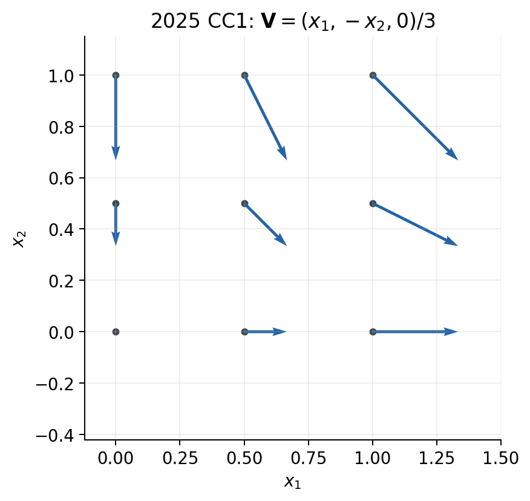

当 $x_1<0$ 时，$V_1<0$，水平分量转向左；$V_2=-x_2/3$ 不因 $x_1$ 改变。因此把右半平面的速度图关于竖轴作相应的镜像即可。图中的箭头是瞬时速度，不表示经过一秒后粒子一定到达箭头终点。

#### Question 1.9.10

*Que peut-on conclure sur les caractéristiques du mouvement : incompressibilité, rotationnel, stationnarité ?* 是否不可压缩、无旋、稳态？

**答案**

$\operatorname{div}\vec V=0$ : incompressible ; $\overrightarrow{\operatorname{rot}}\vec V=\vec0$ : irrotationnel ; $\partial_t\vec V\neq\vec0$ (facteur $\frac\alpha{1+\alpha t}$) : non stationnaire.

**Détail · 推导**

三种性质分别用三个运算检查，不能相互代替。

**不可压缩：** 散度是速度梯度的迹，

$$\operatorname{div}\vec V
=\frac{\partial V_1}{\partial x_1}
+\frac{\partial V_2}{\partial x_2}
+\frac{\partial V_3}{\partial x_3}
=\frac\alpha a-\frac\alpha a=0.$$

所以运动不可压缩，与题库 1.9.3 的 $J=1$ 相符。

**无旋：** $V_1$ 只依赖 $x_1$，$V_2$ 只依赖 $x_2$，所有参与旋度的交叉偏导均为零，因此 $\overrightarrow{\operatorname{rot}}\vec V=\vec0$。这也与上一问 $\boldsymbol\Omega=\mathbb O$ 一致。

**非稳态：** 稳态要求固定当前位置 $\vec x$ 时，速度不随时间变化。但

$$\partial_t\left(\frac{\alpha}{1+\alpha t}\right)
=-\frac{\alpha^2}{(1+\alpha t)^2},$$

所以

$$\frac{\partial\vec V}{\partial t}
=-\frac{\alpha^2}{a^2}(x_1\vec e_1-x_2\vec e_2)
\not\equiv\vec0.$$

结论是：**不可压缩、无旋、非稳态，并且有变形。** 固定位置处的速度箭头会随时间缩短，所以不是稳态；这里判断的是整个速度场，不能因为原点一直静止就把运动判为稳态。这个时间偏导也不是粒子的完整加速度，后者还包含对流项。

#### Question 1.9.11

*Quelles similarités et différences observe-t-on par rapport à un glissement simple ?* 与简单剪切有何相同与不同？

**答案**

Similitudes : mouvements plans, isochores ($\det\mathbb F=1$), avec déformation. Différences : ici $\boldsymbol\Omega=\mathbb O$ et directions principales fixes ($\vec e_1$, $\vec e_2$), trajectoires hyperboliques ; le glissement simple est rotationnel, ses directions principales tournent et ses trajectoires sont des droites parallèles.

**Détail · 推导**

先写出简单剪切的一个标准例子，便于与本题比较：

$$x_1=X_1+k(t)X_2,\qquad x_2=X_2,\qquad x_3=X_3,$$

$$\mathbb F_s=
\begin{pmatrix}1&k&0\\0&1&0\\0&0&1\end{pmatrix},\qquad
\mathbb L_s=
\begin{pmatrix}0&\dot k&0\\0&0&0\\0&0&0\end{pmatrix}.$$

| 比较项 | 本题纯伸缩式剪切 | 上述简单剪切 |
|---|---|---|
| 物质方块的形状 | 沿坐标轴拉长、压窄，仍为矩形 | 相邻层错动，变成平行四边形 |
| 体积 | $a\times a^{-1}=1$，保持体积 | $\det\mathbb F_s=1$，也保持体积 |
| 变形率 | $\mathbb D$ 为对角矩阵，非零 | $\mathbb D_s=(\mathbb L_s+\mathbb L_s^{\mathsf T})/2$，有非对角项 |
| 局部旋转率 | $\boldsymbol\Omega=\mathbb O$ | $\dot k\ne0$ 时 $\boldsymbol\Omega_s\ne\mathbb O$ |
| 有限主应变方向 | 固定为坐标轴方向 | 一般随剪切量 $k$ 改变 |

简单剪切中的速度梯度既有对称部分，也有反对称部分；所以它同时包含局部变形和局部转动。本题速度梯度完全对称，只有沿固定方向的伸缩率。

这里最后一行说的是**有限应变张量的主方向**，不要与瞬时变形率 $\mathbb D_s$ 的主方向混淆。两种运动都能改变形状而保持体积，但几何过程和旋转率不同。

### Exercice 1.10 · Descriptions eulérienne et lagrangienne · 欧拉与拉格朗日描述

**考点**　unités, tracé, divergence, $\mathbb D$, Lagrange, trajectoires, $\mathbb F$, masse volumique, $\mathbb E$, principales, HPP, comparaison $\mathbb D$–$\boldsymbol\varepsilon$, rotationnel

#### Énoncé · 题面

On considère le mouvement plan d'un milieu continu défini par la représentation suivante du champ des vitesses en description eulérienne : 给定平面速度场

$$\vec V(M)=\alpha(x_1\vec e_1-x_2\vec e_2),$$
exprimé dans la base cartésienne $(\vec e_1,\vec e_2,\vec e_3)$, $\alpha$ étant un scalaire constant, supposé positif. On désigne par $(x_1,x_2,x_3)$ les composantes du vecteur position $\vec x$ d'une particule à l'instant $t$, et par $(X_1,X_2,X_3)$ les composantes du vecteur position $\vec X$ de cette même particule à l'instant initial $t=0$. Le milieu continu occupe à l'instant $t$ le domaine $\Omega(t)$ défini par $x_1>0$, $x_2>0$ et $x_3$ quelconque. 初始坐标为 $(X_1,X_2,X_3)$，当前坐标为 $(x_1,x_2,x_3)$，参考时刻 $t=0$。介质区域为 $x_1>0,x_2>0$，$x_3$ 任意。下方原题也要求画坐标轴上的示例点，可把它们理解为该运动映射延拓到区域边界后的轨迹。

$$\vec V(M)=\alpha(x_1\vec e_1-x_2\vec e_2)
=\begin{pmatrix}\alpha x_1\\-\alpha x_2\\0\end{pmatrix},\qquad\alpha>0.$$

#### Question 1.10.1

*Quelle est l’unité de la constante $\alpha$ ? Quelles quantités s’expriment dans cette unité ?* $\alpha$ 的单位是什么？哪些物理量有相同单位？

**答案**

$[\alpha]=\frac{[V]}{[x]}=\mathrm s^{-1}$ : même unité qu'une fréquence ou qu'un taux de déformation ($\mathbb D$, $\boldsymbol\Omega$, $\operatorname{div}\vec V$).

**Détail · 推导**

从 $V_1=\alpha x_1$ 出发，先写量纲：

$$[\alpha]=\frac{[V_1]}{[x_1]}
=\frac{\mathrm{m/s}}{\mathrm m}=\mathrm{s^{-1}}.$$

因此 $\alpha$ 不是一个长度或应变，而是一个**每单位时间的变化尺度**；频率、应变率、角速度都可具有这一单位。

本题后面会出现 $e^{\alpha t}$。指数必须无量纲，$[\alpha t]=1$，这也能反过来检查单位是否正确。

#### Question 1.10.2

*Tracer, dans le plan $(O,\mathbf e_1,\mathbf e_2)$, la forme du champ des vitesses à l’instant $t$. À quel type de mouvement ou phénomène cela peut-il correspondre ?* 画速度场，说明可能对应哪类运动或现象

**答案**

Vitesses qui s'éloignent de l'axe $x_2$ selon $\vec e_1$ et se rapprochent de l'axe $x_1$ selon $\vec e_2$ ; lignes de courant $x_1x_2=$ cste (hyperboles) : écoulement au voisinage d'un point d'arrêt (fluide arrivant sur une paroi).

**Détail · 推导**

速度场作图是在同一时刻，对多个**当前空间位置**画速度箭头。先分别看两个分量：

$$V_1=\alpha x_1,\qquad V_2=-\alpha x_2.$$

因为 $\alpha>0$，第一象限内的箭头向右、向下。在 $x_1$ 轴上只有水平分量，远离原点；在 $x_2$ 轴上只有竖直分量，朝向原点。在全平面延拓后，左右两侧沿第一方向分开，上下两侧沿第二方向靠拢。

例如取 $\alpha=1\,\mathrm{s^{-1}}$，在 $(1,0)$、$(0,1)$、$(1,1)$ 处依次画 $(1,0)$、$(0,-1)$、$(1,-1)$ 的箭头，再按坐标的符号和大小补全其他位置。

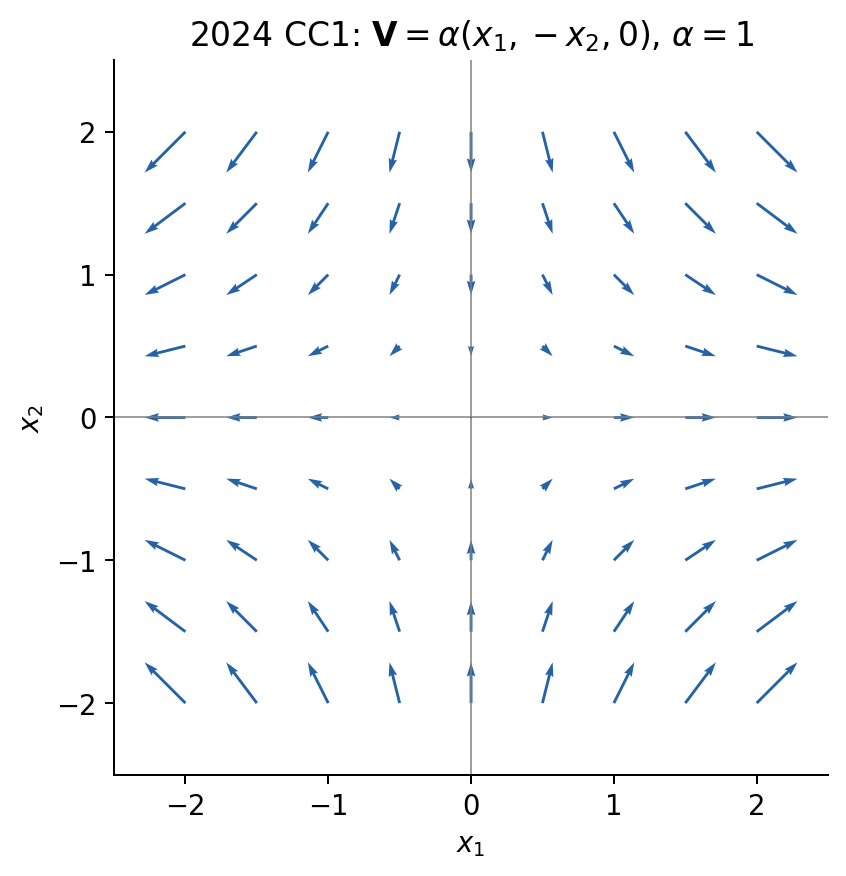

这对应第一方向伸长、第二方向收缩的平面伸缩流，也称纯伸缩式剪切。它可示意拉伸流或停滞点附近的鞍形流动。图中的箭头表示速度，不是粒子已经走过的轨迹；粒子轨迹要由题库 1.10.5、1.10.6 确定。

#### Question 1.10.3

*Calculer $\operatorname{div}\mathbf V$. Que peut-on en déduire concernant la variation de volume d’un domaine matériel $\omega(t)$ contenu dans $\Omega(t)$ entre les instants $0$ et $t$ ?* 求散度，并判断物质域从 0 到 $t$ 的体积变化

**答案**

$\operatorname{div}\vec V=\alpha-\alpha=0$ ; $\frac{\mathrm d}{\mathrm dt}(\mathrm dv)=\operatorname{div}\vec V\,\mathrm dv=0$ : le volume de $\omega(t)$ reste constant entre $0$ et $t$.

**Détail · 推导**

散度取的是“第 $i$ 个速度分量对第 $i$ 个空间坐标的导数”之和：

$$\operatorname{div}\vec V
=\frac{\partial(\alpha x_1)}{\partial x_1}
+\frac{\partial(-\alpha x_2)}{\partial x_2}
+\frac{\partial 0}{\partial x_3}
=\alpha-\alpha=0.$$

第一方向在拉开，第二方向在压缩，二者的局部体积变化率正好抵消。要从这个**瞬时结论**得到“从 $0$ 到 $t$ 体积不变”，可用物质微元的关系

$$\frac{\mathrm d(\mathrm dv)}{\mathrm dt}=(\operatorname{div}\vec V)\,\mathrm dv=0.$$

所以每个随粒子运动的微小体积始终保持初始值，任意有限随体区域的体积也不变。等价地，

$$\dot J=J\,\operatorname{div}\vec V=0,\qquad J(0)=1
\quad\Longrightarrow\quad J(t)=1.$$

这里 $J=\mathrm dv/\mathrm dV_0$ 是当前体积与初始体积之比。结论是**运动不可压缩、变换等体积，但允许形状改变**。

#### Question 1.10.4

*Calculer le taux de déformation $\mathbf D$. Quelles sont les unités de ses composantes ?* 求变形率 $\mathbb D$，其分量单位是什么？

**答案**

$\overrightarrow{\operatorname{grad}}\vec V=\alpha\operatorname{diag}(1,-1,0)$ est symétrique, donc $\mathbb D=\alpha\operatorname{diag}(1,-1,0)$, composantes en $\mathrm s^{-1}$.

**Détail · 推导**

变形率 $\mathbb D$ 描述的是“现在每单位时间发生多少局部伸缩或剪切”。从欧拉速度求它，要先算对当前坐标的梯度：

$$L_{ij}=\frac{\partial V_i}{\partial x_j},\qquad
\mathbb L=
\begin{pmatrix}
\alpha&0&0\\
0&-\alpha&0\\
0&0&0
\end{pmatrix}.$$

例如 $L_{11}=\partial_{x_1}(\alpha x_1)=\alpha$，$L_{12}=\partial_{x_2}(\alpha x_1)=0$，其他项同理。

再取对称部分：

$$\mathbb D=\frac12(\mathbb L+\mathbb L^{\mathsf T})
=\alpha\operatorname{diag}(1,-1,0).$$

由于 $\mathbb L$ 已经对称，这一步不改变矩阵。$D_{11}>0$ 表示第一方向的瞬时伸长率，$D_{22}<0$ 表示第二方向的瞬时收缩率，第三方向不变。其单位是速度除以长度，即 $\mathrm{s^{-1}}$。

反对称部分 $\boldsymbol\Omega=(\mathbb L-\mathbb L^{\mathsf T})/2=\mathbb O$，说明没有局部刚体旋转率；这不妨碍 $\mathbb D$ 非零。

#### Question 1.10.5

*Déterminer la représentation lagrangienne du mouvement, c’est-à-dire les fonctions $f_i$ telles que $x_i=f_i(X_1,X_2,X_3,t)$.* 求拉格朗日运动映射 $x_i=f_i(\vec X,t)$

**答案**

$\dot x_1=\alpha x_1$, $\dot x_2=-\alpha x_2$, $\dot x_3=0$ avec $\vec x(0)=\vec X$ : $x_1=X_1e^{\alpha t}$, $x_2=X_2e^{-\alpha t}$, $x_3=X_3$.

**Détail · 推导**

要得到拉格朗日描述，就要跟踪**同一个粒子**，把它在初始时刻的位置 $\vec X$ 当作固定标签。它的当前位置满足“位置对时间的导数等于该处的速度”：

$$\dot x_1=\alpha x_1,\qquad
\dot x_2=-\alpha x_2,\qquad
\dot x_3=0,\qquad \vec x(0)=\vec X.$$

第一式可分离变量：$\mathrm dx_1/x_1=\alpha\,\mathrm dt$，积分后 $x_1=C_1e^{\alpha t}$。代入 $x_1(0)=X_1$ 得 $C_1=X_1$。第二式同理，只是指数符号相反；第三式说明第三坐标保持初值。因此

$$\boxed{x_1=X_1e^{\alpha t},\qquad
x_2=X_2e^{-\alpha t},\qquad x_3=X_3.}$$

这是整个运动映射，不是某一个点的特殊轨迹；代入不同的 $\vec X$，就得到不同粒子的轨迹。坐标轴上的 $X_1=0$ 或 $X_2=0$ 也可直接代入这个结果，不需要对零取对数。

最后做两个检查：令 $t=0$ 应恢复 $\vec x=\vec X$；固定 $\vec X$ 求时间导数，应恢复题给速度场。

#### Question 1.10.6

*Tracer la trajectoire des points initialement situés en $(0,1,0)$, $(1,0,0)$ et $(1,1,0)$.* 画初始点 $(0,1,0),(1,0,0),(1,1,0)$ 的轨迹

**答案**

$(0,1,0)$ : descend sur l'axe $x_2$ vers $O$ ; $(1,0,0)$ : s'éloigne sur l'axe $x_1$ ; $(1,1,0)$ : branche d'hyperbole $x_1x_2=1$.

**Détail · 推导**

把三个初始位置分别代入上一问的映射：

| 初始点 | 参数轨迹 $(x_1(t),x_2(t),x_3(t))$ | 从 $t=0$ 开始的运动方向 |
|---|---|---|
| $(0,1,0)$ | $(0,e^{-\alpha t},0)$ | 沿正 $x_2$ 轴接近原点，有限时间内不到原点 |
| $(1,0,0)$ | $(e^{\alpha t},0,0)$ | 沿正 $x_1$ 轴远离原点 |
| $(1,1,0)$ | $(e^{\alpha t},e^{-\alpha t},0)$ | 向右下方运动 |

第三个粒子的参数 $t$ 可以消去：

$$x_1x_2=e^{\alpha t}e^{-\alpha t}=1,
\qquad x_2=\frac1{x_1}.$$

因此它走的是双曲线；对 $t\ge0$，只走从 $(1,1)$ 出发、$x_1\ge1$ 的那一段。作图时应标起点和方向，不能只画完整双曲线而不指出走哪一段。

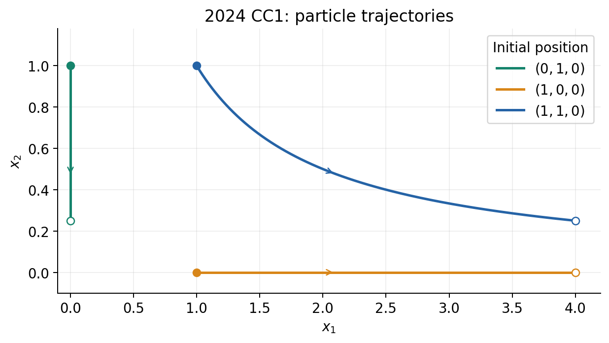

图取 $\alpha=1\,\mathrm{s^{-1}}$、$0\le t\le\ln4\,\mathrm s$。实心点是起点，空心点是该绘图时间段的终点，不是粒子最终停止的位置。

#### Question 1.10.7

*Déterminer le tenseur gradient de la transformation $\mathbf F$. En déduire que la masse volumique d’une particule reste constante au cours du temps.* 求变换梯度 $\mathbb F$，据此证明粒子密度不随时间改变

**答案**

$\mathbb F=\operatorname{diag}(e^{\alpha t},e^{-\alpha t},1)$, $J=1$ ; la conservation de la masse $\rho J=\rho_0$ donne $\rho=\rho_0$ : la masse volumique de chaque particule reste constante.

**Détail · 推导**

变换梯度对的是**参考坐标** $\vec X$，不是当前坐标：

$$F_{ij}=\frac{\partial x_i}{\partial X_j},\qquad
\mathbb F=
\begin{pmatrix}
e^{\alpha t}&0&0\\
0&e^{-\alpha t}&0\\
0&0&1
\end{pmatrix}.$$

每个 $x_i$ 只依赖相应的 $X_i$，所以非对角项为零。对角矩阵的行列式是对角元的乘积：

$$J=e^{\alpha t}e^{-\alpha t}\times1=1.$$

要由体积联系到密度，必须再使用质量守恒。对同一物质微元，

$$\underbrace{\rho_0(\vec X)\,\mathrm dV_0}_{\text{初始质量}}
=\underbrace{\rho(t,\vec x(t,\vec X))\,\mathrm dv}_{\text{当前质量}},
\qquad \mathrm dv=J\,\mathrm dV_0.$$

消去 $\mathrm dV_0$，得到 $\rho J=\rho_0$；由于本题 $J=1$，

$$\rho(t,\vec x(t,\vec X))=\rho_0(\vec X).$$

因此**同一个粒子的密度随时间保持不变**。这不要求不同粒子的密度相等：若初始密度分布不均匀，各粒子只是各自保持原来的密度。

#### Question 1.10.8

*Calculer le tenseur des déformations de Green–Lagrange $\mathbf E$. Quelles sont les unités des composantes de $\mathbf F$ et $\mathbf E$ ?* 求 Green–Lagrange 应变，说明 $\mathbb F,\mathbb E$ 的单位

**答案**

$\mathbb E=\frac12\operatorname{diag}(e^{2\alpha t}-1,\ e^{-2\alpha t}-1,\ 0)$ ; $\mathbb F$ et $\mathbb E$ sont sans dimension.

**Détail · 推导**

从定义开始：

$$\mathbb C=\mathbb F^{\mathsf T}\mathbb F,\qquad
\mathbb E=\frac12(\mathbb C-\mathbb I).$$

$\mathbb F$ 已经是对角矩阵，转置后不变，相乘只需把各对角元平方：

$$\mathbb C=\operatorname{diag}(e^{2\alpha t},e^{-2\alpha t},1).$$

再逐个对角元减去 1、除以 2：

$$\boxed{\mathbb E=\frac12
\begin{pmatrix}
e^{2\alpha t}-1&0&0\\
0&e^{-2\alpha t}-1&0\\
0&0&0
\end{pmatrix}.}$$

对 $t>0$，第一方向伸长，故 $E_{11}>0$；第二方向收缩，故 $E_{22}<0$；第三方向不变，故 $E_{33}=0$。令 $t=0$，三个应变都应为零，这也是检查式子是否漏了“减 1”的办法。

$F_{ij}$ 是长度对长度的导数，单位为 $\mathrm m/\mathrm m=1$；$\mathbb E$ 由它相乘、减单位阵得到，因此 $\mathbb F$、$\mathbb E$ 均无量纲。

#### Question 1.10.9

*Donner, sans passer par des calculs, une déformation principale et une direction principale de déformation.* 不作计算，给出一个主应变和主方向

**答案**

$\mathbb E\vec e_3=\vec0$ : $\vec e_3$ est direction principale, de déformation principale nulle.

**Détail · 推导**

主应变的定义是 $\mathbb E\vec n=E_{\mathrm{pr}}\vec n$：沿主方向 $\vec n$ 的线元，在应变算子的作用下不混入其他方向。

本题不必求特征多项式。由运动映射 $x_3=X_3$，第三方向既不伸缩，也不和第一、第二方向耦合。因此

$$\mathbb E\vec e_3=\vec0=0\,\vec e_3,$$

可直接给出：**主方向为 $\vec e_3$，对应主应变为 0。**

上一问的矩阵已经对角化，所以其余两条坐标轴也都是主方向，对应主应变就是另外两个对角元。$t=0$ 时 $\mathbb E=\mathbb O$，任意方向都可作为主方向。

#### Question 1.10.10

*Pour quelles valeurs de $t$ peut-on utiliser la forme linéarisée du tenseur des déformations ? En déduire $\boldsymbol\varepsilon$ avec ces simplifications. Comparer les expressions de $\mathbf D$ et de $\boldsymbol\varepsilon$.* 何时可以线性化应变？求线性化应变并比较 $\mathbb D,\boldsymbol\varepsilon$

**答案**

HPP si $\|\overrightarrow{\operatorname{grad}}\vec u\|\ll1$ et $\|\vec u\|\ll L$ (sur un sous-domaine borné), soit $0\le t\ll\frac1\alpha$ (ou $|t|\ll\frac1\alpha$) :

$$\boldsymbol\varepsilon=\operatorname{diag}(e^{\alpha t}-1,\ e^{-\alpha t}-1,\ 0)\approx\alpha t\operatorname{diag}(1,-1,0)=t\,\mathbb D.$$
Au premier ordre $\boldsymbol\varepsilon\approx t\,\mathbb D$ (mêmes directions principales, $\boldsymbol\varepsilon$ sans dimension et $\mathbb D$ en $\mathrm s^{-1}$).

**Détail · 推导**

先区分两个步骤：**用位移梯度写线性化应变**，以及**把本题位移中的指数函数对小时间展开**。

位移是“当前位置减初始位置”：

$$\vec u=\vec x-\vec X
=\bigl((e^{\alpha t}-1)X_1,\ (e^{-\alpha t}-1)X_2,\ 0\bigr).$$

所以

$$\mathbb H=\overrightarrow{\operatorname{grad}}_X\vec u=\mathbb F-\mathbb I
=\operatorname{diag}(e^{\alpha t}-1,e^{-\alpha t}-1,0).$$

小扰动假设（HPP）要求位移梯度的各项足够小，且在有界子域上位移远小于区域特征尺寸 $L$（因原域 $\Omega(t)$ 无界，需限定在有界区域内），故时间条件为 $|\alpha t|\ll1$，即 $|t|\ll1/\alpha$（对于 $t\ge0$ 即 $0\le t\ll1/\alpha$）。此时

$$e^{\alpha t}\simeq1+\alpha t,\qquad
e^{-\alpha t}\simeq1-\alpha t.$$

保留一阶项，得到

$$\boldsymbol\varepsilon
=\frac12(\mathbb H+\mathbb H^{\mathsf T})
\simeq \alpha t\,\operatorname{diag}(1,-1,0).$$

它与题库 1.10.4 的 $\mathbb D=\alpha\operatorname{diag}(1,-1,0)$ 相比，多了一个时间因子：

$$\boxed{\boldsymbol\varepsilon\simeq t\,\mathbb D,\qquad
\dot{\boldsymbol\varepsilon}\simeq\mathbb D.}$$

这对应“累计伸长量”和“每秒伸长多少”的区别。$\boldsymbol\varepsilon$ 无量纲，$\mathbb D$ 的单位是 $\mathrm{s^{-1}}$，不能把两者直接写成相等。上述简单关系用到了本题 $\mathbb D$ 为常量和小扰动近似。

若暂不对指数展开，则 $\operatorname{sym}\mathbb H$ 的对角元仍是 $e^{\pm\alpha t}-1$；只有进入小参数近似后，才得到上面的 $\pm\alpha t$。实际判断时间上限时，$t\ll 1/\alpha$ 表示远小于特征时间尺度 $1/\alpha$（例如有的参考解答会拿 $\ln 2/\alpha$ 举例，仅作同量级示意，并非统一界限）。

#### Question 1.10.11

*Calculer le rotationnel du champ de vitesse eulérien $\mathbf V(M)$ et donner toutes les caractéristiques de ce mouvement.* 求速度场旋度，列出运动性质

**答案**

$\overrightarrow{\operatorname{rot}}\vec V=\vec0$ : irrotationnel ; de plus incompressible, stationnaire, plan, avec déformation (pas un mouvement rigide).

**Détail · 推导**

旋度要用交叉偏导，而散度用对角偏导。对本题，

$$\overrightarrow{\operatorname{rot}}\vec V=
\begin{pmatrix}
\partial_{x_2}V_3-\partial_{x_3}V_2\\
\partial_{x_3}V_1-\partial_{x_1}V_3\\
\partial_{x_1}V_2-\partial_{x_2}V_1
\end{pmatrix}
=\begin{pmatrix}0\\0\\0\end{pmatrix}.$$

原因是 $V_1$ 只依赖 $x_1$、$V_2$ 只依赖 $x_2$，所有交叉偏导均为零。将已有结果并列：

| 结果 | 对应性质 |
|---|---|
| $\partial_t\vec V=\vec0$，固定 $\vec x$ 求导 | 稳态 |
| $\operatorname{div}\vec V=0$ | 不可压缩 |
| $\overrightarrow{\operatorname{rot}}\vec V=\vec0$ | 无旋 |
| $\mathbb D=\alpha\operatorname{diag}(1,-1,0)\ne\mathbb O$ | 有变形，不是刚体运动 |

因此**无旋只排除了局部旋转，并没有排除伸长和收缩**。同样，稳态也没有排除粒子随时间移动、材料不断变形。

### Exercice 1.11 · Cisaillement pur à 45° · 斜 45° 的纯剪切流

**考点**　$\mathbb D$, $\boldsymbol\Omega$, Lagrange par changement de variables, trajectoires, $\mathbb E$ principales, comparaison avec le glissement simple

#### Énoncé · 题面

On considère le champ eulérien des vitesses

$$\vec V=\alpha\,(x_2\,\vec e_1+x_1\,\vec e_2),$$
où $\alpha$ est une constante positive. 欧拉速度场如上，$\alpha$ 为正常数。

#### Question 1.11.1

*Calculer $\mathbb D$ et $\boldsymbol\Omega$ ; préciser les caractéristiques du mouvement.* 求 $\mathbb D$、$\boldsymbol\Omega$；判断运动特征。

**答案**

$\overrightarrow{\operatorname{grad}}\vec V=\alpha(\vec e_1\otimes\vec e_2+\vec e_2\otimes\vec e_1)$ symétrique : $\mathbb D=\alpha(\vec e_1\otimes\vec e_2+\vec e_2\otimes\vec e_1)$, $\boldsymbol\Omega=\mathbb O$. Stationnaire, incompressible ($\operatorname{tr}\mathbb D=0$), irrotationnel.

**Détail · 推导**

速度梯度 $\overrightarrow{\operatorname{grad}}\vec V=\begin{pmatrix}0&\alpha&0\\\alpha&0&0\\0&0&0\end{pmatrix}$ 本身对称，所以 $\mathbb D=\overrightarrow{\operatorname{grad}}\vec V$、$\boldsymbol\Omega=\mathbb O$（纯变形、无局部转动，单位 $\mathrm s^{-1}$）。由不显含 $t$ 知稳态，由 $\operatorname{tr}\mathbb D=\operatorname{div}\vec V=0$ 知不可压缩，由 $\boldsymbol\Omega=\mathbb O$（即 $\overrightarrow{\operatorname{rot}}\vec V=\vec0$）知无旋。

#### Question 1.11.2

*Déterminer la description lagrangienne. (Indication : poser $s=x_1+x_2$ et $d=x_1-x_2$.)* 求拉格朗日描述（提示：令 $s=x_1+x_2$，$d=x_1-x_2$）。

**答案**

$\dot s=\alpha s$, $\dot d=-\alpha d$ ⇒ $s=(X_1+X_2)e^{\alpha t}$, $d=(X_1-X_2)e^{-\alpha t}$, d'où

$$x_1=X_1\cosh\alpha t+X_2\sinh\alpha t,\qquad x_2=X_1\sinh\alpha t+X_2\cosh\alpha t,\qquad x_3=X_3.$$

**Détail · 推导**

两个方程 $\dot x_1=\alpha x_2$、$\dot x_2=\alpha x_1$ 互相耦合，相加、相减后分别得到 $\dot s=\alpha s$、$\dot d=-\alpha d$，立即解耦并积分（初值 $s(0)=X_1+X_2,\ d(0)=X_1-X_2$）。再由 $x_1=\frac{s+d}2$、$x_2=\frac{s-d}2$ 和 $\frac{e^{\alpha t}\pm e^{-\alpha t}}2=\cosh/\sinh(\alpha t)$ 写回原坐标。几何上相当于在 $\mathbb D$ 的主轴（与坐标轴成 $\pm45^\circ$）上分别做指数伸长和指数压缩。

#### Question 1.11.3

*Déterminer les trajectoires.* 求轨迹。

**答案**

$x_1^2-x_2^2=sd=X_1^2-X_2^2$. Pour $X_1^2\ne X_2^2$, les trajectoires sont des branches d’hyperboles d’asymptotes $x_2=\pm x_1$. Sur les diagonales, elles sont rectilignes. L’origine est un point fixe.

**Détail · 推导**

$s\cdot d$ 不随时间变化。一般粒子沿双曲线运动，随着时间增长趋向 $x_2=x_1$ 的方向。若初始点在 $x_2=x_1$ 上，粒子沿该直线远离原点。若初始点在 $x_2=-x_1$ 上，粒子沿该直线趋近原点。

#### Question 1.11.4

*Calculer $\mathbb F$, $J$, $\mathbb E$ et les déformations principales.* 求 $\mathbb F$、$J$、$\mathbb E$ 及主应变。

**答案**

$\mathbb F=\begin{pmatrix}\cosh\alpha t&\sinh\alpha t&0\\\sinh\alpha t&\cosh\alpha t&0\\0&0&1\end{pmatrix}$, $J=\cosh^2-\sinh^2=1$, $\mathbb E=\begin{pmatrix}\sinh^2\alpha t&\frac12\sinh2\alpha t&0\\\frac12\sinh2\alpha t&\sinh^2\alpha t&0\\0&0&0\end{pmatrix}$. Directions principales $\frac{\vec e_1\pm\vec e_2}{\sqrt2}$ (et $\vec e_3$), déformations $\frac{e^{\pm2\alpha t}-1}2$ (et 0).

**Détail · 推导**

$\mathbb F$ 对称，$\mathbb F^{\mathsf T}\mathbb F=\mathbb F^2$。$2\times2$ 块形如 $\begin{pmatrix}p&q\\q&p\end{pmatrix}$，特征值 $p\pm q$、特征向量 $(1,\pm1)$：$\sinh^2\alpha t\pm\frac12\sinh2\alpha t=\frac{e^{\pm2\alpha t}-1}2$。主方向固定在 $45^\circ$ 方向，不随时间转动。

#### Question 1.11.5

*Comparer avec le glissement simple $\vec V'=2\alpha x_2\vec e_1$.* 与简单剪切 $\vec V'=2\alpha x_2\vec e_1$ 比较。

**答案**

Même $\mathbb D$ : $\mathbb D'=\alpha(\vec e_1\otimes\vec e_2+\vec e_2\otimes\vec e_1)$ ; mais $\boldsymbol\Omega'=\alpha(\vec e_1\otimes\vec e_2-\vec e_2\otimes\vec e_1)\neq\mathbb O$ (rotation $-\alpha\vec e_3$). Le glissement simple = ce cisaillement pur + une rotation de corps rigide ; trajectoires droites au lieu d'hyperboles.

**Détail · 推导**

两者的瞬时变形率张量 $\mathbb D$ 相同，主方向也相同。差别出现在旋转率和累积变形上。纯剪切的有限主应变方向固定，简单剪切的有限主应变方向随剪切量改变。

### Exercice 1.12 · Rotation et dilatation (spirale) · 转动加膨胀（螺旋运动）

**考点**　décomposition $\mathbb D+\boldsymbol\Omega$, Lagrange, trajectoires, $\mathbb E$ insensible à la rotation, masse volumique, HPP

#### Énoncé · 题面

On considère le champ eulérien des vitesses

$$\vec V=(ax_1-\omega x_2)\,\vec e_1+(\omega x_1+ax_2)\,\vec e_2,$$
où $a$ et $\omega$ sont des constantes positives. 欧拉速度场如上，$a$、$\omega$ 为正常数。

#### Question 1.12.1

*Calculer $\mathbb D$ et $\boldsymbol\Omega$ ; interpréter. Le mouvement est-il incompressible ?* 求 $\mathbb D$、$\boldsymbol\Omega$ 并解释；是否不可压缩？

**答案**

$\mathbb D=a(\vec e_1\otimes\vec e_1+\vec e_2\otimes\vec e_2)$ : dilatation isotrope dans le plan ; $\boldsymbol\Omega=\omega(\vec e_2\otimes\vec e_1-\vec e_1\otimes\vec e_2)$ : rotation de vitesse angulaire $\omega\vec e_3$. $\operatorname{div}\vec V=2a\neq0$ : compressible ; stationnaire.

**Détail · 推导**

速度梯度 $\overrightarrow{\operatorname{grad}}\vec V=\begin{pmatrix}a&-\omega&0\\\omega&a&0\\0&0&0\end{pmatrix}$：对称部分 $\mathbb D=a(\vec e_1\otimes\vec e_1+\vec e_2\otimes\vec e_2)$ 是各向同性的面内膨胀，反对称部分 $\boldsymbol\Omega=\begin{pmatrix}0&-\omega&0\\\omega&0&0\\0&0&0\end{pmatrix}$ 满足 $\boldsymbol\Omega\vec e_1=\omega\vec e_2=(\omega\vec e_3)\wedge\vec e_1$，对应绕 $\vec e_3$ 正向（角速度 $\omega\vec e_3$）的局部刚体转动。

#### Question 1.12.2

*Déterminer la description lagrangienne et les trajectoires.* 求拉格朗日描述和轨迹。

**答案**

$x_1=e^{at}(X_1\cos\omega t-X_2\sin\omega t)$, $x_2=e^{at}(X_1\sin\omega t+X_2\cos\omega t)$, $x_3=X_3$ : en polaire $r=r_0e^{at}$, $\theta=\theta_0+\omega t$, soit $r=r_0\,e^{\frac a\omega(\theta-\theta_0)}$ : spirales logarithmiques (l'origine reste fixe).

**Détail · 推导**

利用复变量 $z=x_1+\mathrm ix_2$，原方程组 $\dot x_1=ax_1-\omega x_2,\ \dot x_2=\omega x_1+ax_2$ 合并为 $\dot z=(a+\mathrm i\omega)z$，立即积分得 $z=(X_1+\mathrm iX_2)e^{at}(\cos\omega t+\mathrm i\sin\omega t)$；分别取实部、虚部即得 $x_1,x_2$。在极坐标下，模 $r=r_0e^{at}$ 指数增长，辐角 $\theta=\theta_0+\omega t$ 匀速增加，消去 $t$ 即得对数螺线。

#### Question 1.12.3

*Calculer $\mathbb F$, $J$ et $\mathbb E$. Commenter. En déduire la masse volumique.* 求 $\mathbb F$、$J$、$\mathbb E$ 并评论；求密度。

**答案**

$\mathbb F=e^{at}\begin{pmatrix}\cos\omega t&-\sin\omega t&0\\\sin\omega t&\cos\omega t&0\\0&0&e^{-at}\end{pmatrix}$, $J=e^{2at}$, $\mathbb E=\frac{e^{2at}-1}2(\vec e_1\otimes\vec e_1+\vec e_2\otimes\vec e_2)$ : la rotation n'apparaît pas dans $\mathbb E$. $\rho J=\rho_0$ ⇒ $\rho=\rho_0e^{-2at}$.

**Détail · 推导**

面内 $2\times2$ 块满足 $\mathbb F_{2\times2}=e^{at}\mathbb Q(\omega t)$，其中 $\mathbb Q^{\mathsf T}\mathbb Q=\mathbb I_2$，因此 $\mathbb F^{\mathsf T}\mathbb F=\operatorname{diag}(e^{2at},e^{2at},1)$，转动角 $\omega t$ 在 $\mathbb E$ 中完全消失（再次印证 $\mathbb E$ 对刚体转动不敏感）。体积按 $J=\det\mathbb F=e^{2at}$ 指数增大，由质量守恒 $\rho J=\rho_0$ 得密度按 $e^{-2at}$ 衰减。

#### Question 1.12.4

*À quelles conditions l'HPP est-elle valable ?* HPP 在什么条件下成立？

**答案**

HPP : $\|\overrightarrow{\operatorname{grad}}\vec u\|=\|\mathbb F-\mathbb I\|\ll1$ et $\|\vec u\|\ll L$ (domaine borné) : il faut $at\ll1$ **et** $\omega t\ll1$ (petite rotation), bien que la rotation ne déforme pas.

**Détail · 推导**

小扰动假设要求有界域上位移小且**整个位移梯度矩阵** $\mathbb F-\mathbb I$ 小（包含转动引起的非对角项 $e^{at}\sin\omega t$）。若 $\omega t$ 不小，即使膨胀量 $at$ 很小，$\boldsymbol\varepsilon$ 也会因 $\cos\omega t-1$ 给出由转动产生的虚假压缩应变（与题库 1.1.3–1.1.4 同理）。

### Exercice 1.13 · Tourbillon atmosphérique · 大气涡旋

**考点**　descriptions, lignes de courant, trajectoires, accélération, caractéristiques

#### Énoncé · 题面

On étudie le mouvement d'un tourbillon atmosphérique défini par le champ de vitesse suivant dans un repère cartésien $(O,\vec e_1,\vec e_2)$ en un point $M(x_1,x_2)$ à l'instant $t$ :

$$V_1=\omega x_2,\qquad V_2=-\omega x_1+a\omega^2t,$$
où $a$ et $\omega$ sont des constantes ($\omega\neq0$). 研究大气涡旋的运动，在直角坐标系 $(O,\vec e_1,\vec e_2)$ 中，时刻 $t$ 点 $M(x_1,x_2)$ 的速度场如上，$a$、$\omega$ 为常数（$\omega\ne0$）。
NB : on utilisera la notation ${}^E\bullet$ pour désigner les grandeurs eulériennes et $\frac{\mathrm d\bullet}{\mathrm dt}$ la dérivée particulaire. 记号：${}^E\bullet$ 表示欧拉量，$\frac{\mathrm d\bullet}{\mathrm dt}$ 表示物质导数。

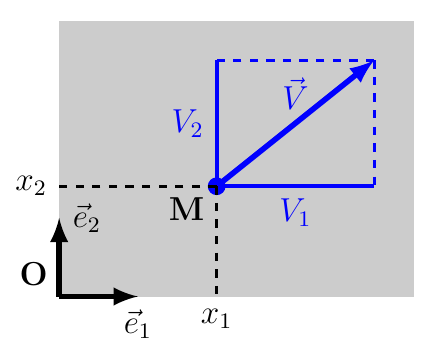

#### Question 1.13.1

*Rappeler les définitions des descriptions eulérienne et lagrangienne et la démarche permettant de passer de l'une à l'autre.* 复述欧拉描述和拉格朗日描述的定义，以及两者互换的方法。

**答案**

Description lagrangienne : on suit chaque particule, repérée par sa position initiale $\vec X$ : $\vec x=\vec\phi(\vec X,t)$, grandeurs $f(\vec X,t)$. Description eulérienne : on observe en un point fixe $\vec x$ de l'espace : $f(\vec x,t)$.
Lagrange → Euler : dériver $\vec\phi$ par rapport à $t$ à $\vec X$ fixé, puis remplacer $\vec X=\vec\phi^{-1}(\vec x,t)$. Euler → Lagrange : intégrer $\dot{\vec x}=\vec V(\vec x,t)$ avec $\vec x(0)=\vec X$.

**Détail · 推导**

拉格朗日描述跟着粒子走，自变量是初始位置 $\vec X$ 和时间；欧拉描述盯住空间中的固定点，自变量是当前位置 $\vec x$ 和时间。两种描述描述的是同一个运动，互换的桥梁是运动映射 $\vec x=\vec\phi(\vec X,t)$：已知映射，求导得速度再反解；已知速度场，解常微分方程得映射。

#### Question 1.13.2

*Donner la description eulérienne de ce mouvement.* 给出这个运动的欧拉描述。

**答案**

Le champ donné est déjà eulérien : ${}^E\vec V(\vec x,t)=\omega x_2\,\vec e_1+(-\omega x_1+a\omega^2t)\,\vec e_2$.

**Détail · 推导**

速度写成当前坐标 $x_1,x_2$ 和 $t$ 的函数，本身就是欧拉描述，不需要再算。

#### Question 1.13.3

*Donner la description lagrangienne de ce mouvement.* 给出这个运动的拉格朗日描述。

**答案**

$\dot x_1=\omega x_2$, $\dot x_2=-\omega x_1+a\omega^2t$, $x_i(0)=X_i$. En dérivant la seconde et en reportant la première : $\ddot x_2+\omega^2x_2=a\omega^2$. Avec $c=\cos\omega t$, $s=\sin\omega t$ :

$$x_1=X_1c+(X_2-a)s+a\omega t,\qquad x_2=-X_1s+(X_2-a)c+a .$$

**Détail · 推导**

1. 两个方程耦合，对第二式再求一次导：$\ddot x_2=-\omega\dot x_1+a\omega^2=-\omega^2x_2+a\omega^2$。
2. 齐次解 $A\cos\omega t+B\sin\omega t$，常数特解 $a$：$x_2=A\cos\omega t+B\sin\omega t+a$。
3. 初始条件：$x_2(0)=X_2$ 给 $A=X_2-a$；$\dot x_2(0)=-\omega X_1$（由原方程在 $t=0$）给 $B=-X_1$。
4. 由 $\dot x_1=\omega x_2$ 积分（或由第二个原方程反解 $x_1$），得 $x_1$。
5. 检查：$t=0$ 时回到 $X_i$；对 $t$ 求导换回 $x_i$ 得到题给速度。

#### Question 1.13.4

*Donner et tracer les lignes de courant et les trajectoires.* 给出并画出流线和轨迹。

**答案**

Lignes de courant (à $t$ fixé) : $\frac{\mathrm dx_1}{V_1}=\frac{\mathrm dx_2}{V_2}$ ⇒ $(x_1-a\omega t)^2+x_2^2=C$ : cercles de centre $(a\omega t,0)$. Trajectoires : $(x_1-a\omega t)^2+(x_2-a)^2=X_1^2+(X_2-a)^2$ : mouvement circulaire autour d'un centre qui se translate à la vitesse $a\omega\,\vec e_1$ (trochoïdes). Pour $a\neq0$ trajectoires et lignes de courant sont distinctes.

**Détail · 推导**

- **流线：** 固定 $t$，$\frac{\mathrm dx_2}{\mathrm dx_1}=\frac{-\omega x_1+a\omega^2t}{\omega x_2}$，分离变量 $x_2\,\mathrm dx_2=-(x_1-a\omega t)\,\mathrm dx_1$，积分得圆族，圆心 $(a\omega t,0)$ 随时间 $t$ 沿 $\vec e_1$ 移动。
- **轨迹：** 由上一问 $x_1-a\omega t=X_1c+(X_2-a)s$，$x_2-a=-X_1s+(X_2-a)c$，平方相加得半径 $R=\sqrt{X_1^2+(X_2-a)^2}$ 不变的圆，但圆心 $(a\omega t,a)$ 以速度 $a\omega$ 沿 $\vec e_1$ 平移，所以实际轨迹是摆线类曲线（trochoïde）。特例：初始位于 $(0,a)$ 的粒子半径 $R=0$，轨迹退化为水平直线 $x_1=a\omega t,\ x_2=a$。
- 非稳态（$a\ne0$）时轨迹与流线不重合：流线是某一时刻的"速度方向图"，轨迹是一个粒子走过的路径。

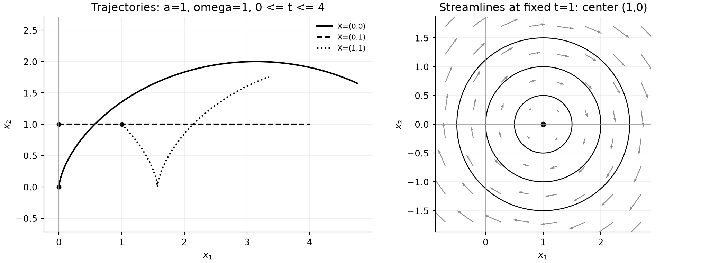

#### Question 1.13.5

*Rappeler et calculer l'expression des accélérations eulérienne et lagrangienne.* 复述并计算欧拉加速度和拉格朗日加速度。

**答案**

Eulérienne : ${}^E\vec\gamma=\frac{\partial\vec V}{\partial t}+\overrightarrow{\operatorname{grad}}\vec V\cdot\vec V=(-\omega^2x_1+a\omega^3t)\,\vec e_1+(-\omega^2x_2+a\omega^2)\,\vec e_2$.
Lagrangienne : $\vec\gamma=\frac{\partial^2\vec x}{\partial t^2}\Big|_{\vec X}=-\omega^2[X_1c+(X_2-a)s]\,\vec e_1+\omega^2[X_1s-(X_2-a)c]\,\vec e_2$ ; les deux coïncident via $\vec x=\vec\phi(\vec X,t)$.

**Détail · 推导**

- 局部项 $\partial_t\vec V=a\omega^2\vec e_2$；对流项 $\overrightarrow{\operatorname{grad}}\vec V\cdot\vec V=\begin{pmatrix}0&\omega\\-\omega&0\end{pmatrix}\begin{pmatrix}V_1\\V_2\end{pmatrix}=(\omega V_2)\vec e_1+(-\omega V_1)\vec e_2=(-\omega^2x_1+a\omega^3t)\vec e_1-\omega^2x_2\vec e_2$。两项相加。
- 拉格朗日：对映射求两次导。检查：$-\omega^2(x_1-a\omega t)=-\omega^2x_1+a\omega^3t$，$-\omega^2(x_2-a)=-\omega^2x_2+a\omega^2$，与欧拉结果一致。

#### Question 1.13.6

*Le mouvement est-il stationnaire ? Rotationnel ? Incompressible ?* 运动是否稳态？有旋？不可压缩？

**答案**

$\frac{\partial\vec V}{\partial t}=a\omega^2\vec e_2\neq\vec0$ : non stationnaire (sauf si $a=0$). $\overrightarrow{\operatorname{rot}}\vec V=(\partial_1V_2-\partial_2V_1)\vec e_3=-2\omega\vec e_3\neq\vec0$ : rotationnel. $\operatorname{div}\vec V=\partial_1V_1+\partial_2V_2=0$ : incompressible. (De plus $\mathbb D=\mathbb O$ : mouvement de corps rigide instantané.)

**Détail · 推导**

三项检查全部用欧拉场：是否显含 $t$；旋度；散度。旋度为 $-2\omega\vec e_3$，对应局部转动角速度 $\frac12\overrightarrow{\operatorname{rot}}\vec V=-\omega\vec e_3$（顺时针）。此外 $\overrightarrow{\operatorname{grad}}\vec V$ 反对称，变形率 $\mathbb D=\mathbb O$，因此这是一个整体平移叠加刚体旋转的刚体运动。

### Exercice 1.14 · Compatibilité des déformations · 应变协调

**考点**　intégration d'un champ de déformation, compatibilité, mouvement rigide

#### Énoncé · 题面

Pour les déformations suivantes, y a-t-il un champ de déplacement associé ? Si oui, le(s) calculer : 对下面两个应变场，是否存在对应的位移场？若存在，求出来。

$$\boldsymbol\varepsilon_1=\begin{pmatrix}ax_1^2&0&0\\0&0&0\\0&0&0\end{pmatrix}\qquad\text{et}\qquad\boldsymbol\varepsilon_2=\begin{pmatrix}0&0&0\\0&ax_1^2&0\\0&0&0\end{pmatrix}.$$

#### Question 1.14.1

*Donner la démarche permettant de déterminer un champ de déplacement associé à un état de déformation. À quelle(s) condition(s) cette démarche peut-elle être menée à terme ? Pour les déformations données, y a-t-il un champ de déplacement associé ? Si oui, le(s) calculer.* 给出由应变求位移的方法和条件；判断两个场并求位移。

**答案**

Démarche : intégrer $\varepsilon_{ij}=\frac12(u_{i,j}+u_{j,i})$ (termes diagonaux, puis extra-diagonaux) ; possible si le domaine est **simplement connexe** et si les conditions de compatibilité de Saint-Venant sont vérifiées (par exemple dans le plan : $\varepsilon_{11,22}+\varepsilon_{22,11}=2\varepsilon_{12,12}$) ; le déplacement est défini à un mouvement de corps rigide infinitésimal près ($\vec c+\vec\omega_0\wedge\overrightarrow{OM}$, où $\vec c,\vec\omega_0$ sont des vecteurs constants).
$\boldsymbol\varepsilon_1$ : compatible, $\vec u=\frac{ax_1^3}3\vec e_1+\vec c+\vec\omega_0\wedge\overrightarrow{OM}$. $\boldsymbol\varepsilon_2$ ($a\neq0$) : $\varepsilon_{22,11}=2a\neq2\varepsilon_{12,12}=0$, incompatible : pas de déplacement associé.

**Détail · 推导**

- **一般条件（Saint-Venant 协调方程）：** $\varepsilon_{ij,kl}+\varepsilon_{kl,ij}-\varepsilon_{ik,jl}-\varepsilon_{jl,ik}=0$（必要条件；当区域**单连通**时也是充分条件，三维共 6 个独立方程，二维面内化为 1 个方程 $\varepsilon_{11,22}+\varepsilon_{22,11}=2\varepsilon_{12,12}$）。
- **第一个场 $\boldsymbol\varepsilon_1$：** 对角元 $u_{1,1}=ax_1^2\implies u_1=\frac{ax_1^3}3+f(x_2,x_3)$，$u_{2,2}=0\implies u_2=g(x_1,x_3)$，$u_{3,3}=0\implies u_3=h(x_1,x_2)$。由于所有非对角应变为零，取特解 $f=g=h=0$（即 $\vec u_{\mathrm{part}}=\frac{ax_1^3}3\vec e_1$），其余齐次解满足 $\boldsymbol\varepsilon(\vec u_{\mathrm{hom}})=\mathbb O$，即 HPP 下的无穷小刚体位移 $\vec c+\vec\omega_0\wedge\overrightarrow{OM}$。由 $\varepsilon_{11}$ 无量纲得 $[a]=\mathrm m^{-2}$。
- **第二个场 $\boldsymbol\varepsilon_2$（假设 $a\neq0$）：** 由 $u_{2,2}=ax_1^2$ 积分得 $u_2=ax_1^2x_2+g(x_1,x_3)$；再由 $\varepsilon_{12}=\frac12(u_{1,2}+u_{2,1})=0$ 得 $u_{1,2}=-u_{2,1}=-2ax_1x_2-g_{,1}(x_1,x_3)$。对 $x_1$ 求偏导得 $u_{1,21}=-2ax_2-g_{,11}(x_1,x_3)$；另一方面 $u_{1,1}=0\implies u_{1,12}=0$。由 Schwarz 定理 $u_{1,12}=u_{1,21}$ 要求 $g_{,11}(x_1,x_3)=-2ax_2$，但左侧只依赖 $(x_1,x_3)$ 而右侧显含 $x_2$，故矛盾。直接代入面内协调方程亦可立刻判别：左边 $\varepsilon_{11,22}+\varepsilon_{22,11}=0+2a=2a$，右边 $2\varepsilon_{12,12}=0$，不相等。

## 2　Contraintes et équilibre · 应力与平衡（题库）

### CC2 · 第 3 题读题：从应力张量读出物体怎样受力

**两年的共同任务**是把物体内部的应力 $\boldsymbol\sigma$ 和表面受力联系起来。读第一遍时，在图上标出题目点名的面和它的外法向 $\vec n$，再看张量里哪些分量已经给出、哪些还要求。

| 题面中的物体 | 已经给了什么 | 第一笔写什么，后面求什么 |
|---|---|---|
| **2024 · 圆轴**（2.14）。*arbre* 是机械轴，*surface latérale* 是圆柱侧面，*bases* 是两端面。 | 给应力场，问它对应什么载荷。第一小问问 *forces volumiques*（体力）。 | 静力下先写 $\vec f_d=-\operatorname{div}\boldsymbol\sigma$。问到某个面时才写 $\vec T=\boldsymbol\sigma\vec n$。两端面分别积分求合力和力矩，由此识别扭转，最后用 Tresca 求允许扭矩。 |
| **2025 · 受剪方块**（2.17）。*plot* 指块体，*faces libres d’effort* 指自由面。 | 给平面应力张量的形式、部分未知分量和各面载荷。第一小问先验两个自由面。 | 在 $z=\pm a/2$ 写 $\vec n=\pm\vec e_z$，取张量第三列并带上符号。再用其余各面的条件求常数，用体内平衡补全应力，最后求端面力旋量。 |

**小问里的几个词决定你要交什么。**

- *Vérifier les conditions aux limites sur une face* 验证某面的边界条件。可起笔写 *Sur cette face, la normale sortante est …, donc le vecteur contrainte vaut …* 算出 $\boldsymbol\sigma\vec n$ 后与题给面力比较；自由面应得到零向量。
- *Densité d’efforts surfaciques* 求面力密度，答案是向量，单位 Pa。*Résultante* 求整个面的合力，写 $\vec R=\int_S\vec T\,\mathrm dS$，单位 N。
- *Éléments de réduction du torseur en $O$* 求以 $O$ 为参考点的合力和合力矩。除 $\vec R$ 外还要写 $\vec M_O=\int_S\overrightarrow{OM}\times\vec T(M)\,\mathrm dS$。即使合力为零，也要算力矩。
- *En quels points … maximale ? Couple à ne pas dépasser ?* 先找等效应力最大的**位置**，再把该处的等效应力与屈服极限比较，反求允许的扭矩。

**椭圆柱的外法向**　两个底面的外法向沿轴线，侧面的外法向由椭圆边界确定。

### Méthode · 应力与平衡大题的解题步骤

#### ① Compléter le tenseur ; unités des constantes · 补全应力张量、常数的单位

*Compléter la forme du tenseur $\boldsymbol\sigma$ ; dans quelle unité s'exprime la constante $A$ ?* 补全张量 $\boldsymbol\sigma$ 的形式；常数 $A$ 用什么单位表示？

- Symétrie (équilibre des moments) : $\sigma_{ji}=\sigma_{ij}$. 对称性（来自力矩平衡）：$\sigma_{ji}=\sigma_{ij}$。
- $\boldsymbol\sigma$ est en Pa : $\sigma=Ax$ ⇒ $[A]=\mathrm{Pa\,m^{-1}}$ ; $\sigma=Ar^2$ ⇒ $\mathrm{Pa\,m^{-2}}=\mathrm{N\,m^{-4}}$ ; $\sigma=A/r^2$ ⇒ $\mathrm{Pa\,m^2}=\mathrm N$. $\boldsymbol\sigma$ 的单位是 Pa：$\sigma=Ax$ ⇒ $[A]=\mathrm{Pa\,m^{-1}}$；$\sigma=Ar^2$ ⇒ $\mathrm{Pa\,m^{-2}}=\mathrm{N\,m^{-4}}$；$\sigma=A/r^2$ ⇒ $\mathrm{Pa\,m^2}=\mathrm N$。
- Autres unités : force volumique $\mathrm{N\,m^{-3}}$ ; vecteur contrainte Pa ; résultante N ; moment $\mathrm{N\,m}=\mathrm J=\mathrm{Pa\,m^3}$. 其他单位：体力 $\mathrm{N\,m^{-3}}$；应力向量 Pa；合力 N；力矩 $\mathrm{N\,m}=\mathrm J=\mathrm{Pa\,m^3}$。

**法语答题句**

Le tenseur des contraintes est symétrique (équilibre des moments) : $\sigma_{ji}=\sigma_{ij}$. 应力张量是对称的（力矩平衡）：$\sigma_{ji}=\sigma_{ij}$。

Les contraintes s'expriment en Pa, donc $A$ s'exprime en $\mathrm{Pa\cdot m^{-2}}=\mathrm{N\cdot m^{-4}}$. 应力的单位是 Pa，所以 $A$ 的单位是 $\mathrm{Pa\cdot m^{-2}}=\mathrm{N\cdot m^{-4}}$。

#### ② Équilibre local : force volumique, composantes inconnues · 局部平衡：体力、未知分量

*Calculer la densité d'effort volumique en équilibre avec ce champ (statique) ; appliquer l'équation d'équilibre local, en déduire $\sigma_{xx}$*

1. $\overrightarrow{\operatorname{div}}\boldsymbol\sigma$ : composante $i$ = somme des dérivées de la **ligne** $i$ par rapport à $x_1,x_2,x_3$. En cylindrique, utiliser la table C (ne pas oublier $\frac{\sigma_{rr}-\sigma_{\theta\theta}}r$…). 散度第 $i$ 分量 = 第 $i$ 行逐项求导相加；柱坐标用查表 C，别漏附加项。
2. Statique : $\overrightarrow{\operatorname{div}}\boldsymbol\sigma+\vec f=\vec0$ ⇒ $\vec f=-\overrightarrow{\operatorname{div}}\boldsymbol\sigma$ ($\mathrm{N\,m^{-3}}$). Sans force volumique : $\overrightarrow{\operatorname{div}}\boldsymbol\sigma=\vec0$ donne des relations entre constantes. 静力：体力 = 负的散度；无体力时散度为零给出常数之间的关系。
3. Composante inconnue : intégrer la ligne correspondante, par exemple $\partial_x\sigma_{xx}=-\partial_y\sigma_{xy}$ ⇒ $\sigma_{xx}=-\int\partial_y\sigma_{xy}\,\mathrm dx+C(y)$ ; la « constante » est une fonction des autres variables, fixée par les conditions aux limites (étape ⑤). 积分求未知分量；积分"常数"是其余变量的函数，由边界条件定。
4. Commenter : $\vec f=\vec0$ → seulement des efforts de surface ; $\vec f$ constant → comme la pesanteur ; composantes constantes → $\overrightarrow{\operatorname{div}}\boldsymbol\sigma=\vec0$ d'office. 评论：体力为零只有面力；常数体力类似重力；常数应力场散度一定为零。
5. Vérification globale (PFS) : sur tout le solide ou un tronçon, résultante et moment des efforts extérieurs nuls. 整体验证：外力合力、合力矩为零。

**法语答题句**

L'équilibre local s'écrit $\overrightarrow{\operatorname{div}}\boldsymbol\sigma+\vec f_v=\vec0$ (statique), d'où $\vec f_v=-\overrightarrow{\operatorname{div}}\boldsymbol\sigma=\dots$ (en $\mathrm{N\cdot m^{-3}}$).
Les composantes étant constantes, $\overrightarrow{\operatorname{div}}\boldsymbol\sigma=\vec0$ : aucune force volumique n'est nécessaire à l'équilibre.
La projection sur $\vec e_x$ donne $\partial_x\sigma_{xx}=-\partial_y\sigma_{xy}$, que l'on intègre en $x$ ; la fonction d'intégration est fixée par les conditions aux limites. 局部平衡求体力；常数场无需体力；投影后积分，积分函数由边界条件定。

#### ③ Vecteur contrainte sur une facette · 某面上的应力向量

*Calculer le vecteur contrainte pour les facettes de normales $\vec e_1$, $\vec e_2$, $\vec e_3$ ; ses composantes normale et tangentielle*

1. Normale unitaire $\vec n$ (diviser par la norme pour une facette inclinée) ; sur la frontière, $\vec n$ est la normale **sortante**. 单位法向；边界上取外法向。
2. $\vec T=\boldsymbol\sigma\vec n$ ; pour $\vec n=\vec e_j$ c'est la **colonne** $j$. Si $\boldsymbol\sigma$ dépend du point, remplacer d'abord les coordonnées. $\vec T=\boldsymbol\sigma\vec n$，法向是 $\vec e_j$ 时就是第 $j$ 列；先代入点的坐标。
3. Contrainte normale $\sigma_n=\vec T\cdot\vec n$ ($=\sigma_{jj}$ pour $\vec n=\vec e_j$) ; $\sigma_n>0$ traction, $<0$ compression. 法向应力；正为拉，负为压。
4. Vecteur cisaillement $\vec T_t=\vec T-\sigma_n\vec n$, contrainte tangentielle $\tau=\|\vec T_t\|=\sqrt{\|\vec T\|^2-\sigma_n^2}$. 切向向量与切应力大小。
5. Tracé : dessiner $\vec T$ sur la facette avec ses composantes normale et tangentielle. 画图：在面上画出 $\vec T$ 及其法向、切向分量。

**法语答题句**

Le vecteur contrainte sur la facette de normale $\vec e_1$ est la première colonne de $\boldsymbol\sigma$ : $\vec T(\vec e_1)=\dots$ ; sa composante normale vaut $\sigma_n=\vec T\cdot\vec e_1=\dots$ et sa composante tangentielle $\vec T-\sigma_n\vec e_1=\dots$ 法向 $\vec e_1$ 面上的应力向量是第一列；法向分量、切向分量。

#### ④ Contraintes et directions principales · 主应力、主方向

*Calculer les contraintes principales et les directions principales ; à quoi correspondent-elles physiquement ?*

1. Une ligne et une colonne ne contenant que le terme diagonal : direction principale immédiate, de valeur ce terme. 只剩对角元的方向直接是主方向。
2. Bloc $2\times2$ $\begin{pmatrix}a&b\\b&c\end{pmatrix}$ : $\sigma_\pm=\frac{a+c}2\pm\sqrt{(\frac{a-c}2)^2+b^2}$, $\vec n_\pm\propto(b,\ \sigma_\pm-a)$. 2×2 块的公式。
3. Cas général : développer $\det(\boldsymbol\sigma-s\mathbb I)=0$ selon une ligne contenant des zéros ; directions : résoudre $(\boldsymbol\sigma-\sigma_i\mathbb I)\vec n=\vec0$ avec deux lignes, puis normer. 一般情形：按含零的行展开特征行列式；主方向解齐次方程再归一化。
4. Contrôles : $\sum\sigma_i=\operatorname{tr}\boldsymbol\sigma$, $\prod\sigma_i=\det\boldsymbol\sigma$, directions orthogonales, $\boldsymbol\sigma\vec n=\sigma_i\vec n$. 自查：迹、行列式、正交、代回。
5. Sens physique : facettes sans cisaillement, la contrainte normale y est extrémale. 物理意义：这些面上没有切应力，正应力取极值。
6. Partie sphérique et déviateur : $\boldsymbol\sigma=\frac13\operatorname{tr}\boldsymbol\sigma\,\mathbb I+\boldsymbol\sigma^D$, $\operatorname{tr}\boldsymbol\sigma^D=0$ (le déviateur **n'est pas** $\boldsymbol\sigma$ avec une diagonale nulle). 球量 + 偏量；偏量不是把对角元换成 0。
7. Mohr (plan, $\vec n$ à l'angle $\alpha$ de la direction 1) : $\sigma_n=\frac{\sigma_1+\sigma_2}2+\frac{\sigma_1-\sigma_2}2\cos2\alpha$, $\tau=\frac{\sigma_2-\sigma_1}2\sin2\alpha$ ; cercle de centre $\frac{\sigma_1+\sigma_2}2$ et de rayon $\frac{|\sigma_1-\sigma_2|}2$ ; cisaillement maximal à $45^\circ$. Quand la facette fait un tour ($\alpha$ de 0 à $2\pi$), le point parcourt le cercle deux fois. Mohr 圆：圆心、半径；最大切应力在 45°；法向转一周，点在圆上走两圈。

**法语答题句**

$\det(\boldsymbol\sigma-\lambda\mathbb I)=(8-\lambda)(\lambda^2-2)=0$, d'où $\sigma_1=-\sqrt2$, $\sigma_2=\sqrt2$, $\sigma_3=8$. Les directions principales sont les normales des facettes sur lesquelles le vecteur contrainte est purement normal (pas de cisaillement). 示例：特征方程分解得主应力；主方向是只有正应力、没有切应力的面的法向。

#### ⑤ Conditions aux limites sur chaque face · 逐面边界条件

*Écrire (vérifier) les conditions aux limites sur les différentes faces ; en déduire les constantes*

1. Dessiner le domaine, indiquer la **normale sortante** de chaque face (table B). 画图，每个面标外法向。
2. Sur chaque face : $\boldsymbol\sigma\vec n$ (± une colonne si $\vec n$ est un vecteur de base), évalué sur la face (par exemple $y=a/2$). 每个面算 $\boldsymbol\sigma\vec n$，代入该面的坐标。
3. Égaler à la donnée : face libre $\vec0$ ; pression $-p\vec n$ ; effort imposé $\vec T_d$. Une équation par composante. 令其等于给定值：自由面零、压力 $-p\vec n$、给定面力；每个分量一个方程。
4. Surface courbe ($r=R$) : la condition doit être vérifiée **en tout point** ; un polynôme nul ⇒ tous ses coefficients nuls. 曲面上要处处成立，多项式各系数为零。
5. Deux faces opposées ($y=\pm a/2$) : additionner et soustraire les deux conditions sépare les termes pairs et impairs. 相对两面的条件相加、相减。
6. « Vérifier » : montrer que la substitution donne bien la valeur imposée. "验证"题：代入后说明成立。

**Justifier l'état de contraintes planes · 论证平面应力 :** ① le solide est mince dans la direction $\vec e_3$ ; ② ses faces $\pm\vec e_3$ sont libres : $\boldsymbol\sigma\vec e_3=\vec0$, soit $\sigma_{13}=\sigma_{23}=\sigma_{33}=0$ ; ③ l'épaisseur étant faible, ces composantes restent négligeables dans tout le solide, le chargement étant parallèle au plan moyen. 三句话：薄；上下面自由；厚度小，这些分量处处近似为零，载荷平行于中面。

**法语答题句**

Sur la face $y=a/2$, de normale sortante $\vec e_y$, la condition de surface libre s'écrit $\boldsymbol\sigma\vec e_y=\vec0$, soit $\sigma_{xy}(x,a/2)=0$ et $\sigma_{yy}(x,a/2)=0$.
Sur la surface latérale $r=R$ ($\vec n=\vec e_r$), $\boldsymbol\sigma\vec n=\vec0$ doit être vérifié pour tout $\theta$ et tout $z$ : les coefficients du polynôme sont nuls.
Le solide est mince et ses faces $z=\pm e/2$ sont libres : $\sigma_{rz}=\sigma_{\theta z}=\sigma_{zz}=0$ (contraintes planes). 自由面条件；侧面条件要对所有 θ、z 成立；薄板上下面自由 ⇒ 平面应力。

#### ⑥ Torseur des efforts : résultante et moment · 合力与合力矩（力旋量）

*Calculer la résultante et le moment des efforts sur les bases ; montrer que la résultante est nulle*

$$\vec R=\int_S\boldsymbol\sigma\vec n\,\mathrm dS,\qquad\vec M_P=\int_S\overrightarrow{PM}\wedge(\boldsymbol\sigma\vec n)\,\mathrm dS .$$

1. Écrire $\overrightarrow{PM}$ pour un point de la face (centre de la face : seulement les coordonnées dans le plan). 写面上点相对参考点的位置。
2. Calculer $\vec T=\boldsymbol\sigma\vec n$ puis $\overrightarrow{PM}\wedge\vec T$. 先算 $\vec T$，再算叉积。
3. **Parité :** sur une section symétrique par rapport au centre, $\int x\,\mathrm dS=\int y\,\mathrm dS=\int xy\,\mathrm dS=0$. 用奇偶性消项。
4. Disque : $\mathrm dS=r\,\mathrm dr\,\mathrm d\theta$ ; $\int_0^{2\pi}\cos\theta\,\mathrm d\theta=0$, $\int_0^{2\pi}\cos^2\theta\,\mathrm d\theta=\pi$. Intégrales usuelles : table B. 圆截面用极坐标；常用积分见查表 B。
5. Changement de point : $\vec M_Q=\vec M_P+\overrightarrow{QP}\wedge\vec R$ ; si $\vec R=\vec0$, le moment ne dépend pas du point (couple). 换点公式；合力为零时是力偶。
6. Contrôle global : la somme des torseurs de toutes les faces (et des forces volumiques) est nulle. 整体自检：所有面的力旋量之和为零。

**法语答题句**

La résultante des efforts sur $\Sigma_0$ vaut $\vec R=\int_{\Sigma_0}\boldsymbol\sigma\cdot(-\vec e_3)\,\mathrm dS=\vec0$ par parité ; le moment en $O$ vaut $\vec M_O=\int_{\Sigma_0}\overrightarrow{OM}\wedge\vec T\,\mathrm dS=A\int_{\Sigma_0}r^2\,\mathrm dS\,\vec e_3=\frac{A\pi R^4}2\vec e_3$. 由奇偶性合力为零；对 O 的力矩用极坐标积分。

#### ⑦ Interpréter le chargement · 判断载荷类型

*Interpréter le type de chargement ; quelle est la particularité de ce champ de contraintes ?*

| Torseur sur les extrémités · 端面力旋量 | Chargement · 载荷 |
|---|---|
| $\vec R$ selon l'axe, $\vec M=\vec0$ | traction / compression · 拉伸 / 压缩 |
| $\vec R=\vec0$, $\vec M$ selon l'axe (opposés aux deux bouts) | torsion · 扭转 |
| $\vec R=\vec0$, $\vec M$ perpendiculaire à l'axe | flexion pure · 纯弯曲 |
| $\vec R$ perpendiculaire à l'axe, $\vec M$ variable | flexion simple (cisaillement + flexion) · 剪切 + 弯曲 |
| tout est nul (faces libres, $\vec f=\vec0$) mais $\boldsymbol\sigma\ne\mathbb O$ | autocontraintes · 自应力 |
| surface latérale $\boldsymbol\sigma\vec n=-p\vec n$ | pression · 受压 |
| base $\vec u=\vec0$, sommet $\vec T_d=Ar\vec e_\theta$ | torsion · 扭转 |

**法语答题句**

Les résultantes sont nulles et les moments sont axiaux et opposés sur les deux bases : l'arbre est sollicité en torsion pure.
Aucun effort extérieur (volumique ou surfacique) n'est appliqué alors que les contraintes ne sont pas nulles : c'est un champ d'autocontraintes (contraintes résiduelles). 合力为零、两端轴向力矩相反：纯扭转；没有外力而应力不为零：自应力（残余应力）。

#### ⑧ Contrainte équivalente, vérification · 等效应力与校核

*Appliquer le critère de von Mises (Tresca) au point $A$ : le matériau reste-t-il élastique ? Où la contrainte équivalente est-elle maximale ?*

1. Contraintes principales (étape ④) ; tenseur déjà diagonal ⇒ termes diagonaux. **État plan : ne pas oublier la troisième contrainte principale 0.** 先求主应力；平面状态别忘了第三个主应力 0。
2. Tresca : $\sigma_{Tr}=\sigma_{\max}-\sigma_{\min}$. Von Mises : $\sigma_{VM}=\sqrt{\frac12[(\sigma_1-\sigma_2)^2+(\sigma_2-\sigma_3)^2+(\sigma_3-\sigma_1)^2]}$, ou la forme en composantes (table A). Tresca 与 von Mises 公式。
3. Comparer à $\sigma_e$ : sans calculatrice, comparer les carrés ($\sigma_{VM}^2$ et $\sigma_e^2$) ; les termes croisés en racine se compensent souvent. 与屈服极限比较：两边平方比较，交叉项常相消。
4. Point le plus sollicité : écrire $\sigma_{eq}$ en fonction de la position ; fonction monotone → extrémité (surface $r=R$ ou centre $r=0$) ; sinon dériver. 写成位置的函数；单调取端点，否则求导。

**法语答题句**

$\sigma_{VM}=\sqrt{\frac{(\sigma_1-\sigma_2)^2+(\sigma_2-\sigma_3)^2+(\sigma_3-\sigma_1)^2}2}=\sqrt{70}$ ; comme $70<100$, $\sigma_{VM}<\sigma_0$ : le matériau reste élastique.
$\sigma_{Tr}=\max_{i,j}|\sigma_i-\sigma_j|=8+\sqrt2<10$ : élastique, avec moins de marge qu'avec von Mises (Tresca est plus conservatif). 示例：比较平方得出弹性；Tresca 余量更小，更保守。

#### ⑨ Charge maximale, dimensionnement · 极限载荷、尺寸设计

*Calculer la valeur maximale du couple à ne pas dépasser ; règle de dimensionnement*

1. Relier le paramètre de chargement (couple $C$, force $F$, pression $p$, vitesse $\omega$) au coefficient des contraintes par l'intégrale de l'étape ⑥. 由合力 / 合力矩积分把载荷与应力系数联系起来。
2. Écrire $\max_M\sigma_{eq}\le\sigma_e/k_s$ ($k_s\ge1$ coefficient de sécurité) et résoudre pour la charge maximale ou la dimension minimale. 令最大等效应力 ≤ 屈服极限 / 安全系数，解出极限载荷或最小尺寸。
3. Tresca donne une charge admissible plus faible (plus conservatif). Tresca 给出的允许载荷更小。

| Cas · 情形 | Contraintes · 应力 | Résultat · 结果 |
|---|---|---|
| arbre plein en torsion, couple $C$, rayon $R$ · 实心轴扭转 | $\tau=\frac{2C}{\pi R^4}r$, maximum en $r=R$ | Tresca : $C_{\max}=\frac{\pi R^3\sigma_e}4$ ; von Mises : $C_{\max}=\frac{\pi R^3\sigma_e}{2\sqrt3}$ |
| traction simple $\sigma=F/S$ · 单轴拉伸 | $(\sigma,0,0)$ | les deux critères : $\lvert\sigma\rvert\le\sigma_e$ |
| traction $\sigma$ + torsion $\tau$ (tube mince) · 拉扭 | $(\sigma,\tau)$ | Tresca $\sqrt{\sigma^2+4\tau^2}$ ; von Mises $\sqrt{\sigma^2+3\tau^2}$ |

**法语答题句**

La contrainte de Tresca vaut $\sigma_{Tr}=2Ar$, maximale sur la surface extérieure $r=R$. Avec $C=\frac{A\pi R^4}2$, la condition $2AR\le\sigma_e$ donne $C_{\max}=\frac{\pi R^3\sigma_e}4$. Tresca 等效应力在外表面最大；由扭矩与 A 的关系得最大允许扭矩。

#### Table A　États de contrainte particuliers et critères · 特殊应力状态与准则

| État · 状态 | Forme · 形式 | Contraintes principales · 主应力 | Remarque · 特征 |
|---|---|---|---|
| sphérique · 球形 | $\sigma_0\mathbb I=-p\mathbb I$ | $(\sigma_0,\sigma_0,\sigma_0)$ | toute direction principale ; déviateur nul ; pas de plasticité · 任何方向都是主方向，偏量为零，不屈服 |
| uniaxial (traction pure) · 单轴 | $\sigma\,\vec e_1\otimes\vec e_1$ | $(\sigma,0,0)$ | une seule non nulle · 只有一个非零 |
| biaxial · 双轴 | deux non nulles · 两个非零 | $(\sigma_1,\sigma_2,0)$ | $\det\boldsymbol\sigma=0$, non uniaxial |
| plan · 平面 | $\sigma_{i3}=0$ (ligne et colonne 3 nulles) | $(\sigma_1,\sigma_2,0)$ | $\boldsymbol\sigma\vec e_3=\vec0$ ; plaque mince à faces libres |
| antiplan · 反平面 | seulement $\sigma_{12}$, $\sigma_{13}$ | $(s,0,-s)$, $s=\sqrt{\sigma_{12}^2+\sigma_{13}^2}$ | contraintes normales nulles |
| cisaillement pur · 纯剪切 | $\tau(\vec e_1\otimes\vec e_2+\vec e_2\otimes\vec e_1)$ | $(\tau,0,-\tau)$ | $\operatorname{tr}=0$ et $\det=0$ ; directions à $45^\circ$ |
| torsion pure · 纯扭转 | $\tau(\vec e_\theta\otimes\vec e_z+\vec e_z\otimes\vec e_\theta)$ | $(\tau,0,-\tau)$ | arbre circulaire |
| déviatorique · 偏量 | $\operatorname{tr}\boldsymbol\sigma=0$ | — | |
| autocontraintes · 自应力 | $\overrightarrow{\operatorname{div}}\boldsymbol\sigma=\vec0$, $\boldsymbol\sigma\vec n=\vec0$, $\boldsymbol\sigma\ne\mathbb O$ | — | contraintes résiduelles, thermiques |

| | von Mises | Tresca |
|---|---|---|
| contrainte équivalente · 等效应力 | $\sqrt{\frac32\boldsymbol\sigma^D:\boldsymbol\sigma^D}=\sqrt{\frac12[(\sigma_1-\sigma_2)^2+(\sigma_2-\sigma_3)^2+(\sigma_3-\sigma_1)^2]}$ | $\max_{i,j}\lvert\sigma_i-\sigma_j\rvert$ |
| composantes · 分量式 | $\sqrt{\frac12[(\sigma_{11}-\sigma_{22})^2+(\sigma_{22}-\sigma_{33})^2+(\sigma_{33}-\sigma_{11})^2]+3(\sigma_{12}^2+\sigma_{23}^2+\sigma_{13}^2)}$ | contraintes principales d'abord · 先求主应力 |
| état plan · 平面应力 | $\sqrt{\sigma_{11}^2+\sigma_{22}^2-\sigma_{11}\sigma_{22}+3\sigma_{12}^2}$ | $\max(\lvert\sigma_1-\sigma_2\rvert,\lvert\sigma_1\rvert,\lvert\sigma_2\rvert)$ |
| cisaillement pur $\tau$ · 纯剪 | $\sqrt3\lvert\tau\rvert$ | $2\lvert\tau\rvert$ (plus conservatif · 更保守) |
| pression hydrostatique · 静水 | 0 | 0 |

$\sigma_{VM}\le\sigma_{Tr}\le\frac2{\sqrt3}\sigma_{VM}$ ; élastique si $\sigma_{eq}<\sigma_e$ ; coefficient de sécurité $k_s=\sigma_e/\max\sigma_{eq}$. 两准则的关系；弹性条件；安全系数。

#### Table B　Normales sortantes, intégrales usuelles · 外法向、常用积分

| Domaine · 区域 | Face · 面 | Normale sortante · 外法向 |
|---|---|---|
| parallélépipède · 长方体 | $x=L$ / $x=0$ | $+\vec e_x$ / $-\vec e_x$ |
| cylindre plein (rayon $R$, hauteur $h$) · 实心圆柱 | latérale $r=R$ / sommet $z=h$ / base $z=0$ | $\vec e_r$ / $+\vec e_z$ / $-\vec e_z$ |
| tube ou sphère creuse $a\le r\le b$ · 空心 | intérieure $r=a$ / extérieure $r=b$ | $-\vec e_r$ / $+\vec e_r$ |
| surface $g(\vec x)=0$ · 曲面 | — | $\overrightarrow{\operatorname{grad}}g/\|\overrightarrow{\operatorname{grad}}g\|$ |
| couche fluide $0\le y\le h$ · 流体层 | fond $y=0$ / surface $y=h$ | $-\vec e_y$ / $+\vec e_y$ |

| Intégrale (section centrée) · 积分 | Valeur · 值 |
|---|---|
| disque $R$ : $\int\mathrm dS$ / $\int r^2\mathrm dS$ / $\int x^2\mathrm dS$ | $\pi R^2$ / $\frac{\pi R^4}2$ / $\frac{\pi R^4}4$ |
| disque : $\int r\,\mathrm dS$ / $\int r^3\mathrm dS$ | $\frac{2\pi R^3}3$ / $\frac{2\pi R^5}5$ |
| couronne $a\le r\le b$ : $\int r^2\mathrm dS$ | $\frac\pi2(b^4-a^4)$ |
| carré de côté $a$ : $\int y^2\mathrm dS$ ; $\int_{-a/2}^{a/2}y^2\mathrm dy$ | $\frac{a^4}{12}$ ; $\frac{a^3}{12}$ |
| rectangle $b\times h$ : $\int y^2\mathrm dS$ | $\frac{bh^3}{12}$ |
| ellipse $a,b$ : $\int x^2\mathrm dS$ / $\int y^2\mathrm dS$ | $\frac{\pi a^3b}4$ / $\frac{\pi ab^3}4$ |
| $\int_{-a/2}^{a/2}\bigl(\frac{a^2}4-y^2\bigr)\mathrm dy$ | $\frac{a^3}6$ |

#### Table C　Équations d'équilibre et de conservation · 平衡方程与守恒律

Mouvement : $\overrightarrow{\operatorname{div}}\boldsymbol\sigma+\vec f=\rho\vec\gamma$ ; statique : $\overrightarrow{\operatorname{div}}\boldsymbol\sigma+\vec f=\vec0$ ; $\boldsymbol\sigma$ symétrique (moments). 动量方程；静力平衡；应力对称来自力矩平衡。

**Cartésien · 直角：**
$$\begin{cases}
\partial_x\sigma_{xx}+\partial_y\sigma_{xy}+\partial_z\sigma_{xz}+f_x=\rho\gamma_x\\
\partial_x\sigma_{xy}+\partial_y\sigma_{yy}+\partial_z\sigma_{yz}+f_y=\rho\gamma_y\\
\partial_x\sigma_{xz}+\partial_y\sigma_{yz}+\partial_z\sigma_{zz}+f_z=\rho\gamma_z
\end{cases}$$

**Cylindrique · 柱坐标：**
$$\begin{cases}
\partial_r\sigma_{rr}+\frac1r\partial_\theta\sigma_{r\theta}+\partial_z\sigma_{rz}+\dfrac{\sigma_{rr}-\sigma_{\theta\theta}}r+f_r=\rho\gamma_r\\
\partial_r\sigma_{r\theta}+\frac1r\partial_\theta\sigma_{\theta\theta}+\partial_z\sigma_{\theta z}+\dfrac{2\sigma_{r\theta}}r+f_\theta=\rho\gamma_\theta\\
\partial_r\sigma_{rz}+\frac1r\partial_\theta\sigma_{\theta z}+\partial_z\sigma_{zz}+\dfrac{\sigma_{rz}}r+f_z=\rho\gamma_z
\end{cases}$$

**Symétrie sphérique · 球对称**（$\sigma_{\theta\theta}=\sigma_{\varphi\varphi}$, dépend de $r$ seul）: $\dfrac{\mathrm d\sigma_{rr}}{\mathrm dr}+\dfrac{2(\sigma_{rr}-\sigma_{\theta\theta})}r+f_r=0$.

**Conservation de la masse · 质量守恒 :** lagrangien $\rho J=\rho_0$ ; eulérien $\dfrac{\partial\rho}{\partial t}+\operatorname{div}(\rho\vec V)=0\iff\dfrac{\mathrm d\rho}{\mathrm dt}+\rho\operatorname{div}\vec V=0$. 拉格朗日形式与两种等价的欧拉形式。

**Énergie cinétique · 动能定理 :** $\dfrac{\mathrm dE_c}{\mathrm dt}=P_e+P_i$, $P_i=-\int_\Omega\boldsymbol\sigma:\mathbb D\,\mathrm dV$ ; régime permanent : $P_e+P_i=0$. 动能定理；定常时外力功率与内力功率之和为零。

### Exercice 2.1 · Calculs simples sur les contraintes · 简单应力计算

**考点**　symétrie, vecteur contrainte, composantes normale et tangentielle, contraintes principales, von Mises

#### Énoncé · 题面

Soit $(\vec e_1,\vec e_2,\vec e_3)$ une base orthonormée. Dans cette base, le tenseur des contraintes $\boldsymbol\sigma$ est donné en un point $A$ d'un milieu déformable par :
$$\boldsymbol\sigma(A)=\begin{pmatrix}2&0&3\\-&1&0\\-&-&0\end{pmatrix}_{(\vec e_1,\vec e_2,\vec e_3)}.$$
Il représente l'état des contraintes (en MPa) au point $A$. 在正交基下，变形体中点 $A$ 的应力张量如上（单位 MPa），下三角部分未给出。

#### Question 2.1.1

*Compléter l'expression du tenseur des contraintes.* 补全应力张量。

**答案**

$\boldsymbol\sigma$ est symétrique (équilibre des moments) : $\boldsymbol\sigma(A)=\begin{pmatrix}2&0&3\\0&1&0\\3&0&0\end{pmatrix}$ MPa.

**Détail · 推导**

角动量守恒（力矩平衡）给出 $\sigma_{ij}=\sigma_{ji}$，下三角照上三角对称填入。

#### Question 2.1.2

*Calculer le vecteur contrainte $\vec T$ dans la base $(\vec e_1,\vec e_2,\vec e_3)$ pour les facettes centrées en $A$ de normales $\vec e_1$, $-\vec e_1$ et $\vec e_2$.* 求法向为 $\vec e_1$、$-\vec e_1$、$\vec e_2$ 的面上的应力向量。

**答案**

$\vec T(\vec e_1)=\boldsymbol\sigma\vec e_1=2\vec e_1+3\vec e_3$ ; $\vec T(-\vec e_1)=-2\vec e_1-3\vec e_3$ ; $\vec T(\vec e_2)=\vec e_2$ (MPa).

**Détail · 推导**

$\vec T=\boldsymbol\sigma\vec n$，法向为 $\vec e_j$ 时就是第 $j$ 列。反向的面上应力向量反号（作用与反作用）。

#### Question 2.1.3

*Représenter graphiquement les composantes du vecteur contrainte pour la facette de normale $\vec e_1$ et celle de normale $\vec e_2$.* 画出两个面上应力向量的分量。

**答案**

Facette $\vec e_1$ : composante normale $2\vec e_1$ (traction), composante tangentielle $3\vec e_3$. Facette $\vec e_2$ : composante normale $\vec e_2$ (traction), composante tangentielle nulle.

**Détail · 推导**

法向分量 $\sigma_n=\vec T\cdot\vec n$（正为拉），切向分量 $\vec T-\sigma_n\vec n$。$\vec e_2$ 面上没有切应力，说明 $\vec e_2$ 是主方向。下图分别在 $(\vec e_1,\vec e_3)$ 与 $(\vec e_1,\vec e_2)$ 平面内画出两个面上的 $\vec T$ 及其法向、切向分量。

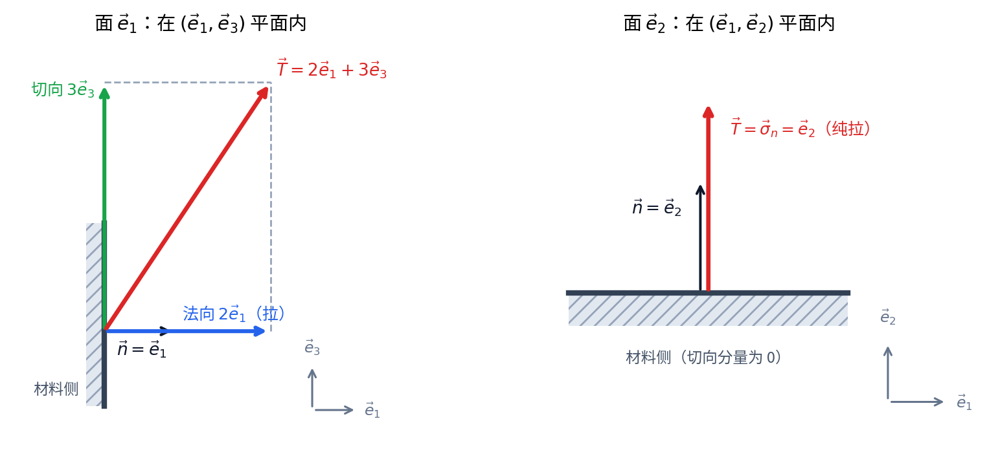

#### Question 2.1.4

*Calculer les contraintes principales de $\boldsymbol\sigma$ en $A$, et donner le tenseur des contraintes dans la base principale.* 求主应力，写出主轴基下的应力张量。

**答案**

$\vec e_2$ est principale (valeur 1). Bloc $(\vec e_1,\vec e_3)$ : $s^2-2s-9=0$ ⇒ $s=1\pm\sqrt{10}$, directions $\propto(s,0,3)$. Dans la base principale : $\boldsymbol\sigma=\operatorname{diag}(1+\sqrt{10},\ 1,\ 1-\sqrt{10})\approx\operatorname{diag}(4{,}16;\ 1;\ -2{,}16)$ MPa.

**Détail · 推导**

$\vec e_2$ 的行和列只有对角元，直接是主方向（对应主应力 $1$）。剩下 $2\times2$ 块 $\begin{pmatrix}2&3\\3&0\end{pmatrix}$：特征方程 $(2-s)(-s)-9=0\implies s^2-2s-9=0$，解得 $s=1\pm\sqrt{10}$。由特征方程组第二行 $3n_1-sn_3=0$ 可直接读出主方向 $(s,0,3)$（与第一行 $(2-s)n_1+3n_3=0$ 给出的 $(3,0,s-2)$ 成比例，因 $(2-s)s+9=-s^2+2s+9=0$）。检查：主应力之和 $1+(1+\sqrt{10})+(1-\sqrt{10})=3=\operatorname{tr}\boldsymbol\sigma$。

#### Question 2.1.5

*Déterminer au point $A$ la contrainte équivalente de von Mises $\sigma_{VM}=\sqrt{\frac32\operatorname{tr}(\boldsymbol\sigma^D\boldsymbol\sigma^D)}$.* 求 $A$ 点的 von Mises 等效应力。

**答案**

$\operatorname{tr}\boldsymbol\sigma=3$, $\boldsymbol\sigma^D=\boldsymbol\sigma-\mathbb I=\begin{pmatrix}1&0&3\\0&0&0\\3&0&-1\end{pmatrix}$, $\boldsymbol\sigma^D:\boldsymbol\sigma^D=20$, $\sigma_{VM}=\sqrt{30}\approx5{,}48$ MPa.

**Détail · 推导**

偏量 = 应力减去平均正应力（$\operatorname{tr}\boldsymbol\sigma/3=1$）。平方和 $1+1+2\times9=20$。用主应力检验：差值的平方 $10,10,40$，和 60，除以 2 得 30。Tresca 等效应力为 $2\sqrt{10}\approx6{,}32$ MPa，比 von Mises 大。

### Exercice 2.2 · Analyse complète en un point · 一点应力的完整分析

**考点**　vecteur contrainte sur une facette oblique, contraintes principales, von Mises, Tresca, coefficient de sécurité

#### Énoncé · 题面

En un point $M$ d'une pièce, le tenseur des contraintes vaut (en MPa)
$$\boldsymbol\sigma=\begin{pmatrix}4&2&0\\2&1&0\\0&0&-3\end{pmatrix}_{(\vec e_1,\vec e_2,\vec e_3)}.$$
La limite élastique du matériau est $\sigma_e=10$ MPa. 构件中一点的应力张量如上（MPa），材料屈服极限 $\sigma_e=10$ MPa。

#### Question 2.2.1

*Calculer le vecteur contrainte sur la facette de normale $\vec n=\frac1{\sqrt3}(1,1,1)$, ainsi que ses composantes normale et tangentielle.* 求法向 $(1,1,1)/\sqrt3$ 的斜面上的应力向量及其法向、切向分量。

**答案**

$\vec T=\boldsymbol\sigma\vec n=\frac1{\sqrt3}(6,\ 3,\ -3)$ ; $\sigma_n=\vec T\cdot\vec n=\frac{6+3-3}3=2$ MPa ; $\|\vec T\|^2=18$, $\tau=\sqrt{18-4}=\sqrt{14}\approx3{,}74$ MPa.

**Détail · 推导**

斜面先把法向归一化。切应力大小用勾股：$\tau=\sqrt{\|\vec T\|^2-\sigma_n^2}$。

#### Question 2.2.2

*Déterminer les contraintes et directions principales.* 求主应力和主方向。

**答案**

$\vec e_3$ principale : $-3$. Bloc $\begin{pmatrix}4&2\\2&1\end{pmatrix}$ : $s=\frac52\pm\sqrt{\frac94+4}=\frac52\pm\frac52$, soit $5$ (direction $\frac{(2,1,0)}{\sqrt5}$) et $0$ (direction $\frac{(1,-2,0)}{\sqrt5}$). Contraintes principales : $5$, $0$, $-3$ MPa.

**Détail · 推导**

$2\times2$ 块的行列式为 0，所以一个主值是 0。检查：和 $5+0-3=2=\operatorname{tr}\boldsymbol\sigma$；两方向正交。

#### Question 2.2.3

*Calculer les contraintes équivalentes de von Mises et de Tresca, et les coefficients de sécurité correspondants.* 求 von Mises、Tresca 等效应力和安全系数。

**答案**

$\sigma_{VM}=\sqrt{\frac12\bigl[(5-0)^2+(0+3)^2+(-3-5)^2\bigr]}=\sqrt{49}=7$ MPa, $k_s=\frac{10}7\approx1{,}43$ ; $\sigma_{Tr}=5-(-3)=8$ MPa, $k_s=1{,}25$. Le matériau reste élastique ; Tresca est plus conservatif.

**Détail · 推导**

$\frac12(25+9+64)=49$，开方得整数，适合手算。Tresca 取最大与最小主应力之差，注意 0 和负值都要参与比较。

### Exercice 2.3 · Étude des contraintes dans un milieu continu · 连续介质中的应力

**考点**　force volumique, vecteurs contrainte, contraintes principales, von Mises, Tresca

#### Énoncé · 题面

Soit $\boldsymbol\sigma$ le tenseur des contraintes exprimé en chaque point $M$ d'un milieu continu, de coordonnées $(x_1,x_2,x_3)$, dans un système de coordonnées cartésiennes $(\vec e_1,\vec e_2,\vec e_3)$, par :
$$\boldsymbol\sigma(M)=\begin{pmatrix}-1&x_1&2x_3\\x_1&1&x_2\\2x_3&x_2&8\end{pmatrix}_{(\vec e_1,\vec e_2,\vec e_3)}\quad(\text{en Pa}).$$

$$\boldsymbol\sigma(M)=\begin{pmatrix}-1&x_1&2x_3\\x_1&1&x_2\\2x_3&x_2&8\end{pmatrix}_{(\vec e_1,\vec e_2,\vec e_3)}$$

（数值，单位按 Pa 理解。）

#### Question 2.3.1

*Calculer la densité d’effort volumique $\mathbf f_v$ en équilibre avec ce champ de contrainte, pour un problème de statique.* 静力问题中与该应力场平衡的体力

**答案**

$\overrightarrow{\operatorname{div}}\boldsymbol\sigma+\vec f_v=\vec0\Rightarrow\vec f_v=-\overrightarrow{\operatorname{div}}\boldsymbol\sigma=-(2\vec e_1+\vec e_2+\vec e_3)\ \mathrm{Pa\cdot m^{-1}}$ ($\mathrm{N\cdot m^{-3}}$).

**Détail · 推导**

按行求散度（第 $i$ 个分量是第 $i$ 行对相应坐标求导之和）：

$$\overrightarrow{\operatorname{div}}\boldsymbol\sigma=\begin{pmatrix}\partial_1(-1)+\partial_2x_1+\partial_3(2x_3)\\\partial_1x_1+\partial_2(1)+\partial_3x_2\\\partial_1(2x_3)+\partial_2x_2+\partial_3(8)\end{pmatrix}=\begin{pmatrix}0+0+2\\1+0+0\\0+1+0\end{pmatrix},\qquad
\vec f_v=-\begin{pmatrix}2\\1\\1\end{pmatrix}\ \mathrm{N\cdot m^{-3}}.$$

#### Question 2.3.2

*Calculer et tracer le vecteur contrainte au point $A=(1,0,0)$, pour les facettes $a$, $b$, $c$ de normales $\mathbf e_1$, $\mathbf e_2$, $\mathbf e_3$. Dans chacun des trois cas, déterminer les composantes normale et tangentielle du vecteur contrainte.* 点 $A=(1,0,0)$ 处三个面上的应力向量及其法向、切向分量

**答案**

$\boldsymbol\sigma(A)=\begin{pmatrix}-1&1&0\\1&1&0\\0&0&8\end{pmatrix}$ Pa ; $\vec T_a=-\vec e_1+\vec e_2$ : $\sigma_n=-1$, $\tau=1$ ; $\vec T_b=\vec e_1+\vec e_2$ : $\sigma_n=1$, $\tau=1$ ; $\vec T_c=8\vec e_3$ : $\sigma_n=8$, $\tau=0$ (en Pa).

**Détail · 推导**

先代入 $x_1=1$、$x_2=x_3=0$。$\vec T=\boldsymbol\sigma\vec n$ 就是第 $j$ 列；法向分量 $\sigma_n=\vec n\cdot\vec T$，切向向量 $\vec T_t=\vec T-\sigma_n\vec n$，其模为切向应力（单位 Pa）：

| 面 | $\vec n$ | $\vec T$ | $\sigma_n$ | $\vec T_t$ | $\tau$ |
|---|---|---|---|---|---|
| a | $\vec e_1$ | $(-1,1,0)$ | $-1$（压） | $(0,1,0)$ | 1 |
| b | $\vec e_2$ | $(1,1,0)$ | $1$（拉） | $(1,0,0)$ | 1 |
| c | $\vec e_3$ | $(0,0,8)$ | $8$（拉） | $\vec0$ | 0 |

面 c 上没有切应力，所以 $\vec e_3$ 是一个主方向，8 Pa 是一个主应力。作图时在三个微元面上分别画出外法向、应力向量 $\vec T$ 及其法向/切向分解：

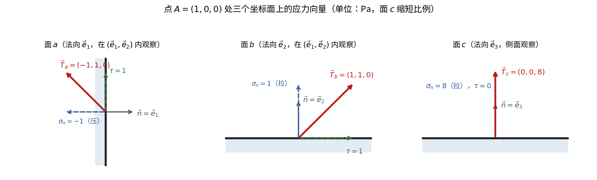

#### Question 2.3.3

*Calculer les contraintes principales et les directions principales au point $A$. À quoi correspondent physiquement ces directions ?* 点 $A$ 处的主应力与主方向及其物理意义

**答案**

$\det(\boldsymbol\sigma-\lambda\mathbb I)=(8-\lambda)(\lambda^2-2)=0$, d’où $\sigma_1=-\sqrt2$, $\sigma_2=\sqrt2$, $\sigma_3=8$ Pa, avec $\vec N_1\propto(1,\,1-\sqrt2,\,0)$, $\vec N_2\propto(1,\,1+\sqrt2,\,0)$, $\vec N_3=\vec e_3$. Ce sont les directions pour lesquelles le vecteur contrainte est purement normal (contrainte tangentielle nulle) ; la contrainte normale y est stationnaire.

**Détail · 推导**

矩阵分块：$\vec e_3$ 已经独立出来（$\sigma_3=8$），只需对左上角 $2\times2$ 块求特征值：

$$\begin{vmatrix}-1-\lambda&1\\1&1-\lambda\end{vmatrix}=(\lambda+1)(\lambda-1)-1=\lambda^2-2=0\ \Rightarrow\ \lambda=\pm\sqrt2 .$$

主方向：解 $(\boldsymbol\sigma-\lambda\mathbb I)\vec N=\vec0$ 的第一行 $(-1-\lambda)N_1+N_2=0$，即 $N_2=(1+\lambda)N_1$：

- $\lambda=-\sqrt2$：$\vec N_1=(1,\,1-\sqrt2,\,0)$；
- $\lambda=\sqrt2$：$\vec N_2=(1,\,1+\sqrt2,\,0)$。

自查：$\vec N_1\cdot\vec N_2=1+(1-\sqrt2)(1+\sqrt2)=1-1=0$，正交，符合对称矩阵的性质。注意不要把主方向符号配错（如把 $\vec N_1$ 误配成 $(1,1+\sqrt2,0)$，可代回 $\boldsymbol\sigma\vec N=\lambda\vec N$ 验证）。

物理意义：在主方向的面上，应力向量与法向平行（没有切应力），法向应力 $\sigma_n(\vec n)$ 在该方向取驻值（三维下最小主应力 $-\sqrt2\text{ Pa}$ 与最大主应力 $8\text{ Pa}$ 分别为极小和极大值，中间主应力 $+\sqrt2\text{ Pa}$ 为鞍点：朝 $\vec N_3$ 转动时升高，朝 $\vec N_1$ 转动时降低）。

#### Question 2.3.4

*On considère un matériau élastoplastique de limite élastique $\sigma_0=10$ Pa. Appliquer le critère de von Mises au point $A$. Le matériau reste-t-il dans son domaine d’élasticité ?* 在 $A$ 点用 von Mises 准则校核（$\sigma_0=10\ \mathrm{Pa}$）

**答案**

$\sigma_{VM}=\sqrt{\frac{(\sigma_1-\sigma_2)^2+(\sigma_2-\sigma_3)^2+(\sigma_1-\sigma_3)^2}{2}}=\sqrt{\frac{8+(66-16\sqrt2)+(66+16\sqrt2)}{2}}=\sqrt{70}$. Comme $70<100$, $\sigma_{VM}<\sigma_0$ : le matériau reste élastique.

**Détail · 推导**

不用计算器的技巧：交叉项 $\pm16\sqrt2$ 正好抵消，和为 140，除以 2 得 70。比较时两边平方：$\sigma_{VM}^2=70<\sigma_0^2=100$，弹性（$\sqrt{70}\approx8{,}37$）。

#### Question 2.3.5

*Appliquer le critère de Tresca au point $A$. Le matériau reste-t-il dans son domaine d’élasticité selon ce critère ?* 在 $A$ 点用 Tresca 准则校核

**答案**

$\sigma_{Tr}=\max_{i,j}|\sigma_i-\sigma_j|=8+\sqrt2\approx9{,}41<10$ : élastique, avec moins de marge qu’avec von Mises (Tresca est plus conservatif).

**Détail · 推导**

最大主应力差在最大和最小之间：$8-(-\sqrt2)=8+\sqrt2\approx9{,}41<10$，仍在弹性范围，但余量比 von Mises 小。一般总有 $\sigma_{VM}\le\sigma_{Tr}\le\frac{2}{\sqrt3}\sigma_{VM}$，所以 Tresca 更保守。

### Exercice 2.4 · Éprouvette de traction uniaxiale · 单轴拉伸试样

**考点**　vecteur contrainte sur une facette quelconque, cercle de Mohr, cisaillement maximal, changement de base, conditions aux limites

#### Énoncé · 题面

On considère une éprouvette d'essai de traction dont la géométrie est décrite sur la figure 2.1. Pour étudier sa zone utile, on suppose une répartition uniforme des contraintes au sein de cette zone. Le chargement extérieur à l'éprouvette est alors équivalent à une densité d'efforts sur la zone utile : $-p_0\vec e_1$ sur $S_0$ et $p_0\vec e_1$ sur $S_1$. 拉伸试样的几何见图 2.1。研究其有效段时，假设应力在有效段内均匀分布。外载等效为有效段两端的面力：$S_0$ 上 $-p_0\vec e_1$，$S_1$ 上 $p_0\vec e_1$；侧面自由。

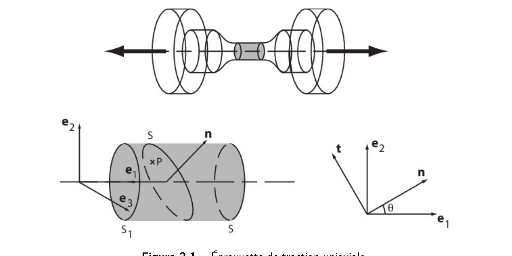

#### Question 2.4.1

*Soit $P$ un point d'une section $S$ quelconque de normale $\vec n$. Calculer le vecteur contrainte en $P$ relatif à la direction $\vec n$.* 求任意截面（法向 $\vec n$）上点 $P$ 的应力向量。

**答案**

Contraintes uniformes compatibles avec les CL : $\boldsymbol\sigma=p_0\,\vec e_1\otimes\vec e_1$. Pour toute normale unitaire $\vec n$, $\vec T(P,\vec n)=\boldsymbol\sigma\vec n=p_0(\vec n\cdot\vec e_1)\vec e_1=p_0\cos\theta\,\vec e_1$ (où $\theta=(\vec e_1,\vec n)$) ; en particulier dans le plan $(\vec e_1,\vec e_2)$, $\vec n=\cos\theta\,\vec e_1+\sin\theta\,\vec e_2$.

**Détail · 推导**

两端面力只有 $\vec e_1$ 分量、侧面自由，均匀应力场只能是 $p_0\vec e_1\otimes\vec e_1$。应力向量永远平行于 $\vec e_1$，大小随截面倾角变化。

#### Question 2.4.2

*Tracer la contrainte tangentielle de cisaillement en fonction de la contrainte normale.* 画出切应力随正应力变化的关系。

**答案**

$\sigma_n=\vec T\cdot\vec n=p_0\cos^2\theta$, $\tau=\vec T\cdot\vec t=-p_0\sin\theta\cos\theta$ (avec $\vec t=-\sin\theta\,\vec e_1+\cos\theta\,\vec e_2$) : $\bigl(\sigma_n-\frac{p_0}2\bigr)^2+\tau^2=\bigl(\frac{p_0}2\bigr)^2$, cercle de Mohr de centre $(p_0/2,0)$ et de rayon $p_0/2$.

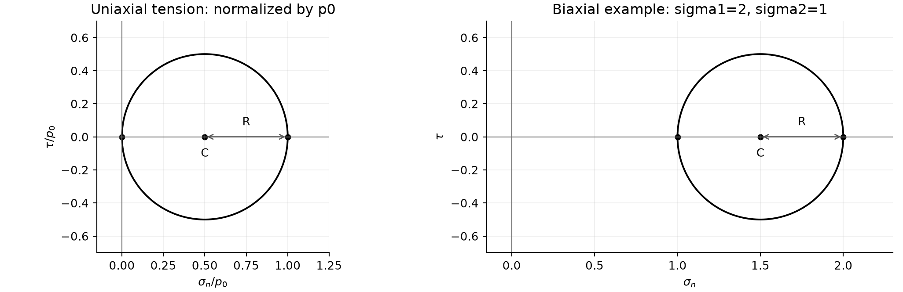

**Détail · 推导**

用倍角公式：$\sigma_n=\frac{p_0}2(1+\cos2\theta)$，$\tau=-\frac{p_0}2\sin2\theta$，消去 $\theta$ 得圆。纵轴若只画大小 $|\tau|$，就是上半圆。

#### Question 2.4.3

*On se place à la limite d'élasticité en traction $\sigma_e$. Que vaut alors la contrainte de cisaillement ?* 拉到屈服极限 $\sigma_e$ 时切应力是多少？

**答案**

$p_0=\sigma_e$ : $\tau=-\sigma_e\sin\theta\cos\theta$, de valeur absolue maximale $\frac{\sigma_e}2$ sur les facettes à $45^\circ$ de l'axe.

**Détail · 推导**

最大切应力 = Mohr 圆半径。这正是 Tresca 准则的出发点：单轴拉伸屈服时最大切应力为 $\sigma_e/2$。

#### Question 2.4.4

*Écrire l'opérateur des contraintes dans la base $(\vec e_1,\vec e_2,\vec e_3)$ puis dans la base $(\vec n,\vec t,\vec e_3)$.* 分别在两组基下写出应力矩阵。

**答案**

$[\boldsymbol\sigma]_{(\vec e_i)}=\operatorname{diag}(p_0,0,0)$ ; $[\boldsymbol\sigma]_{(\vec n,\vec t,\vec e_3)}=\mathbb Q^{\mathsf T}[\boldsymbol\sigma]\mathbb Q=p_0\begin{pmatrix}\cos^2\theta&-\sin\theta\cos\theta&0\\-\sin\theta\cos\theta&\sin^2\theta&0\\0&0&0\end{pmatrix}$.

**Détail · 推导**

$\mathbb Q$ 的列是新基向量在旧基下的坐标。也可以直接算 $\sigma_{nn}=\vec n\cdot\boldsymbol\sigma\vec n$、$\sigma_{nt}=\vec n\cdot\boldsymbol\sigma\vec t$、$\sigma_{tt}=\vec t\cdot\boldsymbol\sigma\vec t$。

#### Question 2.4.5

*Vérifier que les conditions aux limites imposées sur toute la surface de la zone utile sont vérifiées.* 验证有效段全部表面的边界条件。

**答案**

$S_1$ ($\vec n=\vec e_1$) : $\boldsymbol\sigma\vec e_1=p_0\vec e_1$ ✓ ; $S_0$ ($\vec n=-\vec e_1$) : $-p_0\vec e_1$ ✓ ; surface latérale ($n_1=0$) : $\boldsymbol\sigma\vec n=p_0n_1\vec e_1=\vec0$ ✓ (libre).

**Détail · 推导**

每个面取外法向乘应力张量，与给定面力比较。侧面法向垂直于 $\vec e_1$，所以面力为零，侧面自由。

### Exercice 2.5 · Éprouvette de traction biaxiale · 双轴拉伸试样

**考点**　vecteur contrainte, cercle de Mohr parcouru deux fois

#### Énoncé · 题面

L'éprouvette de traction biaxiale (figure 3.1a) a été conçue pour présenter au niveau de la zone utile (figure 3.1b) un état de contrainte plan diagonal tel que :
$$\boldsymbol\sigma=\begin{pmatrix}\sigma_1&0&0\\0&\sigma_2&0\\0&0&0\end{pmatrix}_{(\vec e_1,\vec e_2,\vec e_3)}$$
où $(\vec e_1,\vec e_2,\vec e_3)$ est le repère cartésien. 十字形双轴拉伸试样（图 3.1a）在有效区（图 3.1b）产生平面对角应力状态。

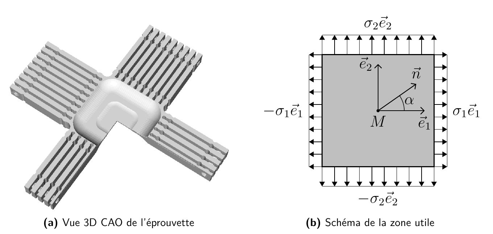

#### Question 2.5.1

*Soit une facette de normale $\vec n$ du plan $(\vec e_1,\vec e_2)$ et $M$ un point de cette facette ; exprimer le vecteur contrainte $\vec T(M,\vec n)$.* 求面内法向 $\vec n$ 的面上的应力向量。

**答案**

$\vec n=\cos\alpha\,\vec e_1+\sin\alpha\,\vec e_2$ : $\vec T(M,\vec n)=\sigma_1\cos\alpha\,\vec e_1+\sigma_2\sin\alpha\,\vec e_2$.

**Détail · 推导**

对角矩阵乘向量，各分量分别乘对应主应力。

#### Question 2.5.2

*Soit $\alpha$ l'angle $(\vec e_1,\vec n)$. Tracer le lieu des contraintes $\vec T(M,\vec n)$ lorsque la facette réalise un tour complet autour de $M$ ($\alpha$ de $0$ à $2\pi$), dans un repère où les axes horizontal et vertical représentent respectivement l'amplitude de la contrainte normale et l'amplitude de la contrainte tangentielle.* 法向转一整圈时，在 $(\sigma_n,\tau)$ 平面上画出应力点的轨迹。

**答案**

$\sigma_n=\frac{\sigma_1+\sigma_2}2+\frac{\sigma_1-\sigma_2}2\cos2\alpha$, $\tau=-\frac{\sigma_1-\sigma_2}2\sin2\alpha$ : cercle de Mohr de centre $\bigl(\frac{\sigma_1+\sigma_2}2,0\bigr)$ et de rayon $\frac{|\sigma_1-\sigma_2|}2$, parcouru deux fois quand $\alpha$ va de $0$ à $2\pi$.

**Détail · 推导**

$\sigma_n=\vec T\cdot\vec n=\sigma_1\cos^2\alpha+\sigma_2\sin^2\alpha$，$\tau=\vec T\cdot\vec t$，$\vec t=(-\sin\alpha,\cos\alpha)$。参数是 $2\alpha$，所以法向在 $(\vec e_1,\vec e_2)$ 平面内转一圈，点在圆上走两圈。几何上即 2.4.2 的 Mohr 圆右图（只是将主方向记为 $\vec e_1,\vec e_2$），因为本题的法向始终局限在 $(\vec e_1,\vec e_2)$ 平面内，所求最大切应力 $\frac{|\sigma_1-\sigma_2|}2$ 正对应这一面内转动范围的圆半径（在与主方向成 $45^\circ$ 的面上达到）。

### Exercice 2.6 · Équations de l'équilibre local · 推导局部平衡方程

**考点**　PFS sur un volume élémentaire, symétrie de $\boldsymbol\sigma$

#### Énoncé · 题面

Autour du point $P$, de coordonnées cartésiennes $(x,y,z)$, d'un milieu continu soumis à une densité volumique de force $\vec f$, on engendre un volume élémentaire en faisant varier indépendamment chaque coordonnée d'une quantité infinitésimale $\pm\mathrm dx$, $\pm\mathrm dy$, $\pm\mathrm dz$. Le domaine obtenu est un parallélépipède rectangle de volume $\mathrm dV=8\,\mathrm dx\,\mathrm dy\,\mathrm dz$ (figure 4.1). On admet que le vecteur contrainte en tout point d'une facette est très peu différent de la valeur qu'il prend au centre de cette facette. 在连续介质中点 $P$ 周围取边长 $2\mathrm dx\times2\mathrm dy\times2\mathrm dz$ 的小长方体（体积 $8\,\mathrm dx\,\mathrm dy\,\mathrm dz$），介质受体力 $\vec f$。认为每个面上的应力向量近似等于面中心处的值。

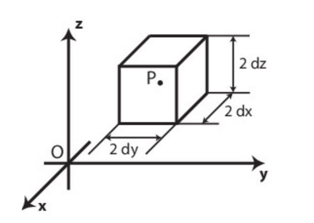

#### Question 2.6.1

*Montrer que l'équilibre global de ce volume (PFS) en résultante permet de retrouver l'équation d'équilibre local $\overrightarrow{\operatorname{div}}\boldsymbol\sigma+\vec f=\vec0$.* 证明合力平衡给出局部平衡方程。

**答案**

Faces $x\pm\mathrm dx$ (normales $\pm\vec e_x$, aire $4\,\mathrm dy\,\mathrm dz$) : $\bigl[\boldsymbol\sigma(x+\mathrm dx)-\boldsymbol\sigma(x-\mathrm dx)\bigr]\vec e_x\,4\,\mathrm dy\,\mathrm dz\approx\frac{\partial\boldsymbol\sigma}{\partial x}\vec e_x\,8\,\mathrm dx\,\mathrm dy\,\mathrm dz$ ; de même en $y$, $z$. Avec $\vec f\,\mathrm dV$ : $\Bigl(\frac{\partial\boldsymbol\sigma}{\partial x}\vec e_x+\frac{\partial\boldsymbol\sigma}{\partial y}\vec e_y+\frac{\partial\boldsymbol\sigma}{\partial z}\vec e_z+\vec f\Bigr)\mathrm dV=\vec0$, soit $\sigma_{ij,j}+f_i=0$.

**Détail · 推导**

一对相对面上的应力向量方向相反、位置相差 $2\mathrm dx$，一阶泰勒展开后只剩导数项。三对面相加就是散度（按行求导）。

#### Question 2.6.2

*Montrer que l'équilibre global de ce volume en moment induit que le tenseur $\boldsymbol\sigma$ est symétrique.* 证明力矩平衡推出应力对称。

**答案**

Moment en $P$ : les faces $\pm\mathrm dx$ donnent $2\,\mathrm dx\,\vec e_x\wedge\boldsymbol\sigma\vec e_x\,4\,\mathrm dy\,\mathrm dz$, etc. ; les termes en dérivées et la force volumique sont d'ordre supérieur. Il reste $\bigl(\vec e_x\wedge\boldsymbol\sigma\vec e_x+\vec e_y\wedge\boldsymbol\sigma\vec e_y+\vec e_z\wedge\boldsymbol\sigma\vec e_z\bigr)\mathrm dV=\vec0$, soit $\sigma_{yz}=\sigma_{zy}$, $\sigma_{zx}=\sigma_{xz}$, $\sigma_{xy}=\sigma_{yx}$.

**Détail · 推导**

$\vec e_j\wedge\sigma_{ij}\vec e_i$ 的第 $k$ 个分量是 $\epsilon_{kji}\sigma_{ij}$，它为零等价于 $\boldsymbol\sigma$ 的反对称部分为零（如 $k=3$ 时 $\sigma_{21}-\sigma_{12}=0$）。从阶次上看，面力偶矩本身与微元体积 $\mathrm dV=8\,\mathrm dx\,\mathrm dy\,\mathrm dz$ 同为三阶小量，而表面应力展开的导数项以及体力的力矩（体积力 $\sim O(\mathrm dx^3)$ 再乘力臂 $\sim O(\mathrm dx)$）均为四阶小量，因此在除以 $\mathrm dV$ 并令微元趋于零时全部消失。

### Exercice 2.7 · Poutre pesante · 受自重的梁

**考点**　équilibre local, PFS, conditions aux limites, pression de contact

#### Énoncé · 题面

Soit une poutre soumise à son poids propre et reposant sur le sol (figure 1.1). La poutre a une hauteur $h$ et une section carrée $S$. Le matériau est homogène de masse volumique $\rho$. Le repère de travail est $(O,\vec e_1,\vec e_2,\vec e_3)$ où $O$ est un point de l'axe de la poutre en contact avec le sol. La direction verticale est définie par le vecteur $\vec e_3$. Un point $M$ de la poutre est repéré par $\overrightarrow{OM}=x_1\vec e_1+x_2\vec e_2+x_3\vec e_3$. 立在地面上的梁受自重，高 $h$，正方形截面面积 $S$，均质，密度 $\rho$。$O$ 在梁轴与地面的交点，$\vec e_3$ 竖直向上。

Le poids propre est modélisé par une force élémentaire volumique $\vec f=-\rho g\vec e_3$ où $g$ est l'accélération de la pesanteur. On suppose que les contraintes en tout point $M$ sont décrites par le tenseur :
$$\boldsymbol\sigma=\begin{pmatrix}0&0&0\\0&0&0\\0&0&a+bx_3\end{pmatrix}_{(\vec e_1,\vec e_2,\vec e_3)},$$
où $a$ et $b$ sont des constantes. 体力 $\vec f=-\rho g\vec e_3$，应力张量形式如上，$a$、$b$ 为常数。

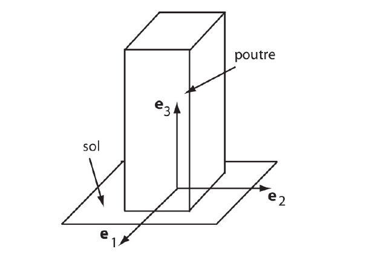

#### Question 2.7.1

*En utilisant l'équation d'équilibre local, déterminer la condition sur $b$ pour que le solide soit en équilibre statique. Retrouver ce résultat à partir du Principe Fondamental de la Statique (PFS).* 用局部平衡求 $b$；再用整体静力学（PFS）验证。

**答案**

$\overrightarrow{\operatorname{div}}\boldsymbol\sigma+\vec f=\vec0$ : $\partial_3\sigma_{33}-\rho g=0$ ⇒ $b=\rho g$. PFS sur la partie située au-dessus de la cote $x_3$ : poids $-\rho gS(h-x_3)\vec e_3$, effort sur la section ($\vec n=-\vec e_3$) $-\sigma_{33}S\vec e_3$, sommet libre : $\sigma_{33}=-\rho g(h-x_3)$, donc $b=\rho g$.

**Détail · 推导**

散度只有第三分量 $\partial_3(a+bx_3)=b$。整体验证：取截面以上的一段，它受自重和截面上的内力，合力为零，截面上的压应力恰好托住上面的重量。

#### Question 2.7.2

*Écrire les conditions aux limites sur les différentes faces de la poutre.* 写出梁各个面上的边界条件。

**答案**

Faces latérales ($\vec n=\pm\vec e_1,\pm\vec e_2$) : libres, $\boldsymbol\sigma\vec n=\vec0$ (vérifié). Sommet $x_3=h$ ($\vec n=\vec e_3$) : libre, $\boldsymbol\sigma\vec e_3=(a+bh)\vec e_3=\vec0$. Base $x_3=0$ ($\vec n=-\vec e_3$) : pression de contact $p$ : $\boldsymbol\sigma(-\vec e_3)=-p(-\vec e_3)$, soit $-a=p$.

**Détail · 推导**

侧面法向的第一、二列全为零，自动自由。顶面自由给出 $a+bh=0$。底面受地面压力 $p$，外法向 $-\vec e_3$，压力条件 $\boldsymbol\sigma\vec n=-p\vec n$。

#### Question 2.7.3

*En déduire les expressions de $a$ et de la pression de contact $p$ entre le sol et la poutre.* 求 $a$ 和地面接触压力 $p$。

**答案**

$a=-bh=-\rho gh$, $\sigma_{33}=-\rho g(h-x_3)$ (compression) ; $p=-a=\rho gh$, soit une force totale $\rho ghS$ égale au poids de la poutre.

**Détail · 推导**

接触压力乘面积 = 梁的总重量，整体平衡自洽。压应力绝对值在顶面为零、底面最大（带符号的 $\sigma_{33}$ 在顶面为 $0$、底面最小），沿高度线性分布。

### Exercice 2.8 · Massif de sol pesant · 自重作用下的土层

**考点**　équilibre avec pesanteur, surface libre, facette inclinée, Tresca

#### Énoncé · 题面

Un massif de sol occupe le demi-espace $z\ge0$, l'axe $\vec e_z$ étant dirigé vers le bas ; la surface $z=0$ est libre. La masse volumique est $\rho$, la pesanteur $\vec g=g\vec e_z$. On propose $\boldsymbol\sigma=-\rho gz\operatorname{diag}(K_0,K_0,1)$, où $0<K_0<1$ est un coefficient donné. 土体占半空间 $z\ge0$，$\vec e_z$ 竖直向下，地表 $z=0$ 自由。密度 $\rho$，重力 $g\vec e_z$。给定应力 $-\rho gz\operatorname{diag}(K_0,K_0,1)$，$0<K_0<1$ 为已知系数。

#### Question 2.8.1

*Vérifier l'équilibre local et la condition à la surface.* 验证局部平衡和地表条件。

**答案**

$\overrightarrow{\operatorname{div}}\boldsymbol\sigma+\rho\vec g=(-\rho g+\rho g)\vec e_z=\vec0$ ; en $z=0$ ($\vec n=-\vec e_z$) : $\boldsymbol\sigma\vec n=\vec0$ car $\boldsymbol\sigma(z=0)=\mathbb O$.

**Détail · 推导**

三个对角应力分量均随 $z$ 变化，但 $\sigma_{xx}$ 和 $\sigma_{yy}$ 在散度 $\overrightarrow{\operatorname{div}}\boldsymbol\sigma$ 中分别对 $x$ 和 $y$ 求偏导（均为零），因此只有 $\partial_z\sigma_{zz}=-\rho g$ 进入散度方程并与体力 $\rho g\vec e_z$ 抵消。

#### Question 2.8.2

*Calculer les composantes normale et tangentielle sur une facette de normale $\vec n=\frac{\vec e_x+\vec e_z}{\sqrt2}$.* 求法向 $(\vec e_x+\vec e_z)/\sqrt2$ 的面上的法向、切向应力。

**答案**

$\vec T=-\frac{\rho gz}{\sqrt2}(K_0,0,1)$ ; $\sigma_n=-\rho gz\frac{1+K_0}2$ (compression) ; $\tau=\rho gz\frac{1-K_0}2$.

**Détail · 推导**

45° 面上正应力是两主应力的平均，切应力是两主应力差的一半，正好是 Mohr 圆的最高点。

#### Question 2.8.3

*Déterminer la contrainte de Tresca en fonction de la profondeur. Le sol plastifie lorsque le cisaillement maximal atteint une cohésion $c$ : à quelle profondeur ?* 求 Tresca 等效应力随深度的变化；最大切应力达到黏聚力 $c$ 时在什么深度？

**答案**

Principales $-K_0\rho gz$ (double) et $-\rho gz$ : $\sigma_{Tr}=\rho gz(1-K_0)$, $\tau_{\max}=\frac{\rho gz(1-K_0)}2$ ; $\tau_{\max}=c$ pour $z=\frac{2c}{\rho g(1-K_0)}$.

**Détail · 推导**

应力已对角，对角元就是主应力；最大差是 $\rho gz(1-K_0)$。剪应力随深度线性增长，所以深处先达到黏聚力。

### Exercice 2.9 · Conditions aux limites d'une sphère creuse · 空心球的边界条件

**考点**　conditions de pression, normales sortantes

#### Énoncé · 题面

Une sphère creuse (rayon intérieur $r_1$, rayon extérieur $r_2$) est soumise à une pression intérieure $p_1$ et une pression extérieure $p_2$. Le tenseur des contraintes, dont la forme est supposée connue, est caractérisé, dans la base locale associée aux coordonnées sphériques $(r,\theta,\varphi)$, par la matrice $\boldsymbol\sigma=\operatorname{diag}(\sigma_r,\sigma_\theta,\sigma_\varphi)$ avec 空心球（内半径 $r_1$，外半径 $r_2$）受内压 $p_1$、外压 $p_2$。
$$\sigma_r=A-\frac{2B}{r^3},\qquad\sigma_\theta=\sigma_\varphi=A+\frac B{r^3},\qquad A,\ B\ \text{constantes}.$$

球坐标局部基下应力张量为对角形式，各分量如上，$A$、$B$ 为常数。

#### Question 2.9.1

*Déterminer les valeurs des constantes $A$ et $B$ qui satisfont aux conditions aux limites.* 求满足边界条件的常数 $A$、$B$。

**答案**

En $r=r_1$ ($\vec n=-\vec e_r$) et en $r=r_2$ ($\vec n=\vec e_r$), $\boldsymbol\sigma\vec n=-p\vec n$ donne $\sigma_r(r_1)=-p_1$ et $\sigma_r(r_2)=-p_2$ :
$$B=\frac{(p_1-p_2)\,r_1^3r_2^3}{2(r_2^3-r_1^3)},\qquad A=\frac{p_1r_1^3-p_2r_2^3}{r_2^3-r_1^3}.$$

**Détail · 推导**

内壁外法向指向球心（$-\vec e_r$），但压力条件 $\boldsymbol\sigma\vec n=-p_1\vec n$ 两边都含 $\vec n$，最后仍是 $\sigma_r=-p_1$。两式相减：$2B\bigl(\frac1{r_1^3}-\frac1{r_2^3}\bigr)=p_1-p_2$；再回代求 $A$。检查：$p_1=p_2=p$ 时 $B=0$、$A=-p$，即均匀静水压。

### Exercice 2.10 · Tube épais sous pression intérieure · 内压厚壁圆筒

**考点**　équilibre en cylindrique, conditions de pression, Tresca

#### Énoncé · 题面

Un tube de rayons $a<b$, à extrémités libres (contraintes planes, $\sigma_{zz}=0$), est soumis à une pression intérieure $p$ ; la surface extérieure est libre. On propose, dans la base cylindrique, $\boldsymbol\sigma=\operatorname{diag}(\sigma_{rr},\sigma_{\theta\theta},0)$ avec 内外半径 $a<b$ 的圆筒，两端自由（平面应力，$\sigma_{zz}=0$），受内压 $p$，外表面自由。
$$\sigma_{rr}=A-\frac B{r^2},\qquad\sigma_{\theta\theta}=A+\frac B{r^2}.$$

柱坐标下应力形式如上。

#### Question 2.10.1

*Vérifier l'équilibre local sans force volumique.* 验证无体力的局部平衡。

**答案**

Composante radiale : $\frac{\mathrm d\sigma_{rr}}{\mathrm dr}+\frac{\sigma_{rr}-\sigma_{\theta\theta}}r=\frac{2B}{r^3}-\frac{2B}{r^3}=0$ ; les autres composantes sont identiquement nulles.

**Détail · 推导**

柱坐标散度的径向分量多出 $\frac{\sigma_{rr}-\sigma_{\theta\theta}}r$ 项，不能漏。

#### Question 2.10.2

*Déterminer $A$ et $B$.* 求 $A$、$B$。

**答案**

$\sigma_{rr}(a)=-p$, $\sigma_{rr}(b)=0$ ⇒ $A=\frac{pa^2}{b^2-a^2}$, $B=\frac{pa^2b^2}{b^2-a^2}$.

**Détail · 推导**

内壁外法向 $-\vec e_r$，压力条件仍化为 $\sigma_{rr}=-p$；外壁自由 $\sigma_{rr}=0$。

#### Question 2.10.3

*Déterminer la contrainte de Tresca maximale et sa position ; en déduire une condition sur $p$.* 求 Tresca 等效应力最大值及位置，推出 $p$ 的条件。

**答案**

Contraintes principales $\sigma_{\theta\theta}>0$, $0$, $\sigma_{rr}\le0$ : $\sigma_{Tr}=\sigma_{\theta\theta}-\sigma_{rr}=\frac{2B}{r^2}$, maximale à la paroi intérieure : $\sigma_{Tr}(a)=\frac{2pb^2}{b^2-a^2}\le\sigma_e$ ⇒ $p\le\frac{\sigma_e}2\Bigl(1-\frac{a^2}{b^2}\Bigr)$.

**Détail · 推导**

三个主应力中 $\sigma_{\theta\theta}$ 最大、$\sigma_{rr}$ 最小，二者之差大于 $\sigma_{\theta\theta}$ 与 0 的差。与 TD4 练习 2 的空心球对照：球坐标下是 $B/r^3$，这里是 $B/r^2$。

### Exercice 2.11 · État de contrainte dans un disque troué · 带孔圆盘中的应力

**考点**　contraintes planes, conditions aux limites, équilibre en cylindrique, Tresca, concentration de contrainte

#### Énoncé · 题面

Nous considérons un disque de rayon $R_e$ et d'épaisseur $e$ très inférieure aux autres dimensions, percé en son centre d'un trou circulaire de rayon $R$ et de centre $O$ (cf. figure 3.1). Nous associons à ce disque un repère cylindrique dont la base orthonormée est notée $(\vec e_r,\vec e_\theta,\vec e_z)$ et le centre $O$ ; $\vec e_z$ indique le vecteur orthogonal au plan du disque. Le problème est statique et l'effet des forces volumiques est négligé. Dans le repère cylindrique, le tenseur des contraintes le plus général s'exprime selon 圆盘外半径 $R_e$、中心孔半径 $R$，厚度 $e$ 远小于其他尺度。采用柱坐标 $(r,\theta,z)$；静态、忽略体积力。
$$\boldsymbol\sigma=\begin{pmatrix}\sigma_{rr}&\sigma_{r\theta}&\sigma_{rz}\\\sigma_{r\theta}&\sigma_{\theta\theta}&\sigma_{\theta z}\\\sigma_{rz}&\sigma_{\theta z}&\sigma_{zz}\end{pmatrix}_{(\vec e_r,\vec e_\theta,\vec e_z)}.$$
Le disque est soumis en $r=R_e$ à des forces surfaciques radiales uniformes de densité $\vec T_1=\frac F2\vec e_r$. (À partir de la question 3.2 : $\sigma_{rr}=\frac F2\bigl[1-\bigl(\frac Rr\bigr)^2\bigr]$ et $\sigma_{r\theta}=0$.) 外缘施加径向均布牵引 $(F/2)\vec e_r$，孔壁自由。这里 $F$ 是应力尺度，量纲为 Pa，而非单位为 N 的集中力。

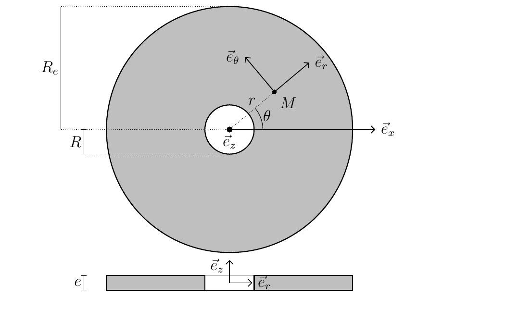

#### Question 2.11.1

*Pour quelles raisons peut-on considérer un état de contrainte plane, avec $\sigma_{rz}=\sigma_{\theta z}=\sigma_{zz}=0$ ? Cette hypothèse est conservée pour la suite.* 为何可用平面应力？

**答案**

Disque d'épaisseur $e$ très faible devant les autres dimensions ; faces $z=\pm e/2$ libres : $\boldsymbol\sigma(\pm\vec e_z)=\vec0$, donc $\sigma_{rz}=\sigma_{\theta z}=\sigma_{zz}=0$ sur ces faces ; l'épaisseur étant faible et le chargement contenu dans le plan, ces composantes restent négligeables dans tout le disque : état de contraintes planes.

**Détail · 推导**

先看圆盘的两个大表面：上、下表面没有施加载荷，法向分别为 $\vec e_z$ 与 $-\vec e_z$。自由表面条件是

$$\boldsymbol\sigma(\pm\vec e_z)=\vec0.$$

矩阵乘 $\vec e_z$ 就是取第三列，因此在这两个表面上，

$$\sigma_{rz}=\sigma_{\theta z}=\sigma_{zz}=0.$$

圆盘很薄，载荷在盘面内作用，薄板近似中忽略这些分量沿厚度的变化，就把上述条件用于整个厚度：

$$\boldsymbol\sigma\simeq
\begin{pmatrix}
\sigma_{rr}&\sigma_{r\theta}&0\\
\sigma_{r\theta}&\sigma_{\theta\theta}&0\\
0&0&0
\end{pmatrix}_{(\vec e_r,\vec e_\theta,\vec e_z)}.$$

这称为**平面应力**。其依据是“薄 + 上下表面自由 + 薄板近似”，不是仅由厚度小就无条件得到精确三维结论。

另外，平面应力允许 $\sigma_{rr}$、$\sigma_{\theta\theta}$、$\sigma_{r\theta}$ 非零；它也不等于平面应变。到第 3.4 问计算屈服时，第三个主应力仍是明确的 **0**，不能把这一主应力删掉。

#### Question 2.11.2

*Montrer que le champ donné par les expressions de $\sigma_{rr}$ et $\sigma_{r\theta}$ ci-dessous satisfait les conditions aux limites si $R\ll R_e$.* 验证给定应力满足边界条件

**答案**

Trou ($r=R$, $\vec n=-\vec e_r$) : $\boldsymbol\sigma\vec n=-(\sigma_{rr},\sigma_{r\theta},0)=\vec0$ car $\sigma_{rr}(R)=0$ et $\sigma_{r\theta}=0$ : vérifié exactement. Bord extérieur ($r=R_e$, $\vec n=\vec e_r$) : $\boldsymbol\sigma\vec e_r=\frac F2\bigl(1-\frac{R^2}{R_e^2}\bigr)\vec e_r\approx\frac F2\vec e_r=\vec T_1$ si $R\ll R_e$.

**Détail · 推导**

给定的是径向正应力和面内剪应力：

$$\sigma_{rr}(r)=\frac F2\left(1-\frac{R^2}{r^2}\right),
\qquad \sigma_{r\theta}=0.$$

这里标量 $F$ 是载荷的应力尺度（单位 Pa），不要与运动学中的变换梯度 $\mathbb F$ 混淆。边界条件比较的是牵引向量 $\boldsymbol\sigma\vec n$，需要分别检查内、外圆周。

**内孔 $r=R$：** 材料位于孔的外侧，材料的外法向指向孔内，因此 $\vec n=-\vec e_r$。于是

$$\vec T(R)=\boldsymbol\sigma(-\vec e_r)
=-\sigma_{rr}(R)\vec e_r-\sigma_{r\theta}(R)\vec e_\theta.$$

代入 $\sigma_{rr}(R)=\frac F2(1-1)=0$ 和 $\sigma_{r\theta}=0$，得到 $\vec T(R)=\vec0$，内孔自由条件**严格满足**。即使后面求出的环向应力 $\sigma_{\theta\theta}(R)$ 非零，也不会改变这个径向法向面上的零牵引。

**外圆周 $r=R_e$：** 此处外法向为 $\vec e_r$，所以

$$\vec T(R_e)
=\frac F2\left(1-\frac{R^2}{R_e^2}\right)\vec e_r.$$

题目要求的外载荷是 $\vec T_1=(F/2)\vec e_r$。二者差

$$\vec T(R_e)-\vec T_1
=-\frac F2\left(\frac R{R_e}\right)^2\vec e_r.$$

其相对误差为 $(R/R_e)^2$；当 $R\ll R_e$ 时可忽略，所以外边界条件**近似满足**。例如 $R/R_e=1/10$ 时，这一相对误差为 $1\%$。

因此答案必须保留小孔近似 $R\ll R_e$。上下表面的自由条件已由上一问的平面应力近似处理。

#### Question 2.11.3

*Appliquer l’équation d’équilibre, en déduire $\sigma_{\theta\theta}$ puis le champ de contrainte complet, noté $\boldsymbol\sigma_1$.* 用平衡求环向应力与完整张量

**答案**

Équilibre radial (sans force volumique, $\sigma_{r\theta}=0$, rien ne dépend de $\theta$) : $\frac{\mathrm d\sigma_{rr}}{\mathrm dr}+\frac{\sigma_{rr}-\sigma_{\theta\theta}}r=0$, d'où $\sigma_{\theta\theta}=\sigma_{rr}+r\sigma_{rr}'=\frac F2\bigl(1+\frac{R^2}{r^2}\bigr)$ et $\boldsymbol\sigma_1=\frac F2\operatorname{diag}\bigl(1-\frac{R^2}{r^2},\ 1+\frac{R^2}{r^2},\ 0\bigr)$ dans $(\vec e_r,\vec e_\theta,\vec e_z)$.

**Détail · 推导**

本题静态、无体积力，因此 $\overrightarrow{\operatorname{div}}\boldsymbol\sigma=\vec0$。又由于场轴对称、仅依赖 $r$、剪应力为零，柱坐标平衡方程只剩径向一式：

$$\frac{\mathrm d\sigma_{rr}}{\mathrm dr}
+\frac{\sigma_{rr}-\sigma_{\theta\theta}}r=0.$$

第二项来自柱坐标方向随位置改变的几何效应，不能像直角坐标那样只令 $\mathrm d\sigma_{rr}/\mathrm dr=0$。

**先求导。** 将 $R$ 和 $F$ 视为常量：

$$\frac{\mathrm d\sigma_{rr}}{\mathrm dr}
=\frac F2\frac{\mathrm d}{\mathrm dr}(1-R^2r^{-2})
=\frac F2(2R^2r^{-3})
=\frac{FR^2}{r^3}.$$

**再整理平衡方程。** 两边乘 $r$ 后解出未知的环向应力：

$$r\sigma_{rr}'+\sigma_{rr}-\sigma_{\theta\theta}=0
\quad\Longrightarrow\quad
\sigma_{\theta\theta}=\sigma_{rr}+r\sigma_{rr}'.$$

代入：

$$\begin{aligned}
\sigma_{\theta\theta}
&=\frac F2\left(1-\frac{R^2}{r^2}\right)
+\frac{FR^2}{r^2}\\
&=\frac F2\left(1+\frac{R^2}{r^2}\right).
\end{aligned}$$

所以在局部正交柱坐标基底中，完整张量为

$$\boxed{\boldsymbol\sigma_1=
\begin{pmatrix}
\frac F2(1-R^2/r^2)&0&0\\
0&\frac F2(1+R^2/r^2)&0\\
0&0&0
\end{pmatrix}_{(\vec e_r,\vec e_\theta,\vec e_z)}.}$$

可在孔边检查：$r=R$ 时 $\sigma_{rr}=0$、$\sigma_{\theta\theta}=F$、$\sigma_{zz}=0$。这表示孔壁没有外界牵引，但材料仍有环向内应力。再代回径向平衡，两个非零项分别是 $FR^2/r^3$ 与 $-FR^2/r^3$，正好抵消。

#### Question 2.11.4

*Déterminer la contrainte équivalente de Tresca. Où atteint-elle son maximum ? Que vaut ce maximum ?* Tresca 等效应力、最大值及其位置

**答案**

Contraintes principales $\sigma_{rr}$, $\sigma_{\theta\theta}$, $0$ : $\sigma_{Tr}=\max\bigl(|\sigma_{\theta\theta}-\sigma_{rr}|,|\sigma_{\theta\theta}|,|\sigma_{rr}|\bigr)=\frac{|F|}2\bigl(1+\frac{R^2}{r^2}\bigr)$, maximale au bord du trou $r=R$ où elle vaut $|F|$ (concentration de contrainte d'un facteur 2 par rapport à $F/2$).

**Détail · 推导**

**先确认三个主应力，再比较差值。** 上一问矩阵已经对角化，所以主应力就是

$$\sigma_{rr}=\frac F2(1-q),\qquad
\sigma_{\theta\theta}=\frac F2(1+q),\qquad
\sigma_{zz}=0,\qquad q=\frac{R^2}{r^2}.$$

先讨论拉伸载荷 $F>0$。材料中 $r\ge R$，所以 $0<q\le1$，从而

$$\sigma_{\theta\theta}\ge\sigma_{rr}\ge0=\sigma_{zz}.$$

按本课程的 Tresca 等效应力定义，取三个主应力之间的最大差，也就是最大主应力减最小主应力：

$$\sigma_{\mathrm{Tr}}
=\max_{i,j}|\sigma_i-\sigma_j|
=\sigma_{\max}-\sigma_{\min}.$$

这里最大的是环向应力，最小的是厚度方向的零应力，因此

$$\boxed{\sigma_{\mathrm{Tr}}(r)
=\sigma_{\theta\theta}-0
=\frac F2\left(1+\frac{R^2}{r^2}\right).}$$

若逐项检查，三个差值分别为 $Fq$、$F(1-q)/2$、$F(1+q)/2$；最后一个最大。最大切应力则为 $\tau_{\max}=\sigma_{\mathrm{Tr}}/2$，别把它与这里定义的等效应力混为一个量。

**再找空间最大值。** 对半径求导：

$$\frac{\mathrm d\sigma_{\mathrm{Tr}}}{\mathrm dr}
=-\frac{FR^2}{r^3}<0.$$

所以离孔越远，等效应力越小；最大值在最小半径 $r=R$ 的孔边，且

$$\boxed{\sigma_{\mathrm{Tr,max}}=F.}$$

若 $F<0$，主应力排序反过来，等效应力依然非负，通式为
$\sigma_{\mathrm{Tr}}=|F|(1+R^2/r^2)/2$，最大值为 $|F|$。

### Exercice 2.12 · Champ d'autocontraintes dans un cylindre · 圆柱中的自应力场

**考点**　symétrie, unités, force volumique, efforts sur les frontières, autocontraintes

#### Énoncé · 题面

On considère un solide dont la configuration d'équilibre statique est un cylindre droit de révolution $\Omega$ de hauteur $h$ et de rayon $R$. L'axe du cylindre étant l'axe $O\vec e_z$, on suppose que les composantes du tenseur des contraintes sont, dans le repère cartésien : 直圆柱半径 $R$、高度 $h$，轴线为 $O\vec e_z$，处于静力平衡。直角坐标下给定应力上三角部分：
$$\boldsymbol\sigma=\begin{pmatrix}A(R^2-x^2-3y^2)&2Axy&0\\ &A(R^2-3x^2-y^2)&0\\ & &0\end{pmatrix}_{(\vec e_x,\vec e_y,\vec e_z)}.$$

$$\boldsymbol\sigma=\begin{pmatrix}
A(R^2-x^2-3y^2)&2Axy&0\\
\text{待补}&A(R^2-3x^2-y^2)&0\\
\text{待补}&\text{待补}&0
\end{pmatrix}.$$

#### Question 2.12.1

*Compléter la forme du tenseur $\boldsymbol\sigma$.* 补全应力张量

**答案**

$\boldsymbol\sigma$ est symétrique : $\boldsymbol\sigma=A\begin{pmatrix}R^2-x^2-3y^2&2xy&0\\2xy&R^2-3x^2-y^2&0\\0&0&0\end{pmatrix}$.

**Détail · 推导**

普通 Cauchy 连续介质在没有独立内偶力的假设下，角动量平衡要求

$$\sigma_{ij}=\sigma_{ji}.$$

所以关于主对角线对称的位置必须相等：$\sigma_{yx}=\sigma_{xy}=2Axy$，$\sigma_{zx}=\sigma_{xz}=0$，$\sigma_{zy}=\sigma_{yz}=0$。补全为

$$\boldsymbol\sigma=A
\begin{pmatrix}
R^2-x^2-3y^2&2xy&0\\
2xy&R^2-3x^2-y^2&0\\
0&0&0
\end{pmatrix}.$$

“应力张量对称”不代表它已对角化；本题的 $\sigma_{xy}=\sigma_{yx}$ 一般非零。第三行、第三列为零则表示这是相对于 $z$ 方向的平面应力场。

#### Question 2.12.2

*Dans quelle unité s’exprime la constante $A$ ?* 常数 $A$ 的单位

**答案**

$A(R^2-x^2-3y^2)$ est une contrainte : $[A]=\mathrm{Pa\cdot m^{-2}}=\mathrm{N\cdot m^{-4}}$.

**Détail · 推导**

例如从 $\sigma_{xx}=A(R^2-x^2-3y^2)$ 检查。括号中各项都是长度平方，能相加，单位为 $\mathrm{m^2}$；而 $\sigma_{xx}$ 是应力，单位为 Pa。因此

$$[A]=\frac{\mathrm{Pa}}{\mathrm{m^2}}
=\frac{\mathrm{N/m^2}}{\mathrm{m^2}}
=\mathrm{N/m^4}.$$

同样检查非对角分量 $2Axy$，其中 $xy$ 也是长度平方，结果一致。参数 $A$ 本身不是应力；需要乘上长度平方才成为应力。

#### Question 2.12.3

*Calculer la densité volumique de force $\mathbf f_v$ s’appliquant sur le solide $\Omega$. Commenter.* 求作用在圆柱上的体积力密度并说明

**答案**

$\vec f_v=-\overrightarrow{\operatorname{div}}\boldsymbol\sigma=-(-2Ax+2Ax,\ 2Ay-2Ay,\ 0)=\vec0$ : aucune force volumique n'est nécessaire.

**Détail · 推导**

“体积力密度”$\vec f_v$ 指每单位体积受到的外力，单位为 $\mathrm{N/m^3}$。本题静止，动量平衡简化为

$$\overrightarrow{\operatorname{div}}\boldsymbol\sigma+\vec f_v=\vec0,
\qquad \vec f_v=-\overrightarrow{\operatorname{div}}\boldsymbol\sigma.$$

对直角坐标下的张量，按行求散度：

$$\begin{aligned}
(\overrightarrow{\operatorname{div}}\boldsymbol\sigma)_x
&=\partial_x\sigma_{xx}+\partial_y\sigma_{xy}+\partial_z\sigma_{xz}\\
&=\partial_x[A(R^2-x^2-3y^2)]+\partial_y(2Axy)+0\\
&=-2Ax+2Ax=0,\\
(\overrightarrow{\operatorname{div}}\boldsymbol\sigma)_y
&=\partial_x\sigma_{yx}+\partial_y\sigma_{yy}+\partial_z\sigma_{yz}\\
&=\partial_x(2Axy)+\partial_y[A(R^2-3x^2-y^2)]+0\\
&=2Ay-2Ay=0,\\
(\overrightarrow{\operatorname{div}}\boldsymbol\sigma)_z&=0.
\end{aligned}$$

因此 $\boxed{\vec f_v=\vec0}$：这个应力场不需要额外体积力就能满足局部静力平衡。虽然每个应力分量会随位置变化，但它们造成的局部合力恰好抵消；“散度为零”并不等于“应力分量是常量或全为零”。展开分量求非零体积力时注意不要漏掉 $\vec f_v=-\overrightarrow{\operatorname{div}}\boldsymbol\sigma$ 中的整体负号。

#### Question 2.12.4

*Calculer la densité surfacique de force $\mathbf T$ s’appliquant sur les différentes frontières du solide $\Omega$. Commenter.* 求不同边界上的面力密度并说明

**答案**

Bases ($\vec n=\pm\vec e_z$) : troisième colonne nulle, $\vec T=\vec0$. Surface latérale ($\vec n=\frac{x\vec e_x+y\vec e_y}R$) : $\boldsymbol\sigma\vec n=\frac AR\bigl(x(R^2-x^2-y^2),\ y(R^2-x^2-y^2),\ 0\bigr)=\vec0$ sur $x^2+y^2=R^2$. Aucun effort extérieur n'est appliqué.

**Détail · 推导**

面力密度即单位面积的边界牵引，单位为 Pa。它由 $\vec T=\boldsymbol\sigma\vec n$ 给出，**不同边界必须使用各自的外法向**。

**底面和顶面。** 底面 $z=0$ 的外法向为 $-\vec e_z$，顶面 $z=h$ 的外法向为 $\vec e_z$。矩阵乘 $\pm\vec e_z$ 就是取第三列并加相应符号；本题第三列全零，所以

$$\vec T_{z=0}=\vec T_{z=h}=\vec0.$$

**圆柱侧面。** 侧面满足 $x^2+y^2=R^2$，外法向是从轴线向外的单位径向量：

$$\vec n=\frac{x\vec e_x+y\vec e_y}{R}
=\begin{pmatrix}x/R\\y/R\\0\end{pmatrix}.$$

相乘后，先合并同类项，再使用侧面方程：

$$\begin{aligned}
T_x&=\sigma_{xx}\frac xR+\sigma_{xy}\frac yR
=\frac{Ax}{R}(R^2-x^2-3y^2+2y^2)\\
&=\frac{Ax}{R}(R^2-x^2-y^2)=0,\\
T_y&=\sigma_{yx}\frac xR+\sigma_{yy}\frac yR
=\frac{Ay}{R}(2x^2+R^2-3x^2-y^2)\\
&=\frac{Ay}{R}(R^2-x^2-y^2)=0,\qquad T_z=0.
\end{aligned}$$

所以圆柱**全部外表面都没有牵引力**。注意，$x^2+y^2=R^2$ 只在侧面成立，不能先把它代入整个体内应力场再去求空间导数。

边界上牵引为零也不表示该点的所有应力分量为零。例如侧面点 $(R,0,z)$ 上，$\sigma_{yy}=-2AR^2$ 可以非零，但外法向为 $\vec e_x$，应力第一列为零，故该面的牵引仍为零。

#### Question 2.12.5

*Quelle est la particularité du champ de contraintes au sein de ce solide ?* 这个应力场有什么特殊之处？

**答案**

Efforts extérieurs volumiques et surfaciques nuls, mais $\boldsymbol\sigma\neq\mathbb O$ (au centre $\boldsymbol\sigma=\operatorname{diag}(AR^2,AR^2,0)$) : c'est un champ d'autocontraintes (contraintes résiduelles).

**Détail · 推导**

把前两问合起来看：体内 $\vec f_v=\vec0$，外边界 $\boldsymbol\sigma\vec n=\vec0$，但当 $A\ne0$ 时，体内 $\boldsymbol\sigma$ 并不为零。例如圆柱轴线上 $x=y=0$，有

$$\boldsymbol\sigma=\operatorname{diag}(AR^2,AR^2,0)\ne\mathbb O.$$

因此这是**自应力场（champ d’autocontraintes）**：没有外加体积力和表面牵引，内部应力仍可相互平衡。材料经过不均匀塑性变形、焊接或热处理后留下的残余应力，是理解这种现象的常见例子。

“没有外载荷”约束的是外界作用，并不直接要求每一处内部应力为零。本题验证了这个场在静力学上能自平衡；若还要说明具体材料为何具有该应力，需结合本构、初始应变或加工历史。考试作答的核心是指出“**外力为零而内部应力非零**”并命名为自应力场。

### Exercice 2.13 · Efforts sur les bords d'un cylindre elliptique · 椭圆柱边界上的力

**考点**　surface latérale libre, torseur sur les bases, torsion, contraintes principales

#### Énoncé · 题面

Un cylindre de section elliptique $\Omega$ est soumis à un système de charges tel que son tenseur des contraintes, dont la forme est supposée connue, est caractérisé, dans la base associée aux coordonnées cartésiennes $(x,y,z)$, par la matrice :
$$\boldsymbol\sigma=\begin{pmatrix}0&0&-\frac{Ky}{b^2}\\0&0&\frac{Kx}{a^2}\\-\frac{Ky}{b^2}&\frac{Kx}{a^2}&0\end{pmatrix},\qquad K=\text{cste},\quad\Omega=\Bigl\{(x,y,z)\ /\ 0\le z\le h\ ;\ \frac{x^2}{a^2}+\frac{y^2}{b^2}\le1\Bigr\}.$$

椭圆截面柱体（半轴 $a$、$b$，高 $h$）的应力张量如上，$K$ 为常数。

#### Question 2.13.1

*Déterminer les efforts extérieurs auxquels est soumise la surface latérale.* 求侧表面受到的外力。

**答案**

Surface latérale $\frac{x^2}{a^2}+\frac{y^2}{b^2}=1$, normale $\vec n\propto\bigl(\frac x{a^2},\frac y{b^2},0\bigr)$ : $\boldsymbol\sigma\vec n\propto\Bigl(0,\ 0,\ -\frac{Ky}{b^2}\frac x{a^2}+\frac{Kx}{a^2}\frac y{b^2}\Bigr)=\vec0$ : la surface latérale est libre.

**Détail · 推导**

曲面 $g=\frac{x^2}{a^2}+\frac{y^2}{b^2}-1=0$ 的外法向沿 $\overrightarrow{\operatorname{grad}}g$（第三分量为零）。应力张量前两列的前两行为零，第三行分别为 $-Ky/b^2$ 与 $Kx/a^2$，所以 $\boldsymbol\sigma\vec n$ 只有第三分量，代入椭圆法向后两项恰好抵消。

#### Question 2.13.2

*Déterminer le torseur des efforts extérieurs exercé sur les deux bases du cylindre.* 求两个底面上外力的力旋量。

**答案**

Base $z=h$ ($\vec n=\vec e_z$) : $\vec T=K\bigl(-\frac y{b^2},\frac x{a^2},0\bigr)$ ; résultante nulle (intégrandes impairs) ; moment au centre $\vec M=\int(x\vec e_x+y\vec e_y)\wedge\vec T\,\mathrm dS=K\int\Bigl(\frac{x^2}{a^2}+\frac{y^2}{b^2}\Bigr)\mathrm dS\,\vec e_z=\frac{K\pi ab}2\vec e_z$. Base $z=0$ : torseur opposé. Le cylindre est en torsion pure.

**Détail · 推导**

按极坐标变换 $x=ar\cos\theta,\ y=br\sin\theta$（雅可比行列式 $abr$）：$\int x^2\,\mathrm dS=a^3b\int_0^1 r^3\,\mathrm dr\int_0^{2\pi}\cos^2\theta\,\mathrm d\theta=\frac{\pi a^3b}4$，同理 $\int y^2\,\mathrm dS=\frac{\pi ab^3}4$，所以 $\int\bigl(\frac{x^2}{a^2}+\frac{y^2}{b^2}\bigr)\mathrm dS=\frac{\pi ab}4+\frac{\pi ab}4=\frac{\pi ab}2$。底面 $z=0$ 外法向为 $-\vec e_z$，面力反号，力矩相反：两端是一对反向轴向力偶，即纯扭转。

#### Question 2.13.3

*Dans le cas particulier où $a=b$, déterminer les contraintes et les directions principales associées à ce tenseur.* $a=b$ 时求主应力和主方向。

**答案**

En cylindrique : $\boldsymbol\sigma=\frac{Kr}{a^2}(\vec e_\theta\otimes\vec e_z+\vec e_z\otimes\vec e_\theta)$ (cisaillement pur). Contraintes principales $\frac{Kr}{a^2}$, $0$, $-\frac{Kr}{a^2}$, de directions $\frac{\vec e_\theta+\vec e_z}{\sqrt2}$, $\vec e_r$, $\frac{\vec e_\theta-\vec e_z}{\sqrt2}$.

**Détail · 推导**

$a=b$ 时 $(-y,x)/a^2=\frac r{a^2}\vec e_\theta$，只有 $\sigma_{\theta z}$。形如 $\begin{pmatrix}0&\tau\\\tau&0\end{pmatrix}$ 的块特征值 $\pm\tau$，特征向量 $(1,\pm1)/\sqrt2$。

### Exercice 2.14 · État de contrainte dans un arbre · 圆轴中的应力状态

**考点**　forces volumiques, surface latérale, torseurs sur les bases, contraintes principales, Tresca, couple maximal

#### Énoncé · 题面

Un arbre cylindrique, de génératrices parallèles à l'axe $\vec e_3$ et de hauteur $h$, a pour section droite un cercle $\mathcal C$ de centre $O$ et de rayon $R$. L'arbre est limité par deux bases : $\Sigma_0$ située dans le plan $x_3=0$ et $\Sigma_h$ située dans le plan $x_3=h$. On désigne par $\Sigma_{lat}$ la surface latérale de la pièce. L'arbre, supposé en équilibre, est soumis au champ de tenseur des contraintes suivant : 圆柱轴（母线平行于 $\vec e_3$，高 $h$，截面是圆心 $O$、半径 $R$ 的圆）。两个底面：$\Sigma_0$（$x_3=0$）和 $\Sigma_h$（$x_3=h$），侧面 $\Sigma_{lat}$。
$$\boldsymbol\sigma(x_1,x_2,x_3)=\begin{pmatrix}0&0&Ax_2\\0&0&-Ax_1\\Ax_2&-Ax_1&0\end{pmatrix}_{(\vec e_1,\vec e_2,\vec e_3)},$$
où $A$ est un scalaire constant positif et $(\vec e_1,\vec e_2,\vec e_3)$ est le repère cartésien. 轴处于平衡，应力场如上，$A$ 为正常数。

#### Question 2.14.1

*Que peut-on dire des forces volumiques extérieures appliquées à la pièce ?* 关于作用在构件上的外体力能说什么？

**答案**

Statique : $\overrightarrow{\operatorname{div}}\boldsymbol\sigma+\vec f_v=\vec0$. Ici $\overrightarrow{\operatorname{div}}\boldsymbol\sigma=(\partial_3(Ax_2),\ \partial_3(-Ax_1),\ \partial_1(Ax_2)+\partial_2(-Ax_1))=\vec0$, donc $\vec f_v=\vec0$ : aucune force volumique.

**Détail · 推导**

按行求散度，每一项都是某个分量对一个它不依赖的坐标求导，全部为零。

#### Question 2.14.2

*Calculer la densité d'efforts surfaciques exercés sur $\Sigma_{lat}$.* 求侧面上的面力密度。

**答案**

$\vec n=\frac{x_1\vec e_1+x_2\vec e_2}R$ : $\vec T_{lat}=\boldsymbol\sigma\vec n=\frac AR\bigl(0,\ 0,\ x_2x_1-x_1x_2\bigr)=\vec0$ : la surface latérale est libre.

**Détail · 推导**

前两列的前两行都是零，所以 $\boldsymbol\sigma\vec n$ 只有第三分量 $\sigma_{31}n_1+\sigma_{32}n_2$，恰好抵消。

#### Question 2.14.3

*Quelles sont les densités d'efforts surfaciques s'exerçant sur les bases $\Sigma_0$ et $\Sigma_h$ ? Montrer que les résultantes des efforts s'exerçant sur les bases $\Sigma_0$ et $\Sigma_h$ sont nulles.* 求两个底面上的面力密度；证明合力为零。

**答案**

$\Sigma_0$ ($\vec n=-\vec e_3$) : $\vec T_0=A(-x_2,\ x_1,\ 0)$ ; $\Sigma_h$ ($\vec n=\vec e_3$) : $\vec T_h=A(x_2,\ -x_1,\ 0)$. Résultantes : $\int_{\Sigma}x_1\,\mathrm dS=\int_\Sigma x_2\,\mathrm dS=0$ (centre $O$ de la section), donc $\vec R_0=\vec R_h=\vec0$.

**Détail · 推导**

面力是 $\pm$ 第三列。圆截面关于中心对称，一次项积分为零。

#### Question 2.14.4

*Calculer, respectivement aux points $O$ et $O'$ (centres des bases $\Sigma_0$ et $\Sigma_h$), les moments des torseurs des efforts s'exerçant respectivement sur les bases $\Sigma_0$ et $\Sigma_h$. Les exprimer en fonction des caractéristiques géométriques de l'arbre et du paramètre $A$. Interpréter la nature des actions mécaniques extérieures agissant sur l'arbre.* 分别求两个底面的力对各自中心的力矩，并解释外载的性质。

**答案**

$\vec M_O(\Sigma_0)=\int_{\Sigma_0}\overrightarrow{OM}\wedge\vec T_0\,\mathrm dS=A\int(x_1^2+x_2^2)\,\mathrm dS\,\vec e_3=\frac{A\pi R^4}2\vec e_3$ ; $\vec M_{O'}(\Sigma_h)=-\frac{A\pi R^4}2\vec e_3$. Résultantes nulles, moments axiaux opposés : l'arbre est sollicité en torsion pure, de couple $C=\frac{A\pi R^4}2$.

**Détail · 推导**

$(x_1,x_2,0)\wedge(-x_2,x_1,0)=(0,0,x_1^2+x_2^2)$。$\int r^2\,\mathrm dS=\int_0^R r^2\,2\pi r\,\mathrm dr=\frac{\pi R^4}2$（极惯性矩）。两端合力为零、力矩沿轴且相反，即一对扭转力偶。

#### Question 2.14.5

*Déterminer en tous points de la pièce les contraintes principales. Déterminer l'expression de la contrainte équivalente de Tresca. En quels points de l'arbre prend-elle sa valeur la plus grande ?* 求各点的主应力和 Tresca 等效应力；最大值在哪里？

**答案**

$\det(\boldsymbol\sigma-\lambda\mathbb I)=-\lambda\bigl(\lambda^2-A^2(x_1^2+x_2^2)\bigr)=0$ : $\sigma_1=-Ar$, $\sigma_2=0$, $\sigma_3=Ar$ ($r=\sqrt{x_1^2+x_2^2}$). $\sigma_{Tr}=\sigma_3-\sigma_1=2Ar$, maximale sur la surface extérieure $r=R$ : $2AR$.

**Détail · 推导**

在柱坐标下 $\boldsymbol\sigma=-Ar(\vec e_\theta\otimes\vec e_3+\vec e_3\otimes\vec e_\theta)$，是纯剪切（纯扭转），主应力 $\pm Ar$ 和 0。等效应力随半径线性增长，外表面最危险。

#### Question 2.14.6

*Sachant que la limite élastique du matériau de l'arbre est notée $\sigma_e$, calculer la valeur maximale du couple à ne pas dépasser.* 已知屈服极限 $\sigma_e$，求允许的最大扭矩。

**答案**

Tresca : $2AR\le\sigma_e$ ⇒ $A\le\frac{\sigma_e}{2R}$ ; avec $C=\frac{A\pi R^4}2$ : $C_{\max}=\frac{\pi R^3\sigma_e}4$. (Avec von Mises, $\sigma_{VM}=\sqrt3Ar$ donnerait $C_{\max}=\frac{\pi R^3\sigma_e}{2\sqrt3}$.)

**Détail · 推导**

把屈服条件写在最危险点 $r=R$：Tresca 给出 $2AR\le\sigma_e\implies A\le\frac{\sigma_e}{2R}$，代入 2.14.4 的扭矩公式 $C=\frac{A\pi R^4}2$ 即得 $C_{\max}=\frac{\pi R^3\sigma_e}4$。若用 von Mises：$\sigma_{VM}=\sqrt{\frac12[(Ar-0)^2+(0+Ar)^2+(2Ar)^2]}=\sqrt3 Ar\le\sigma_e\implies A\le\frac{\sigma_e}{\sqrt3 R}$，得 $C_{\max}=\frac{\pi R^3\sigma_e}{2\sqrt3}$。可见 Tresca 给出的允许扭矩更小（更保守）。

### Exercice 2.15 · Poutre en flexion pure · 纯弯曲梁

**考点**　équilibre, faces libres, torseur sur une section, nature du chargement, dimensionnement

#### Énoncé · 题面

Une poutre occupe le domaine $0\le x\le L$, $-\frac h2\le y\le\frac h2$, $-\frac b2\le z\le\frac b2$. On propose le champ de contraintes $\boldsymbol\sigma=-ky\,\vec e_x\otimes\vec e_x$, où $k$ est une constante positive ; les forces volumiques sont négligées. 梁占据长方体区域如上，给定应力场 $\boldsymbol\sigma=-ky\,\vec e_x\otimes\vec e_x$（$k>0$），忽略体力。

#### Question 2.15.1

*Préciser l'unité de $k$ et vérifier l'équilibre local.* 说明 $k$ 的单位并验证局部平衡。

**答案**

$[k]=\mathrm{Pa\cdot m^{-1}}$ ; $\overrightarrow{\operatorname{div}}\boldsymbol\sigma=\partial_x(-ky)\,\vec e_x=\vec0$ : équilibre sans force volumique.

**Détail · 推导**

$\sigma_{xx}$ 只依赖 $y$，对 $x$ 求导为零。

#### Question 2.15.2

*Vérifier que les faces $y=\pm\frac h2$ et $z=\pm\frac b2$ sont libres.* 验证上下、前后四个面自由。

**答案**

Normales $\pm\vec e_y$ et $\pm\vec e_z$ : $\boldsymbol\sigma\vec n=-ky\,(\vec e_x\cdot\vec n)\,\vec e_x=\vec0$ : faces libres.

**Détail · 推导**

只有第一列非零，法向不是 $\vec e_x$ 的面上面力都为零。

#### Question 2.15.3

*Calculer le torseur des efforts sur l'extrémité $x=L$ (au centre de la section) et interpréter.* 求端面 $x=L$ 上的力旋量（对截面中心），并解释载荷。

**答案**

$\vec n=\vec e_x$, $\vec T=-ky\,\vec e_x$. Résultante $\int-ky\,\mathrm dS=0$. Moment $\int(y\vec e_y+z\vec e_z)\wedge(-ky\vec e_x)\,\mathrm dS=\int(ky^2\vec e_z-kyz\,\vec e_y)\,\mathrm dS=\frac{kbh^3}{12}\vec e_z$. Sur $x=0$ : torseur opposé. Résultantes nulles, moments perpendiculaires à l'axe : flexion pure, $M=\frac{kbh^3}{12}$.

**Détail · 推导**

$\int y^2\,\mathrm dS=\frac{bh^3}{12}$（矩形截面惯性矩），$\int yz\,\mathrm dS=0$。合力为零、力矩垂直于轴：纯弯曲。

#### Question 2.15.4

*Le matériau a une limite élastique $\sigma_e$. Quel moment maximal peut-on appliquer ?* 屈服极限为 $\sigma_e$，最大允许弯矩是多少？

**答案**

État uniaxial : $\sigma_{Tr}=\sigma_{VM}=|ky|$, maximal en $y=\pm\frac h2$ : $\frac{kh}2\le\sigma_e$ ⇒ $M_{\max}=\frac{bh^3}{12}\cdot\frac{2\sigma_e}h=\frac{\sigma_ebh^2}6$.

**Détail · 推导**

单轴应力下两种准则相同。最大应力在离中性轴最远的上下表面。

### Exercice 2.16 · Équilibre et efforts sur les bords · 圆柱的平衡与端面载荷

**考点**　dimensions, équilibre local, surface latérale libre, torseur imposé, efforts transmis

#### Énoncé · 题面

On considère un solide qui occupe le domaine $\Omega$ cylindrique d'axe $(O,\vec e_3)$, de section circulaire de rayon $R$, délimité par les bases $x_3=0$ et $x_3=L$. Ce solide est soumis au champ de tenseur des contraintes suivant :
$$\boldsymbol\sigma=\begin{pmatrix}0&0&Ax_1^2+Bx_2^2+C\\0&0&Dx_1x_2\\Ax_1^2+Bx_2^2+C&Dx_1x_2&Ex_1-2(1+\nu)(A+B)x_1x_3\end{pmatrix},$$
où le coefficient de Poisson du matériau $\nu$ est un nombre donné sans dimension ($0<\nu<0{,}5$) et $(A,B,C,D,E)$ des constantes à déterminer. Le cylindre est en équilibre uniquement sous l'action d'efforts exercés sur les bases $x_3=0$ et $x_3=L$, les efforts volumiques ainsi que les efforts surfaciques sur la surface latérale étant supposés nuls. 圆柱（轴 $(O,\vec e_3)$，半径 $R$，两底面 $x_3=0$、$x_3=L$）的应力张量如上，$\nu$ 为泊松比，$A$–$E$ 待定。圆柱只在两个底面上受力，体力为零，侧面不受力。

#### Question 2.16.1

*Préciser les dimensions des constantes $(A,B,C,D,E)$.* 说明常数 $A$–$E$ 的量纲。

**答案**

$[A]=[B]=[D]=\mathrm{Pa\cdot m^{-2}}$, $[C]=\mathrm{Pa}$, $[E]=\mathrm{Pa\cdot m^{-1}}$.

**Détail · 推导**

每一项都是应力（Pa）：$Ax_1^2$ 中 $x_1^2$ 是 $\mathrm m^2$；$Ex_1$ 中 $x_1$ 是 m；$(A+B)x_1x_3$ 与 $A$ 同量纲。

#### Question 2.16.2

*Établir les relations que doivent vérifier ces constantes pour que le cylindre soit en équilibre et que la surface latérale soit libre d'efforts.* 写出平衡与侧面自由所要求的常数关系。

**答案**

Équilibre ($\vec f=\vec0$) : les deux premières lignes sont vérifiées ; troisième ligne : $2Ax_1+Dx_1-2(1+\nu)(A+B)x_1=0$, soit $D=2\nu A+2(1+\nu)B$. Surface latérale ($\vec n=\frac{x_1\vec e_1+x_2\vec e_2}R$) : $\boldsymbol\sigma\vec n=\frac{x_1}R\bigl(Ax_1^2+(B+D)x_2^2+C\bigr)\vec e_3=\vec0$ sur tout le cercle : $A=B+D$ et $C=-AR^2$.

**Détail · 推导**

- 第三行散度：$\partial_1(Ax_1^2+Bx_2^2+C)+\partial_2(Dx_1x_2)+\partial_3\sigma_{33}=2Ax_1+Dx_1-2(1+\nu)(A+B)x_1$。
- 侧面：$\sigma_{31}x_1+\sigma_{32}x_2=x_1(Ax_1^2+Bx_2^2+C+Dx_2^2)$。在圆周上用 $x_2^2=R^2-x_1^2$ 代入，得 $x_1\bigl[(A-B-D)x_1^2+(B+D)R^2+C\bigr]=0$ 对所有 $x_1$ 成立，系数全为零。

#### Question 2.16.3

*Quelles relations doivent satisfaire les constantes pour que les efforts surfaciques extérieurs appliqués sur la face $x_3=L$ forment un torseur résultant équivalent à une force donnée $P\vec e_1$ passant par le centre de la base ?* 顶面面力合成为过中心的力 $P\vec e_1$，常数应满足什么关系？

**答案**

Sur $x_3=L$ ($\vec n=\vec e_3$) : $\vec T=(Ax_1^2+Bx_2^2+C,\ Dx_1x_2,\ Ex_1-2(1+\nu)(A+B)Lx_1)$. Résultante : $\int T_1\,\mathrm dS=(A+B)\frac{\pi R^4}4+C\pi R^2=P$, $\int T_2=\int T_3=0$ (parité). Moment au centre : seule $M_2=-\int x_1T_3\,\mathrm dS=-\bigl(E-2(1+\nu)(A+B)L\bigr)\frac{\pi R^4}4$ peut être non nulle ; il faut $E=2(1+\nu)(A+B)L$.

**Détail · 推导**

$\int x_1^2\,\mathrm dS=\int x_2^2\,\mathrm dS=\frac{\pi R^4}4$，$\int x_1x_2\,\mathrm dS=0$。记顶面中心为 $O_L=(0,0,L)$，面内位矢为 $\overrightarrow{O_LM}=(x_1,x_2,0)$，对 $O_L$ 计算力矩 $\overrightarrow{O_LM}\wedge\vec T$：含奇函数的积分为零，只剩与 $x_1T_3$ 有关的项，得到对 $O_L$ 的力矩为 $\vec0$；而合力 $P\vec e_1$ 过 $O_L$，换算到底面中心 $O=(0,0,0)$ 的力矩为 $\overrightarrow{OO_L}\wedge(P\vec e_1)=PL\vec e_2$。

#### Question 2.16.4

*Calculer les constantes et donner l'expression du tenseur des contraintes.* 求常数，写出应力张量。

**答案**

Avec $q=\frac P{\pi R^4}$ : $A=-\frac{3+2\nu}{2(1+\nu)}q$, $B=-\frac{1-2\nu}{2(1+\nu)}q$, $C=\frac{3+2\nu}{2(1+\nu)}qR^2$, $D=-\frac{1+2\nu}{1+\nu}q$, $E=-4qL$ ; d'où $\sigma_{13}=\frac q{2(1+\nu)}\bigl[(3+2\nu)(R^2-x_1^2)-(1-2\nu)x_2^2\bigr]$, $\sigma_{23}=-\frac{1+2\nu}{1+\nu}qx_1x_2$, $\sigma_{33}=4qx_1(x_3-L)$, les autres nulles.

**Détail · 推导**

五个方程：$D=2\nu A+2(1+\nu)B$，$A=B+D$，$C=-AR^2$，$(A+B)\frac{\pi R^4}4+C\pi R^2=P$，$E=2(1+\nu)(A+B)L$。
1. 由前两式消去 $D$：$A-B=2\nu A+2(1+\nu)B\implies (1-2\nu)A=(3+2\nu)B$。令 $A=(3+2\nu)k$、$B=(1-2\nu)k$，则 $A+B=4k$、$C=-(3+2\nu)kR^2$。
2. 代入合力条件：$4k\frac{\pi R^4}4-(3+2\nu)k\pi R^4=-2(1+\nu)k\pi R^4=P\implies k=-\frac{P}{2(1+\nu)\pi R^4}=-\frac q{2(1+\nu)}$。
3. 回代即得 $A,B,C$，再由 $D=A-B$ 与 $E=8(1+\nu)kL$ 求出 $D,E$。其中 $\sigma_{33}=4qx_1(x_3-L)$ 沿 $x_1$ 线性变化，是悬臂梁弯曲正应力；$\sigma_{13},\sigma_{23}$ 是横力弯曲剪应力。

#### Question 2.16.5

*Quels sont les efforts transmis par le cylindre à la base $x_3=0$ ?* 圆柱传给底面 $x_3=0$ 的力是什么？

**答案**

Sur $x_3=0$ ($\vec n=-\vec e_3$) l'appui exerce $-\boldsymbol\sigma\vec e_3$ sur le cylindre ; le cylindre exerce donc $\boldsymbol\sigma\vec e_3|_{x_3=0}$ sur l'appui : résultante $P\vec e_1$ et moment au centre de la base $PL\,\vec e_2$ (encastrement d'une poutre console).

**Détail · 推导**

整体平衡：顶面 $x_3=L$ 所受合力 $P\vec e_1$ 对底面中心 $O$ 的力矩为 $L\vec e_3\wedge P\vec e_1=+PL\vec e_2$，因此底面支座对圆柱必须施加相反的反力 $-P\vec e_1$ 和反力矩 $-PL\vec e_2$；反过来，圆柱传给支座的作用力旋量就是 $+P\vec e_1$ 与 $+PL\vec e_2$（也可以直接对 $\boldsymbol\sigma\vec e_3|_{x_3=0}=(\sigma_{13},\sigma_{23},-4qLx_1)$ 积分验证：$\int x_1(-4qLx_1)(-\vec e_2)\,\mathrm dS=4qL\frac{\pi R^4}4\vec e_2=PL\vec e_2$）。要分清“谁对谁”。

### Exercice 2.17 · Cisaillement d'un plot · 方块的剪切

**考点**　contraintes planes, conditions aux limites, équilibre local, torseur

#### Énoncé · 题面

Considérons un plot parallélépipédique rectangle de longueur $L$ et de section droite à base carrée de côté $a$ telle que $L<a$, illustré en figure 3.1. On associe à ce solide un repère cartésien $(O,\vec e_x,\vec e_y,\vec e_z)$, où $O$ est le centre de la face notée $S_0$ et dont les axes sont parallèles aux arêtes. La surface en $x=L$ est notée $S_L$. Les 4 autres surfaces sont notées de $S_1$ à $S_4$. L'ensemble de ces surfaces délimite le plot. On considère par ailleurs les éléments suivants : 方块沿 $x$ 长 $L$，截面是边长 $a$ 的正方形，静止。

- le plot est statique ;
- la surface $S_L$ est soumise à une densité surfacique de force $\vec f_s=f(y)\vec e_y$, où $f(y)$ est une fonction que l'on cherchera à calculer ; $x=L$ 的面 $S_L$ 上作用沿 $\vec e_y$ 的面力 $f(y)$；
- on réduit à un torseur $\mathcal T_0=\{\vec R_0,\ \vec M_{0/O}\}_O$ l'action des densités de forces s'exerçant sur la surface $S_0$ ; $x=0$ 的面 $S_0$ 上的作用力合成为一个力旋量；
- les surfaces $S_1$, $S_2$, $S_3$ et $S_4$ sont libres d'effort. On négligera par ailleurs la pression atmosphérique dans tout le problème ; 其余四个面自由；
- l'effet des forces volumiques est négligeable comparé aux autres efforts. 忽略体力和大气压。

Compte tenu du chargement, le tenseur des contraintes $\boldsymbol\sigma$ solution est plan, donné par
$$\boldsymbol\sigma=\begin{pmatrix}\sigma_{xx}&\sigma_{xy}&0\\\sigma_{xy}&\sigma_{yy}&0\\0&0&0\end{pmatrix},$$
avec chaque composante indépendante de la coordonnée $z$. On choisit ensuite (à partir de la question 3.2) la forme $\sigma_{xy}=K(A+By+y^2)$, avec $K>0$ supposé connu, pour tout le volume. 应力为上面的平面形式，且与 $z$ 无关。

$$\boldsymbol\sigma=\begin{pmatrix}\sigma_{xx}&\sigma_{xy}&0\\\sigma_{xy}&\sigma_{yy}&0\\0&0&0\end{pmatrix},\quad\text{composantes indépendantes de }z.$$

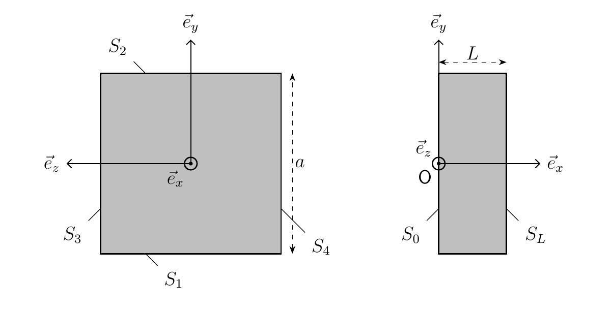

#### Question 2.17.1

*Montrer que le tenseur des contraintes vérifie les conditions aux limites sur les surfaces $S_3$ et $S_4$.* 验证 $S_3$、$S_4$ 上的边界条件

**答案**

Sur $z=\pm a/2$, $\vec n=\pm\vec e_z$ et $\boldsymbol\sigma\vec e_z=\vec0$ (troisième colonne nulle) : les faces sont bien libres.

**Détail · 推导**

$S_3,S_4$ 的外法向为 $\pm\vec e_z$，$\boldsymbol\sigma\vec n=\pm(\sigma_{xz},\sigma_{yz},\sigma_{zz})=\vec0$，因为第三列全为零。所以这两个面自动满足"自由面"条件，这正是平面应力形式的意义。

#### Question 2.17.2

*On choisit $\sigma_{xy}=K(A+By+y^2)$, avec $K>0$ connu, dans tout le volume. Exprimer les équations issues de la vérification des conditions aux limites sur $S_1$, $S_2$ et $S_L$.* 写出 $S_1$、$S_2$、$S_L$ 上的边界条件方程

**答案**

- $S_2$ ($y=a/2$, $\vec n=\vec e_y$) : $\sigma_{xy}(a/2)=0\Rightarrow A+B\frac a2+\frac{a^2}4=0$, et $\sigma_{yy}(a/2)=0$ ;
- $S_1$ ($y=-a/2$, $\vec n=-\vec e_y$) : $A-B\frac a2+\frac{a^2}4=0$, et $\sigma_{yy}(-a/2)=0$ ;
- $S_L$ ($x=L$, $\vec n=\vec e_x$) : $\sigma_{xx}(L,y)=0$ et $K(A+By+y^2)=f(y)$.

**Détail · 推导**

逐面写 $\boldsymbol\sigma\vec n=\vec T_d$：

| 面 | 外法向 | $\boldsymbol\sigma\vec n$ | 条件 |
|---|---|---|---|
| $S_2$：$y=a/2$ | $\vec e_y$ | $(\sigma_{xy},\sigma_{yy},0)$ | $\sigma_{xy}(a/2)=0$，$\sigma_{yy}(a/2)=0$ |
| $S_1$：$y=-a/2$ | $-\vec e_y$ | $-(\sigma_{xy},\sigma_{yy},0)$ | $\sigma_{xy}(-a/2)=0$，$\sigma_{yy}(-a/2)=0$ |
| $S_L$：$x=L$ | $\vec e_x$ | $(\sigma_{xx},\sigma_{xy},0)$ | $\sigma_{xx}(L,y)=0$，$\sigma_{xy}(L,y)=f(y)$ |

代入 $\sigma_{xy}$ 的形式即得上面三组方程。

#### Question 2.17.3

*En déduire l’expression de $A$, $B$ et $f(y)$.* 求 $A$、$B$ 与 $f(y)$

**答案**

En soustrayant et en ajoutant les deux conditions : $B=0$, $A=-a^2/4$, d’où $\sigma_{xy}=K\left(y^2-\frac{a^2}4\right)$ et $f(y)=K\left(y^2-\frac{a^2}4\right)$.

**Détail · 推导**

两式相减得 $Ba=0\Rightarrow B=0$；两式相加得 $2A+a^2/2=0\Rightarrow A=-a^2/4$。于是

$$\sigma_{xy}=K\Bigl(y^2-\frac{a^2}{4}\Bigr),\qquad f(y)=K\Bigl(y^2-\frac{a^2}{4}\Bigr)\le0 .$$

剪应力在上下自由面为零、在中面 $y=0$ 达到最大绝对值 $Ka^2/4$，是抛物线分布（与梁理论中矩形截面的剪应力分布相同）。

#### Question 2.17.4

*Appliquer l’équation d’équilibre local. En déduire $\sigma_{xx}$ et $\sigma_{yy}$.* 局部平衡，求 $\sigma_{xx}$ 与 $\sigma_{yy}$

**答案**

$\overrightarrow{\operatorname{div}}\boldsymbol\sigma=\vec0$ donne $\partial_x\sigma_{xx}=-\partial_y\sigma_{xy}=-2Ky$ et $\partial_y\sigma_{yy}=-\partial_x\sigma_{xy}=0$. Avec $\sigma_{xx}(L)=0$ et $\sigma_{yy}(\pm a/2)=0$ : $\sigma_{xx}=2Ky(L-x)$, $\sigma_{yy}=0$.

**Détail · 推导**

无体力的静力平衡 $\overrightarrow{\operatorname{div}}\boldsymbol\sigma=\vec0$，按直角坐标展开（与 $z$ 无关、第三列为零）：

$$\begin{cases}\partial_x\sigma_{xx}+\partial_y\sigma_{xy}=0\\ \partial_x\sigma_{xy}+\partial_y\sigma_{yy}=0\end{cases}
\Rightarrow
\begin{cases}\partial_x\sigma_{xx}=-2Ky\ \Rightarrow\ \sigma_{xx}=-2Kxy+C_1(y)\\ \partial_y\sigma_{yy}=0\ \Rightarrow\ \sigma_{yy}=C_2(x)\end{cases}$$

用 $\sigma_{xx}(L,y)=0$ 得 $C_1(y)=2KLy$；用 $\sigma_{yy}(x,\pm a/2)=0$ 得 $C_2=0$。最终

$$\boldsymbol\sigma=K\begin{pmatrix}2y(L-x)&y^2-a^2/4&0\\y^2-a^2/4&0&0\\0&0&0\end{pmatrix}.$$

$|\sigma_{xx}|$ 关于 $y$ 线性增大、在 $x=0,\ |y|=a/2$ 处取到最大值，这就是悬臂梁的弯曲正应力。

#### Question 2.17.5

*Déduire de ce résultat les éléments de réduction du torseur d’action $\mathcal T_0$.* $S_0$ 上力旋量的约化元素

**答案**

Sur $S_0$, $\vec n=-\vec e_x$ et $\vec T=-(\sigma_{xx},\sigma_{xy},0)|_{x=0}=\bigl(-2KLy,\ K(\frac{a^2}4-y^2),\ 0\bigr)$. D’où $\vec R_0=\frac{Ka^4}{6}\vec e_y$ et $\vec M_{0/O}=\frac{KLa^4}{6}\vec e_z$.

**Détail · 推导**

$S_0$ 的外法向是 $-\vec e_x$，面上点 $\overrightarrow{OM}=(0,y,z)$。

合力：

$$\vec R_0=\int_{S_0}\boldsymbol\sigma\vec n\,\mathrm dS
=\int_{-a/2}^{a/2}\!\!\int_{-a/2}^{a/2}\begin{pmatrix}-2KLy\\K(a^2/4-y^2)\\0\end{pmatrix}\mathrm dy\,\mathrm dz
=aK\begin{pmatrix}0\\a^3/4-a^3/12\\0\end{pmatrix}=\frac{Ka^4}{6}\vec e_y .$$

$x$ 分量是 $y$ 的奇函数，积分为零。

力矩：

$$\overrightarrow{OM}\wedge\vec T=\begin{pmatrix}0\\y\\z\end{pmatrix}\wedge\begin{pmatrix}-2KLy\\K(a^2/4-y^2)\\0\end{pmatrix}
=\begin{pmatrix}-zK(a^2/4-y^2)\\-2KLyz\\2KLy^2\end{pmatrix},$$

前两项是 $z$ 的奇函数，积分为零；第三项

$$M_z=2KLa\int_{-a/2}^{a/2}y^2\,\mathrm dy=2KLa\cdot\frac{a^3}{12}=\frac{KLa^4}{6}.$$

**检查整体平衡：** $S_L$ 上的合力 $\int f\,\mathrm dS=-\frac{Ka^4}{6}\vec e_y$，与 $\vec R_0$ 抵消；$S_L$ 上的面力对 $O$ 的力矩 $L\vec e_x\wedge(-\frac{Ka^4}6\vec e_y)=-\frac{KLa^4}{6}\vec e_z$，与 $\vec M_{0/O}$ 抵消。这说明 $S_0$ 上的面力正好提供了维持整体平衡所需的剪力与弯矩。

## 4　Élasticité · 弹性问题（题库）

### CC2 · 第 4 题读题：先列弹性问题，再看给的是哪个场

**两年第一小问都用 *poser le problème*。** 这里要把方程和边界条件列全。答题纸上可以先写三行：**CA** 放应变与位移的关系及给定的位移分量；**SA** 放体内平衡及给定的面力分量；**loi de comportement** 放材料本构。然后回到题面，把每个面的条件填到对应行。一张光滑支承面可以同时给出法向位移和切向面力。

| 题面中的物体 | 决定解法的一句法语 | 第一笔写什么，后面求什么 |
|---|---|---|
| **2024 · 受拉梁**（4.4）。*poutre en traction* 是受轴向拉力的梁，底面可滑动。 | *On cherche un champ de contraintes de la forme…* 给了候选**应力场**，唯一未知函数是 $g(z)$。 | 本题无体力且仅有 $\sigma_{zz}=g(z)$，体内平衡给 $g'(z)=0$。顶端均匀拉力确定应力，逆 Hooke 定律给应变，再检验候选位移能否产生这些应变。 |
| **2025 · 涡轮转子**（4.10）。*disque* 是圆盘，*repère attaché au disque* 是随盘转动的参考系。 | *Le champ de déplacement a la forme…* 给了径向**位移场** $\vec u=u_r(r)\vec e_r$。 | 柱坐标下先写 $\varepsilon_{rr}=u_r'$、$\varepsilon_{\theta\theta}=u_r/r$。用 Hooke 得应力，把题给离心体力代入径向平衡。用圆心有界和外缘自由定常数，最后做 Tresca 校核。 |

**几种容易读懂单词却答偏的问法。**

- *Le problème admet-il une solution unique ?* 分别回答应力、应变和位移。检验位移时，把刚体位移 $\vec c+\vec\omega\times\overrightarrow{OM}$ 代入齐次位移边界条件。受拉梁底面的 $u_z=0$ 仍允许面内平移和绕 $z$ 轴转动。
- *Le champ proposé est-il solution ? Justifier.* 要检验给出的场。对候选位移求对称梯度，逐个比较所需应变，再检查位移边界。受拉梁有泊松收缩，纯轴向位移给不出所需的横向应变。
- *Exprimer … en fonction de $u_r$* 只要求用 $u_r$ 及其导数表示。*Déterminer les constantes à l’aide des conditions aux limites* 才要求把条件代入通解，写出常数方程。
- *Dimensionner le rayon … à vitesse de rotation fixée* 角速度已固定，待求的是半径。先写 $\max_{\Omega}\sigma_{\mathrm{Tr}}\leq\sigma_e$，再说明最大值在哪里、尺寸如何进入不等式。

**受压厚壁管**同样有径向位移。管内有孔，区域不含 $r=0$，通解中的 $1/r$ 项可以保留；内外壁的压力条件用来定两个常数。

### Lois de comportement · 本构的写法

#### ① Écrire la loi de comportement · 写本构关系

*Rappeler les relations de comportement directe $\boldsymbol\sigma=f_1(\boldsymbol\varepsilon)$ et inverse $\boldsymbol\varepsilon=f_2(\boldsymbol\sigma)$*

Élasticité linéaire isotrope homogène (HPP) · 线弹性、各向同性、均质：

$$\boldsymbol\sigma=\lambda\operatorname{tr}(\boldsymbol\varepsilon)\,\mathbb I+2\mu\,\boldsymbol\varepsilon,\qquad
\boldsymbol\varepsilon=\frac{1+\nu}E\,\boldsymbol\sigma-\frac\nu E\operatorname{tr}(\boldsymbol\sigma)\,\mathbb I .$$

- Forme directe avec $E,\nu$ : $\boldsymbol\sigma=\dfrac E{1+\nu}\boldsymbol\varepsilon+\dfrac{E\nu}{(1+\nu)(1-2\nu)}\operatorname{tr}(\boldsymbol\varepsilon)\,\mathbb I$. 用 $E,\nu$ 写的正关系。
- Composantes (inverse) : $\varepsilon_{11}=\frac1E\bigl[\sigma_{11}-\nu(\sigma_{22}+\sigma_{33})\bigr]$, $\varepsilon_{12}=\frac{1+\nu}E\sigma_{12}=\frac{\sigma_{12}}{2\mu}$. 逆关系的分量式。
- Partie sphérique / déviatorique : $\operatorname{tr}\boldsymbol\sigma=3K\operatorname{tr}\boldsymbol\varepsilon$, $\boldsymbol\sigma^D=2\mu\,\boldsymbol\varepsilon^D$. 球量与偏量分开：体积模量与剪切模量。
- Démonstration du lien entre coefficients : prendre la trace de la loi directe, $\operatorname{tr}\boldsymbol\sigma=(3\lambda+2\mu)\operatorname{tr}\boldsymbol\varepsilon$, puis inverser et identifier avec la loi inverse. 证明常数关系：对正关系取迹，反解后与逆关系比较。
- L'opérateur de Hooke $\mathbb K$ est linéaire, symétrique, défini positif ; cas général anisotrope : 21 coefficients indépendants ; isotrope : 2 ($\lambda,\mu$ ou $E,\nu$). Hooke 算子线性、对称、正定；各向异性 21 个独立系数，各向同性 2 个。

**法语答题句**

Le matériau est élastique linéaire isotrope homogène : $\boldsymbol\sigma=\lambda\operatorname{tr}(\boldsymbol\varepsilon)\mathbb I+2\mu\boldsymbol\varepsilon$, soit de manière équivalente $\boldsymbol\varepsilon=\frac{1+\nu}E\boldsymbol\sigma-\frac\nu E\operatorname{tr}(\boldsymbol\sigma)\mathbb I$. 材料是线弹性、各向同性、均质的；正关系与逆关系等价。

#### ② Des contraintes aux déformations · 由应力求应变（逆关系）

*Appliquer la relation de comportement pour en déduire le champ des déformations*

1. Calculer $\operatorname{tr}\boldsymbol\sigma$. 先算迹。
2. $\boldsymbol\varepsilon=\frac{1+\nu}E\boldsymbol\sigma-\frac\nu E\operatorname{tr}(\boldsymbol\sigma)\mathbb I$, composante par composante. 逐分量代入。
3. Traction simple $\boldsymbol\sigma=\sigma\,\vec e_z\otimes\vec e_z$ : $\boldsymbol\varepsilon=\frac\sigma E\operatorname{diag}(-\nu,-\nu,1)$ (contraction latérale = effet Poisson) ; variation de volume $\operatorname{tr}\boldsymbol\varepsilon=\frac{(1-2\nu)\sigma}E$. 单轴拉伸：横向收缩（泊松效应）；体积变化。
4. Pression hydrostatique $\boldsymbol\sigma=-p\,\mathbb I$ : $\boldsymbol\varepsilon=-\frac{(1-2\nu)p}E\mathbb I=-\frac p{3K}\mathbb I$, $\operatorname{tr}\boldsymbol\varepsilon=-\frac pK$ (variation relative de volume) ; aucun cisaillement sur aucune facette ($\boldsymbol\sigma$ sphérique). 静水压：迹 = 体积相对变化 = $-p/K$；球形张量任何面上无切应力。

**法语答题句**

En appliquant la relation de comportement inverse : $\boldsymbol\varepsilon=\frac{1+\nu}E\boldsymbol\sigma-\frac\nu E\operatorname{tr}(\boldsymbol\sigma)\mathbb I=\frac F{ES}\operatorname{diag}(-\nu,-\nu,1)$ : allongement selon l'axe et contraction latérale (effet Poisson). 用逆本构得到应变：沿轴伸长、横向收缩。

#### ③ Des déplacements aux contraintes · 由位移求应力（正关系）

*Calculer la forme du tenseur des contraintes en fonction du déplacement*

1. $\boldsymbol\varepsilon(\vec u)$ (题库第 1 部分解题步骤 ⑨ ; en cylindrique : 解题步骤表 A). 先算应变。
2. $\operatorname{tr}\boldsymbol\varepsilon=\operatorname{div}\vec u$.
3. $\sigma_{ii}=\lambda\operatorname{tr}\boldsymbol\varepsilon+2\mu\varepsilon_{ii}$ (diagonal), $\sigma_{ij}=2\mu\varepsilon_{ij}$ (hors diagonale). 对角元有 $\lambda\operatorname{tr}\boldsymbol\varepsilon$，非对角元是 $2\mu\varepsilon_{ij}$。
4. Cisaillement : $\tau=\mu\gamma=2\mu\varepsilon_{12}$ ($\mu$ = module de cisaillement, différent de $E$). 剪切：$\tau=\mu\gamma$。

#### ④ Constantes, application numérique · 常数换算与数值

*Exprimer $\lambda$ et $\mu$ en fonction de $E$ et $\nu$ ; application numérique*

- Formules : 本构表 A. Unités : $E,\lambda,\mu,K$ en Pa (souvent GPa) ; $\nu$ sans dimension, $-1<\nu<\frac12$ (souvent 0,25–0,35). 常数单位 Pa；泊松比无量纲，范围 $-1<\nu<\frac12$。
- Sans calculatrice, $E=200$ GPa, $\nu=0{,}3$ : $\mu=\frac{200}{2{,}6}\approx76{,}9$ GPa ; $\lambda=\frac{200\times0{,}3}{1{,}3\times0{,}4}=\frac{60}{0{,}52}\approx115{,}4$ GPa ; $K=\frac{200}{1{,}2}\approx166{,}7$ GPa. On constate $\mu<E/2$. 手算示例；可见 $\mu$ 小于 $E/2$。
- Incompressible : $\operatorname{tr}\boldsymbol\varepsilon=0$ ⇒ $K\to\infty$, $\nu\to\frac12$ ; la pression devient une réaction (ne pas remplacer $\nu=\frac12$ dans $1-2\nu$ au dénominateur). 不可压缩：$K\to\infty$，$\nu\to\frac12$；不能把 ½ 代进分母。
- Déformation plastique isochore : $\operatorname{tr}\boldsymbol\varepsilon^p=0$ ⇒ 5 composantes indépendantes en 3D. 塑性等体积：3D 中 5 个独立分量。

#### ⑤ Thermoélasticité · 热弹性

*Écrire la relation de comportement anisotherme ; contraintes d'origine thermique*

$$\boldsymbol\sigma=\mathbb K:(\boldsymbol\varepsilon-\boldsymbol\varepsilon^{th}),\quad\boldsymbol\varepsilon^{th}=\alpha\,\delta T\,\mathbb I=\frac{\alpha_v}3\delta T\,\mathbb I,\quad
\boldsymbol\sigma=\lambda\operatorname{tr}(\boldsymbol\varepsilon)\mathbb I+2\mu\boldsymbol\varepsilon-K\alpha_v\,\delta T\,\mathbb I,$$
$$\boldsymbol\varepsilon=\frac{1+\nu}E\boldsymbol\sigma-\frac\nu E\operatorname{tr}(\boldsymbol\sigma)\mathbb I+\alpha\,\delta T\,\mathbb I .$$

- $\alpha$ dilatation linéique ($\mathrm K^{-1}$), $\alpha_v=3\alpha$ dilatation volumique ; coefficient du terme thermique : $K\alpha_v=3K\alpha=(3\lambda+2\mu)\alpha=\dfrac{E\alpha}{1-2\nu}$ ($E\alpha$ seulement pour une barre à surface latérale libre). 线膨胀系数与体膨胀系数；热项系数是 $3K\alpha$，只有侧面自由的杆才是 $E\alpha$。
- La contrainte ne dépend que de la déformation **élastique** ; la dilatation thermique est sphérique (pas de glissement). 应力只与弹性应变有关；热应变是各向同性的，不产生剪应变。
- Sans effort extérieur, des contraintes peuvent exister : température non uniforme ou dilatation empêchée (本构表 B). 没有外力也可能有应力：温度不均匀或膨胀受阻。

**法语答题句**

La relation de comportement anisotherme s'écrit $\boldsymbol\sigma=2\mu\boldsymbol\varepsilon+\lambda\operatorname{tr}(\boldsymbol\varepsilon)\mathbb I-K\alpha_v\,\delta T\,\mathbb I$ : seule la déformation élastique $\boldsymbol\varepsilon-\boldsymbol\varepsilon^{th}$ crée des contraintes.
Un champ de température non uniforme peut créer des contraintes même en l'absence de tout effort extérieur et de tout déplacement imposé. 非等温本构：只有弹性应变产生应力；不均匀温度场在没有任何外载时也能产生应力。

#### ⑥ Solide ou fluide ? · 固体还是流体

*Quelle(s) relation(s) de comportement correspondent à des milieux fluides (à un fluide newtonien) ?*

| Loi · 本构 | Milieu · 介质 |
|---|---|
| $\boldsymbol\sigma=\lambda\operatorname{tr}(\boldsymbol\varepsilon)\mathbb I+2\mu\boldsymbol\varepsilon$ ; $\boldsymbol\varepsilon=\frac{1+\nu}E\boldsymbol\sigma-\frac\nu E\operatorname{tr}(\boldsymbol\sigma)\mathbb I$ | solide élastique (même loi, directe / inverse) · 线弹性固体（同一本构的正、逆形式） |
| $\boldsymbol\sigma=-p\,\mathbb I$ | fluide parfait · 理想流体 |
| $\boldsymbol\sigma=-p\,\mathbb I+2\mu_v\mathbb D$ ($+\lambda_v\operatorname{tr}\mathbb D\,\mathbb I$ si compressible) | fluide newtonien · 牛顿流体 |

Règle : $\boldsymbol\varepsilon$, $E$, $\nu$, $\lambda$, $\mu$ → solide ; $p$, $\mathbb D$, $\mu_v$ → fluide. « Fluide » : cocher parfait **et** newtonien ; « fluide newtonien » : seulement la loi avec $\mathbb D$. $\mu$ solide (module de cisaillement, Pa) ≠ $\mu_v$ fluide (viscosité, Pa·s). 判别口诀：含 ε、E、ν、λ、μ 的是固体；含 p、D、μ_v 的是流体。问"流体"两个都选，问"牛顿流体"只选含 D 的；固体的 μ（Pa）与流体的黏度（Pa·s）量纲不同。

#### Table A　Conversion des constantes · 本构表 A：常数换算

| | à partir de $E,\nu$ · 由 $E,\nu$ | à partir de $\lambda,\mu$ · 由 $\lambda,\mu$ |
|---|---|---|
| $\mu$ ($=G$) | $\dfrac E{2(1+\nu)}$ | — |
| $\lambda$ | $\dfrac{E\nu}{(1+\nu)(1-2\nu)}$ | — |
| $K$ | $\dfrac E{3(1-2\nu)}$ | $\lambda+\dfrac23\mu$ |
| $E$ | — | $\dfrac{\mu(3\lambda+2\mu)}{\lambda+\mu}$ |
| $\nu$ | — | $\dfrac\lambda{2(\lambda+\mu)}$ |

Combinaisons utiles · 常用组合 : $\lambda+2\mu=\dfrac{E(1-\nu)}{(1+\nu)(1-2\nu)}$ ; $3\lambda+2\mu=3K=\dfrac E{1-2\nu}$ ; $\dfrac\lambda{\lambda+2\mu}=\dfrac\nu{1-\nu}$ ; $\dfrac\mu{\lambda+\mu}=1-2\nu$ ; $\dfrac{\lambda+\mu}{\lambda+2\mu}=\dfrac1{2(1-\nu)}$ ; $\dfrac{3\lambda+2\mu}{\lambda+2\mu}=\dfrac{1+\nu}{1-\nu}$.

#### Table B　Cas thermiques (élévation uniforme $\delta T=T_0$) · 本构表 B：均匀温升的典型情形

| Cas · 情形 | Déplacement · 位移 | Déformation · 应变 | Contrainte · 应力 |
|---|---|---|---|
| structure libre · 自由结构 | $\vec u=\alpha T_0\,\overrightarrow{OM}$ (+ rigide) | $\alpha T_0\,\mathbb I$ | $\mathbb O$ |
| totalement bloquée ($\vec u=\vec0$ sur tout le bord) · 完全约束 | $\vec0$ | $\mathbb O$ | $-3K\alpha T_0\,\mathbb I$ (compression · 受热被压) |
| barre encastrée aux deux bouts, latérale libre · 两端固定的杆 | $u_x=0$ | $\varepsilon_{xx}=0$ | $\sigma_{xx}=-E\alpha T_0$ |
| plaque mince bloquée dans son plan · 面内全约束的薄板 | nul dans le plan | nul dans le plan | $\sigma_{11}=\sigma_{22}=-\dfrac{E\alpha T_0}{1-\nu}$ |

### Méthode · 弹性问题大题的解题步骤

#### ① Poser le problème (CA, SA, comportement) · 建立问题

*Poser le problème en écrivant les équations et conditions aux limites, en précisant si elles portent sur l'admissibilité cinématique ou statique*

1. Domaine (ex. $r\in[R_1,R_2]$, $\theta\in[0,2\pi]$, $z\in[0,h]$) et hypothèses : statique, HPP, élastique linéaire isotrope homogène, forces volumiques prises en compte ou négligées. 写区域和假设：静力、HPP、线弹性各向同性均质、体力是否忽略。
2. **CA** (cinématique) : $\boldsymbol\varepsilon(\vec u)=\frac12(\overrightarrow{\operatorname{grad}}\vec u+\overrightarrow{\operatorname{grad}}^{\mathsf T}\vec u)$, $\vec u$ continu et régulier ; conditions en déplacement face par face (encastrement $\vec u=\vec0$ ; contact glissant $\vec u\cdot\vec n=0$ ; $u_\theta(L)$ imposé…). 运动学可容：HPP 应变定义、位移连续正则；逐面写位移条件。
3. **SA** (statique) : $\overrightarrow{\operatorname{div}}\boldsymbol\sigma+\vec f_d=\vec0$ dans $\Omega$ ; conditions en effort face par face (libre, pression, effort imposé, torseur imposé ; contact glissant : effort tangentiel nul). 静力学可容：局部平衡；逐面写力条件（滑动面的切向面力为零）。
4. **Relation de comportement** : Hooke (directe si on donne $\lambda,\mu$ ; inverse si on donne $E,\nu$) ; anisotherme : soustraire la dilatation thermique (解题步骤 ⑬ ; 本构 ⑤). 本构：Hooke；非等温时减去热应变。
5. Présenter en liste, chaque équation étiquetée CA / SA / RdC. La solution est un couple ($\vec u$ CA, $\boldsymbol\sigma$ SA) relié par la loi de comportement. 分条列出并标注类别；解 = 一个 CA 位移场与一个 SA 应力场，由本构联系。

| Frontière · 边界 | CA (déplacement · 位移) | SA (effort · 力) |
|---|---|---|
| effort imposé · 给定面力 | — | $\boldsymbol\sigma\vec n=\vec T_d$ |
| libre · 自由面 | — | $\boldsymbol\sigma\vec n=\vec0$ |
| pression $p$ · 压力 | — | $\boldsymbol\sigma\vec n=-p\vec n$ |
| torseur imposé (forme faible) · 给定合力旋量 | — | $\int\boldsymbol\sigma\vec n\,\mathrm dS=\vec R$, $\int\overrightarrow{AM}\wedge\boldsymbol\sigma\vec n\,\mathrm dS=\vec M_A$ |
| encastrement · 固定 | $\vec u=\vec0$ (ou $\vec u_d$) | — |
| contact glissant / plan de symétrie · 滑动接触、对称面 | $\vec u\cdot\vec n=0$ | $(\boldsymbol\sigma\vec n)\cdot\vec t=0$ pour tout $\vec t$ tangent |
| interface collée · 粘结界面 | $\llbracket\vec u\rrbracket=\vec0$ | $\llbracket\boldsymbol\sigma\rrbracket\vec n=\vec0$ |

En chaque point du bord et pour chaque direction : on impose **soit** le déplacement **soit** l'effort, jamais les deux, jamais aucun. 边界上每点每个方向：要么给位移，要么给力；不能两者都给，也不能都不给。

**法语答题句**

Admissibilité cinématique (CA) : $\boldsymbol\varepsilon=\frac12(\overrightarrow{\operatorname{grad}}\vec u+\overrightarrow{\operatorname{grad}}^{\mathsf T}\vec u)$ dans $\Omega$ (HPP), $\vec u$ continu ; $u_z=0$ sur les bases $z=0$ et $z=h$.
Admissibilité statique (SA) : $\overrightarrow{\operatorname{div}}\boldsymbol\sigma+\vec f=\vec0$ dans $\Omega$ ; $\boldsymbol\sigma\vec n=-p_1\vec n$ en $r=R_1$ ($\vec n=-\vec e_r$), $\boldsymbol\sigma\vec n=-p_2\vec n$ en $r=R_2$ ($\vec n=\vec e_r$) ; efforts tangentiels nuls sur les bases.
Relation de comportement : $\boldsymbol\sigma=\lambda\operatorname{tr}(\boldsymbol\varepsilon)\mathbb I+2\mu\boldsymbol\varepsilon$ dans $\Omega$. CA：HPP 应变、位移连续、两底面轴向位移为零；SA：局部平衡、内外壁压力、底面切向面力为零；本构：Hooke。

#### ② Justifier la forme du champ · 论证场的形式

*Justifier la forme du champ de déplacement $\vec u=u(r)\,\vec e_r$ (du champ de contrainte proposé)*

Éliminer composantes et variables une par une à l'aide de la **géométrie** et du **chargement** : 逐条用几何和载荷的性质消去分量和变量：

| Propriété · 性质 | Conséquence · 结论 |
|---|---|
| axisymétrie (géométrie et chargement) · 轴对称 | $\partial_\theta(\cdot)=0$ |
| chargement purement radial · 载荷纯径向 | $u_\theta=0$ |
| déplacement axial bloqué / pas de charge axiale · 轴向被挡 | $u_z=0$ |
| solide long ou conditions identiques aux deux bouts · 很长 | $\partial_z(\cdot)=0$ (déformations planes) |
| symétrie sphérique · 球对称 | $\vec u=u_r(r)\vec e_r$, $\sigma_{\theta\theta}=\sigma_{\varphi\varphi}$ |
| invariance selon $x$, $y$, symétries $(Oxz)$, $(Oyz)$ | $\partial_x=\partial_y=0$ |
| charge axiale seule, surface latérale libre · 只有轴向载荷、侧面自由 | seul $\sigma_{zz}\ne0$ |
| torsion (rotation des extrémités, pas d'effort axial) · 扭转 | $\vec u=u_\theta(r,z)\,\vec e_\theta$ |

Conclure en vérifiant que la forme obtenue est compatible avec les conditions aux limites. 最后说明这个形式与边界条件相容。

**法语答题句**

La géométrie et le chargement sont axisymétriques : les champs ne dépendent pas de $\theta$ et $u_\theta=0$ (chargement purement radial). Le déplacement axial étant bloqué et le solide long, $u_z=0$ et rien ne dépend de $z$. D'où $\vec u=u(r)\,\vec e_r$. 几何与载荷轴对称 ⇒ 与 θ 无关、$u_\theta=0$；轴向被挡且很长 ⇒ $u_z=0$、与 z 无关；所以 $\vec u=u(r)\vec e_r$。

#### ③ Unicité, mouvements de corps rigide · 唯一性、刚体模态

*Le problème admet-il une solution unique ? Pourquoi ?*

1. Problème bien posé ⇒ déformations et contraintes **uniques** ; le déplacement est unique à un mouvement de corps rigide près $\vec\lambda_0+\vec\omega_0\wedge\overrightarrow{OM}$. 良定 ⇒ 应变、应力唯一；位移差一个刚体运动。
2. Lister les 6 mouvements rigides (3 translations, 3 rotations) bloqués par les conditions en déplacement (table C) ; écrire la composante concernée du déplacement rigide et l'annuler en tout point de la face. 列出 6 个刚体运动中哪些被位移条件挡住（查表 C）：把刚体位移在该面上的对应分量令为零。
3. Existence quand seuls des efforts sont imposés : les efforts extérieurs doivent être en équilibre (résultante et moment nuls). 只给力时，解存在的条件是外力自身平衡。

**法语答题句**

Le problème est bien posé : la solution est unique en contraintes et en déformations. Le déplacement est défini à un mouvement de corps rigide près : la condition $u_z=0$ sur la base bloque la translation selon $\vec e_z$ et les rotations autour de $O\vec e_x$ et $O\vec e_y$ ; restent les translations selon $\vec e_x$, $\vec e_y$ et la rotation autour de $\vec e_z$. 问题良定，应力、应变唯一；位移差一个刚体运动：底面 $u_z=0$ 挡住沿 $\vec e_z$ 平移和绕 $\vec e_x$、$\vec e_y$ 的转动，剩下沿 $\vec e_x$、$\vec e_y$ 平移和绕 $\vec e_z$ 转动。

#### ④ Choisir la méthode · 选位移法还是应力法

| | Approche en déplacement (Navier) · 位移法 | Approche en contrainte · 应力法 |
|---|---|---|
| quand · 何时用 | déplacements imposés, symétrie radiale, forces volumiques | efforts imposés, champ de contrainte simple (traction) |
| démarche · 步骤 | forme CA de $\vec u$ → $\boldsymbol\varepsilon$ → $\boldsymbol\sigma$ → équilibre (Navier) → **CL en effort** | forme SA de $\boldsymbol\sigma$ → $\boldsymbol\varepsilon$ (loi inverse) → intégrer $\vec u$ (**compatibilité**) → **CL en déplacement** |
| à vérifier · 要检查 | conditions en effort (l'équilibre est déjà dans Navier) | compatibilité et conditions en déplacement |

位移法：设 CA 位移 → 应变 → 应力 → 平衡（Navier）→ 用力边界条件定常数。应力法：设 SA 应力 → 逆本构求应变 → 积分位移（检查协调）→ 检查位移边界条件。

#### ⑤ $\boldsymbol\varepsilon$ et $\boldsymbol\sigma$ en fonction de $u_r$ · 由 $u_r$ 求应变与应力

*Calculer la forme des tenseurs de déformation et de contrainte en fonction de $u_r$*

Gradient en cylindrique · 柱坐标位移梯度：
$$\overrightarrow{\operatorname{grad}}\vec u=\begin{pmatrix}\partial_ru_r&\frac1r(\partial_\theta u_r-u_\theta)&\partial_zu_r\\\partial_ru_\theta&\frac1r(\partial_\theta u_\theta+u_r)&\partial_zu_\theta\\\partial_ru_z&\frac1r\partial_\theta u_z&\partial_zu_z\end{pmatrix}$$

- $\vec u=u(r)\vec e_r$, $u_z=0$ : $\boldsymbol\varepsilon=\operatorname{diag}\bigl(u',\ \frac ur,\ 0\bigr)$, $\operatorname{tr}\boldsymbol\varepsilon=u'+\frac ur=\frac1r(ru)'$. 柱坐标径向位移的应变；别漏 $\varepsilon_{\theta\theta}=u/r$。
- $\sigma_{rr}=(\lambda+2\mu)u'+\lambda\frac ur$, $\sigma_{\theta\theta}=\lambda u'+(\lambda+2\mu)\frac ur$, $\sigma_{zz}=\lambda\bigl(u'+\frac ur\bigr)$ : diagonal dans $(\vec e_r,\vec e_\theta,\vec e_z)$. 应力已对角；$\varepsilon_{zz}=0$ 但 $\sigma_{zz}\ne0$。
- Sphère : table A. 球坐标见查表 A。

**法语答题句**

Seuls $\partial_ru_r=u_r'$ et $u_r/r$ sont non nuls : $\boldsymbol\varepsilon=\operatorname{diag}(u_r',u_r/r,0)$ dans $(\vec e_r,\vec e_\theta,\vec e_z)$. Avec $\operatorname{tr}\boldsymbol\varepsilon=u_r'+u_r/r$, la loi de Hooke donne $\sigma_{rr}=(\lambda+2\mu)u_r'+\lambda\frac{u_r}r$, $\sigma_{\theta\theta}=\lambda u_r'+(\lambda+2\mu)\frac{u_r}r$, $\sigma_{zz}=\lambda\operatorname{tr}\boldsymbol\varepsilon\neq0$ : le blocage axial crée une contrainte axiale. 只有两项非零；代入 Hooke；轴向被挡产生轴向应力。

#### ⑥ Équation de Navier, intégration · Navier 方程与积分

*Montrer à l'aide de l'équation de Navier que $u(r)=K_1/r+K_2r$ (ou $C_1r^3+C_2r+C_3/r$)*

$$\mu\Delta\vec u+(\lambda+\mu)\overrightarrow{\operatorname{grad}}(\operatorname{div}\vec u)+\vec f=\rho\vec\gamma
\iff(\lambda+2\mu)\overrightarrow{\operatorname{grad}}(\operatorname{div}\vec u)-\mu\,\overrightarrow{\operatorname{rot}}\,\overrightarrow{\operatorname{rot}}\vec u+\vec f=\rho\vec\gamma .$$

1. Navier = équilibre + Hooke + HPP (pas les conditions aux limites). Champ radial ⇒ $\overrightarrow{\operatorname{rot}}\vec u=\vec0$ ⇒ $(\lambda+2\mu)\overrightarrow{\operatorname{grad}}(\operatorname{div}\vec u)+\vec f=\vec0$. Navier = 平衡 + 本构 + HPP，不含边界条件；径向场无旋，方程化简。
2. Cylindre : $(\lambda+2\mu)\dfrac{\mathrm d}{\mathrm dr}\Bigl[\dfrac1r\dfrac{\mathrm d}{\mathrm dr}(ru)\Bigr]+f_r=0$ ; sphère : $(\lambda+2\mu)\dfrac{\mathrm d}{\mathrm dr}\Bigl[\dfrac1{r^2}\dfrac{\mathrm d}{\mathrm dr}(r^2u)\Bigr]+f_r=0$. Équivalent : $u''+\frac{u'}r-\frac u{r^2}=\frac{\mathrm d}{\mathrm dr}\bigl[\frac1r(ru)'\bigr]$. 柱、球的径向方程；左边可以写成逐次求导的形式。
3. Intégrer deux fois : solution homogène (cylindre $Ar+\frac Br$, sphère $Ar+\frac B{r^2}$) + solution particulière (table A). 积分两次：齐次解 + 特解（查表 A）。
4. Forces volumiques : rotation à $\omega$ (repère tournant) $f_r=+\rho\omega^2r$ ; autogravitation d'une sphère $f_r=-\rho g\,r/R$ ; pesanteur $-\rho g\vec e_z$ (non radiale). 体力：随动系中的离心力；球的自引力；竖直重力。

**法语答题句**

Le champ étant radial, $\overrightarrow{\operatorname{rot}}\vec u=\vec0$ et l'équation de Navier se réduit à $(\lambda+2\mu)\frac{\mathrm d}{\mathrm dr}\bigl[\frac1r\frac{\mathrm d}{\mathrm dr}(ru)\bigr]+f_r=0$. En intégrant deux fois : $u(r)=\frac{K_1}r+K_2r$ (sans force volumique). 径向场无旋，Navier 化为常微分方程；积分两次得通解。

#### ⑦ Constantes par les conditions aux limites · 用边界条件定常数

*En utilisant les conditions aux limites, calculer les constantes ; en déduire $\vec u$ et $\boldsymbol\sigma$*

1. Domaine contenant $r=0$ (plein) : $B/r$ ou $B/r^2$ infini au centre ⇒ $B=0$. Domaine creux : garder deux constantes. 实心体中心有界 ⇒ 去掉奇异项；空心体保留两个常数。
2. Conditions en effort : surface libre $\sigma_{rr}(R)=0$ ; pression $\sigma_{rr}=-p$ (paroi intérieure : $\vec n=-\vec e_r$, on obtient quand même $\sigma_{rr}(R_1)=-p_1$). 力边界：自由面 $\sigma_{rr}=0$；压力 $\sigma_{rr}=-p$（内壁两个负号抵消）。
3. Écrire $\vec u$ et $\boldsymbol\sigma$ ; vérifier les CL et l'homogénéité (contraintes de l'ordre de $p$, $\rho\omega^2R^2$, $\rho gR$). 写出结果，检查边界条件和量纲。

**法语答题句**

Le point $r=0$ appartient au domaine : le terme en $1/r$ doit être nul pour que le déplacement reste fini. La surface extérieure est libre : $\boldsymbol\sigma\vec e_r=\vec0$ en $r=R$, soit $\sigma_{rr}(R)=0$, ce qui fixe la dernière constante. 中心在区域内 ⇒ $1/r$ 项为零；外表面自由 ⇒ $\sigma_{rr}(R)=0$ 定出最后一个常数。

#### ⑧ Approche en contrainte (traction, $\sigma_{zz}=g(z)$) · 应力法

*Justifier la forme de ce champ, puis utiliser l'admissibilité statique pour déterminer $g(z)$ ; appliquer la loi de comportement*

1. Forme : symétries, invariance transverse, charge axiale seule, surface latérale libre ⇒ seul $\sigma_{zz}=g(z)$. 论证只有 $\sigma_{zz}=g(z)$。
2. SA : $\partial_zg+f_z=0$ ⇒ $g$ constant sans force volumique ; extrémité : $g=F/S$ (ou $\int g\,\mathrm dS=F$) ; faces latérales $\boldsymbol\sigma\vec n=\vec0$ automatiquement. 平衡 ⇒ g 为常数；端面合力 ⇒ $g=F/S$；侧面自动自由。
3. Loi inverse : $\boldsymbol\varepsilon=\frac F{ES}\operatorname{diag}(-\nu,-\nu,1)$. 逆本构求应变。
4. Intégrer : $u_x=-\nu\frac F{ES}x$, $u_y=-\nu\frac F{ES}y$, $u_z=\frac F{ES}z$, + mouvement rigide ; les CL en déplacement fixent une partie des constantes. 积分位移，加刚体运动，由位移边界条件定部分常数。
5. Barre pesante : $\sigma_{zz}=a+bz$, l'équilibre donne $b$ (= $\rho g$ si $\vec f=-\rho g\vec e_z$), l'extrémité libre donne $a$. 自重杆：平衡定 b，自由端定 a。

**法语答题句**

L'équilibre local donne $g'(z)=0$ (pas de force volumique), et la condition sur la face $z=L$ donne $g=F/S$. Les faces latérales sont libres d'office. La loi de comportement inverse donne $\boldsymbol\varepsilon=\frac F{ES}\operatorname{diag}(-\nu,-\nu,1)$. 局部平衡 ⇒ $g$ 为常数；端面 ⇒ $g=F/S$；侧面自动自由；逆本构得应变。

#### ⑨ Torsion (approche en déplacement) · 扭转（位移法）

*On propose $\vec u=f(r)g(z)\,\vec e_\theta$ ; justifier ; déterminer $\boldsymbol\varepsilon$, $\boldsymbol\sigma$, le couple*

1. Axisymétrie, la torsion ne crée qu'un déplacement orthoradial ; $u_\theta(0)=0$ et $u_\theta(L)=\alpha Lr$ ⇒ $g(z)=z$, $f(r)=\alpha r$ : $\vec u=\alpha rz\,\vec e_\theta$. 端面条件给出 $\vec u=\alpha rz\,\vec e_\theta$。
2. $\varepsilon_{\theta z}=\frac12\partial_zu_\theta=\frac{\alpha r}2$ (seul terme non nul), $\sigma_{\theta z}=2\mu\varepsilon_{\theta z}=\mu\alpha r$ ; équilibre et surface latérale libre vérifiés. 只有 $\varepsilon_{\theta z}$；$\sigma_{\theta z}=\mu\alpha r$；平衡与侧面自由自动满足。
3. Couple $C=\int_Sr\,\sigma_{\theta z}\,\mathrm dS=\mu\alpha I_0$, $I_0=\frac{\pi R^4}2$ (plein), $\frac\pi2(r_e^4-r_i^4)$ (tube) ; donc $\sigma_{\theta z}=\frac{Cr}{I_0}$, maximum sur la surface extérieure. 扭矩 = $\mu\alpha I_0$；应力在外表面最大。
4. Tube mince ($e\ll r$) : $\sigma_{\theta z}\approx\mu\alpha r_m$ quasi uniforme dans l'épaisseur. 薄壁：剪应力在壁厚内近似均匀。

#### ⑩ Superposition, chargement combiné · 叠加与组合载荷

*Trouver la solution du problème de départ ; contrainte de von Mises en fonction de $N$ et $\alpha$*

1. Équations linéaires : solution (traction) + solution (torsion) = solution (traction + torsion), à géométrie et partition du bord identiques. 线性：两个问题的解相加。
2. $\boldsymbol\sigma=\sigma\,\vec e_z\otimes\vec e_z+\tau(\vec e_\theta\otimes\vec e_z+\vec e_z\otimes\vec e_\theta)$, $\sigma=N/S$, $\tau=\mu\alpha r$ ; principales $\frac\sigma2\pm\sqrt{\frac{\sigma^2}4+\tau^2}$ et 0. 组合应力及主应力。
3. $\sigma_{VM}=\sqrt{\sigma^2+3\tau^2}$, $\sigma_{Tr}=\sqrt{\sigma^2+4\tau^2}$ ; limite élastique dans le plan $(\sigma_{zz},\sigma_{\theta z})$ : ellipse $\sigma^2+3\tau^2=\sigma_e^2$. VM 系数 3、Tresca 系数 4；屈服边界是椭圆。

**法语答题句**

Le problème étant linéaire, la solution du chargement combiné est la somme des solutions de traction et de torsion (principe de superposition). On obtient $\sigma_{VM}=\sqrt{(N/S)^2+3(\mu\alpha r)^2}$, maximale en $r=r_e$. 线性问题，组合载荷的解是两解之和（叠加原理）；VM 等效应力在外半径处最大。

#### ⑪ Vérifier un champ donné · 检验给定场是不是解

*Le champ de déplacement $\vec u=\dots$ est-il solution du problème ? Sous quelles conditions ?*

1. Continu, régulier ? Conditions en déplacement satisfaites ? 连续正则？满足位移边界条件？
2. Calculer son $\boldsymbol\varepsilon$ et le comparer **composante par composante** à la déformation imposée par la loi de comportement (déformations uniques), y compris les termes latéraux $-\nu\sigma/E$ et les glissements. 算出它的应变，与本构要求的（唯一的）应变逐分量比较，包括横向收缩和剪应变。
3. Ou bien : en déduire $\boldsymbol\sigma$ et vérifier équilibre et conditions en effort. 或者：算应力，检查平衡和力边界条件。
4. Une seule condition non vérifiée ⇒ ce n'est pas la solution. On peut toujours ajouter un mouvement rigide non bloqué. 任一条不满足就不是解；可再叠加未被挡住的刚体运动。

**法语答题句**

Ce champ donne $\varepsilon_{xx}=\varepsilon_{yy}=0$ alors que la loi de comportement impose $\varepsilon_{xx}=\varepsilon_{yy}=-\nu\frac F{ES}\neq0$ (effet Poisson) : ce n'est pas la solution. 这个场给出横向应变为零，而本构要求横向收缩：不是解。

#### ⑫ Contrainte de Tresca, dimensionnement · Tresca 校核与尺寸设计

*Déterminer la contrainte équivalente de Tresca et en déduire une règle de dimensionnement*

1. Tenseur diagonal dans $(\vec e_r,\vec e_\theta,\vec e_z)$ : les termes diagonaux sont les contraintes principales. 对角元就是主应力。
2. Comparer $|\sigma_{rr}-\sigma_{\theta\theta}|$, $|\sigma_{\theta\theta}-\sigma_{zz}|$, $|\sigma_{rr}-\sigma_{zz}|$ (signe des constantes, valeur de $\frac{\lambda+\mu}\mu$, domaine de $r$). 比较三个差的大小。
3. Localiser le maximum (paroi intérieure, extérieure, centre) ; écrire $\max\sigma_{Tr}\le\sigma_e/k_s$ et résoudre. 找最大值位置；令其 ≤ 屈服极限 / 安全系数，解出尺寸。
4. Paroi mince : développement $\sqrt{\frac1{1-x}}\approx1+\frac x2$ pour $x\ll1$. 薄壁时一阶展开。

**法语答题句**

Le tenseur des contraintes est diagonal dans la base cylindrique : ses termes diagonaux sont les contraintes principales. $\sigma_{Tr}=\max_{i,j}|\sigma_i-\sigma_j|$ est maximale sur la paroi intérieure ; la condition $\sigma_{Tr}(R_1)\le\sigma_e$ donne l'épaisseur minimale $e\ge R_1\bigl(\sqrt{\frac{\sigma_e}{\sigma_e-2p_1}}-1\bigr)$. 应力在柱坐标基下对角；Tresca 在内壁最大；由 $\sigma_{Tr}(R_1)\le\sigma_e$ 得最小壁厚。

#### ⑬ Contraintes planes, déformations planes, thermique · 平面问题、热应力

*Pourquoi peut-on considérer un état de contraintes (déformations) planes ? Contraintes d'origine thermique*

| | Contraintes planes · 平面应力 | Déformations planes · 平面应变 |
|---|---|---|
| hypothèse · 假设 | $\sigma_{13}=\sigma_{23}=\sigma_{33}=0$ | $u_3=0$, indépendant de $x_3$ ⇒ $\varepsilon_{i3}=0$ |
| typique · 典型 | plaque mince à faces libres, charge dans le plan | solide long, ou déplacement axial bloqué |
| 3e direction · 第三方向 | $\varepsilon_{33}=-\frac\nu E(\sigma_{11}+\sigma_{22})\ne0$ | $\sigma_{33}=\lambda(\varepsilon_{11}+\varepsilon_{22})=\nu(\sigma_{11}+\sigma_{22})\ne0$ |

- Justification (3 phrases) : contraintes planes — mince, faces $\pm\vec e_3$ libres, chargement dans le plan ; déformations planes — long (ou bloqué), invariance selon $\vec e_3$, $u_3=0$. 论证三句话：平面应力——薄、上下面自由、载荷在面内；平面应变——长（或被挡）、沿轴不变、$u_3=0$。
- Thermique : $\boldsymbol\sigma=2\mu\boldsymbol\varepsilon+\lambda\operatorname{tr}\boldsymbol\varepsilon\,\mathbb I-K\alpha_v\,\delta T\,\mathbb I$ ; Navier anisotherme : ajouter $-K\alpha_v\overrightarrow{\operatorname{grad}}T$. Radial : $(\lambda+2\mu)\frac{\mathrm d}{\mathrm dr}(\operatorname{div}\vec u)=K\alpha_v\frac{\mathrm dT}{\mathrm dr}$, à intégrer (table A). 热应力：非等温本构与 Navier；径向问题积分一次得散度，再积分（查表 A）。
- Sans effort ni déplacement imposé, des contraintes peuvent exister (température non uniforme, dilatation empêchée, autocontraintes). 没有外载也可能有应力。

#### ⑭ Théorèmes énergétiques · 能量定理

- Énergie potentielle (champ CA) : $E_p(\vec u)=\frac12\int_\Omega\boldsymbol\varepsilon:\mathbb K:\boldsymbol\varepsilon\,\mathrm dV-\int_\Omega\vec f\cdot\vec u\,\mathrm dV-\int_{\partial\Omega_T}\vec T_d\cdot\vec u\,\mathrm dS$ ; la solution exacte la **minimise** parmi les champs CA. 势能：精确解在所有 CA 场中使势能最小。
- Énergie complémentaire (champ SA) : $E_c(\boldsymbol\sigma)=\frac12\int_\Omega\boldsymbol\sigma:\mathbb K^{-1}:\boldsymbol\sigma\,\mathrm dV-\int_{\partial\Omega_u}(\boldsymbol\sigma\vec n)\cdot\vec u_d\,\mathrm dS$ ; minimale pour la solution exacte parmi les champs SA. 补能：精确解在所有 SA 场中使补能最小。
- Encadrement : $-E_c(\boldsymbol\sigma_{SA})\le-E_c(\boldsymbol\sigma_{ex})=E_p(\vec u_{ex})\le E_p(\vec u_{CA})$. 上下界。
- Sans effort volumique ni surfacique : $E_p$ = énergie de déformation $\ge0$ (« positive »), minimale à la solution exacte (nulle si aucun déplacement imposé). 无体力无面力：势能 = 应变能 ≥ 0，在精确解处最小（无给定位移时为零）。
- $E_p(\vec u_{CA})=0$ : l'énergie de déformation (écrite en déplacement) est compensée par le travail des efforts extérieurs ; cela ne prouve pas que c'est la solution exacte. CA 场势能为零：应变能被外力功抵消，不能推出是精确解。
- Méthode de Ritz : champ CA à paramètres $\vec u=\sum q_i\vec\phi_i$, minimiser $E_p$ ⇒ $\mathbb K\vec q=\vec F$. Exemple : barre en traction, $u=q\,x/L$ ⇒ $q=\frac{FL}{ES}$ (exact). Ritz 近似：试探场代入势能求极小，得刚度方程；拉杆示例给出精确解。

#### Table A　Solutions radiales · 径向问题公式

| | Cylindre $\vec u=u(r)\vec e_r$ ($u_z=0$) · 柱 | Sphère $\vec u=u(r)\vec e_r$ · 球 |
|---|---|---|
| déformations · 应变 | $\varepsilon_{rr}=u'$, $\varepsilon_{\theta\theta}=\frac ur$, $\varepsilon_{zz}=0$ | $\varepsilon_{rr}=u'$, $\varepsilon_{\theta\theta}=\varepsilon_{\varphi\varphi}=\frac ur$ |
| $\operatorname{div}\vec u$ | $u'+\frac ur=\frac1r(ru)'$ | $u'+\frac{2u}r=\frac1{r^2}(r^2u)'$ |
| $\sigma_{rr}$ | $(\lambda+2\mu)u'+\lambda\frac ur$ | $(\lambda+2\mu)u'+2\lambda\frac ur$ |
| $\sigma_{\theta\theta}$ | $\lambda u'+(\lambda+2\mu)\frac ur$ | $\lambda u'+2(\lambda+\mu)\frac ur$ ($=\sigma_{\varphi\varphi}$) |
| $\sigma_{zz}$ | $\lambda(u'+\frac ur)$ | — |
| équilibre radial · 径向平衡 | $\sigma_{rr}'+\frac{\sigma_{rr}-\sigma_{\theta\theta}}r+f_r=0$ | $\sigma_{rr}'+\frac{2(\sigma_{rr}-\sigma_{\theta\theta})}r+f_r=0$ |
| Navier | $(\lambda+2\mu)\bigl[\frac1r(ru)'\bigr]'+f_r=0$ | $(\lambda+2\mu)\bigl[\frac1{r^2}(r^2u)'\bigr]'+f_r=0$ |
| solution homogène · 齐次解 | $Ar+\frac Br$ | $Ar+\frac B{r^2}$ |
| particulière $f_r=kr$ · 特解 | $-\frac{kr^3}{8(\lambda+2\mu)}$ | $-\frac{kr^3}{10(\lambda+2\mu)}$ |
| particulière $f_r=k$ (constant) | $-\frac{kr^2}{3(\lambda+2\mu)}$ | $-\frac{kr^2}{4(\lambda+2\mu)}$ |
| contraintes de la solution homogène · 齐次解的应力 | $\sigma_{rr}=2(\lambda+\mu)A-2\mu\frac B{r^2}$, $\sigma_{\theta\theta}=2(\lambda+\mu)A+2\mu\frac B{r^2}$, $\sigma_{zz}=2\lambda A$ | $\sigma_{rr}=(3\lambda+2\mu)A-4\mu\frac B{r^3}$, $\sigma_{\theta\theta}=(3\lambda+2\mu)A+2\mu\frac B{r^3}$ |
| thermique $\delta T(r)$ · 热 | $u=\frac{K\alpha_v}{\lambda+2\mu}\frac1r\int r\,\delta T\,\mathrm dr+Ar+\frac Br$ | $u=\frac{K\alpha_v}{\lambda+2\mu}\frac1{r^2}\int r^2\delta T\,\mathrm dr+Ar+\frac B{r^2}$ |

#### Table B　Solutions classiques (cours et TD) · 标准解（课件、TD）

| Problème · 问题 | Résultat · 结果 |
|---|---|
| sphère pleine sous pression extérieure $p$ · 实心球受外压 | $\vec u=-\frac{pr}{3\lambda+2\mu}\vec e_r$, $\boldsymbol\sigma=-p\,\mathbb I$ |
| sphère creuse, $p_1$ en $r_1$, $p_2$ en $r_2$ · 空心球内外压 | $\sigma_{rr}=A'-\frac{2B'}{r^3}$, $\sigma_{\theta\theta}=\sigma_{\varphi\varphi}=A'+\frac{B'}{r^3}$, $A'=\frac{p_1r_1^3-p_2r_2^3}{r_2^3-r_1^3}$, $B'=\frac{(p_1-p_2)r_1^3r_2^3}{2(r_2^3-r_1^3)}$ |
| tube épais, $p_1$ en $R_1$, $p_2$ en $R_2$, $u_z=0$ · 厚壁管 | $u=\frac{K_1}r+K_2r$, $K_1=\frac{p_1-p_2}{2\mu}\frac{R_1^2R_2^2}{R_2^2-R_1^2}$, $K_2=\frac1{2(\lambda+\mu)}\frac{p_1R_1^2-p_2R_2^2}{R_2^2-R_1^2}$ ; $\sigma_{rr}=2\bigl[-\mu\frac{K_1}{r^2}+(\lambda+\mu)K_2\bigr]$, $\sigma_{\theta\theta}=2\bigl[\mu\frac{K_1}{r^2}+(\lambda+\mu)K_2\bigr]$, $\sigma_{zz}=2\lambda K_2$ |
| même tube, $p_2=0$, $2\lambda\simeq3\mu$ · 只有内压 | $\sigma_{Tr}=\frac{2p_1R_1^2R_2^2}{r^2(R_2^2-R_1^2)}$, max en $R_1$ : $\frac{2p_1R_2^2}{R_2^2-R_1^2}\le\sigma_e$ ⇒ $e\ge R_1\Bigl(\sqrt{\frac{\sigma_e}{\sigma_e-2p_1}}-1\Bigr)\approx R_1\frac{p_1}{\sigma_e}$ |
| rotation à $\omega$ (repère tournant, $f_r=\rho\omega^2r$, $u_z=0$) · 匀速旋转 | $u=-\frac{\rho\omega^2r^3}{8(\lambda+2\mu)}+Ar+\frac Br$ ; plein : $B=0$, $A$ par $\sigma_{rr}(R)=0$ ; $\sigma_{zz}=\lambda\operatorname{tr}\boldsymbol\varepsilon$ |
| planète autogravitante ($f_r=-\rho g\,r/R$), surface libre · 行星自引力 | $u=ar+br^3$, $b=\frac{\rho g}{10R(\lambda+2\mu)}$ ; $\sigma_{rr}=\frac{(3-\nu)\rho g}{10(1-\nu)R}(r^2-R^2)$, $\sigma_{\theta\theta}=\frac{(1+3\nu)r^2-(3-\nu)R^2}{10(1-\nu)}\frac{\rho g}R$ ; pression au centre $\frac{(3-\nu)\rho gR}{10(1-\nu)}$ ; cisaillement max $\frac{(1-2\nu)\rho gR}{10(1-\nu)}$ en $r=R$ ; $\operatorname{tr}\boldsymbol\varepsilon<0$ partout |
| croûte $R_i\le r\le R$, $T(r)=\frac{R_iT_0}{R-R_i}(\frac Rr-1)$, faces libres · 地壳热应力 | $u=\frac{C_0}2+C_1r+\frac{C_2}{r^2}$, $C_0=\frac{K\alpha_vT_0RR_i}{(\lambda+2\mu)(R-R_i)}$, $C_2=-\frac{K\alpha_vT_0(RR_i)^3}{2(\lambda+2\mu)(R^3-R_i^3)}$ ; cisaillement max en $r=R_i$ |
| traction pure (bloc, extrémités $\pm f_s\vec e_1$) · 纯拉伸 | $\boldsymbol\sigma=f_s\vec e_1\otimes\vec e_1$, $\boldsymbol\varepsilon=\frac{f_s}E\operatorname{diag}(1,-\nu,-\nu)$, $\vec u=\frac{f_s}E(x_1,-\nu x_2,-\nu x_3)$ + rigide |
| torsion (angle par unité de longueur $\alpha$) · 扭转 | $\vec u=\alpha rz\,\vec e_\theta$, $\sigma_{\theta z}=\mu\alpha r$, $C=\mu\alpha I_0$ |
| traction + torsion · 拉扭 | $\sigma_{VM}=\sqrt{(N/S)^2+3(\mu\alpha r)^2}$, $\sigma_{Tr}=\sqrt{(N/S)^2+4(\mu\alpha r)^2}$ |

**Saint-Venant :** remplacer une répartition d'efforts par une autre de même torseur ne change la solution que près de la zone chargée (à 1–3 fois la dimension transversale). **Superposition :** pour une même géométrie et une même partition du bord, la somme des données donne la somme des solutions. Saint-Venant 原理：同一力旋量的不同分布只影响加载区附近；叠加原理：数据相加，解也相加。

#### Table C　Mouvements de corps rigide bloqués · 刚体模态

Déplacement rigide $\vec\lambda_0+\vec\omega_0\wedge\overrightarrow{OM}$ (3 translations + 3 rotations). 刚体位移 = 3 个平移 + 3 个转动。

| Conditions en déplacement · 位移条件 | Bloqués · 挡住 | Restants · 剩下 |
|---|---|---|
| $\vec u=\vec0$ sur une face (encastrement) · 固定一个面 | les 6 · 全部 | aucun : $\vec u$ unique · 无，位移唯一 |
| $u_z=0$ sur le plan $z=0$ (contact glissant) · 滑动支撑 | translation $\vec e_z$, rotations autour de $\vec e_x$, $\vec e_y$ | translations $\vec e_x$, $\vec e_y$, rotation autour de $\vec e_z$ |
| $u_z=0$ sur $z=0$ et $z=h$ | idem · 同上 | idem · 同上 |
| efforts seulement · 只给力 | aucun · 无 | les 6 · 全部 |
| $u_r=0$ sur la surface latérale $r=R$ · 侧面 $u_r=0$ | translations $\vec e_x$, $\vec e_y$, rotations autour de $\vec e_x$, $\vec e_y$ | translation $\vec e_z$, rotation autour de $\vec e_z$ |

### Exercice 4.1 · Relations de comportement directe et inverse · 正逆本构关系

**考点**　loi de Hooke, relations entre coefficients, incompressibilité, déformation plastique isochore

#### Énoncé · 题面

On s'intéresse à un matériau solide à comportement élastique linéaire isotrope, sous l'Hypothèse des Petites Perturbations (HPP). Ce dernier est caractérisé par les paramètres matériaux suivants : $\lambda$, 1er coefficient de Lamé (Pa) ; $\mu$, module de cisaillement ou second coefficient de Lamé, parfois noté $G$ (Pa) ; $E$, module de Young (Pa) ; $\nu$, coefficient de Poisson (sans unité) ; $K$, module d'élasticité isostatique ou module de compressibilité (Pa), qui relie la trace du tenseur des contraintes à celle du tenseur des déformations. 小扰动下的线弹性、各向同性固体，材料参数：第一 Lamé 常数 $\lambda$、剪切模量 $\mu$（即 $G$）、杨氏模量 $E$、泊松比 $\nu$（无量纲）、体积模量 $K$（联系应力的迹与应变的迹）。

Lorsque le matériau est chargé au-delà de sa limite élastique, il peut apparaître de la déformation plastique $\boldsymbol\varepsilon^{pl}$, qui vient s'ajouter à la déformation élastique $\boldsymbol\varepsilon^{el}$ pour constituer la déformation totale $\boldsymbol\varepsilon(\vec u)$. La déformation plastique est considérée comme une transformation isochore dans les métaux et alliages. 超过弹性极限后会出现塑性应变 $\boldsymbol\varepsilon^{pl}$，与弹性应变相加得到总应变；在金属中塑性变形被视为等体积变换。

#### Question 4.1.1

*Rappeler les deux expressions des relations de comportement donnant $\boldsymbol\sigma=f_1(\boldsymbol\varepsilon)$ et $\boldsymbol\varepsilon=f_2(\boldsymbol\sigma)$ en fonction des coefficients matériaux ($\lambda$, $\nu$, $\mu$ et $E$). Démontrer les relations liant ces coefficients matériaux.* 写出正、逆本构关系，并证明各常数之间的关系。

**答案**

$\boldsymbol\sigma=\lambda\operatorname{tr}(\boldsymbol\varepsilon)\mathbb I+2\mu\boldsymbol\varepsilon$ et $\boldsymbol\varepsilon=\frac{1+\nu}E\boldsymbol\sigma-\frac\nu E\operatorname{tr}(\boldsymbol\sigma)\mathbb I$. En prenant la trace : $\operatorname{tr}\boldsymbol\sigma=(3\lambda+2\mu)\operatorname{tr}\boldsymbol\varepsilon$, d'où $\boldsymbol\varepsilon=\frac1{2\mu}\boldsymbol\sigma-\frac\lambda{2\mu(3\lambda+2\mu)}\operatorname{tr}(\boldsymbol\sigma)\mathbb I$. Par identification : $E=\frac{\mu(3\lambda+2\mu)}{\lambda+\mu}$, $\nu=\frac\lambda{2(\lambda+\mu)}$ ; inversement $\mu=\frac E{2(1+\nu)}$, $\lambda=\frac{E\nu}{(1+\nu)(1-2\nu)}$, et $K=\lambda+\frac23\mu=\frac E{3(1-2\nu)}$.

**Détail · 推导**

1. 对正关系取迹：$\operatorname{tr}\boldsymbol\sigma=3\lambda\operatorname{tr}\boldsymbol\varepsilon+2\mu\operatorname{tr}\boldsymbol\varepsilon$。
2. 反解：$\boldsymbol\varepsilon=\frac1{2\mu}\bigl(\boldsymbol\sigma-\lambda\operatorname{tr}\boldsymbol\varepsilon\,\mathbb I\bigr)$，把 $\operatorname{tr}\boldsymbol\varepsilon=\frac{\operatorname{tr}\boldsymbol\sigma}{3\lambda+2\mu}$ 代入。
3. 与逆关系逐项比较：$\frac{1+\nu}E=\frac1{2\mu}$，$\frac\nu E=\frac\lambda{2\mu(3\lambda+2\mu)}$。两式相除得 $\frac\nu{1+\nu}=\frac\lambda{3\lambda+2\mu}$，解出 $\nu$，再由第一式得 $E$。
4. 体积模量：$\operatorname{tr}\boldsymbol\sigma=3K\operatorname{tr}\boldsymbol\varepsilon$，所以 $3K=3\lambda+2\mu$。

#### Question 4.1.2

*Rappeler la condition d'incompressibilité pour un matériau solide. Quelles en sont les conséquences sur le module $K$ pour un tel matériau ?* 固体不可压缩的条件是什么？对 $K$ 有什么影响？

**答案**

Incompressible : $J=\det\mathbb F=1$, soit sous l'HPP $\operatorname{tr}\boldsymbol\varepsilon=0$ quel que soit le chargement. Comme $\operatorname{tr}\boldsymbol\sigma=3K\operatorname{tr}\boldsymbol\varepsilon$ avec $\operatorname{tr}\boldsymbol\sigma$ quelconque, il faut $K\to+\infty$, c'est-à-dire $\nu\to\frac12$.

**Détail · 推导**

无论加多大的静水压，体积都不变，等价于体积模量无穷大。由 $K=\frac E{3(1-2\nu)}$ 得 $\nu\to\frac12$。此时压力不再由本构确定，而成为约束反力。

#### Question 4.1.3

*En déduire le nombre de composantes indépendantes dans le tenseur de déformation plastique dans ce cas précis (en 3D).* 塑性应变等体积时，三维中有几个独立分量？

**答案**

$\boldsymbol\varepsilon^{pl}$ symétrique : 6 composantes ; la condition isochore $\operatorname{tr}\boldsymbol\varepsilon^{pl}=0$ en supprime une : 5 composantes indépendantes (le tenseur de déformation plastique est déviatorique).

**Détail · 推导**

对称二阶张量有 6 个独立分量，迹为零给出一个约束。

### Exercice 4.2 · Cas de l'élasticité linéaire · 线弹性数值应用

**考点**　loi de Hooke avec $E$, $\nu$ et $\lambda$, $\mu$, application numérique, cisaillement pur, pression hydrostatique

#### Énoncé · 题面

On considère un matériau élastique, linéaire et isotrope dont on connaît les constantes élastiques : le module d'élasticité (module d'Young) est $E=200$ GPa ; le coefficient de Poisson est $\nu=0{,}3$. 线弹性、各向同性材料，$E=200$ GPa，$\nu=0{,}3$。

#### Question 4.2.1

*Écrire la relation de comportement qui donne le tenseur des contraintes $\boldsymbol\sigma$ en fonction de celui des déformations linéarisé $\boldsymbol\varepsilon$ à l'aide de $E$ et $\nu$.* 用 $E$、$\nu$ 写出由应变求应力的本构关系。

**答案**

$\boldsymbol\sigma=\frac E{1+\nu}\boldsymbol\varepsilon+\frac{E\nu}{(1+\nu)(1-2\nu)}\operatorname{tr}(\boldsymbol\varepsilon)\,\mathbb I$.

**Détail · 推导**

即 $2\mu=\frac E{1+\nu}$、$\lambda=\frac{E\nu}{(1+\nu)(1-2\nu)}$ 代入正关系。

#### Question 4.2.2

*Écrire cette relation en fonction des coefficients de Lamé $\lambda$ et $\mu$, et donner l'expression de $\lambda$ et $\mu$ en fonction de $E$ et $\nu$. Faire l'application numérique. Que constate-t-on pour $\mu$ ?* 用 Lamé 常数写出本构，给出 $\lambda$、$\mu$ 的表达式并代入数值；$\mu$ 有什么特点？

**答案**

$\boldsymbol\sigma=\lambda\operatorname{tr}(\boldsymbol\varepsilon)\mathbb I+2\mu\boldsymbol\varepsilon$, $\mu=\frac E{2(1+\nu)}=\frac{200}{2{,}6}\approx76{,}9$ GPa, $\lambda=\frac{E\nu}{(1+\nu)(1-2\nu)}=\frac{60}{0{,}52}\approx115{,}4$ GPa ($K\approx166{,}7$ GPa). On constate $\mu<\frac E2$ (ici $\mu\approx0{,}38\,E$).

**Détail · 推导**

手算：$1+\nu=1{,}3$，$1-2\nu=0{,}4$。$\nu$ 在 $0$ 到 $\frac12$ 之间时，$\mu=\frac E{2(1+\nu)}$ 介于 $\frac E3$ 与 $\frac E2$ 之间。

#### Question 4.2.3

*En cisaillement pur, le tenseur des déformations linéarisé est $\boldsymbol\varepsilon=\frac\gamma2(\vec e_1\otimes\vec e_2+\vec e_2\otimes\vec e_1)$. En déduire le tenseur des contraintes correspondant.* 纯剪切应变下求应力张量。

**答案**

$\operatorname{tr}\boldsymbol\varepsilon=0$ : $\boldsymbol\sigma=2\mu\boldsymbol\varepsilon=\mu\gamma(\vec e_1\otimes\vec e_2+\vec e_2\otimes\vec e_1)$, soit $\sigma_{12}=\mu\gamma\approx76{,}9\,\gamma$ GPa.

**Détail · 推导**

迹为零，$\lambda$ 项消失；剪应力 $\tau=\mu\gamma$，这就是剪切模量的物理意义（$\gamma$ 是工程剪应变，等于 $2\varepsilon_{12}$）。

#### Question 4.2.4

*Écrire la relation de comportement qui donne le tenseur des déformations linéarisé $\boldsymbol\varepsilon$ en fonction de celui des contraintes $\boldsymbol\sigma$ à l'aide de $E$ et $\nu$.* 用 $E$、$\nu$ 写出由应力求应变的本构关系。

**答案**

$\boldsymbol\varepsilon=\frac{1+\nu}E\boldsymbol\sigma-\frac\nu E\operatorname{tr}(\boldsymbol\sigma)\,\mathbb I$, soit $\varepsilon_{11}=\frac1E\bigl[\sigma_{11}-\nu(\sigma_{22}+\sigma_{33})\bigr]$, $\varepsilon_{12}=\frac{1+\nu}E\sigma_{12}$.

**Détail · 推导**

分量式便于手算：对角元减去另外两个方向应力的泊松效应；非对角元是 $\frac{\sigma_{12}}{2\mu}$。

#### Question 4.2.5

*En présence d'une pression hydrostatique pure, $\boldsymbol\sigma=-p\mathbb I$. En déduire le tenseur des déformations $\boldsymbol\varepsilon$ correspondant. Calculer la trace de $\boldsymbol\varepsilon$. Que représente cette quantité ? Pourquoi n'y a-t-il pas de contrainte de cisaillement quelle que soit l'orientation de la facette ?* 静水压下求应变及其迹；迹代表什么？为什么任何面上都没有切应力？

**答案**

$\boldsymbol\varepsilon=\frac{1+\nu}E(-p\mathbb I)-\frac\nu E(-3p)\mathbb I=-\frac{(1-2\nu)p}E\mathbb I=-\frac p{3K}\mathbb I$ ; $\operatorname{tr}\boldsymbol\varepsilon=-\frac{3(1-2\nu)p}E=-\frac pK$ : variation relative de volume (diminution). $\boldsymbol\sigma$ sphérique : $\boldsymbol\sigma\vec n=-p\vec n$ pour tout $\vec n$, toute direction est principale, donc aucune contrainte tangentielle.

**Détail · 推导**

各向同性受压，各方向等量收缩，没有形状变化。数值：$\frac{1-2\nu}E=\frac{0{,}4}{200}$ GPa$^{-1}$，即每 1 GPa 压力体积减少 $0{,}6\,\%$。

### Exercice 4.3 · Bloc comprimé entre deux parois lisses · 两光滑壁之间受压的块体

**考点**　loi inverse avec une déformation bloquée, conditions de contact glissant, mouvements rigides, Tresca et von Mises

#### Énoncé · 题面

Un bloc parallélépipédique $-\frac a2\le x\le\frac a2$, $-\frac b2\le y\le\frac b2$, $0\le z\le c$, élastique linéaire isotrope ($E$, $\nu$), est posé sur un plan rigide lisse en $z=0$ et serré entre deux parois rigides lisses en $x=\pm\frac a2$. On applique une pression uniforme $p$ sur la face $z=c$ ; les faces $y=\pm\frac b2$ sont libres. Forces volumiques négligées. On cherche une solution à contraintes uniformes $\boldsymbol\sigma=\operatorname{diag}(\sigma_{xx},0,-p)$. 线弹性块体（设 $0\le\nu<\frac12$）放在 $z=0$ 的光滑刚性平面上，又夹在 $x=\pm a/2$ 两块光滑刚性壁之间；顶面 $z=c$ 受均匀压力 $p>0$，$y=\pm b/2$ 两面自由，忽略体力。设应力均匀，形如 $\operatorname{diag}(\sigma_{xx},0,-p)$。

#### Question 4.3.1

*Écrire les conditions aux limites en les classant en CA et SA.* 写出边界条件，并按 CA / SA 分类。

**答案**

$x=\pm\frac a2$ (contact glissant) : CA $u_x=0$ ; SA $\sigma_{yx}=\sigma_{zx}=0$. $z=0$ (contact glissant) : CA $u_z=0$ ; SA $\sigma_{xz}=\sigma_{yz}=0$. $y=\pm\frac b2$ (libres) : SA $\boldsymbol\sigma\vec e_y=\vec0$. $z=c$ : SA $\boldsymbol\sigma\vec e_z=-p\vec e_z$.

**Détail · 推导**

光滑接触面：法向位移为零（运动学），切向面力为零（静力学），法向应力是未知的反力。

#### Question 4.3.2

*Déterminer $\sigma_{xx}$ et le tenseur des déformations.* 求 $\sigma_{xx}$ 和应变张量。

**答案**

$u_x=0$ sur les deux parois et déformation uniforme ⇒ $\varepsilon_{xx}=0$ : $\frac1E\bigl(\sigma_{xx}-\nu(0-p)\bigr)=0$ ⇒ $\sigma_{xx}=-\nu p$. Puis $\varepsilon_{zz}=-\frac{(1-\nu^2)p}E$, $\varepsilon_{yy}=\frac{\nu(1+\nu)p}E$, glissements nuls.

**Détail · 推导**

被挡住的方向应变为零，用逆本构反求出该方向的约束反力（压应力 $\nu p$）。$y$ 方向自由，所以受压后横向膨胀：$\varepsilon_{yy}=-\frac\nu E(\sigma_{xx}+\sigma_{zz})=\frac{\nu(1+\nu)p}E$。

#### Question 4.3.3

*Donner le champ de déplacement. Est-il unique ?* 求位移场；它唯一吗？

**答案**

$\vec u=\varepsilon_{yy}\,y\,\vec e_y+\varepsilon_{zz}\,z\,\vec e_z+$ mouvement rigide compatible : $u_x=0$ sur $x=\pm\frac a2$ et $u_z=0$ en $z=0$ bloquent les translations selon $\vec e_x$, $\vec e_z$ et les trois rotations ; il reste la translation selon $\vec e_y$. Contraintes uniques, déplacement unique à une translation $c\,\vec e_y$ près.

**Détail · 推导**

积分各正应变并利用零剪应变条件得特解 $\vec u_{\text{part}}=\varepsilon_{yy}\,y\,\vec e_y+\varepsilon_{zz}\,z\,\vec e_z$，加上一般小刚体位移 $\vec\lambda_0+\vec\omega_0\wedge\overrightarrow{OM}$：
- 由 $x=\pm\frac a2$ 上 $u_x=\lambda_{0x}+\omega_{0y}z-\omega_{0z}y=0$（对所有 $y,z$ 成立），得 $\lambda_{0x}=\omega_{0y}=\omega_{0z}=0$；
- 由 $z=0$ 上 $u_z=\lambda_{0z}+\omega_{0x}y-\omega_{0y}x=0$（对所有 $x,y$ 成立），得 $\lambda_{0z}=\omega_{0x}=0$。

只有沿 $\vec e_y$ 的平移 $\lambda_{0y}=c$ 不受任何位移边界约束，因此应力应变唯一，位移唯一到沿 $\vec e_y$ 的刚体平移。

#### Question 4.3.4

*Calculer les contraintes équivalentes de Tresca et de von Mises.* 求 Tresca 与 von Mises 等效应力。

**答案**

Contraintes principales $0$, $-\nu p$, $-p$ : $\sigma_{Tr}=p$, $\sigma_{VM}=p\sqrt{1-\nu+\nu^2}$ ($\approx0{,}89\,p$ pour $\nu=0{,}3$).

**Détail · 推导**

$\frac12\bigl[(\nu p)^2+(1-\nu)^2p^2+p^2\bigr]=p^2(1-\nu+\nu^2)$。注意在 $0\le\nu<\frac12$ 下有 $\sigma_{xx}=-\nu p\le0$（刚性侧壁单边受压接触成立，不会脱开），且 $-p<\sigma_{xx}\le0$：侧向约束提供的压应力降低了 von Mises 等效应力，但不改变 Tresca（最大与最小主应力仍是 $0$ 和 $-p$）。

### Exercice 4.4 · Poutre en traction · 受拉梁

**考点**　poser le problème, unicité, approche en contrainte, loi inverse, vérification de champs de déplacement

#### Énoncé · 题面

On considère une poutre parallélépipédique, de longueur $L$, orientée selon l'axe $\vec e_z$ du repère cartésien $(O,\vec e_x,\vec e_y,\vec e_z)$, à section carrée de côté $a$, elle-même centrée sur l'axe $\vec e_z$. L'origine du repère se situe au centre de la base $z=0$. Elle est constituée d'un matériau homogène élastique linéaire isotrope, caractérisé par le module d'Young $E$ et le coefficient de Poisson $\nu=0{,}3$. Cette poutre est en équilibre statique et on néglige les forces volumiques. 沿 $\vec e_z$ 的方截面梁（长 $L$，边长 $a$），原点在底面中心。材料均质线弹性各向同性，$E$，$\nu=0{,}3$。静力平衡，忽略体力。

La surface ($z=0$) est en contact avec un plan rigide fixe et avec glissement libre dans le plan, ce qui implique l'absence de contrainte tangentielle dans ce plan. Les densités surfaciques d'effort sont supposées uniformes sur chacune des faces du parallélépipède. Chacune des surfaces latérales est considérée comme libre d'effort, alors que le torseur résultant des efforts surfaciques sur la surface ($z=L$) s'exprime au centre $O'$ de cette surface comme suit : $\mathcal T_L=\{F\vec e_z,\ \vec0\}_{O'}$. 底面 $z=0$ 与固定刚性平面接触，可在面内自由滑动（无切应力）。各面面力均匀；侧面自由；顶面 $z=L$ 的合力在中心 $O'$ 处为 $F\vec e_z$，力矩为零。

(À partir de la question 4.3, on cherche un champ de contraintes de la forme $\boldsymbol\sigma=g(z)\,\vec e_z\otimes\vec e_z$.) 从 4.3 问起设应力形如 $g(z)\vec e_z\otimes\vec e_z$。

#### Question 4.4.1

*Poser le problème complet (équations, conditions aux limites, relation de comportement) en catégorisant les admissibilités statique et cinématique.* 完整地建立问题（方程、边界条件、本构），区分静力学和运动学可容。

**答案**

Domaine $x,y\in[-\frac a2,\frac a2]$, $z\in[0,L]$.
CA : $\boldsymbol\varepsilon=\frac12(\overrightarrow{\operatorname{grad}}\vec u+\overrightarrow{\operatorname{grad}}^{\mathsf T}\vec u)$, $\vec u$ continu ; $u_z(z=0)=0$.
SA : $\overrightarrow{\operatorname{div}}\boldsymbol\sigma=\vec0$ dans $\Omega$ ; faces latérales $\boldsymbol\sigma\vec n=\vec0$ ; en $z=0$, $(\boldsymbol\sigma\vec e_z)\cdot\vec e_x=(\boldsymbol\sigma\vec e_z)\cdot\vec e_y=0$ ; en $z=L$, $\boldsymbol\sigma\vec e_z=\frac F{a^2}\vec e_z$ (uniforme), de torseur $\{F\vec e_z,\vec0\}_{O'}$.
Comportement : $\boldsymbol\varepsilon=\frac{1+\nu}E\boldsymbol\sigma-\frac\nu E\operatorname{tr}(\boldsymbol\sigma)\mathbb I$.

**Détail · 推导**

滑动接触的底面给出一条运动学条件（法向位移为零）和两条静力学条件（切向面力为零）；法向应力是未知反力。题设已给出各面面力分布均匀，因此顶面的旋量 $\mathcal T_L=\{F\vec e_z,\vec0\}_{O'}$ 等价于局部均匀面力 $\vec T=\frac F{a^2}\vec e_z$（若未假定均匀，则该旋量条件属于弱形式 / 圣维南意义下的整体边界条件）。

#### Question 4.4.2

*Le problème admet-il une solution unique ? Pourquoi ?* 问题有唯一解吗？为什么？

**答案**

Problème bien posé : solution unique en contraintes et déformations. Le déplacement est défini à un mouvement de corps rigide près : $u_z=0$ en $z=0$ bloque la translation selon $\vec e_z$ et les rotations autour de $O\vec e_x$ et $O\vec e_y$ ; restent les translations selon $\vec e_x$, $\vec e_y$ et la rotation autour de $\vec e_z$.

**Détail · 推导**

把刚体位移的 $z$ 分量 $\lambda_z+\omega_xy-\omega_yx$ 在底面上令为零（对所有 $x,y$），得 $\lambda_z=\omega_x=\omega_y=0$；其余三个不受影响。

#### Question 4.4.3

*Justifier la forme de ce champ, puis utiliser l'admissibilité statique pour déterminer l'expression de la fonction $g(z)$.* 说明应力场形式的合理性，并用静力学可容求 $g(z)$。

**答案**

Symétries par rapport aux plans $(Oxz)$, $(Oyz)$, chargement uniforme et axial, faces latérales libres : on adopte la forme candidate $\boldsymbol\sigma=g(z)\,\vec e_z\otimes\vec e_z$ compatible avec ces hypothèses. $\overrightarrow{\operatorname{div}}\boldsymbol\sigma=g'(z)\vec e_z=\vec0$ ⇒ $g=$ cste ; en $z=L$ : $g\,a^2=F$ ⇒ $g=\frac F{a^2}=\frac FS$. Les faces latérales et la condition tangentielle en $z=0$ sont bien vérifiées.

**Détail · 推导**

侧面法向 $\pm\vec e_x$、$\pm\vec e_y$，$\boldsymbol\sigma\vec n$ 取第一或第二列，全为零，自动自由；底面切向面力 $\sigma_{xz}=\sigma_{yz}=0$ 也自动满足。

#### Question 4.4.4

*Appliquer la relation de comportement pour en déduire le champ des déformations $\boldsymbol\varepsilon$.* 用本构关系求应变场。

**答案**

$\boldsymbol\varepsilon=\frac{1+\nu}E\boldsymbol\sigma-\frac\nu E\frac FS\mathbb I=\frac F{ES}\operatorname{diag}(-\nu,\ -\nu,\ 1)$ : allongement axial et contraction latérale (effet Poisson).

**Détail · 推导**

单轴应力下 $\varepsilon_{zz}=\sigma/E$，横向 $\varepsilon_{xx}=\varepsilon_{yy}=-\nu\sigma/E$，无剪应变。

#### Question 4.4.5

*Le champ de déplacement $\vec u=(Cz+D)\vec e_z$ ($C$ et $D$ constantes) est-il solution du problème ? Justifier.* 位移场 $(Cz+D)\vec e_z$ 是本问题的解吗？

**答案**

Non : il donne $\varepsilon_{xx}=\varepsilon_{yy}=0$, alors que la solution (unique en déformations) impose $\varepsilon_{xx}=\varepsilon_{yy}=-\nu\frac F{ES}\neq0$ : il manque la contraction latérale due à l'effet Poisson.

**Détail · 推导**

应变是唯一的，任何候选位移场都必须给出 4.4 问的应变；只要有一个分量对不上就不是解。

#### Question 4.4.6

*Sous quelle(s) condition(s) le champ de déplacement $\vec u^\star=u(x)\vec e_x+v(y)\vec e_y+w(z)\vec e_z$ est-il solution du problème ?* 位移场 $u(x)\vec e_x+v(y)\vec e_y+w(z)\vec e_z$ 在什么条件下是解？

**答案**

Il faut $u'(x)=-\nu\frac F{ES}$, $v'(y)=-\nu\frac F{ES}$, $w'(z)=\frac F{ES}$ (les glissements sont alors nuls) et $w(0)=0$ : $u=-\nu\frac F{ES}x+c_1$, $v=-\nu\frac F{ES}y+c_2$, $w=\frac F{ES}z$, avec $c_1$, $c_2$ constantes quelconques (translations non bloquées).

**Détail · 推导**

这种形式的剪应变 $\frac12(u_{,y}+v_{,x})$ 等自动为零，正好符合 4.4 问。剩下的平移 $c_1$、$c_2$ 对应 4.2 问里未被挡住的刚体平移（这种分量形式里不能含绕 $\vec e_z$ 的转动）。

### Exercice 4.5 · Éprouvette de traction-torsion · 拉扭试样

**考点**　approche en contrainte (traction), approche en déplacement (torsion), superposition, von Mises

#### Énoncé · 题面

On considère la zone utile d'une éprouvette de traction-torsion (figure 2.1a). Ce type d'éprouvette est utilisé pour déterminer expérimentalement l'allure du domaine d'élasticité d'un matériau (de type acier). Cette zone utile est modélisée par un cylindre mince (figure 2.1b) de rayon intérieur $r_i$, de rayon extérieur $r_e$ tels que $r_e=r_i+e$ et de longueur $L$. L'épaisseur $e$ du tube est considérée faible devant $r_i$ et $r_e$. On étudiera le cylindre en statique sous l'hypothèse des petites perturbations. Les forces volumiques seront supposées nulles. Le matériau obéit à une relation de comportement élastique linéaire isotrope. On utilisera les coordonnées cylindriques $(r,\theta,z)$. 拉扭试样的有效段模型化为薄壁圆筒（内半径 $r_i$，外半径 $r_e=r_i+e$，长 $L$，$e\ll r_i$），静力、HPP、无体力、线弹性各向同性，用柱坐标。

Le cylindre est soumis à des forces réparties de manière uniforme sur les extrémités. La résultante projetée sur $\vec e_z$ a pour valeur $N$ en $z=L$, et $-N$ en $z=0$. Ces forces réparties sont nulles en projection sur $\vec e_r$. La torsion du tube est obtenue par déplacement imposé aux extrémités : en $z=0$, on a $u_\theta=0$ et en $z=L$, on a $u_\theta=\alpha Lr$ (où $\alpha$ est un scalaire donné appelé angle de torsion, $L$ la longueur de la zone utile et $r$ le rayon courant). 两端受均匀分布力：$z=L$ 处沿 $\vec e_z$ 的合力为 $N$，$z=0$ 处为 $-N$，径向分量为零。扭转通过端面位移施加：$z=0$ 处 $u_\theta=0$，$z=L$ 处 $u_\theta=\alpha Lr$（$\alpha$ 为单位长度扭转角，总转角 $\alpha L$）。

*Traction simple, résolution en contrainte (questions 2.1–2.3) : $\alpha=0$. Torsion, résolution en déplacement (questions 2.4–2.10) : $N=0$. Superposition (questions 2.11–2.12).* 先做纯拉伸（$\alpha=0$，应力法），再做纯扭转（$N=0$，位移法），最后叠加。

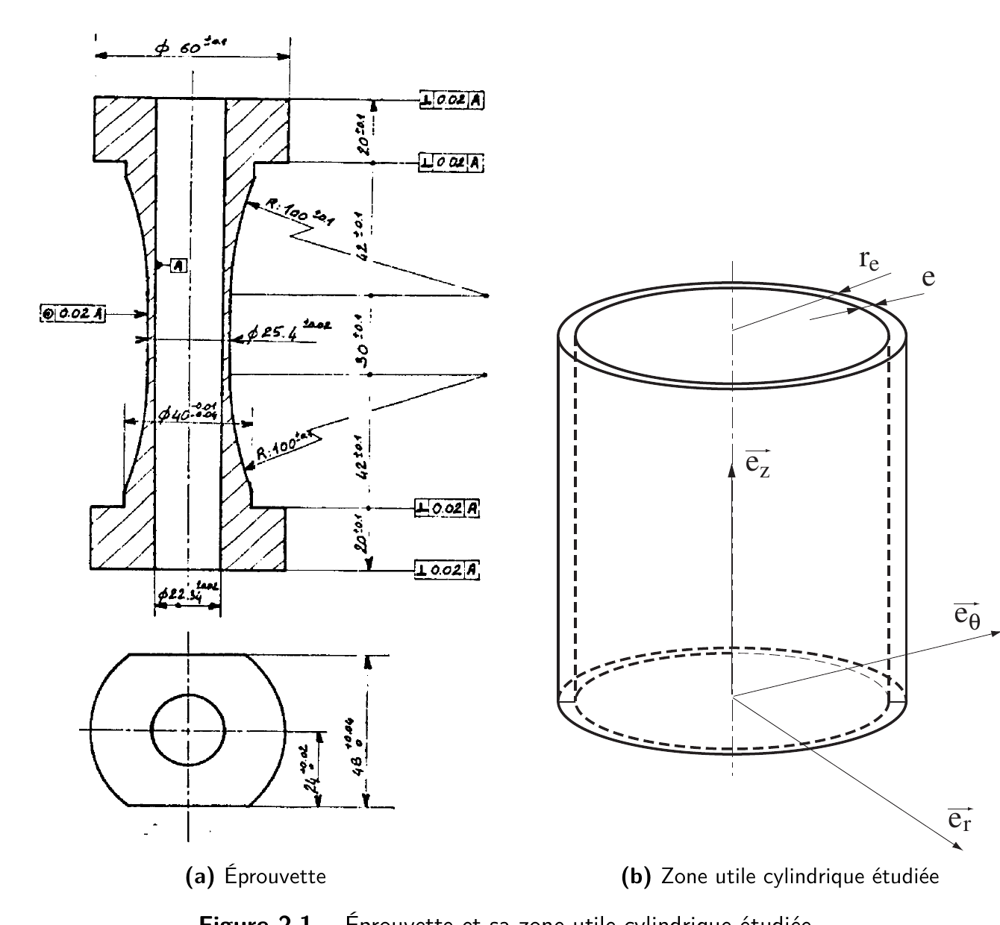

#### Question 4.5.1

*Écrire les équations du problème en distinguant conditions aux limites, équations d'équilibre et relation de comportement (exprimée en fonction de $E$ et $\nu$).* 写出纯拉伸问题的方程，区分边界条件、平衡方程和本构关系。

**答案**

CA : $\boldsymbol\varepsilon=\frac12(\overrightarrow{\operatorname{grad}}\vec u+\overrightarrow{\operatorname{grad}}^{\mathsf T}\vec u)$ ; $u_\theta=0$ en $z=0$ et $z=L$ ($\alpha=0$).
SA : $\overrightarrow{\operatorname{div}}\boldsymbol\sigma=\vec0$ ; surfaces $r=r_i$, $r=r_e$ libres ($\boldsymbol\sigma\vec e_r=\vec0$) ; extrémités à efforts uniformément répartis ($S=\pi(r_e^2-r_i^2)$) : en $z=L$ ($\vec n=\vec e_z$), $\sigma_{rz}=0$ et $\sigma_{zz}=\frac NS$ (soit $\int_S(\boldsymbol\sigma\vec e_z)\cdot\vec e_z\,\mathrm dS=N$) ; en $z=0$ ($\vec n=-\vec e_z$), $\sigma_{rz}=0$ et $-\sigma_{zz}=-\frac NS$ (soit $\int_S(\boldsymbol\sigma(-\vec e_z))\cdot\vec e_z\,\mathrm dS=-N$, donc $\sigma_{zz}=\frac NS$ aux deux bouts).
Comportement : $\boldsymbol\varepsilon=\frac{1+\nu}E\boldsymbol\sigma-\frac\nu E\operatorname{tr}(\boldsymbol\sigma)\mathbb I$.

**Détail · 推导**

端面受力均匀分布，因此合力条件直接给出逐点正应力条件：$z=L$ 端（外法向 $+\vec e_z$）上 $(\boldsymbol\sigma\vec e_z)\cdot\vec e_z=\sigma_{zz}=N/S$；$z=0$ 端（外法向 $-\vec e_z$）上 $(\boldsymbol\sigma(-\vec e_z))\cdot\vec e_z=-\sigma_{zz}=-N/S$，同样得 $\sigma_{zz}=+N/S$（两端的合力都是向外拉的轴力），且两面均有 $\sigma_{rz}=0$。

#### Question 4.5.2

*Résoudre le problème.* 求解纯拉伸问题。

**答案**

$\boldsymbol\sigma=\frac NS\,\vec e_z\otimes\vec e_z$, $S=\pi(r_e^2-r_i^2)$ : équilibre et CL vérifiés. $\boldsymbol\varepsilon=\frac N{ES}\operatorname{diag}(-\nu,-\nu,1)$ dans $(\vec e_r,\vec e_\theta,\vec e_z)$ ; $\vec u=-\nu\frac N{ES}r\,\vec e_r+\frac N{ES}z\,\vec e_z$ (à un mouvement rigide près).

**Détail · 推导**

假设均匀轴向应力，平衡和侧面自由自动满足。积分：$\varepsilon_{rr}=u_r'=-\nu\frac N{ES}$、$\varepsilon_{\theta\theta}=\frac{u_r}r=-\nu\frac N{ES}$ 都由 $u_r=-\nu\frac N{ES}r$ 满足；$u_z=\frac N{ES}z$。

#### Question 4.5.3

*La solution est-elle unique ? Préciser.* 解唯一吗？

**答案**

Unique en contraintes et déformations ; le déplacement est défini à un mouvement rigide près compatible avec $u_\theta=0$ aux deux extrémités, c'est-à-dire à une translation selon $\vec e_z$ près.

**Détail · 推导**

两端 $u_\theta=0$ 挡住了绕轴转动和横向平移（它们会产生非零 $u_\theta$），也挡住了绕横轴的转动（在 $z=L$ 端产生 $u_\theta$）；轴向平移不产生 $u_\theta$，所以保留。

#### Question 4.5.4

*Rappeler brièvement la démarche de résolution en déplacement.* 简述位移法的步骤。

**答案**

Choisir un champ $\vec u$ cinématiquement admissible (forme justifiée par les symétries) → calculer $\boldsymbol\varepsilon(\vec u)$ → $\boldsymbol\sigma$ par la loi de comportement → écrire l'équilibre (équations de Navier) → imposer les conditions aux limites en effort pour fixer les constantes.

**Détail · 推导**

位移法先保证运动学可容，平衡（Navier）和力边界条件最后检查。

#### Question 4.5.5

*Poser le problème (écrire les équations du problème).* 写出纯扭转问题的方程。

**答案**

CA : $u_\theta(z=0)=0$, $u_\theta(z=L)=\alpha Lr$, $\boldsymbol\varepsilon=\frac12(\overrightarrow{\operatorname{grad}}\vec u+\overrightarrow{\operatorname{grad}}^{\mathsf T}\vec u)$. SA : $\overrightarrow{\operatorname{div}}\boldsymbol\sigma=\vec0$ ; $r=r_i,r_e$ libres ; extrémités : efforts nuls selon $\vec e_r$ et $\vec e_z$ ($N=0$). Comportement : $\boldsymbol\sigma=\lambda\operatorname{tr}(\boldsymbol\varepsilon)\mathbb I+2\mu\boldsymbol\varepsilon$.

**Détail · 推导**

扭转由位移施加，所以端面环向是运动学条件；轴向和径向面力为零是静力学条件。

#### Question 4.5.6

*On propose $\vec u=f(r)g(z)\vec e_\theta$. Justifier ce choix. À quelle condition le champ vérifie-t-il les équations de liaison ? Montrer que $f(r)=Cr$ et déterminer la constante $C$.* 论证 $\vec u=f(r)g(z)\vec e_\theta$；它满足约束方程的条件；证明 $f=Cr$ 并求 $C$。

**答案**

Axisymétrie et torsion pure : déplacement orthoradial, indépendant de $\theta$. Liaisons : $f(r)g(0)=0$ et $f(r)g(L)=\alpha Lr$ pour tout $r$ ⇒ $g(0)=0$ et $f(r)=Cr$ avec $Cg(L)=\alpha L$. L'équilibre (Navier, composante $\theta$) donne $g''=0$, donc $g(z)=z$ (normalisation) et $C=\alpha$ : $\vec u=\alpha rz\,\vec e_\theta$.

**Détail · 推导**

$z=L$ 的条件对所有 $r$ 成立，所以 $f$ 正比于 $r$。Navier 的 $\theta$ 分量 $\mu\bigl(\Delta u_\theta-\frac{u_\theta}{r^2}\bigr)=0$：对 $f=Cr$，径向部分自动为零，剩下 $Crg''=0$。每个截面整体转过角度 $\alpha z$。

#### Question 4.5.7

*Déterminer $\boldsymbol\varepsilon(\vec u)$ puis $\boldsymbol\sigma$, en fonction du déplacement et des coefficients de Lamé $\lambda$, $\mu$.* 求应变和应力。

**答案**

$\varepsilon_{\theta z}=\frac12\frac{\partial u_\theta}{\partial z}=\frac{\alpha r}2$, $\varepsilon_{r\theta}=\frac12\bigl(f'-\frac fr\bigr)g=0$, autres nuls ; $\operatorname{tr}\boldsymbol\varepsilon=0$ ⇒ $\boldsymbol\sigma=2\mu\boldsymbol\varepsilon=\mu\alpha r(\vec e_\theta\otimes\vec e_z+\vec e_z\otimes\vec e_\theta)$.

**Détail · 推导**

柱坐标应变：$\varepsilon_{\theta z}=\frac12\bigl(\partial_zu_\theta+\frac1r\partial_\theta u_z\bigr)$。注意系数 $\frac12$，$\sigma_{\theta z}=2\mu\varepsilon_{\theta z}=\mu\alpha r$。

#### Question 4.5.8

*Déterminer la solution $(\vec u,\boldsymbol\sigma)$ du problème.* 给出问题的解。

**答案**

$\vec u=\alpha rz\,\vec e_\theta$, $\boldsymbol\sigma=\mu\alpha r(\vec e_\theta\otimes\vec e_z+\vec e_z\otimes\vec e_\theta)$. Vérifications : $\overrightarrow{\operatorname{div}}\boldsymbol\sigma=\vec0$ ; $\boldsymbol\sigma\vec e_r=\vec0$ en $r=r_i,r_e$ ; aux extrémités $\boldsymbol\sigma\vec e_z=\mu\alpha r\,\vec e_\theta$ en $z=L$ et $\boldsymbol\sigma(-\vec e_z)=-\mu\alpha r\,\vec e_\theta$ en $z=0$ : purement orthoradial (pas d'effort selon $\vec e_r$, $\vec e_z$).

**Détail · 推导**

位移法已满足平衡，只需检查力边界条件。端面面力只有环向分量，合力为零，形成扭矩。

#### Question 4.5.9

*Expliquer la conséquence de l'hypothèse de tube mince sur la composante de cisaillement $\sigma_{\theta z}$.* 薄壁假设对 $\sigma_{\theta z}$ 有什么影响？

**答案**

$e\ll r_i$ : $r$ varie peu dans l'épaisseur, $\sigma_{\theta z}=\mu\alpha r\approx\mu\alpha r_m$ est quasi uniforme ; l'état de contrainte est le même en tout point de la zone utile.

**Détail · 推导**

均匀的应力状态让一次试验对应一个确定的 $(\sigma_{zz},\sigma_{\theta z})$ 点，才能用来描出屈服面。

#### Question 4.5.10

*Calculer le couple de torsion que doit appliquer la machine d'essais pour obtenir l'angle de torsion indiqué, paramétré par $\alpha$.* 求得到给定扭转角所需的扭矩。

**答案**

$C=\int_Sr\,\sigma_{\theta z}\,\mathrm dS=\mu\alpha\int_{r_i}^{r_e}r^2\,2\pi r\,\mathrm dr=\frac{\mu\alpha\pi}2(r_e^4-r_i^4)$.

**Détail · 推导**

力臂 $r$ × 剪应力 × 面积元 $2\pi r\,\mathrm dr$，被积函数是 $r^3$。薄壁时约为 $2\pi r_m^3e\,\mu\alpha$。

#### Question 4.5.11

*Trouver la solution du problème de départ.* 求原问题（拉伸 + 扭转）的解。

**答案**

Problème linéaire, même géométrie et mêmes types de CL : superposition. $\vec u=-\nu\frac N{ES}r\,\vec e_r+\alpha rz\,\vec e_\theta+\frac N{ES}z\,\vec e_z$, $\boldsymbol\sigma=\frac NS\vec e_z\otimes\vec e_z+\mu\alpha r(\vec e_\theta\otimes\vec e_z+\vec e_z\otimes\vec e_\theta)$.

**Détail · 推导**

两个子问题的数据相加正好是原问题的数据，所以解也相加。

#### Question 4.5.12

*Déterminer la contrainte équivalente de von Mises en fonction de $N$ et $\alpha$. Tracer la limite d'élasticité dans le diagramme $(\sigma_{zz},\sigma_{\theta z})$, pour lequel $\sigma_{VM}\le\sigma_e$.* 求 von Mises 等效应力，并在 $(\sigma_{zz},\sigma_{\theta z})$ 平面画出弹性极限。

**答案**

$\sigma_{VM}=\sqrt{\sigma_{zz}^2+3\sigma_{\theta z}^2}=\sqrt{\bigl(\frac NS\bigr)^2+3(\mu\alpha r)^2}$, maximale en $r=r_e$. Limite : ellipse $\sigma_{zz}^2+3\sigma_{\theta z}^2=\sigma_e^2$, de demi-axes $\sigma_e$ (selon $\sigma_{zz}$) et $\frac{\sigma_e}{\sqrt3}$ (selon $\sigma_{\theta z}$).

**Détail · 推导**

在 $(\vec e_r,\vec e_\theta,\vec e_z)$ 基下 $\boldsymbol\sigma=\begin{pmatrix}0&0&0\\0&0&\sigma_{\theta z}\\0&\sigma_{\theta z}&\sigma_{zz}\end{pmatrix}$：
- **von Mises：** 偏量 $\boldsymbol\sigma^D=\boldsymbol\sigma-\frac{\sigma_{zz}}3\mathbb I=\operatorname{diag}\bigl(-\frac{\sigma_{zz}}3,-\frac{\sigma_{zz}}3,\frac{2\sigma_{zz}}3\bigr)+\sigma_{\theta z}(\vec e_\theta\otimes\vec e_z+\vec e_z\otimes\vec e_\theta)$，于是 $\frac32\boldsymbol\sigma^D:\boldsymbol\sigma^D=\frac32\bigl(\frac{6}{9}\sigma_{zz}^2+2\sigma_{\theta z}^2\bigr)=\sigma_{zz}^2+3\sigma_{\theta z}^2$。
- **Tresca（对照）：** 主应力为 $0$ 与 $\frac{\sigma_{zz}}2\pm\sqrt{\frac{\sigma_{zz}^2}4+\sigma_{\theta z}^2}$（两非零特征值异号或一为零，总有 $\sigma_{\max}\ge0\ge\sigma_{\min}$），故 $\sigma_{Tr}=\sigma_{\max}-\sigma_{\min}=\sqrt{\sigma_{zz}^2+4\sigma_{\theta z}^2}$，对应的椭圆 $\sigma_{zz}^2+4\sigma_{\theta z}^2=\sigma_e^2$ 落在 von Mises 椭圆内侧。

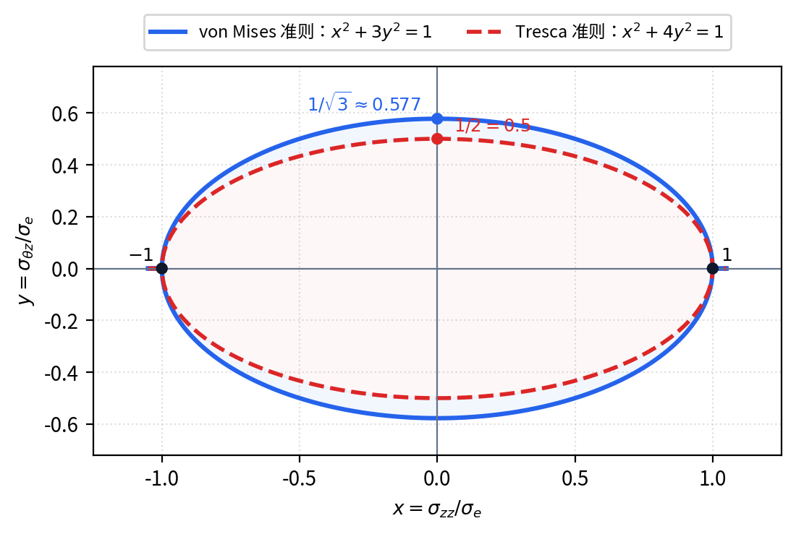

### Exercice 4.6 · Arbre plein en torsion · 实心轴扭转与尺寸设计

**考点**　approche en déplacement, couple, contrainte maximale, dimensionnement Tresca / von Mises

#### Énoncé · 题面

Un arbre cylindrique plein de rayon $R$ et de longueur $L$, élastique ($\mu$), transmet un couple $C$ ; la section $z=0$ est fixe et la section $z=L$ tourne de l'angle $\alpha L$ ; la surface latérale est libre. On cherche $\vec u=\alpha rz\,\vec e_\theta$. 实心圆轴（半径 $R$，长 $L$，剪切模量 $\mu$）传递扭矩 $C$；$z=0$ 截面固定，$z=L$ 截面转过 $\alpha L$；侧面自由。设位移 $\vec u=\alpha rz\,\vec e_\theta$。

#### Question 4.6.1

*Calculer $\boldsymbol\sigma$ et vérifier l'équilibre et la surface latérale libre.* 求应力，验证平衡和侧面自由。

**答案**

$\sigma_{\theta z}=\mu\alpha r$, autres nuls. Équilibre : composante $\theta$ $\partial_z\sigma_{\theta z}=0$, composante $z$ $\frac1r\partial_\theta\sigma_{\theta z}=0$ ✓. $\boldsymbol\sigma\vec e_r=\vec0$ en $r=R$ ✓.

**Détail · 推导**

与 TD6 拉扭试样的扭转部分相同，只是截面是实心圆。

#### Question 4.6.2

*Relier $\alpha$ au couple $C$ ; exprimer $\sigma_{\theta z}$ en fonction de $C$.* 用扭矩 $C$ 表示 $\alpha$ 和剪应力。

**答案**

$C=\int_0^R\mu\alpha r\cdot r\cdot2\pi r\,\mathrm dr=\mu\alpha\frac{\pi R^4}2=\mu\alpha I_0$ ; $\sigma_{\theta z}=\frac{Cr}{I_0}=\frac{2Cr}{\pi R^4}$, maximale en $r=R$ : $\tau_{\max}=\frac{2C}{\pi R^3}$.

**Détail · 推导**

$I_0=\frac{\pi R^4}2$ 是极惯性矩。剪应力沿半径线性分布，轴心为零、表面最大。

#### Question 4.6.3

*Dimensionner le rayon $R$ avec Tresca puis avec von Mises (limite élastique $\sigma_e$).* 分别用 Tresca 和 von Mises 设计半径 $R$。

**答案**

Cisaillement pur : $\sigma_{Tr}=2\tau_{\max}=\frac{4C}{\pi R^3}\le\sigma_e$ ⇒ $R\ge\Bigl(\frac{4C}{\pi\sigma_e}\Bigr)^{1/3}$ ; $\sigma_{VM}=\sqrt3\tau_{\max}$ ⇒ $R\ge\Bigl(\frac{2\sqrt3C}{\pi\sigma_e}\Bigr)^{1/3}$ : Tresca donne un rayon plus grand (plus conservatif).

**Détail · 推导**

纯剪切主应力 $\pm\tau$、0：Tresca $2\tau$，von Mises $\sqrt3\tau$。$4>2\sqrt3\approx3{,}46$，所以 Tresca 要求的半径更大。

### Exercice 4.7 · Barre chauffée entre deux parois · 两端固定、受热的杆

**考点**　thermoélasticité, déformation bloquée, contrainte thermique, comparaison avec la barre libre

#### Énoncé · 题面

Une barre $0\le x\le L$, de section $S$, élastique ($E$, $\nu$, dilatation linéique $\alpha$), est placée entre deux parois rigides : $u_x(0)=u_x(L)=0$ (contact sans frottement) ; sa surface latérale est libre. On l'échauffe uniformément de $\delta T>0$. On cherche $\boldsymbol\sigma=\sigma\,\vec e_x\otimes\vec e_x$ uniforme. 杆（长 $L$，截面 $S$，$E$、$\nu$、线膨胀系数 $\alpha$）两端顶在刚性壁上（$u_x(0)=u_x(L)=0$，无摩擦），侧面自由，均匀升温 $\delta T>0$。设应力为均匀的 $\sigma\,\vec e_x\otimes\vec e_x$。

#### Question 4.7.1

*Écrire la loi de comportement thermoélastique et déterminer $\sigma$.* 写出热弹性本构，求 $\sigma$。

**答案**

$\boldsymbol\varepsilon=\frac{1+\nu}E\boldsymbol\sigma-\frac\nu E\operatorname{tr}(\boldsymbol\sigma)\mathbb I+\alpha\,\delta T\,\mathbb I$. Déformation uniforme et $u_x(0)=u_x(L)=0$ ⇒ $\varepsilon_{xx}=0=\frac\sigma E+\alpha\,\delta T$ ⇒ $\sigma=-E\alpha\,\delta T$ (compression).

**Détail · 推导**

杆想伸长 $\alpha\delta TL$，被壁挡住，弹性应变必须抵消热应变，产生压应力。系数是 $E\alpha$（侧面自由的单轴情形）。

#### Question 4.7.2

*Calculer les déformations transversales et la force exercée sur les parois.* 求横向应变和杆对壁的作用力。

**答案**

$\varepsilon_{yy}=\varepsilon_{zz}=-\frac\nu E\sigma+\alpha\,\delta T=(1+\nu)\alpha\,\delta T$ ; force sur chaque paroi : $|\sigma|S=E\alpha\,\delta T\,S$.

**Détail · 推导**

横向既有自由热膨胀，又有压应力引起的泊松膨胀，两者相加。

#### Question 4.7.3

*Comparer avec une barre libre aux deux extrémités.* 与两端自由的杆比较。

**答案**

Barre libre : $\boldsymbol\sigma=\mathbb O$, $\boldsymbol\varepsilon=\alpha\,\delta T\,\mathbb I$, $\vec u=\alpha\,\delta T\,\overrightarrow{OM}$ + rigide : une élévation uniforme de température sans liaison ne crée aucune contrainte. Les contraintes thermiques viennent des liaisons (ou d'un champ de température non uniforme).

**Détail · 推导**

QCM 常考：没有体力、面力、给定位移时也可能有应力，条件是温度不均匀或膨胀受阻；均匀升温的自由体没有应力。

### Exercice 4.8 · Méthode de Navier : tube épais sous pression · Navier 方法：受压厚壁管

**考点**　poser le problème, forme du champ, Navier, constantes, Tresca, dimensionnement

#### Énoncé · 题面

On étudie certaines déformations d'un tube cylindrique de hauteur $h$, de rayon intérieur $R_1$ et de rayon extérieur $R_2$. La paroi interne est soumise à une pression $p_1$ et la paroi externe à une pression $p_2$. Les extrémités sont bloquées de manière à ce que le tube ne s'allonge pas. On se place dans le cadre des petites perturbations, on néglige les forces de volume et le milieu est considéré homogène, isotrope et élastique (de coefficients de Lamé $\lambda$ et $\mu$). Dans ces conditions, on cherche les solutions telles que le déplacement en tout point du tube n'ait qu'une composante radiale $u(r)$. 厚壁管（高 $h$，内半径 $R_1$，外半径 $R_2$），内壁受压 $p_1$、外壁受压 $p_2$，两端被挡住不能伸长。HPP，忽略体力，均质各向同性线弹性（Lamé 常数 $\lambda$、$\mu$）。寻找位移只有径向分量 $u(r)$ 的解。

(À partir de la question 1.4, on se place dans le cas particulier où $p_2\ll p_1$ (soit $p_2=0$) ; $2p_1<\sigma_e$ ; $e=R_2-R_1\ll R_1$ ; le matériau est l'acier, pour lequel $2\lambda\approx3\mu$.) 从 1.4 问起取 $p_2=0$、$2p_1<\sigma_e$、壁薄、钢材 $2\lambda\approx3\mu$。

#### Question 4.8.1

*Poser le problème, c'est-à-dire la géométrie, les équations et les conditions aux limites, en précisant si elles portent sur la cinématique ou la statique.* 建立问题：几何、方程和边界条件，说明属于运动学还是静力学。

**答案**

$\Omega$ : $R_1\le r\le R_2$, $0\le\theta<2\pi$, $0\le z\le h$. CA : $\boldsymbol\varepsilon=\frac12(\overrightarrow{\operatorname{grad}}\vec u+\overrightarrow{\operatorname{grad}}^{\mathsf T}\vec u)$ ; $u_z=0$ en $z=0$ et $z=h$. SA : $\overrightarrow{\operatorname{div}}\boldsymbol\sigma=\vec0$ ; $\boldsymbol\sigma\vec n=-p_1\vec n$ en $r=R_1$ ($\vec n=-\vec e_r$) ; $\boldsymbol\sigma\vec n=-p_2\vec n$ en $r=R_2$ ($\vec n=\vec e_r$) ; efforts tangentiels nuls sur les extrémités. Comportement : $\boldsymbol\sigma=\lambda\operatorname{tr}(\boldsymbol\varepsilon)\mathbb I+2\mu\boldsymbol\varepsilon$.

**Détail · 推导**

端面被挡住轴向位移（运动学），切向面力为零（静力学）；内外壁是压力条件（静力学）。

#### Question 4.8.2

*Justifier la forme du champ de déplacement recherché $\vec u(M)=u(r)\vec e_r$.* 论证 $\vec u=u(r)\vec e_r$ 的形式。

**答案**

Géométrie et chargement axisymétriques : pas de dépendance en $\theta$ ; chargement purement radial : $u_\theta=0$ ; allongement bloqué et invariance selon $z$ (déformations planes) : $u_z=0$ et pas de dépendance en $z$. D'où $\vec u=u(r)\vec e_r$, compatible avec $u_z=0$ aux extrémités.

**Détail · 推导**

逐条用对称性和载荷消去分量和变量，最后说明与边界条件相容。

#### Question 4.8.3

*Montrer que le champ de déplacement s'écrit $u(r)=\frac{K_1}r+K_2r$, avec $K_1$, $K_2$ constants.* 证明 $u(r)=K_1/r+K_2r$。

**答案**

$\overrightarrow{\operatorname{rot}}\vec u=\vec0$, Navier se réduit à $(\lambda+2\mu)\overrightarrow{\operatorname{grad}}(\operatorname{div}\vec u)=\vec0$ : $\operatorname{div}\vec u=\frac1r(ru)'=2K_2$ (constante), d'où $ru=K_2r^2+K_1$, soit $u=\frac{K_1}r+K_2r$.

**Détail · 推导**

- 由 $\overrightarrow{\operatorname{grad}}\vec u$ 的柱坐标公式（或直接由 $\boldsymbol\varepsilon=\operatorname{diag}(u',\frac ur,0)$）：$\operatorname{tr}\boldsymbol\varepsilon=u'+\frac ur=\frac1r(ru)'$。
- 法一（Navier 方程）：因 $\vec u=u(r)\vec e_r$ 无旋（$\overrightarrow{\operatorname{rot}}\vec u=\vec0$），Navier 方程 $(\lambda+2\mu)\overrightarrow{\operatorname{grad}}(\operatorname{div}\vec u)-\mu\overrightarrow{\operatorname{rot}}\overrightarrow{\operatorname{rot}}\vec u=\vec0$ 退化为 $\frac{\mathrm d}{\mathrm dr}\bigl[\frac1r(ru)'\bigr]=0$，积分两次得 $\frac1r(ru)'=2K_2\implies ru=K_2r^2+K_1$，即 $u(r)=\frac{K_1}r+K_2r$。
- 法二（直接代平衡）：由 $\sigma_{rr}=(\lambda+2\mu)u'+\lambda\frac ur$、$\sigma_{\theta\theta}=\lambda u'+(\lambda+2\mu)\frac ur$ 代入径向平衡 $\sigma_{rr}'+\frac{\sigma_{rr}-\sigma_{\theta\theta}}r=0$，化简后同样得 $(\lambda+2\mu)\bigl[\frac1r(ru)'\bigr]'=0$。

#### Question 4.8.4

*En utilisant les conditions aux limites, calculer $K_1$ et $K_2$.* 用边界条件求 $K_1$、$K_2$。

**答案**

$\sigma_{rr}=2\bigl[(\lambda+\mu)K_2-\mu\frac{K_1}{r^2}\bigr]$, $\sigma_{\theta\theta}=2\bigl[(\lambda+\mu)K_2+\mu\frac{K_1}{r^2}\bigr]$, $\sigma_{zz}=2\lambda K_2$. $\sigma_{rr}(R_1)=-p_1$, $\sigma_{rr}(R_2)=-p_2$ :
$$K_1=\frac{p_1-p_2}{2\mu}\frac{R_1^2R_2^2}{R_2^2-R_1^2},\qquad K_2=\frac1{2(\lambda+\mu)}\frac{p_1R_1^2-p_2R_2^2}{R_2^2-R_1^2}.$$

**Détail · 推导**

$u'=K_2-\frac{K_1}{r^2}$，$\frac ur=K_2+\frac{K_1}{r^2}$，$\operatorname{tr}\boldsymbol\varepsilon=2K_2$。两个压力条件相减消去 $K_2$，求 $K_1$；再回代。注意轴向被挡住（平面应变），一般情形 $\sigma_{zz}=\lambda\operatorname{tr}\boldsymbol\varepsilon=2\lambda K_2$（仅当 $p_1R_1^2=p_2R_2^2$ 时为零；当 $p_2=0$ 时非零，为维持轴向零应变所需反力）。

#### Question 4.8.5

*Déterminer la contrainte équivalente de Tresca et en déduire une règle de dimensionnement sur l'épaisseur $e$ du tube.* 求 Tresca 等效应力，推出壁厚 $e$ 的设计准则。

**答案**

Avec $p_2=0$, $2\lambda=3\mu$ : $\sigma_{rr}\le\sigma_{zz}\le\sigma_{\theta\theta}$, donc $\sigma_{Tr}=\sigma_{\theta\theta}-\sigma_{rr}=\frac{4\mu K_1}{r^2}=\frac{2p_1R_1^2R_2^2}{r^2(R_2^2-R_1^2)}$, maximale à la paroi intérieure : $\frac{2p_1R_2^2}{R_2^2-R_1^2}\le\sigma_e$ ⇒ $e\ge R_1\Bigl(\sqrt{\frac{\sigma_e}{\sigma_e-2p_1}}-1\Bigr)\approx R_1\frac{p_1}{\sigma_e}$.

**Détail · 推导**

- 应力已在柱坐标基下对角，对角元就是主应力。当 $p_2=0$ 时，$K_1=\frac{p_1}{2\mu}\frac{R_1^2R_2^2}{R_2^2-R_1^2}>0$、$K_2=\frac{p_1}{2(\lambda+\mu)}\frac{R_1^2}{R_2^2-R_1^2}>0$。计算各主应力差：
  $$\sigma_{\theta\theta}-\sigma_{zz}=2\mu\Bigl(K_2+\frac{K_1}{r^2}\Bigr)>0,\qquad \sigma_{zz}-\sigma_{rr}=2\mu\Bigl(\frac{K_1}{r^2}-K_2\Bigr).$$
  因 $\frac{K_1/r^2}{K_2}=\frac{\lambda+\mu}\mu\frac{R_2^2}{r^2}\ge\frac{\lambda+\mu}\mu>1$（代入 $2\lambda=3\mu$ 即 $\ge2.5>1$），故处处有 $\sigma_{rr}<\sigma_{zz}<\sigma_{\theta\theta}$，因此 $\sigma_{Tr}=\sigma_{\theta\theta}-\sigma_{rr}=\frac{4\mu K_1}{r^2}$。
- 最大值在内壁 $r=R_1$：$\frac{2p_1R_2^2}{R_2^2-R_1^2}\le\sigma_e$。由于 $\frac{R_2^2}{R_2^2-R_1^2}>1$，该式**有解的前提是 $\sigma_e>2p_1$**（若 $2p_1\ge\sigma_e$，内壁主应力差至少为 $2p_1$，无论加多厚都会在内壁先屈服）。在 $\sigma_e>2p_1$ 下整理得 $R_2^2(\sigma_e-2p_1)\ge\sigma_eR_1^2$，开方并减去 $R_1$ 得精确下界 $e=R_2-R_1\ge R_1\bigl(\sqrt{\frac{\sigma_e}{\sigma_e-2p_1}}-1\bigr)$。在薄壁低压极限 $2p_1\ll\sigma_e$ 下，用 $(1-x)^{-1/2}\approx1+\frac x2$（$x=\frac{2p_1}{\sigma_e}$）即得工程薄壁估计 $e\ge R_1\frac{p_1}{\sigma_e}$。

### Exercice 4.9 · Sphère creuse sous pression intérieure · 内压空心球（位移法）

**考点**　Navier en sphérique, constantes, Tresca

#### Énoncé · 题面

Une sphère creuse de rayons $a<b$, élastique ($\lambda$, $\mu$), est soumise à une pression $p$ sur sa surface intérieure ; la surface extérieure est libre ; forces volumiques négligées. On cherche $\vec u=u(r)\vec e_r$. 空心球（内外半径 $a<b$，Lamé 常数 $\lambda,\mu$）内表面受压 $p$，外表面自由，忽略体力。设 $\vec u=u(r)\vec e_r$。

#### Question 4.9.1

*Montrer que $u=Ar+\frac B{r^2}$ et exprimer $\sigma_{rr}$, $\sigma_{\theta\theta}$.* 证明 $u=Ar+B/r^2$，写出 $\sigma_{rr}$、$\sigma_{\theta\theta}$。

**答案**

Navier (champ radial irrotationnel) : $\frac{\mathrm d}{\mathrm dr}\Bigl[\frac1{r^2}\frac{\mathrm d}{\mathrm dr}(r^2u)\Bigr]=0$ ⇒ $u=Ar+\frac B{r^2}$. $\sigma_{rr}=(3\lambda+2\mu)A-\frac{4\mu B}{r^3}$, $\sigma_{\theta\theta}=\sigma_{\varphi\varphi}=(3\lambda+2\mu)A+\frac{2\mu B}{r^3}$.

**Détail · 推导**

球坐标下纯径向场 $\vec u=u(r)\vec e_r$ 无旋（$\overrightarrow{\operatorname{rot}}\vec u=\vec0$），Navier 方程退化为 $\bigl[\frac1{r^2}(r^2u)'\bigr]'=0$。积分一次得 $\frac1{r^2}(r^2u)'=3A$，再积分得 $r^2u=Ar^3+B\implies u(r)=Ar+\frac B{r^2}$。应变：$\varepsilon_{rr}=u'=A-\frac{2B}{r^3}$，$\varepsilon_{\theta\theta}=\varepsilon_{\varphi\varphi}=\frac ur=A+\frac B{r^3}$，$\operatorname{tr}\boldsymbol\varepsilon=3A$；代入本构 $\sigma_{ii}=\lambda\operatorname{tr}\boldsymbol\varepsilon+2\mu\varepsilon_{ii}$ 即得 $\sigma_{rr}$ 和 $\sigma_{\theta\theta}$。

#### Question 4.9.2

*Déterminer $A$ et $B$.* 求 $A$、$B$。

**答案**

$\sigma_{rr}(a)=-p$, $\sigma_{rr}(b)=0$ ⇒ $(3\lambda+2\mu)A=\frac{pa^3}{b^3-a^3}$, $4\mu B=\frac{pa^3b^3}{b^3-a^3}$ ; d'où $\sigma_{rr}=\frac{pa^3}{b^3-a^3}\Bigl(1-\frac{b^3}{r^3}\Bigr)$, $\sigma_{\theta\theta}=\frac{pa^3}{b^3-a^3}\Bigl(1+\frac{b^3}{2r^3}\Bigr)$.

**Détail · 推导**

与 TD4 练习 2 的应力形式一致（那里 $A'=(3\lambda+2\mu)A$，$2B'=4\mu B$）。检查：$p\to$ 外部也加 $p$ 时应退化为 $-p\mathbb I$。

#### Question 4.9.3

*Calculer la contrainte de Tresca maximale.* 求 Tresca 等效应力的最大值。

**答案**

$\sigma_{Tr}=\sigma_{\theta\theta}-\sigma_{rr}=\frac{3pa^3b^3}{2(b^3-a^3)r^3}$, maximale en $r=a$ : $\frac{3pb^3}{2(b^3-a^3)}$.

**Détail · 推导**

$\sigma_{\theta\theta}>0\ge\sigma_{rr}$，两个环向主应力相等，最大差就是 $\sigma_{\theta\theta}-\sigma_{rr}$，随 $r^{-3}$ 衰减，内壁最大。与厚壁管（$r^{-2}$）对照。

### Exercice 4.10 · Rotor de turbine · 涡轮转子

**考点**　CA / SA, forme du champ, $\boldsymbol\varepsilon$ et $\boldsymbol\sigma$ en cylindrique, Navier avec force volumique, constantes, Tresca, dimensionnement

#### Énoncé · 题面

On s'intéresse à un rotor de turbine en régime permanent, tournant à vitesse angulaire constante. Le rotor, représenté en figure 4.1, correspond à un disque qui peut être modélisé par un cylindre d'axe $\vec e_z$, de rayon $R$ et d'épaisseur $h$ (très faible devant $R$). Le matériau constituant le rotor est considéré homogène élastique linéaire et isotrope, caractérisé par un module de cisaillement $\mu$ et un 1er coefficient de Lamé $\lambda$, avec une masse volumique $\rho$ constante. 圆盘半径 $R$、厚度 $h\ll R$，均匀各向同性线弹性（Lamé 常数 $\lambda,\mu$，密度 $\rho$），以角速度 $\omega$ 匀速旋转。

La surface latérale ($r=R$) est considérée libre de contrainte, alors que le déplacement axial des bases inférieure et supérieure est considéré comme négligeable. Le disque tourne autour de son axe $O\vec e_z$ à vitesse angulaire constante $\omega$. En se plaçant dans le repère attaché au disque, on peut considérer le problème comme statique en considérant en tout point $M(r,\theta,z)$ une densité volumique de forces $\vec f_d(M)=\rho\omega^2r\,\vec e_r$, correspondant aux effets d'inertie. On fait l'hypothèse que le champ de déplacement a la forme $\vec u(r,\theta,z)=u_r(r)\,\vec e_r$, où la fonction $u_r$ est inconnue. 随盘一起转的参考系里，惯性力表现为离心体力 $\vec f_d=\rho\omega^2r\,\vec e_r$，问题变成静力问题。侧面 $r=R$ 自由；上下底面轴向位移可忽略。假设 $\vec u=u_r(r)\vec e_r$。

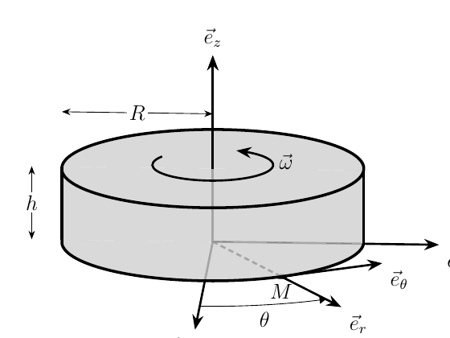

#### Question 4.10.1

*Poser le problème en écrivant les équations et conditions aux limites en précisant si elles portent sur l’admissibilité cinématique ou statique.* 建立问题（区分 CA 与 SA）

**答案**

Sur $\Omega=\{r\in[0,R],\theta\in[0,2\pi],z\in[0,h]\}$ :
- **CA** : $\boldsymbol\varepsilon(\vec u)=\frac12(\overrightarrow{\operatorname{grad}}\vec u+\overrightarrow{\operatorname{grad}}^{\mathsf T}\vec u)$, $\vec u$ continu et régulier ; $\vec u\cdot\vec e_z=0$ en $z=0$ et $z=h$.
- **SA** : $\overrightarrow{\operatorname{div}}\boldsymbol\sigma+\rho\omega^2r\,\vec e_r=\vec0$ dans $\Omega$ ; $\boldsymbol\sigma\vec n=\vec0$ en $r=R$ ; $(\boldsymbol\sigma\vec n)\cdot\vec e_r=(\boldsymbol\sigma\vec n)\cdot\vec e_\theta=0$ en $z=0,h$.
- **Comportement** : $\boldsymbol\sigma=2\mu\boldsymbol\varepsilon+\lambda\operatorname{tr}(\boldsymbol\varepsilon)\mathbb I$.

**Détail · 推导**

按"三类方程"写：

| 类别 | 方程 | 本题 |
|---|---|---|
| CA：应变–位移（HPP） | $\boldsymbol\varepsilon=\frac12(\overrightarrow{\operatorname{grad}}\vec u+\overrightarrow{\operatorname{grad}}^{\mathsf T}\vec u)$，$\vec u$ 连续、正则 | 区域内处处成立 |
| CA：位移边界 | $\vec u=\vec u_d$ 于 $\partial\Omega_u$ | $z=0$ 和 $z=h$：$u_z=0$ |
| SA：局部平衡 | $\overrightarrow{\operatorname{div}}\boldsymbol\sigma+\vec f_d=\vec0$ | $\vec f_d=\rho\omega^2r\vec e_r$ |
| SA：力边界 | $\boldsymbol\sigma\vec n=\vec T_d$ 于 $\partial\Omega_T$ | $r=R$：$\boldsymbol\sigma\vec e_r=\vec0$；$z=0,h$：两个切向分量为零（可自由滑动） |
| 本构 | Hooke | $\boldsymbol\sigma=2\mu\boldsymbol\varepsilon+\lambda\operatorname{tr}\boldsymbol\varepsilon\,\mathbb I$ |

上下底面是**滑动接触**：法向位移给定（CA），切向面力为零（SA）。

#### Question 4.10.2

*Justifier la forme du champ de déplacement $\vec u$ proposé.* 解释位移场的形式

**答案**

Géométrie, matériau et chargement axisymétriques : $\partial_\theta(\cdot)=0$ et $u_\theta=0$ (pas de torsion). Les bases étant en contact glissant entre deux plans fixes rigides ($u_z=0$ aux deux bases), on adopte la cinématique plane symétrique $u_z=0$ et $\partial_z(\cdot)=0$ dans tout le disque. Donc $\vec u=u_r(r)\,\vec e_r$.

**Détail · 推导**

四条理由说明题目所采用的简化模型 $\vec u=u_r(r)\vec e_r$ 的合理性：

1. 几何、材料和离心体积力都轴对称 ⇒ 各分量与 $\theta$ 无关。
2. 载荷只有径向分量，没有扭转耦合 ⇒ $u_\theta=0$。
3. 上下底面在固定刚性面间滑动接触（$u_z=0$）⇒ 在整个圆盘厚度内采用平面应变假设 $u_z=0$。
4. 边界条件与离心力均不依赖 $z$，与前面 $u_z=0$ 的对称平面运动学假设相容 ⇒ $u_r$ 仅依赖 $r$。

所以 $\vec u=u_r(r,\theta,z)\vec e_r+u_\theta\vec e_\theta+u_z\vec e_z$ 化为 $u_r(r)\vec e_r$。

#### Question 4.10.3

*Calculer la forme du tenseur de déformation $\boldsymbol\varepsilon$ en fonction de $u_r$.* $\boldsymbol\varepsilon$ 用 $u_r$ 表示

**答案**

$\boldsymbol\varepsilon=\operatorname{diag}\left(u_r',\ \frac{u_r}{r},\ 0\right)_{(\vec e_r,\vec e_\theta,\vec e_z)}$.

**Détail · 推导**

用柱坐标位移梯度公式：$\overrightarrow{\operatorname{grad}}\vec u$ 中只有 $\partial u_r/\partial r=u_r'$ 和 $(\partial_\theta u_\theta+u_r)/r=u_r/r$ 两项非零，已经对称，故

$$\boldsymbol\varepsilon=\begin{pmatrix}u_r'&0&0\\0&u_r/r&0\\0&0&0\end{pmatrix}.$$

$u_r/r$ 是环向应变：半径为 $r$ 的圆周长从 $2\pi r$ 变成 $2\pi(r+u_r)$，相对伸长就是 $u_r/r$。

#### Question 4.10.4

*Calculer la forme du tenseur de contraintes $\boldsymbol\sigma$ en fonction de $u_r$.* $\boldsymbol\sigma$ 用 $u_r$ 表示

**答案**

Avec $\operatorname{tr}\boldsymbol\varepsilon=u_r'+u_r/r$ :

$$\boldsymbol\sigma=\begin{pmatrix}(2\mu+\lambda)u_r'+\lambda\frac{u_r}{r}&0&0\\0&\lambda u_r'+(2\mu+\lambda)\frac{u_r}{r}&0\\0&0&\lambda\left(u_r'+\frac{u_r}{r}\right)\end{pmatrix}.$$

**Détail · 推导**

直接代入 $\boldsymbol\sigma=2\mu\boldsymbol\varepsilon+\lambda\operatorname{tr}\boldsymbol\varepsilon\,\mathbb I$。注意 $\varepsilon_{zz}=0$ 但 $\sigma_{zz}=\lambda\operatorname{tr}\boldsymbol\varepsilon\ne0$：轴向位移被挡住，所以出现轴向应力。这是**平面应变**的特征（见第 6 章：平面应变 $\varepsilon_{33}=0$ 时 $\sigma_{33}$ 一般不为零）。

#### Question 4.10.5

*Montrer que la solution peut se mettre sous la forme $u_r(r)=C_1r^3+C_2r+\frac{C_3}{r}$. Préciser la forme de $C_1$.* 证明 $u_r=C_1r^3+C_2r+C_3/r$，并给出 $C_1$

**答案**

La projection radiale de $\overrightarrow{\operatorname{div}}\boldsymbol\sigma+\rho\omega^2r\vec e_r=\vec0$ donne

$$(2\mu+\lambda)\left(u_r''+\frac{u_r'}{r}-\frac{u_r}{r^2}\right)=-\rho\omega^2r
\iff\frac{\mathrm d}{\mathrm dr}\left[\frac1r\frac{\mathrm d}{\mathrm dr}(ru_r)\right]=-\frac{\rho\omega^2}{2\mu+\lambda}r .$$

En intégrant deux fois : $u_r=C_1r^3+C_2r+\frac{C_3}{r}$ avec $C_1=-\dfrac{\rho\omega^2}{8(2\mu+\lambda)}$.

**Détail · 推导**

柱坐标散度的径向分量（$\sigma_{r\theta}=\sigma_{rz}=0$，与 $\theta,z$ 无关）：

$$\frac{\mathrm d\sigma_{rr}}{\mathrm dr}+\frac{\sigma_{rr}-\sigma_{\theta\theta}}{r}+\rho\omega^2r=0 .$$

代入上一问，$\sigma_{rr}-\sigma_{\theta\theta}=2\mu(u_r'-u_r/r)$，整理得

$$(2\mu+\lambda)\Bigl(u_r''+\frac{u_r'}{r}-\frac{u_r}{r^2}\Bigr)=-\rho\omega^2r .$$

**关键技巧：** 左边括号可以写成 $\dfrac{\mathrm d}{\mathrm dr}\Bigl[\dfrac1r\dfrac{\mathrm d}{\mathrm dr}(ru_r)\Bigr]$，于是能逐次积分。令 $K_1=-\rho\omega^2/(2\mu+\lambda)$：

$$\frac1r(ru_r)'=\frac{K_1}{2}r^2+K_2\ \Rightarrow\ ru_r=\frac{K_1}{8}r^4+\frac{K_2}{2}r^2+K_3\ \Rightarrow\ u_r=\frac{K_1}{8}r^3+\frac{K_2}{2}r+\frac{K_3}{r}.$$

所以 $C_1=K_1/8=-\dfrac{\rho\omega^2}{8(2\mu+\lambda)}$。齐次部分 $C_2r+C_3/r$ 与受压厚壁管（4.8）的 $K_2r+K_1/r$ 完全相同；离心力只多出一个特解 $C_1r^3$。也可直接由 Navier 方程 $(\lambda+2\mu)\overrightarrow{\operatorname{grad}}(\operatorname{div}\vec u)-\mu\overrightarrow{\operatorname{rot}}\overrightarrow{\operatorname{rot}}\vec u+\vec f_d=\vec0$ 出发（这里 $\overrightarrow{\operatorname{rot}}\vec u=\vec0$），一步到位。

#### Question 4.10.6

*Déterminer l’expression complète des constantes $C_2$ et $C_3$, en utilisant (notamment) les conditions aux limites. En déduire la forme complète des champs $\vec u$ et $\boldsymbol\sigma$.* 用边界条件定 $C_2$、$C_3$，写出完整的 $\vec u$ 与 $\boldsymbol\sigma$

**答案**

Le centre $r=0$ appartient au domaine : $C_3=0$ (sinon $u_r\to\infty$). Puis $\sigma_{rr}(R)=0$ donne $(6\mu+4\lambda)C_1R^2+(2\mu+2\lambda)C_2=0$, d’où $C_2=\frac{(3\mu+2\lambda)\rho\omega^2R^2}{8(\mu+\lambda)(2\mu+\lambda)}$ et :
$$\vec u=\frac{\rho\omega^2}{8(2\mu+\lambda)}\Bigl(\frac{3\mu+2\lambda}{\mu+\lambda}R^2r-r^3\Bigr)\vec e_r,$$
$$\sigma_{rr}=\frac{(3\mu+2\lambda)\rho\omega^2}{4(2\mu+\lambda)}(R^2-r^2),\quad \sigma_{\theta\theta}=\frac{(3\mu+2\lambda)\rho\omega^2}{4(2\mu+\lambda)}\Bigl(R^2-\frac{\mu+2\lambda}{3\mu+2\lambda}r^2\Bigr),\quad \sigma_{zz}=\frac{\lambda\rho\omega^2}{4(2\mu+\lambda)}\Bigl(\frac{3\mu+2\lambda}{\mu+\lambda}R^2-2r^2\Bigr)$$
(composantes hors diagonale nulles).

**Détail · 推导**

1. **有界性：** 圆盘是实心的，$r=0$ 在区域内，$C_3/r$ 在中心发散，必须 $C_3=0$。（空心圆盘才保留 $C_3$，用内外两个边界条件定 $C_2,C_3$。）
2. **侧面自由：** $\boldsymbol\sigma\vec e_r=\vec0\Rightarrow\sigma_{rr}(R)=0$。由 $u_r'=3C_1r^2+C_2$、$u_r/r=C_1r^2+C_2$：

$$\sigma_{rr}=(2\mu+\lambda)(3C_1r^2+C_2)+\lambda(C_1r^2+C_2)=2\bigl[(3\mu+2\lambda)C_1r^2+(\mu+\lambda)C_2\bigr],$$

令 $r=R$ 时为零即得 $C_2$。

最终结果：

$$\vec u=\frac{\rho\omega^2}{8(2\mu+\lambda)}\Bigl(\frac{3\mu+2\lambda}{\mu+\lambda}R^2r-r^3\Bigr)\vec e_r,$$

$$\sigma_{rr}=\frac{(3\mu+2\lambda)\rho\omega^2}{4(2\mu+\lambda)}(R^2-r^2),\qquad
\sigma_{\theta\theta}=\frac{(3\mu+2\lambda)\rho\omega^2}{4(2\mu+\lambda)}\Bigl(R^2-\frac{\mu+2\lambda}{3\mu+2\lambda}r^2\Bigr),$$

$$\sigma_{zz}=\lambda\operatorname{tr}\boldsymbol\varepsilon=\frac{\lambda\rho\omega^2}{4(2\mu+\lambda)}\Bigl(\frac{3\mu+2\lambda}{\mu+\lambda}R^2-2r^2\Bigr),\qquad\text{其余分量为零。}$$

#### Question 4.10.7

*Donner l’expression générale de la contrainte équivalente de Tresca $\sigma_{Tr}$, les étapes de calcul. Détailler ensuite la méthode pour dimensionner le rayon du rotor vis-à-vis de ce critère, pour une vitesse de rotation fixée, sachant que le matériau a une limite élastique en traction notée $\sigma_e$.* Tresca 等效应力与尺寸设计方法

**答案**

$\sigma_{Tr}=\max_{i,j}|\sigma_i-\sigma_j|$. Le tenseur est déjà diagonal dans $(\vec e_r,\vec e_\theta,\vec e_z)$ : ses composantes diagonales sont les contraintes principales. On cherche le point où $\sigma_{Tr}$ est maximal (ici au centre $r=0$, où $\sigma_{Tr,\max}=\frac{\mu(3\mu+2\lambda)\rho\omega^2R^2}{4(\mu+\lambda)(2\mu+\lambda)}$), puis le rayon maximal $R_0$ tel que $\max_r\sigma_{Tr}=\sigma_e/k_s$ ($k_s\ge1$ coefficient de sécurité), soit $R_0=\sqrt{\frac{4(\mu+\lambda)(2\mu+\lambda)\,\sigma_e}{k_s\,\mu(3\mu+2\lambda)\,\rho\,\omega^2}}$.

**Détail · 推导**

1. 求主应力：这里 $\boldsymbol\sigma$ 在柱坐标基下已经对角，主应力就是 $\sigma_{rr},\sigma_{\theta\theta},\sigma_{zz}$。
2. 写出 $\sigma_{Tr}(r)=\max|\sigma_i-\sigma_j|$。
3. 找出 $\sigma_{Tr}$ 在圆盘中取得最大值的点。
4. 令 $\max_r\sigma_{Tr}=\sigma_e/k_s$（$k_s\ge1$ 为安全系数），解出允许的最大半径 $R_0$。

**具体最大值与半径公式推导：** 先比较三个主应力之差：

$$\sigma_{\theta\theta}-\sigma_{rr}=\frac{\mu\rho\omega^2r^2}{2(2\mu+\lambda)}\ge0,\qquad
\sigma_{\theta\theta}-\sigma_{zz}=\frac{\mu\rho\omega^2}{4(\mu+\lambda)(2\mu+\lambda)}\bigl[(3\mu+2\lambda)R^2-(\mu+\lambda)r^2\bigr]>0 .$$

可见 $\sigma_{\theta\theta}$ 处处不小于 $\sigma_{rr}$ 与 $\sigma_{zz}$，因此 $\sigma_{Tr}(r)=\max\bigl(\sigma_{\theta\theta}(r)-\sigma_{rr}(r),\ \sigma_{\theta\theta}(r)-\sigma_{zz}(r)\bigr)$：
- 第一项 $\sigma_{\theta\theta}(r)-\sigma_{rr}(r)$ 随 $r$ 单调递增，其最大值在边缘 $r=R$ 取得：$\frac{\mu\rho\omega^2R^2}{2(2\mu+\lambda)}$；
- 第二项 $\sigma_{\theta\theta}(r)-\sigma_{zz}(r)$ 随 $r$ 单调递减（注意 $\mu>0,\ \mu+\lambda>0$），其最大值在中心 $r=0$ 取得：$\frac{\mu(3\mu+2\lambda)\rho\omega^2R^2}{4(\mu+\lambda)(2\mu+\lambda)}$。

两者相比，中心值与边缘值之比为 $\frac{3\mu+2\lambda}{2(\mu+\lambda)}=1+\frac{\mu}{2(\mu+\lambda)}>1$（无需对 $\lambda$ 的正负另作限制，只需物理稳定性 $\mu>0,\ \mu+\lambda>0$），所以**最大值在圆心 $r=0$**：

$$\max_r\sigma_{Tr}=\sigma_{Tr}(0)=\frac{\mu(3\mu+2\lambda)\rho\omega^2R^2}{4(\mu+\lambda)(2\mu+\lambda)} .$$

令其等于 $\sigma_e/k_s$ 解出允许的最大半径：

$$R_0=\sqrt{\frac{4(\mu+\lambda)(2\mu+\lambda)\,\sigma_e}{k_s\,\mu(3\mu+2\lambda)\,\rho\,\omega^2}}\quad\Bigl(R_0\propto\frac1\omega\Bigr).$$

转速加倍，允许半径减半。

### Exercice 4.11 · Planète : champ de gravitation et champ de température · 行星：引力场与温度场

**考点**　Navier en sphérique avec force volumique, pression au centre, cisaillement maximal, variation de volume ; thermoélasticité dans une coque sphérique

#### Énoncé · 题面

On rappelle que, dans l'espace, loin de toute influence gravitationnelle, une planète de rayon $R$, de masse volumique $\rho$, exerce sur elle-même un champ de gravitation propre tel qu'en chacun de ses points la densité volumique des forces s'écrit $\vec f(r)=-\rho g\frac rR\,\vec e_r$. L'isotropie du solide à comportement linéaire élastique ($E$, $\nu$) et la nature des charges justifient la recherche d'un champ des déplacements de matière de la forme $\vec u=u(r)\vec e_r$. 远离外部引力的均质行星（半径 $R$，密度 $\rho$），自身引力对应的体力为 $-\rho g\frac rR\vec e_r$；材料线弹性（$E$、$\nu$），设 $\vec u=u(r)\vec e_r$。

En réalité, seule la croûte est solide et a une tenue mécanique. Elle est soumise à un flux continu de chaleur provenant du cœur de la planète. Le manteau visqueux à haute température ne participe pas, en première approximation, à l'état mécanique de la croûte. On modélise maintenant la planète comme une sphère creuse de rayons intérieur $R_i$ et extérieur $R$. La croûte est supposée homogène et isotrope de module d'Young $E$, de coefficient de Poisson $\nu$, de module de compressibilité isotherme $K$ et de coefficient de dilatation volumique $\alpha_v$. On désigne par $T_0$ la température constante à la surface intérieure de la croûte, et on suppose que la température à la surface de la planète est nulle. La température dans la croûte à la distance $r$ du centre est régie par la loi
$$T(r)=\frac{R_i}{R-R_i}\,T_0\Bigl(\frac Rr-1\Bigr).$$
Par raison de symétrie, le champ des déplacements est purement radial : $\vec u=u(r)\vec e_r$ (questions 3.7–3.11). 第二部分：只有地壳是固体，把行星看成空心球 $R_i\le r\le R$，地壳的 $E$、$\nu$、$K$、体膨胀系数 $\alpha_v$ 已知；内表面温度 $T_0$，外表面温度为 0，温度分布如上，位移仍为径向。

#### Question 4.11.1

*Poser le problème.* 建立问题（第一部分：自重）。

**答案**

$\Omega$ : $r\le R$. CA : $\boldsymbol\varepsilon=\frac12(\overrightarrow{\operatorname{grad}}\vec u+\overrightarrow{\operatorname{grad}}^{\mathsf T}\vec u)$, $\vec u$ fini (nul) au centre. SA : $\overrightarrow{\operatorname{div}}\boldsymbol\sigma-\rho g\frac rR\vec e_r=\vec0$ ; surface libre $\boldsymbol\sigma\vec e_r=\vec0$ en $r=R$. Comportement : $\boldsymbol\sigma=\lambda\operatorname{tr}(\boldsymbol\varepsilon)\mathbb I+2\mu\boldsymbol\varepsilon$.

**Détail · 推导**

没有位移边界条件，只有中心的有界性；表面自由。

#### Question 4.11.2

*Montrer à l'aide de l'équation de Navier que $u(r)=ar+br^3$, où $a$, $b$ sont des constantes à déterminer.* 用 Navier 方程证明 $u=ar+br^3$。

**答案**

$(\lambda+2\mu)\frac{\mathrm d}{\mathrm dr}\Bigl[\frac1{r^2}\frac{\mathrm d}{\mathrm dr}(r^2u)\Bigr]=\rho g\frac rR$ ⇒ $u=ar+\frac c{r^2}+br^3$ avec $b=\frac{\rho g}{10R(\lambda+2\mu)}$ ; $u$ fini au centre ⇒ $c=0$.

**Détail · 推导**

特解代入 $u=br^3$：$\frac1{r^2}(r^2\cdot br^3)'=5br^2$，再求导 $10br$。齐次解 $ar+\frac c{r^2}$。

#### Question 4.11.3

*Donner les expressions de l'opérateur des déformations et de l'opérateur des contraintes en fonction des constantes $a$ et $b$.* 用 $a$、$b$ 表示应变和应力。

**答案**

$\boldsymbol\varepsilon=\operatorname{diag}(a+3br^2,\ a+br^2,\ a+br^2)$, $\operatorname{tr}\boldsymbol\varepsilon=3a+5br^2$ ; $\sigma_{rr}=(3\lambda+2\mu)a+(5\lambda+6\mu)br^2$, $\sigma_{\theta\theta}=\sigma_{\varphi\varphi}=(3\lambda+2\mu)a+(5\lambda+2\mu)br^2$.

**Détail · 推导**

$\varepsilon_{rr}=u'$，$\varepsilon_{\theta\theta}=\varepsilon_{\varphi\varphi}=\frac ur$；$\sigma_{ii}=\lambda\operatorname{tr}\boldsymbol\varepsilon+2\mu\varepsilon_{ii}$。

#### Question 4.11.4

*Écrire la condition aux limites et en déduire la valeur de la constante $a$. Préciser alors la valeur des composantes du tenseur des contraintes en fonction de $r$, $R$ et $\nu$.* 写出边界条件求 $a$，并用 $r$、$R$、$\nu$ 表示应力。

**答案**

$\sigma_{rr}(R)=0$ ⇒ $a=-\frac{(5\lambda+6\mu)bR^2}{3\lambda+2\mu}$ ; d'où $\sigma_{rr}=\frac{(3-\nu)\rho g}{10(1-\nu)R}(r^2-R^2)$, $\sigma_{\theta\theta}=\sigma_{\varphi\varphi}=\frac{\rho g}{10(1-\nu)R}\bigl[(1+3\nu)r^2-(3-\nu)R^2\bigr]$.

**Détail · 推导**

由 $\sigma_{rr}(R)=0$ 解出 $a=-\frac{5\lambda+6\mu}{3\lambda+2\mu}bR^2$，回代应力公式并提取 $b=\frac{\rho g}{10R(\lambda+2\mu)}$：
$$\sigma_{rr}=\frac{5\lambda+6\mu}{\lambda+2\mu}\frac{\rho g}{10R}(r^2-R^2),\qquad \sigma_{\theta\theta}=\frac{\rho g}{10R}\Bigl(\frac{5\lambda+2\mu}{\lambda+2\mu}r^2-\frac{5\lambda+6\mu}{\lambda+2\mu}R^2\Bigr).$$
利用 $\lambda=\frac{2\mu\nu}{1-2\nu}$ 将系数化为 $\nu$：$\frac{5\lambda+6\mu}{\lambda+2\mu}=\frac{10\nu+6(1-2\nu)}{2\nu+2(1-2\nu)}=\frac{3-\nu}{1-\nu}$，$\frac{5\lambda+2\mu}{\lambda+2\mu}=\frac{10\nu+2(1-2\nu)}{2-2\nu}=\frac{1+3\nu}{1-\nu}$。

#### Question 4.11.5

*Quelle est la pression au centre de la sphère ? Quelle est la valeur maximale des contraintes de cisaillement ? En quels points est-elle atteinte ?* 中心压力是多少？最大剪应力是多少，在哪里？

**答案**

Au centre $\boldsymbol\sigma=\sigma_{rr}(0)\mathbb I$ : $p(0)=\frac{(3-\nu)\rho gR}{10(1-\nu)}$. $\tau_{\max}=\frac{|\sigma_{\theta\theta}-\sigma_{rr}|}2=\frac{(1-2\nu)\rho g\,r^2}{10(1-\nu)R}$, maximale à la surface $r=R$ : $\frac{(1-2\nu)\rho gR}{10(1-\nu)}$.

**Détail · 推导**

中心处三个主应力相等，是纯静水压。剪应力随 $r^2$ 增长，在整个表面上达到最大。

#### Question 4.11.6

*Donner l'expression de la variation de volume $\operatorname{tr}\boldsymbol\varepsilon$. Étudier son signe et déterminer le rayon de la sphère à l'intérieur de laquelle les points restent en « contraction ».* 求体积变化 $\operatorname{tr}\boldsymbol\varepsilon$，分析符号，求收缩区的半径。

**答案**

$\operatorname{tr}\boldsymbol\varepsilon=3a+5br^2=b\Bigl(5r^2-3\frac{5\lambda+6\mu}{3\lambda+2\mu}R^2\Bigr)$, nulle en $R_0=\sqrt{\frac{15\lambda+18\mu}{15\lambda+10\mu}}\,R>R$ : $\operatorname{tr}\boldsymbol\varepsilon<0$ partout, toute la planète est en contraction.

**Détail · 推导**

$15\lambda+18\mu>15\lambda+10\mu$，零点在球外。中心 $\operatorname{tr}\boldsymbol\varepsilon(0)=3a<0$，符号在整个球内不变。

#### Question 4.11.7

*Donner les équations du problème (croûte thermique).* 写出地壳热问题的方程。

**答案**

$\Omega$ : $R_i\le r\le R$. Équilibre : $\overrightarrow{\operatorname{div}}\boldsymbol\sigma=\vec0$ (on néglige ici la gravité). Comportement thermoélastique : $\boldsymbol\sigma=2\mu\boldsymbol\varepsilon+\lambda\operatorname{tr}(\boldsymbol\varepsilon)\mathbb I-K\alpha_v\,\delta T\,\mathbb I$, $\delta T=T-T_0$. CL : surfaces libres $\sigma_{rr}(R_i)=\sigma_{rr}(R)=0$.

**Détail · 推导**

两个表面都自由，没有位移条件；外力为零，整体平衡自动满足。这里以 $T_0$ 作为无应力参考温度，因此温度变化写为 $\delta T(r)=T(r)-T_0$（注意对自由边界的均匀热弹性球壳，若把参考温度改变常数 $\Delta T_0$，只会使均匀体积应变平移 $\Delta C_1=\alpha_v\Delta T_0/3$，而内部应力 $\boldsymbol\sigma$ 完全不变）。

#### Question 4.11.8

*À l'aide de l'équation d'équilibre (anisotherme), déterminer l'expression de $u(r)$.* 用非等温平衡方程求 $u(r)$。

**答案**

$(\lambda+2\mu)\overrightarrow{\operatorname{grad}}(\operatorname{div}\vec u)=K\alpha_v\overrightarrow{\operatorname{grad}}T$ ⇒ $\frac{\mathrm d}{\mathrm dr}\Bigl[\frac1{r^2}\frac{\mathrm d}{\mathrm dr}(r^2u)\Bigr]=-\frac{C_0}{r^2}$, $C_0=\frac{K\alpha_vT_0RR_i}{(\lambda+2\mu)(R-R_i)}>0$ ; en intégrant deux fois : $u(r)=\frac{C_0}2+C_1r+\frac{C_2}{r^2}$.

**Détail · 推导**

由球坐标散度和无旋条件 $\overrightarrow{\operatorname{rot}}\vec u=\vec0$，$\overrightarrow{\operatorname{div}}(2\mu\boldsymbol\varepsilon+\lambda\operatorname{tr}\boldsymbol\varepsilon\,\mathbb I)=(\lambda+2\mu)\overrightarrow{\operatorname{grad}}(\operatorname{div}\vec u)$；代入 $T'(r)=-\frac{R_iRT_0}{(R-R_i)r^2}$ 即得 $\frac{\mathrm d}{\mathrm dr}\bigl[\frac1{r^2}(r^2u)'\bigr]=-\frac{C_0}{r^2}$。第一次积分 $\frac1{r^2}(r^2u)'=\frac{C_0}r+3C_1$（把常数写为 $3C_1$ 便于下一步配整），乘以 $r^2$ 后再积分得 $r^2u=\frac{C_0}2r^2+C_1r^3+C_2$。

#### Question 4.11.9

*Déterminer le tenseur des déformations et des contraintes.* 求应变和应力张量。

**答案**

$\varepsilon_{rr}=C_1-\frac{2C_2}{r^3}$, $\varepsilon_{\theta\theta}=\varepsilon_{\varphi\varphi}=\frac{C_0}{2r}+C_1+\frac{C_2}{r^3}$ ; $\sigma_{rr}=\lambda\frac{C_0}r+(3\lambda+2\mu)C_1-\frac{4\mu C_2}{r^3}-K\alpha_v\delta T$, $\sigma_{\theta\theta}=\sigma_{\varphi\varphi}=(\lambda+\mu)\frac{C_0}r+(3\lambda+2\mu)C_1+\frac{2\mu C_2}{r^3}-K\alpha_v\delta T$.

**Détail · 推导**

$\operatorname{tr}\boldsymbol\varepsilon=\frac{C_0}r+3C_1$，代入非等温本构 $\sigma_{ii}=\lambda\operatorname{tr}\boldsymbol\varepsilon+2\mu\varepsilon_{ii}-K\alpha_v\delta T$ 即得。

#### Question 4.11.10

*Déterminer complètement ces tenseurs à partir des conditions limites.* 由边界条件确定常数。

**答案**

$\delta T(R_i)=0$, $\delta T(R)=-T_0$ ; $\sigma_{rr}(R_i)=\sigma_{rr}(R)=0$ donnent
$$C_2=-\frac{K\alpha_vT_0(RR_i)^3}{2(\lambda+2\mu)(R^3-R_i^3)}<0,\qquad C_1=-\frac{K\alpha_vT_0}{(\lambda+2\mu)(3\lambda+2\mu)}\Bigl[\frac{2\mu R^3}{R^3-R_i^3}+\frac{\lambda R}{R-R_i}\Bigr]<0.$$

**Détail · 推导**

1. 由 $\sigma_{rr}(R_i)=0$ 和 $\sigma_{rr}(R)=0$ 分别写出：
   $$\lambda\frac{C_0}{R_i}+(3\lambda+2\mu)C_1-\frac{4\mu C_2}{R_i^3}=0,\qquad \lambda\frac{C_0}R+(3\lambda+2\mu)C_1-\frac{4\mu C_2}{R^3}+K\alpha_vT_0=0.$$
2. 两式相减消去 $C_1$：$\lambda C_0\frac{R-R_i}{RR_i}-4\mu C_2\frac{R^3-R_i^3}{R^3R_i^3}=K\alpha_vT_0$。因 $\lambda C_0\frac{R-R_i}{RR_i}=\frac{\lambda K\alpha_vT_0}{\lambda+2\mu}$，移项得 $-4\mu C_2\frac{R^3-R_i^3}{R^3R_i^3}=\frac{2\mu K\alpha_vT_0}{\lambda+2\mu}$，解出 $C_2$。
3. 回代 $\sigma_{rr}(R_i)=0$：$(3\lambda+2\mu)C_1=-\lambda\frac{C_0}{R_i}+\frac{4\mu C_2}{R_i^3}=-\frac{K\alpha_vT_0}{\lambda+2\mu}\bigl(\frac{\lambda R}{R-R_i}+\frac{2\mu R^3}{R^3-R_i^3}\bigr)$，两边同除 $3\lambda+2\mu$ 即得 $C_1$。

#### Question 4.11.11

*Déterminer le cisaillement maximal et la position radiale où la limite d'élasticité en cisaillement est atteinte en premier.* 求最大剪应力，以及剪切屈服最先发生的位置。

**答案**

$\tau_{\max}(r)=\frac{|\sigma_{rr}-\sigma_{\theta\theta}|}2=\frac\mu{2}\Bigl|-\frac{C_0}r-\frac{6C_2}{r^3}\Bigr|$ ($C_0>0$, $C_2<0$). Bien que $\sigma_{rr}-\sigma_{\theta\theta}$ change de signe dans $]R_i,R[$, son module atteint son maximum global à la paroi intérieure $r=R_i$ :
$$\max_{r\in[R_i,R]}\tau_{\max}(r)=\tau_{\max}(R_i)=\frac{\mu K\alpha_vT_0}{2(\lambda+2\mu)}\frac{R(2R+R_i)}{R_i^2+R_iR+R^2} ;$$
la limite élastique en cisaillement y est donc atteinte en premier.

**Détail · 推导**

由上一问，各向同性热项 $-K\alpha_v\delta T\,\mathbb I$ 在主应力差中相消：

$$\sigma_{rr}-\sigma_{\theta\theta}=\mu\Bigl(-\frac{C_0}r-\frac{6C_2}{r^3}\Bigr)=:\mu\,g(r).$$

**注意不要直接去掉绝对值号，也不要误判 $g(r)$ 全程同号或 $|\tau_{\max}|$ 单调递减：**
- **两端点比较：** 代入 $C_0,C_2$ 并消去公因子 $R-R_i$（利用 $R^3-R_i^3=(R-R_i)(R^2+RR_i+R_i^2)$）：
  $$g(R_i)=\frac{K\alpha_vT_0}{\lambda+2\mu}\frac{R(2R+R_i)}{R_i^2+R_iR+R^2}>0,\qquad g(R)=-\frac{K\alpha_vT_0}{\lambda+2\mu}\frac{R_i(R+2R_i)}{R_i^2+R_iR+R^2}<0.$$
  可见 $g(r)$ 在壳内必有零点 $r_0=\sqrt{-6C_2/C_0}$：在 $[R_i,r_0]$ 上 $g\ge0$，在 $(r_0,R]$ 上 $g<0$。且因 $R>R_i>0$，显然 $R(2R+R_i)>R_i(R+2R_i)$，即 $g(R_i)>|g(R)|$。
- **内部极值检查：** 求导 $g'(r)=\frac{C_0}{r^2}+\frac{18C_2}{r^4}$。若 $g'(r_c)=0$，则 $r_c^2=-\frac{18C_2}{C_0}=3r_0^2=\frac{9R_i^2R^2}{R^2+RR_i+R_i^2}$。
  1. 在 $[R_i,r_0]$ 上 $r<r_c$，故 $g'(r)<0$，$g$ 单调递减，所以 $|g(r)|\le g(R_i)$。
  2. 在 $(r_0,R]$ 上 $g(r)<0$：若 $r_c\ge R$，则 $g$ 在整个 $[R_i,R]$ 单调递减，从而 $|g(r)|\le |g(R)|<g(R_i)$；若 $r_c<R$（即 $x:=R_i/R<\frac{1+\sqrt{33}}{16}\approx0.422<\frac12$），则在 $r_c$ 处取负向极小值 $g(r_c)=\frac{12C_2}{r_c^3}=-\frac{2C_0}{3r_c}$，此时有 $|g(r_c)|=\frac{2C_0\sqrt{R^2+RR_i+R_i^2}}{9RR_i}<\frac{2\sqrt3}{9}\frac{C_0}{R_i}\approx0.385\frac{C_0}{R_i}$，而因 $x<\frac12$，得 $g(R_i)=\frac{C_0}{R_i}\frac{2-x-x^2}{1+x+x^2}>\frac57\frac{C_0}{R_i}\approx0.714\frac{C_0}{R_i}>|g(r_c)|$。

综上，对一切 $0<R_i<R$，全局最大值始终在内表面 $r=R_i$ 达到，数值为 $\tau_{\max}(R_i)=\frac\mu2 g(R_i)$，剪切屈服最先在内表面发生。

## 5　Fluides · 流体（题库）

### CC2 · 第 5 题读题：先画壁面和速度方向

**两年第一问都要求写假设、方程和边界条件。** 第一次读题优先找三个信息：流体夹在哪里，哪个表面在动，流体沿哪个方向流。把它们画在草图上，接着写速度场。到这一步，才能决定 Navier–Stokes 方程要保留哪些分量。

| 题面中的装置 | 图上要画什么 | 第一笔写什么，后面求什么 |
|---|---|---|
| **2024 · 运动斜面上的液膜**（5.4）。*plan incliné* 是斜板，*couche d’épaisseur constante* 是等厚液层，*surface libre* 是自由面。 | $x$ 沿坡向下，板以 $-U\vec e_x$ 向上运动，重力沿坡分量向下。 | 壁面无滑移给 $v(0)=-U$。在单向平行流、自由面仅受恒定大气压的模型下，液面给 $v'(h)=0$、$p(h)=p_{\rm atm}$。投影动量方程求速度和压力，再由速度的符号判断哪一层被板带走。 |
| **2025 · 旋转黏度计**（5.7）。*cylindres coaxiaux* 是同轴圆筒，*cylindre extérieur entraîné* 表示外筒由电机带动。 | 在半径 $a,b$ 的两壁画切向速度，内筒静止，外筒以 $\omega$ 转动。 | 写 $\vec V=v_\theta(r)\vec e_\theta$、$v_\theta(a)=0$、$v_\theta(b)=\omega b$。环向动量方程给速度，径向和竖向给压力。由壁面剪应力求扭矩，再从扭矩和转速反求黏度。 |

**法语动词相近，要求交出的东西不同。**

- *Énoncer les hypothèses puis écrire les équations scalaires* 列假设，再按坐标方向写方程。可起笔写 *L’écoulement est stationnaire, donc la dérivée locale par rapport au temps est nulle.* 定常只消去局部时间导数，环向流仍保留向心加速度 $-v_\theta^2/r$。
- *Justifier la forme des champs* 说明速度和压力为什么只依赖某个坐标。*Déterminer les distributions* 则要积分，并用边界条件定常数。斜面液膜可从连续性推出 $\partial_xv=0$；同轴环向流则有 $\partial_r p=\rho v_\theta^2/r$。
- *Épaisseur que peut transporter le plan* 求被板带走的**厚度**。在液层内找 $v(y)=0$ 的位置并检查两侧流向；若整层均沿板运动，厚度直接取 $h$。*Puissance à fournir* 接着用板所受驱动力与板速度点乘。
- *Moment selon l’axe / couple de maintien* 求轴向力矩。先标明谁作用在谁上，积分“力臂 × 切向面力 × 面积元”。*En déduire la viscosité* 才是利用所得扭矩关系反解 $\mu$；若给每分钟转数 $N$，用 $\omega=2\pi N/60$。

**压差驱动的圆管流**沿管轴流动，速度是 $v_z(r)\vec e_z$。决定速度分量的是流向；“圆柱形”本身只帮你选坐标。

### Méthode · 流体大题的解题步骤

#### ① Schéma et repère · 读题、画图、选坐标

- Dessiner la section ; repérer les **parois** (fixes ou mobiles, à quelle vitesse), la **surface libre**, le **moteur** de l'écoulement (gradient de pression, pesanteur, paroi mobile, cylindre en rotation). 画截面，标出壁面（静止还是运动、速度多少）、自由面、驱动（压差、重力、运动壁面、转动圆柱）。
- Repère : cartésien pour un plan ou un plan incliné ($x$ selon l'écoulement, $y$ normal à la paroi) ; cylindrique pour un tube ou des cylindres coaxiaux ($z$ selon l'axe). 平板、斜面用直角坐标；圆管、同轴圆柱用柱坐标。
- Projeter la pesanteur après l'avoir dessinée. Plan incliné ($x$ vers le bas de la pente, $y$ normal au plan) : $\vec g=g(\sin\alpha\,\vec e_x-\cos\alpha\,\vec e_y)$. 重力先画再投影。
- Reconnaître l'écoulement classique correspondant (table A) : on connaît alors le résultat attendu. 对一下是查表 A 里的哪种流动，心里先有答案。

#### ② Hypothèses · 写假设

*Énoncer (préciser) les hypothèses qui régissent l'écoulement* 列出（明确）控制流动的假设。

Ne citer que les hypothèses utiles, numérotées H1, H2… et les invoquer ensuite dans les calculs. 只写用得上的，编号 H1、H2…，后面推导时引用编号。

| Hypothèse | 中文 | Conséquence · 推出 |
|---|---|---|
| écoulement stationnaire (permanent) | 定常 | $\partial_t(\cdot)=0$ |
| fluide incompressible et homogène | 不可压缩、均质 | $\rho=$ cste，$\operatorname{div}\vec V=0$ |
| fluide newtonien de viscosité dynamique $\mu$ | 牛顿流体 | $\boldsymbol\sigma=-p\,\mathbb I+2\mu\,\mathbb D$ |
| fluide pesant / pesanteur négligée | 有重力 / 忽略重力 | $\vec f=\rho\vec g$ / $\vec f=\vec0$ |
| écoulement plan | 平面流 | $V_z=0$，$\partial_z=0$ |
| écoulement laminaire unidirectionnel | 单向层流 | $\vec V=v\,\vec e_x$（ou $\vec e_z$, $\vec e_\theta$） |
| écoulement axisymétrique | 轴对称 | $\partial_\theta=0$ |
| conduite infiniment longue, effets de bord négligés | 无限长、忽略端部 | invariance selon l'écoulement · 沿流向不变 |
| surface libre plane, épaisseur $h$ constante | 自由面平、厚度不变 | surface libre en $y=h$ |

**法语答题句**

Hypothèses : (H1) écoulement stationnaire ; (H2) fluide incompressible et homogène, $\rho=$ cste ; (H3) fluide newtonien de viscosité dynamique $\mu$ ; (H4) fluide pesant, $\vec f=\rho\vec g$ ; (H5) écoulement laminaire unidirectionnel, $\vec V=v\,\vec e_x$ ; (H6) effets de bord négligés. 假设：定常；不可压缩且均质；牛顿流体；有重力；单向层流；忽略端部效应。

#### ③ Équations · 写方程

*Écrire les équations (scalaires) déduites des lois de conservation* 写出由守恒律得到的（标量）方程。

1. Conservation de la masse : $\partial_t\rho+\operatorname{div}(\rho\vec V)=0$, donc $\operatorname{div}\vec V=0$ d'après H2. 质量守恒；由 H2 得 $\operatorname{div}\vec V=0$。
2. Quantité de mouvement : $\overrightarrow{\operatorname{div}}\boldsymbol\sigma+\vec f=\rho\vec\gamma$, avec $\vec\gamma=\partial_t\vec V+\overrightarrow{\operatorname{grad}}\vec V\cdot\vec V$. 动量守恒，加速度含对流项。
3. Loi de comportement : $\boldsymbol\sigma=-p\,\mathbb I+2\mu\,\mathbb D$, $\mathbb D=\frac12(\overrightarrow{\operatorname{grad}}\vec V+\overrightarrow{\operatorname{grad}}^{\mathsf T}\vec V)$. 本构关系。
4. En injectant 3 dans 2 : équation de **Navier–Stokes** (fluide incompressible) 把 3 代入 2，得 Navier–Stokes 方程：

$$\mu\,\Delta\vec V-\overrightarrow{\operatorname{grad}}\,p+\vec f=\rho\Bigl(\frac{\partial\vec V}{\partial t}+\overrightarrow{\operatorname{grad}}\vec V\cdot\vec V\Bigr)$$
   En cartésien : $\rho(\partial_tV_x+V_x\partial_xV_x+V_y\partial_yV_x+V_z\partial_zV_x)=-\partial_xp+\mu\Delta V_x+f_x$ (idem en $y$, $z$). En cylindrique : table B. 直角坐标分量如上，$y$、$z$ 同理；柱坐标见查表 B。

5. Bilan : 4 inconnues ($\vec V$, $p$) et 4 équations (Navier–Stokes et continuité). 数一数：4 个未知量，4 个方程。

Simplifications usuelles · 常见速度形式代进去：

| Champ de vitesse · 速度形式 | $\Delta\vec V$ | $\overrightarrow{\operatorname{grad}}\vec V\cdot\vec V$ |
|---|---|---|
| $v(y)\,\vec e_x$ (cartésien · 直角) | $v''\,\vec e_x$ | $\vec0$ |
| $v(r)\,\vec e_z$ (tube, axial · 圆管轴向) | $\frac1r(rv')'\,\vec e_z$ | $\vec0$ |
| $v(r)\,\vec e_\theta$ (cylindres coaxiaux · 同轴环向) | $\bigl[\frac1r(rv)'\bigr]'\,\vec e_\theta$ | $-\frac{v^2}r\,\vec e_r$ (centripète · 向心) |

**法语答题句**

La conservation de la masse $\frac{\partial\rho}{\partial t}+\operatorname{div}(\rho\vec V)=0$ se réduit, d'après (H2), à $\operatorname{div}\vec V=0$.
En injectant la loi de comportement $\boldsymbol\sigma=-p\,\mathbb I+2\mu\,\mathbb D$ dans l'équation du mouvement $\overrightarrow{\operatorname{div}}\boldsymbol\sigma+\vec f=\rho\vec\gamma$, on obtient l'équation de Navier–Stokes : $\mu\Delta\vec V-\overrightarrow{\operatorname{grad}}\,p+\rho\vec g=\rho\bigl(\partial_t\vec V+\overrightarrow{\operatorname{grad}}\vec V\cdot\vec V\bigr)$.
On dispose de 4 équations scalaires (Navier–Stokes et continuité) pour 4 inconnues ($\vec V$ et $p$). 质量守恒化为 div V = 0；本构代入运动方程得 NS；4 个方程对 4 个未知量。

#### ④ Conditions aux limites · 边界条件

*Écrire les conditions aux limites* 写出边界条件。

| Frontière · 位置 | Condition · 条件 | Rédaction |
|---|---|---|
| paroi fixe (fluide visqueux) · 静止壁面 | $\vec V=\vec0$ | adhérence à la paroi fixe |
| paroi mobile · 运动壁面 | $\vec V=\vec V_{\text{paroi}}$ | le fluide adhère à la paroi mobile |
| cylindre $r=a$ tournant à $\omega$ · 转动圆柱 | $\vec V=\omega a\,\vec e_\theta$ | adhérence au cylindre en rotation |
| surface libre (atmosphère) · 自由面 | $\boldsymbol\sigma\vec n=-p_{\text{atm}}\vec n$ : $\mu v'=0$ et $p=p_{\text{atm}}$ | contrainte tangentielle nulle, pression atmosphérique |
| entrée / sortie · 入口、出口 | $p(z=0)=P_0$，$p(z=L)=P_L$ | pressions imposées |
| interface entre deux fluides · 两流体界面 | $\vec V_A=\vec V_B$，$\boldsymbol\sigma_A\vec n=\boldsymbol\sigma_B\vec n$ | continuité de la vitesse et du vecteur contrainte |
| axe $r=0$ · 轴 | vitesse finie · 速度有界 | la vitesse reste finie sur l'axe |
| paroi, fluide parfait · 理想流体壁面 | $\vec V\cdot\vec n=\vec V_{\text{paroi}}\cdot\vec n$ seulement | seule la composante normale est imposée |

#### ⑤ Forme des champs de vitesse et de pression · 论证场的形式

*Justifier les formes $\vec V=v(y)\,\vec e_x$ et $p=p(y)$* 说明速度场和压力场采用上述形式的理由。

**Cartésien (plan, plan incliné) · 直角：**

1. D'après H5, $\vec V=v(x,y)\,\vec e_x$. 由假设 H5。
2. Continuité : $\operatorname{div}\vec V=\partial_xv=0$, donc $v=v(y)$. 连续性 ⇒ $v$ 只依赖 $y$。
3. Terme convectif : $v\,\partial_xv\,\vec e_x=\vec0$, l'accélération est nulle. 对流项为零，加速度为零。
4. Projection de NS sur $\vec e_y$ : $0=-\partial_yp+f_y$ ; on intègre en $y$, la « constante » est une fonction de $x$. 投影到 $\vec e_y$：静水压分布；积分"常数"是 $x$ 的函数。
5. Projection sur $\vec e_x$ : $\mu v''(y)=\partial_xp-f_x$. Le membre de gauche ne dépend que de $y$, celui de droite que de $x$ : ils sont égaux à une même constante. Sans gradient de pression moteur (film, Couette), $\partial_xp=0$ et $p=p(y)$. 投影到 $\vec e_x$：左边只依赖 $y$，右边只依赖 $x$，两边等于同一常数；无压差驱动时 $p=p(y)$。

**Tube $\vec V=v(r)\,\vec e_z$ · 圆管：** continuité ⇒ $\partial_zv=0$ ; composantes $r$, $\theta$ ⇒ $p=p(z)$ (pesanteur négligée) ; composante $z$ ⇒ $\frac\mu r(rv')'=p'(z)=$ cste $=-\frac{\Delta P}L$. 连续性 ⇒ 与 $z$ 无关；$r$、$\theta$ 分量 ⇒ $p=p(z)$；$z$ 分量 ⇒ 常数压降。

**Cylindres coaxiaux $\vec V=v(r)\,\vec e_\theta$ · 同轴圆柱：** continuité vérifiée d'office ; composante $\theta$ ⇒ $\bigl[\frac1r(rv)'\bigr]'=0$ ; composante $r$ ⇒ $\partial_rp=\rho\frac{v^2}r$ ; composante $z$ ⇒ $\partial_zp=-\rho g$. 连续性自动满足；$\theta$ 分量给速度方程；$r$ 分量给径向压力梯度；$z$ 分量给静水压。

**法语答题句**

La conservation de la masse donne $\operatorname{div}\vec V=\frac{\partial v}{\partial x}=0$ : la vitesse ne dépend que de $y$.
La projection de l'équation de Navier–Stokes sur $\vec e_y$ donne $\frac{\partial p}{\partial y}=-\rho g\cos\alpha$, d'où $p(x,y)=-\rho g\cos\alpha\,y+k(x)$.
Le premier membre ne dépend que de $y$, le second que de $x$ : ils sont égaux à une même constante. 连续性 ⇒ $v=v(y)$；$y$ 分量 ⇒ 静水压；分离变量 ⇒ 两边等于同一常数。

#### ⑥ Intégration et constantes · 积分、定常数

*Déterminer le champ de vitesse* 求速度场。

| Cas · 情形 | Équation · 方程 | Solution générale · 通解 |
|---|---|---|
| cartésien · 直角 | $\mu v''=-G-f_x$（$G=-\partial_xp$） | $v=-\frac{G+f_x}{2\mu}y^2+C_1y+C_2$ |
| tube · 圆管 | $\frac\mu r(rv')'=-G$（$G=-\mathrm dp/\mathrm dz$） | $v=-\frac G{4\mu}r^2+C_1\ln r+C_2$ |
| orthoradial · 同轴环向 | $\bigl[\frac1r(rv)'\bigr]'=0$ | $v=Ar+\frac Br$ |

- Constantes : une condition en vitesse (adhérence) et une condition en contrainte (surface libre $v'=0$), ou deux conditions d'adhérence. Tube : vitesse finie sur l'axe ⇒ $C_1=0$. 定常数：一个速度条件 + 一个应力条件，或两个速度条件；圆管轴上有界 ⇒ 去掉 $\ln r$。
- Vérifier toutes les conditions aux limites et l'homogénéité ($\rho gh^2/\mu$ est une vitesse). 代回检查所有边界条件和量纲。

**法语答题句**

En intégrant deux fois : $v(y)=-\frac{\rho g\sin\alpha}{2\mu}y^2+C_1y+C_2$. L'adhérence en $y=0$ donne $C_2=\dots$, la condition de surface libre $v'(h)=0$ donne $C_1=\dots$
La vitesse doit rester finie sur l'axe $r=0$, donc le coefficient de $\ln r$ est nul. 积分两次；贴壁条件和自由面条件定常数；轴上有界 ⇒ $\ln r$ 的系数为零。

#### ⑦ Champ de pression · 压力分布

*Déterminer le champ de pression* 求压力场。

- Intégrer la projection transverse (étape ⑤) ; la constante est fixée par $p=p_{\text{atm}}$ sur la surface libre ou par la pression d'entrée. 由第 ⑤ 步的横向分量积分，用自由面或入口压力定常数。
- Film sur plan incliné · 斜面液膜 : $p=p_{\text{atm}}+\rho g\cos\alpha\,(h-y)$.
- Cylindres coaxiaux · 同轴圆柱 : $\partial_rp=\rho v^2/r>0$, la pression croît vers l'extérieur ; ajouter $-\rho gz$. 压力向外增大；再加静水压项。
- Rotation d'ensemble $v=\omega r$ · 整体刚性转动 : $p=p_0+\frac12\rho\omega^2r^2-\rho gz$, surface libre parabolique. 自由面是抛物面。

#### ⑧ Profil des vitesses · 画速度剖面

*Tracer le profil des vitesses* 画出速度剖面。

- Indiquer les valeurs aux parois ; le maximum est là où $v'=0$. 标出壁面值；最大值在 $v'=0$ 处。
- Surface libre $v'=0$ : la tangente au profil y est parallèle à l'axe $y$. 自由面处剖面切线与 $y$ 轴平行。
- Forme : droite (Couette), parabole (Poiseuille, film), $Ar+B/r$ (cylindres coaxiaux) ; voir les profils de la table A. 形状：直线、抛物线、$Ar+B/r$；见查表 A 的图。
- Paroi mobile en sens opposé à la pesanteur (ou au gradient de pression) : le profil peut **changer de signe** ; résoudre $v(y^*)=0$ et garder la racine dans $[0,h]$. « Toute la couche est entraînée » ⇔ $v$ ne change pas de signe sur $[0,h]$ ; le sens du transport net est celui du débit $q$. 壁面运动与重力相反时剖面可能换向：解 $v(y^*)=0$；"整层被带走"要求不变号；净输运看流量符号。

#### ⑨ Débit et vitesse moyenne · 流量、平均速度

*Calculer le débit volumique (massique) et la vitesse moyenne* 求体积流量（质量流量）和平均速度。

$$Q=\int_S\vec V\cdot\vec n\,\mathrm dS,\qquad V_m=\frac QS,\qquad Q_m=\rho\,Q$$

- Problème plan : débit par unité de largeur $q=\int_0^hv\,\mathrm dy$ ($\mathrm{m^2\,s^{-1}}$). Tube : $Q=\int_0^Rv\,2\pi r\,\mathrm dr$ ($\mathrm{m^3\,s^{-1}}$). 平面问题算单位宽度流量；圆管按环形面积积分。

**法语答题句**

Le débit volumique vaut $Q=\int_S\vec V\cdot\vec n\,\mathrm dS=\dots$ et la vitesse moyenne $V_m=Q/S=\dots$ ; le débit massique est $Q_m=\rho Q$. 体积流量、平均速度、质量流量。

#### ⑩ Contraintes, contrainte pariétale, efforts, couple · 应力、壁面应力、力、力矩

*Calculer le tenseur des contraintes (visqueuses), la contrainte pariétale, l'effort exercé sur la paroi, le couple* 求（黏性）应力张量、壁面应力、作用在壁面上的力和力矩。

1. Calculer $\mathbb D$, puis $\boldsymbol\sigma=-p\,\mathbb I+2\mu\,\mathbb D$ : 先算 $\mathbb D$，再算应力：

| Vitesse · 速度 | $\mathbb D$ (composantes non nulles · 非零分量) | Cisaillement · 剪应力 |
|---|---|---|
| $v(y)\,\vec e_x$ | $D_{xy}=\frac12v'$ | $\sigma_{xy}=\mu v'$ |
| $v(r)\,\vec e_z$ | $D_{rz}=\frac12v'$ | $\sigma_{rz}=\mu v'$ |
| $v(r)\,\vec e_\theta$ | $D_{r\theta}=\frac r2\bigl(\frac vr\bigr)'$ | $\sigma_{r\theta}=\mu r\bigl(\frac vr\bigr)'$ ; $=-\frac{2\mu B}{r^2}$ si $v=Ar+\frac Br$ |

2. Vecteur contrainte $\vec T=\boldsymbol\sigma\vec n$. Préciser **qui agit sur qui** : avec $\vec n$ normale sortante du fluide, $\vec T$ est l'action de la paroi sur le fluide ; le fluide exerce $-\vec T$ sur la paroi. 先说清谁对谁：$\vec n$ 为流体外法向时 $\vec T$ 是壁面对流体的力，流体对壁面是 $-\vec T$。
3. Résultante $\vec F=\int_S\vec T\,\mathrm dS$. 合力。
4. Moment axial sur un cylindre de rayon $r$ et de hauteur $h$ : $M_z=\underbrace{r}_{\text{bras de levier}}\cdot\underbrace{\sigma_{r\theta}}_{\text{contrainte}}\cdot\underbrace{2\pi rh}_{\text{aire}}=2\pi r^2h\,\sigma_{r\theta}$. Cylindres coaxiaux : $|M|=4\pi\mu h|B|$, indépendant de $r$. 力矩 = 力臂 × 应力 × 面积；同轴圆柱的力矩与 $r$ 无关。
5. Contrôle global : tube $\pi R^2\Delta P=2\pi RL\,\tau_p$ ; film incliné : cisaillement pariétal par unité de surface = poids de la couche projeté sur la pente, $\rho gh\sin\alpha$. 整体检查：圆管、液膜的受力平衡。

**法语答题句**

Le tenseur des contraintes s'écrit $\boldsymbol\sigma=-p\,\mathbb I+2\mu\,\mathbb D$, soit $\sigma_{xy}=\mu\,\frac{\mathrm dv}{\mathrm dy}$.
La contrainte pariétale vaut $\tau_p=\mu\,\frac{\mathrm dv}{\mathrm dr}\big|_{r=R}=\dots$ ; on retrouve ce résultat par l'équilibre global d'un tronçon de fluide.
Le couple transmis vaut $|M|=4\pi\mu h\,\frac{a^2b^2}{b^2-a^2}\,|\omega_b-\omega_a|$ ; il ne dépend pas du rayon de la surface considérée. 应力张量；壁面剪应力（可用整体平衡验证）；传递的力矩与所取圆柱面半径无关。

#### ⑪ Puissance · 功率

*Calculer la puissance à fournir / dissipée* 求所需输入功率或耗散功率。

- Puissance motrice $P=\int_S\vec T_{\text{paroi}\to\text{fluide}}\cdot\vec V_{\text{paroi}}\,\mathrm dS$ ; paroi en translation $P=FU$ ; en rotation $P=M\omega$. 驱动功率；平移 $FU$，转动 $M\omega$。
- En régime permanent l'énergie cinétique est constante : puissance des efforts extérieurs = dissipation visqueuse $\int_\Omega2\mu\,\mathbb D:\mathbb D\,\mathrm dV$. Écoulement unidirectionnel : $2\mu\,\mathbb D:\mathbb D=\mu v'^2$ ; orthoradial : $\frac{4\mu B^2}{r^4}$. 定常时外力功率 = 黏性耗散；单向流、环向流的被积函数。
- Inversement, la dissipation donne le couple sans intégrer les contraintes. 反过来可用耗散求力矩。

**法语答题句**

En régime permanent l'énergie cinétique est constante : le théorème de l'énergie cinétique donne $P_e+P_i=0$, donc la puissance fournie est entièrement dissipée par viscosité, $P_e=\int_\Omega2\mu\,\mathbb D:\mathbb D\,\mathrm dV$. 定常时动能不变，外力功率全部被黏性耗散。

#### ⑫ Application numérique (sans calculatrice) · 数值计算（无计算器）

*Application numérique* 代入数值计算。

- Écrire un rapport pour éliminer les grandeurs géométriques communes : si $\mu\propto\frac M\omega$, alors $\frac{\mu_2}{\mu_1}=\frac{M_2}{M_1}\cdot\frac{\omega_1}{\omega_2}$. 先写比例式，消去相同的几何量。
- Vitesse de rotation : $\omega=\frac{2\pi N}{60}$ ($N$ en tr/min). 转速换算。
- 2 à 3 chiffres significatifs : $\pi\approx3{,}14$, $\sqrt2\approx1{,}41$, $\sqrt3\approx1{,}73$, $g\approx9{,}81\approx10$. 保留 2–3 位有效数字。
- Ordres de grandeur de $\mu$ à 20 °C : eau $10^{-3}$, air $1{,}8\times10^{-5}$, huile $10^{-1}$–$1$, glycérine $\approx1{,}4$ Pa·s. 与常见黏度量级对比：水、空气、油、甘油。

#### Table A　Écoulements classiques · 标准流动（stationnaire, incompressible, newtonien, laminaire）

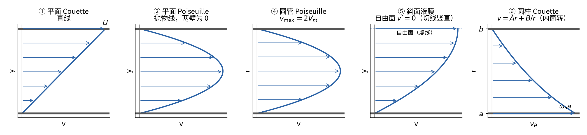

$G=-\mathrm dp/\mathrm dx>0$ : gradient de pression moteur · 驱动压力梯度。

| Écoulement · 流动 | Conditions · 边界条件 | Vitesse · 速度 | Résultats · 关键结果 |
|---|---|---|---|
| ① Couette plan · 平面 Couette | $v(0)=0$，$v(h)=U$，$G=0$ | $v=U\frac yh$ | $\tau=\mu\frac Uh$ uniforme · 处处相同 |
| ② Poiseuille plan · 平面 Poiseuille | $v(0)=v(h)=0$ | $v=\frac G{2\mu}y(h-y)$ | $v_{\max}=\frac{Gh^2}{8\mu}$；$q=\frac{Gh^3}{12\mu}$；$V_m=\frac23v_{\max}$；$\tau_p=\frac{Gh}2=\frac{6\mu V_m}h$ |
| ③ Couette + Poiseuille | $v(0)=0$，$v(h)=U$ | $v=U\frac yh+\frac G{2\mu}y(h-y)$ | superposition de ① et ② · 线性叠加 |
| ④ Poiseuille en tube · 圆管 | $v(R)=0$, vitesse finie sur l'axe | $v=\frac G{4\mu}(R^2-r^2)$ | $Q=\frac{\pi R^4G}{8\mu}$；$V_m=\frac{GR^2}{8\mu}=\frac{v_{\max}}2$；$\tau_p=\frac{GR}2=\frac{4\mu V_m}R$；$\Delta P=\frac{8\mu LQ}{\pi R^4}$ |
| ⑤ Film sur plan incliné · 斜面液膜（pente $\alpha$, épaisseur $h$, paroi à $V_p$ selon $\vec e_x$） | $v(0)=V_p$；$v'(h)=0$，$p(h)=p_{\text{atm}}$ | $v=\frac{\rho g\sin\alpha}{2\mu}y(2h-y)+V_p$ | $p=p_{\text{atm}}+\rho g\cos\alpha(h-y)$；$q=\frac{\rho g\sin\alpha\,h^3}{3\mu}+V_ph$；cisaillement pariétal $\rho gh\sin\alpha$ |
| ⑥ Couette cylindrique · 圆柱 Couette（$r=a$ à $\omega_a$, $r=b$ à $\omega_b$） | $v(a)=\omega_aa$，$v(b)=\omega_bb$ | $v=Ar+\frac Br$ | $A=\frac{\omega_bb^2-\omega_aa^2}{b^2-a^2}$，$B=\frac{(\omega_a-\omega_b)a^2b^2}{b^2-a^2}$；$\sigma_{r\theta}=-\frac{2\mu B}{r^2}$；$|M|=4\pi\mu h|B|$ |
| ⑦ Rotation d'ensemble · 整体刚性转动 | récipient tournant à $\omega$ | $v=\omega r$ | $\mathbb D=\mathbb O$, pas de contrainte visqueuse · 无黏性应力；$p=p_0+\frac12\rho\omega^2r^2-\rho gz$ |

- ⑥ : $Ar$ est une rotation de corps rigide (pas de contrainte) ; seul $B/r$ cisaille. Entrefer mince ($b-a\ll a$) : profil quasi linéaire, on retrouve ①. $Ar$ 是刚体转动，只有 $B/r$ 产生剪切；窄间隙时退化为 ①。
- Couette plan : cisaillement uniforme ; Poiseuille : nul au centre, maximal à la paroi. Débit : $\propto R^4$ (tube), $\propto h^3$ (canal plan). Couette 剪应力均匀；Poiseuille 中心为零、壁面最大；流量与 $R^4$、$h^3$ 成正比。

#### Table B　Formulaire cylindrique (incompressible) · 柱坐标公式

$\frac{\mathrm D}{\mathrm Dt}=\partial_t+V_r\partial_r+\frac{V_\theta}r\partial_\theta+V_z\partial_z$，$\Delta f=\frac1r\partial_r(r\partial_rf)+\frac1{r^2}\partial_\theta^2f+\partial_z^2f$。

$$\begin{aligned}
\rho\Bigl(\tfrac{\mathrm DV_r}{\mathrm Dt}-\tfrac{V_\theta^2}r\Bigr)&=-\partial_rp+\mu\Bigl(\Delta V_r-\tfrac{V_r}{r^2}-\tfrac2{r^2}\partial_\theta V_\theta\Bigr)+f_r\\
\rho\Bigl(\tfrac{\mathrm DV_\theta}{\mathrm Dt}+\tfrac{V_rV_\theta}r\Bigr)&=-\tfrac1r\partial_\theta p+\mu\Bigl(\Delta V_\theta-\tfrac{V_\theta}{r^2}+\tfrac2{r^2}\partial_\theta V_r\Bigr)+f_\theta\\
\rho\tfrac{\mathrm DV_z}{\mathrm Dt}&=-\partial_zp+\mu\Delta V_z+f_z
\end{aligned}$$

Continuité · 连续性 : $\frac1r\partial_r(rV_r)+\frac1r\partial_\theta V_\theta+\partial_zV_z=0$.

Taux de déformation · 变形率 : $D_{rr}=\partial_rV_r$，$D_{\theta\theta}=\frac1r\partial_\theta V_\theta+\frac{V_r}r$，$D_{zz}=\partial_zV_z$，$D_{r\theta}=\frac12\bigl(r\partial_r\frac{V_\theta}r+\frac1r\partial_\theta V_r\bigr)$，$D_{rz}=\frac12(\partial_zV_r+\partial_rV_z)$，$D_{\theta z}=\frac12\bigl(\partial_zV_\theta+\frac1r\partial_\theta V_z\bigr)$。

#### Table C　Lois de comportement des fluides · 流体本构

| Fluide · 流体 | Loi · 本构 | Remarque · 说明 |
|---|---|---|
| fluide parfait · 理想流体 | $\boldsymbol\sigma=-p\,\mathbb I$ | pas de viscosité, aucune contrainte tangentielle · 无黏性，任何面上无切应力 |
| newtonien compressible · 可压缩牛顿流体 | $\boldsymbol\sigma=-p\,\mathbb I+\lambda_v\operatorname{tr}(\mathbb D)\,\mathbb I+2\mu_v\mathbb D$ | $\lambda_v,\mu_v$ en Pa·s ; NS contient en plus $(\lambda_v+\mu_v)\overrightarrow{\operatorname{grad}}(\operatorname{div}\vec V)$ |
| newtonien incompressible · 不可压缩牛顿流体 | $\boldsymbol\sigma=-p\,\mathbb I+2\mu\,\mathbb D$，$\operatorname{div}\vec V=0$ | $p$ est une inconnue, déterminée par les équations et les CL · $p$ 由方程和边界条件解出 |

Sens de la viscosité : en cisaillement simple $\vec V=a\,x_2\vec e_1$, $\sigma_{12}=\mu a$, soit $\tau=\mu\,\frac{\mathrm dV_1}{\mathrm dx_2}$ (frottement interne entre couches). Viscosité cinématique $\nu=\mu/\rho$ ($\mathrm{m^2\,s^{-1}}$). 黏度的意义：简单剪切中 $\sigma_{12}=\mu a$，是流层间的内摩擦；运动黏度 $\nu=\mu/\rho$。

### Exercice 5.1 · Écoulement de Poiseuille cylindrique · 圆管 Poiseuille 流

**考点**　hypothèses, équations, vitesse, pression, débit, contrainte pariétale

#### Énoncé · 题面

On considère l'écoulement permanent d'un fluide homogène newtonien incompressible, de masse volumique $\rho$, de viscosité dynamique $\mu$ et volumique $\lambda$ dans un tube de section circulaire (rayon $R$) d'axe $O\vec e_z$ horizontal comme indiqué en figure 1.1. 考虑一种均质、牛顿、不可压缩流体（密度 $\rho$，动力黏度 $\mu$，体积黏度 $\lambda$）在圆截面管（半径 $R$）中的定常流动，管轴 $O\vec e_z$ 水平，见图 1.1。

On supposera l'écoulement unidirectionnel. On ne tiendra pas compte de l'action de la gravité. La pression sur la section $S_0$ (resp. $S_L$) vaut $P_0$ (resp. $P_L$) ($\Delta P=P_0-P_L>0$). 假设流动是单向的，不考虑重力。截面 $S_0$ 上的压力为 $P_0$，$S_L$ 上为 $P_L$，$\Delta P=P_0-P_L>0$。

L'objectif est de déterminer : le profil des vitesses, la contrainte de cisaillement à la paroi et le coefficient de pertes de charges régulières. 目标：求速度剖面、壁面剪应力和沿程压力损失系数。

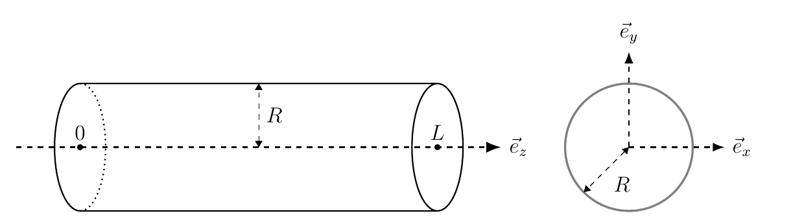

#### Question 5.1.1

*En tenant compte des hypothèses, écrire les équations et conditions limites du problème.* 考虑题设假设，写出问题的方程和边界条件。

**答案**

(H1) écoulement permanent : $\partial_t(\cdot)=0$ ; (H2) axisymétrique : $\partial_\theta(\cdot)=0$ ; (H3) unidirectionnel : $\vec V=v(r,z)\vec e_z$ ; (H4) incompressible et (H5) homogène : $\rho=$ cste ⇒ $\operatorname{div}\vec V=0$ ; (H6) pas de force volumique : $\vec f_d=\vec0$ ; (H7) fluide visqueux newtonien ($\boldsymbol\sigma=2\mu\mathbb D-p\mathbb I$).
Équations simplifiées : $\operatorname{div}\vec V=0$ ; $\mu\Delta\vec V-\overrightarrow{\operatorname{grad}}p=\rho\,\overrightarrow{\operatorname{grad}}\vec V\cdot\vec V$.
Conditions aux limites : adhérence à la paroi immobile $\vec V(r=R)=\vec0$, régularité sur l'axe ($v$ fini en $r=0$) ; $p(z=0)=P_0$, $p(z=L)=P_L$.

**Détail · 推导**

- 七条假设各自给出一个简化：定常去掉 $\partial_t$；轴对称去掉 $\partial_\theta$；单向使速度只有 $z$ 分量；不可压缩结合均质（$\rho$ 为常数）由质量守恒得 $\operatorname{div}\vec V=0$；不计重力使体力为零；牛顿流体给出本构 $\boldsymbol\sigma=2\mu\mathbb D+(\lambda\operatorname{tr}\mathbb D-p)\mathbb I=2\mu\mathbb D-p\mathbb I$。
- 三个基本方程（质量守恒、动量守恒、本构）合并并代入上述假设，即得到简化后的连续性方程和 Navier–Stokes 方程。
- 边界条件：壁面不可穿透且黏性流体无滑移，故 $r=R$ 上速度为零；管轴 $r=0$ 处物理量必须有限；进出口给定压力。
- 求解逻辑：由连续性先得 $\partial_z v=0$，再由 $r,\theta$ 向动量方程限制压力只依赖 $z$，最后由 $z$ 向方程与边界条件联立定出 $p(z)$ 和 $v(r)$。

#### Question 5.1.2

*En déduire les champs de vitesse et de pression. Calculer la vitesse moyenne $V_m$. Exprimer la distribution de vitesse en fonction de $V_m$.* 求速度场和压力场；计算平均速度 $V_m$；用 $V_m$ 表示速度分布。

**答案**

$\operatorname{div}\vec V=\partial_zv=0$ ⇒ $v=v(r)$ ; $\overrightarrow{\operatorname{grad}}\vec V\cdot\vec V=\vec0$, donc $\mu\Delta v\,\vec e_z=\overrightarrow{\operatorname{grad}}p$ : $\partial_rp=\partial_\theta p=0$ et $\frac{\mathrm dp}{\mathrm dz}=\mu\Delta v=$ cste. Avec les pressions imposées : $p(z)=P_0-\frac{\Delta P}Lz$.
$\frac\mu r\frac{\mathrm d}{\mathrm dr}\bigl(r\frac{\mathrm dv}{\mathrm dr}\bigr)=-\frac{\Delta P}L$ ⇒ $v=-\frac{\Delta P}{4\mu L}r^2+C\ln(r/r_\ast)+D$ ; $v$ fini en $r=0$ ⇒ $C=0$ ; $v(R)=0$ ⇒ $v(r)=\frac{\Delta PR^2}{4\mu L}\Bigl(1-\frac{r^2}{R^2}\Bigr)$.
$V_m=\frac1{\pi R^2}\int_Sv\,\mathrm dS=\frac{\Delta PR^2}{8\mu L}$, d'où $v(r)=2V_m\Bigl(1-\frac{r^2}{R^2}\Bigr)$.

**Détail · 推导**

1. **连续性：** $\operatorname{div}\vec V=\partial v/\partial z=0$，所以 $v$ 只依赖 $r$（沿管轴不变）。
2. **对流项：** 柱坐标速度梯度只有 $(z,r)$ 位置一个元素 $v'(r)$，乘以 $\vec V=(0,0,v)$ 得零向量，所以加速度为零。
3. **NS 化简：** 定常、不可压缩、无体力，NS 变成 $\mu\Delta\vec V=\overrightarrow{\operatorname{grad}}p$，其中 $\Delta\vec V=\Delta v\,\vec e_z$。分量：$\partial_rp=0$，$\partial_\theta p=0$，所以 $p=p(z)$；$\frac{\mathrm dp}{\mathrm dz}=\mu\Delta v$。
4. **分离变量：** 左边只依赖 $z$，右边只依赖 $r$，两边等于同一个常数 $A$。由 $p(0)=P_0$、$p(L)=P_L$ 得 $A=-\Delta P/L$，$p(z)=P_0-\frac{\Delta P}Lz$，压力沿管线性下降。
5. **积分速度：** $\frac1r(rv')'=-\frac{\Delta P}{\mu L}$ ⇒ $rv'=-\frac{\Delta P}{2\mu L}r^2+C$ ⇒ $v=-\frac{\Delta P}{4\mu L}r^2+C\ln(r/r_\ast)+D$（取任意参考长度 $r_\ast>0$ 使对数自变量无量纲）。轴上 $r=0$ 速度必须有限，所以 $C=0$；$v(R)=0$ 给出 $D=\frac{\Delta PR^2}{4\mu L}$。速度剖面是抛物面，轴上最大。
6. **平均速度：** $\int_0^R\bigl(1-\frac{r^2}{R^2}\bigr)2\pi r\,\mathrm dr=\frac{\pi R^2}2$，所以 $V_m=\frac{\Delta PR^2}{4\mu L}\cdot\frac12=\frac{\Delta PR^2}{8\mu L}$；最大速度 $v(0)=2V_m$。

#### Question 5.1.3

*Calculer le débit volumique et le débit massique.* 计算体积流量和质量流量。

**答案**

$Q_v=\int_S\vec V\cdot\vec n\,\mathrm dS=V_mS=\frac{\pi R^4\Delta P}{8\mu L}$ ; fluide homogène incompressible : $Q_m=\int_S\rho\vec V\cdot\vec n\,\mathrm dS=\rho Q_v$.

**Détail · 推导**

截面 $S$ 的法向是 $\vec e_z$，$\vec V\cdot\vec n=v(r)$。由平均速度的定义直接得 $Q_v=V_m\pi R^2$。流量与 $R^4$ 成正比（Hagen–Poiseuille 定律）：半径减半，流量变为 1/16。$\rho$ 是常数，可以提出积分号。

#### Question 5.1.4

*Évaluer la contrainte de cisaillement à la paroi $\tau_p$.* 求壁面剪应力 $\tau_p$。

**答案**

Méthode locale : $\mathbb D=-\frac{2V_mr}{R^2}(\vec e_r\otimes\vec e_z+\vec e_z\otimes\vec e_r)$, $\boldsymbol\sigma=-p\mathbb I+2\mu\mathbb D$ ; en $r=R$, $\vec n=\vec e_r$, $\vec t=\vec e_z$ : $\tau_p=(\boldsymbol\sigma\vec n)\cdot\vec t=-\frac{4\mu V_m}R=-\frac{R}{2}\frac{\Delta P}L$.
Méthode globale : équilibre d'un tronçon de rayon $R$ et de longueur $\mathrm dz$ : $p\pi R^2-(p+\mathrm dp)\pi R^2+\tau_p2\pi R\,\mathrm dz=0$ ⇒ $\tau_p=\frac R2\frac{\mathrm dp}{\mathrm dz}=-\frac R2\frac{\Delta P}L$.

**Détail · 推导**

- **局部法：** $v'(r)=-\frac{4V_mr}{R^2}$；速度梯度只有 $(z,r)$ 元素，对称化后 $D_{rz}=D_{zr}=\frac12v'=-\frac{2V_mr}{R^2}$。应力 $\boldsymbol\sigma=-p\mathbb I+2\mu\mathbb D$（$\operatorname{tr}\mathbb D=0$，体积黏度项消失）。壁面上流体的外法向为 $\vec e_r$，切向为 $\vec e_z$：$\tau_p=\sigma_{zr}(R)=2\mu D_{rz}(R)=-\frac{4\mu V_m}R$。负号表示壁面对流体的切向力沿 $-\vec e_z$，即阻碍流动；流体对壁面的力沿 $+\vec e_z$。
- **整体法：** 取半径 $R$、长 $\mathrm dz$ 的流体圆柱，沿 $\vec e_z$ 的受力：两端压力差 $-\mathrm dp\,\pi R^2$，壁面对流体的侧面剪力 $\tau_p\,2\pi R\,\mathrm dz$，合力为零（加速度为零）。得 $\tau_p=\frac R2\frac{\mathrm dp}{\mathrm dz}$，与局部法一致。
- 两种方法互相验证，考试时写一种、用另一种检查。
- **延伸（回应题面目标的沿程损失系数）：** 按 Darcy–Weisbach 定义 $\Delta P=f_D\frac{L}{2R}\frac12\rho V_m^2$，代入 $V_m=\frac{\Delta PR^2}{8\mu L}$ 并引入管径雷诺数 $\mathrm{Re}_D=\frac{\rho V_m(2R)}{\mu}$，即得层流圆管经典结果 $f_D=\frac{64}{\mathrm{Re}_D}$（这里记作 $f_D$ 以免与题面体积黏度 $\lambda$ 混淆）。

### Exercice 5.2 · Poiseuille annulaire · 环形管 Poiseuille 流

**考点**　NS cylindrique, terme en $\ln r$, débit, équilibre global, cas limite

#### Énoncé · 题面

Un fluide newtonien incompressible ($\rho$, $\mu$) s'écoule dans l'espace annulaire compris entre deux cylindres coaxiaux fixes de rayons $a$ et $b$ ($a<b$), d'axe $O\vec e_z$ horizontal et de longueur $L$. La pression vaut $P_0$ en $z=0$ et $P_L$ en $z=L$, avec $\Delta P=P_0-P_L>0$. On néglige la pesanteur. L'écoulement est permanent, unidirectionnel et axisymétrique : $\vec V=v(r)\vec e_z$. 不可压缩牛顿流体在两根固定同轴圆柱（半径 $a<b$）之间的环形空间中流动，轴 $O\vec e_z$ 水平，长 $L$。$z=0$ 处压力 $P_0$，$z=L$ 处 $P_L$，$\Delta P=P_0-P_L>0$。忽略重力。流动定常、单向、轴对称：$\vec V=v(r)\vec e_z$。

#### Question 5.2.1

*Écrire les équations et les conditions aux limites ; montrer que $p=P_0-\frac{\Delta P}Lz$.* 写出方程和边界条件；证明压力沿轴线性下降。

**答案**

$\operatorname{div}\vec V=0$ vérifié ; $\overrightarrow{\operatorname{grad}}\vec V\cdot\vec V=\vec0$ ; Navier–Stokes : $\partial_rp=\partial_\theta p=0$, $\frac{\mathrm dp}{\mathrm dz}=\frac\mu r(rv')'=$ cste. CL : $v(a)=v(b)=0$, $p(0)=P_0$, $p(L)=P_L$, donc $p=P_0-\frac{\Delta P}Lz$.

**Détail · 推导**

和 TD7 完全相同的推理：左边只依赖 $z$，右边只依赖 $r$，两边等于同一常数 $-\Delta P/L$。唯一的区别是边界：现在有内外两个壁面，都要贴壁。

#### Question 5.2.2

*Déterminer $v(r)$. Pourquoi conserve-t-on ici le terme en $\ln r$, contrairement au tube plein ?* 求 $v(r)$。为什么这里保留 $\ln r$ 项，而普通圆管（区域含轴线）里要去掉？

**答案**

$v=-\frac{\Delta P}{4\mu L}r^2+C_1\ln(r/r_\ast)+C_2$ (avec $r_\ast>0$ arbitraire). Le domaine $a\le r\le b$ ne contient pas l'axe : $\ln(r/r_\ast)$ reste fini, on garde les deux constantes et on impose $v(a)=v(b)=0$ :
$$v(r)=\frac{\Delta P}{4\mu L}\Bigl[b^2-r^2-(b^2-a^2)\frac{\ln(b/r)}{\ln(b/a)}\Bigr].$$

**Détail · 推导**

普通圆管的流体区域包含轴线 $r=0$，$\ln(r/r_\ast)\to-\infty$ 会使速度发散，所以必须取 $C_1=0$。环形区域不含轴线，没有这个奇点限制，两个常数由内外两个贴壁条件确定。代入检查：$r=b$ 时方括号为 $0-0$；$r=a$ 时为 $(b^2-a^2)-(b^2-a^2)=0$。

#### Question 5.2.3

*Calculer le débit volumique $Q$.* 求体积流量 $Q$。

**答案**

$$Q=\int_a^bv\,2\pi r\,\mathrm dr=\frac{\pi\Delta P}{8\mu L}\Bigl[b^4-a^4-\frac{(b^2-a^2)^2}{\ln(b/a)}\Bigr].$$

**Détail · 推导**

逐项积分：$\int_a^b(b^2-r^2)r\,\mathrm dr=\frac{(b^2-a^2)^2}4$；分部积分得 $\int_a^br\ln\frac br\,\mathrm dr=\bigl[\frac{r^2}2\ln\frac br\bigr]_a^b+\int_a^b\frac r2\,\mathrm dr=\frac{b^2-a^2}4-\frac{a^2}2\ln\frac ba$。代入 $Q=\frac{\pi\Delta P}{2\mu L}\bigl[\frac{(b^2-a^2)^2}4-\frac{b^2-a^2}{\ln(b/a)}\bigl(\frac{b^2-a^2}4-\frac{a^2}2\ln\frac ba\bigr)\bigr]$，利用 $(b^2-a^2)^2+2a^2(b^2-a^2)=b^4-a^4$ 整理即得上式。

#### Question 5.2.4

*Calculer les contraintes tangentielles exercées par le fluide sur les deux cylindres et vérifier l'équilibre global du fluide contenu entre $z=0$ et $z=L$.* 求流体作用在两圆柱上的切应力；验证 $0\le z\le L$ 段流体的整体平衡。

**答案**

$\sigma_{rz}=\mu v'$, avec $v'(r)=\frac{\Delta P}{4\mu L}\Bigl[-2r+\frac{b^2-a^2}{r\ln(b/a)}\Bigr]$. Sur le cylindre intérieur : $\tau_a=\mu v'(a)>0$ ; sur le cylindre extérieur : $\tau_b=-\mu v'(b)>0$ (les deux sont entraînés selon $+\vec e_z$). Équilibre : $\Delta P\,\pi(b^2-a^2)=L\,(2\pi a\,\tau_a+2\pi b\,\tau_b)$, vérifié.

**Détail · 推导**

- 内圆柱在 $r<a$ 一侧，流体在 $+\vec e_r$ 一侧：流体对内柱的面力是 $\boldsymbol\sigma\vec e_r$，切向分量 $\sigma_{rz}(a)=\mu v'(a)$。外圆柱在 $r>b$ 一侧，流体在 $-\vec e_r$ 一侧：面力 $\boldsymbol\sigma(-\vec e_r)$，切向分量 $-\mu v'(b)$。
- 整体平衡（带符号的轴向平衡）：两端压力差沿 $+\vec e_z$ 推动流体的合力为 $\Delta P\,\pi(b^2-a^2)$；本题定义 $\tau_a,\tau_b>0$ 为**流体对圆柱**的切应力，由作用与反作用，两壁对流体施加沿 $-\vec e_z$ 的摩擦合力为 $-(2\pi a\,\tau_a+2\pi b\,\tau_b)L$（对比 5.1.4 的 $\tau_p<0$ 为壁面对流体的力）。轴向平衡 $\Delta P\,\pi(b^2-a^2)-L(2\pi a\,\tau_a+2\pi b\,\tau_b)=0$，而 $2\pi a\tau_a+2\pi b\tau_b=\frac{\pi\Delta P}{2L}\bigl[-2a^2+\frac{b^2-a^2}{\ln(b/a)}+2b^2-\frac{b^2-a^2}{\ln(b/a)}\bigr]=\frac{\pi\Delta P(b^2-a^2)}{L}$，含 $\ln$ 的项正好抵消，恒成立。

#### Question 5.2.5

*Retrouver l'écoulement de Poiseuille dans un tube plein lorsque $a\to0$.* $a\to0$ 时退化为普通圆管的 Poiseuille 流。

**答案**

Quand $a\to0$, $\frac{b^2-a^2}{\ln(b/a)}\to0$ : $v\to\frac{\Delta P}{4\mu L}(b^2-r^2)$ et $Q\to\frac{\pi b^4\Delta P}{8\mu L}$, résultats du TD7.

**Détail · 推导**

$\ln(b/a)\to+\infty$，所以含 $\ln$ 的修正项趋于零（对固定的 $r>0$）。另一个极限：间隙很窄（$b-a=e\ll a$）时，剖面退化为两平板之间的平面 Poiseuille 流。

### Exercice 5.3 · Écoulement de Couette–Poiseuille plan · 平面 Couette–Poiseuille 流

**考点**　paroi mobile et gradient de pression, débit, contrainte pariétale, puissance

#### Énoncé · 题面

Un fluide newtonien incompressible ($\rho$, $\mu$) est contenu entre deux plaques planes horizontales, parallèles et infinies, distantes de $h$. La plaque inférieure ($y=0$) est fixe ; la plaque supérieure ($y=h$) se translate à la vitesse constante $U\vec e_x$. Un gradient de pression constant est imposé dans la direction de l'écoulement : $\frac{\partial p}{\partial x}=-G$ ($G$ constante de signe quelconque). La pesanteur est $\vec g=-g\vec e_y$. L'écoulement est stationnaire, laminaire et plan : $\vec V=v(y)\vec e_x$. 不可压缩牛顿流体（$\rho,\mu$）位于两块相距 $h$ 的水平无限大平行平板之间。下板（$y=0$）固定，上板（$y=h$）以恒定速度 $U\vec e_x$ 平移。沿流动方向施加恒定压力梯度 $\partial p/\partial x=-G$（$G$ 正负均可）。重力 $\vec g=-g\vec e_y$。流动定常、层流、平面：$\vec V=v(y)\vec e_x$。

#### Question 5.3.1

*Écrire les équations et les conditions aux limites. Montrer que $p(x,y)=p_0-Gx-\rho gy$.* 写出方程和边界条件，证明压力为 $p_0-Gx-\rho gy$。

**答案**

$\operatorname{div}\vec V=\partial_xv=0$ (vérifié) ; $\overrightarrow{\operatorname{grad}}\vec V\cdot\vec V=\vec0$ ; Navier–Stokes : $\mu v''-\partial_xp=0$ (selon $\vec e_x$), $-\partial_yp-\rho g=0$ (selon $\vec e_y$). CL : $v(0)=0$, $v(h)=U$. Avec $\partial_xp=-G$ : $p=p_0-Gx-\rho gy$.

**Détail · 推导**

速度沿 $x$ 方向且只依赖 $y$，所以连续性方程自动满足，对流项也为零。$y$ 方向方程给出静水压 $-\rho gy$，$x$ 方向给定梯度 $-G$，两者相加得压力；积分常数 $p_0$ 是原点处的压力。两板都是黏性贴壁条件。

#### Question 5.3.2

*Déterminer $v(y)$. Tracer l'allure du profil pour $G=0$, $G>0$ et $G<0$.* 求 $v(y)$；画出 $G=0$、$G>0$、$G<0$ 时的剖面形状。

**答案**

$\mu v''=-G$ ⇒ $v=-\frac G{2\mu}y^2+C_1y+C_2$ ; $v(0)=0$, $v(h)=U$ :
$$v(y)=U\frac yh+\frac G{2\mu}y(h-y).$$
Pour $U>0$ : $G=0$ ⇒ droite reliant $(0,0)$ à $(h,U)$ ; $G>0$ ⇒ courbe au-dessus de cette droite (accélération par le gradient de pression) ; $G<0$ ⇒ courbe au-dessous de la droite, avec contre-écoulement ($v<0$) près de $y=0$ dès que $G<-\frac{2\mu U}{h^2}$.

**Détail · 推导**

解是 Couette（线性）和 Poiseuille（抛物线）的叠加，这正是方程线性的结果。三条剖面共用端点 $v(0)=0,\ v(h)=U$：以 $G=0$ 的直线为基准，$G>0$ 时板间速度处处高于该直线；$G<0$ 时逆压梯度使板间速度低于该直线，且当 $G<-\frac{2\mu U}{h^2}$（对 $U>0$）时下板附近 $v'(0)<0$，出现局部倒流。

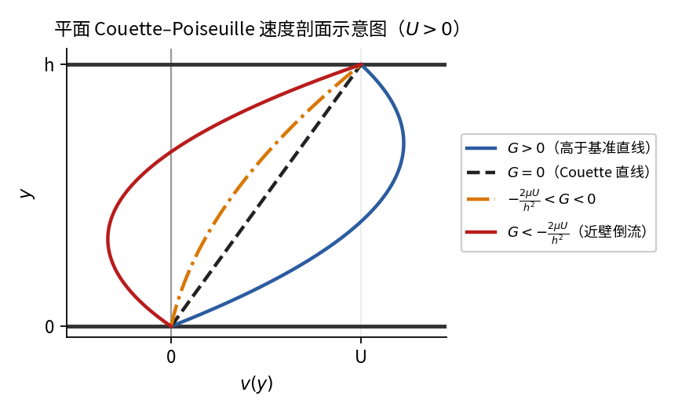

#### Question 5.3.3

*Calculer le débit volumique $q$ par unité de largeur. Pour quelle valeur de $G$ le débit est-il nul ?* 求单位宽度体积流量 $q$；$G$ 取何值时流量为零？

**答案**

$q=\int_0^hv\,\mathrm dy=\frac{Uh}2+\frac{Gh^3}{12\mu}$ ; $q=0$ pour $G=-\frac{6\mu U}{h^2}$.

**Détail · 推导**

$\int_0^hy\,\mathrm dy=\frac{h^2}2$，$\int_0^hy(h-y)\,\mathrm dy=\frac{h^3}6$。当 $q=0$（对 $U>0$，即 $G=-\frac{6\mu U}{h^2}$）时，代回速度得 $v(y)=U\frac yh\bigl(\frac{3y}h-2\bigr)$：下方三分之二区域（$0<y<\frac{2h}3$）倒流，上方三分之一区域（$\frac{2h}3<y\le h$）顺流，两者流量正负抵消，净输运为零（例如封闭的润滑槽）。

#### Question 5.3.4

*Calculer la contrainte tangentielle exercée par le fluide sur la plaque inférieure. Pour quelle valeur de $G$ est-elle nulle ?* 求流体作用在下板上的切应力；$G$ 取何值时它为零？

**答案**

Sur la plaque inférieure, le fluide est du côté $+\vec e_y$ : $\vec T=\boldsymbol\sigma\vec e_y$, composante tangentielle $\tau_0=\mu v'(0)=\frac{\mu U}h+\frac{Gh}2$ ; nulle pour $G=-\frac{2\mu U}{h^2}$.

**Détail · 推导**

$\boldsymbol\sigma\vec e_y$ 是法向 $+\vec e_y$ 一侧（流体）作用在另一侧（下板）上的面力。$v'(y)=\frac Uh+\frac G{2\mu}(h-2y)$。切应力为零意味着剖面在 $y=0$ 处切线竖直（$v'(0)=0$），这是**近壁倒流刚要出现的临界条件**；$G$ 再减小（对 $U>0$），下板附近就会出现倒流。

#### Question 5.3.5

*Quelle force par unité de surface faut-il appliquer à la plaque supérieure pour la maintenir en mouvement ? Vérifier le bilan de puissance $FU+Gq=\int_0^h\mu v'^2\,\mathrm dy$.* 需要对上板施加多大的单位面积力才能保持其运动？验证功率平衡。

**答案**

Le fluide exerce sur la plaque supérieure $\boldsymbol\sigma(-\vec e_y)$, de composante tangentielle $-\mu v'(h)$ ; il faut donc appliquer la force algébrique $F=\mu v'(h)=\frac{\mu U}h-\frac{Gh}2$ (selon $\vec e_x$). Pour $U>0$ et $G>\frac{2\mu U}{h^2}$, on a $F<0$ : l'écoulement entraîne la plaque et il faut la retenir selon $-\vec e_x$ (d'où $FU<0$). Bilan (par unité de surface) : $FU+Gq=\int_0^h\mu v'^2\,\mathrm dy=\frac{\mu U^2}h+\frac{G^2h^3}{12\mu}$, vérifié identiquement.

**Détail · 推导**

- 上板在 $y=h$，流体在它下方（$-\vec e_y$ 一侧），流体对上板的面力是 $\boldsymbol\sigma(-\vec e_y)=(-\mu v'(h),\ p)$。匀速运动要求外力与之平衡，故有符号的切向力为 $F=\mu v'(h)$。当 $U>0$ 且顺压梯度大到 $G>\frac{2\mu U}{h^2}$ 时，压力流拖着上板向前，外力需沿 $-\vec e_x$ 制动（$F<0$，此时外力功率 $FU<0$，而压力功率与外力功率之和仍等于正的黏性耗散）。
- 功率平衡：取长 $L$、单位宽度的一段，定常时动能不变，外力功率 = 内力耗散。外力有两部分：上板的力 $FUL$，两端压力差做功 $(p_{in}-p_{out})q=GLq$；耗散 $L\int_0^h2\mu\mathbb D:\mathbb D\,\mathrm dy=L\int_0^h\mu v'^2\,\mathrm dy$。除以 $L$ 即得：左边 $FU+Gq=\bigl(\frac{\mu U}h-\frac{Gh}2\bigr)U+G\bigl(\frac{Uh}2+\frac{Gh^3}{12\mu}\bigr)=\frac{\mu U^2}h+\frac{G^2h^3}{12\mu}$；右边用 $\int_0^h(h-2y)\,\mathrm dy=0$ 与 $\int_0^h(h-2y)^2\,\mathrm dy=\frac{h^3}3$ 积分得完全相同的结果。

### Exercice 5.4 · Fluide sur un plan incliné · 运动斜面上的液膜

**考点**　hypothèses, NS cartésien, surface libre, profil, épaisseur transportée, effort, puissance

#### Énoncé · 题面

Un plan solide $(\Pi)$ formant un angle $\alpha$ avec l'horizontale est animé d'un mouvement de translation uniforme de vitesse $\vec U=-U\vec e_x$. Ce plan est destiné à transporter un fluide visqueux newtonien incompressible et pesant, de masse volumique $\rho$ et de viscosité dynamique $\mu$. Les forces de volume sont prises en compte et le champ de gravité est noté $\vec g$. On suppose que l'écoulement est stationnaire, laminaire et plan. 一个与水平面成 $\alpha$ 角的固体平面 $(\Pi)$ 以匀速 $\vec U=-U\vec e_x$ 平移（沿斜面向上），用来输运一种黏性、牛顿、不可压缩、有重量的流体（密度 $\rho$，动力黏度 $\mu$）。考虑体力，重力场记为 $\vec g$。假设流动定常、层流、平面。

On considère que la couche fluide, d'épaisseur constante $h$, est en contact par sa surface supérieure avec une atmosphère considérée comme un fluide parfait à pression atmosphérique constante $p_{atm}$. 厚度恒为 $h$ 的流体层上表面与大气接触，大气视为压力恒为 $p_{atm}$ 的理想流体。$x$ 轴沿斜面向下，$y$ 轴垂直于斜面。

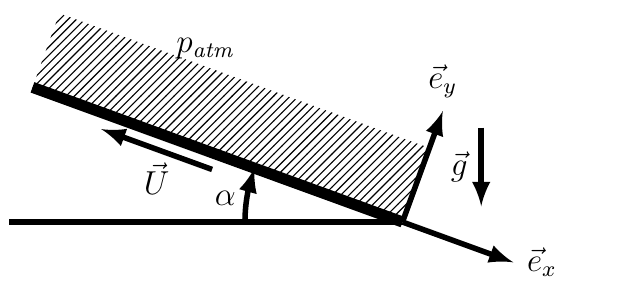

#### Question 5.4.1

*Donner les hypothèses du problème puis écrire les équations et conditions aux limites qui régissent l'écoulement.* 给出问题的假设，写出控制流动的方程和边界条件。

**答案**

(H1) fluide visqueux newtonien de viscosité $\mu$ ; (H2) incompressible : $\rho=$ cste ⇒ $\operatorname{div}\vec V=0$ ; (H3) fluide pesant : $\vec f_d=\rho\vec g$ ; (H4) stationnaire : $\partial_t(\cdot)=0$ ; (H5) plan : $\vec V=v(x,y)\vec e_x+w(x,y)\vec e_y$ ; (H6) laminaire et modélisé comme un écoulement parallèle à épaisseur constante $h$ : $\vec V=v(x,y)\vec e_x$ ; (H7) plan animé de la vitesse $-U\vec e_x$.
Équations simplifiées : $\operatorname{div}\vec V=0$ ; $\boldsymbol\sigma=2\mu\mathbb D-p\mathbb I$, d'où Navier–Stokes : $\mu\Delta\vec V-\overrightarrow{\operatorname{grad}}p+\rho\vec g=\rho\,\overrightarrow{\operatorname{grad}}\vec V\cdot\vec V$.
Conditions aux limites : en $y=0$, adhérence $\vec V(y=0)=-U\vec e_x$ ; en $y=h$, $\boldsymbol\sigma(y=h)\cdot\vec e_y=-p_{atm}\vec e_y$ (soit $\sigma_{xy}(h)=0$ et $p(h)=p_{atm}$).

**Détail · 推导**

- 由 H5 及建模假设 H6（取沿斜面的平行流，厚度 $h$ 恒定），速度只有 $x$ 分量：$\vec V=v(x,y)\vec e_x$；注意仅靠“层流且 $h$ 恒定”本身还不能推出法向速度处处为零，需要平行流假设（之后 5.4.2 再由连续性方程推出 $v=v(y)$）。
- 本构：$\boldsymbol\sigma=2\mu\mathbb D+(\lambda_v\operatorname{tr}\mathbb D-p)\mathbb I$，不可压缩时 $\operatorname{tr}\mathbb D=0$，化为 $2\mu\mathbb D-p\mathbb I$。结合定常条件代入动量方程得简化后的 NS 方程。
- $y=0$：固体壁面不可穿透，黏性流体贴壁，壁面以 $-U\vec e_x$ 运动，所以流体速度也等于 $-U\vec e_x$。
- $y=h$：上表面外法向 $\vec e_y$，大气是理想流体，只施加压力：$\boldsymbol\sigma\vec e_y=-p_{atm}\vec e_y$，即切应力为零、法向应力为 $-p_{atm}$（等价于 $p(h)=p_{atm}$）。

#### Question 5.4.2

*Justifier les formes supposées pour les champs de vitesse et de pression de l'écoulement : $\vec V(x,y)=v(y)\vec e_x$ et $p(x,y)=p(y)$. (On cherche ensuite $v(y)=C_1y^2+C_2y+C_3$ et $p(y)=C_4y+C_5$.)* 说明速度场和压力场为什么可以取 $v(y)\vec e_x$ 和 $p(y)$。

**答案**

Conservation de la masse : $\operatorname{div}\vec V=\frac{\partial v}{\partial x}=0$ ⇒ $\vec V=v(y)\vec e_x$. Pression : la projection de Navier–Stokes sur $\vec e_y$ donne $\partial_yp=-\rho g\cos\alpha$, d'où $p=-\rho g\cos\alpha\,y+k(x)$ ; la condition $p(x,h)=p_{atm}$ pour tout $x$ (épaisseur $h$ constante) impose $k=$ cste, donc $p=p(y)$.

**Détail · 推导**

连续性：$\vec V=v(x,y)\vec e_x$ 的散度就是 $\partial v/\partial x$，令其为零得 $v$ 只依赖 $y$。压力：在厚度 $h$ 恒定的前提下，由 $y$ 方向的方程积分得 $p(x,y)=-\rho g\cos\alpha\,y+k(x)$，再代入自由面条件 $p(x,h)=p_{atm}$ 对所有 $x$ 成立，直接推出 $k(x)=p_{atm}+\rho g h\cos\alpha$ 为常数，从而 $p$ 只依赖 $y$（不必额外把 $p=p(y)$ 当作独立假设）。

#### Question 5.4.3

*Montrer que l'on peut obtenir la forme de ces champs de vitesse et pression à partir des équations.* 证明可以由方程得到上述速度和压力的形式。

**答案**

$\overrightarrow{\operatorname{grad}}\vec V=\begin{pmatrix}0&v'\\0&0\end{pmatrix}$, $\overrightarrow{\operatorname{grad}}\vec V\cdot\vec V=\vec0$. Avec $\vec g=g(\sin\alpha\,\vec e_x-\cos\alpha\,\vec e_y)$, Navier–Stokes donne $\mu v''=-\rho g\sin\alpha$ et $\partial_yp=-\rho g\cos\alpha$, d'où $v=C_1y^2+C_2y+C_3$ avec $C_1=-\frac{\rho g\sin\alpha}{2\mu}$, et $p=C_4y+C_5$ avec $C_4=-\rho g\cos\alpha$.

**Détail · 推导**

对流项：速度梯度只有 $(x,y)$ 元素 $v'$，乘以 $\vec V=(v,0)$ 得零。NS 化为 $\mu\Delta\vec V-\overrightarrow{\operatorname{grad}}p+\rho\vec g=\vec0$，其中 $\Delta\vec V=v''\vec e_x$。重力投影：$x$ 沿坡向下，所以 $g_x=g\sin\alpha>0$，$g_y=-g\cos\alpha$。两个分量各积分，得到二次的速度和线性的压力。

#### Question 5.4.4

*Déterminer complètement les champs de vitesse et de pression en tout point du fluide à l'aide des conditions aux limites.* 用边界条件完全确定速度场和压力场。

**答案**

$v(0)=-U$ ⇒ $C_3=-U$. $\boldsymbol\sigma=2\mu\mathbb D-p\mathbb I=\begin{pmatrix}-p&\mu v'\\\mu v'&-p\end{pmatrix}$ ; en $y=h$ : $\boldsymbol\sigma\vec e_y=-p_{atm}\vec e_y$ ⇒ $\mu v'(h)=0$ et $p(h)=p_{atm}$, soit $C_2=\frac{\rho gh\sin\alpha}\mu$, $C_5=p_{atm}+\rho gh\cos\alpha$.
$$v(y)=\frac{\rho g\sin\alpha}{2\mu}(2h-y)y-U,\qquad p(y)=\rho g\cos\alpha\,(h-y)+p_{atm}.$$

**Détail · 推导**

- 速度条件 $y=0$ 定 $C_3$。
- 应力条件 $y=h$：$\mathbb D=\frac{v'}2(\vec e_x\otimes\vec e_y+\vec e_y\otimes\vec e_x)$，$\boldsymbol\sigma\vec e_y=(\mu v',\,-p)$。令其等于 $(0,-p_{atm})$：切向给 $v'(h)=2C_1h+C_2=0$，即 $C_2=\frac{\rho gh\sin\alpha}\mu$；法向给 $C_5=p_{atm}+\rho gh\cos\alpha$。
- 检查：$y=0$ 时 $v=-U$；$y=h$ 时 $v'=0$，自由面切线竖直；压力在自由面等于大气压，向下线性增加（静水压沿法向的分量）。

#### Question 5.4.5

*Tracer le profil des vitesses et calculer l'épaisseur $h_{max}$ de la couche fluide que peut transporter le plan en fonction de $\mu$, $h$, $U$, $\rho$, $g$ et $\alpha$.* 画速度剖面；求平板能带走的流体层厚度 $h_{max}$。

**答案**

En $h_{max}$ la vitesse s'annule (elle passe de négative à positive) : $\frac{\rho g\sin\alpha}{2\mu}(2h-h_{max})h_{max}-U=0$ ⇔ $h_{max}^2-2hh_{max}+\frac{2\mu U}{\rho g\sin\alpha}=0$. Solutions réelles si $U\le U_0=\frac{\rho gh^2\sin\alpha}{2\mu}$ (soit $h^2\geq\frac{2\mu U}{\rho g\sin\alpha}$) ; on garde la racine dans $[0,h]$ :
$$h_{max}=h-\sqrt{h^2-\frac{2\mu U}{\rho g\sin\alpha}}.$$
Pour $U=U_0$, le zéro atteint la surface libre ($h_{max}=h$) ; pour $U\ge U_0$, la vitesse reste $\le0$ dans toute la couche et toute l'épaisseur $h$ est entraînée ($h_{max}=h$).

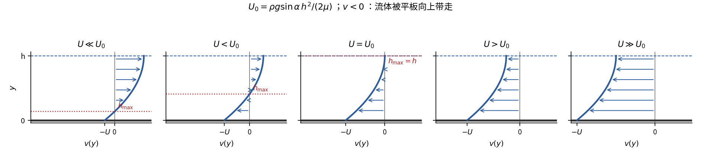

**Détail · 推导**

- 记 $U_0=\frac{\rho g\sin\alpha\,h^2}{2\mu}$（静止斜面上液膜自由面的速度）。$v(y)=U_0\bigl(2\frac yh-\frac{y^2}{h^2}\bigr)-U$：壁面处为 $-U$，自由面处为 $U_0-U$，切线竖直。
- $v<0$ 表示流体沿 $-\vec e_x$（斜面向上）运动，即被平板带走；$v>0$ 表示在重力作用下向下流。$U<U_0$ 时零速点在液膜内部，其高度就是 $h_{max}$；$U=U_0$ 时零速点恰好到达自由面；$U>U_0$ 时整层都向上走，直接取 $h_{max}=h$。
- 解二次方程，两个根之和为 $2h$，只有较小的根在 $[0,h]$ 内。判别式非负的条件就是 $U\le U_0$。

#### Question 5.4.6

*Calculer la densité d'efforts qu'il faut appliquer pour maintenir le plan en mouvement. En déduire la puissance qu'il faut fournir pour transporter l'épaisseur maximale de fluide.* 求维持平板运动所需施加的力密度；推出输运最大厚度流体所需的功率。

**答案**

$\vec T(y=0)=\boldsymbol\sigma(y=0)\cdot(-\vec e_y)=\begin{pmatrix}-\mu v'(0)\\p(0)\end{pmatrix}=\begin{pmatrix}-\rho gh\sin\alpha\\\rho gh\cos\alpha+p_{atm}\end{pmatrix}$ : efforts du plan sur le fluide, égaux à la densité d'efforts à appliquer au plan pour maintenir son mouvement uniforme (la composante selon $\vec e_x$ est négative, le plan « remonte » le fluide).
$P=\int_S\vec T(y=0)\cdot\vec V(y=0)\,\mathrm dS=\rho gh\sin\alpha\,US$ (à $U$ fixé, $P$ est indépendante de $\mu$). Toute la couche ($h_{max}=h$) est transportée dès que $U\ge U_0=\frac{\rho gh^2\sin\alpha}{2\mu}$ ; la puissance minimale (critique) pour transporter toute la couche correspond à $U=U_0$ :
$$P_{\min}=P(U_0)=\frac{(\rho gh\sin\alpha)^2hS}{2\mu}.$$

**Détail · 推导**

- 底面 $y=0$ 上流体的外法向是 $-\vec e_y$，$\vec T=\boldsymbol\sigma(-\vec e_y)$ 是平板作用在流体上的面力。$v'(0)=C_2=\frac{\rho gh\sin\alpha}\mu$，$p(0)=\rho gh\cos\alpha+p_{atm}$。
- 切向分量 $-\rho gh\sin\alpha$ 恰好等于单位面积上液层重力沿坡向上的平衡力（整体平衡检查）。由作用与反作用，流体作用在平板上的面力为 $-\vec T$，因此驱动装置须对平板施加 $+\vec T$ 才能保持匀速。
- 功率 $=$ 面力 · 平板速度 $\times$ 面积，得 $P(U)=\rho gh\sin\alpha\,US$：**给定板速 $U$ 时**功率与黏度 $\mu$ 无关；但**给定输运整层（$h_{max}=h$）的目标时**，需要板速满足 $U\ge U_0=\frac{\rho gh^2\sin\alpha}{2\mu}$，因此临界速度 $U_0$ 和临界（最小）功率 $P_{\min}=P(U_0)$ 都反比于 $\mu$（黏度越小，流体越容易向下流，所需板速和功率反而越大）。

### Exercice 5.5 · Deux couches sur un plan incliné · 斜面上的两层流体

**考点**　conditions d'interface entre deux fluides, surface libre, pression

#### Énoncé · 题面

Deux liquides newtoniens incompressibles non miscibles s'écoulent sur un plan incliné fixe faisant l'angle $\alpha$ avec l'horizontale. Le liquide 1 ($\rho_1$, $\mu_1$) occupe $0\le y\le h_1$ ; le liquide 2 ($\rho_2<\rho_1$, $\mu_2$) occupe $h_1\le y\le H=h_1+h_2$, sa surface libre est en contact avec l'atmosphère (pression $p_{atm}$). L'axe $x$ suit la ligne de plus grande pente vers le bas, l'axe $y$ est normal au plan. L'écoulement est stationnaire, laminaire et plan, les épaisseurs sont constantes : $\vec V_i=v_i(y)\vec e_x$. 两种互不相溶的不可压缩牛顿液体在固定斜面（倾角 $\alpha$）上流动。液体 1（$\rho_1,\mu_1$）占 $0\le y\le h_1$；液体 2（$\rho_2<\rho_1$，$\mu_2$）占 $h_1\le y\le H=h_1+h_2$，其自由面与大气接触（压力 $p_{atm}$）。$x$ 沿最大坡度向下，$y$ 垂直于斜面。流动定常、层流、平面，厚度不变：$\vec V_i=v_i(y)\vec e_x$。

#### Question 5.5.1

*Écrire les conditions aux limites en $y=0$, à l'interface $y=h_1$ et en $y=H$.* 写出 $y=0$、界面 $y=h_1$ 和 $y=H$ 处的边界条件。

**答案**

$y=0$ : $v_1(0)=0$ (adhérence). $y=h_1$ : continuité de la vitesse $v_1(h_1)=v_2(h_1)$ et du vecteur contrainte $\boldsymbol\sigma_1\vec e_y=\boldsymbol\sigma_2\vec e_y$, soit $\mu_1v_1'(h_1)=\mu_2v_2'(h_1)$ et $p_1(h_1)=p_2(h_1)$. $y=H$ : $\boldsymbol\sigma_2\vec e_y=-p_{atm}\vec e_y$, soit $v_2'(H)=0$ et $p_2(H)=p_{atm}$.

**Détail · 推导**

界面上：在无滑移且无相变的界面模型下，两层黏性流体在法向互不穿透、在切向速度连续（$v_1(h_1)=v_2(h_1)$）；在不计表面张力等额外界面力且界面平直的模型下，界面局部动量平衡给出应力向量 $\boldsymbol\sigma\vec n$ 连续（法向和切向分量都连续）。注意连续的是**剪应力** $\mu v'$，不是速度梯度 $v'$：两种流体黏度不同，界面两侧速度梯度会跳。

#### Question 5.5.2

*Déterminer $v_1(y)$ et $v_2(y)$.* 求两层的速度。

**答案**

Par les conditions en $y=H$ et $y=h_1$, $p_i$ ne dépend pas de $x$ ($\partial_xp_i=0$), donc dans chaque couche $\mu_iv_i''=-\rho_ig\sin\alpha$. Couche 2 avec $v_2'(H)=0$ : $\mu_2v_2'=\rho_2g\sin\alpha(H-y)$. Interface : $\mu_1v_1'(h_1)=\rho_2g\sin\alpha\,h_2$, d'où $\mu_1v_1'=\rho_1g\sin\alpha(h_1-y)+\rho_2g\sin\alpha\,h_2$. Avec $v_1(0)=0$ et $v_2(h_1)=v_1(h_1)$ :
$$v_1=\frac{g\sin\alpha}{\mu_1}\Bigl[\rho_1\Bigl(h_1y-\frac{y^2}2\Bigr)+\rho_2h_2y\Bigr],\qquad v_2=v_1(h_1)+\frac{\rho_2g\sin\alpha}{\mu_2}\Bigl[H(y-h_1)-\frac{y^2-h_1^2}2\Bigr].$$

**Détail · 推导**

与 5.4.2 同理，由 $\partial_yp_i=-\rho_ig\cos\alpha$、自由面 $p_2(x,H)=p_{atm}$ 及界面压力连续 $p_1(x,h_1)=p_2(x,h_1)$ 可知两层中均有 $\partial_xp_i=0$，于是 $x$ 向动量方程只剩黏性项与重力项。从自由面往下积分最方便：每一层的剪应力 $\mu v'$ 等于它上方流体重力沿坡分量（单位面积），所以上层是 $\rho_2g\sin\alpha(H-y)$，下层再加上整个上层的重量 $\rho_2g\sin\alpha\,h_2$。剪应力在界面处连续，速度梯度跳变。再由贴壁和界面速度连续积分一次。

#### Question 5.5.3

*Déterminer la pression dans les deux couches.* 求两层中的压力。

**答案**

$\partial_yp_i=-\rho_ig\cos\alpha$ : $p_2=p_{atm}+\rho_2g\cos\alpha(H-y)$ ; $p_1=p_{atm}+\rho_2g\cos\alpha\,h_2+\rho_1g\cos\alpha(h_1-y)$ ; continuité en $y=h_1$ vérifiée ($\sigma_{yy}=-p$ continu).

**Détail · 推导**

每层都是沿法向的静水压，从自由面往下累加。由于 $D_{yy}=0$，法向应力就是 $-p$，所以界面上法向应力连续等价于压力连续。

#### Question 5.5.4

*Calculer la vitesse de la surface libre. Que retrouve-t-on si les deux fluides sont identiques ?* 求自由面速度；两种流体相同时得到什么？

**答案**

$$v_2(H)=\frac{g\sin\alpha}{2\mu_1\mu_2}\bigl(\mu_2\rho_1h_1^2+2\mu_2\rho_2h_1h_2+\mu_1\rho_2h_2^2\bigr).$$
Si $\rho_1=\rho_2=\rho$ et $\mu_1=\mu_2=\mu$ : $v(H)=\frac{\rho g\sin\alpha\,H^2}{2\mu}$, vitesse de surface d'un film unique d'épaisseur $H$.

**Détail · 推导**

两种流体相同时，界面"消失"，回到单层液膜的结果（题库 5.4 中 $U=0$ 的情形，自由面速度 $U_0$）。这是检查计算的好方法。

### Exercice 5.6 · Rotation d'ensemble dans un récipient · 容器中的整体刚性转动

**考点**　solution de NS en rotation, $\mathbb D=\mathbb O$, pression, surface libre, rôle de la viscosité

#### Énoncé · 题面

Un récipient cylindrique de rayon $R$, d'axe vertical $O\vec e_z$, contient un liquide newtonien incompressible ($\rho$, $\mu$) et tourne à la vitesse angulaire constante $\omega$. En régime permanent, on cherche une solution de la forme $\vec V=v(r)\vec e_\theta$. La pesanteur est $\vec g=-g\vec e_z$ ; la surface libre est en contact avec l'atmosphère ($p_{atm}$) et on note $z_0$ sa cote sur l'axe. 半径 $R$、轴竖直的圆柱容器装有不可压缩牛顿液体（$\rho,\mu$），以恒定角速度 $\omega$ 转动。定常状态下设 $\vec V=v(r)\vec e_\theta$。重力 $-g\vec e_z$；自由面接触大气（$p_{atm}$），轴上自由面高度记为 $z_0$。

#### Question 5.6.1

*Montrer que $v(r)=\omega r$.* 证明 $v(r)=\omega r$。

**答案**

Composante $\theta$ de Navier–Stokes : $\frac{\mathrm d}{\mathrm dr}\bigl[\frac1r\frac{\mathrm d}{\mathrm dr}(rv)\bigr]=0$ ⇒ $v=Ar+\frac Br$ ; vitesse finie sur l'axe ⇒ $B=0$ ; adhérence en $r=R$ : $v(R)=\omega R$ ⇒ $A=\omega$. Donc $v=\omega r$ : rotation de corps rigide.

**Détail · 推导**

与黏度计同一个方程，但区域包含轴 $r=0$，$B/r$ 发散，必须去掉。底面上流体也以 $\omega r$ 转动，与容器底的速度一致，贴壁条件同样满足。

#### Question 5.6.2

*Calculer $\mathbb D$ et les contraintes visqueuses. Commenter.* 求变形率和黏性应力，并评论。

**答案**

$D_{r\theta}=\frac r2\frac{\mathrm d}{\mathrm dr}\bigl(\frac vr\bigr)=0$ : $\mathbb D=\mathbb O$, contraintes visqueuses nulles, $\boldsymbol\sigma=-p\mathbb I$. Le fluide tourne comme un solide, sans déformation.

**Détail · 推导**

刚体运动没有变形，所以没有黏性应力，流体内部像理想流体一样只受压力。

#### Question 5.6.3

*Déterminer le champ de pression et la forme de la surface libre.* 求压力场和自由面形状。

**答案**

$\partial_rp=\rho\omega^2r$, $\partial_zp=-\rho g$ ⇒ $p=p_{atm}+\frac12\rho\omega^2r^2-\rho g(z-z_0)$. Surface libre ($p=p_{atm}$) : $z=z_0+\frac{\omega^2r^2}{2g}$, paraboloïde de révolution.

**Détail · 推导**

$r$ 方向：压力沿径向向外增大（$\partial_rp=\rho\omega^2r>0$），因此压力力 $-\partial_rp\,\vec e_r$ 指向转轴，提供向心加速度 $-\omega^2r\,\vec e_r$；$z$ 方向：静水压。自由面是等压面，中心低、边缘高；高度差 $\frac{\omega^2R^2}{2g}$。

#### Question 5.6.4

*La viscosité intervient-elle dans le résultat ? Quel couple faut-il fournir en régime permanent ?* 结果与黏度有关吗？定常时需要提供多大的力矩？

**答案**

Non : $\mu$ n'apparaît pas ($\mathbb D=\mathbb O$). Les contraintes visqueuses étant nulles, aucun couple n'est transmis au fluide : le couple à fournir pour entretenir la rotation d'ensemble du liquide en régime permanent est nul (la viscosité ne joue que pendant la mise en rotation).

**Détail · 推导**

黏度只在"起转"的非定常阶段起作用：把转动从壁面传到液体内部。达到刚体转动后没有剪切、没有耗散，因此**维持液体整体转动所需的稳态力矩为零**（与实际装置中的轴承等机械阻力区分开）。QCM 里常考：刚体转动的流体内力功率为零。

### Exercice 5.7 · Viscosimètre rotatif · 旋转黏度计

**考点**　Couette cylindrique, pression, taux de déformation, couple, viscosité, application numérique

#### Énoncé · 题面

On se propose de mesurer la viscosité d'un liquide à l'aide d'un dispositif à cylindres coaxiaux (figure 5.1). Le cylindre extérieur de rayon $b$, entraîné par un moteur, tourne autour de son axe $O\vec e_z$, à une vitesse de rotation constante $\omega$. Le cylindre intérieur, de rayon $a$, est maintenu fixe par l'application d'un couple $\vec C=C\vec e_z$. Le liquide, incompressible, de masse volumique $\rho$, de viscosité $\mu$, se met en mouvement qu'on suppose de symétrie axiale. Le couple transmis par les contraintes visqueuses au cylindre intérieur s'exerce sur la surface verticale et sur la base inférieure du cylindre intérieur. 用同轴圆柱装置测量液体的黏度（图 5.1）。外圆柱半径 $b$，由电机带动绕轴 $O\vec e_z$ 以恒定角速度 $\omega$ 转动；内圆柱半径 $a$，靠施加的力偶 $\vec C=C\vec e_z$ 保持不动。液体不可压缩，密度 $\rho$，黏度 $\mu$，其运动假设为轴对称。黏性应力传给内圆柱的力矩作用在内圆柱的竖直侧面和底面上。

La hauteur de fluide en contact avec la base inférieure étant très supérieure à l'épaisseur de fluide entre les deux cylindres, on considérera négligeable le couple transmis à la surface inférieure. Dans la zone de hauteur $h$ comprise entre les deux surfaces verticales, on admet que la vitesse est azimutale et ne dépend que de $r$ : $\vec V=v(r)\,\vec e_\theta$. 由于内圆柱底面下方的液层厚度远大于两圆柱间的间隙，忽略传到底面上的力矩。在两竖直面之间高度为 $h$ 的区域内，认为速度是环向的且只依赖 $r$：$\vec V=v(r)\vec e_\theta$。

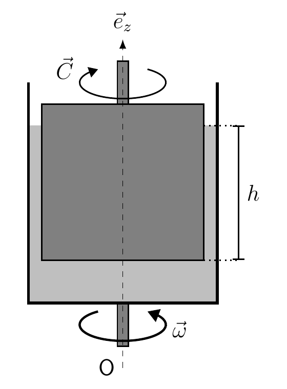

#### Question 5.7.1

*Énoncer les hypothèses qui régissent l'écoulement puis écrire les équations scalaires déduites des lois de conservation et des conditions aux limites.* 列出流动的假设，写出由守恒律得到的标量方程和边界条件。

**答案**

(H1) rotation constante en régime permanent établi (transitoire de démarrage dissipé) : $\partial_t(\cdot)=0$ ; (H2) fluide incompressible : $\operatorname{div}\vec V=0$ ; (H3) fluide pesant : $\vec f_d=-\rho g\vec e_z$ ; (H4) fluide newtonien : $\boldsymbol\sigma=2\mu\mathbb D-p\mathbb I$ ; (H5) symétrie axiale : $\partial_\theta(\cdot)=0$ ; (H6) $\vec V=v(r)\vec e_\theta$ ; (H7) couple transmis par la surface latérale seulement ; (H8) surface libre supposée plane à la cote approchée $z\approx h$.
Équations scalaires : continuité $\frac1r\partial_\theta v=0$ (vérifiée) ; projections de Navier–Stokes en cylindriques : $\partial_rp=\rho\frac{v^2}r$ (selon $\vec e_r$), $\frac{\mathrm d}{\mathrm dr}\bigl[\frac1r\frac{\mathrm d}{\mathrm dr}(rv)\bigr]=0$ (selon $\vec e_\theta$), $\partial_zp=-\rho g$ (selon $\vec e_z$).
Conditions aux limites : $\vec V(r=a)=\vec0$, $\vec V(r=b)=\omega b\,\vec e_\theta$ (adhérence) ; pression de référence prise sur le bord intérieur de la surface libre : $p(a,h)=P_a$ (le modèle à surface plane $z=h$ étant incompatible avec $\partial_rp>0$ sur toute la surface).

**Détail · 推导**

| 编号 | 假设 | 推出 |
|---|---|---|
| H1 | 外筒匀速转动且已进入稳态 | 定常，$\partial_t=0$（启动暂态已消失） |
| H2 | 不可压缩 | $\operatorname{div}\vec V=0$ |
| H3 | 有重量 | $\vec f_d=-\rho g\vec e_z$ |
| H4 | 牛顿黏性流体 | $\boldsymbol\sigma=2\mu\mathbb D-p\mathbb I$ |
| H5 | 轴对称 | $\partial_\theta=0$ |
| H6 | 速度形式 | $\vec V=v(r)\vec e_\theta$，$z\in[0,h]$ |
| H7 | 只有侧面传递力矩 | 底面力矩忽略 |
| H8 | 自由面近似视为平面 | 液面高度近似 $z\approx h$ |

方程：由质量守恒、动量守恒与本构 H4 合并得定常不可压缩 Navier–Stokes 方程 $\mu\Delta\vec V-\overrightarrow{\operatorname{grad}}p+\vec f_d=\rho\,\overrightarrow{\operatorname{grad}}\vec V\cdot\vec V$，再按柱坐标投影为三条标量方程（推导见 5.7.2）。边界条件：内壁静止，外壁速度 $\omega b$（黏性贴壁）。压力条件需要注意：因为径向方程给出 $\partial_rp=\rho v^2/r>0$，同一水平面 $z=h$ 上压力随 $r$ 增大，无法在整张平面 $z=h$ 上都等于 $P_a$，因此求压力分布时取内壁处 $p(a,h)=P_a$ 作参考点（与 H8 的平液面近似相协调）。

#### Question 5.7.2

*Déterminer les distributions de vitesse et de pression.* 求速度分布和压力分布。

**答案**

Projection sur $\vec e_\theta$ : $\frac{\mathrm d}{\mathrm dr}\Bigl[\frac1r\frac{\mathrm d}{\mathrm dr}(rv)\Bigr]=0$ ⇒ $v=Ar+\frac Br$ ; avec $v(a)=0$, $v(b)=\omega b$ :
$$v(r)=\frac{b^2\omega}{b^2-a^2}\Bigl(r-\frac{a^2}r\Bigr).$$
Intégration de $\partial_zp=-\rho g$ et $\partial_rp=\rho\frac{v^2}r$ avec la référence $p(a,h)=P_a$ (et $A=\frac{b^2\omega}{b^2-a^2}$) :
$$p(r,z)=P_a+\rho g(h-z)+\rho A^2\Bigl(\frac{r^2-a^2}2-2a^2\ln\frac ra-\frac{a^4}2\Bigl(\frac1{r^2}-\frac1{a^2}\Bigr)\Bigr).$$

**Détail · 推导**

1. **连续性：** $\operatorname{div}\vec V=\frac1r\partial_\theta v=0$，自动满足。
2. **两个预备量：** $\Delta\vec V=\bigl(\Delta v-\frac v{r^2}\bigr)\vec e_\theta=\frac{\mathrm d}{\mathrm dr}\bigl[\frac1r\frac{\mathrm d}{\mathrm dr}(rv)\bigr]\vec e_\theta$；$\overrightarrow{\operatorname{grad}}\vec V\cdot\vec V=-\frac{v^2}r\vec e_r$（向心加速度）。
3. **NS 三个分量：** $\vec e_r$：$\partial_rp=\rho\frac{v^2}r$；$\vec e_\theta$：$\frac{\mathrm d}{\mathrm dr}\bigl[\frac1r(rv)'\bigr]=0$；$\vec e_z$：$\partial_zp=-\rho g$。
4. **速度：** 积分 $\vec e_\theta$ 方程：$\frac1r(rv)'=2A$ ⇒ $rv=Ar^2+B$ ⇒ $v=Ar+\frac Br$。代入 $v(a)=0$、$v(b)=\omega b$：$A=\frac{b^2\omega}{b^2-a^2}$，$B=-\frac{a^2b^2\omega}{b^2-a^2}=-Aa^2$。$Ar$ 是刚体转动，$B/r$ 产生剪切。间隙很窄时剖面接近直线，退化为平面 Couette 流。
5. **压力：** 由 $\vec e_z$ 方程积分得 $p(r,z)=f(r)+\rho g(h-z)$；再将 $\frac{v^2}r=A^2\bigl(r-\frac{2a^2}r+\frac{a^4}{r^3}\bigr)$ 代入 $\vec e_r$ 方程积分，并用内壁液面参考条件 $p(a,h)=P_a$ 定出常数（注意 $\frac{r^2-a^2}2-\frac{a^4}2(\frac1{r^2}-\frac1{a^2})=\frac{r^2}2-\frac{a^4}{2r^2}$）：$p(r,z)=P_a+\rho g(h-z)+\rho A^2\bigl[\frac{r^2}2-2a^2\ln\frac ra-\frac{a^4}{2r^2}\bigr]$。严格说压力随 $r$ 增大与"自由面是平面"（H8）存在微弱冲突（实际自由面会向外壁略微爬升），但在忽略液面微弱弯曲的模型下，该压力场满足控制方程。

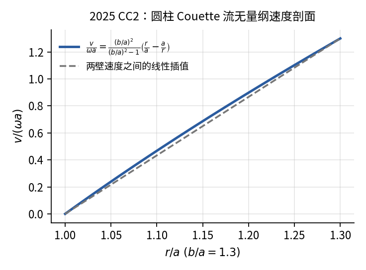

#### Question 5.7.3

*Donner les expressions des opérateurs des taux de déformation et des contraintes visqueuses. En déduire le moment selon $O\vec e_z$ des contraintes exercées par le fluide sur le cylindre intérieur.* 写出变形率张量和黏性应力；求流体作用在内圆柱上的应力对 $O\vec e_z$ 的力矩。

**答案**

$$\mathbb D=-\frac B{r^2}\begin{pmatrix}0&1&0\\1&0&0\\0&0&0\end{pmatrix},\qquad\boldsymbol\tau=2\mu\mathbb D=-\frac{2\mu B}{r^2}\begin{pmatrix}0&1&0\\1&0&0\\0&0&0\end{pmatrix}\ \text{dans }(\vec e_r,\vec e_\theta,\vec e_z),$$
Moment des contraintes exercées par le fluide sur le cylindre intérieur :
$$M_z=4\pi h\mu\frac{a^2b^2}{b^2-a^2}\,\omega\quad(\text{d'où le couple de maintien algébrique } C=-M_z,\ |C|=M_z).$$

**Détail · 推导**

- **变形率：** 柱坐标速度梯度中非零的是 $\partial_rv=A-\frac B{r^2}$ 和 $-\frac vr=-(A+\frac B{r^2})$；对称化后 $D_{r\theta}=\frac12\bigl(v'-\frac vr\bigr)=\frac r2\bigl(\frac vr\bigr)'=-\frac B{r^2}$。刚体转动部分 $Ar$ 对 $\mathbb D$ 没有贡献。
- **方法一（直接积分）：** 内壁 $r=a$ 上内柱受流体面力的外法向为 $+\vec e_r$，切应力 $\tau_{r\theta}(a)=-\frac{2\mu B}{a^2}=+\frac{2\mu b^2\omega}{b^2-a^2}$（当 $\omega>0$ 时沿 $+\vec e_\theta$ 拖着内柱转动）。力臂 $a$，面积 $2\pi ah$：$M_z=a\cdot\tau_{r\theta}(a)\cdot2\pi ah=-4\pi h\mu B=4\pi h\mu\frac{a^2b^2}{b^2-a^2}\omega$。维持内柱不动的制动偶矩 $\vec C=C\vec e_z$ 与之平衡，故有符号的力偶 $C=-M_z$（读数大小 $|C|=M_z$）。
- **方法二（功率平衡）：** 取定常流体为系统，其轴向角动量平衡要求内、外壁对流体的总力矩之和为零：内壁对流体施力矩为 $-M_z\vec e_z=+C\vec e_z$，故外壁对流体施力矩必为 $-C\vec e_z=M_z\vec e_z$。内柱不动功率为零，外柱输入功率 $P_e=(-C)\omega$。内力功率 $P_i=-\int2\mu\mathbb D:\mathbb D\,\mathrm dV=-\int_a^b\frac{4\mu B^2}{r^4}\,2\pi rh\,\mathrm dr=-8\pi h\mu B^2\bigl[-\frac1{2r^2}\bigr]_a^b=-4\pi h\mu\frac{a^2b^2}{b^2-a^2}\omega^2$。由 $P_e+P_i=0$ 得 $-C\omega-4\pi h\mu\frac{a^2b^2}{b^2-a^2}\omega^2=0$，即 $C=-4\pi h\mu\frac{a^2b^2}{b^2-a^2}\omega$，$M_z=-C=4\pi h\mu\frac{a^2b^2}{b^2-a^2}\omega$，与方法一完全一致。

#### Question 5.7.4

*Déterminer la viscosité $\mu$ en fonction des paramètres $a$, $b$, $h$, du nombre $N$ de tours/minute du moteur et du couple $C$.* 用 $a$、$b$、$h$、电机每分钟转数 $N$ 和力偶 $C$ 表示 $\mu$。

**答案**

$\omega=\frac{2\pi N}{60}$, donc $\mu=\frac{|C|(b^2-a^2)}{4\pi\omega ha^2b^2}=\frac{|C|}N\,K$ avec $K=\frac{15}{2\pi^2h}\frac{b^2-a^2}{a^2b^2}$ (constante de l'appareil).

**Détail · 推导**

由上一问反解 $\mu$（注意题目给的力偶数值通常为读数大小 $|C|$），再把每分钟转数换成角速度 $\omega=2\pi N/60$。$K$ 只与仪器几何有关，用一种已知黏度的液体标定一次即可。

#### Question 5.7.5

*Déterminer la viscosité d'une huile pour laquelle $C=6000\ \mathrm{N\cdot m}$ et $N=120$, sachant que pour l'eau : $\mu=1{,}14\times10^{-3}\ \mathrm{Pa\cdot s}$, $C=30\ \mathrm{N\cdot m}$ et $N=720$.* 已知水的数据，求一种油的黏度。

**答案**

Les valeurs données pour $C$ sont les modules $|C|$ : $K=\frac{\mu_{eau}N_{eau}}{|C_{eau}|}=\frac{1{,}14\times10^{-3}\times720}{30}=2{,}736\times10^{-2}$, puis $\mu_{huile}=\frac{|C_{huile}|}{N_{huile}}K=\frac{6000}{120}\times2{,}736\times10^{-2}=1{,}368\ \mathrm{Pa\cdot s}$.

**Détail · 推导**

不用计算器的做法：写比例，不必算出 $K$。$\frac{\mu_{huile}}{\mu_{eau}}=\frac{|C_{huile}|}{|C_{eau}|}\cdot\frac{N_{eau}}{N_{huile}}=\frac{6000}{30}\cdot\frac{720}{120}=200\times6=1200$，所以 $\mu_{huile}=1200\times1{,}14\times10^{-3}=1{,}368$ Pa·s，约为甘油的黏度。

## 6　Annexes · 附录（题库）

### A　Opérateurs différentiels · 坐标算子

**Conventions · 约定 :** $(\overrightarrow{\operatorname{grad}}\vec U)_{ij}=\partial U_i/\partial x_j$ (ligne $i$ = dérivées de $U_i$) ; $(\overrightarrow{\operatorname{div}}\mathbb A)_i=\partial A_{ij}/\partial x_j$ (dérivées de la ligne $i$) ; $\mathbb A:\mathbb B=\sum A_{ij}B_{ij}$ ; $(\vec a\otimes\vec b)_{ij}=a_ib_j$ ; $\vec a\wedge\vec b=(a_2b_3-a_3b_2,\ a_3b_1-a_1b_3,\ a_1b_2-a_2b_1)$ ; $\vec e_r\wedge\vec e_\theta=\vec e_z$, $\vec e_\theta\wedge\vec e_z=\vec e_r$, $\vec e_z\wedge\vec e_r=\vec e_\theta$. 梯度第 $i$ 行是第 $i$ 个分量的偏导；散度按行求导；叉积与柱坐标基的叉积关系。

**Identités · 恒等式 :** $\overrightarrow{\operatorname{rot}}\,\overrightarrow{\operatorname{rot}}\vec U=\overrightarrow{\operatorname{grad}}(\operatorname{div}\vec U)-\Delta\vec U$ ; $\operatorname{div}(\overrightarrow{\operatorname{rot}}\vec U)=0$ ; $\overrightarrow{\operatorname{rot}}(\overrightarrow{\operatorname{grad}}f)=\vec0$ ; $\operatorname{div}(f\vec U)=f\operatorname{div}\vec U+\overrightarrow{\operatorname{grad}}f\cdot\vec U$.

**Cylindrique $(r,\theta,z)$ · 柱坐标 :**

$$\overrightarrow{\operatorname{grad}}f=\partial_rf\,\vec e_r+\frac1r\partial_\theta f\,\vec e_\theta+\partial_zf\,\vec e_z,\qquad
\Delta f=\frac1r\partial_r(r\partial_rf)+\frac1{r^2}\partial^2_\theta f+\partial^2_zf$$

$$\overrightarrow{\operatorname{grad}}\vec U=\begin{pmatrix}
\partial_rU_r&\frac1r(\partial_\theta U_r-U_\theta)&\partial_zU_r\\
\partial_rU_\theta&\frac1r(\partial_\theta U_\theta+U_r)&\partial_zU_\theta\\
\partial_rU_z&\frac1r\partial_\theta U_z&\partial_zU_z\end{pmatrix},\qquad
\operatorname{div}\vec U=\frac1r\partial_r(rU_r)+\frac1r\partial_\theta U_\theta+\partial_zU_z$$

$$\overrightarrow{\operatorname{rot}}\vec U=\Bigl(\frac1r\partial_\theta U_z-\partial_zU_\theta,\ \partial_zU_r-\partial_rU_z,\ \frac1r\bigl[\partial_r(rU_\theta)-\partial_\theta U_r\bigr]\Bigr)$$

$$\Delta\vec U=\Bigl(\Delta U_r-\frac{U_r}{r^2}-\frac2{r^2}\partial_\theta U_\theta\Bigr)\vec e_r+\Bigl(\Delta U_\theta-\frac{U_\theta}{r^2}+\frac2{r^2}\partial_\theta U_r\Bigr)\vec e_\theta+\Delta U_z\,\vec e_z$$

Déformations (HPP) · 应变 : $\varepsilon_{rr}=\partial_ru_r$, $\varepsilon_{\theta\theta}=\frac1r\partial_\theta u_\theta+\frac{u_r}r$, $\varepsilon_{zz}=\partial_zu_z$, $\varepsilon_{r\theta}=\frac12\bigl(\frac1r\partial_\theta u_r+\partial_ru_\theta-\frac{u_\theta}r\bigr)$, $\varepsilon_{rz}=\frac12(\partial_zu_r+\partial_ru_z)$, $\varepsilon_{\theta z}=\frac12\bigl(\partial_zu_\theta+\frac1r\partial_\theta u_z\bigr)$.
Divergence d'un tenseur symétrique : partie 2 (méthode), table C. 柱坐标小扰动应变分量；对称张量的散度见第 2 部分查表 C。

**Sphérique $(r,\theta,\varphi)$ ($\theta$ angle polaire) · 球坐标 :**

$$\overrightarrow{\operatorname{grad}}f=\partial_rf\,\vec e_r+\frac1r\partial_\theta f\,\vec e_\theta+\frac1{r\sin\theta}\partial_\varphi f\,\vec e_\varphi,\qquad
\operatorname{div}\vec U=\frac1{r^2}\partial_r(r^2U_r)+\frac1{r\sin\theta}\partial_\theta(\sin\theta\,U_\theta)+\frac1{r\sin\theta}\partial_\varphi U_\varphi$$

$$\Delta f=\frac1{r^2}\partial_r(r^2\partial_rf)+\frac1{r^2\sin\theta}\partial_\theta(\sin\theta\,\partial_\theta f)+\frac1{r^2\sin^2\theta}\partial^2_\varphi f$$

Déplacement radial $u(r)\vec e_r$ : $\varepsilon_{rr}=u'$, $\varepsilon_{\theta\theta}=\varepsilon_{\varphi\varphi}=\frac ur$, $\operatorname{div}\vec u=\frac1{r^2}(r^2u)'$. Divergence, composante $r$ : $\partial_r\sigma_{rr}+\frac1r\partial_\theta\sigma_{r\theta}+\frac1{r\sin\theta}\partial_\varphi\sigma_{r\varphi}+\frac1r(2\sigma_{rr}-\sigma_{\theta\theta}-\sigma_{\varphi\varphi}+\sigma_{r\theta}\cot\theta)$. 球坐标径向位移的应变与散度。

### B　Équations différentielles · 常微分方程

| Équation · 方程 | Solution · 解 |
|---|---|
| $y'+ay=f(x)$ | $y=e^{-ax}\bigl[C+\int e^{ax}f\,\mathrm dx\bigr]$ ; $f=b$ : $y=Ce^{-ax}+\frac ba$ |
| $y'+p(x)y=q(x)$ | $y=e^{-P}\bigl[C+\int e^Pq\,\mathrm dx\bigr]$, $P=\int p$ |
| $y''+\omega^2y=c$ | $A\cos\omega x+B\sin\omega x+\frac c{\omega^2}$ |
| $y''-k^2y=0$ | $Ae^{kx}+Be^{-kx}$ |
| $ay''+by'+cy=0$ | racines $r_{1,2}$ : $C_1e^{r_1x}+C_2e^{r_2x}$ ; racine double $(C_1+C_2x)e^{rx}$ ; complexes $e^{\alpha x}(C_1\cos\beta x+C_2\sin\beta x)$ |
| Euler $r^2u''+aru'+bu=0$ | essayer $u=r^\alpha$ : $\alpha(\alpha-1)+a\alpha+b=0$ |
| $u''+\frac{u'}r-\frac u{r^2}=g$ | $\bigl[\frac1r(ru)'\bigr]'=g$ : $u=Ar+\frac Br$ + particulière |
| $u''+\frac{2u'}r-\frac{2u}{r^2}=g$ | $\bigl[\frac1{r^2}(r^2u)'\bigr]'=g$ : $u=Ar+\frac B{r^2}$ + particulière |
| $\frac1r(rv')'=c$ | $v=\frac c4r^2+A\ln r+B$ |
| $v''=c$ | $v=\frac c2y^2+Ay+B$ |

Second membre constant, polynomial, exponentiel ou trigonométrique : chercher une solution particulière de même forme ; si elle est déjà solution homogène, multiplier par $x$ (ou $\ln r$). 右端为常数、多项式、指数、三角时用同类形式待定系数；与齐次解重复时乘 $x$ 或 $\ln r$。

### C　Intégrales et valeurs propres · 积分与特征值

| Intégrale · 积分 | Valeur · 值 |
|---|---|
| $\int_0^{2\pi}\cos\theta\,\mathrm d\theta=\int_0^{2\pi}\sin\theta\,\mathrm d\theta$ | $0$ |
| $\int_0^{2\pi}\cos^2\theta\,\mathrm d\theta=\int_0^{2\pi}\sin^2\theta\,\mathrm d\theta$ | $\pi$ |
| disque · 圆盘 $\int\mathrm dS$, $\int r^2\mathrm dS$, $\int x^2\mathrm dS$, $\int r^3\mathrm dS$ | $\pi R^2$, $\frac{\pi R^4}2$, $\frac{\pi R^4}4$, $\frac{2\pi R^5}5$ |
| $\int_{-a/2}^{a/2}y^2\,\mathrm dy$ | $\frac{a^3}{12}$ |
| $\int_0^hy(h-y)\,\mathrm dy$ ; $\int_0^hy(2h-y)\,\mathrm dy$ | $\frac{h^3}6$ ; $\frac{2h^3}3$ |
| $\int_0^R(R^2-r^2)\,r\,\mathrm dr$ | $\frac{R^4}4$ |
| $\int_a^b\frac{\mathrm dr}{r^3}$ | $\frac{b^2-a^2}{2a^2b^2}$ |
| fonction impaire sur un intervalle symétrique · 奇函数对称区间 | $0$ |

**Valeurs propres · 特征值 :**

- Ligne et colonne réduites au terme diagonal : direction propre immédiate. 只剩对角元的方向直接是特征方向。
- Bloc $\begin{pmatrix}a&b\\b&c\end{pmatrix}$ : $\lambda_\pm=\frac{a+c}2\pm\sqrt{(\frac{a-c}2)^2+b^2}$, direction $(b,\lambda_\pm-a)$ ; $\begin{pmatrix}0&\tau\\\tau&0\end{pmatrix}$ : $\pm\tau$, directions $(1,\pm1)/\sqrt2$.
- $\begin{pmatrix}0&a&b\\a&0&0\\b&0&0\end{pmatrix}$ : $0$, $\pm\sqrt{a^2+b^2}$.
- Cas général : $-\lambda^3+I_1\lambda^2-I_2\lambda+I_3=0$ ; chercher une racine entière (diviseurs) puis factoriser. Contrôles : somme = trace, produit = déterminant, directions orthogonales. 一般情形先试整数根再降阶；检验和、积、正交。

### D　Calcul sans calculatrice · 无计算器手算

| Nombre · 数 | Valeur · 近似值 |
|---|---|
| $\sqrt2$, $\sqrt3$, $\sqrt5$, $\sqrt{10}$ | 1,414 ; 1,732 ; 2,236 ; 3,162 |
| $\pi$, $e$, $\ln2$, $\ln10$ | 3,1416 ; 2,718 ; 0,693 ; 2,303 |
| $\frac1{\sqrt3}$, $\frac2{\sqrt3}$ | 0,577 ; 1,155 |
| $(1+x)^n\approx1+nx$, $\sqrt{1+x}\approx1+\frac x2$, $e^x\approx1+x$, $\ln(1+x)\approx x$ | petits $x$ (HPP, paroi mince) · 小量展开 |

Comparer $\sqrt A$ et $B$ ($B\ge0$) : comparer $A$ et $B^2$. Écrire un rapport pour éliminer les constantes communes avant de calculer. 比较根号：两边平方；先写比例式消去公共常数。

### E　Unités · 单位

| Grandeur · 量 | Unité · 单位 |
|---|---|
| $\mathbb F$, $J$, $\mathbb C$, $\mathbb E$, $\boldsymbol\varepsilon$, $\overrightarrow{\operatorname{grad}}\vec u$, $\nu$ | sans dimension · 无量纲 |
| $\overrightarrow{\operatorname{grad}}\vec V$, $\mathbb D$, $\boldsymbol\Omega$, $\operatorname{div}\vec V$, $\overrightarrow{\operatorname{rot}}\vec V$ | $\mathrm s^{-1}$ |
| $\boldsymbol\sigma$, $\vec T$, $p$, $E$, $\lambda$, $\mu$ (solide), $K$, $\sigma_e$ | Pa $=\mathrm{N\,m^{-2}}=\mathrm{kg\,m^{-1}s^{-2}}$ |
| $\vec f$, $\overrightarrow{\operatorname{div}}\boldsymbol\sigma$, $\overrightarrow{\operatorname{grad}}p$, $\rho\vec\gamma$ | $\mathrm{N\,m^{-3}}$ |
| résultante · 合力 | N $=\mathrm{Pa\,m^2}$ |
| moment, couple · 力矩 | $\mathrm{N\,m}=\mathrm J=\mathrm{Pa\,m^3}=\mathrm{kg\,m^2s^{-2}}$ |
| accélération · 加速度 / masse volumique · 密度 / vitesse angulaire · 角速度 | $\mathrm{m\,s^{-2}}$ / $\mathrm{kg\,m^{-3}}$ / $\mathrm{rad\,s^{-1}}$ |
| viscosité dynamique · 动力黏度 / cinématique · 运动黏度 | Pa·s / $\mathrm{m^2\,s^{-1}}$ |
| débit volumique (plan, par unité de largeur) · 流量 | $\mathrm{m^3\,s^{-1}}$ ($\mathrm{m^2\,s^{-1}}$) |
| puissance · 功率 / énergie · 能量 | W / J |
| dilatation thermique $\alpha$ · 热膨胀系数 | $\mathrm K^{-1}$ |

### F　Verbes de consigne · 题干动词

| Consigne · 法语 | Ce qu'il faut faire · 要做什么 |
|---|---|
| Lister, Quel(s) / Quelle(s) | citer toutes les bonnes réponses · 列出所有正确项（可能多选） |
| Rappeler (la définition, la démarche) | énoncer la définition ou la méthode du cours · 复述定义、方法 |
| Calculer, Déterminer, Exprimer en fonction de | donner le résultat avec les étapes · 写出计算过程和结果、用…表示 |
| En déduire | utiliser le résultat précédent · 用上一问的结果推出 |
| Montrer que, Vérifier que | partir des équations et arriver au résultat donné · 从方程出发推到给定结果 |
| Justifier (la forme) | donner les raisons : symétries, invariances, chargement · 给出理由：对称、不变性、载荷 |
| Préciser (les unités, les conditions) | énoncer explicitement · 明确写出 |
| Poser le problème | écrire géométrie, équations, CL, loi de comportement, classées CA / SA · 建立问题，分类写出 |
| Énoncer les hypothèses | lister H1, H2… et leurs conséquences · 列出假设及其推论 |
| Commenter, Interpréter | dire ce que signifie le résultat (physiquement) · 解释物理意义 |
| Tracer, Représenter | figure soignée avec axes, valeurs, sens · 画图并标注 |
| Comparer (similarités et différences) | deux colonnes : points communs, différences · 分相同点、不同点 |
| Dimensionner | écrire $\max\sigma_{eq}\le\sigma_e/k_s$ et résoudre · 令最大等效应力 ≤ 允许值并求解 |
| Application numérique | remplacer les valeurs, unités, 2–3 chiffres · 代入数值、写单位 |
| forcément / potentiellement | toujours / possible mais pas obligatoire · 必定 / 可以有 |
