# 按主题题库 · 第 2–5 题

## 第 2 题　运动学 · Cinématique

### 读题与起笔

- **题面给 $x_i(t,X)$**。大写 $X$ 是粒子的初始位置，小写 $x$ 是它现在的位置。问 *transformée*（变形后的图形），就把角点代入。问 *description eulérienne*，先固定 $X$ 对时间求导，再用当前位置 $x$ 表示结果。
- **题面给 $\vec V(t,x)$**。问 *trajectoire* 或 *description lagrangienne*，先写 $\dot x_i=V_i(t,\vec x)$ 和 $x_i(0)=X_i$，逐分量积分。画速度场时固定时间，在每个指定位置画当地的速度箭头。
- **从运动映射求变形**。$\mathbb F_{ij}=\partial x_i/\partial X_j$，$J=\det\mathbb F$，体积相对变化为 $J-1$，Green–Lagrange 应变为 $\mathbb E=(\mathbb F^{\mathsf T}\mathbb F-\mathbb I)/2$。
- **从欧拉速度求变形率**。写 $L_{ij}=\partial V_i/\partial x_j$，再算 $\mathbb D=(L+L^{\mathsf T})/2$ 和 $\boldsymbol\Omega=(L-L^{\mathsf T})/2$。问稳态看欧拉速度是否显含时间，问不可压缩看 $\operatorname{tr}L$ 是否为零。

**同类练习**　2.3 简单剪切练画图和求变形梯度；2.4 刚体旋转练两种速度描述与小变形条件；2.5 大气涡旋练由速度场求轨迹。

### 2.1　给欧拉速度场：平移与简单剪切

**题面**

Soit $(O,\vec e_1,\vec e_2,\vec e_3)$ le référentiel cartésien orthonormé d'étude. On s'intéresse au mouvement d'un milieu continu, représenté par le champ eulérien des vitesses $\vec V(M,t)$ suivant :

$$\vec V(M,t)=-\frac{vt}\tau\,\vec e_1-\frac{x_1}\tau\,\vec e_2,$$
où $v$ et $\tau$ sont des constantes positives données (dont les unités ne sont pas précisées), $t$ est la variable temporelle, et $M$ est un point de coordonnées $(x_1,x_2,x_3)$ dans la configuration actuelle (ou déformée). 研究由上述欧拉速度场描述的连续介质运动，$v$、$\tau$ 为给定正常数（未给单位），$M$ 是当前构形中坐标为 $(x_1,x_2,x_3)$ 的点。

#### 2.1.1

*En quelle(s) unité(s) s'expriment les constantes $v$ et $\tau$ ?* 常数 $v$、$\tau$ 的单位是什么？

**答案**

$\frac{x_1}\tau$ est une vitesse : $[\tau]=\frac{\mathrm m}{\mathrm{m\,s^{-1}}}=\mathrm s$ ; $\frac{vt}\tau$ est une vitesse et $\frac t\tau$ est sans dimension : $[v]=\mathrm{m\,s^{-1}}$.

**推导**

速度的每一项都是 $\mathrm{m\,s^{-1}}$。第二项是长度除以 $\tau$，所以 $\tau$ 是时间；第一项中 $t/\tau$ 无量纲，所以 $v$ 是速度。

#### 2.1.2

*Tracer, dans le plan $(O, \mathbf e_1, \mathbf e_2)$, la forme du champ des vitesses à $t = 0$ et à $t = \tau$. À $t = 0$, type de mouvement observe-t-on ?* 画 $t=0$ 与 $t=\tau$ 时的速度场

**答案**

$\vec V(M,0)=-\frac{x_1}{\tau}\vec e_2$ (glissement simple : vitesse selon $\vec e_2$ proportionnelle à $x_1$) ; $\vec V(M,\tau)=-v\vec e_1-\frac{x_1}{\tau}\vec e_2$ (même glissement simple plus une translation uniforme selon $-\vec e_1$).

**推导**

$t=0$ 时速度只有 $\vec e_2$ 分量，大小正比于 $x_1$：$x_1<0$ 向上、$x_1>0$ 向下、$x_1=0$ 静止，是简单剪切流（glissement simple）。$t=\tau$ 时再叠加一个均匀的 $-v\vec e_1$ 平移。

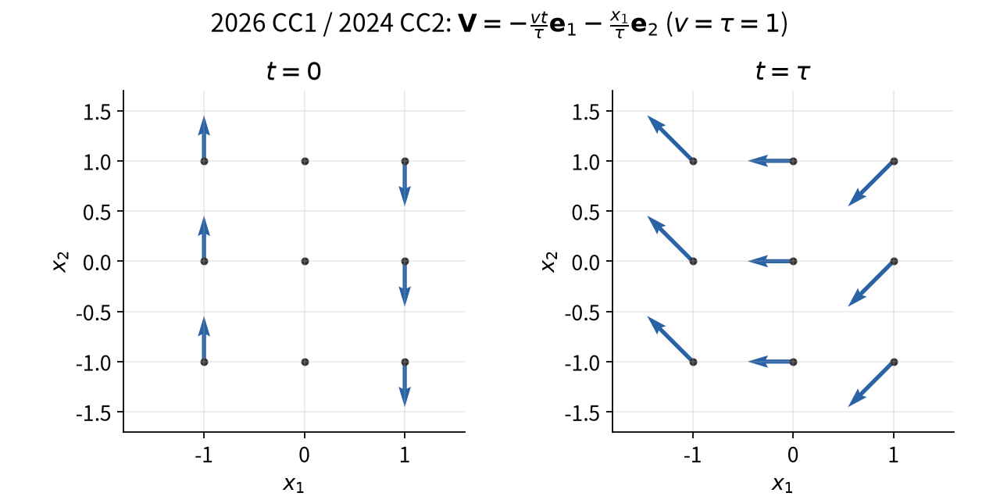

#### 2.1.3

*Calculer le tenseur du taux de déformation D. Quelles sont les unités de ses composantes ?* 变形率 $\mathbb D$ 及其单位

**答案**

$\overrightarrow{\operatorname{grad}}\vec V=-\frac1\tau\,\vec e_2\otimes\vec e_1$, donc $\mathbb D=-\dfrac{1}{2\tau}\begin{pmatrix}0&1&0\\1&0&0\\0&0&0\end{pmatrix}$, en $\mathrm s^{-1}$.

**推导**

唯一非零的导数是 $\partial V_2/\partial x_1=-1/\tau$（$-vt/\tau$ 不含空间坐标，对梯度没有贡献）。$\overrightarrow{\operatorname{grad}}\vec V$ 只有 $(2,1)$ 元；对称化后 $\mathbb D$ 的 $(1,2)$、$(2,1)$ 元都是 $-1/(2\tau)$。单位 $\mathrm s^{-1}$。

#### 2.1.4

*Déterminer la représentation lagrangienne $x_i=f_i(X_1,X_2,X_3,t)$, où les $X_i$ sont les coordonnées initiales à $t=0$.* 拉格朗日描述

**答案**

$$x_1=X_1-\frac{vt^2}{2\tau},\qquad x_2=X_2-\frac{X_1t}{\tau}+\frac{vt^3}{6\tau^2},\qquad x_3=X_3 .$$

**推导**

速度场就是轨迹的时间导数，得到常微分方程组

$$\dot x_1=-\frac{vt}{\tau},\qquad \dot x_2=-\frac{x_1}{\tau},\qquad \dot x_3=0,\qquad x_i(0)=X_i .$$

**按依赖关系的顺序积分：** 先解只含 $t$ 的 $x_1$：$x_1=X_1-\frac{vt^2}{2\tau}$；把它代入 $x_2$ 的方程：$\dot x_2=-\frac{X_1}{\tau}+\frac{vt^2}{2\tau^2}$，再积分并用 $x_2(0)=X_2$ 定常数，得上式。

#### 2.1.5

*En déduire l’expression, et tracer, la trajectoire du point initialement à l’origine O du repère.* 原点处粒子的轨迹

**答案**

$x_1(O,t)=-\frac{vt^2}{2\tau}$, $x_2(O,t)=\frac{vt^3}{6\tau^2}$, $x_3=0$ ($t\ge0$). En éliminant $t=\sqrt{-\frac{2\tau x_1}{v}}$ ($x_1\le0$), on obtient la parabole semi-cubique :

$$x_2=\frac{\sqrt{2}}{3\sqrt{v\tau}}(-x_1)^{3/2}\qquad(x_1\le0,\ x_3=0).$$

**推导**

令 $X_1=X_2=X_3=0$ 得参数方程；将 $x_2$ 与 $x_1$ 相比，得到的是原点到粒子当前位置的**连线（割线）斜率** $x_2/x_1=-\frac{t}{3\tau}$（仍含时间 $t$，并非曲线的笛卡尔方程；而轨迹在该点的**切线斜率**为 $\mathrm dx_2/\mathrm dx_1=\dot x_2/\dot x_1=-\frac{t}{2\tau}$）。真正消去 $t$ 要用 $t=\sqrt{-2\tau x_1/v}$（$x_1\le0$），代入 $x_2$ 得 $x_2=\frac{v}{6\tau^2}\bigl(-\frac{2\tau x_1}{v}\bigr)^{3/2}=\frac{\sqrt{2}}{3\sqrt{v\tau}}(-x_1)^{3/2}$，无量纲化即图题所示的 $\frac{x_2}{v\tau}=\frac{\sqrt{2}}{3}\bigl(-\frac{x_1}{v\tau}\bigr)^{3/2}$，是一条半立方抛物线，粒子向左上方运动。

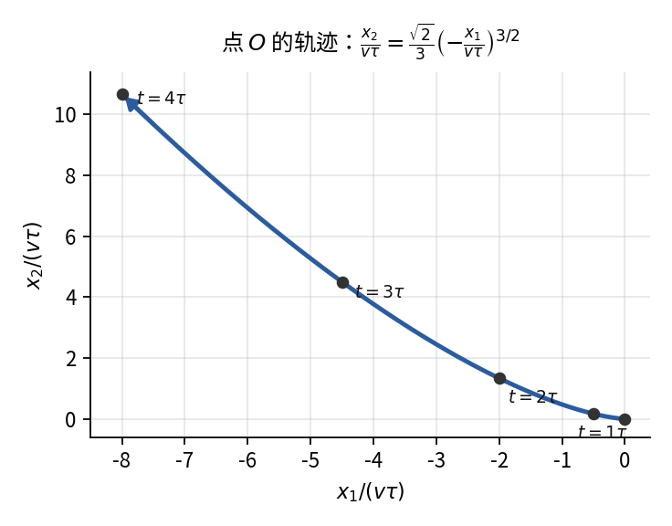

#### 2.1.6

*Calculer l’opérateur gradient de la transformation F, ainsi que l’opérateur des déformations de Green-Lagrange E. Quelles sont les unités des composantes de ces deux tenseurs ?* 变换梯度 $\mathbb F$ 与 Green–Lagrange 应变 $\mathbb E$，及其单位

**答案**

$$\mathbb F=\begin{pmatrix}1&0&0\\-\frac t\tau&1&0\\0&0&1\end{pmatrix},\qquad
\mathbb E=\frac12(\mathbb F^{\mathsf T}\mathbb F-\mathbb I)=\frac{t}{2\tau}\begin{pmatrix}\frac t\tau&-1&0\\-1&0&0\\0&0&0\end{pmatrix},$$

tous deux sans dimension.

**推导**

对拉格朗日描述求 $\partial x_i/\partial X_j$，只有 $\partial x_2/\partial X_1=-t/\tau$ 不平凡。$\mathbb F^{\mathsf T}\mathbb F$ 的 $(1,1)$ 元为 $1+(t/\tau)^2$，$(1,2)$、$(2,1)$ 元为 $-t/\tau$。这是剪切量 $\gamma=-t/\tau$ 的简单剪切。

#### 2.1.7

*Déterminer la variation relative de volume du milieu continu au cours du temps.* 体积相对变化

**答案**

$\dfrac{\mathrm dV}{\mathrm dV_0}=\det\mathbb F=1$, donc $\dfrac{\mathrm dV-\mathrm dV_0}{\mathrm dV_0}=0$ : mouvement isochore.

**推导**

$\mathbb F$ 是下三角矩阵，行列式等于对角元之积 $=1$，体积不变（isochore）。与 $\operatorname{div}\vec V=\operatorname{tr}\mathbb D=0$ 一致。

#### 2.1.8

*Sous l’HPP, calculer le tenseur des déformations linéarisées $\boldsymbol\varepsilon$. À quelles conditions cette hypothèse est-elle valable ici ?* HPP 下的线性化应变及适用条件

**答案**

$$\vec u=-\frac t\tau\begin{pmatrix}\frac{vt}{2}\\X_1-\frac{vt^2}{6\tau}\\0\end{pmatrix},\quad
\overrightarrow{\operatorname{grad}}_X\vec u=-\frac t\tau\,\vec e_2\otimes\vec e_1,\quad
\boldsymbol\varepsilon=-\frac{t}{2\tau}\begin{pmatrix}0&1&0\\1&0&0\\0&0&0\end{pmatrix}.$$

HPP : $\|\overrightarrow{\operatorname{grad}}\vec u\|\ll1\Rightarrow t\ll\tau$ (transformations infinitésimales) et $\|\vec u\|\ll L$ sur $\Omega_0$ (petits déplacements, dépend de $v$ et de la taille $L$ du domaine).

**推导**

位移 $\vec u=\vec x-\vec X$，其中 $u_2=-\frac{X_1t}{\tau}+\frac{vt^3}{6\tau^2}=-\frac t\tau\bigl(X_1-\frac{vt^2}{6\tau}\bigr)$。用积分得到的轨迹检查位移。展开后的 $t^3$ 项为正，提出 $-t/\tau$ 后括号内两项都具有长度量纲。$t^3$ 项对 $\vec X$ 的导数为零，因此 $\overrightarrow{\operatorname{grad}}_X\vec u$ 只保留剪切项。

HPP 包含两个条件，考场作答需写全：

1. **小变换**：$\|\overrightarrow{\operatorname{grad}}\vec u\|\ll1\iff|t/\tau|\ll1\iff t\ll\tau$。也可以表述为 $\mathbb E$ 中的二阶项 $\frac12\overrightarrow{\operatorname{grad}}^{\mathsf T}\vec u\cdot\overrightarrow{\operatorname{grad}}\vec u$（量级 $t^2/\tau^2$）远小于一阶项（量级 $t/\tau$），结论同为 $t\ll\tau$。
2. **小位移**：$\|\vec u\|\ll L$（相对物体特征尺寸 $L$ 很小），这取决于 $v$ 和区域 $\Omega_0$ 的大小。

此时 $\mathbb E\approx\boldsymbol\varepsilon$：$\mathbb E$ 中的 $t^2/(2\tau^2)$ 项可以略去。

#### 2.1.9

*Quelles sont les caractéristiques de ce mouvement ?* 这个运动有哪些特征？

**答案**

Non stationnaire : $\frac{\partial\vec V}{\partial t}=-\frac v\tau\vec e_1\neq\vec0$ ; incompressible : $\operatorname{div}\vec V=0$ ($J=1$) ; rotationnel : $\overrightarrow{\operatorname{rot}}\vec V=-\frac1\tau\vec e_3\neq\vec0$ ; avec déformation ($\mathbb D\neq\mathbb O$) : ce n'est pas un mouvement rigide.

**推导**

全部用欧拉速度判断：显含 $t$ ⇒ 非稳态；$\partial_1V_1+\partial_2V_2=0$ ⇒ 不可压缩，与2.1.7 的 $\det\mathbb F=1$ 一致；旋度第三分量 $\partial_1V_2-\partial_2V_1=-\frac1\tau$ ⇒ 有旋；$\mathbb D\ne\mathbb O$ ⇒ 有变形。它是简单剪切叠加一个随时间加速的平移。

### 2.2　给运动映射：正方形沿一个方向伸长

**题面**

Soit $(O,\vec e_1,\vec e_2,\vec e_3)$ le référentiel cartésien orthonormé d'étude. On s'intéresse au mouvement d'un milieu continu, pour $t\geqslant0$, représenté par les équations de trajectoires suivantes : 运动由拉格朗日轨迹方程给出：

$$x_1(t,X_1,X_2,X_3)=X_1,\qquad x_2(t,X_1,X_2,X_3)=X_2\exp(\alpha t),\qquad x_3(t,X_1,X_2,X_3)=X_3,$$
où $\alpha$ est une constante positive donnée, $t$ est la variable temporelle, $(x_1,x_2,x_3)$ les coordonnées d'une particule dans la configuration actuelle (ou déformée) et $(X_1,X_2,X_3)$ ses coordonnées dans la configuration initiale, c'est-à-dire à $t=0$.

$$x_1=X_1,\qquad x_2=X_2e^{\alpha t},\qquad x_3=X_3,\qquad \alpha>0 .$$

#### 2.2.1

*Soit le carré de côté $\eta$, défini à $t=0$ par $0\le X_1\le\eta$, $0\le X_2\le\eta$, $X_3=0$. Calculer les transformées des points correspondant à ses coins. Tracer ses configurations initiale $\Omega_0$ et courante $\Omega$ (à $t=1$ s).* 正方形四个角的像，画初始与当前构形（$t=1\,$s）

**答案**

À $t=1\ \mathrm s$ (avec $\alpha$ en $\mathrm s^{-1}$), dans le plan $x_3=0$ : $A=\vec0$, $B=\eta\vec e_1$, $C=\eta(\vec e_1+e^{\alpha\cdot 1\ \mathrm s}\vec e_2)$, $D=\eta e^{\alpha\cdot 1\ \mathrm s}\vec e_2$ : le carré devient un rectangle étiré selon $\vec e_2$.

**推导**

把四个角代入运动映射（$t=1\,\mathrm s$，此时指数 $\alpha t$ 在数值上等于 $\alpha$ 取 $\mathrm s^{-1}$ 时的数值，记作 $e^{\alpha}$），且 $x_3=X_3=0$ 保持共面：

| 初始点 | 坐标 $(X_1,X_2)$ | 当前点 |
|---|---|---|
| $A_0$ | $(0,0)$ | $A=(0,0)$ |
| $B_0$ | $(\eta,0)$ | $B=(\eta,0)$ |
| $C_0$ | $(\eta,\eta)$ | $C=(\eta,\eta e^{\alpha})$ |
| $D_0$ | $(0,\eta)$ | $D=(0,\eta e^{\alpha})$ |

正方形沿 $\vec e_2$ 拉长为 $\eta\times\eta e^{\alpha}$ 的矩形，$\vec e_1$ 方向尺寸不变，直角保持为直角。

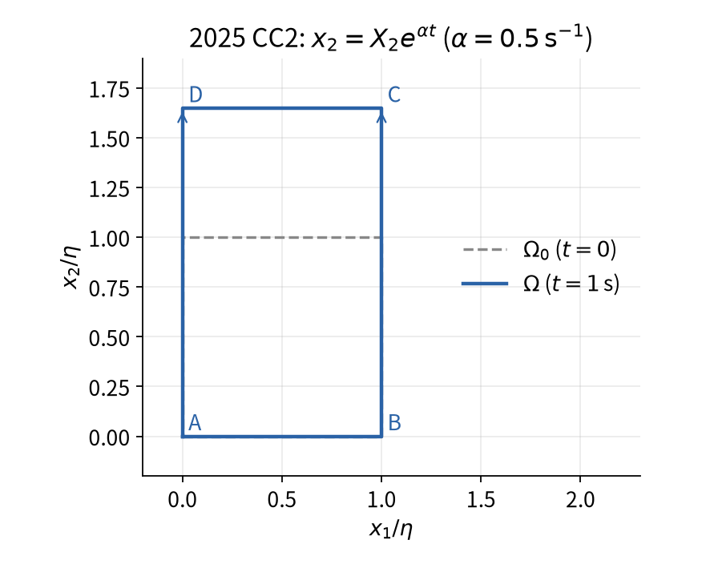

#### 2.2.2

*Calculer le tenseur gradient de transformation $\mathbf F$, puis le tenseur des déformations de Green–Lagrange $\mathbf E$.* 求 $\mathbb F$ 与 Green–Lagrange 应变 $\mathbb E$

**答案**

$$\mathbb F=\frac{\partial\vec x}{\partial\vec X}=\operatorname{diag}(1,e^{\alpha t},1),\qquad
\mathbb E=\tfrac12(\mathbb F^{\mathsf T}\mathbb F-\mathbb I)=\frac{e^{2\alpha t}-1}{2}\begin{pmatrix}0&0&0\\0&1&0\\0&0&0\end{pmatrix}.$$

**推导**

$\mathbb F$ 的第 $i$ 行第 $j$ 列是 $\partial x_i/\partial X_j$。只有 $\partial x_2/\partial X_2=e^{\alpha t}$ 不是 1。$\mathbb F$ 对角，所以 $\mathbb F^{\mathsf T}\mathbb F=\operatorname{diag}(1,e^{2\alpha t},1)$，减去 $\mathbb I$ 再除以 2 即得 $\mathbb E$。两者都无量纲。$E_{22}$ 与伸长比 $\lambda_2=e^{\alpha t}$ 的关系是 $E_{22}=(\lambda_2^2-1)/2$。

#### 2.2.3

*Calculer le vecteur déplacement $\mathbf u$ et son gradient.* 求位移向量 $\vec u$ 及其梯度

**答案**

$$\vec u=\overrightarrow{OM}-\overrightarrow{OM_0}=X_2\,(e^{\alpha t}-1)\,\vec e_2,\qquad
\overrightarrow{\operatorname{grad}}_X\vec u=\frac{\partial\vec u}{\partial\vec X}=(e^{\alpha t}-1)\begin{pmatrix}0&0&0\\0&1&0\\0&0&0\end{pmatrix}=\mathbb F-\mathbb I .$$

**推导**

位移是"当前位置减初始位置"，用拉格朗日变量写出；对 $\vec X$ 求导得到拉格朗日位移梯度，恒有 $\overrightarrow{\operatorname{grad}}_X\vec u=\mathbb F-\mathbb I$，可用来检查。

#### 2.2.4

*Calculer le tenseur des déformations linéarisées $\boldsymbol\varepsilon$ puis préciser dans quelles conditions ce dernier est valide.* 线性化应变 $\boldsymbol\varepsilon$ 及其适用条件

**答案**

$\boldsymbol\varepsilon=\frac12(\overrightarrow{\operatorname{grad}}\vec u+\overrightarrow{\operatorname{grad}}^{\mathsf T}\vec u)=(e^{\alpha t}-1)\,\vec e_2\otimes\vec e_2\approx\alpha t\,\vec e_2\otimes\vec e_2$. Valable sous l’HPP : $\|\overrightarrow{\operatorname{grad}}\vec u\|\ll1$ et $\|\vec u\|\ll L$ (domaine borné), soit $|e^{\alpha t}-1|\ll1$, i.e. $\alpha t\ll1$ ($t\ll1/\alpha$).

**推导**

$$\boldsymbol\varepsilon=(e^{\alpha t}-1)\begin{pmatrix}0&0&0\\0&1&0\\0&0&0\end{pmatrix}\approx\alpha t\begin{pmatrix}0&0&0\\0&1&0\\0&0&0\end{pmatrix}.$$

条件是小扰动（HPP）：一方面要求位移梯度小（$\|\overrightarrow{\operatorname{grad}}\vec u\|\ll1\iff |e^{\alpha t}-1|\ll1$），另一方面要求有界域上位移远小于特征尺度 $L$（$|e^{\alpha t}-1|\,|X_2|\ll L$，对尺寸为 $L$ 的物体同样归结为 $|e^{\alpha t}-1|\ll1$）。因为 $e^{\alpha t}-1\approx\alpha t$，所以等价于 $\alpha t\ll1$，即 $t\ll1/\alpha$。此时 $E_{22}=\frac{e^{2\alpha t}-1}{2}\approx\alpha t\approx\varepsilon_{22}$，两种应变一致。

#### 2.2.5

*De quel type de mouvement s’agit-il ? Quelle est l’unité de $\alpha$ ?* 运动类型和 $\alpha$ 的单位

**答案**

Il s’agit d’une dilatation (extension) d’un facteur $\exp(\alpha t)$ selon $\vec e_2$. L’exposant est sans dimension, donc $\alpha$ s’exprime en $\mathrm s^{-1}$.

**推导**

沿 $\vec e_2$ 的单轴伸长（extension / dilatation），伸长比 $e^{\alpha t}$；指数必须无量纲，故 $[\alpha]=\mathrm s^{-1}$。

#### 2.2.6

*Déterminer la description eulérienne de ce mouvement.* 欧拉描述

**答案**

$V_2=\dot x_2=\alpha X_2e^{\alpha t}=\alpha x_2$, donc $\vec V(t,M)=\alpha x_2\,\vec e_2$.

**推导**

先对时间求导得拉格朗日速度 $\dot x_1=0$、$\dot x_2=\alpha X_2e^{\alpha t}$、$\dot x_3=0$，再用 $X_2=x_2e^{-\alpha t}$ 反解消去初始坐标：

$$\vec V(t,M)=\alpha x_2\,\vec e_2 .$$

固定初始位置求时间导数后，用当前位置消去初始坐标，就得到欧拉速度。

#### 2.2.7

*Calculer le tenseur des taux de déformation $\mathbf D$ et de rotation $\boldsymbol\Omega$. Commenter.* 变形率 $\mathbb D$ 与旋转率 $\boldsymbol\Omega$

**答案**

$\overrightarrow{\operatorname{grad}}\vec V=\alpha\,\vec e_2\otimes\vec e_2$ est symétrique : $\mathbb D=\alpha\,\vec e_2\otimes\vec e_2$ et $\boldsymbol\Omega=\mathbb O$. Le milieu se déforme sans rotation.

**推导**

$$\overrightarrow{\operatorname{grad}}\vec V=\alpha\begin{pmatrix}0&0&0\\0&1&0\\0&0&0\end{pmatrix},\qquad \mathbb D=\overrightarrow{\operatorname{grad}}\vec V,\qquad \boldsymbol\Omega=\mathbb O .$$

速度梯度本身对称，所以对称部分就是它自己，反对称部分为零：介质有变形、无旋转。$\mathbb D$ 的单位是 $\mathrm s^{-1}$。

#### 2.2.8

*Préciser les caractéristiques de ce mouvement (incompressible, stationnaire, irrotationnel).* 运动特征（不可压缩？稳态？无旋？）

**答案**

- $\operatorname{div}\vec V=\alpha\ne0$ : pas incompressible ;
- $\vec V$ ne dépend pas de $t$ en eulérien : stationnaire ;
- $\overrightarrow{\operatorname{rot}}\vec V=\vec0$ : irrotationnel.

**推导**

可压缩（体积按 $J=e^{\alpha t}$ 增大）、**稳态**（欧拉速度场不显含 $t$，虽然每个粒子的速度 $\alpha X_2e^{\alpha t}$ 在变）、无旋。"稳态"一定要用欧拉场判断，这是常见陷阱。

### 2.3　简单剪切运动 · 同类练习

**题面**

Soit $(O,\vec e_1,\vec e_2,\vec e_3)$ un repère orthonormé où le point $O$ est considéré comme fixe. Soit un milieu continu ayant un mouvement défini par le champ de vitesses :

$$\vec V(M)=\alpha\,\vec e_1\,\bigl(\vec e_2\cdot\overrightarrow{OM}\bigr)=\alpha x_2\,\vec e_1,$$
où $\alpha$ est une constante positive donnée. $O$ 为固定点的正交坐标系中，连续介质的速度场为 $\vec V=\alpha x_2\vec e_1$，$\alpha$ 为给定正常数（简单剪切流）。

#### 2.3.1

*Quelles sont les trajectoires et lignes de courant de ce mouvement ?* 这个运动的轨迹和流线是什么？

**答案**

Le mouvement est stationnaire : trajectoires et lignes de courant sont confondues. $\dot x_1=\alpha x_2$, $\dot x_2=\dot x_3=0$ ⇒ $x_1=X_1+\alpha tX_2$, $x_2=X_2$, $x_3=X_3$ : droites parallèles à $\vec e_1$ ; les points de $x_2=0$ sont immobiles.

**推导**

速度场不显含 $t$，稳态，所以轨迹、流线（和脉线）重合。积分：$x_2$、$x_3$ 不变，$x_1$ 以速度 $\alpha X_2$ 匀速运动。离 $x_2=0$ 越远，粒子走得越快。

#### 2.3.2

*On considère à l'instant $t=0$ le carré $OA_0B_0C_0$, de côté $\eta$, avec $\overrightarrow{OA_0}=\eta\vec e_1$, $\overrightarrow{OB_0}=\eta\vec e_2$. Quelle est la transformée de ce carré à l'instant $t$ ?* $t=0$ 时边长 $\eta$ 的正方形 $OA_0B_0C_0$ 在时刻 $t$ 变成什么？

**答案**

$O\to O$, $A=\eta\vec e_1$, $B=\eta(\alpha t\,\vec e_1+\vec e_2)$, $C=\eta\bigl((1+\alpha t)\vec e_1+\vec e_2\bigr)$ : un parallélogramme de même base $\eta$ et de même hauteur $\eta$, donc de même aire $\eta^2$.

**推导**

注意题设顶点顺序：$\overrightarrow{OA_0}=\eta\vec e_1$、$\overrightarrow{OB_0}=\eta\vec e_2$，因此对角顶点是 $C_0=\eta(\vec e_1+\vec e_2)$（绕边界顺序实为 $O\to A_0\to C_0\to B_0$）。将四个顶点代入映射 $x_1=X_1+\alpha tX_2,\ x_2=X_2$：底边 $OA$ 不动，上边 $B_0C_0$ 整体沿 $\vec e_1$ 平移 $\alpha t\eta$，正方形变成底和高原仍为 $\eta$ 的平行四边形，面积 $\eta^2$ 不变。

#### 2.3.3

*On considère à l'instant $t=0$ un cube dont une face correspond au carré $OA_0B_0C_0$. Quelle est la transformée de ce cube à l'instant $t$ ?* 以该正方形为一个面的立方体在时刻 $t$ 变成什么？

**答案**

Les sommets $X_3=\eta$ se transforment de la même manière ($x_3=X_3$) : le cube devient un parallélépipède oblique de même volume $\eta^3$.

**推导**

第三方向不受影响，每个水平截面都做同样的剪切，体积不变（见 2.3.7）。

#### 2.3.4

*Rappeler la définition du tenseur de transformation et donner son expression.* 复述变换梯度的定义并给出表达式。

**答案**

$\mathrm d\vec x=\mathbb F\,\mathrm d\vec X$, $\mathbb F=\frac{\partial\vec x}{\partial\vec X}=\overrightarrow{\operatorname{grad}}_X\vec\phi$ ; ici $\mathbb F=\begin{pmatrix}1&\alpha t&0\\0&1&0\\0&0&1\end{pmatrix}=\mathbb I+\alpha t\,\vec e_1\otimes\vec e_2$.

**推导**

$F_{ij}=\partial x_i/\partial X_j$：第 $i$ 行是 $x_i$ 对 $X_1,X_2,X_3$ 的偏导。只有 $\partial x_1/\partial X_2=\alpha t$ 非平凡。

#### 2.3.5

*Rappeler la définition du tenseur de déformation de Green-Lagrange et calculer son expression. Déterminer les déformations principales et les directions principales de déformation.* 复述 Green–Lagrange 应变的定义并计算；求主应变和主方向。

**答案**

$\mathbb E=\frac12(\mathbb F^{\mathsf T}\mathbb F-\mathbb I)=\frac12\begin{pmatrix}0&\alpha t&0\\\alpha t&(\alpha t)^2&0\\0&0&0\end{pmatrix}$, avec $\mathrm dl^2-\mathrm dl_0^2=2\,\mathrm d\vec X\cdot\mathbb E\,\mathrm d\vec X$.
Valeurs propres : $E_1=0$ (direction $\vec e_3$), $E_{2,3}=\frac{\alpha t}4\bigl(\alpha t\mp\sqrt{(\alpha t)^2+4}\bigr)$ ; pour $t>0$, directions principales $\propto\bigl(2,\ \alpha t\mp\sqrt{(\alpha t)^2+4},\ 0\bigr)$ (à $t=0$, $\mathbb E=\mathbb O$ et toute direction est principale).

**推导**

- $\mathbb C=\mathbb F^{\mathsf T}\mathbb F=\begin{pmatrix}1&\alpha t&0\\\alpha t&1+(\alpha t)^2&0\\0&0&1\end{pmatrix}$。对角元管长度变化，非对角元管角度变化。
- $\vec e_3$ 那一行一列只有 0，直接是主方向，主值 0。
- 记 $k=\alpha t\ge 0$，其余 $2\times2$ 块 $\frac12\begin{pmatrix}0&k\\k&k^2\end{pmatrix}$ 的特征方程为 $(-\lambda)(\frac{k^2}2-\lambda)-\frac{k^2}4=0$，即 $4\lambda^2-2k^2\lambda-k^2=0$，解得 $\lambda=\frac k4\bigl(k\pm\sqrt{k^2+4}\bigr)$；两根一正一负，和为 $k^2/2$（迹），积为 $-k^2/4$（行列式）。
- 当 $t>0$（$k>0$）时，将特征值 $\lambda_\pm=\frac k4\bigl(k\pm\sqrt{k^2+4}\bigr)$ 代入特征方程第一行 $-\lambda n_1+\frac k2n_2=0$，得 $n_2=\frac{2\lambda_\pm}{k}n_1=\frac{k\pm\sqrt{k^2+4}}2n_1$；取 $n_1=2$ 即得与 $\lambda_\pm$ 一一对应的两正交主方向 $\vec n_\pm\propto\bigl(2,\ k\pm\sqrt{k^2+4},\ 0\bigr)$（小 $k$ 时趋近与 $\vec e_1$ 成 $\pm45^\circ$）。$t=0$ 时 $\mathbb E=\mathbb O$，任意方向都是主方向。

#### 2.3.6

*Calculer l'accroissement du carré de la longueur de $\mathrm d\vec M_0=\mathrm dl_0\,\vec\tau$, où $\vec\tau$ est un vecteur unitaire du plan $(\vec e_1,\vec e_2)$ tel que $\varphi=(\vec e_1,\vec\tau)$.* 求方向角 $\varphi$ 的线元长度平方的增量。

**答案**

$\mathrm dl^2-\mathrm dl_0^2=2\,\mathrm dl_0^2\,\vec\tau\cdot\mathbb E\vec\tau=\mathrm dl_0^2\,\alpha t\,(\sin2\varphi+\alpha t\sin^2\varphi)$.

**推导**

$\vec\tau=(\cos\varphi,\sin\varphi,0)$，$\vec\tau\cdot\mathbb E\vec\tau=E_{11}\cos^2\varphi+2E_{12}\sin\varphi\cos\varphi+E_{22}\sin^2\varphi=\frac{\alpha t}2\bigl(2\sin\varphi\cos\varphi+\alpha t\sin^2\varphi\bigr)$。$\varphi=0$（沿 $\vec e_1$）长度不变；$\varphi=\pi/2$ 时 $\mathrm dl^2=\mathrm dl_0^2(1+(\alpha t)^2)$，竖直线元被拉斜变长。

#### 2.3.7

*Soit un cube élémentaire de côtés $\mathrm d\vec a_0$, $\mathrm d\vec b_0$ et $\mathrm d\vec c_0$ ; déterminer la variation de volume entre l'état non déformé et l'état déformé.* 求微元立方体变形前后的体积变化。

**答案**

$\mathrm dV=(\mathbb F\mathrm d\vec a_0,\mathbb F\mathrm d\vec b_0,\mathbb F\mathrm d\vec c_0)=\det\mathbb F\,\mathrm dV_0=\mathrm dV_0$, soit $\mathrm dV-\mathrm dV_0=0$ : pas de variation de volume ($J=1$, isochore).

**推导**

体积是三条边的混合积，变形后每条边乘以 $\mathbb F$，所以体积乘以 $\det\mathbb F$。上三角矩阵行列式为对角元之积，等于 1。

#### 2.3.8

*Décrire le mouvement d'un milieu continu dont le champ de vitesses est $\vec V=\alpha\,\vec e_1(\vec e_2\cdot\overrightarrow{OM})-\alpha\,\vec e_2(\vec e_1\cdot\overrightarrow{OM})$.* 描述速度场为 $\alpha x_2\vec e_1-\alpha x_1\vec e_2$ 的运动。

**答案**

$\vec V=\alpha x_2\vec e_1-\alpha x_1\vec e_2$ : $\overrightarrow{\operatorname{grad}}\vec V=\begin{pmatrix}0&\alpha&0\\-\alpha&0&0\\0&0&0\end{pmatrix}$ antisymétrique, $\mathbb D=\mathbb O$ : rotation de corps rigide autour de $O\vec e_3$, de vitesse angulaire $-\alpha\vec e_3$ ; trajectoires circulaires.

**推导**

速度梯度反对称 ⇒ $\mathbb D=\mathbb O$ ⇒ 变形率为零，属于刚体运动（$\mathbb E=\mathbb O$，且定常、不可压缩）。由 $\boldsymbol\Omega\vec e_1=-\alpha\vec e_2=(-\alpha\vec e_3)\wedge\vec e_1$ 或 $\frac12\overrightarrow{\operatorname{rot}}\vec V=\frac12(-\alpha-\alpha)\vec e_3=-\alpha\vec e_3$，可知绕 $O\vec e_3$ 顺时针匀速转动，粒子沿以 $O\vec e_3$ 为轴的圆周运动。对照 2.3.1，简单剪切 $\vec V_s=\alpha x_2\vec e_1$ 的局部角速度是 $-\frac{\alpha}{2}\vec e_3$，其速度梯度的反对称部分正好等于本问刚体转动速度梯度的一半。

### 2.4　刚体旋转与变形 · 同类练习

**题面**

On se place dans un espace euclidien $\mathbf E$ muni de la base orthonormée $(\vec e_1,\vec e_2,\vec e_3)$. Les relations suivantes définissent le mouvement de rotation de solide rigide (à la vitesse de rotation $\omega$), autour de l'axe $(O,\vec e_3)$, d'un cylindre $\Omega$ (figure 2.1). $\vec X$ et $\vec x$ désignent respectivement les positions spatiales aux instants initial ($t=0$) et courant : 圆柱 $\Omega$ 绕轴 $(O,\vec e_3)$ 以角速度 $\omega$ 做刚体转动。

$$x_1=X_1\cos\theta-X_2\sin\theta,\qquad x_2=X_1\sin\theta+X_2\cos\theta,\qquad x_3=X_3,$$
où $\theta=\omega t$ désigne l'angle de rotation à l'instant $t$. $\theta=\omega t$ 是时刻 $t$ 的转角，运动映射如上。

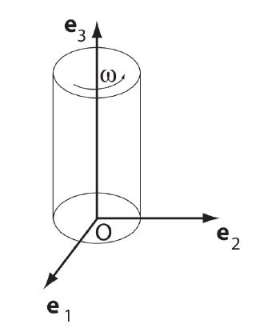

#### 2.4.1

*Donner les descriptions lagrangienne et eulérienne de ce mouvement.* 给出拉格朗日描述和欧拉描述。

**答案**

Lagrangienne : les relations données. Eulérienne : $\vec V=\dot{\vec x}$ à $\vec X$ fixé puis $\vec X=\mathbb Q^{\mathsf T}\vec x$ : $\vec V=\omega(-x_2\vec e_1+x_1\vec e_2)$, $\vec\gamma=-\omega^2(x_1\vec e_1+x_2\vec e_2)$.

**推导**

- 拉格朗日速度对 $\vec X$ 固定求导：$\dot x_1=\omega(-X_1\sin\theta-X_2\cos\theta)=-\omega x_2$，$\dot x_2=\omega(X_1\cos\theta-X_2\sin\theta)=\omega x_1$，$\dot x_3=0$。由于转动矩阵 $\mathbb Q$ 正交，直接用 $\vec X=\mathbb Q^{\mathsf T}\vec x$ 即可反解（不必写开三角恒等式就能识别出上式）。
- 欧拉加速度用物质导数计算：$\partial_t\vec V=\vec0$（定常），$\overrightarrow{\operatorname{grad}}\vec V=\begin{pmatrix}0&-\omega&0\\\omega&0&0\\0&0&0\end{pmatrix}$，对流项 $\overrightarrow{\operatorname{grad}}\vec V\cdot\vec V=-\omega^2(x_1\vec e_1+x_2\vec e_2)$。加速度始终指向转轴（向心加速度），大小 $\omega^2 r$（$r=\sqrt{x_1^2+x_2^2}$）。

#### 2.4.2

*Calculer le tenseur gradient de la transformation $\mathbb F$, puis le tenseur des déformations de Green-Lagrange $\mathbb E$. Commenter le résultat obtenu.* 求 $\mathbb F$ 和 $\mathbb E$，并评论。

**答案**

$\mathbb F=\mathbb Q=\begin{pmatrix}\cos\theta&-\sin\theta&0\\\sin\theta&\cos\theta&0\\0&0&1\end{pmatrix}$ ; $\mathbb E=\frac12(\mathbb Q^{\mathsf T}\mathbb Q-\mathbb I)=\mathbb O$ : aucune déformation, quel que soit $\theta$ ; $\mathbb E$ est insensible aux rotations de corps rigide.

**推导**

$\mathbb Q$ 正交，$\mathbb Q^{\mathsf T}\mathbb Q=\mathbb I$，所以 $\mathbb E=\mathbb O$。有限应变正确地识别出"刚体运动没有变形"，即使转角很大。

#### 2.4.3

*En faisant l'hypothèse des petites perturbations, donner le tenseur des déformations linéarisé $\boldsymbol\varepsilon$.* 在小扰动假设下给出线性化应变 $\boldsymbol\varepsilon$。

**答案**

$\vec u=\vec x-\vec X=(\mathbb Q-\mathbb I)\vec X$, $\overrightarrow{\operatorname{grad}}\vec u=\mathbb F-\mathbb I$, $\boldsymbol\varepsilon=\frac12(\overrightarrow{\operatorname{grad}}\vec u+\overrightarrow{\operatorname{grad}}^{\mathsf T}\vec u)=\operatorname{diag}(\cos\theta-1,\ \cos\theta-1,\ 0)$ : non nul alors qu'il n'y a pas de déformation.

**推导**

$\overrightarrow{\operatorname{grad}}\vec u=\mathbb Q-\mathbb I=\begin{pmatrix}\cos\theta-1&-\sin\theta&0\\\sin\theta&\cos\theta-1&0\\0&0&0\end{pmatrix}$。对称化后，反对称部分（$\pm\sin\theta$）互相抵消，只剩下对角元 $\cos\theta-1$。这说明线性化应变对有限刚体转动会给出“虚假的压缩应变”。

#### 2.4.4

*Quelle est l'hypothèse à formuler sur $\theta$ pour que l'hypothèse HPP soit effectivement vérifiée ?* $\theta$ 满足什么条件时 HPP 成立？

**答案**

HPP : $\|\overrightarrow{\operatorname{grad}}\vec u\|=\|\mathbb Q-\mathbb I\|\ll1$ et $\|\vec u\|\ll L$ (domaine borné), soit $|\theta|\ll1$ ; alors $\cos\theta-1\approx-\frac{\theta^2}2$ est du second ordre et $\boldsymbol\varepsilon\approx\mathbb O$ au premier ordre.

**推导**

小扰动假设（HPP）要求位移梯度和无量纲位移都足够小：当 $|\theta|\ll 1$ 时，$\sin\theta\approx\theta$ 为一阶小量，而 $\cos\theta-1\approx-\theta^2/2$ 为二阶小量，在一次线性化中可以略去，从而 $\boldsymbol\varepsilon\approx\mathbb O$ 与无变形一致；当转角很大时，必须使用有限应变 $\mathbb E$。

### 2.5　大气涡旋 · 同类练习

**题面**

On étudie le mouvement d'un tourbillon atmosphérique défini par le champ de vitesse suivant dans un repère cartésien $(O,\vec e_1,\vec e_2)$ en un point $M(x_1,x_2)$ à l'instant $t$ :

$$V_1=\omega x_2,\qquad V_2=-\omega x_1+a\omega^2t,$$
où $a$ et $\omega$ sont des constantes ($\omega\neq0$). 研究大气涡旋的运动，在直角坐标系 $(O,\vec e_1,\vec e_2)$ 中，时刻 $t$ 点 $M(x_1,x_2)$ 的速度场如上，$a$、$\omega$ 为常数（$\omega\ne0$）。
NB : on utilisera la notation ${}^E\bullet$ pour désigner les grandeurs eulériennes et $\frac{\mathrm d\bullet}{\mathrm dt}$ la dérivée particulaire. 记号：${}^E\bullet$ 表示欧拉量，$\frac{\mathrm d\bullet}{\mathrm dt}$ 表示物质导数。

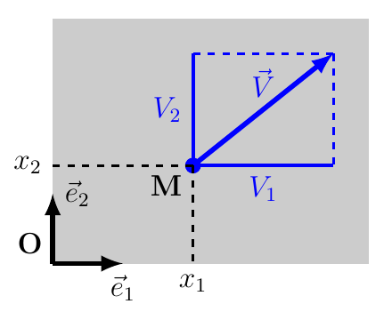

#### 2.5.1

*Rappeler les définitions des descriptions eulérienne et lagrangienne et la démarche permettant de passer de l'une à l'autre.* 复述欧拉描述和拉格朗日描述的定义，以及两者互换的方法。

**答案**

Description lagrangienne : on suit chaque particule, repérée par sa position initiale $\vec X$ : $\vec x=\vec\phi(\vec X,t)$, grandeurs $f(\vec X,t)$. Description eulérienne : on observe en un point fixe $\vec x$ de l'espace : $f(\vec x,t)$.
Lagrange → Euler : dériver $\vec\phi$ par rapport à $t$ à $\vec X$ fixé, puis remplacer $\vec X=\vec\phi^{-1}(\vec x,t)$. Euler → Lagrange : intégrer $\dot{\vec x}=\vec V(\vec x,t)$ avec $\vec x(0)=\vec X$.

**推导**

拉格朗日描述跟着粒子走，自变量是初始位置 $\vec X$ 和时间；欧拉描述盯住空间中的固定点，自变量是当前位置 $\vec x$ 和时间。两种描述描述的是同一个运动，互换的桥梁是运动映射 $\vec x=\vec\phi(\vec X,t)$：已知映射，求导得速度再反解；已知速度场，解常微分方程得映射。

#### 2.5.2

*Donner la description eulérienne de ce mouvement.* 给出这个运动的欧拉描述。

**答案**

Le champ donné est déjà eulérien : ${}^E\vec V(\vec x,t)=\omega x_2\,\vec e_1+(-\omega x_1+a\omega^2t)\,\vec e_2$.

**推导**

速度写成当前坐标 $x_1,x_2$ 和 $t$ 的函数，本身就是欧拉描述，不需要再算。

#### 2.5.3

*Donner la description lagrangienne de ce mouvement.* 给出这个运动的拉格朗日描述。

**答案**

$\dot x_1=\omega x_2$, $\dot x_2=-\omega x_1+a\omega^2t$, $x_i(0)=X_i$. En dérivant la seconde et en reportant la première : $\ddot x_2+\omega^2x_2=a\omega^2$. Avec $c=\cos\omega t$, $s=\sin\omega t$ :

$$x_1=X_1c+(X_2-a)s+a\omega t,\qquad x_2=-X_1s+(X_2-a)c+a .$$

**推导**

1. 两个方程耦合，对第二式再求一次导：$\ddot x_2=-\omega\dot x_1+a\omega^2=-\omega^2x_2+a\omega^2$。
2. 齐次解 $A\cos\omega t+B\sin\omega t$，常数特解 $a$：$x_2=A\cos\omega t+B\sin\omega t+a$。
3. 初始条件：$x_2(0)=X_2$ 给 $A=X_2-a$；$\dot x_2(0)=-\omega X_1$（由原方程在 $t=0$）给 $B=-X_1$。
4. 由 $\dot x_1=\omega x_2$ 积分（或由第二个原方程反解 $x_1$），得 $x_1$。
5. 检查：$t=0$ 时回到 $X_i$；对 $t$ 求导换回 $x_i$ 得到题给速度。

#### 2.5.4

*Donner et tracer les lignes de courant et les trajectoires.* 给出并画出流线和轨迹。

**答案**

Lignes de courant (à $t$ fixé) : $\frac{\mathrm dx_1}{V_1}=\frac{\mathrm dx_2}{V_2}$ ⇒ $(x_1-a\omega t)^2+x_2^2=C$ : cercles de centre $(a\omega t,0)$. Trajectoires : $(x_1-a\omega t)^2+(x_2-a)^2=X_1^2+(X_2-a)^2$ : mouvement circulaire autour d'un centre qui se translate à la vitesse $a\omega\,\vec e_1$ (trochoïdes). Pour $a\neq0$ trajectoires et lignes de courant sont distinctes.

**推导**

- **流线：** 固定 $t$，$\frac{\mathrm dx_2}{\mathrm dx_1}=\frac{-\omega x_1+a\omega^2t}{\omega x_2}$，分离变量 $x_2\,\mathrm dx_2=-(x_1-a\omega t)\,\mathrm dx_1$，积分得圆族，圆心 $(a\omega t,0)$ 随时间 $t$ 沿 $\vec e_1$ 移动。
- **轨迹：** 由上一问 $x_1-a\omega t=X_1c+(X_2-a)s$，$x_2-a=-X_1s+(X_2-a)c$，平方相加得半径 $R=\sqrt{X_1^2+(X_2-a)^2}$ 不变的圆，但圆心 $(a\omega t,a)$ 以速度 $a\omega$ 沿 $\vec e_1$ 平移，所以实际轨迹是摆线类曲线（trochoïde）。特例：初始位于 $(0,a)$ 的粒子半径 $R=0$，轨迹退化为水平直线 $x_1=a\omega t,\ x_2=a$。
- 非稳态（$a\ne0$）时轨迹与流线不重合：流线是某一时刻的"速度方向图"，轨迹是一个粒子走过的路径。

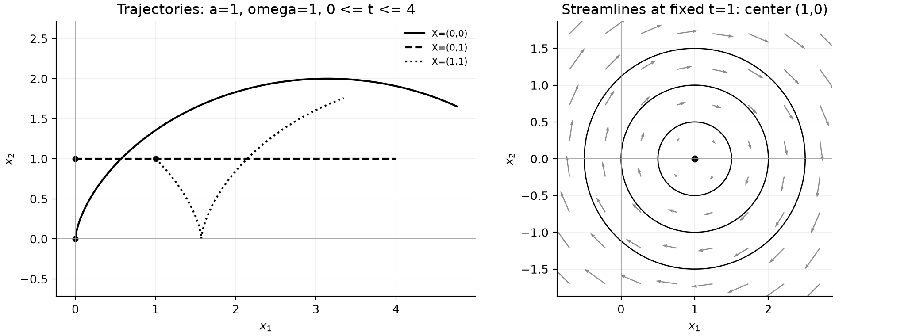

#### 2.5.5

*Rappeler et calculer l'expression des accélérations eulérienne et lagrangienne.* 复述并计算欧拉加速度和拉格朗日加速度。

**答案**

Eulérienne : ${}^E\vec\gamma=\frac{\partial\vec V}{\partial t}+\overrightarrow{\operatorname{grad}}\vec V\cdot\vec V=(-\omega^2x_1+a\omega^3t)\,\vec e_1+(-\omega^2x_2+a\omega^2)\,\vec e_2$.
Lagrangienne : $\vec\gamma=\frac{\partial^2\vec x}{\partial t^2}\Big|_{\vec X}=-\omega^2[X_1c+(X_2-a)s]\,\vec e_1+\omega^2[X_1s-(X_2-a)c]\,\vec e_2$ ; les deux coïncident via $\vec x=\vec\phi(\vec X,t)$.

**推导**

- 局部项 $\partial_t\vec V=a\omega^2\vec e_2$；对流项 $\overrightarrow{\operatorname{grad}}\vec V\cdot\vec V=\begin{pmatrix}0&\omega\\-\omega&0\end{pmatrix}\begin{pmatrix}V_1\\V_2\end{pmatrix}=(\omega V_2)\vec e_1+(-\omega V_1)\vec e_2=(-\omega^2x_1+a\omega^3t)\vec e_1-\omega^2x_2\vec e_2$。两项相加。
- 拉格朗日：对映射求两次导。检查：$-\omega^2(x_1-a\omega t)=-\omega^2x_1+a\omega^3t$，$-\omega^2(x_2-a)=-\omega^2x_2+a\omega^2$，与欧拉结果一致。
- 只写 $\partial_t\vec V$ 是常见错误：加速度一定要加对流项。

#### 2.5.6

*Le mouvement est-il stationnaire ? Rotationnel ? Incompressible ?* 运动是否稳态？有旋？不可压缩？

**答案**

$\frac{\partial\vec V}{\partial t}=a\omega^2\vec e_2\neq\vec0$ : non stationnaire (sauf si $a=0$). $\overrightarrow{\operatorname{rot}}\vec V=(\partial_1V_2-\partial_2V_1)\vec e_3=-2\omega\vec e_3\neq\vec0$ : rotationnel. $\operatorname{div}\vec V=\partial_1V_1+\partial_2V_2=0$ : incompressible. (De plus $\mathbb D=\mathbb O$ : mouvement de corps rigide instantané.)

**推导**

三项检查全部用欧拉场：是否显含 $t$；旋度；散度。旋度为 $-2\omega\vec e_3$，对应局部转动角速度 $\frac12\overrightarrow{\operatorname{rot}}\vec V=-\omega\vec e_3$（顺时针）。此外 $\overrightarrow{\operatorname{grad}}\vec V$ 反对称，变形率 $\mathbb D=\mathbb O$，因此这是一个整体平移叠加刚体旋转的刚体运动。

## 第 3 题　应力与平衡 · Contraintes et équilibre

### 读题与起笔

- **圆轴（arbre cylindrique）**。题目给了应力张量，问 *forces volumiques*。先写静力平衡 $\vec f_d=-\operatorname{div}\boldsymbol\sigma$。算侧面或端面载荷时再取外法向，写 $\vec T=\boldsymbol\sigma\vec n$。
- **受剪方块（cisaillement d’un plot）**。读图找出 *faces libres*（自由面）。在法向为 $\pm\vec e_j$ 的面上，$\vec T$ 就是应力矩阵第 $j$ 列带相应符号。先用面上的已知条件定常数，再用体内平衡求未知分量。
- **面力、合力、力矩**。*Densité d’efforts surfaciques* 求 $\vec T$，单位 Pa；*résultante* 求 $\vec R=\int_S\vec T\,\mathrm dS$，单位 N；*éléments de réduction du torseur en O* 还要求 $\vec M_O=\int_S\overrightarrow{OM}\times\vec T\,\mathrm dS$，单位 N·m。合力为零时仍可能有扭矩。
- **可直接起笔**　*Sur cette face, la normale sortante est …, donc le vecteur contrainte vaut …*（这个面的外法向是……，所以应力向量为……。）

**同类练习**　3.3 椭圆柱和 3.4 圆柱练端面力旋量，与圆轴题最接近；3.5 自重梁和 3.6 空心球练用边界条件定常数；3.7–3.9 练取面力、分法向和切向、判断主应力。

### 3.1　圆轴中的应力与端面扭矩

**题面**

Un arbre cylindrique, de génératrices parallèles à l'axe $\vec e_3$ et de hauteur $h$, a pour section droite un cercle $\mathcal C$ de centre $O$ et de rayon $R$. L'arbre est limité par deux bases : $\Sigma_0$ située dans le plan $x_3=0$ et $\Sigma_h$ située dans le plan $x_3=h$. On désigne par $\Sigma_{lat}$ la surface latérale de la pièce. L'arbre, supposé en équilibre, est soumis au champ de tenseur des contraintes suivant : 圆柱轴（母线平行于 $\vec e_3$，高 $h$，截面是圆心 $O$、半径 $R$ 的圆）。两个底面：$\Sigma_0$（$x_3=0$）和 $\Sigma_h$（$x_3=h$），侧面 $\Sigma_{lat}$。
$$\boldsymbol\sigma(x_1,x_2,x_3)=\begin{pmatrix}0&0&Ax_2\\0&0&-Ax_1\\Ax_2&-Ax_1&0\end{pmatrix}_{(\vec e_1,\vec e_2,\vec e_3)},$$
où $A$ est un scalaire constant positif et $(\vec e_1,\vec e_2,\vec e_3)$ est le repère cartésien. 轴处于平衡，应力场如上，$A$ 为正常数。

#### 3.1.1

*Que peut-on dire des forces volumiques extérieures appliquées à la pièce ?* 关于作用在构件上的外体力能说什么？

**答案**

Statique : $\overrightarrow{\operatorname{div}}\boldsymbol\sigma+\vec f_v=\vec0$. Ici $\overrightarrow{\operatorname{div}}\boldsymbol\sigma=(\partial_3(Ax_2),\ \partial_3(-Ax_1),\ \partial_1(Ax_2)+\partial_2(-Ax_1))=\vec0$, donc $\vec f_v=\vec0$ : aucune force volumique.

**推导**

按行求散度，每一项都是某个分量对一个它不依赖的坐标求导，全部为零。

#### 3.1.2

*Calculer la densité d'efforts surfaciques exercés sur $\Sigma_{lat}$.* 求侧面上的面力密度。

**答案**

$\vec n=\frac{x_1\vec e_1+x_2\vec e_2}R$ : $\vec T_{lat}=\boldsymbol\sigma\vec n=\frac AR\bigl(0,\ 0,\ x_2x_1-x_1x_2\bigr)=\vec0$ : la surface latérale est libre.

**推导**

前两列的前两行都是零，所以 $\boldsymbol\sigma\vec n$ 只有第三分量 $\sigma_{31}n_1+\sigma_{32}n_2$，恰好抵消。

#### 3.1.3

*Quelles sont les densités d'efforts surfaciques s'exerçant sur les bases $\Sigma_0$ et $\Sigma_h$ ? Montrer que les résultantes des efforts s'exerçant sur les bases $\Sigma_0$ et $\Sigma_h$ sont nulles.* 求两个底面上的面力密度；证明合力为零。

**答案**

$\Sigma_0$ ($\vec n=-\vec e_3$) : $\vec T_0=A(-x_2,\ x_1,\ 0)$ ; $\Sigma_h$ ($\vec n=\vec e_3$) : $\vec T_h=A(x_2,\ -x_1,\ 0)$. Résultantes : $\int_{\Sigma}x_1\,\mathrm dS=\int_\Sigma x_2\,\mathrm dS=0$ (centre $O$ de la section), donc $\vec R_0=\vec R_h=\vec0$.

**推导**

面力是 $\pm$ 第三列。圆截面关于中心对称，一次项积分为零。

#### 3.1.4

*Calculer, respectivement aux points $O$ et $O'$ (centres des bases $\Sigma_0$ et $\Sigma_h$), les moments des torseurs des efforts s'exerçant respectivement sur les bases $\Sigma_0$ et $\Sigma_h$. Les exprimer en fonction des caractéristiques géométriques de l'arbre et du paramètre $A$. Interpréter la nature des actions mécaniques extérieures agissant sur l'arbre.* 分别求两个底面的力对各自中心的力矩，并解释外载的性质。

**答案**

$\vec M_O(\Sigma_0)=\int_{\Sigma_0}\overrightarrow{OM}\wedge\vec T_0\,\mathrm dS=A\int(x_1^2+x_2^2)\,\mathrm dS\,\vec e_3=\frac{A\pi R^4}2\vec e_3$ ; $\vec M_{O'}(\Sigma_h)=-\frac{A\pi R^4}2\vec e_3$. Résultantes nulles, moments axiaux opposés : l'arbre est sollicité en torsion pure, de couple $C=\frac{A\pi R^4}2$.

**推导**

$(x_1,x_2,0)\wedge(-x_2,x_1,0)=(0,0,x_1^2+x_2^2)$。$\int r^2\,\mathrm dS=\int_0^R r^2\,2\pi r\,\mathrm dr=\frac{\pi R^4}2$（极惯性矩）。两端合力为零、力矩沿轴且相反，即一对扭转力偶。

#### 3.1.5

*Déterminer en tous points de la pièce les contraintes principales. Déterminer l'expression de la contrainte équivalente de Tresca. En quels points de l'arbre prend-elle sa valeur la plus grande ?* 求各点的主应力和 Tresca 等效应力；最大值在哪里？

**答案**

$\det(\boldsymbol\sigma-\lambda\mathbb I)=-\lambda\bigl(\lambda^2-A^2(x_1^2+x_2^2)\bigr)=0$ : $\sigma_1=-Ar$, $\sigma_2=0$, $\sigma_3=Ar$ ($r=\sqrt{x_1^2+x_2^2}$). $\sigma_{Tr}=\sigma_3-\sigma_1=2Ar$, maximale sur la surface extérieure $r=R$ : $2AR$.

**推导**

在柱坐标下 $\boldsymbol\sigma=-Ar(\vec e_\theta\otimes\vec e_3+\vec e_3\otimes\vec e_\theta)$，是纯剪切（纯扭转），主应力 $\pm Ar$ 和 0。等效应力随半径线性增长，外表面最危险。

#### 3.1.6

*Sachant que la limite élastique du matériau de l'arbre est notée $\sigma_e$, calculer la valeur maximale du couple à ne pas dépasser.* 已知屈服极限 $\sigma_e$，求允许的最大扭矩。

**答案**

Tresca : $2AR\le\sigma_e$ ⇒ $A\le\frac{\sigma_e}{2R}$ ; avec $C=\frac{A\pi R^4}2$ : $C_{\max}=\frac{\pi R^3\sigma_e}4$. (Avec von Mises, $\sigma_{VM}=\sqrt3Ar$ donnerait $C_{\max}=\frac{\pi R^3\sigma_e}{2\sqrt3}$.)

**推导**

把屈服条件写在最危险点 $r=R$：Tresca 给出 $2AR\le\sigma_e\implies A\le\frac{\sigma_e}{2R}$，代入 3.1.4 的扭矩公式 $C=\frac{A\pi R^4}2$ 即得 $C_{\max}=\frac{\pi R^3\sigma_e}4$。若用 von Mises：$\sigma_{VM}=\sqrt{\frac12[(Ar-0)^2+(0+Ar)^2+(2Ar)^2]}=\sqrt3 Ar\le\sigma_e\implies A\le\frac{\sigma_e}{\sqrt3 R}$，得 $C_{\max}=\frac{\pi R^3\sigma_e}{2\sqrt3}$。可见 Tresca 给出的允许扭矩更小（更保守）。

### 3.2　受剪方块的自由面与端面载荷

**题面**

Considérons un plot parallélépipédique rectangle de longueur $L$ et de section droite à base carrée de côté $a$ telle que $L<a$, illustré en figure 3.1. On associe à ce solide un repère cartésien $(O,\vec e_x,\vec e_y,\vec e_z)$, où $O$ est le centre de la face notée $S_0$ et dont les axes sont parallèles aux arêtes. La surface en $x=L$ est notée $S_L$. Les 4 autres surfaces sont notées de $S_1$ à $S_4$. L'ensemble de ces surfaces délimite le plot. On considère par ailleurs les éléments suivants : 方块沿 $x$ 长 $L$，截面是边长 $a$ 的正方形，静止。

- le plot est statique ;
- la surface $S_L$ est soumise à une densité surfacique de force $\vec f_s=f(y)\vec e_y$, où $f(y)$ est une fonction que l'on cherchera à calculer ; $x=L$ 的面 $S_L$ 上作用沿 $\vec e_y$ 的面力 $f(y)$；
- on réduit à un torseur $\mathcal T_0=\{\vec R_0,\ \vec M_{0/O}\}_O$ l'action des densités de forces s'exerçant sur la surface $S_0$ ; $x=0$ 的面 $S_0$ 上的作用力合成为一个力旋量；
- les surfaces $S_1$, $S_2$, $S_3$ et $S_4$ sont libres d'effort. On négligera par ailleurs la pression atmosphérique dans tout le problème ; 其余四个面自由；
- l'effet des forces volumiques est négligeable comparé aux autres efforts. 忽略体力和大气压。

Compte tenu du chargement, le tenseur des contraintes $\boldsymbol\sigma$ solution est plan, donné par
$$\boldsymbol\sigma=\begin{pmatrix}\sigma_{xx}&\sigma_{xy}&0\\\sigma_{xy}&\sigma_{yy}&0\\0&0&0\end{pmatrix},$$
avec chaque composante indépendante de la coordonnée $z$. On choisit ensuite (à partir de la question 3.2.2) la forme $\sigma_{xy}=K(A+By+y^2)$, avec $K>0$ supposé connu, pour tout le volume. 应力为上面的平面形式，且与 $z$ 无关。

$$\boldsymbol\sigma=\begin{pmatrix}\sigma_{xx}&\sigma_{xy}&0\\\sigma_{xy}&\sigma_{yy}&0\\0&0&0\end{pmatrix},\quad\text{composantes indépendantes de }z.$$

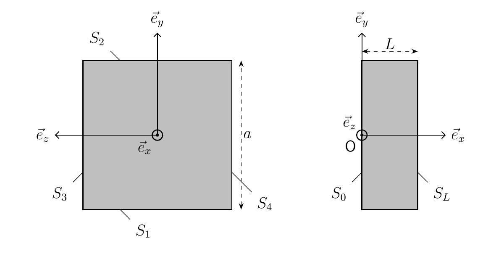

#### 3.2.1

*Montrer que le tenseur des contraintes vérifie les conditions aux limites sur les surfaces $S_3$ et $S_4$.* 验证 $S_3$、$S_4$ 上的边界条件

**答案**

Sur $z=\pm a/2$, $\vec n=\pm\vec e_z$ et $\boldsymbol\sigma\vec e_z=\vec0$ (troisième colonne nulle) : les faces sont bien libres.

**推导**

$S_3,S_4$ 的外法向为 $\pm\vec e_z$，$\boldsymbol\sigma\vec n=\pm(\sigma_{xz},\sigma_{yz},\sigma_{zz})=\vec0$，因为第三列全为零。所以这两个面自动满足"自由面"条件，这正是平面应力形式的意义。

#### 3.2.2

*On choisit $\sigma_{xy}=K(A+By+y^2)$, avec $K>0$ connu, dans tout le volume. Exprimer les équations issues de la vérification des conditions aux limites sur $S_1$, $S_2$ et $S_L$.* 写出 $S_1$、$S_2$、$S_L$ 上的边界条件方程

**答案**

- $S_2$ ($y=a/2$, $\vec n=\vec e_y$) : $\sigma_{xy}(a/2)=0\Rightarrow A+B\frac a2+\frac{a^2}4=0$, et $\sigma_{yy}(a/2)=0$ ;
- $S_1$ ($y=-a/2$, $\vec n=-\vec e_y$) : $A-B\frac a2+\frac{a^2}4=0$, et $\sigma_{yy}(-a/2)=0$ ;
- $S_L$ ($x=L$, $\vec n=\vec e_x$) : $\sigma_{xx}(L,y)=0$ et $K(A+By+y^2)=f(y)$.

**推导**

逐面写 $\boldsymbol\sigma\vec n=\vec T_d$：

| 面 | 外法向 | $\boldsymbol\sigma\vec n$ | 条件 |
|---|---|---|---|
| $S_2$：$y=a/2$ | $\vec e_y$ | $(\sigma_{xy},\sigma_{yy},0)$ | $\sigma_{xy}(a/2)=0$，$\sigma_{yy}(a/2)=0$ |
| $S_1$：$y=-a/2$ | $-\vec e_y$ | $-(\sigma_{xy},\sigma_{yy},0)$ | $\sigma_{xy}(-a/2)=0$，$\sigma_{yy}(-a/2)=0$ |
| $S_L$：$x=L$ | $\vec e_x$ | $(\sigma_{xx},\sigma_{xy},0)$ | $\sigma_{xx}(L,y)=0$，$\sigma_{xy}(L,y)=f(y)$ |

代入 $\sigma_{xy}$ 的形式即得上面三组方程。

#### 3.2.3

*En déduire l’expression de $A$, $B$ et $f(y)$.* 求 $A$、$B$ 与 $f(y)$

**答案**

En soustrayant et en ajoutant les deux conditions : $B=0$, $A=-a^2/4$, d’où $\sigma_{xy}=K\left(y^2-\frac{a^2}4\right)$ et $f(y)=K\left(y^2-\frac{a^2}4\right)$.

**推导**

两式相减得 $Ba=0\Rightarrow B=0$；两式相加得 $2A+a^2/2=0\Rightarrow A=-a^2/4$。于是

$$\sigma_{xy}=K\Bigl(y^2-\frac{a^2}{4}\Bigr),\qquad f(y)=K\Bigl(y^2-\frac{a^2}{4}\Bigr)\le0 .$$

剪应力在上下自由面为零、在中面 $y=0$ 达到最大绝对值 $Ka^2/4$，是抛物线分布（与梁理论中矩形截面的剪应力分布相同）。

#### 3.2.4

*Appliquer l’équation d’équilibre local. En déduire $\sigma_{xx}$ et $\sigma_{yy}$.* 局部平衡，求 $\sigma_{xx}$ 与 $\sigma_{yy}$

**答案**

$\overrightarrow{\operatorname{div}}\boldsymbol\sigma=\vec0$ donne $\partial_x\sigma_{xx}=-\partial_y\sigma_{xy}=-2Ky$ et $\partial_y\sigma_{yy}=-\partial_x\sigma_{xy}=0$. Avec $\sigma_{xx}(L)=0$ et $\sigma_{yy}(\pm a/2)=0$ : $\sigma_{xx}=2Ky(L-x)$, $\sigma_{yy}=0$.

**推导**

无体力的静力平衡 $\overrightarrow{\operatorname{div}}\boldsymbol\sigma=\vec0$，按直角坐标展开（与 $z$ 无关、第三列为零）：

$$\begin{cases}\partial_x\sigma_{xx}+\partial_y\sigma_{xy}=0\\ \partial_x\sigma_{xy}+\partial_y\sigma_{yy}=0\end{cases}
\Rightarrow
\begin{cases}\partial_x\sigma_{xx}=-2Ky\ \Rightarrow\ \sigma_{xx}=-2Kxy+C_1(y)\\ \partial_y\sigma_{yy}=0\ \Rightarrow\ \sigma_{yy}=C_2(x)\end{cases}$$

用 $\sigma_{xx}(L,y)=0$ 得 $C_1(y)=2KLy$；用 $\sigma_{yy}(x,\pm a/2)=0$ 得 $C_2=0$。最终

$$\boldsymbol\sigma=K\begin{pmatrix}2y(L-x)&y^2-a^2/4&0\\y^2-a^2/4&0&0\\0&0&0\end{pmatrix}.$$

$|\sigma_{xx}|$ 关于 $y$ 线性增大、在 $x=0,\ |y|=a/2$ 处取到最大值，这就是悬臂梁的弯曲正应力。

#### 3.2.5

*Déduire de ce résultat les éléments de réduction du torseur d’action $\mathcal T_0$.* $S_0$ 上力旋量的约化元素

**答案**

Sur $S_0$, $\vec n=-\vec e_x$ et $\vec T=-(\sigma_{xx},\sigma_{xy},0)|_{x=0}=\bigl(-2KLy,\ K(\frac{a^2}4-y^2),\ 0\bigr)$. D’où $\vec R_0=\frac{Ka^4}{6}\vec e_y$ et $\vec M_{0/O}=\frac{KLa^4}{6}\vec e_z$.

**推导**

$S_0$ 的外法向是 $-\vec e_x$，面上点 $\overrightarrow{OM}=(0,y,z)$。

合力：

$$\vec R_0=\int_{S_0}\boldsymbol\sigma\vec n\,\mathrm dS
=\int_{-a/2}^{a/2}\!\!\int_{-a/2}^{a/2}\begin{pmatrix}-2KLy\\K(a^2/4-y^2)\\0\end{pmatrix}\mathrm dy\,\mathrm dz
=aK\begin{pmatrix}0\\a^3/4-a^3/12\\0\end{pmatrix}=\frac{Ka^4}{6}\vec e_y .$$

$x$ 分量是 $y$ 的奇函数，积分为零。

力矩：

$$\overrightarrow{OM}\wedge\vec T=\begin{pmatrix}0\\y\\z\end{pmatrix}\wedge\begin{pmatrix}-2KLy\\K(a^2/4-y^2)\\0\end{pmatrix}
=\begin{pmatrix}-zK(a^2/4-y^2)\\-2KLyz\\2KLy^2\end{pmatrix},$$

前两项是 $z$ 的奇函数，积分为零；第三项

$$M_z=2KLa\int_{-a/2}^{a/2}y^2\,\mathrm dy=2KLa\cdot\frac{a^3}{12}=\frac{KLa^4}{6}.$$

**检查整体平衡：** $S_L$ 上的合力 $\int f\,\mathrm dS=-\frac{Ka^4}{6}\vec e_y$，与 $\vec R_0$ 抵消；$S_L$ 上的面力对 $O$ 的力矩 $L\vec e_x\wedge(-\frac{Ka^4}6\vec e_y)=-\frac{KLa^4}{6}\vec e_z$，与 $\vec M_{0/O}$ 抵消。这说明 $S_0$ 上的面力正好提供了维持整体平衡所需的剪力与弯矩。

### 3.3　椭圆柱边界上的力 · 同类练习

**题面**

Un cylindre de section elliptique $\Omega$ est soumis à un système de charges tel que son tenseur des contraintes, dont la forme est supposée connue, est caractérisé, dans la base associée aux coordonnées cartésiennes $(x,y,z)$, par la matrice :
$$\boldsymbol\sigma=\begin{pmatrix}0&0&-\frac{Ky}{b^2}\\0&0&\frac{Kx}{a^2}\\-\frac{Ky}{b^2}&\frac{Kx}{a^2}&0\end{pmatrix},\qquad K=\text{cste},\quad\Omega=\Bigl\{(x,y,z)\ /\ 0\le z\le h\ ;\ \frac{x^2}{a^2}+\frac{y^2}{b^2}\le1\Bigr\}.$$

椭圆截面柱体（半轴 $a$、$b$，高 $h$）的应力张量如上，$K$ 为常数。

#### 3.3.1

*Déterminer les efforts extérieurs auxquels est soumise la surface latérale.* 求侧表面受到的外力。

**答案**

Surface latérale $\frac{x^2}{a^2}+\frac{y^2}{b^2}=1$, normale $\vec n\propto\bigl(\frac x{a^2},\frac y{b^2},0\bigr)$ : $\boldsymbol\sigma\vec n\propto\Bigl(0,\ 0,\ -\frac{Ky}{b^2}\frac x{a^2}+\frac{Kx}{a^2}\frac y{b^2}\Bigr)=\vec0$ : la surface latérale est libre.

**推导**

曲面 $g=\frac{x^2}{a^2}+\frac{y^2}{b^2}-1=0$ 的外法向沿 $\overrightarrow{\operatorname{grad}}g$（第三分量为零）。应力张量前两列的前两行为零，第三行分别为 $-Ky/b^2$ 与 $Kx/a^2$，所以 $\boldsymbol\sigma\vec n$ 只有第三分量，代入椭圆法向后两项恰好抵消。

#### 3.3.2

*Déterminer le torseur des efforts extérieurs exercé sur les deux bases du cylindre.* 求两个底面上外力的力旋量。

**答案**

Base $z=h$ ($\vec n=\vec e_z$) : $\vec T=K\bigl(-\frac y{b^2},\frac x{a^2},0\bigr)$ ; résultante nulle (intégrandes impairs) ; moment au centre $\vec M=\int(x\vec e_x+y\vec e_y)\wedge\vec T\,\mathrm dS=K\int\Bigl(\frac{x^2}{a^2}+\frac{y^2}{b^2}\Bigr)\mathrm dS\,\vec e_z=\frac{K\pi ab}2\vec e_z$. Base $z=0$ : torseur opposé. Le cylindre est en torsion pure.

**推导**

按极坐标变换 $x=ar\cos\theta,\ y=br\sin\theta$（雅可比行列式 $abr$）：$\int x^2\,\mathrm dS=a^3b\int_0^1 r^3\,\mathrm dr\int_0^{2\pi}\cos^2\theta\,\mathrm d\theta=\frac{\pi a^3b}4$，同理 $\int y^2\,\mathrm dS=\frac{\pi ab^3}4$，所以 $\int\bigl(\frac{x^2}{a^2}+\frac{y^2}{b^2}\bigr)\mathrm dS=\frac{\pi ab}4+\frac{\pi ab}4=\frac{\pi ab}2$。底面 $z=0$ 外法向为 $-\vec e_z$，面力反号，力矩相反：两端是一对反向轴向力偶，即纯扭转。

#### 3.3.3

*Dans le cas particulier où $a=b$, déterminer les contraintes et les directions principales associées à ce tenseur.* $a=b$ 时求主应力和主方向。

**答案**

En cylindrique : $\boldsymbol\sigma=\frac{Kr}{a^2}(\vec e_\theta\otimes\vec e_z+\vec e_z\otimes\vec e_\theta)$ (cisaillement pur). Contraintes principales $\frac{Kr}{a^2}$, $0$, $-\frac{Kr}{a^2}$, de directions $\frac{\vec e_\theta+\vec e_z}{\sqrt2}$, $\vec e_r$, $\frac{\vec e_\theta-\vec e_z}{\sqrt2}$.

**推导**

$a=b$ 时 $(-y,x)/a^2=\frac r{a^2}\vec e_\theta$，只有 $\sigma_{\theta z}$。形如 $\begin{pmatrix}0&\tau\\\tau&0\end{pmatrix}$ 的块特征值 $\pm\tau$，特征向量 $(1,\pm1)/\sqrt2$。

### 3.4　圆柱的平衡与端面载荷 · 同类练习

**题面**

On considère un solide qui occupe le domaine $\Omega$ cylindrique d'axe $(O,\vec e_3)$, de section circulaire de rayon $R$, délimité par les bases $x_3=0$ et $x_3=L$. Ce solide est soumis au champ de tenseur des contraintes suivant :
$$\boldsymbol\sigma=\begin{pmatrix}0&0&Ax_1^2+Bx_2^2+C\\0&0&Dx_1x_2\\Ax_1^2+Bx_2^2+C&Dx_1x_2&Ex_1-2(1+\nu)(A+B)x_1x_3\end{pmatrix},$$
où le coefficient de Poisson du matériau $\nu$ est un nombre donné sans dimension ($0<\nu<0{,}5$) et $(A,B,C,D,E)$ des constantes à déterminer. Le cylindre est en équilibre uniquement sous l'action d'efforts exercés sur les bases $x_3=0$ et $x_3=L$, les efforts volumiques ainsi que les efforts surfaciques sur la surface latérale étant supposés nuls. 圆柱（轴 $(O,\vec e_3)$，半径 $R$，两底面 $x_3=0$、$x_3=L$）的应力张量如上，$\nu$ 为泊松比，$A$–$E$ 待定。圆柱只在两个底面上受力，体力为零，侧面不受力。

#### 3.4.1

*Préciser les dimensions des constantes $(A,B,C,D,E)$.* 说明常数 $A$–$E$ 的量纲。

**答案**

$[A]=[B]=[D]=\mathrm{Pa\cdot m^{-2}}$, $[C]=\mathrm{Pa}$, $[E]=\mathrm{Pa\cdot m^{-1}}$.

**推导**

每一项都是应力（Pa）：$Ax_1^2$ 中 $x_1^2$ 是 $\mathrm m^2$；$Ex_1$ 中 $x_1$ 是 m；$(A+B)x_1x_3$ 与 $A$ 同量纲。

#### 3.4.2

*Établir les relations que doivent vérifier ces constantes pour que le cylindre soit en équilibre et que la surface latérale soit libre d'efforts.* 写出平衡与侧面自由所要求的常数关系。

**答案**

Équilibre ($\vec f=\vec0$) : les deux premières lignes sont vérifiées ; troisième ligne : $2Ax_1+Dx_1-2(1+\nu)(A+B)x_1=0$, soit $D=2\nu A+2(1+\nu)B$. Surface latérale ($\vec n=\frac{x_1\vec e_1+x_2\vec e_2}R$) : $\boldsymbol\sigma\vec n=\frac{x_1}R\bigl(Ax_1^2+(B+D)x_2^2+C\bigr)\vec e_3=\vec0$ sur tout le cercle : $A=B+D$ et $C=-AR^2$.

**推导**

- 第三行散度：$\partial_1(Ax_1^2+Bx_2^2+C)+\partial_2(Dx_1x_2)+\partial_3\sigma_{33}=2Ax_1+Dx_1-2(1+\nu)(A+B)x_1$。
- 侧面：$\sigma_{31}x_1+\sigma_{32}x_2=x_1(Ax_1^2+Bx_2^2+C+Dx_2^2)$。在圆周上用 $x_2^2=R^2-x_1^2$ 代入，得 $x_1\bigl[(A-B-D)x_1^2+(B+D)R^2+C\bigr]=0$ 对所有 $x_1$ 成立，系数全为零。

#### 3.4.3

*Quelles relations doivent satisfaire les constantes pour que les efforts surfaciques extérieurs appliqués sur la face $x_3=L$ forment un torseur résultant équivalent à une force donnée $P\vec e_1$ passant par le centre de la base ?* 顶面面力合成为过中心的力 $P\vec e_1$，常数应满足什么关系？

**答案**

Sur $x_3=L$ ($\vec n=\vec e_3$) : $\vec T=(Ax_1^2+Bx_2^2+C,\ Dx_1x_2,\ Ex_1-2(1+\nu)(A+B)Lx_1)$. Résultante : $\int T_1\,\mathrm dS=(A+B)\frac{\pi R^4}4+C\pi R^2=P$, $\int T_2=\int T_3=0$ (parité). Moment au centre : seule $M_2=-\int x_1T_3\,\mathrm dS=-\bigl(E-2(1+\nu)(A+B)L\bigr)\frac{\pi R^4}4$ peut être non nulle ; il faut $E=2(1+\nu)(A+B)L$.

**推导**

$\int x_1^2\,\mathrm dS=\int x_2^2\,\mathrm dS=\frac{\pi R^4}4$，$\int x_1x_2\,\mathrm dS=0$。记顶面中心为 $O_L=(0,0,L)$，面内位矢为 $\overrightarrow{O_LM}=(x_1,x_2,0)$，对 $O_L$ 计算力矩 $\overrightarrow{O_LM}\wedge\vec T$：含奇函数的积分为零，只剩与 $x_1T_3$ 有关的项，得到对 $O_L$ 的力矩为 $\vec0$；而合力 $P\vec e_1$ 过 $O_L$，换算到底面中心 $O=(0,0,0)$ 的力矩为 $\overrightarrow{OO_L}\wedge(P\vec e_1)=PL\vec e_2$。

#### 3.4.4

*Calculer les constantes et donner l'expression du tenseur des contraintes.* 求常数，写出应力张量。

**答案**

Avec $q=\frac P{\pi R^4}$ : $A=-\frac{3+2\nu}{2(1+\nu)}q$, $B=-\frac{1-2\nu}{2(1+\nu)}q$, $C=\frac{3+2\nu}{2(1+\nu)}qR^2$, $D=-\frac{1+2\nu}{1+\nu}q$, $E=-4qL$ ; d'où $\sigma_{13}=\frac q{2(1+\nu)}\bigl[(3+2\nu)(R^2-x_1^2)-(1-2\nu)x_2^2\bigr]$, $\sigma_{23}=-\frac{1+2\nu}{1+\nu}qx_1x_2$, $\sigma_{33}=4qx_1(x_3-L)$, les autres nulles.

**推导**

五个方程：$D=2\nu A+2(1+\nu)B$，$A=B+D$，$C=-AR^2$，$(A+B)\frac{\pi R^4}4+C\pi R^2=P$，$E=2(1+\nu)(A+B)L$。
1. 由前两式消去 $D$：$A-B=2\nu A+2(1+\nu)B\implies (1-2\nu)A=(3+2\nu)B$。令 $A=(3+2\nu)k$、$B=(1-2\nu)k$，则 $A+B=4k$、$C=-(3+2\nu)kR^2$。
2. 代入合力条件：$4k\frac{\pi R^4}4-(3+2\nu)k\pi R^4=-2(1+\nu)k\pi R^4=P\implies k=-\frac{P}{2(1+\nu)\pi R^4}=-\frac q{2(1+\nu)}$。
3. 回代即得 $A,B,C$，再由 $D=A-B$ 与 $E=8(1+\nu)kL$ 求出 $D,E$。其中 $\sigma_{33}=4qx_1(x_3-L)$ 沿 $x_1$ 线性变化，是悬臂梁弯曲正应力；$\sigma_{13},\sigma_{23}$ 是横力弯曲剪应力。

#### 3.4.5

*Quels sont les efforts transmis par le cylindre à la base $x_3=0$ ?* 圆柱传给底面 $x_3=0$ 的力是什么？

**答案**

Sur $x_3=0$ ($\vec n=-\vec e_3$) l'appui exerce $-\boldsymbol\sigma\vec e_3$ sur le cylindre ; le cylindre exerce donc $\boldsymbol\sigma\vec e_3|_{x_3=0}$ sur l'appui : résultante $P\vec e_1$ et moment au centre de la base $PL\,\vec e_2$ (encastrement d'une poutre console).

**推导**

整体平衡：顶面 $x_3=L$ 所受合力 $P\vec e_1$ 对底面中心 $O$ 的力矩为 $L\vec e_3\wedge P\vec e_1=+PL\vec e_2$，因此底面支座对圆柱必须施加相反的反力 $-P\vec e_1$ 和反力矩 $-PL\vec e_2$；反过来，圆柱传给支座的作用力旋量就是 $+P\vec e_1$ 与 $+PL\vec e_2$（也可以直接对 $\boldsymbol\sigma\vec e_3|_{x_3=0}=(\sigma_{13},\sigma_{23},-4qLx_1)$ 积分验证：$\int x_1(-4qLx_1)(-\vec e_2)\,\mathrm dS=4qL\frac{\pi R^4}4\vec e_2=PL\vec e_2$）。要分清“谁对谁”。

### 3.5　受自重的梁 · 同类练习

**题面**

Soit une poutre soumise à son poids propre et reposant sur le sol (figure 1.1). La poutre a une hauteur $h$ et une section carrée $S$. Le matériau est homogène de masse volumique $\rho$. Le repère de travail est $(O,\vec e_1,\vec e_2,\vec e_3)$ où $O$ est un point de l'axe de la poutre en contact avec le sol. La direction verticale est définie par le vecteur $\vec e_3$. Un point $M$ de la poutre est repéré par $\overrightarrow{OM}=x_1\vec e_1+x_2\vec e_2+x_3\vec e_3$. 立在地面上的梁受自重，高 $h$，正方形截面面积 $S$，均质，密度 $\rho$。$O$ 在梁轴与地面的交点，$\vec e_3$ 竖直向上。

Le poids propre est modélisé par une force élémentaire volumique $\vec f=-\rho g\vec e_3$ où $g$ est l'accélération de la pesanteur. On suppose que les contraintes en tout point $M$ sont décrites par le tenseur :
$$\boldsymbol\sigma=\begin{pmatrix}0&0&0\\0&0&0\\0&0&a+bx_3\end{pmatrix}_{(\vec e_1,\vec e_2,\vec e_3)},$$
où $a$ et $b$ sont des constantes. 体力 $\vec f=-\rho g\vec e_3$，应力张量形式如上，$a$、$b$ 为常数。

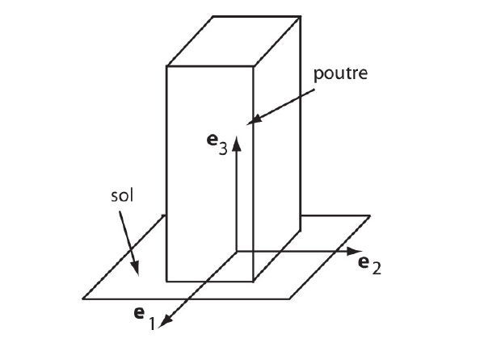

#### 3.5.1

*En utilisant l'équation d'équilibre local, déterminer la condition sur $b$ pour que le solide soit en équilibre statique. Retrouver ce résultat à partir du Principe Fondamental de la Statique (PFS).* 用局部平衡求 $b$；再用整体静力学（PFS）验证。

**答案**

$\overrightarrow{\operatorname{div}}\boldsymbol\sigma+\vec f=\vec0$ : $\partial_3\sigma_{33}-\rho g=0$ ⇒ $b=\rho g$. PFS sur la partie située au-dessus de la cote $x_3$ : poids $-\rho gS(h-x_3)\vec e_3$, effort sur la section ($\vec n=-\vec e_3$) $-\sigma_{33}S\vec e_3$, sommet libre : $\sigma_{33}=-\rho g(h-x_3)$, donc $b=\rho g$.

**推导**

散度只有第三分量 $\partial_3(a+bx_3)=b$。整体验证：取截面以上的一段，它受自重和截面上的内力，合力为零，截面上的压应力恰好托住上面的重量。

#### 3.5.2

*Écrire les conditions aux limites sur les différentes faces de la poutre.* 写出梁各个面上的边界条件。

**答案**

Faces latérales ($\vec n=\pm\vec e_1,\pm\vec e_2$) : libres, $\boldsymbol\sigma\vec n=\vec0$ (vérifié). Sommet $x_3=h$ ($\vec n=\vec e_3$) : libre, $\boldsymbol\sigma\vec e_3=(a+bh)\vec e_3=\vec0$. Base $x_3=0$ ($\vec n=-\vec e_3$) : pression de contact $p$ : $\boldsymbol\sigma(-\vec e_3)=-p(-\vec e_3)$, soit $-a=p$.

**推导**

侧面法向的第一、二列全为零，自动自由。顶面自由给出 $a+bh=0$。底面受地面压力 $p$，外法向 $-\vec e_3$，压力条件 $\boldsymbol\sigma\vec n=-p\vec n$。

#### 3.5.3

*En déduire les expressions de $a$ et de la pression de contact $p$ entre le sol et la poutre.* 求 $a$ 和地面接触压力 $p$。

**答案**

$a=-bh=-\rho gh$, $\sigma_{33}=-\rho g(h-x_3)$ (compression) ; $p=-a=\rho gh$, soit une force totale $\rho ghS$ égale au poids de la poutre.

**推导**

接触压力乘面积 = 梁的总重量，整体平衡自洽。压应力绝对值在顶面为零、底面最大（带符号的 $\sigma_{33}$ 在顶面为 $0$、底面最小），沿高度线性分布。

### 3.6　空心球的边界条件 · 同类练习

**题面**

Une sphère creuse (rayon intérieur $r_1$, rayon extérieur $r_2$) est soumise à une pression intérieure $p_1$ et une pression extérieure $p_2$. Le tenseur des contraintes, dont la forme est supposée connue, est caractérisé, dans la base locale associée aux coordonnées sphériques $(r,\theta,\varphi)$, par la matrice $\boldsymbol\sigma=\operatorname{diag}(\sigma_r,\sigma_\theta,\sigma_\varphi)$ avec 空心球（内半径 $r_1$，外半径 $r_2$）受内压 $p_1$、外压 $p_2$。
$$\sigma_r=A-\frac{2B}{r^3},\qquad\sigma_\theta=\sigma_\varphi=A+\frac B{r^3},\qquad A,\ B\ \text{constantes}.$$

球坐标局部基下应力张量为对角形式，各分量如上，$A$、$B$ 为常数。

#### 3.6.1

*Déterminer les valeurs des constantes $A$ et $B$ qui satisfont aux conditions aux limites.* 求满足边界条件的常数 $A$、$B$。

**答案**

En $r=r_1$ ($\vec n=-\vec e_r$) et en $r=r_2$ ($\vec n=\vec e_r$), $\boldsymbol\sigma\vec n=-p\vec n$ donne $\sigma_r(r_1)=-p_1$ et $\sigma_r(r_2)=-p_2$ :
$$B=\frac{(p_1-p_2)\,r_1^3r_2^3}{2(r_2^3-r_1^3)},\qquad A=\frac{p_1r_1^3-p_2r_2^3}{r_2^3-r_1^3}.$$

**推导**

内壁外法向指向球心（$-\vec e_r$），但压力条件 $\boldsymbol\sigma\vec n=-p_1\vec n$ 两边都含 $\vec n$，最后仍是 $\sigma_r=-p_1$。两式相减：$2B\bigl(\frac1{r_1^3}-\frac1{r_2^3}\bigr)=p_1-p_2$；再回代求 $A$。检查：$p_1=p_2=p$ 时 $B=0$、$A=-p$，即均匀静水压。

### 3.7　简单应力计算 · 同类练习

**题面**

Soit $(\vec e_1,\vec e_2,\vec e_3)$ une base orthonormée. Dans cette base, le tenseur des contraintes $\boldsymbol\sigma$ est donné en un point $A$ d'un milieu déformable par :
$$\boldsymbol\sigma(A)=\begin{pmatrix}2&0&3\\-&1&0\\-&-&0\end{pmatrix}_{(\vec e_1,\vec e_2,\vec e_3)}.$$
Il représente l'état des contraintes (en MPa) au point $A$. 在正交基下，变形体中点 $A$ 的应力张量如上（单位 MPa），下三角部分未给出。

#### 3.7.1

*Compléter l'expression du tenseur des contraintes.* 补全应力张量。

**答案**

$\boldsymbol\sigma$ est symétrique (équilibre des moments) : $\boldsymbol\sigma(A)=\begin{pmatrix}2&0&3\\0&1&0\\3&0&0\end{pmatrix}$ MPa.

**推导**

角动量守恒（力矩平衡）给出 $\sigma_{ij}=\sigma_{ji}$，下三角照上三角对称填入。

#### 3.7.2

*Calculer le vecteur contrainte $\vec T$ dans la base $(\vec e_1,\vec e_2,\vec e_3)$ pour les facettes centrées en $A$ de normales $\vec e_1$, $-\vec e_1$ et $\vec e_2$.* 求法向为 $\vec e_1$、$-\vec e_1$、$\vec e_2$ 的面上的应力向量。

**答案**

$\vec T(\vec e_1)=\boldsymbol\sigma\vec e_1=2\vec e_1+3\vec e_3$ ; $\vec T(-\vec e_1)=-2\vec e_1-3\vec e_3$ ; $\vec T(\vec e_2)=\vec e_2$ (MPa).

**推导**

$\vec T=\boldsymbol\sigma\vec n$，法向为 $\vec e_j$ 时就是第 $j$ 列。反向的面上应力向量反号（作用与反作用）。

#### 3.7.3

*Représenter graphiquement les composantes du vecteur contrainte pour la facette de normale $\vec e_1$ et celle de normale $\vec e_2$.* 画出两个面上应力向量的分量。

**答案**

Facette $\vec e_1$ : composante normale $2\vec e_1$ (traction), composante tangentielle $3\vec e_3$. Facette $\vec e_2$ : composante normale $\vec e_2$ (traction), composante tangentielle nulle.

**推导**

法向分量 $\sigma_n=\vec T\cdot\vec n$（正为拉），切向分量 $\vec T-\sigma_n\vec n$。$\vec e_2$ 面上没有切应力，说明 $\vec e_2$ 是主方向。下图分别在 $(\vec e_1,\vec e_3)$ 与 $(\vec e_1,\vec e_2)$ 平面内画出两个面上的 $\vec T$ 及其法向、切向分量。

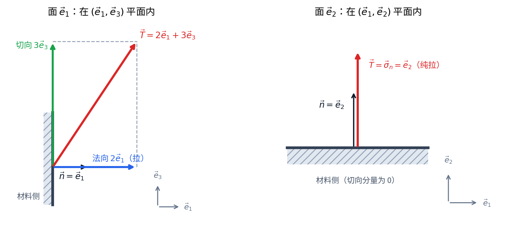

#### 3.7.4

*Calculer les contraintes principales de $\boldsymbol\sigma$ en $A$, et donner le tenseur des contraintes dans la base principale.* 求主应力，写出主轴基下的应力张量。

**答案**

$\vec e_2$ est principale (valeur 1). Bloc $(\vec e_1,\vec e_3)$ : $s^2-2s-9=0$ ⇒ $s=1\pm\sqrt{10}$, directions $\propto(s,0,3)$. Dans la base principale : $\boldsymbol\sigma=\operatorname{diag}(1+\sqrt{10},\ 1,\ 1-\sqrt{10})\approx\operatorname{diag}(4{,}16;\ 1;\ -2{,}16)$ MPa.

**推导**

$\vec e_2$ 的行和列只有对角元，直接是主方向（对应主应力 $1$）。剩下 $2\times2$ 块 $\begin{pmatrix}2&3\\3&0\end{pmatrix}$：特征方程 $(2-s)(-s)-9=0\implies s^2-2s-9=0$，解得 $s=1\pm\sqrt{10}$。由特征方程组第二行 $3n_1-sn_3=0$ 可直接读出主方向 $(s,0,3)$（与第一行 $(2-s)n_1+3n_3=0$ 给出的 $(3,0,s-2)$ 成比例，因 $(2-s)s+9=-s^2+2s+9=0$）。检查：主应力之和 $1+(1+\sqrt{10})+(1-\sqrt{10})=3=\operatorname{tr}\boldsymbol\sigma$。

#### 3.7.5

*Déterminer au point $A$ la contrainte équivalente de von Mises $\sigma_{VM}=\sqrt{\frac32\operatorname{tr}(\boldsymbol\sigma^D\boldsymbol\sigma^D)}$.* 求 $A$ 点的 von Mises 等效应力。

**答案**

$\operatorname{tr}\boldsymbol\sigma=3$, $\boldsymbol\sigma^D=\boldsymbol\sigma-\mathbb I=\begin{pmatrix}1&0&3\\0&0&0\\3&0&-1\end{pmatrix}$, $\boldsymbol\sigma^D:\boldsymbol\sigma^D=20$, $\sigma_{VM}=\sqrt{30}\approx5{,}48$ MPa.

**推导**

偏量 = 应力减去平均正应力（$\operatorname{tr}\boldsymbol\sigma/3=1$）。平方和 $1+1+2\times9=20$。用主应力检验：差值的平方 $10,10,40$，和 60，除以 2 得 30。Tresca 等效应力为 $2\sqrt{10}\approx6{,}32$ MPa，比 von Mises 大。

### 3.8　单轴拉伸试样 · 同类练习

**题面**

On considère une éprouvette d'essai de traction dont la géométrie est décrite sur la figure 2.1. Pour étudier sa zone utile, on suppose une répartition uniforme des contraintes au sein de cette zone. Le chargement extérieur à l'éprouvette est alors équivalent à une densité d'efforts sur la zone utile : $-p_0\vec e_1$ sur $S_0$ et $p_0\vec e_1$ sur $S_1$. 拉伸试样的几何见图 2.1。研究其有效段时，假设应力在有效段内均匀分布。外载等效为有效段两端的面力：$S_0$ 上 $-p_0\vec e_1$，$S_1$ 上 $p_0\vec e_1$；侧面自由。

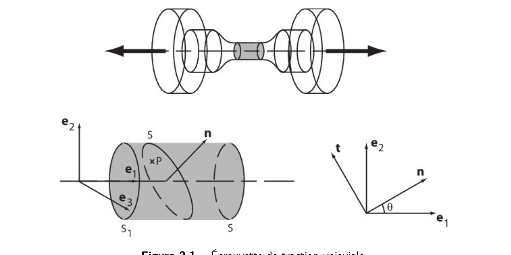

#### 3.8.1

*Soit $P$ un point d'une section $S$ quelconque de normale $\vec n$. Calculer le vecteur contrainte en $P$ relatif à la direction $\vec n$.* 求任意截面（法向 $\vec n$）上点 $P$ 的应力向量。

**答案**

Contraintes uniformes compatibles avec les CL : $\boldsymbol\sigma=p_0\,\vec e_1\otimes\vec e_1$. Pour toute normale unitaire $\vec n$, $\vec T(P,\vec n)=\boldsymbol\sigma\vec n=p_0(\vec n\cdot\vec e_1)\vec e_1=p_0\cos\theta\,\vec e_1$ (où $\theta=(\vec e_1,\vec n)$) ; en particulier dans le plan $(\vec e_1,\vec e_2)$, $\vec n=\cos\theta\,\vec e_1+\sin\theta\,\vec e_2$.

**推导**

两端面力只有 $\vec e_1$ 分量、侧面自由，均匀应力场只能是 $p_0\vec e_1\otimes\vec e_1$。应力向量永远平行于 $\vec e_1$，大小随截面倾角变化。

#### 3.8.2

*Tracer la contrainte tangentielle de cisaillement en fonction de la contrainte normale.* 画出切应力随正应力变化的关系。

**答案**

$\sigma_n=\vec T\cdot\vec n=p_0\cos^2\theta$, $\tau=\vec T\cdot\vec t=-p_0\sin\theta\cos\theta$ (avec $\vec t=-\sin\theta\,\vec e_1+\cos\theta\,\vec e_2$) : $\bigl(\sigma_n-\frac{p_0}2\bigr)^2+\tau^2=\bigl(\frac{p_0}2\bigr)^2$, cercle de Mohr de centre $(p_0/2,0)$ et de rayon $p_0/2$.

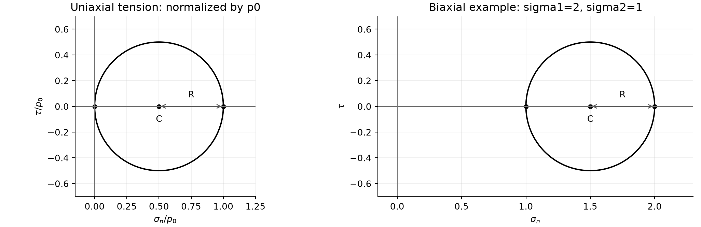

**推导**

用倍角公式：$\sigma_n=\frac{p_0}2(1+\cos2\theta)$，$\tau=-\frac{p_0}2\sin2\theta$，消去 $\theta$ 得圆。纵轴若只画大小 $|\tau|$，就是上半圆。

#### 3.8.3

*On se place à la limite d'élasticité en traction $\sigma_e$. Que vaut alors la contrainte de cisaillement ?* 拉到屈服极限 $\sigma_e$ 时切应力是多少？

**答案**

$p_0=\sigma_e$ : $\tau=-\sigma_e\sin\theta\cos\theta$, de valeur absolue maximale $\frac{\sigma_e}2$ sur les facettes à $45^\circ$ de l'axe.

**推导**

最大切应力 = Mohr 圆半径。这正是 Tresca 准则的出发点：单轴拉伸屈服时最大切应力为 $\sigma_e/2$。

#### 3.8.4

*Écrire l'opérateur des contraintes dans la base $(\vec e_1,\vec e_2,\vec e_3)$ puis dans la base $(\vec n,\vec t,\vec e_3)$.* 分别在两组基下写出应力矩阵。

**答案**

$[\boldsymbol\sigma]_{(\vec e_i)}=\operatorname{diag}(p_0,0,0)$ ; $[\boldsymbol\sigma]_{(\vec n,\vec t,\vec e_3)}=\mathbb Q^{\mathsf T}[\boldsymbol\sigma]\mathbb Q=p_0\begin{pmatrix}\cos^2\theta&-\sin\theta\cos\theta&0\\-\sin\theta\cos\theta&\sin^2\theta&0\\0&0&0\end{pmatrix}$.

**推导**

$\mathbb Q$ 的列是新基向量在旧基下的坐标。也可以直接算 $\sigma_{nn}=\vec n\cdot\boldsymbol\sigma\vec n$、$\sigma_{nt}=\vec n\cdot\boldsymbol\sigma\vec t$、$\sigma_{tt}=\vec t\cdot\boldsymbol\sigma\vec t$。

#### 3.8.5

*Vérifier que les conditions aux limites imposées sur toute la surface de la zone utile sont vérifiées.* 验证有效段全部表面的边界条件。

**答案**

$S_1$ ($\vec n=\vec e_1$) : $\boldsymbol\sigma\vec e_1=p_0\vec e_1$ ✓ ; $S_0$ ($\vec n=-\vec e_1$) : $-p_0\vec e_1$ ✓ ; surface latérale ($n_1=0$) : $\boldsymbol\sigma\vec n=p_0n_1\vec e_1=\vec0$ ✓ (libre).

**推导**

每个面取外法向乘应力张量，与给定面力比较。侧面法向垂直于 $\vec e_1$，所以面力为零，侧面自由。

### 3.9　双轴拉伸试样 · 同类练习

**题面**

L'éprouvette de traction biaxiale (figure 3.1a) a été conçue pour présenter au niveau de la zone utile (figure 3.1b) un état de contrainte plan diagonal tel que :
$$\boldsymbol\sigma=\begin{pmatrix}\sigma_1&0&0\\0&\sigma_2&0\\0&0&0\end{pmatrix}_{(\vec e_1,\vec e_2,\vec e_3)}$$
où $(\vec e_1,\vec e_2,\vec e_3)$ est le repère cartésien. 十字形双轴拉伸试样（图 3.1a）在有效区（图 3.1b）产生平面对角应力状态。

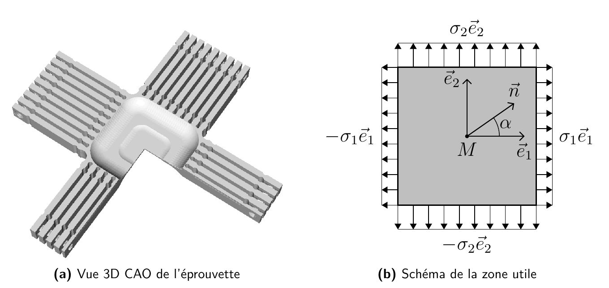

#### 3.9.1

*Soit une facette de normale $\vec n$ du plan $(\vec e_1,\vec e_2)$ et $M$ un point de cette facette ; exprimer le vecteur contrainte $\vec T(M,\vec n)$.* 求面内法向 $\vec n$ 的面上的应力向量。

**答案**

$\vec n=\cos\alpha\,\vec e_1+\sin\alpha\,\vec e_2$ : $\vec T(M,\vec n)=\sigma_1\cos\alpha\,\vec e_1+\sigma_2\sin\alpha\,\vec e_2$.

**推导**

对角矩阵乘向量，各分量分别乘对应主应力。

#### 3.9.2

*Soit $\alpha$ l'angle $(\vec e_1,\vec n)$. Tracer le lieu des contraintes $\vec T(M,\vec n)$ lorsque la facette réalise un tour complet autour de $M$ ($\alpha$ de $0$ à $2\pi$), dans un repère où les axes horizontal et vertical représentent respectivement l'amplitude de la contrainte normale et l'amplitude de la contrainte tangentielle.* 法向转一整圈时，在 $(\sigma_n,\tau)$ 平面上画出应力点的轨迹。

**答案**

$\sigma_n=\frac{\sigma_1+\sigma_2}2+\frac{\sigma_1-\sigma_2}2\cos2\alpha$, $\tau=-\frac{\sigma_1-\sigma_2}2\sin2\alpha$ : cercle de Mohr de centre $\bigl(\frac{\sigma_1+\sigma_2}2,0\bigr)$ et de rayon $\frac{|\sigma_1-\sigma_2|}2$, parcouru deux fois quand $\alpha$ va de $0$ à $2\pi$.

**推导**

$\sigma_n=\vec T\cdot\vec n=\sigma_1\cos^2\alpha+\sigma_2\sin^2\alpha$，$\tau=\vec T\cdot\vec t$，$\vec t=(-\sin\alpha,\cos\alpha)$。参数是 $2\alpha$，所以法向在 $(\vec e_1,\vec e_2)$ 平面内转一圈，点在圆上走两圈。几何上即 2.4.2 的 Mohr 圆右图（只是将主方向记为 $\vec e_1,\vec e_2$），因为本题的法向始终局限在 $(\vec e_1,\vec e_2)$ 平面内，所求最大切应力 $\frac{|\sigma_1-\sigma_2|}2$ 正对应这一面内转动范围的圆半径（在与主方向成 $45^\circ$ 的面上达到）。

## 第 4 题　弹性问题 · Élasticité

### 读题与起笔

- **看到 *poser le problème***，先分三行写。**CA** 写应变与位移的关系、给定的位移分量；**SA** 写体内平衡、给定的面力分量；**本构**写线弹性 Hooke 关系。把每个边界条件放回实际的面上。
- **受拉梁（poutre en traction）**给候选应力 $\sigma_{zz}=g(z)$。无体力时先由体内平衡得到 $g'(z)=0$，顶端面力确定这个常数。用逆 Hooke 求应变；检验候选位移时，轴向伸长和横向泊松收缩都要符合。
- **旋转圆盘（rotor de turbine）**给径向位移 $\vec u=u_r(r)\vec e_r$。先写 $\varepsilon_{rr}=u_r'$、$\varepsilon_{\theta\theta}=u_r/r$，再由 Hooke 求应力。径向平衡里保留离心体力。圆心位移有界、外缘自由，这两个条件用来定积分常数。
- **看到 *solution unique* 或 *dimensionner***。前者把刚体位移 $\vec c+\vec\omega\times\overrightarrow{OM}$ 代入齐次位移边界条件，看还允许哪些平移和转动；后者先找等效应力最大的点，再解 $\max_\Omega\sigma_{\mathrm{Tr}}\leq\sigma_e/k_s$。

- **可直接起笔**　*Le champ de déplacement doit être cinématiquement admissible. Le champ de contraintes vérifie l’équilibre local et les conditions en effort.* 随后按图上每个面的外法向，写出该面具体的位移或面力分量。

**同类练习**　4.3 拉扭试样练建立问题和判断唯一性；4.4 厚壁管练径向 Navier 方程和 Tresca，与转子题最接近。4.5–4.6 单练正逆 Hooke；4.7 用球对称模型练体力、边界条件与剪切校核，后半题加入温度场。

### 4.1　光滑底面支承的受拉梁

**题面**

On considère une poutre parallélépipédique, de longueur $L$, orientée selon l'axe $\vec e_z$ du repère cartésien $(O,\vec e_x,\vec e_y,\vec e_z)$, à section carrée de côté $a$, elle-même centrée sur l'axe $\vec e_z$. L'origine du repère se situe au centre de la base $z=0$. Elle est constituée d'un matériau homogène élastique linéaire isotrope, caractérisé par le module d'Young $E$ et le coefficient de Poisson $\nu=0{,}3$. Cette poutre est en équilibre statique et on néglige les forces volumiques. 沿 $\vec e_z$ 的方截面梁（长 $L$，边长 $a$），原点在底面中心。材料均质线弹性各向同性，$E$，$\nu=0{,}3$。静力平衡，忽略体力。

La surface ($z=0$) est en contact avec un plan rigide fixe et avec glissement libre dans le plan, ce qui implique l'absence de contrainte tangentielle dans ce plan. Les densités surfaciques d'effort sont supposées uniformes sur chacune des faces du parallélépipède. Chacune des surfaces latérales est considérée comme libre d'effort, alors que le torseur résultant des efforts surfaciques sur la surface ($z=L$) s'exprime au centre $O'$ de cette surface comme suit : $\mathcal T_L=\{F\vec e_z,\ \vec0\}_{O'}$. 底面 $z=0$ 与固定刚性平面接触，可在面内自由滑动（无切应力）。各面面力均匀；侧面自由；顶面 $z=L$ 的合力在中心 $O'$ 处为 $F\vec e_z$，力矩为零。

(À partir de la question 4.1.3, on cherche un champ de contraintes de la forme $\boldsymbol\sigma=g(z)\,\vec e_z\otimes\vec e_z$.) 从 4.1.3 起设应力形如 $g(z)\vec e_z\otimes\vec e_z$。

#### 4.1.1

*Poser le problème complet (équations, conditions aux limites, relation de comportement) en catégorisant les admissibilités statique et cinématique.* 完整地建立问题（方程、边界条件、本构），区分静力学和运动学可容。

**答案**

Domaine $x,y\in[-\frac a2,\frac a2]$, $z\in[0,L]$.
CA : $\boldsymbol\varepsilon=\frac12(\overrightarrow{\operatorname{grad}}\vec u+\overrightarrow{\operatorname{grad}}^{\mathsf T}\vec u)$, $\vec u$ continu ; $u_z(z=0)=0$.
SA : $\overrightarrow{\operatorname{div}}\boldsymbol\sigma=\vec0$ dans $\Omega$ ; faces latérales $\boldsymbol\sigma\vec n=\vec0$ ; en $z=0$, $(\boldsymbol\sigma\vec e_z)\cdot\vec e_x=(\boldsymbol\sigma\vec e_z)\cdot\vec e_y=0$ ; en $z=L$, $\boldsymbol\sigma\vec e_z=\frac F{a^2}\vec e_z$ (uniforme), de torseur $\{F\vec e_z,\vec0\}_{O'}$.
Comportement : $\boldsymbol\varepsilon=\frac{1+\nu}E\boldsymbol\sigma-\frac\nu E\operatorname{tr}(\boldsymbol\sigma)\mathbb I$.

**推导**

滑动接触的底面给出一条运动学条件（法向位移为零）和两条静力学条件（切向面力为零）；法向应力是未知反力。题设已给出各面面力分布均匀，因此顶面的旋量 $\mathcal T_L=\{F\vec e_z,\vec0\}_{O'}$ 等价于局部均匀面力 $\vec T=\frac F{a^2}\vec e_z$（若未假定均匀，则该旋量条件属于弱形式 / 圣维南意义下的整体边界条件）。

#### 4.1.2

*Le problème admet-il une solution unique ? Pourquoi ?* 问题有唯一解吗？为什么？

**答案**

Problème bien posé : solution unique en contraintes et déformations. Le déplacement est défini à un mouvement de corps rigide près : $u_z=0$ en $z=0$ bloque la translation selon $\vec e_z$ et les rotations autour de $O\vec e_x$ et $O\vec e_y$ ; restent les translations selon $\vec e_x$, $\vec e_y$ et la rotation autour de $\vec e_z$.

**推导**

把刚体位移的 $z$ 分量 $\lambda_z+\omega_xy-\omega_yx$ 在底面上令为零（对所有 $x,y$），得 $\lambda_z=\omega_x=\omega_y=0$；其余三个不受影响。

#### 4.1.3

*Justifier la forme de ce champ, puis utiliser l'admissibilité statique pour déterminer l'expression de la fonction $g(z)$.* 说明应力场形式的合理性，并用静力学可容求 $g(z)$。

**答案**

Symétries par rapport aux plans $(Oxz)$, $(Oyz)$, chargement uniforme et axial, faces latérales libres : on adopte la forme candidate $\boldsymbol\sigma=g(z)\,\vec e_z\otimes\vec e_z$ compatible avec ces hypothèses. $\overrightarrow{\operatorname{div}}\boldsymbol\sigma=g'(z)\vec e_z=\vec0$ ⇒ $g=$ cste ; en $z=L$ : $g\,a^2=F$ ⇒ $g=\frac F{a^2}=\frac FS$. Les faces latérales et la condition tangentielle en $z=0$ sont bien vérifiées.

**推导**

侧面法向 $\pm\vec e_x$、$\pm\vec e_y$，$\boldsymbol\sigma\vec n$ 取第一或第二列，全为零，自动自由；底面切向面力 $\sigma_{xz}=\sigma_{yz}=0$ 也自动满足。

#### 4.1.4

*Appliquer la relation de comportement pour en déduire le champ des déformations $\boldsymbol\varepsilon$.* 用本构关系求应变场。

**答案**

$\boldsymbol\varepsilon=\frac{1+\nu}E\boldsymbol\sigma-\frac\nu E\frac FS\mathbb I=\frac F{ES}\operatorname{diag}(-\nu,\ -\nu,\ 1)$ : allongement axial et contraction latérale (effet Poisson).

**推导**

单轴应力下 $\varepsilon_{zz}=\sigma/E$，横向 $\varepsilon_{xx}=\varepsilon_{yy}=-\nu\sigma/E$，无剪应变。

#### 4.1.5

*Le champ de déplacement $\vec u=(Cz+D)\vec e_z$ ($C$ et $D$ constantes) est-il solution du problème ? Justifier.* 位移场 $(Cz+D)\vec e_z$ 是本问题的解吗？

**答案**

Non : il donne $\varepsilon_{xx}=\varepsilon_{yy}=0$, alors que la solution (unique en déformations) impose $\varepsilon_{xx}=\varepsilon_{yy}=-\nu\frac F{ES}\neq0$ : il manque la contraction latérale due à l'effet Poisson.

**推导**

应变是唯一的，任何候选位移场都必须给出 4.1.4 的应变；只要有一个分量对不上就不是解。

#### 4.1.6

*Sous quelle(s) condition(s) le champ de déplacement $\vec u^\star=u(x)\vec e_x+v(y)\vec e_y+w(z)\vec e_z$ est-il solution du problème ?* 位移场 $u(x)\vec e_x+v(y)\vec e_y+w(z)\vec e_z$ 在什么条件下是解？

**答案**

Il faut $u'(x)=-\nu\frac F{ES}$, $v'(y)=-\nu\frac F{ES}$, $w'(z)=\frac F{ES}$ (les glissements sont alors nuls) et $w(0)=0$ : $u=-\nu\frac F{ES}x+c_1$, $v=-\nu\frac F{ES}y+c_2$, $w=\frac F{ES}z$, avec $c_1$, $c_2$ constantes quelconques (translations non bloquées).

**推导**

这种形式的剪应变 $\frac12(u_{,y}+v_{,x})$ 等自动为零，正好符合 4.1.4。剩下的平移 $c_1$、$c_2$ 对应 4.1.2 里未被挡住的刚体平移（这种分量形式里不能含绕 $\vec e_z$ 的转动）。

### 4.2　匀速旋转的涡轮圆盘

**题面**

On s'intéresse à un rotor de turbine en régime permanent, tournant à vitesse angulaire constante. Le rotor, représenté en figure 4.1, correspond à un disque qui peut être modélisé par un cylindre d'axe $\vec e_z$, de rayon $R$ et d'épaisseur $h$ (très faible devant $R$). Le matériau constituant le rotor est considéré homogène élastique linéaire et isotrope, caractérisé par un module de cisaillement $\mu$ et un 1er coefficient de Lamé $\lambda$, avec une masse volumique $\rho$ constante. 圆盘半径 $R$、厚度 $h\ll R$，均匀各向同性线弹性（Lamé 常数 $\lambda,\mu$，密度 $\rho$），以角速度 $\omega$ 匀速旋转。

La surface latérale ($r=R$) est considérée libre de contrainte, alors que le déplacement axial des bases inférieure et supérieure est considéré comme négligeable. Le disque tourne autour de son axe $O\vec e_z$ à vitesse angulaire constante $\omega$. En se plaçant dans le repère attaché au disque, on peut considérer le problème comme statique en considérant en tout point $M(r,\theta,z)$ une densité volumique de forces $\vec f_d(M)=\rho\omega^2r\,\vec e_r$, correspondant aux effets d'inertie. On fait l'hypothèse que le champ de déplacement a la forme $\vec u(r,\theta,z)=u_r(r)\,\vec e_r$, où la fonction $u_r$ est inconnue. 随盘一起转的参考系里，惯性力表现为离心体力 $\vec f_d=\rho\omega^2r\,\vec e_r$，问题变成静力问题。侧面 $r=R$ 自由；上下底面轴向位移可忽略。假设 $\vec u=u_r(r)\vec e_r$。

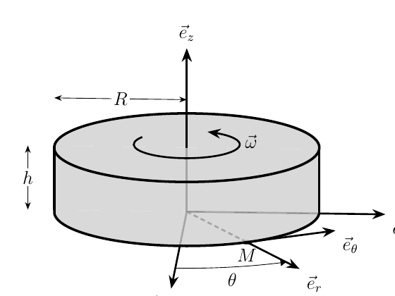

#### 4.2.1

*Poser le problème en écrivant les équations et conditions aux limites en précisant si elles portent sur l’admissibilité cinématique ou statique.* 建立问题（区分 CA 与 SA）

**答案**

Sur $\Omega=\{r\in[0,R],\theta\in[0,2\pi],z\in[0,h]\}$ :
- **CA** : $\boldsymbol\varepsilon(\vec u)=\frac12(\overrightarrow{\operatorname{grad}}\vec u+\overrightarrow{\operatorname{grad}}^{\mathsf T}\vec u)$, $\vec u$ continu et régulier ; $\vec u\cdot\vec e_z=0$ en $z=0$ et $z=h$.
- **SA** : $\overrightarrow{\operatorname{div}}\boldsymbol\sigma+\rho\omega^2r\,\vec e_r=\vec0$ dans $\Omega$ ; $\boldsymbol\sigma\vec n=\vec0$ en $r=R$ ; $(\boldsymbol\sigma\vec n)\cdot\vec e_r=(\boldsymbol\sigma\vec n)\cdot\vec e_\theta=0$ en $z=0,h$.
- **Comportement** : $\boldsymbol\sigma=2\mu\boldsymbol\varepsilon+\lambda\operatorname{tr}(\boldsymbol\varepsilon)\mathbb I$.

**推导**

按"三类方程"写：

| 类别 | 方程 | 本题 |
|---|---|---|
| CA：应变–位移（HPP） | $\boldsymbol\varepsilon=\frac12(\overrightarrow{\operatorname{grad}}\vec u+\overrightarrow{\operatorname{grad}}^{\mathsf T}\vec u)$，$\vec u$ 连续、正则 | 区域内处处成立 |
| CA：位移边界 | $\vec u=\vec u_d$ 于 $\partial\Omega_u$ | $z=0$ 和 $z=h$：$u_z=0$ |
| SA：局部平衡 | $\overrightarrow{\operatorname{div}}\boldsymbol\sigma+\vec f_d=\vec0$ | $\vec f_d=\rho\omega^2r\vec e_r$ |
| SA：力边界 | $\boldsymbol\sigma\vec n=\vec T_d$ 于 $\partial\Omega_T$ | $r=R$：$\boldsymbol\sigma\vec e_r=\vec0$；$z=0,h$：两个切向分量为零（可自由滑动） |
| 本构 | Hooke | $\boldsymbol\sigma=2\mu\boldsymbol\varepsilon+\lambda\operatorname{tr}\boldsymbol\varepsilon\,\mathbb I$ |

上下底面是**滑动接触**：法向位移给定（CA），切向面力为零（SA）。

#### 4.2.2

*Justifier la forme du champ de déplacement $\vec u$ proposé.* 解释位移场的形式

**答案**

Géométrie, matériau et chargement axisymétriques : $\partial_\theta(\cdot)=0$ et $u_\theta=0$ (pas de torsion). Les bases étant en contact glissant entre deux plans fixes rigides ($u_z=0$ aux deux bases), on adopte la cinématique plane symétrique $u_z=0$ et $\partial_z(\cdot)=0$ dans tout le disque. Donc $\vec u=u_r(r)\,\vec e_r$.

**推导**

四条理由说明题目所采用的简化模型 $\vec u=u_r(r)\vec e_r$ 的合理性：

1. 几何、材料和离心体积力都轴对称 ⇒ 各分量与 $\theta$ 无关。
2. 载荷只有径向分量，没有扭转耦合 ⇒ $u_\theta=0$。
3. 上下底面在固定刚性面间滑动接触（$u_z=0$）⇒ 在整个圆盘厚度内采用平面应变假设 $u_z=0$。
4. 边界条件与离心力均不依赖 $z$，与前面 $u_z=0$ 的对称平面运动学假设相容 ⇒ $u_r$ 仅依赖 $r$。

所以 $\vec u=u_r(r,\theta,z)\vec e_r+u_\theta\vec e_\theta+u_z\vec e_z$ 化为 $u_r(r)\vec e_r$。

#### 4.2.3

*Calculer la forme du tenseur de déformation $\boldsymbol\varepsilon$ en fonction de $u_r$.* $\boldsymbol\varepsilon$ 用 $u_r$ 表示

**答案**

$\boldsymbol\varepsilon=\operatorname{diag}\left(u_r',\ \frac{u_r}{r},\ 0\right)_{(\vec e_r,\vec e_\theta,\vec e_z)}$.

**推导**

用柱坐标位移梯度公式：$\overrightarrow{\operatorname{grad}}\vec u$ 中只有 $\partial u_r/\partial r=u_r'$ 和 $(\partial_\theta u_\theta+u_r)/r=u_r/r$ 两项非零，已经对称，故

$$\boldsymbol\varepsilon=\begin{pmatrix}u_r'&0&0\\0&u_r/r&0\\0&0&0\end{pmatrix}.$$

$u_r/r$ 是环向应变：半径为 $r$ 的圆周长从 $2\pi r$ 变成 $2\pi(r+u_r)$，相对伸长就是 $u_r/r$。

#### 4.2.4

*Calculer la forme du tenseur de contraintes $\boldsymbol\sigma$ en fonction de $u_r$.* $\boldsymbol\sigma$ 用 $u_r$ 表示

**答案**

Avec $\operatorname{tr}\boldsymbol\varepsilon=u_r'+u_r/r$ :

$$\boldsymbol\sigma=\begin{pmatrix}(2\mu+\lambda)u_r'+\lambda\frac{u_r}{r}&0&0\\0&\lambda u_r'+(2\mu+\lambda)\frac{u_r}{r}&0\\0&0&\lambda\left(u_r'+\frac{u_r}{r}\right)\end{pmatrix}.$$

**推导**

直接代入 $\boldsymbol\sigma=2\mu\boldsymbol\varepsilon+\lambda\operatorname{tr}\boldsymbol\varepsilon\,\mathbb I$。注意 $\varepsilon_{zz}=0$ 但 $\sigma_{zz}=\lambda\operatorname{tr}\boldsymbol\varepsilon\ne0$：轴向位移被挡住，所以出现轴向应力。这是**平面应变**的特征（见第 6 章：平面应变 $\varepsilon_{33}=0$ 时 $\sigma_{33}$ 一般不为零）。

#### 4.2.5

*Montrer que la solution peut se mettre sous la forme $u_r(r)=C_1r^3+C_2r+\frac{C_3}{r}$. Préciser la forme de $C_1$.* 证明 $u_r=C_1r^3+C_2r+C_3/r$，并给出 $C_1$

**答案**

La projection radiale de $\overrightarrow{\operatorname{div}}\boldsymbol\sigma+\rho\omega^2r\vec e_r=\vec0$ donne

$$(2\mu+\lambda)\left(u_r''+\frac{u_r'}{r}-\frac{u_r}{r^2}\right)=-\rho\omega^2r
\iff\frac{\mathrm d}{\mathrm dr}\left[\frac1r\frac{\mathrm d}{\mathrm dr}(ru_r)\right]=-\frac{\rho\omega^2}{2\mu+\lambda}r .$$

En intégrant deux fois : $u_r=C_1r^3+C_2r+\frac{C_3}{r}$ avec $C_1=-\dfrac{\rho\omega^2}{8(2\mu+\lambda)}$.

**推导**

柱坐标散度的径向分量（$\sigma_{r\theta}=\sigma_{rz}=0$，与 $\theta,z$ 无关）：

$$\frac{\mathrm d\sigma_{rr}}{\mathrm dr}+\frac{\sigma_{rr}-\sigma_{\theta\theta}}{r}+\rho\omega^2r=0 .$$

代入上一问，$\sigma_{rr}-\sigma_{\theta\theta}=2\mu(u_r'-u_r/r)$，整理得

$$(2\mu+\lambda)\Bigl(u_r''+\frac{u_r'}{r}-\frac{u_r}{r^2}\Bigr)=-\rho\omega^2r .$$

**关键技巧：** 左边括号可以写成 $\dfrac{\mathrm d}{\mathrm dr}\Bigl[\dfrac1r\dfrac{\mathrm d}{\mathrm dr}(ru_r)\Bigr]$，于是能逐次积分。令 $K_1=-\rho\omega^2/(2\mu+\lambda)$：

$$\frac1r(ru_r)'=\frac{K_1}{2}r^2+K_2\ \Rightarrow\ ru_r=\frac{K_1}{8}r^4+\frac{K_2}{2}r^2+K_3\ \Rightarrow\ u_r=\frac{K_1}{8}r^3+\frac{K_2}{2}r+\frac{K_3}{r}.$$

所以 $C_1=K_1/8=-\dfrac{\rho\omega^2}{8(2\mu+\lambda)}$。齐次部分 $C_2r+C_3/r$ 与受压厚壁管（4.8）的 $K_2r+K_1/r$ 完全相同；离心力只多出一个特解 $C_1r^3$。也可直接由 Navier 方程 $(\lambda+2\mu)\overrightarrow{\operatorname{grad}}(\operatorname{div}\vec u)-\mu\overrightarrow{\operatorname{rot}}\overrightarrow{\operatorname{rot}}\vec u+\vec f_d=\vec0$ 出发（这里 $\overrightarrow{\operatorname{rot}}\vec u=\vec0$），一步到位。

#### 4.2.6

*Déterminer l’expression complète des constantes $C_2$ et $C_3$, en utilisant (notamment) les conditions aux limites. En déduire la forme complète des champs $\vec u$ et $\boldsymbol\sigma$.* 用边界条件定 $C_2$、$C_3$，写出完整的 $\vec u$ 与 $\boldsymbol\sigma$

**答案**

Le centre $r=0$ appartient au domaine : $C_3=0$ (sinon $u_r\to\infty$). Puis $\sigma_{rr}(R)=0$ donne $(6\mu+4\lambda)C_1R^2+(2\mu+2\lambda)C_2=0$, d’où $C_2=\frac{(3\mu+2\lambda)\rho\omega^2R^2}{8(\mu+\lambda)(2\mu+\lambda)}$ et :
$$\vec u=\frac{\rho\omega^2}{8(2\mu+\lambda)}\Bigl(\frac{3\mu+2\lambda}{\mu+\lambda}R^2r-r^3\Bigr)\vec e_r,$$
$$\sigma_{rr}=\frac{(3\mu+2\lambda)\rho\omega^2}{4(2\mu+\lambda)}(R^2-r^2),\quad \sigma_{\theta\theta}=\frac{(3\mu+2\lambda)\rho\omega^2}{4(2\mu+\lambda)}\Bigl(R^2-\frac{\mu+2\lambda}{3\mu+2\lambda}r^2\Bigr),\quad \sigma_{zz}=\frac{\lambda\rho\omega^2}{4(2\mu+\lambda)}\Bigl(\frac{3\mu+2\lambda}{\mu+\lambda}R^2-2r^2\Bigr)$$
(composantes hors diagonale nulles).

**推导**

1. **有界性：** 圆盘是实心的，$r=0$ 在区域内，$C_3/r$ 在中心发散，必须 $C_3=0$。（空心圆盘才保留 $C_3$，用内外两个边界条件定 $C_2,C_3$。）
2. **侧面自由：** $\boldsymbol\sigma\vec e_r=\vec0\Rightarrow\sigma_{rr}(R)=0$。由 $u_r'=3C_1r^2+C_2$、$u_r/r=C_1r^2+C_2$：

$$\sigma_{rr}=(2\mu+\lambda)(3C_1r^2+C_2)+\lambda(C_1r^2+C_2)=2\bigl[(3\mu+2\lambda)C_1r^2+(\mu+\lambda)C_2\bigr],$$

令 $r=R$ 时为零即得 $C_2$。

最终结果：

$$\vec u=\frac{\rho\omega^2}{8(2\mu+\lambda)}\Bigl(\frac{3\mu+2\lambda}{\mu+\lambda}R^2r-r^3\Bigr)\vec e_r,$$

$$\sigma_{rr}=\frac{(3\mu+2\lambda)\rho\omega^2}{4(2\mu+\lambda)}(R^2-r^2),\qquad
\sigma_{\theta\theta}=\frac{(3\mu+2\lambda)\rho\omega^2}{4(2\mu+\lambda)}\Bigl(R^2-\frac{\mu+2\lambda}{3\mu+2\lambda}r^2\Bigr),$$

$$\sigma_{zz}=\lambda\operatorname{tr}\boldsymbol\varepsilon=\frac{\lambda\rho\omega^2}{4(2\mu+\lambda)}\Bigl(\frac{3\mu+2\lambda}{\mu+\lambda}R^2-2r^2\Bigr),\qquad\text{其余分量为零。}$$

**易错提示：** 计算 $\sigma_{zz}$ 时别漏掉 $r^2$ 前的系数 **2**。可用体应变直接核对：$\operatorname{tr}\boldsymbol\varepsilon=u_r'+u_r/r=4C_1r^2+2C_2$，因此 $\sigma_{zz}=2\lambda(2C_1r^2+C_2)$，其中 $r^2$ 项为 $4\lambda C_1=-\frac{\lambda\rho\omega^2}{2(2\mu+\lambda)}$，提出 $\frac{\lambda\rho\omega^2}{4(2\mu+\lambda)}$ 后括号内为 $-2r^2$。

#### 4.2.7

*Donner l’expression générale de la contrainte équivalente de Tresca $\sigma_{Tr}$, les étapes de calcul. Détailler ensuite la méthode pour dimensionner le rayon du rotor vis-à-vis de ce critère, pour une vitesse de rotation fixée, sachant que le matériau a une limite élastique en traction notée $\sigma_e$.* Tresca 等效应力与尺寸设计方法

**答案**

$\sigma_{Tr}=\max_{i,j}|\sigma_i-\sigma_j|$. Le tenseur est déjà diagonal dans $(\vec e_r,\vec e_\theta,\vec e_z)$ : ses composantes diagonales sont les contraintes principales. On cherche le point où $\sigma_{Tr}$ est maximal (ici au centre $r=0$, où $\sigma_{Tr,\max}=\frac{\mu(3\mu+2\lambda)\rho\omega^2R^2}{4(\mu+\lambda)(2\mu+\lambda)}$), puis le rayon maximal $R_0$ tel que $\max_r\sigma_{Tr}=\sigma_e/k_s$ ($k_s\ge1$ coefficient de sécurité), soit $R_0=\sqrt{\frac{4(\mu+\lambda)(2\mu+\lambda)\,\sigma_e}{k_s\,\mu(3\mu+2\lambda)\,\rho\,\omega^2}}$.

**推导**

1. 求主应力：这里 $\boldsymbol\sigma$ 在柱坐标基下已经对角，主应力就是 $\sigma_{rr},\sigma_{\theta\theta},\sigma_{zz}$。
2. 写出 $\sigma_{Tr}(r)=\max|\sigma_i-\sigma_j|$。
3. 找出 $\sigma_{Tr}$ 在圆盘中取得最大值的点。
4. 令 $\max_r\sigma_{Tr}=\sigma_e/k_s$（$k_s\ge1$ 为安全系数），解出允许的最大半径 $R_0$。

**具体最大值与半径公式推导：** 先比较三个主应力之差：

$$\sigma_{\theta\theta}-\sigma_{rr}=\frac{\mu\rho\omega^2r^2}{2(2\mu+\lambda)}\ge0,\qquad
\sigma_{\theta\theta}-\sigma_{zz}=\frac{\mu\rho\omega^2}{4(\mu+\lambda)(2\mu+\lambda)}\bigl[(3\mu+2\lambda)R^2-(\mu+\lambda)r^2\bigr]>0 .$$

可见 $\sigma_{\theta\theta}$ 处处不小于 $\sigma_{rr}$ 与 $\sigma_{zz}$，因此 $\sigma_{Tr}(r)=\max\bigl(\sigma_{\theta\theta}(r)-\sigma_{rr}(r),\ \sigma_{\theta\theta}(r)-\sigma_{zz}(r)\bigr)$：
- 第一项 $\sigma_{\theta\theta}(r)-\sigma_{rr}(r)$ 随 $r$ 单调递增，其最大值在边缘 $r=R$ 取得：$\frac{\mu\rho\omega^2R^2}{2(2\mu+\lambda)}$；
- 第二项 $\sigma_{\theta\theta}(r)-\sigma_{zz}(r)$ 随 $r$ 单调递减（注意 $\mu>0,\ \mu+\lambda>0$），其最大值在中心 $r=0$ 取得：$\frac{\mu(3\mu+2\lambda)\rho\omega^2R^2}{4(\mu+\lambda)(2\mu+\lambda)}$。

两者相比，中心值与边缘值之比为 $\frac{3\mu+2\lambda}{2(\mu+\lambda)}=1+\frac{\mu}{2(\mu+\lambda)}>1$（无需对 $\lambda$ 的正负另作限制，只需物理稳定性 $\mu>0,\ \mu+\lambda>0$），所以**最大值在圆心 $r=0$**：

$$\max_r\sigma_{Tr}=\sigma_{Tr}(0)=\frac{\mu(3\mu+2\lambda)\rho\omega^2R^2}{4(\mu+\lambda)(2\mu+\lambda)} .$$

令其等于 $\sigma_e/k_s$ 解出允许的最大半径：

$$R_0=\sqrt{\frac{4(\mu+\lambda)(2\mu+\lambda)\,\sigma_e}{k_s\,\mu(3\mu+2\lambda)\,\rho\,\omega^2}}\quad\Bigl(R_0\propto\frac1\omega\Bigr).$$

转速加倍，允许半径减半。

### 4.3　拉扭试样 · 同类练习

**题面**

On considère la zone utile d'une éprouvette de traction-torsion (figure 2.1a). Ce type d'éprouvette est utilisé pour déterminer expérimentalement l'allure du domaine d'élasticité d'un matériau (de type acier). Cette zone utile est modélisée par un cylindre mince (figure 2.1b) de rayon intérieur $r_i$, de rayon extérieur $r_e$ tels que $r_e=r_i+e$ et de longueur $L$. L'épaisseur $e$ du tube est considérée faible devant $r_i$ et $r_e$. On étudiera le cylindre en statique sous l'hypothèse des petites perturbations. Les forces volumiques seront supposées nulles. Le matériau obéit à une relation de comportement élastique linéaire isotrope. On utilisera les coordonnées cylindriques $(r,\theta,z)$. 拉扭试样的有效段模型化为薄壁圆筒（内半径 $r_i$，外半径 $r_e=r_i+e$，长 $L$，$e\ll r_i$），静力、HPP、无体力、线弹性各向同性，用柱坐标。

Le cylindre est soumis à des forces réparties de manière uniforme sur les extrémités. La résultante projetée sur $\vec e_z$ a pour valeur $N$ en $z=L$, et $-N$ en $z=0$. Ces forces réparties sont nulles en projection sur $\vec e_r$. La torsion du tube est obtenue par déplacement imposé aux extrémités : en $z=0$, on a $u_\theta=0$ et en $z=L$, on a $u_\theta=\alpha Lr$ (où $\alpha$ est un scalaire donné appelé angle de torsion, $L$ la longueur de la zone utile et $r$ le rayon courant). 两端受均匀分布力：$z=L$ 处沿 $\vec e_z$ 的合力为 $N$，$z=0$ 处为 $-N$，径向分量为零。扭转通过端面位移施加：$z=0$ 处 $u_\theta=0$，$z=L$ 处 $u_\theta=\alpha Lr$（$\alpha$ 为单位长度扭转角，总转角 $\alpha L$）。

*Traction simple, résolution en contrainte (questions 2.1–2.3) : $\alpha=0$. Torsion, résolution en déplacement (questions 2.4–2.10) : $N=0$. Superposition (questions 2.11–2.12).* 先做纯拉伸（$\alpha=0$，应力法），再做纯扭转（$N=0$，位移法），最后叠加。

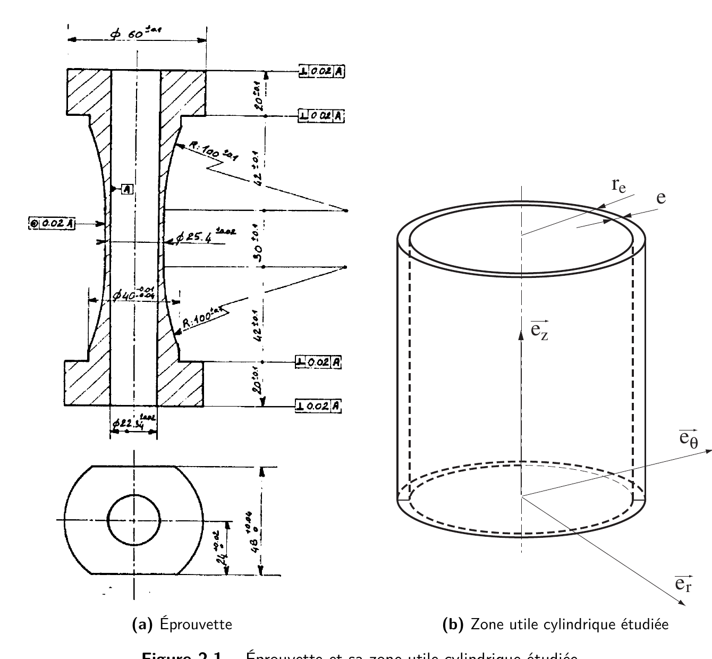

#### 4.3.1

*Écrire les équations du problème en distinguant conditions aux limites, équations d'équilibre et relation de comportement (exprimée en fonction de $E$ et $\nu$).* 写出纯拉伸问题的方程，区分边界条件、平衡方程和本构关系。

**答案**

CA : $\boldsymbol\varepsilon=\frac12(\overrightarrow{\operatorname{grad}}\vec u+\overrightarrow{\operatorname{grad}}^{\mathsf T}\vec u)$ ; $u_\theta=0$ en $z=0$ et $z=L$ ($\alpha=0$).
SA : $\overrightarrow{\operatorname{div}}\boldsymbol\sigma=\vec0$ ; surfaces $r=r_i$, $r=r_e$ libres ($\boldsymbol\sigma\vec e_r=\vec0$) ; extrémités à efforts uniformément répartis ($S=\pi(r_e^2-r_i^2)$) : en $z=L$ ($\vec n=\vec e_z$), $\sigma_{rz}=0$ et $\sigma_{zz}=\frac NS$ (soit $\int_S(\boldsymbol\sigma\vec e_z)\cdot\vec e_z\,\mathrm dS=N$) ; en $z=0$ ($\vec n=-\vec e_z$), $\sigma_{rz}=0$ et $-\sigma_{zz}=-\frac NS$ (soit $\int_S(\boldsymbol\sigma(-\vec e_z))\cdot\vec e_z\,\mathrm dS=-N$, donc $\sigma_{zz}=\frac NS$ aux deux bouts).
Comportement : $\boldsymbol\varepsilon=\frac{1+\nu}E\boldsymbol\sigma-\frac\nu E\operatorname{tr}(\boldsymbol\sigma)\mathbb I$.

**推导**

端面受力均匀分布，因此合力条件直接给出逐点正应力条件：$z=L$ 端（外法向 $+\vec e_z$）上 $(\boldsymbol\sigma\vec e_z)\cdot\vec e_z=\sigma_{zz}=N/S$；$z=0$ 端（外法向 $-\vec e_z$）上 $(\boldsymbol\sigma(-\vec e_z))\cdot\vec e_z=-\sigma_{zz}=-N/S$，同样得 $\sigma_{zz}=+N/S$（两端的合力都是向外拉的轴力），且两面均有 $\sigma_{rz}=0$。

#### 4.3.2

*Résoudre le problème.* 求解纯拉伸问题。

**答案**

$\boldsymbol\sigma=\frac NS\,\vec e_z\otimes\vec e_z$, $S=\pi(r_e^2-r_i^2)$ : équilibre et CL vérifiés. $\boldsymbol\varepsilon=\frac N{ES}\operatorname{diag}(-\nu,-\nu,1)$ dans $(\vec e_r,\vec e_\theta,\vec e_z)$ ; $\vec u=-\nu\frac N{ES}r\,\vec e_r+\frac N{ES}z\,\vec e_z$ (à un mouvement rigide près).

**推导**

假设均匀轴向应力，平衡和侧面自由自动满足。积分：$\varepsilon_{rr}=u_r'=-\nu\frac N{ES}$、$\varepsilon_{\theta\theta}=\frac{u_r}r=-\nu\frac N{ES}$ 都由 $u_r=-\nu\frac N{ES}r$ 满足；$u_z=\frac N{ES}z$。

#### 4.3.3

*La solution est-elle unique ? Préciser.* 解唯一吗？

**答案**

Unique en contraintes et déformations ; le déplacement est défini à un mouvement rigide près compatible avec $u_\theta=0$ aux deux extrémités, c'est-à-dire à une translation selon $\vec e_z$ près.

**推导**

两端 $u_\theta=0$ 挡住了绕轴转动和横向平移（它们会产生非零 $u_\theta$），也挡住了绕横轴的转动（在 $z=L$ 端产生 $u_\theta$）；轴向平移不产生 $u_\theta$，所以保留。

#### 4.3.4

*Rappeler brièvement la démarche de résolution en déplacement.* 简述位移法的步骤。

**答案**

Choisir un champ $\vec u$ cinématiquement admissible (forme justifiée par les symétries) → calculer $\boldsymbol\varepsilon(\vec u)$ → $\boldsymbol\sigma$ par la loi de comportement → écrire l'équilibre (équations de Navier) → imposer les conditions aux limites en effort pour fixer les constantes.

**推导**

位移法先保证运动学可容，平衡（Navier）和力边界条件最后检查。

#### 4.3.5

*Poser le problème (écrire les équations du problème).* 写出纯扭转问题的方程。

**答案**

CA : $u_\theta(z=0)=0$, $u_\theta(z=L)=\alpha Lr$, $\boldsymbol\varepsilon=\frac12(\overrightarrow{\operatorname{grad}}\vec u+\overrightarrow{\operatorname{grad}}^{\mathsf T}\vec u)$. SA : $\overrightarrow{\operatorname{div}}\boldsymbol\sigma=\vec0$ ; $r=r_i,r_e$ libres ; extrémités : efforts nuls selon $\vec e_r$ et $\vec e_z$ ($N=0$). Comportement : $\boldsymbol\sigma=\lambda\operatorname{tr}(\boldsymbol\varepsilon)\mathbb I+2\mu\boldsymbol\varepsilon$.

**推导**

扭转由位移施加，所以端面环向是运动学条件；轴向和径向面力为零是静力学条件。

#### 4.3.6

*On propose $\vec u=f(r)g(z)\vec e_\theta$. Justifier ce choix. À quelle condition le champ vérifie-t-il les équations de liaison ? Montrer que $f(r)=Cr$ et déterminer la constante $C$.* 论证 $\vec u=f(r)g(z)\vec e_\theta$；它满足约束方程的条件；证明 $f=Cr$ 并求 $C$。

**答案**

Axisymétrie et torsion pure : déplacement orthoradial, indépendant de $\theta$. Liaisons : $f(r)g(0)=0$ et $f(r)g(L)=\alpha Lr$ pour tout $r$ ⇒ $g(0)=0$ et $f(r)=Cr$ avec $Cg(L)=\alpha L$. L'équilibre (Navier, composante $\theta$) donne $g''=0$, donc $g(z)=z$ (normalisation) et $C=\alpha$ : $\vec u=\alpha rz\,\vec e_\theta$.

**推导**

$z=L$ 的条件对所有 $r$ 成立，所以 $f$ 正比于 $r$。Navier 的 $\theta$ 分量 $\mu\bigl(\Delta u_\theta-\frac{u_\theta}{r^2}\bigr)=0$：对 $f=Cr$，径向部分自动为零，剩下 $Crg''=0$。每个截面整体转过角度 $\alpha z$。

#### 4.3.7

*Déterminer $\boldsymbol\varepsilon(\vec u)$ puis $\boldsymbol\sigma$, en fonction du déplacement et des coefficients de Lamé $\lambda$, $\mu$.* 求应变和应力。

**答案**

$\varepsilon_{\theta z}=\frac12\frac{\partial u_\theta}{\partial z}=\frac{\alpha r}2$, $\varepsilon_{r\theta}=\frac12\bigl(f'-\frac fr\bigr)g=0$, autres nuls ; $\operatorname{tr}\boldsymbol\varepsilon=0$ ⇒ $\boldsymbol\sigma=2\mu\boldsymbol\varepsilon=\mu\alpha r(\vec e_\theta\otimes\vec e_z+\vec e_z\otimes\vec e_\theta)$.

**推导**

柱坐标应变：$\varepsilon_{\theta z}=\frac12\bigl(\partial_zu_\theta+\frac1r\partial_\theta u_z\bigr)$。注意系数 $\frac12$，$\sigma_{\theta z}=2\mu\varepsilon_{\theta z}=\mu\alpha r$。

#### 4.3.8

*Déterminer la solution $(\vec u,\boldsymbol\sigma)$ du problème.* 给出问题的解。

**答案**

$\vec u=\alpha rz\,\vec e_\theta$, $\boldsymbol\sigma=\mu\alpha r(\vec e_\theta\otimes\vec e_z+\vec e_z\otimes\vec e_\theta)$. Vérifications : $\overrightarrow{\operatorname{div}}\boldsymbol\sigma=\vec0$ ; $\boldsymbol\sigma\vec e_r=\vec0$ en $r=r_i,r_e$ ; aux extrémités $\boldsymbol\sigma\vec e_z=\mu\alpha r\,\vec e_\theta$ en $z=L$ et $\boldsymbol\sigma(-\vec e_z)=-\mu\alpha r\,\vec e_\theta$ en $z=0$ : purement orthoradial (pas d'effort selon $\vec e_r$, $\vec e_z$).

**推导**

位移法已满足平衡，只需检查力边界条件。端面面力只有环向分量，合力为零，形成扭矩。

#### 4.3.9

*Expliquer la conséquence de l'hypothèse de tube mince sur la composante de cisaillement $\sigma_{\theta z}$.* 薄壁假设对 $\sigma_{\theta z}$ 有什么影响？

**答案**

$e\ll r_i$ : $r$ varie peu dans l'épaisseur, $\sigma_{\theta z}=\mu\alpha r\approx\mu\alpha r_m$ est quasi uniforme ; l'état de contrainte est le même en tout point de la zone utile.

**推导**

均匀的应力状态让一次试验对应一个确定的 $(\sigma_{zz},\sigma_{\theta z})$ 点，才能用来描出屈服面。

#### 4.3.10

*Calculer le couple de torsion que doit appliquer la machine d'essais pour obtenir l'angle de torsion indiqué, paramétré par $\alpha$.* 求得到给定扭转角所需的扭矩。

**答案**

$C=\int_Sr\,\sigma_{\theta z}\,\mathrm dS=\mu\alpha\int_{r_i}^{r_e}r^2\,2\pi r\,\mathrm dr=\frac{\mu\alpha\pi}2(r_e^4-r_i^4)$.

**推导**

力臂 $r$ × 剪应力 × 面积元 $2\pi r\,\mathrm dr$，被积函数是 $r^3$。薄壁时约为 $2\pi r_m^3e\,\mu\alpha$。

#### 4.3.11

*Trouver la solution du problème de départ.* 求原问题（拉伸 + 扭转）的解。

**答案**

Problème linéaire, même géométrie et mêmes types de CL : superposition. $\vec u=-\nu\frac N{ES}r\,\vec e_r+\alpha rz\,\vec e_\theta+\frac N{ES}z\,\vec e_z$, $\boldsymbol\sigma=\frac NS\vec e_z\otimes\vec e_z+\mu\alpha r(\vec e_\theta\otimes\vec e_z+\vec e_z\otimes\vec e_\theta)$.

**推导**

两个子问题的数据相加正好是原问题的数据，所以解也相加。

#### 4.3.12

*Déterminer la contrainte équivalente de von Mises en fonction de $N$ et $\alpha$. Tracer la limite d'élasticité dans le diagramme $(\sigma_{zz},\sigma_{\theta z})$, pour lequel $\sigma_{VM}\le\sigma_e$.* 求 von Mises 等效应力，并在 $(\sigma_{zz},\sigma_{\theta z})$ 平面画出弹性极限。

**答案**

$\sigma_{VM}=\sqrt{\sigma_{zz}^2+3\sigma_{\theta z}^2}=\sqrt{\bigl(\frac NS\bigr)^2+3(\mu\alpha r)^2}$, maximale en $r=r_e$. Limite : ellipse $\sigma_{zz}^2+3\sigma_{\theta z}^2=\sigma_e^2$, de demi-axes $\sigma_e$ (selon $\sigma_{zz}$) et $\frac{\sigma_e}{\sqrt3}$ (selon $\sigma_{\theta z}$).

**推导**

在 $(\vec e_r,\vec e_\theta,\vec e_z)$ 基下 $\boldsymbol\sigma=\begin{pmatrix}0&0&0\\0&0&\sigma_{\theta z}\\0&\sigma_{\theta z}&\sigma_{zz}\end{pmatrix}$：
- **von Mises：** 偏量 $\boldsymbol\sigma^D=\boldsymbol\sigma-\frac{\sigma_{zz}}3\mathbb I=\operatorname{diag}\bigl(-\frac{\sigma_{zz}}3,-\frac{\sigma_{zz}}3,\frac{2\sigma_{zz}}3\bigr)+\sigma_{\theta z}(\vec e_\theta\otimes\vec e_z+\vec e_z\otimes\vec e_\theta)$，于是 $\frac32\boldsymbol\sigma^D:\boldsymbol\sigma^D=\frac32\bigl(\frac{6}{9}\sigma_{zz}^2+2\sigma_{\theta z}^2\bigr)=\sigma_{zz}^2+3\sigma_{\theta z}^2$。
- **Tresca（对照）：** 主应力为 $0$ 与 $\frac{\sigma_{zz}}2\pm\sqrt{\frac{\sigma_{zz}^2}4+\sigma_{\theta z}^2}$（两非零特征值异号或一为零，总有 $\sigma_{\max}\ge0\ge\sigma_{\min}$），故 $\sigma_{Tr}=\sigma_{\max}-\sigma_{\min}=\sqrt{\sigma_{zz}^2+4\sigma_{\theta z}^2}$，对应的椭圆 $\sigma_{zz}^2+4\sigma_{\theta z}^2=\sigma_e^2$ 落在 von Mises 椭圆内侧。

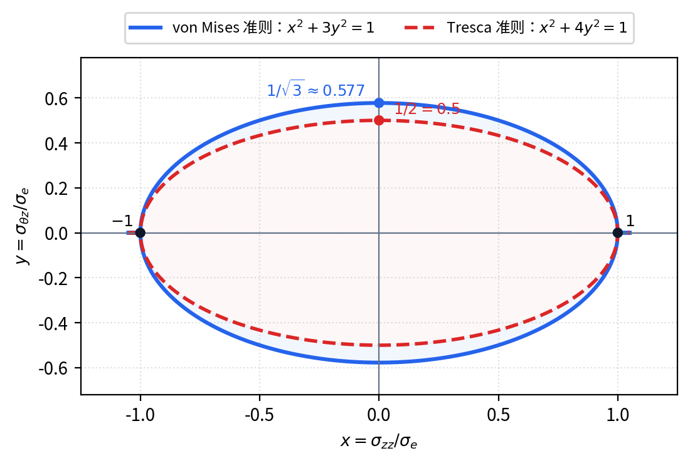

### 4.4　Navier 方法：受压厚壁管 · 同类练习

**题面**

On étudie certaines déformations d'un tube cylindrique de hauteur $h$, de rayon intérieur $R_1$ et de rayon extérieur $R_2$. La paroi interne est soumise à une pression $p_1$ et la paroi externe à une pression $p_2$. Les extrémités sont bloquées de manière à ce que le tube ne s'allonge pas. On se place dans le cadre des petites perturbations, on néglige les forces de volume et le milieu est considéré homogène, isotrope et élastique (de coefficients de Lamé $\lambda$ et $\mu$). Dans ces conditions, on cherche les solutions telles que le déplacement en tout point du tube n'ait qu'une composante radiale $u(r)$. 厚壁管（高 $h$，内半径 $R_1$，外半径 $R_2$），内壁受压 $p_1$、外壁受压 $p_2$，两端被挡住不能伸长。HPP，忽略体力，均质各向同性线弹性（Lamé 常数 $\lambda$、$\mu$）。寻找位移只有径向分量 $u(r)$ 的解。

(À partir de la question 4.4.4, on se place dans le cas particulier où $p_2\ll p_1$ (soit $p_2=0$) ; $2p_1<\sigma_e$ ; $e=R_2-R_1\ll R_1$ ; le matériau est l'acier, pour lequel $2\lambda\approx3\mu$.) 从 4.4.4 起取 $p_2=0$、$2p_1<\sigma_e$、壁薄、钢材 $2\lambda\approx3\mu$。

#### 4.4.1

*Poser le problème, c'est-à-dire la géométrie, les équations et les conditions aux limites, en précisant si elles portent sur la cinématique ou la statique.* 建立问题：几何、方程和边界条件，说明属于运动学还是静力学。

**答案**

$\Omega$ : $R_1\le r\le R_2$, $0\le\theta<2\pi$, $0\le z\le h$. CA : $\boldsymbol\varepsilon=\frac12(\overrightarrow{\operatorname{grad}}\vec u+\overrightarrow{\operatorname{grad}}^{\mathsf T}\vec u)$ ; $u_z=0$ en $z=0$ et $z=h$. SA : $\overrightarrow{\operatorname{div}}\boldsymbol\sigma=\vec0$ ; $\boldsymbol\sigma\vec n=-p_1\vec n$ en $r=R_1$ ($\vec n=-\vec e_r$) ; $\boldsymbol\sigma\vec n=-p_2\vec n$ en $r=R_2$ ($\vec n=\vec e_r$) ; efforts tangentiels nuls sur les extrémités. Comportement : $\boldsymbol\sigma=\lambda\operatorname{tr}(\boldsymbol\varepsilon)\mathbb I+2\mu\boldsymbol\varepsilon$.

**推导**

端面被挡住轴向位移（运动学），切向面力为零（静力学）；内外壁是压力条件（静力学）。

#### 4.4.2

*Justifier la forme du champ de déplacement recherché $\vec u(M)=u(r)\vec e_r$.* 论证 $\vec u=u(r)\vec e_r$ 的形式。

**答案**

Géométrie et chargement axisymétriques : pas de dépendance en $\theta$ ; chargement purement radial : $u_\theta=0$ ; allongement bloqué et invariance selon $z$ (déformations planes) : $u_z=0$ et pas de dépendance en $z$. D'où $\vec u=u(r)\vec e_r$, compatible avec $u_z=0$ aux extrémités.

**推导**

逐条用对称性和载荷消去分量和变量，最后说明与边界条件相容。

#### 4.4.3

*Montrer que le champ de déplacement s'écrit $u(r)=\frac{K_1}r+K_2r$, avec $K_1$, $K_2$ constants.* 证明 $u(r)=K_1/r+K_2r$。

**答案**

$\overrightarrow{\operatorname{rot}}\vec u=\vec0$, Navier se réduit à $(\lambda+2\mu)\overrightarrow{\operatorname{grad}}(\operatorname{div}\vec u)=\vec0$ : $\operatorname{div}\vec u=\frac1r(ru)'=2K_2$ (constante), d'où $ru=K_2r^2+K_1$, soit $u=\frac{K_1}r+K_2r$.

**推导**

- 由 $\overrightarrow{\operatorname{grad}}\vec u$ 的柱坐标公式（或直接由 $\boldsymbol\varepsilon=\operatorname{diag}(u',\frac ur,0)$）：$\operatorname{tr}\boldsymbol\varepsilon=u'+\frac ur=\frac1r(ru)'$。
- 法一（Navier 方程）：因 $\vec u=u(r)\vec e_r$ 无旋（$\overrightarrow{\operatorname{rot}}\vec u=\vec0$），Navier 方程 $(\lambda+2\mu)\overrightarrow{\operatorname{grad}}(\operatorname{div}\vec u)-\mu\overrightarrow{\operatorname{rot}}\overrightarrow{\operatorname{rot}}\vec u=\vec0$ 退化为 $\frac{\mathrm d}{\mathrm dr}\bigl[\frac1r(ru)'\bigr]=0$，积分两次得 $\frac1r(ru)'=2K_2\implies ru=K_2r^2+K_1$，即 $u(r)=\frac{K_1}r+K_2r$。
- 法二（直接代平衡）：由 $\sigma_{rr}=(\lambda+2\mu)u'+\lambda\frac ur$、$\sigma_{\theta\theta}=\lambda u'+(\lambda+2\mu)\frac ur$ 代入径向平衡 $\sigma_{rr}'+\frac{\sigma_{rr}-\sigma_{\theta\theta}}r=0$，化简后同样得 $(\lambda+2\mu)\bigl[\frac1r(ru)'\bigr]'=0$。

#### 4.4.4

*En utilisant les conditions aux limites, calculer $K_1$ et $K_2$.* 用边界条件求 $K_1$、$K_2$。

**答案**

$\sigma_{rr}=2\bigl[(\lambda+\mu)K_2-\mu\frac{K_1}{r^2}\bigr]$, $\sigma_{\theta\theta}=2\bigl[(\lambda+\mu)K_2+\mu\frac{K_1}{r^2}\bigr]$, $\sigma_{zz}=2\lambda K_2$. $\sigma_{rr}(R_1)=-p_1$, $\sigma_{rr}(R_2)=-p_2$ :
$$K_1=\frac{p_1-p_2}{2\mu}\frac{R_1^2R_2^2}{R_2^2-R_1^2},\qquad K_2=\frac1{2(\lambda+\mu)}\frac{p_1R_1^2-p_2R_2^2}{R_2^2-R_1^2}.$$

**推导**

$u'=K_2-\frac{K_1}{r^2}$，$\frac ur=K_2+\frac{K_1}{r^2}$，$\operatorname{tr}\boldsymbol\varepsilon=2K_2$。两个压力条件相减消去 $K_2$，求 $K_1$；再回代。注意轴向被挡住（平面应变），一般情形 $\sigma_{zz}=\lambda\operatorname{tr}\boldsymbol\varepsilon=2\lambda K_2$（仅当 $p_1R_1^2=p_2R_2^2$ 时为零；当 $p_2=0$ 时非零，为维持轴向零应变所需反力）。

#### 4.4.5

*Déterminer la contrainte équivalente de Tresca et en déduire une règle de dimensionnement sur l'épaisseur $e$ du tube.* 求 Tresca 等效应力，推出壁厚 $e$ 的设计准则。

**答案**

Avec $p_2=0$, $2\lambda=3\mu$ : $\sigma_{rr}\le\sigma_{zz}\le\sigma_{\theta\theta}$, donc $\sigma_{Tr}=\sigma_{\theta\theta}-\sigma_{rr}=\frac{4\mu K_1}{r^2}=\frac{2p_1R_1^2R_2^2}{r^2(R_2^2-R_1^2)}$, maximale à la paroi intérieure : $\frac{2p_1R_2^2}{R_2^2-R_1^2}\le\sigma_e$ ⇒ $e\ge R_1\Bigl(\sqrt{\frac{\sigma_e}{\sigma_e-2p_1}}-1\Bigr)\approx R_1\frac{p_1}{\sigma_e}$.

**推导**

- 应力已在柱坐标基下对角，对角元就是主应力。当 $p_2=0$ 时，$K_1=\frac{p_1}{2\mu}\frac{R_1^2R_2^2}{R_2^2-R_1^2}>0$、$K_2=\frac{p_1}{2(\lambda+\mu)}\frac{R_1^2}{R_2^2-R_1^2}>0$。计算各主应力差：
  $$\sigma_{\theta\theta}-\sigma_{zz}=2\mu\Bigl(K_2+\frac{K_1}{r^2}\Bigr)>0,\qquad \sigma_{zz}-\sigma_{rr}=2\mu\Bigl(\frac{K_1}{r^2}-K_2\Bigr).$$
  因 $\frac{K_1/r^2}{K_2}=\frac{\lambda+\mu}\mu\frac{R_2^2}{r^2}\ge\frac{\lambda+\mu}\mu>1$（代入 $2\lambda=3\mu$ 即 $\ge2.5>1$），故处处有 $\sigma_{rr}<\sigma_{zz}<\sigma_{\theta\theta}$，因此 $\sigma_{Tr}=\sigma_{\theta\theta}-\sigma_{rr}=\frac{4\mu K_1}{r^2}$。
- 最大值在内壁 $r=R_1$：$\frac{2p_1R_2^2}{R_2^2-R_1^2}\le\sigma_e$。由于 $\frac{R_2^2}{R_2^2-R_1^2}>1$，该式**有解的前提是 $\sigma_e>2p_1$**（若 $2p_1\ge\sigma_e$，内壁主应力差至少为 $2p_1$，无论加多厚都会在内壁先屈服）。在 $\sigma_e>2p_1$ 下整理得 $R_2^2(\sigma_e-2p_1)\ge\sigma_eR_1^2$，开方并减去 $R_1$ 得精确下界 $e=R_2-R_1\ge R_1\bigl(\sqrt{\frac{\sigma_e}{\sigma_e-2p_1}}-1\bigr)$。在薄壁低压极限 $2p_1\ll\sigma_e$ 下，用 $(1-x)^{-1/2}\approx1+\frac x2$（$x=\frac{2p_1}{\sigma_e}$）即得工程薄壁估计 $e\ge R_1\frac{p_1}{\sigma_e}$。

### 4.5　正逆本构关系 · 同类练习

**题面**

On s'intéresse à un matériau solide à comportement élastique linéaire isotrope, sous l'Hypothèse des Petites Perturbations (HPP). Ce dernier est caractérisé par les paramètres matériaux suivants : $\lambda$, 1er coefficient de Lamé (Pa) ; $\mu$, module de cisaillement ou second coefficient de Lamé, parfois noté $G$ (Pa) ; $E$, module de Young (Pa) ; $\nu$, coefficient de Poisson (sans unité) ; $K$, module d'élasticité isostatique ou module de compressibilité (Pa), qui relie la trace du tenseur des contraintes à celle du tenseur des déformations. 小扰动下的线弹性、各向同性固体，材料参数：第一 Lamé 常数 $\lambda$、剪切模量 $\mu$（即 $G$）、杨氏模量 $E$、泊松比 $\nu$（无量纲）、体积模量 $K$（联系应力的迹与应变的迹）。

Lorsque le matériau est chargé au-delà de sa limite élastique, il peut apparaître de la déformation plastique $\boldsymbol\varepsilon^{pl}$, qui vient s'ajouter à la déformation élastique $\boldsymbol\varepsilon^{el}$ pour constituer la déformation totale $\boldsymbol\varepsilon(\vec u)$. La déformation plastique est considérée comme une transformation isochore dans les métaux et alliages. 超过弹性极限后会出现塑性应变 $\boldsymbol\varepsilon^{pl}$，与弹性应变相加得到总应变；在金属中塑性变形被视为等体积变换。

#### 4.5.1

*Rappeler les deux expressions des relations de comportement donnant $\boldsymbol\sigma=f_1(\boldsymbol\varepsilon)$ et $\boldsymbol\varepsilon=f_2(\boldsymbol\sigma)$ en fonction des coefficients matériaux ($\lambda$, $\nu$, $\mu$ et $E$). Démontrer les relations liant ces coefficients matériaux.* 写出正、逆本构关系，并证明各常数之间的关系。

**答案**

$\boldsymbol\sigma=\lambda\operatorname{tr}(\boldsymbol\varepsilon)\mathbb I+2\mu\boldsymbol\varepsilon$ et $\boldsymbol\varepsilon=\frac{1+\nu}E\boldsymbol\sigma-\frac\nu E\operatorname{tr}(\boldsymbol\sigma)\mathbb I$. En prenant la trace : $\operatorname{tr}\boldsymbol\sigma=(3\lambda+2\mu)\operatorname{tr}\boldsymbol\varepsilon$, d'où $\boldsymbol\varepsilon=\frac1{2\mu}\boldsymbol\sigma-\frac\lambda{2\mu(3\lambda+2\mu)}\operatorname{tr}(\boldsymbol\sigma)\mathbb I$. Par identification : $E=\frac{\mu(3\lambda+2\mu)}{\lambda+\mu}$, $\nu=\frac\lambda{2(\lambda+\mu)}$ ; inversement $\mu=\frac E{2(1+\nu)}$, $\lambda=\frac{E\nu}{(1+\nu)(1-2\nu)}$, et $K=\lambda+\frac23\mu=\frac E{3(1-2\nu)}$.

**推导**

1. 对正关系取迹：$\operatorname{tr}\boldsymbol\sigma=3\lambda\operatorname{tr}\boldsymbol\varepsilon+2\mu\operatorname{tr}\boldsymbol\varepsilon$。
2. 反解：$\boldsymbol\varepsilon=\frac1{2\mu}\bigl(\boldsymbol\sigma-\lambda\operatorname{tr}\boldsymbol\varepsilon\,\mathbb I\bigr)$，把 $\operatorname{tr}\boldsymbol\varepsilon=\frac{\operatorname{tr}\boldsymbol\sigma}{3\lambda+2\mu}$ 代入。
3. 与逆关系逐项比较：$\frac{1+\nu}E=\frac1{2\mu}$，$\frac\nu E=\frac\lambda{2\mu(3\lambda+2\mu)}$。两式相除得 $\frac\nu{1+\nu}=\frac\lambda{3\lambda+2\mu}$，解出 $\nu$，再由第一式得 $E$。
4. 体积模量：$\operatorname{tr}\boldsymbol\sigma=3K\operatorname{tr}\boldsymbol\varepsilon$，所以 $3K=3\lambda+2\mu$。

#### 4.5.2

*Rappeler la condition d'incompressibilité pour un matériau solide. Quelles en sont les conséquences sur le module $K$ pour un tel matériau ?* 固体不可压缩的条件是什么？对 $K$ 有什么影响？

**答案**

Incompressible : $J=\det\mathbb F=1$, soit sous l'HPP $\operatorname{tr}\boldsymbol\varepsilon=0$ quel que soit le chargement. Comme $\operatorname{tr}\boldsymbol\sigma=3K\operatorname{tr}\boldsymbol\varepsilon$ avec $\operatorname{tr}\boldsymbol\sigma$ quelconque, il faut $K\to+\infty$, c'est-à-dire $\nu\to\frac12$.

**推导**

无论加多大的静水压，体积都不变，等价于体积模量无穷大。由 $K=\frac E{3(1-2\nu)}$ 得 $\nu\to\frac12$。此时压力不再由本构确定，而成为约束反力。

#### 4.5.3

*En déduire le nombre de composantes indépendantes dans le tenseur de déformation plastique dans ce cas précis (en 3D).* 塑性应变等体积时，三维中有几个独立分量？

**答案**

$\boldsymbol\varepsilon^{pl}$ symétrique : 6 composantes ; la condition isochore $\operatorname{tr}\boldsymbol\varepsilon^{pl}=0$ en supprime une : 5 composantes indépendantes (le tenseur de déformation plastique est déviatorique).

**推导**

对称二阶张量有 6 个独立分量，迹为零给出一个约束。

### 4.6　线弹性数值应用 · 同类练习

**题面**

On considère un matériau élastique, linéaire et isotrope dont on connaît les constantes élastiques : le module d'élasticité (module d'Young) est $E=200$ GPa ; le coefficient de Poisson est $\nu=0{,}3$. 线弹性、各向同性材料，$E=200$ GPa，$\nu=0{,}3$。

#### 4.6.1

*Écrire la relation de comportement qui donne le tenseur des contraintes $\boldsymbol\sigma$ en fonction de celui des déformations linéarisé $\boldsymbol\varepsilon$ à l'aide de $E$ et $\nu$.* 用 $E$、$\nu$ 写出由应变求应力的本构关系。

**答案**

$\boldsymbol\sigma=\frac E{1+\nu}\boldsymbol\varepsilon+\frac{E\nu}{(1+\nu)(1-2\nu)}\operatorname{tr}(\boldsymbol\varepsilon)\,\mathbb I$.

**推导**

即 $2\mu=\frac E{1+\nu}$、$\lambda=\frac{E\nu}{(1+\nu)(1-2\nu)}$ 代入正关系。

#### 4.6.2

*Écrire cette relation en fonction des coefficients de Lamé $\lambda$ et $\mu$, et donner l'expression de $\lambda$ et $\mu$ en fonction de $E$ et $\nu$. Faire l'application numérique. Que constate-t-on pour $\mu$ ?* 用 Lamé 常数写出本构，给出 $\lambda$、$\mu$ 的表达式并代入数值；$\mu$ 有什么特点？

**答案**

$\boldsymbol\sigma=\lambda\operatorname{tr}(\boldsymbol\varepsilon)\mathbb I+2\mu\boldsymbol\varepsilon$, $\mu=\frac E{2(1+\nu)}=\frac{200}{2{,}6}\approx76{,}9$ GPa, $\lambda=\frac{E\nu}{(1+\nu)(1-2\nu)}=\frac{60}{0{,}52}\approx115{,}4$ GPa ($K\approx166{,}7$ GPa). On constate $\mu<\frac E2$ (ici $\mu\approx0{,}38\,E$).

**推导**

手算：$1+\nu=1{,}3$，$1-2\nu=0{,}4$。$\nu$ 在 $0$ 到 $\frac12$ 之间时，$\mu=\frac E{2(1+\nu)}$ 介于 $\frac E3$ 与 $\frac E2$ 之间。

#### 4.6.3

*En cisaillement pur, le tenseur des déformations linéarisé est $\boldsymbol\varepsilon=\frac\gamma2(\vec e_1\otimes\vec e_2+\vec e_2\otimes\vec e_1)$. En déduire le tenseur des contraintes correspondant.* 纯剪切应变下求应力张量。

**答案**

$\operatorname{tr}\boldsymbol\varepsilon=0$ : $\boldsymbol\sigma=2\mu\boldsymbol\varepsilon=\mu\gamma(\vec e_1\otimes\vec e_2+\vec e_2\otimes\vec e_1)$, soit $\sigma_{12}=\mu\gamma\approx76{,}9\,\gamma$ GPa.

**推导**

迹为零，$\lambda$ 项消失；剪应力 $\tau=\mu\gamma$，这就是剪切模量的物理意义（$\gamma$ 是工程剪应变，等于 $2\varepsilon_{12}$）。

#### 4.6.4

*Écrire la relation de comportement qui donne le tenseur des déformations linéarisé $\boldsymbol\varepsilon$ en fonction de celui des contraintes $\boldsymbol\sigma$ à l'aide de $E$ et $\nu$.* 用 $E$、$\nu$ 写出由应力求应变的本构关系。

**答案**

$\boldsymbol\varepsilon=\frac{1+\nu}E\boldsymbol\sigma-\frac\nu E\operatorname{tr}(\boldsymbol\sigma)\,\mathbb I$, soit $\varepsilon_{11}=\frac1E\bigl[\sigma_{11}-\nu(\sigma_{22}+\sigma_{33})\bigr]$, $\varepsilon_{12}=\frac{1+\nu}E\sigma_{12}$.

**推导**

分量式便于手算：对角元减去另外两个方向应力的泊松效应；非对角元是 $\frac{\sigma_{12}}{2\mu}$。

#### 4.6.5

*En présence d'une pression hydrostatique pure, $\boldsymbol\sigma=-p\mathbb I$. En déduire le tenseur des déformations $\boldsymbol\varepsilon$ correspondant. Calculer la trace de $\boldsymbol\varepsilon$. Que représente cette quantité ? Pourquoi n'y a-t-il pas de contrainte de cisaillement quelle que soit l'orientation de la facette ?* 静水压下求应变及其迹；迹代表什么？为什么任何面上都没有切应力？

**答案**

$\boldsymbol\varepsilon=\frac{1+\nu}E(-p\mathbb I)-\frac\nu E(-3p)\mathbb I=-\frac{(1-2\nu)p}E\mathbb I=-\frac p{3K}\mathbb I$ ; $\operatorname{tr}\boldsymbol\varepsilon=-\frac{3(1-2\nu)p}E=-\frac pK$ : variation relative de volume (diminution). $\boldsymbol\sigma$ sphérique : $\boldsymbol\sigma\vec n=-p\vec n$ pour tout $\vec n$, toute direction est principale, donc aucune contrainte tangentielle.

**推导**

各向同性受压，各方向等量收缩，没有形状变化。数值：$\frac{1-2\nu}E=\frac{0{,}4}{200}$ GPa$^{-1}$，即每 1 GPa 压力体积减少 $0{,}6\,\%$。

### 4.7　行星：引力场与温度场 · 同类练习

**题面**

On rappelle que, dans l'espace, loin de toute influence gravitationnelle, une planète de rayon $R$, de masse volumique $\rho$, exerce sur elle-même un champ de gravitation propre tel qu'en chacun de ses points la densité volumique des forces s'écrit $\vec f(r)=-\rho g\frac rR\,\vec e_r$. L'isotropie du solide à comportement linéaire élastique ($E$, $\nu$) et la nature des charges justifient la recherche d'un champ des déplacements de matière de la forme $\vec u=u(r)\vec e_r$. 远离外部引力的均质行星（半径 $R$，密度 $\rho$），自身引力对应的体力为 $-\rho g\frac rR\vec e_r$；材料线弹性（$E$、$\nu$），设 $\vec u=u(r)\vec e_r$。

En réalité, seule la croûte est solide et a une tenue mécanique. Elle est soumise à un flux continu de chaleur provenant du cœur de la planète. Le manteau visqueux à haute température ne participe pas, en première approximation, à l'état mécanique de la croûte. On modélise maintenant la planète comme une sphère creuse de rayons intérieur $R_i$ et extérieur $R$. La croûte est supposée homogène et isotrope de module d'Young $E$, de coefficient de Poisson $\nu$, de module de compressibilité isotherme $K$ et de coefficient de dilatation volumique $\alpha_v$. On désigne par $T_0$ la température constante à la surface intérieure de la croûte, et on suppose que la température à la surface de la planète est nulle. La température dans la croûte à la distance $r$ du centre est régie par la loi
$$T(r)=\frac{R_i}{R-R_i}\,T_0\Bigl(\frac Rr-1\Bigr).$$
Par raison de symétrie, le champ des déplacements est purement radial : $\vec u=u(r)\vec e_r$ (questions 3.7–3.11). 第二部分：只有地壳是固体，把行星看成空心球 $R_i\le r\le R$，地壳的 $E$、$\nu$、$K$、体膨胀系数 $\alpha_v$ 已知；内表面温度 $T_0$，外表面温度为 0，温度分布如上，位移仍为径向。

#### 4.7.1

*Poser le problème.* 建立问题（第一部分：自重）。

**答案**

$\Omega$ : $r\le R$. CA : $\boldsymbol\varepsilon=\frac12(\overrightarrow{\operatorname{grad}}\vec u+\overrightarrow{\operatorname{grad}}^{\mathsf T}\vec u)$, $\vec u$ fini (nul) au centre. SA : $\overrightarrow{\operatorname{div}}\boldsymbol\sigma-\rho g\frac rR\vec e_r=\vec0$ ; surface libre $\boldsymbol\sigma\vec e_r=\vec0$ en $r=R$. Comportement : $\boldsymbol\sigma=\lambda\operatorname{tr}(\boldsymbol\varepsilon)\mathbb I+2\mu\boldsymbol\varepsilon$.

**推导**

没有位移边界条件，只有中心的有界性；表面自由。

#### 4.7.2

*Montrer à l'aide de l'équation de Navier que $u(r)=ar+br^3$, où $a$, $b$ sont des constantes à déterminer.* 用 Navier 方程证明 $u=ar+br^3$。

**答案**

$(\lambda+2\mu)\frac{\mathrm d}{\mathrm dr}\Bigl[\frac1{r^2}\frac{\mathrm d}{\mathrm dr}(r^2u)\Bigr]=\rho g\frac rR$ ⇒ $u=ar+\frac c{r^2}+br^3$ avec $b=\frac{\rho g}{10R(\lambda+2\mu)}$ ; $u$ fini au centre ⇒ $c=0$.

**推导**

特解代入 $u=br^3$：$\frac1{r^2}(r^2\cdot br^3)'=5br^2$，再求导 $10br$。齐次解 $ar+\frac c{r^2}$。

#### 4.7.3

*Donner les expressions de l'opérateur des déformations et de l'opérateur des contraintes en fonction des constantes $a$ et $b$.* 用 $a$、$b$ 表示应变和应力。

**答案**

$\boldsymbol\varepsilon=\operatorname{diag}(a+3br^2,\ a+br^2,\ a+br^2)$, $\operatorname{tr}\boldsymbol\varepsilon=3a+5br^2$ ; $\sigma_{rr}=(3\lambda+2\mu)a+(5\lambda+6\mu)br^2$, $\sigma_{\theta\theta}=\sigma_{\varphi\varphi}=(3\lambda+2\mu)a+(5\lambda+2\mu)br^2$.

**推导**

$\varepsilon_{rr}=u'$，$\varepsilon_{\theta\theta}=\varepsilon_{\varphi\varphi}=\frac ur$；$\sigma_{ii}=\lambda\operatorname{tr}\boldsymbol\varepsilon+2\mu\varepsilon_{ii}$。

#### 4.7.4

*Écrire la condition aux limites et en déduire la valeur de la constante $a$. Préciser alors la valeur des composantes du tenseur des contraintes en fonction de $r$, $R$ et $\nu$.* 写出边界条件求 $a$，并用 $r$、$R$、$\nu$ 表示应力。

**答案**

$\sigma_{rr}(R)=0$ ⇒ $a=-\frac{(5\lambda+6\mu)bR^2}{3\lambda+2\mu}$ ; d'où $\sigma_{rr}=\frac{(3-\nu)\rho g}{10(1-\nu)R}(r^2-R^2)$, $\sigma_{\theta\theta}=\sigma_{\varphi\varphi}=\frac{\rho g}{10(1-\nu)R}\bigl[(1+3\nu)r^2-(3-\nu)R^2\bigr]$.

**推导**

由 $\sigma_{rr}(R)=0$ 解出 $a=-\frac{5\lambda+6\mu}{3\lambda+2\mu}bR^2$，回代应力公式并提取 $b=\frac{\rho g}{10R(\lambda+2\mu)}$：
$$\sigma_{rr}=\frac{5\lambda+6\mu}{\lambda+2\mu}\frac{\rho g}{10R}(r^2-R^2),\qquad \sigma_{\theta\theta}=\frac{\rho g}{10R}\Bigl(\frac{5\lambda+2\mu}{\lambda+2\mu}r^2-\frac{5\lambda+6\mu}{\lambda+2\mu}R^2\Bigr).$$
利用 $\lambda=\frac{2\mu\nu}{1-2\nu}$ 将系数化为 $\nu$：$\frac{5\lambda+6\mu}{\lambda+2\mu}=\frac{10\nu+6(1-2\nu)}{2\nu+2(1-2\nu)}=\frac{3-\nu}{1-\nu}$，$\frac{5\lambda+2\mu}{\lambda+2\mu}=\frac{10\nu+2(1-2\nu)}{2-2\nu}=\frac{1+3\nu}{1-\nu}$。

#### 4.7.5

*Quelle est la pression au centre de la sphère ? Quelle est la valeur maximale des contraintes de cisaillement ? En quels points est-elle atteinte ?* 中心压力是多少？最大剪应力是多少，在哪里？

**答案**

Au centre $\boldsymbol\sigma=\sigma_{rr}(0)\mathbb I$ : $p(0)=\frac{(3-\nu)\rho gR}{10(1-\nu)}$. $\tau_{\max}=\frac{|\sigma_{\theta\theta}-\sigma_{rr}|}2=\frac{(1-2\nu)\rho g\,r^2}{10(1-\nu)R}$, maximale à la surface $r=R$ : $\frac{(1-2\nu)\rho gR}{10(1-\nu)}$.

**推导**

中心处三个主应力相等，是纯静水压。剪应力随 $r^2$ 增长，在整个表面上达到最大。

#### 4.7.6

*Donner l'expression de la variation de volume $\operatorname{tr}\boldsymbol\varepsilon$. Étudier son signe et déterminer le rayon de la sphère à l'intérieur de laquelle les points restent en « contraction ».* 求体积变化 $\operatorname{tr}\boldsymbol\varepsilon$，分析符号，求收缩区的半径。

**答案**

$\operatorname{tr}\boldsymbol\varepsilon=3a+5br^2=b\Bigl(5r^2-3\frac{5\lambda+6\mu}{3\lambda+2\mu}R^2\Bigr)$, nulle en $R_0=\sqrt{\frac{15\lambda+18\mu}{15\lambda+10\mu}}\,R>R$ : $\operatorname{tr}\boldsymbol\varepsilon<0$ partout, toute la planète est en contraction.

**推导**

$15\lambda+18\mu>15\lambda+10\mu$，零点在球外。中心 $\operatorname{tr}\boldsymbol\varepsilon(0)=3a<0$，符号在整个球内不变。

#### 4.7.7

*Donner les équations du problème (croûte thermique).* 写出地壳热问题的方程。

**答案**

$\Omega$ : $R_i\le r\le R$. Équilibre : $\overrightarrow{\operatorname{div}}\boldsymbol\sigma=\vec0$ (on néglige ici la gravité). Comportement thermoélastique : $\boldsymbol\sigma=2\mu\boldsymbol\varepsilon+\lambda\operatorname{tr}(\boldsymbol\varepsilon)\mathbb I-K\alpha_v\,\delta T\,\mathbb I$, $\delta T=T-T_0$. CL : surfaces libres $\sigma_{rr}(R_i)=\sigma_{rr}(R)=0$.

**推导**

两个表面都自由，没有位移条件；外力为零，整体平衡自动满足。这里以 $T_0$ 作为无应力参考温度，因此温度变化写为 $\delta T(r)=T(r)-T_0$（注意对自由边界的均匀热弹性球壳，若把参考温度改变常数 $\Delta T_0$，只会使均匀体积应变平移 $\Delta C_1=\alpha_v\Delta T_0/3$，而内部应力 $\boldsymbol\sigma$ 完全不变）。

#### 4.7.8

*À l'aide de l'équation d'équilibre (anisotherme), déterminer l'expression de $u(r)$.* 用非等温平衡方程求 $u(r)$。

**答案**

$(\lambda+2\mu)\overrightarrow{\operatorname{grad}}(\operatorname{div}\vec u)=K\alpha_v\overrightarrow{\operatorname{grad}}T$ ⇒ $\frac{\mathrm d}{\mathrm dr}\Bigl[\frac1{r^2}\frac{\mathrm d}{\mathrm dr}(r^2u)\Bigr]=-\frac{C_0}{r^2}$, $C_0=\frac{K\alpha_vT_0RR_i}{(\lambda+2\mu)(R-R_i)}>0$ ; en intégrant deux fois : $u(r)=\frac{C_0}2+C_1r+\frac{C_2}{r^2}$.

**推导**

由球坐标散度和无旋条件 $\overrightarrow{\operatorname{rot}}\vec u=\vec0$，$\overrightarrow{\operatorname{div}}(2\mu\boldsymbol\varepsilon+\lambda\operatorname{tr}\boldsymbol\varepsilon\,\mathbb I)=(\lambda+2\mu)\overrightarrow{\operatorname{grad}}(\operatorname{div}\vec u)$；代入 $T'(r)=-\frac{R_iRT_0}{(R-R_i)r^2}$ 即得 $\frac{\mathrm d}{\mathrm dr}\bigl[\frac1{r^2}(r^2u)'\bigr]=-\frac{C_0}{r^2}$。第一次积分 $\frac1{r^2}(r^2u)'=\frac{C_0}r+3C_1$（把常数写为 $3C_1$ 便于下一步配整），乘以 $r^2$ 后再积分得 $r^2u=\frac{C_0}2r^2+C_1r^3+C_2$。

#### 4.7.9

*Déterminer le tenseur des déformations et des contraintes.* 求应变和应力张量。

**答案**

$\varepsilon_{rr}=C_1-\frac{2C_2}{r^3}$, $\varepsilon_{\theta\theta}=\varepsilon_{\varphi\varphi}=\frac{C_0}{2r}+C_1+\frac{C_2}{r^3}$ ; $\sigma_{rr}=\lambda\frac{C_0}r+(3\lambda+2\mu)C_1-\frac{4\mu C_2}{r^3}-K\alpha_v\delta T$, $\sigma_{\theta\theta}=\sigma_{\varphi\varphi}=(\lambda+\mu)\frac{C_0}r+(3\lambda+2\mu)C_1+\frac{2\mu C_2}{r^3}-K\alpha_v\delta T$.

**推导**

$\operatorname{tr}\boldsymbol\varepsilon=\frac{C_0}r+3C_1$，代入非等温本构 $\sigma_{ii}=\lambda\operatorname{tr}\boldsymbol\varepsilon+2\mu\varepsilon_{ii}-K\alpha_v\delta T$ 即得。

#### 4.7.10

*Déterminer complètement ces tenseurs à partir des conditions limites.* 由边界条件确定常数。

**答案**

$\delta T(R_i)=0$, $\delta T(R)=-T_0$ ; $\sigma_{rr}(R_i)=\sigma_{rr}(R)=0$ donnent
$$C_2=-\frac{K\alpha_vT_0(RR_i)^3}{2(\lambda+2\mu)(R^3-R_i^3)}<0,\qquad C_1=-\frac{K\alpha_vT_0}{(\lambda+2\mu)(3\lambda+2\mu)}\Bigl[\frac{2\mu R^3}{R^3-R_i^3}+\frac{\lambda R}{R-R_i}\Bigr]<0.$$

**推导**

1. 由 $\sigma_{rr}(R_i)=0$ 和 $\sigma_{rr}(R)=0$ 分别写出：
   $$\lambda\frac{C_0}{R_i}+(3\lambda+2\mu)C_1-\frac{4\mu C_2}{R_i^3}=0,\qquad \lambda\frac{C_0}R+(3\lambda+2\mu)C_1-\frac{4\mu C_2}{R^3}+K\alpha_vT_0=0.$$
2. 两式相减消去 $C_1$：$\lambda C_0\frac{R-R_i}{RR_i}-4\mu C_2\frac{R^3-R_i^3}{R^3R_i^3}=K\alpha_vT_0$。因 $\lambda C_0\frac{R-R_i}{RR_i}=\frac{\lambda K\alpha_vT_0}{\lambda+2\mu}$，移项得 $-4\mu C_2\frac{R^3-R_i^3}{R^3R_i^3}=\frac{2\mu K\alpha_vT_0}{\lambda+2\mu}$，解出 $C_2$。
3. 回代 $\sigma_{rr}(R_i)=0$：$(3\lambda+2\mu)C_1=-\lambda\frac{C_0}{R_i}+\frac{4\mu C_2}{R_i^3}=-\frac{K\alpha_vT_0}{\lambda+2\mu}\bigl(\frac{\lambda R}{R-R_i}+\frac{2\mu R^3}{R^3-R_i^3}\bigr)$，两边同除 $3\lambda+2\mu$ 即得 $C_1$。

#### 4.7.11

*Déterminer le cisaillement maximal et la position radiale où la limite d'élasticité en cisaillement est atteinte en premier.* 求最大剪应力，以及剪切屈服最先发生的位置。

**答案**

$\tau_{\max}(r)=\frac{|\sigma_{rr}-\sigma_{\theta\theta}|}2=\frac\mu{2}\Bigl|-\frac{C_0}r-\frac{6C_2}{r^3}\Bigr|$ ($C_0>0$, $C_2<0$). Bien que $\sigma_{rr}-\sigma_{\theta\theta}$ change de signe dans $]R_i,R[$, son module atteint son maximum global à la paroi intérieure $r=R_i$ :
$$\max_{r\in[R_i,R]}\tau_{\max}(r)=\tau_{\max}(R_i)=\frac{\mu K\alpha_vT_0}{2(\lambda+2\mu)}\frac{R(2R+R_i)}{R_i^2+R_iR+R^2} ;$$
la limite élastique en cisaillement y est donc atteinte en premier.

**推导**

由上一问，各向同性热项 $-K\alpha_v\delta T\,\mathbb I$ 在主应力差中相消：

$$\sigma_{rr}-\sigma_{\theta\theta}=\mu\Bigl(-\frac{C_0}r-\frac{6C_2}{r^3}\Bigr)=:\mu\,g(r).$$

**注意不要直接去掉绝对值号，也不要误判 $g(r)$ 全程同号或 $|\tau_{\max}|$ 单调递减：**
- **两端点比较：** 代入 $C_0,C_2$ 并消去公因子 $R-R_i$（利用 $R^3-R_i^3=(R-R_i)(R^2+RR_i+R_i^2)$）：
  $$g(R_i)=\frac{K\alpha_vT_0}{\lambda+2\mu}\frac{R(2R+R_i)}{R_i^2+R_iR+R^2}>0,\qquad g(R)=-\frac{K\alpha_vT_0}{\lambda+2\mu}\frac{R_i(R+2R_i)}{R_i^2+R_iR+R^2}<0.$$
  可见 $g(r)$ 在壳内必有零点 $r_0=\sqrt{-6C_2/C_0}$：在 $[R_i,r_0]$ 上 $g\ge0$，在 $(r_0,R]$ 上 $g<0$。且因 $R>R_i>0$，显然 $R(2R+R_i)>R_i(R+2R_i)$，即 $g(R_i)>|g(R)|$。
- **内部极值检查：** 求导 $g'(r)=\frac{C_0}{r^2}+\frac{18C_2}{r^4}$。若 $g'(r_c)=0$，则 $r_c^2=-\frac{18C_2}{C_0}=3r_0^2=\frac{9R_i^2R^2}{R^2+RR_i+R_i^2}$。
  1. 在 $[R_i,r_0]$ 上 $r<r_c$，故 $g'(r)<0$，$g$ 单调递减，所以 $|g(r)|\le g(R_i)$。
  2. 在 $(r_0,R]$ 上 $g(r)<0$：若 $r_c\ge R$，则 $g$ 在整个 $[R_i,R]$ 单调递减，从而 $|g(r)|\le |g(R)|<g(R_i)$；若 $r_c<R$（即 $x:=R_i/R<\frac{1+\sqrt{33}}{16}\approx0.422<\frac12$），则在 $r_c$ 处取负向极小值 $g(r_c)=\frac{12C_2}{r_c^3}=-\frac{2C_0}{3r_c}$，此时有 $|g(r_c)|=\frac{2C_0\sqrt{R^2+RR_i+R_i^2}}{9RR_i}<\frac{2\sqrt3}{9}\frac{C_0}{R_i}\approx0.385\frac{C_0}{R_i}$，而因 $x<\frac12$，得 $g(R_i)=\frac{C_0}{R_i}\frac{2-x-x^2}{1+x+x^2}>\frac57\frac{C_0}{R_i}\approx0.714\frac{C_0}{R_i}>|g(r_c)|$。

综上，对一切 $0<R_i<R$，全局最大值始终在内表面 $r=R_i$ 达到，数值为 $\tau_{\max}(R_i)=\frac\mu2 g(R_i)$，剪切屈服最先在内表面发生。

## 第 5 题　流体 · Fluides

### 读题与起笔

- **第一笔先画壁面和速度方向**。圈出哪个壁面在动、哪个固定、哪里是自由面。*Énoncer les hypothèses* 要把假设写进方程，例如定常意味着局部时间导数为零。
- **斜面液膜（plan incliné / surface libre）**。取 $x$ 沿坡向下、$y$ 垂直于板。向上运动的板给 $v(0)=-U$。液面只受恒定大气压时，切向条件给 $v'(h)=0$，法向条件给 $p(h)=p_{\mathrm{atm}}$。用这三个条件定速度和压力；问被带走的液层厚度，就找 $v(y)$ 变号的位置。
- **旋转黏度计（cylindres coaxiaux）**。取 $\vec V=v_\theta(r)\vec e_\theta$。内筒静止、外筒转动，写 $v_\theta(a)=0$、$v_\theta(b)=\omega b$。环向方程求速度，径向方程保留向心加速度给出的 $\partial_rp=\rho v_\theta^2/r$。
- **问力矩或功率**。*Couple de maintien* 先说明是谁对谁施力，再积“力臂 × 切向面力 × 面积”；*puissance à fournir* 用驱动力点乘壁面速度。若给每分钟转数 $N$，先换成 $\omega=2\pi N/60$。

- **可直接起笔**　*L’écoulement est stationnaire et le fluide est incompressible. On a donc $\partial_t\vec V=\vec0$ et $\operatorname{div}\vec V=0$.* 这两条假设出现在本章两个考试模型中；接下来分别写平面或柱坐标的速度分量。

**同类练习**　5.3 圆管流也用柱坐标和定常动量方程。它由轴向压差驱动，未知量是 $v_z(r)$；黏度计由外筒转动驱动，未知量是 $v_\theta(r)$。先圈驱动力，再选速度分量。

### 5.1　运动斜面上的液膜

**题面**

Un plan solide $(\Pi)$ formant un angle $\alpha$ avec l'horizontale est animé d'un mouvement de translation uniforme de vitesse $\vec U=-U\vec e_x$. Ce plan est destiné à transporter un fluide visqueux newtonien incompressible et pesant, de masse volumique $\rho$ et de viscosité dynamique $\mu$. Les forces de volume sont prises en compte et le champ de gravité est noté $\vec g$. On suppose que l'écoulement est stationnaire, laminaire et plan. 一个与水平面成 $\alpha$ 角的固体平面 $(\Pi)$ 以匀速 $\vec U=-U\vec e_x$ 平移（沿斜面向上），用来输运一种黏性、牛顿、不可压缩、有重量的流体（密度 $\rho$，动力黏度 $\mu$）。考虑体力，重力场记为 $\vec g$。假设流动定常、层流、平面。

On considère que la couche fluide, d'épaisseur constante $h$, est en contact par sa surface supérieure avec une atmosphère considérée comme un fluide parfait à pression atmosphérique constante $p_{atm}$. 厚度恒为 $h$ 的流体层上表面与大气接触，大气视为压力恒为 $p_{atm}$ 的理想流体。$x$ 轴沿斜面向下，$y$ 轴垂直于斜面。

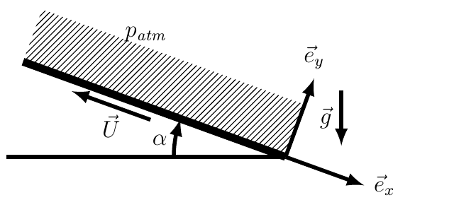

#### 5.1.1

*Donner les hypothèses du problème puis écrire les équations et conditions aux limites qui régissent l'écoulement.* 给出问题的假设，写出控制流动的方程和边界条件。

**答案**

(H1) fluide visqueux newtonien de viscosité $\mu$ ; (H2) incompressible : $\rho=$ cste ⇒ $\operatorname{div}\vec V=0$ ; (H3) fluide pesant : $\vec f_d=\rho\vec g$ ; (H4) stationnaire : $\partial_t(\cdot)=0$ ; (H5) plan : $\vec V=v(x,y)\vec e_x+w(x,y)\vec e_y$ ; (H6) laminaire et modélisé comme un écoulement parallèle à épaisseur constante $h$ : $\vec V=v(x,y)\vec e_x$ ; (H7) plan animé de la vitesse $-U\vec e_x$.
Équations simplifiées : $\operatorname{div}\vec V=0$ ; $\boldsymbol\sigma=2\mu\mathbb D-p\mathbb I$, d'où Navier–Stokes : $\mu\Delta\vec V-\overrightarrow{\operatorname{grad}}p+\rho\vec g=\rho\,\overrightarrow{\operatorname{grad}}\vec V\cdot\vec V$.
Conditions aux limites : en $y=0$, adhérence $\vec V(y=0)=-U\vec e_x$ ; en $y=h$, $\boldsymbol\sigma(y=h)\cdot\vec e_y=-p_{atm}\vec e_y$ (soit $\sigma_{xy}(h)=0$ et $p(h)=p_{atm}$).

**推导**

- 由 H5 及建模假设 H6（取沿斜面的平行流，厚度 $h$ 恒定），速度只有 $x$ 分量：$\vec V=v(x,y)\vec e_x$；注意仅靠“层流且 $h$ 恒定”本身还不能推出法向速度处处为零，需要平行流假设（之后 5.1.2 再由连续性方程推出 $v=v(y)$）。
- 本构：$\boldsymbol\sigma=2\mu\mathbb D+(\lambda_v\operatorname{tr}\mathbb D-p)\mathbb I$，不可压缩时 $\operatorname{tr}\mathbb D=0$，化为 $2\mu\mathbb D-p\mathbb I$。结合定常条件代入动量方程得简化后的 NS 方程。
- $y=0$：固体壁面不可穿透，黏性流体贴壁，壁面以 $-U\vec e_x$ 运动，所以流体速度也等于 $-U\vec e_x$。
- $y=h$：上表面外法向 $\vec e_y$，大气是理想流体，只施加压力：$\boldsymbol\sigma\vec e_y=-p_{atm}\vec e_y$，即切应力为零、法向应力为 $-p_{atm}$（等价于 $p(h)=p_{atm}$）。

#### 5.1.2

*Justifier les formes supposées pour les champs de vitesse et de pression de l'écoulement : $\vec V(x,y)=v(y)\vec e_x$ et $p(x,y)=p(y)$. (On cherche ensuite $v(y)=C_1y^2+C_2y+C_3$ et $p(y)=C_4y+C_5$.)* 说明速度场和压力场为什么可以取 $v(y)\vec e_x$ 和 $p(y)$。

**答案**

Conservation de la masse : $\operatorname{div}\vec V=\frac{\partial v}{\partial x}=0$ ⇒ $\vec V=v(y)\vec e_x$. Pression : la projection de Navier–Stokes sur $\vec e_y$ donne $\partial_yp=-\rho g\cos\alpha$, d'où $p=-\rho g\cos\alpha\,y+k(x)$ ; la condition $p(x,h)=p_{atm}$ pour tout $x$ (épaisseur $h$ constante) impose $k=$ cste, donc $p=p(y)$.

**推导**

连续性：$\vec V=v(x,y)\vec e_x$ 的散度就是 $\partial v/\partial x$，令其为零得 $v$ 只依赖 $y$。压力：在厚度 $h$ 恒定的前提下，由 $y$ 方向的方程积分得 $p(x,y)=-\rho g\cos\alpha\,y+k(x)$，再代入自由面条件 $p(x,h)=p_{atm}$ 对所有 $x$ 成立，直接推出 $k(x)=p_{atm}+\rho g h\cos\alpha$ 为常数，从而 $p$ 只依赖 $y$（不必额外把 $p=p(y)$ 当作独立假设）。

#### 5.1.3

*Montrer que l'on peut obtenir la forme de ces champs de vitesse et pression à partir des équations.* 证明可以由方程得到上述速度和压力的形式。

**答案**

$\overrightarrow{\operatorname{grad}}\vec V=\begin{pmatrix}0&v'\\0&0\end{pmatrix}$, $\overrightarrow{\operatorname{grad}}\vec V\cdot\vec V=\vec0$. Avec $\vec g=g(\sin\alpha\,\vec e_x-\cos\alpha\,\vec e_y)$, Navier–Stokes donne $\mu v''=-\rho g\sin\alpha$ et $\partial_yp=-\rho g\cos\alpha$, d'où $v=C_1y^2+C_2y+C_3$ avec $C_1=-\frac{\rho g\sin\alpha}{2\mu}$, et $p=C_4y+C_5$ avec $C_4=-\rho g\cos\alpha$.

**推导**

对流项：速度梯度只有 $(x,y)$ 元素 $v'$，乘以 $\vec V=(v,0)$ 得零。NS 化为 $\mu\Delta\vec V-\overrightarrow{\operatorname{grad}}p+\rho\vec g=\vec0$，其中 $\Delta\vec V=v''\vec e_x$。重力投影：$x$ 沿坡向下，所以 $g_x=g\sin\alpha>0$，$g_y=-g\cos\alpha$。两个分量各积分，得到二次的速度和线性的压力。

#### 5.1.4

*Déterminer complètement les champs de vitesse et de pression en tout point du fluide à l'aide des conditions aux limites.* 用边界条件完全确定速度场和压力场。

**答案**

$v(0)=-U$ ⇒ $C_3=-U$. $\boldsymbol\sigma=2\mu\mathbb D-p\mathbb I=\begin{pmatrix}-p&\mu v'\\\mu v'&-p\end{pmatrix}$ ; en $y=h$ : $\boldsymbol\sigma\vec e_y=-p_{atm}\vec e_y$ ⇒ $\mu v'(h)=0$ et $p(h)=p_{atm}$, soit $C_2=\frac{\rho gh\sin\alpha}\mu$, $C_5=p_{atm}+\rho gh\cos\alpha$.
$$v(y)=\frac{\rho g\sin\alpha}{2\mu}(2h-y)y-U,\qquad p(y)=\rho g\cos\alpha\,(h-y)+p_{atm}.$$

**推导**

- 速度条件 $y=0$ 定 $C_3$。
- 应力条件 $y=h$：$\mathbb D=\frac{v'}2(\vec e_x\otimes\vec e_y+\vec e_y\otimes\vec e_x)$，$\boldsymbol\sigma\vec e_y=(\mu v',\,-p)$。令其等于 $(0,-p_{atm})$：切向给 $v'(h)=2C_1h+C_2=0$，即 $C_2=\frac{\rho gh\sin\alpha}\mu$；法向给 $C_5=p_{atm}+\rho gh\cos\alpha$。
- 检查：$y=0$ 时 $v=-U$；$y=h$ 时 $v'=0$，自由面切线竖直；压力在自由面等于大气压，向下线性增加（静水压沿法向的分量）。

#### 5.1.5

*Tracer le profil des vitesses et calculer l'épaisseur $h_{max}$ de la couche fluide que peut transporter le plan en fonction de $\mu$, $h$, $U$, $\rho$, $g$ et $\alpha$.* 画速度剖面；求平板能带走的流体层厚度 $h_{max}$。

**答案**

En $h_{max}$ la vitesse s'annule (elle passe de négative à positive) : $\frac{\rho g\sin\alpha}{2\mu}(2h-h_{max})h_{max}-U=0$ ⇔ $h_{max}^2-2hh_{max}+\frac{2\mu U}{\rho g\sin\alpha}=0$. Solutions réelles si $U\le U_0=\frac{\rho gh^2\sin\alpha}{2\mu}$ (soit $h^2\geq\frac{2\mu U}{\rho g\sin\alpha}$) ; on garde la racine dans $[0,h]$ :
$$h_{max}=h-\sqrt{h^2-\frac{2\mu U}{\rho g\sin\alpha}}.$$
Pour $U=U_0$, le zéro atteint la surface libre ($h_{max}=h$) ; pour $U\ge U_0$, la vitesse reste $\le0$ dans toute la couche et toute l'épaisseur $h$ est entraînée ($h_{max}=h$).

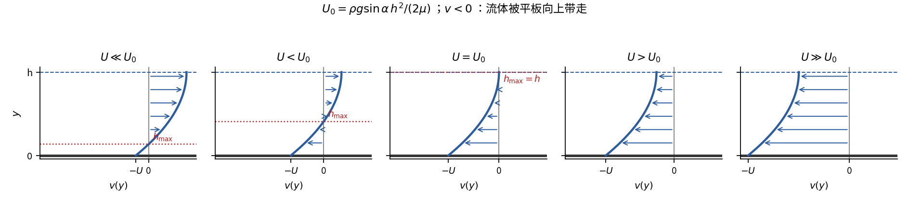

**推导**

- 记 $U_0=\frac{\rho g\sin\alpha\,h^2}{2\mu}$（静止斜面上液膜自由面的速度）。$v(y)=U_0\bigl(2\frac yh-\frac{y^2}{h^2}\bigr)-U$：壁面处为 $-U$，自由面处为 $U_0-U$，切线竖直。
- $v<0$ 表示流体沿 $-\vec e_x$（斜面向上）运动，即被平板带走；$v>0$ 表示在重力作用下向下流。$U<U_0$ 时零速点在液膜内部，其高度就是 $h_{max}$；$U=U_0$ 时零速点恰好到达自由面；$U>U_0$ 时整层都向上走，直接取 $h_{max}=h$。
- 解二次方程，两个根之和为 $2h$，只有较小的根在 $[0,h]$ 内。判别式非负的条件就是 $U\le U_0$。

#### 5.1.6

*Calculer la densité d'efforts qu'il faut appliquer pour maintenir le plan en mouvement. En déduire la puissance qu'il faut fournir pour transporter l'épaisseur maximale de fluide.* 求维持平板运动所需施加的力密度；推出输运最大厚度流体所需的功率。

**答案**

$\vec T(y=0)=\boldsymbol\sigma(y=0)\cdot(-\vec e_y)=\begin{pmatrix}-\mu v'(0)\\p(0)\end{pmatrix}=\begin{pmatrix}-\rho gh\sin\alpha\\\rho gh\cos\alpha+p_{atm}\end{pmatrix}$ : efforts du plan sur le fluide, égaux à la densité d'efforts à appliquer au plan pour maintenir son mouvement uniforme (la composante selon $\vec e_x$ est négative, le plan « remonte » le fluide).
$P=\int_S\vec T(y=0)\cdot\vec V(y=0)\,\mathrm dS=\rho gh\sin\alpha\,US$ (à $U$ fixé, $P$ est indépendante de $\mu$). Toute la couche ($h_{max}=h$) est transportée dès que $U\ge U_0=\frac{\rho gh^2\sin\alpha}{2\mu}$ ; la puissance minimale (critique) pour transporter toute la couche correspond à $U=U_0$ :
$$P_{\min}=P(U_0)=\frac{(\rho gh\sin\alpha)^2hS}{2\mu}.$$

**推导**

- 底面 $y=0$ 上流体的外法向是 $-\vec e_y$，$\vec T=\boldsymbol\sigma(-\vec e_y)$ 是平板作用在流体上的面力。$v'(0)=C_2=\frac{\rho gh\sin\alpha}\mu$，$p(0)=\rho gh\cos\alpha+p_{atm}$。
- 切向分量 $-\rho gh\sin\alpha$ 恰好等于单位面积上液层重力沿坡向上的平衡力（整体平衡检查）。由作用与反作用，流体作用在平板上的面力为 $-\vec T$，因此驱动装置须对平板施加 $+\vec T$ 才能保持匀速。
- 功率 $=$ 面力 · 平板速度 $\times$ 面积，得 $P(U)=\rho gh\sin\alpha\,US$：**给定板速 $U$ 时**功率与黏度 $\mu$ 无关；但**给定输运整层（$h_{max}=h$）的目标时**，需要板速满足 $U\ge U_0=\frac{\rho gh^2\sin\alpha}{2\mu}$，因此临界速度 $U_0$ 和临界（最小）功率 $P_{\min}=P(U_0)$ 都反比于 $\mu$（黏度越小，流体越容易向下流，所需板速和功率反而越大）。

### 5.2　同轴圆筒旋转黏度计

**题面**

On se propose de mesurer la viscosité d'un liquide à l'aide d'un dispositif à cylindres coaxiaux (figure 5.1). Le cylindre extérieur de rayon $b$, entraîné par un moteur, tourne autour de son axe $O\vec e_z$, à une vitesse de rotation constante $\omega$. Le cylindre intérieur, de rayon $a$, est maintenu fixe par l'application d'un couple $\vec C=C\vec e_z$. Le liquide, incompressible, de masse volumique $\rho$, de viscosité $\mu$, se met en mouvement qu'on suppose de symétrie axiale. Le couple transmis par les contraintes visqueuses au cylindre intérieur s'exerce sur la surface verticale et sur la base inférieure du cylindre intérieur. 用同轴圆柱装置测量液体的黏度（图 5.1）。外圆柱半径 $b$，由电机带动绕轴 $O\vec e_z$ 以恒定角速度 $\omega$ 转动；内圆柱半径 $a$，靠施加的力偶 $\vec C=C\vec e_z$ 保持不动。液体不可压缩，密度 $\rho$，黏度 $\mu$，其运动假设为轴对称。黏性应力传给内圆柱的力矩作用在内圆柱的竖直侧面和底面上。

La hauteur de fluide en contact avec la base inférieure étant très supérieure à l'épaisseur de fluide entre les deux cylindres, on considérera négligeable le couple transmis à la surface inférieure. Dans la zone de hauteur $h$ comprise entre les deux surfaces verticales, on admet que la vitesse est azimutale et ne dépend que de $r$ : $\vec V=v(r)\,\vec e_\theta$. 由于内圆柱底面下方的液层厚度远大于两圆柱间的间隙，忽略传到底面上的力矩。在两竖直面之间高度为 $h$ 的区域内，认为速度是环向的且只依赖 $r$：$\vec V=v(r)\vec e_\theta$。

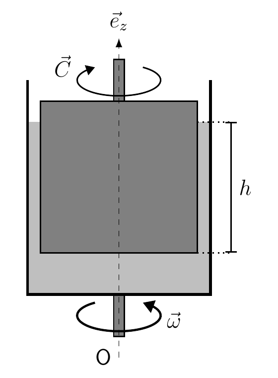

#### 5.2.1

*Énoncer les hypothèses qui régissent l'écoulement puis écrire les équations scalaires déduites des lois de conservation et des conditions aux limites.* 列出流动的假设，写出由守恒律得到的标量方程和边界条件。

**答案**

(H1) rotation constante en régime permanent établi (transitoire de démarrage dissipé) : $\partial_t(\cdot)=0$ ; (H2) fluide incompressible : $\operatorname{div}\vec V=0$ ; (H3) fluide pesant : $\vec f_d=-\rho g\vec e_z$ ; (H4) fluide newtonien : $\boldsymbol\sigma=2\mu\mathbb D-p\mathbb I$ ; (H5) symétrie axiale : $\partial_\theta(\cdot)=0$ ; (H6) $\vec V=v(r)\vec e_\theta$ ; (H7) couple transmis par la surface latérale seulement ; (H8) surface libre supposée plane à la cote approchée $z\approx h$.
Équations scalaires : continuité $\frac1r\partial_\theta v=0$ (vérifiée) ; projections de Navier–Stokes en cylindriques : $\partial_rp=\rho\frac{v^2}r$ (selon $\vec e_r$), $\frac{\mathrm d}{\mathrm dr}\bigl[\frac1r\frac{\mathrm d}{\mathrm dr}(rv)\bigr]=0$ (selon $\vec e_\theta$), $\partial_zp=-\rho g$ (selon $\vec e_z$).
Conditions aux limites : $\vec V(r=a)=\vec0$, $\vec V(r=b)=\omega b\,\vec e_\theta$ (adhérence) ; pression de référence prise sur le bord intérieur de la surface libre : $p(a,h)=P_a$ (le modèle à surface plane $z=h$ étant incompatible avec $\partial_rp>0$ sur toute la surface).

**推导**

| 编号 | 假设 | 推出 |
|---|---|---|
| H1 | 外筒匀速转动且已进入稳态 | 定常，$\partial_t=0$（启动暂态已消失） |
| H2 | 不可压缩 | $\operatorname{div}\vec V=0$ |
| H3 | 有重量 | $\vec f_d=-\rho g\vec e_z$ |
| H4 | 牛顿黏性流体 | $\boldsymbol\sigma=2\mu\mathbb D-p\mathbb I$ |
| H5 | 轴对称 | $\partial_\theta=0$ |
| H6 | 速度形式 | $\vec V=v(r)\vec e_\theta$，$z\in[0,h]$ |
| H7 | 只有侧面传递力矩 | 底面力矩忽略 |
| H8 | 自由面近似视为平面 | 液面高度近似 $z\approx h$ |

方程：由质量守恒、动量守恒与本构 H4 合并得定常不可压缩 Navier–Stokes 方程 $\mu\Delta\vec V-\overrightarrow{\operatorname{grad}}p+\vec f_d=\rho\,\overrightarrow{\operatorname{grad}}\vec V\cdot\vec V$，再按柱坐标投影为三条标量方程（推导见 5.2.2）。边界条件：内壁静止，外壁速度 $\omega b$（黏性贴壁）。压力条件需要注意：因为径向方程给出 $\partial_rp=\rho v^2/r>0$，同一水平面 $z=h$ 上压力随 $r$ 增大，无法在整张平面 $z=h$ 上都等于 $P_a$，因此求压力分布时取内壁处 $p(a,h)=P_a$ 作参考点（与 H8 的平液面近似相协调）。

#### 5.2.2

*Déterminer les distributions de vitesse et de pression.* 求速度分布和压力分布。

**答案**

Projection sur $\vec e_\theta$ : $\frac{\mathrm d}{\mathrm dr}\Bigl[\frac1r\frac{\mathrm d}{\mathrm dr}(rv)\Bigr]=0$ ⇒ $v=Ar+\frac Br$ ; avec $v(a)=0$, $v(b)=\omega b$ :
$$v(r)=\frac{b^2\omega}{b^2-a^2}\Bigl(r-\frac{a^2}r\Bigr).$$
Intégration de $\partial_zp=-\rho g$ et $\partial_rp=\rho\frac{v^2}r$ avec la référence $p(a,h)=P_a$ (et $A=\frac{b^2\omega}{b^2-a^2}$) :
$$p(r,z)=P_a+\rho g(h-z)+\rho A^2\Bigl(\frac{r^2-a^2}2-2a^2\ln\frac ra-\frac{a^4}2\Bigl(\frac1{r^2}-\frac1{a^2}\Bigr)\Bigr).$$

**推导**

1. **连续性：** $\operatorname{div}\vec V=\frac1r\partial_\theta v=0$，自动满足。
2. **两个预备量：** $\Delta\vec V=\bigl(\Delta v-\frac v{r^2}\bigr)\vec e_\theta=\frac{\mathrm d}{\mathrm dr}\bigl[\frac1r\frac{\mathrm d}{\mathrm dr}(rv)\bigr]\vec e_\theta$；$\overrightarrow{\operatorname{grad}}\vec V\cdot\vec V=-\frac{v^2}r\vec e_r$（向心加速度）。
3. **NS 三个分量：** $\vec e_r$：$\partial_rp=\rho\frac{v^2}r$；$\vec e_\theta$：$\frac{\mathrm d}{\mathrm dr}\bigl[\frac1r(rv)'\bigr]=0$；$\vec e_z$：$\partial_zp=-\rho g$。
4. **速度：** 积分 $\vec e_\theta$ 方程：$\frac1r(rv)'=2A$ ⇒ $rv=Ar^2+B$ ⇒ $v=Ar+\frac Br$。代入 $v(a)=0$、$v(b)=\omega b$：$A=\frac{b^2\omega}{b^2-a^2}$，$B=-\frac{a^2b^2\omega}{b^2-a^2}=-Aa^2$。$Ar$ 是刚体转动，$B/r$ 产生剪切。间隙很窄时剖面接近直线，退化为平面 Couette 流。
5. **压力：** 由 $\vec e_z$ 方程积分得 $p(r,z)=f(r)+\rho g(h-z)$；再将 $\frac{v^2}r=A^2\bigl(r-\frac{2a^2}r+\frac{a^4}{r^3}\bigr)$ 代入 $\vec e_r$ 方程积分，并用内壁液面参考条件 $p(a,h)=P_a$ 定出常数（注意 $\frac{r^2-a^2}2-\frac{a^4}2(\frac1{r^2}-\frac1{a^2})=\frac{r^2}2-\frac{a^4}{2r^2}$）：$p(r,z)=P_a+\rho g(h-z)+\rho A^2\bigl[\frac{r^2}2-2a^2\ln\frac ra-\frac{a^4}{2r^2}\bigr]$。严格说压力随 $r$ 增大与"自由面是平面"（H8）存在微弱冲突（实际自由面会向外壁略微爬升），但在忽略液面微弱弯曲的模型下，该压力场满足控制方程。

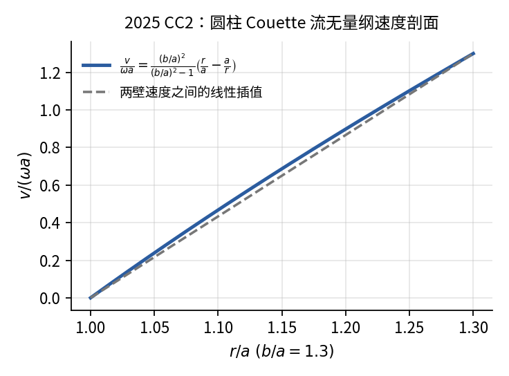

#### 5.2.3

*Donner les expressions des opérateurs des taux de déformation et des contraintes visqueuses. En déduire le moment selon $O\vec e_z$ des contraintes exercées par le fluide sur le cylindre intérieur.* 写出变形率张量和黏性应力；求流体作用在内圆柱上的应力对 $O\vec e_z$ 的力矩。

**答案**

$$\mathbb D=-\frac B{r^2}\begin{pmatrix}0&1&0\\1&0&0\\0&0&0\end{pmatrix},\qquad\boldsymbol\tau=2\mu\mathbb D=-\frac{2\mu B}{r^2}\begin{pmatrix}0&1&0\\1&0&0\\0&0&0\end{pmatrix}\ \text{dans }(\vec e_r,\vec e_\theta,\vec e_z),$$
Moment des contraintes exercées par le fluide sur le cylindre intérieur :
$$M_z=4\pi h\mu\frac{a^2b^2}{b^2-a^2}\,\omega\quad(\text{d'où le couple de maintien algébrique } C=-M_z,\ |C|=M_z).$$

**推导**

- **变形率：** 柱坐标速度梯度中非零的是 $\partial_rv=A-\frac B{r^2}$ 和 $-\frac vr=-(A+\frac B{r^2})$；对称化后 $D_{r\theta}=\frac12\bigl(v'-\frac vr\bigr)=\frac r2\bigl(\frac vr\bigr)'=-\frac B{r^2}$。刚体转动部分 $Ar$ 对 $\mathbb D$ 没有贡献。
- **方法一（直接积分）：** 内壁 $r=a$ 上内柱受流体面力的外法向为 $+\vec e_r$，切应力 $\tau_{r\theta}(a)=-\frac{2\mu B}{a^2}=+\frac{2\mu b^2\omega}{b^2-a^2}$（当 $\omega>0$ 时沿 $+\vec e_\theta$ 拖着内柱转动）。力臂 $a$，面积 $2\pi ah$：$M_z=a\cdot\tau_{r\theta}(a)\cdot2\pi ah=-4\pi h\mu B=4\pi h\mu\frac{a^2b^2}{b^2-a^2}\omega$。维持内柱不动的制动偶矩 $\vec C=C\vec e_z$ 与之平衡，故有符号的力偶 $C=-M_z$（读数大小 $|C|=M_z$）。
- **方法二（功率平衡）：** 取定常流体为系统，其轴向角动量平衡要求内、外壁对流体的总力矩之和为零：内壁对流体施力矩为 $-M_z\vec e_z=+C\vec e_z$，故外壁对流体施力矩必为 $-C\vec e_z=M_z\vec e_z$。内柱不动功率为零，外柱输入功率 $P_e=(-C)\omega$。内力功率 $P_i=-\int2\mu\mathbb D:\mathbb D\,\mathrm dV=-\int_a^b\frac{4\mu B^2}{r^4}\,2\pi rh\,\mathrm dr=-8\pi h\mu B^2\bigl[-\frac1{2r^2}\bigr]_a^b=-4\pi h\mu\frac{a^2b^2}{b^2-a^2}\omega^2$。由 $P_e+P_i=0$ 得 $-C\omega-4\pi h\mu\frac{a^2b^2}{b^2-a^2}\omega^2=0$，即 $C=-4\pi h\mu\frac{a^2b^2}{b^2-a^2}\omega$，$M_z=-C=4\pi h\mu\frac{a^2b^2}{b^2-a^2}\omega$，与方法一完全一致。

#### 5.2.4

*Déterminer la viscosité $\mu$ en fonction des paramètres $a$, $b$, $h$, du nombre $N$ de tours/minute du moteur et du couple $C$.* 用 $a$、$b$、$h$、电机每分钟转数 $N$ 和力偶 $C$ 表示 $\mu$。

**答案**

$\omega=\frac{2\pi N}{60}$, donc $\mu=\frac{|C|(b^2-a^2)}{4\pi\omega ha^2b^2}=\frac{|C|}N\,K$ avec $K=\frac{15}{2\pi^2h}\frac{b^2-a^2}{a^2b^2}$ (constante de l'appareil).

**推导**

由上一问反解 $\mu$（注意题目给的力偶数值通常为读数大小 $|C|$），再把每分钟转数换成角速度 $\omega=2\pi N/60$。$K$ 只与仪器几何有关，用一种已知黏度的液体标定一次即可。

#### 5.2.5

*Déterminer la viscosité d'une huile pour laquelle $C=6000\ \mathrm{N\cdot m}$ et $N=120$, sachant que pour l'eau : $\mu=1{,}14\times10^{-3}\ \mathrm{Pa\cdot s}$, $C=30\ \mathrm{N\cdot m}$ et $N=720$.* 已知水的数据，求一种油的黏度。

**答案**

Les valeurs données pour $C$ sont les modules $|C|$ : $K=\frac{\mu_{eau}N_{eau}}{|C_{eau}|}=\frac{1{,}14\times10^{-3}\times720}{30}=2{,}736\times10^{-2}$, puis $\mu_{huile}=\frac{|C_{huile}|}{N_{huile}}K=\frac{6000}{120}\times2{,}736\times10^{-2}=1{,}368\ \mathrm{Pa\cdot s}$.

**推导**

不用计算器的做法：写比例，不必算出 $K$。$\frac{\mu_{huile}}{\mu_{eau}}=\frac{|C_{huile}|}{|C_{eau}|}\cdot\frac{N_{eau}}{N_{huile}}=\frac{6000}{30}\cdot\frac{720}{120}=200\times6=1200$，所以 $\mu_{huile}=1200\times1{,}14\times10^{-3}=1{,}368$ Pa·s，约为甘油的黏度。

### 5.3　圆管 Poiseuille 流 · 同类练习

**题面**

On considère l'écoulement permanent d'un fluide homogène newtonien incompressible, de masse volumique $\rho$, de viscosité dynamique $\mu$ et volumique $\lambda$ dans un tube de section circulaire (rayon $R$) d'axe $O\vec e_z$ horizontal comme indiqué en figure 1.1. 考虑一种均质、牛顿、不可压缩流体（密度 $\rho$，动力黏度 $\mu$，体积黏度 $\lambda$）在圆截面管（半径 $R$）中的定常流动，管轴 $O\vec e_z$ 水平，见图 1.1。

On supposera l'écoulement unidirectionnel. On ne tiendra pas compte de l'action de la gravité. La pression sur la section $S_0$ (resp. $S_L$) vaut $P_0$ (resp. $P_L$) ($\Delta P=P_0-P_L>0$). 假设流动是单向的，不考虑重力。截面 $S_0$ 上的压力为 $P_0$，$S_L$ 上为 $P_L$，$\Delta P=P_0-P_L>0$。

L'objectif est de déterminer : le profil des vitesses, la contrainte de cisaillement à la paroi et le coefficient de pertes de charges régulières. 目标：求速度剖面、壁面剪应力和沿程压力损失系数。

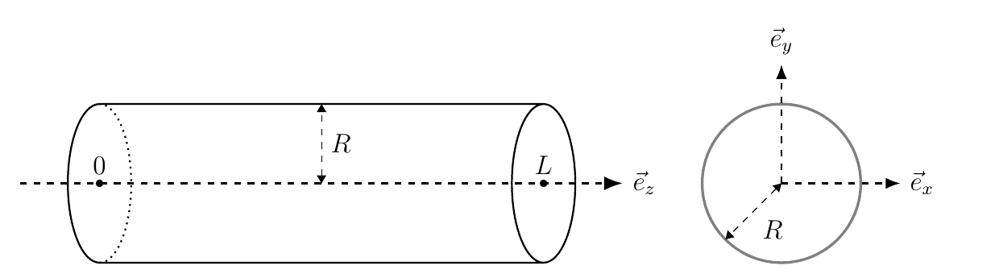

#### 5.3.1

*En tenant compte des hypothèses, écrire les équations et conditions limites du problème.* 考虑题设假设，写出问题的方程和边界条件。

**答案**

(H1) écoulement permanent : $\partial_t(\cdot)=0$ ; (H2) axisymétrique : $\partial_\theta(\cdot)=0$ ; (H3) unidirectionnel : $\vec V=v(r,z)\vec e_z$ ; (H4) incompressible et (H5) homogène : $\rho=$ cste ⇒ $\operatorname{div}\vec V=0$ ; (H6) pas de force volumique : $\vec f_d=\vec0$ ; (H7) fluide visqueux newtonien ($\boldsymbol\sigma=2\mu\mathbb D-p\mathbb I$).
Équations simplifiées : $\operatorname{div}\vec V=0$ ; $\mu\Delta\vec V-\overrightarrow{\operatorname{grad}}p=\rho\,\overrightarrow{\operatorname{grad}}\vec V\cdot\vec V$.
Conditions aux limites : adhérence à la paroi immobile $\vec V(r=R)=\vec0$, régularité sur l'axe ($v$ fini en $r=0$) ; $p(z=0)=P_0$, $p(z=L)=P_L$.

**推导**

- 七条假设各自给出一个简化：定常去掉 $\partial_t$；轴对称去掉 $\partial_\theta$；单向使速度只有 $z$ 分量；不可压缩结合均质（$\rho$ 为常数）由质量守恒得 $\operatorname{div}\vec V=0$；不计重力使体力为零；牛顿流体给出本构 $\boldsymbol\sigma=2\mu\mathbb D+(\lambda\operatorname{tr}\mathbb D-p)\mathbb I=2\mu\mathbb D-p\mathbb I$。
- 三个基本方程（质量守恒、动量守恒、本构）合并并代入上述假设，即得到简化后的连续性方程和 Navier–Stokes 方程。
- 边界条件：壁面不可穿透且黏性流体无滑移，故 $r=R$ 上速度为零；管轴 $r=0$ 处物理量必须有限；进出口给定压力。
- 求解逻辑：由连续性先得 $\partial_z v=0$，再由 $r,\theta$ 向动量方程限制压力只依赖 $z$，最后由 $z$ 向方程与边界条件联立定出 $p(z)$ 和 $v(r)$。

#### 5.3.2

*En déduire les champs de vitesse et de pression. Calculer la vitesse moyenne $V_m$. Exprimer la distribution de vitesse en fonction de $V_m$.* 求速度场和压力场；计算平均速度 $V_m$；用 $V_m$ 表示速度分布。

**答案**

$\operatorname{div}\vec V=\partial_zv=0$ ⇒ $v=v(r)$ ; $\overrightarrow{\operatorname{grad}}\vec V\cdot\vec V=\vec0$, donc $\mu\Delta v\,\vec e_z=\overrightarrow{\operatorname{grad}}p$ : $\partial_rp=\partial_\theta p=0$ et $\frac{\mathrm dp}{\mathrm dz}=\mu\Delta v=$ cste. Avec les pressions imposées : $p(z)=P_0-\frac{\Delta P}Lz$.
$\frac\mu r\frac{\mathrm d}{\mathrm dr}\bigl(r\frac{\mathrm dv}{\mathrm dr}\bigr)=-\frac{\Delta P}L$ ⇒ $v=-\frac{\Delta P}{4\mu L}r^2+C\ln(r/r_\ast)+D$ ; $v$ fini en $r=0$ ⇒ $C=0$ ; $v(R)=0$ ⇒ $v(r)=\frac{\Delta PR^2}{4\mu L}\Bigl(1-\frac{r^2}{R^2}\Bigr)$.
$V_m=\frac1{\pi R^2}\int_Sv\,\mathrm dS=\frac{\Delta PR^2}{8\mu L}$, d'où $v(r)=2V_m\Bigl(1-\frac{r^2}{R^2}\Bigr)$.

**推导**

1. **连续性：** $\operatorname{div}\vec V=\partial v/\partial z=0$，所以 $v$ 只依赖 $r$（沿管轴不变）。
2. **对流项：** 柱坐标速度梯度只有 $(z,r)$ 位置一个元素 $v'(r)$，乘以 $\vec V=(0,0,v)$ 得零向量，所以加速度为零。
3. **NS 化简：** 定常、不可压缩、无体力，NS 变成 $\mu\Delta\vec V=\overrightarrow{\operatorname{grad}}p$，其中 $\Delta\vec V=\Delta v\,\vec e_z$。分量：$\partial_rp=0$，$\partial_\theta p=0$，所以 $p=p(z)$；$\frac{\mathrm dp}{\mathrm dz}=\mu\Delta v$。
4. **分离变量：** 左边只依赖 $z$，右边只依赖 $r$，两边等于同一个常数 $A$。由 $p(0)=P_0$、$p(L)=P_L$ 得 $A=-\Delta P/L$，$p(z)=P_0-\frac{\Delta P}Lz$，压力沿管线性下降。
5. **积分速度：** $\frac1r(rv')'=-\frac{\Delta P}{\mu L}$ ⇒ $rv'=-\frac{\Delta P}{2\mu L}r^2+C$ ⇒ $v=-\frac{\Delta P}{4\mu L}r^2+C\ln(r/r_\ast)+D$（取任意参考长度 $r_\ast>0$ 使对数自变量无量纲）。轴上 $r=0$ 速度必须有限，所以 $C=0$；$v(R)=0$ 给出 $D=\frac{\Delta PR^2}{4\mu L}$。速度剖面是抛物面，轴上最大。
6. **平均速度：** $\int_0^R\bigl(1-\frac{r^2}{R^2}\bigr)2\pi r\,\mathrm dr=\frac{\pi R^2}2$，所以 $V_m=\frac{\Delta PR^2}{4\mu L}\cdot\frac12=\frac{\Delta PR^2}{8\mu L}$；最大速度 $v(0)=2V_m$。

#### 5.3.3

*Calculer le débit volumique et le débit massique.* 计算体积流量和质量流量。

**答案**

$Q_v=\int_S\vec V\cdot\vec n\,\mathrm dS=V_mS=\frac{\pi R^4\Delta P}{8\mu L}$ ; fluide homogène incompressible : $Q_m=\int_S\rho\vec V\cdot\vec n\,\mathrm dS=\rho Q_v$.

**推导**

截面 $S$ 的法向是 $\vec e_z$，$\vec V\cdot\vec n=v(r)$。由平均速度的定义直接得 $Q_v=V_m\pi R^2$。流量与 $R^4$ 成正比（Hagen–Poiseuille 定律）：半径减半，流量变为 1/16。$\rho$ 是常数，可以提出积分号。

#### 5.3.4

*Évaluer la contrainte de cisaillement à la paroi $\tau_p$.* 求壁面剪应力 $\tau_p$。

**答案**

Méthode locale : $\mathbb D=-\frac{2V_mr}{R^2}(\vec e_r\otimes\vec e_z+\vec e_z\otimes\vec e_r)$, $\boldsymbol\sigma=-p\mathbb I+2\mu\mathbb D$ ; en $r=R$, $\vec n=\vec e_r$, $\vec t=\vec e_z$ : $\tau_p=(\boldsymbol\sigma\vec n)\cdot\vec t=-\frac{4\mu V_m}R=-\frac{R}{2}\frac{\Delta P}L$.
Méthode globale : équilibre d'un tronçon de rayon $R$ et de longueur $\mathrm dz$ : $p\pi R^2-(p+\mathrm dp)\pi R^2+\tau_p2\pi R\,\mathrm dz=0$ ⇒ $\tau_p=\frac R2\frac{\mathrm dp}{\mathrm dz}=-\frac R2\frac{\Delta P}L$.

**推导**

- **局部法：** $v'(r)=-\frac{4V_mr}{R^2}$；速度梯度只有 $(z,r)$ 元素，对称化后 $D_{rz}=D_{zr}=\frac12v'=-\frac{2V_mr}{R^2}$。应力 $\boldsymbol\sigma=-p\mathbb I+2\mu\mathbb D$（$\operatorname{tr}\mathbb D=0$，体积黏度项消失）。壁面上流体的外法向为 $\vec e_r$，切向为 $\vec e_z$：$\tau_p=\sigma_{zr}(R)=2\mu D_{rz}(R)=-\frac{4\mu V_m}R$。负号表示壁面对流体的切向力沿 $-\vec e_z$，即阻碍流动；流体对壁面的力沿 $+\vec e_z$。
- **整体法：** 取半径 $R$、长 $\mathrm dz$ 的流体圆柱，沿 $\vec e_z$ 的受力：两端压力差 $-\mathrm dp\,\pi R^2$，壁面对流体的侧面剪力 $\tau_p\,2\pi R\,\mathrm dz$，合力为零（加速度为零）。得 $\tau_p=\frac R2\frac{\mathrm dp}{\mathrm dz}$，与局部法一致。
- 两种方法互相验证，考试时写一种、用另一种检查。
- **延伸（回应题面目标的沿程损失系数）：** 按 Darcy–Weisbach 定义 $\Delta P=f_D\frac{L}{2R}\frac12\rho V_m^2$，代入 $V_m=\frac{\Delta PR^2}{8\mu L}$ 并引入管径雷诺数 $\mathrm{Re}_D=\frac{\rho V_m(2R)}{\mu}$，即得层流圆管经典结果 $f_D=\frac{64}{\mathrm{Re}_D}$（这里记作 $f_D$ 以免与题面体积黏度 $\lambda$ 混淆）。

## 附录　算子、计算、单位与法语动词

### A　Opérateurs différentiels · 坐标算子

**Conventions · 约定 :** $(\overrightarrow{\operatorname{grad}}\vec U)_{ij}=\partial U_i/\partial x_j$ (ligne $i$ = dérivées de $U_i$) ; $(\overrightarrow{\operatorname{div}}\mathbb A)_i=\partial A_{ij}/\partial x_j$ (dérivées de la ligne $i$) ; $\mathbb A:\mathbb B=\sum A_{ij}B_{ij}$ ; $(\vec a\otimes\vec b)_{ij}=a_ib_j$ ; $\vec a\wedge\vec b=(a_2b_3-a_3b_2,\ a_3b_1-a_1b_3,\ a_1b_2-a_2b_1)$ ; $\vec e_r\wedge\vec e_\theta=\vec e_z$, $\vec e_\theta\wedge\vec e_z=\vec e_r$, $\vec e_z\wedge\vec e_r=\vec e_\theta$. 梯度第 $i$ 行是第 $i$ 个分量的偏导；散度按行求导；叉积与柱坐标基的叉积关系。

**Identités · 恒等式 :** $\overrightarrow{\operatorname{rot}}\,\overrightarrow{\operatorname{rot}}\vec U=\overrightarrow{\operatorname{grad}}(\operatorname{div}\vec U)-\Delta\vec U$ ; $\operatorname{div}(\overrightarrow{\operatorname{rot}}\vec U)=0$ ; $\overrightarrow{\operatorname{rot}}(\overrightarrow{\operatorname{grad}}f)=\vec0$ ; $\operatorname{div}(f\vec U)=f\operatorname{div}\vec U+\overrightarrow{\operatorname{grad}}f\cdot\vec U$.

**Cylindrique $(r,\theta,z)$ · 柱坐标 :**

$$\overrightarrow{\operatorname{grad}}f=\partial_rf\,\vec e_r+\frac1r\partial_\theta f\,\vec e_\theta+\partial_zf\,\vec e_z,\qquad
\Delta f=\frac1r\partial_r(r\partial_rf)+\frac1{r^2}\partial^2_\theta f+\partial^2_zf$$

$$\overrightarrow{\operatorname{grad}}\vec U=\begin{pmatrix}
\partial_rU_r&\frac1r(\partial_\theta U_r-U_\theta)&\partial_zU_r\\
\partial_rU_\theta&\frac1r(\partial_\theta U_\theta+U_r)&\partial_zU_\theta\\
\partial_rU_z&\frac1r\partial_\theta U_z&\partial_zU_z\end{pmatrix},\qquad
\operatorname{div}\vec U=\frac1r\partial_r(rU_r)+\frac1r\partial_\theta U_\theta+\partial_zU_z$$

$$\overrightarrow{\operatorname{rot}}\vec U=\Bigl(\frac1r\partial_\theta U_z-\partial_zU_\theta,\ \partial_zU_r-\partial_rU_z,\ \frac1r\bigl[\partial_r(rU_\theta)-\partial_\theta U_r\bigr]\Bigr)$$

$$\Delta\vec U=\Bigl(\Delta U_r-\frac{U_r}{r^2}-\frac2{r^2}\partial_\theta U_\theta\Bigr)\vec e_r+\Bigl(\Delta U_\theta-\frac{U_\theta}{r^2}+\frac2{r^2}\partial_\theta U_r\Bigr)\vec e_\theta+\Delta U_z\,\vec e_z$$

Déformations (HPP) · 应变 : $\varepsilon_{rr}=\partial_ru_r$, $\varepsilon_{\theta\theta}=\frac1r\partial_\theta u_\theta+\frac{u_r}r$, $\varepsilon_{zz}=\partial_zu_z$, $\varepsilon_{r\theta}=\frac12\bigl(\frac1r\partial_\theta u_r+\partial_ru_\theta-\frac{u_\theta}r\bigr)$, $\varepsilon_{rz}=\frac12(\partial_zu_r+\partial_ru_z)$, $\varepsilon_{\theta z}=\frac12\bigl(\partial_zu_\theta+\frac1r\partial_\theta u_z\bigr)$.
轴对称且无剪应力时，柱坐标径向应力散度为 $\partial_r\sigma_{rr}+(\sigma_{rr}-\sigma_{\theta\theta})/r$，旋转圆盘的径向平衡用到这一项。

**Sphérique $(r,\theta,\varphi)$ ($\theta$ angle polaire) · 球坐标 :**

$$\overrightarrow{\operatorname{grad}}f=\partial_rf\,\vec e_r+\frac1r\partial_\theta f\,\vec e_\theta+\frac1{r\sin\theta}\partial_\varphi f\,\vec e_\varphi,\qquad
\operatorname{div}\vec U=\frac1{r^2}\partial_r(r^2U_r)+\frac1{r\sin\theta}\partial_\theta(\sin\theta\,U_\theta)+\frac1{r\sin\theta}\partial_\varphi U_\varphi$$

$$\Delta f=\frac1{r^2}\partial_r(r^2\partial_rf)+\frac1{r^2\sin\theta}\partial_\theta(\sin\theta\,\partial_\theta f)+\frac1{r^2\sin^2\theta}\partial^2_\varphi f$$

Déplacement radial $u(r)\vec e_r$ : $\varepsilon_{rr}=u'$, $\varepsilon_{\theta\theta}=\varepsilon_{\varphi\varphi}=\frac ur$, $\operatorname{div}\vec u=\frac1{r^2}(r^2u)'$. Divergence, composante $r$ : $\partial_r\sigma_{rr}+\frac1r\partial_\theta\sigma_{r\theta}+\frac1{r\sin\theta}\partial_\varphi\sigma_{r\varphi}+\frac1r(2\sigma_{rr}-\sigma_{\theta\theta}-\sigma_{\varphi\varphi}+\sigma_{r\theta}\cot\theta)$. 球坐标径向位移的应变与散度。

### B　Équations différentielles · 常微分方程

| Équation · 方程 | Solution · 解 |
|---|---|
| $y'+ay=f(x)$ | $y=e^{-ax}\bigl[C+\int e^{ax}f\,\mathrm dx\bigr]$ ; $f=b$ : $y=Ce^{-ax}+\frac ba$ |
| $y'+p(x)y=q(x)$ | $y=e^{-P}\bigl[C+\int e^Pq\,\mathrm dx\bigr]$, $P=\int p$ |
| $y''+\omega^2y=c$ | $A\cos\omega x+B\sin\omega x+\frac c{\omega^2}$ |
| $y''-k^2y=0$ | $Ae^{kx}+Be^{-kx}$ |
| $ay''+by'+cy=0$ | racines $r_{1,2}$ : $C_1e^{r_1x}+C_2e^{r_2x}$ ; racine double $(C_1+C_2x)e^{rx}$ ; complexes $e^{\alpha x}(C_1\cos\beta x+C_2\sin\beta x)$ |
| Euler $r^2u''+aru'+bu=0$ | essayer $u=r^\alpha$ : $\alpha(\alpha-1)+a\alpha+b=0$ |
| $u''+\frac{u'}r-\frac u{r^2}=g$ | $\bigl[\frac1r(ru)'\bigr]'=g$ : $u=Ar+\frac Br$ + particulière |
| $u''+\frac{2u'}r-\frac{2u}{r^2}=g$ | $\bigl[\frac1{r^2}(r^2u)'\bigr]'=g$ : $u=Ar+\frac B{r^2}$ + particulière |
| $\frac1r(rv')'=c$ | $v=\frac c4r^2+A\ln r+B$ |
| $v''=c$ | $v=\frac c2y^2+Ay+B$ |

Second membre constant, polynomial, exponentiel ou trigonométrique : chercher une solution particulière de même forme ; si elle est déjà solution homogène, multiplier par $x$ (ou $\ln r$). 右端为常数、多项式、指数、三角时用同类形式待定系数；与齐次解重复时乘 $x$ 或 $\ln r$。

### C　Intégrales et valeurs propres · 积分与特征值

| Intégrale · 积分 | Valeur · 值 |
|---|---|
| $\int_0^{2\pi}\cos\theta\,\mathrm d\theta=\int_0^{2\pi}\sin\theta\,\mathrm d\theta$ | $0$ |
| $\int_0^{2\pi}\cos^2\theta\,\mathrm d\theta=\int_0^{2\pi}\sin^2\theta\,\mathrm d\theta$ | $\pi$ |
| disque · 圆盘 $\int\mathrm dS$, $\int r^2\mathrm dS$, $\int x^2\mathrm dS$, $\int r^3\mathrm dS$ | $\pi R^2$, $\frac{\pi R^4}2$, $\frac{\pi R^4}4$, $\frac{2\pi R^5}5$ |
| $\int_{-a/2}^{a/2}y^2\,\mathrm dy$ | $\frac{a^3}{12}$ |
| $\int_0^hy(h-y)\,\mathrm dy$ ; $\int_0^hy(2h-y)\,\mathrm dy$ | $\frac{h^3}6$ ; $\frac{2h^3}3$ |
| $\int_0^R(R^2-r^2)\,r\,\mathrm dr$ | $\frac{R^4}4$ |
| $\int_a^b\frac{\mathrm dr}{r^3}$ | $\frac{b^2-a^2}{2a^2b^2}$ |
| fonction impaire sur un intervalle symétrique · 奇函数对称区间 | $0$ |

**Valeurs propres · 特征值 :**

- Ligne et colonne réduites au terme diagonal : direction propre immédiate. 只剩对角元的方向直接是特征方向。
- Bloc $\begin{pmatrix}a&b\\b&c\end{pmatrix}$ : $\lambda_\pm=\frac{a+c}2\pm\sqrt{(\frac{a-c}2)^2+b^2}$, direction $(b,\lambda_\pm-a)$ ; $\begin{pmatrix}0&\tau\\\tau&0\end{pmatrix}$ : $\pm\tau$, directions $(1,\pm1)/\sqrt2$.
- $\begin{pmatrix}0&a&b\\a&0&0\\b&0&0\end{pmatrix}$ : $0$, $\pm\sqrt{a^2+b^2}$.
- Cas général : $-\lambda^3+I_1\lambda^2-I_2\lambda+I_3=0$ ; chercher une racine entière (diviseurs) puis factoriser. Contrôles : somme = trace, produit = déterminant, directions orthogonales. 一般情形先试整数根再降阶；检验和、积、正交。

### D　Calcul sans calculatrice · 无计算器手算

| Nombre · 数 | Valeur · 近似值 |
|---|---|
| $\sqrt2$, $\sqrt3$, $\sqrt5$, $\sqrt{10}$ | 1,414 ; 1,732 ; 2,236 ; 3,162 |
| $\pi$, $e$, $\ln2$, $\ln10$ | 3,1416 ; 2,718 ; 0,693 ; 2,303 |
| $\frac1{\sqrt3}$, $\frac2{\sqrt3}$ | 0,577 ; 1,155 |
| $(1+x)^n\approx1+nx$, $\sqrt{1+x}\approx1+\frac x2$, $e^x\approx1+x$, $\ln(1+x)\approx x$ | petits $x$ (HPP, paroi mince) · 小量展开 |

Comparer $\sqrt A$ et $B$ ($B\ge0$) : comparer $A$ et $B^2$. Écrire un rapport pour éliminer les constantes communes avant de calculer. 比较根号：两边平方；先写比例式消去公共常数。

### E　Unités · 单位

| Grandeur · 量 | Unité · 单位 |
|---|---|
| $\mathbb F$, $J$, $\mathbb C$, $\mathbb E$, $\boldsymbol\varepsilon$, $\overrightarrow{\operatorname{grad}}\vec u$, $\nu$ | sans dimension · 无量纲 |
| $\overrightarrow{\operatorname{grad}}\vec V$, $\mathbb D$, $\boldsymbol\Omega$, $\operatorname{div}\vec V$, $\overrightarrow{\operatorname{rot}}\vec V$ | $\mathrm s^{-1}$ |
| $\boldsymbol\sigma$, $\vec T$, $p$, $E$, $\lambda$, $\mu$ (solide), $K$, $\sigma_e$ | Pa $=\mathrm{N\,m^{-2}}=\mathrm{kg\,m^{-1}s^{-2}}$ |
| $\vec f$, $\overrightarrow{\operatorname{div}}\boldsymbol\sigma$, $\overrightarrow{\operatorname{grad}}p$, $\rho\vec\gamma$ | $\mathrm{N\,m^{-3}}$ |
| résultante · 合力 | N $=\mathrm{Pa\,m^2}$ |
| moment, couple · 力矩 | $\mathrm{N\,m}=\mathrm J=\mathrm{Pa\,m^3}=\mathrm{kg\,m^2s^{-2}}$ |
| accélération · 加速度 / masse volumique · 密度 / vitesse angulaire · 角速度 | $\mathrm{m\,s^{-2}}$ / $\mathrm{kg\,m^{-3}}$ / $\mathrm{rad\,s^{-1}}$ |
| viscosité dynamique · 动力黏度 / cinématique · 运动黏度 | Pa·s / $\mathrm{m^2\,s^{-1}}$ |
| débit volumique (plan, par unité de largeur) · 流量 | $\mathrm{m^3\,s^{-1}}$ ($\mathrm{m^2\,s^{-1}}$) |
| puissance · 功率 / énergie · 能量 | W / J |
| dilatation thermique $\alpha$ · 热膨胀系数 | $\mathrm K^{-1}$ |

### F　Verbes de consigne · 题干动词

| Consigne · 法语 | Ce qu'il faut faire · 要做什么 |
|---|---|
| Lister, Quel(s) / Quelle(s) | citer toutes les bonnes réponses · 列出所有正确项（可能多选） |
| Rappeler (la définition, la démarche) | énoncer la définition ou la méthode du cours · 复述定义、方法 |
| Calculer, Déterminer, Exprimer en fonction de | donner le résultat avec les étapes · 写出计算过程和结果、用…表示 |
| En déduire | utiliser le résultat précédent · 用上一问的结果推出 |
| Montrer que, Vérifier que | partir des équations et arriver au résultat donné · 从方程出发推到给定结果 |
| Justifier (la forme) | donner les raisons : symétries, invariances, chargement · 给出理由：对称、不变性、载荷 |
| Préciser (les unités, les conditions) | énoncer explicitement · 明确写出 |
| Poser le problème | écrire géométrie, équations, CL, loi de comportement, classées CA / SA · 建立问题，分类写出 |
| Énoncer les hypothèses | lister H1, H2… et leurs conséquences · 列出假设及其推论 |
| Commenter, Interpréter | dire ce que signifie le résultat (physiquement) · 解释物理意义 |
| Tracer, Représenter | figure soignée avec axes, valeurs, sens · 画图并标注 |
| Comparer (similarités et différences) | deux colonnes : points communs, différences · 分相同点、不同点 |
| Dimensionner | écrire $\max\sigma_{eq}\le\sigma_e/k_s$ et résoudre · 令最大等效应力 ≤ 允许值并求解 |
| Application numérique | remplacer les valeurs, unités, 2–3 chiffres · 代入数值、写单位 |
| forcément / potentiellement | toujours / possible mais pas obligatoire · 必定 / 可以有 |
