# 1　Cinématique · 运动学（题库）

## Notions préalables · 运动学基本概念

### A · Trajectoires, lignes de courant, stationnarité · 轨迹、流线与稳态

#### 1. L'idée en une phrase · 一句话

**Trajectoire :** le chemin suivi par **une particule** au cours du temps, obtenu en intégrant $\dot x_i=V_i(t,\vec M)$ avec $x_i(0)=X_i$. **Ligne de courant :** à **un instant fixé**, la courbe tangente en chaque point à la vitesse. Le mouvement est **stationnaire** si le champ **eulérien** ne contient pas $t$ ; alors trajectoires et lignes de courant sont confondues. 轨迹：**一个粒子** 随时间走过的路线，由 $\dot x_i=V_i$、$x_i(0)=X_i$ 积分得到。流线：**固定某一时刻**，处处与速度相切的曲线。**欧拉速度场不含 $t$** 就是稳态，这时轨迹和流线重合。

直觉：轨迹像夜里给一辆车拍长时间曝光的照片，照片上那条光带就是它一路开过的路线。流线像在某一瞬间给整条路上所有车的车头方向拍一张快照，再把这些方向连成线。如果路况一直不变（稳态），每辆车都顺着快照上的线开，两张图画出来是同一组线；如果路况在变（非稳态），车开到半路时方向已经换了，两张图就不一样。

#### 2. Formules · 公式

| | Trajectoire · 轨迹 | Ligne de courant · 流线 |
|---|---|---|
| 看的是 | 一个粒子，$t$ 在变 | 某一时刻 $t$，空间里所有点 |
| 方程 | $\dfrac{\mathrm dx_i}{\mathrm dt}=V_i(t,\vec M)$，$x_i(0)=X_i$ | $\dfrac{\mathrm dx_1}{V_1}=\dfrac{\mathrm dx_2}{V_2}$，$t$ 当常数 |
| 结果 | 运动映射 $x_i=\phi_i(X_1,X_2,X_3,t)$，代入起点后消去 $t$ | 曲线族 $f(x_1,x_2,t)=C$ |

- **Stationnaire · 稳态：** $\dfrac{\partial\vec V}{\partial t}=\vec0$，也就是欧拉场 $\vec V(t,\vec M)$ 里不显含 $t$。
- **稳态 ⇒ 轨迹 = 流线。** 非稳态时两者一般不同。

**积分的步骤（解题步骤 ④A、⑤）：**

1. 写出常微分方程组 $\dot x_i=V_i(t,\vec x)$ 和初始条件 $x_i(0)=X_i$。
2. 先解只含 $t$ 或只含自己的分量。常用的两个：$\dot x=f(t)\Rightarrow x=X+\int_0^tf(s)\,\mathrm ds$；$\dot x=ax\Rightarrow x=Xe^{at}$。
3. 把已经求出的 $x_j(t)$ 代进其余分量再积分。这时 $x_j$ 是 $t$ 的函数，不是常数。
4. 两项检查：令 $t=0$ 应得 $x_i=X_i$；对 $t$ 求导、再换回 $x_i$，应得题给速度。
5. 求某个粒子的轨迹：把它的起点代入 $X_i$，得到参数方程，再消去 $t$；注明起点、运动方向，只画 $t\ge0$ 的那一段。
6. 求流线：$t$ 固定，积分 $\mathrm dx_1/V_1=\mathrm dx_2/V_2$。

**最小例子：** $\vec V(t,\vec M)=k\,x_1\vec e_1$（$k$ 为常数）。

- 方程：$\dot x_1=kx_1$，$\dot x_2=0$，$\dot x_3=0$。
- 积分：$x_1=X_1e^{kt}$，$x_2=X_2$，$x_3=X_3$。
- 检查：$t=0$ 时 $x_1=X_1$；$\dot x_1=kX_1e^{kt}=kx_1$，回到题给速度。
- 欧拉场 $kx_1\vec e_1$ 不含 $t$，所以是稳态。轨迹是平行于 $\vec e_1$ 的直线 $x_2=X_2$；流线方程 $\mathrm dx_2=0$ 给出同样的直线 $x_2=$ 常数，两者重合。

注意：粒子的速度 $kX_1e^{kt}$ 一直在变，但这不影响"稳态"的判断。

#### 3. Règle de reconnaissance · 判别规则

**稳态只看欧拉场 $\vec V(t,\vec M)$ 是否显含 $t$；稳态时轨迹与流线重合。**

### B · Dérivée particulaire, accélération · 物质导数与加速度

#### 1. L'idée en une phrase · 一句话

La **dérivée particulaire** $\frac{\mathrm dB}{\mathrm dt}$ est le taux de variation de $B$ **en suivant la particule** ; en eulérien elle vaut $\frac{\partial B}{\partial t}$ (variation sur place) **plus un terme convectif** (la particule se déplace vers un endroit où $B$ est différent). L'accélération est la dérivée particulaire de la vitesse. 物质导数 $\frac{\mathrm dB}{\mathrm dt}$ 是**跟着粒子走** 时 $B$ 的变化率；用欧拉场写，它等于"原地随时间的变化" $\frac{\partial B}{\partial t}$ **加上对流项** （粒子跑到了 $B$ 不同的地方）。加速度就是速度的物质导数。

直觉：你开车从郊区进城，车外温度在变。一部分原因是这一天在升温（就算你停着不动也会感到，这是 $\partial T/\partial t$）；另一部分原因是城里本来就比郊区热，你开过去了（这是对流项）。就算这一天气温完全不变（稳态），你开进城还是会感到变热。加速度也一样：速度场不随时间变，粒子照样可以有加速度。

#### 2. Formules · 公式

| | 拉格朗日（已知 $x_i=\phi_i(\vec M_0,t)$） | 欧拉（已知 $\vec V(t,\vec M)$） |
|---|---|---|
| 物质导数 | $\dfrac{\partial B}{\partial t}$，$\vec M_0$ 固定 | $\dfrac{\mathrm dB}{\mathrm dt}=\dfrac{\partial B}{\partial t}+\overrightarrow{\operatorname{grad}}B\cdot\vec V$ |
| 加速度 $\vec\gamma$ | $\dfrac{\partial^2\vec x}{\partial t^2}$，$\vec M_0$ 固定 | $\dfrac{\partial\vec V}{\partial t}+\overrightarrow{\operatorname{grad}}\vec V\,\vec V$，分量 $\gamma_i=\partial_tV_i+\sum_jV_j\,\partial_jV_i$ |

- $\partial_t\vec V$ 叫**局部项** （terme local），$\overrightarrow{\operatorname{grad}}\vec V\,\vec V$ 叫**对流项** （terme convectif）。$\overrightarrow{\operatorname{grad}}\vec V$ 的第 $i$ 行是 $V_i$ 对 $x_1,x_2,x_3$ 的偏导，用它去乘列向量 $\vec V$。
- 两种算法结果相同，只是变量不同：把 $\vec x=\phi(t,\vec M_0)$ 代入欧拉结果，就得到拉格朗日结果。
- **质量守恒的两种欧拉写法** （物质导数的应用）：

$$\frac{\partial\rho}{\partial t}+\operatorname{div}(\rho\vec V)=0\iff\frac{\mathrm d\rho}{\mathrm dt}+\rho\operatorname{div}\vec V=0 .$$
  展开 $\operatorname{div}(\rho\vec V)=\rho\operatorname{div}\vec V+\overrightarrow{\operatorname{grad}}\rho\cdot\vec V$，再用 $\frac{\mathrm d\rho}{\mathrm dt}=\frac{\partial\rho}{\partial t}+\overrightarrow{\operatorname{grad}}\rho\cdot\vec V$，两式就一样。拉格朗日写法 $\rho J=\rho_0$ 在概念 D 讲。

**最小例子：** $\vec V(t,\vec M)=k\,x_1\vec e_1$（概念 A 的例子，$x_1=X_1e^{kt}$）。

- 欧拉：局部项 $\partial_t\vec V=\vec0$（场不含 $t$）；对流项 $\gamma_1=V_1\,\partial_1V_1=(kx_1)(k)=k^2x_1$。所以 $\vec\gamma=k^2x_1\vec e_1$。
- 拉格朗日：$\dfrac{\partial^2}{\partial t^2}\bigl(X_1e^{kt}\bigr)=k^2X_1e^{kt}=k^2x_1$，结果相同。

这个运动是稳态，加速度却不为零：粒子往外走，走到的地方速度更大，所以它在加速。

#### 3. Règle de reconnaissance · 判别规则

**欧拉加速度 = 局部项 + 对流项；稳态只让局部项为零，对流项照样存在。**

### C · Gradient de la transformation $\mathbb F$, corps rigide · 变换梯度 F 与刚体运动

#### 1. L'idée en une phrase · 一句话

**$\mathbb F$ transporte un petit segment matériel :** $\mathrm d\vec x=\mathbb F\,\mathrm d\vec X$, avec $F_{ij}=\partial x_i/\partial X_j$. Un **corps rigide** (milieu indéformable) ne fait que **translater et tourner** : $\vec x=\vec c(t)+\mathbb Q(t)\vec X$, donc $\mathbb F=\mathbb Q$. $\mathbb F$ 把一根小的物质线段 $\mathrm d\vec X$ 变成 $\mathrm d\vec x$，$F_{ij}=\partial x_i/\partial X_j$。**刚体** （不可变形介质）只会**平移和转动**：$\vec x=\vec c(t)+\mathbb Q(t)\vec X$，所以 $\mathbb F=\mathbb Q$。

直觉：在一块橡皮上画一个小箭头 $\mathrm d\vec X$。把橡皮拉一拉、搓一搓、转一转，这个小箭头就变成了新的箭头 $\mathrm d\vec x$。$\mathbb F$ 就是"把旧箭头变成新箭头的机器"，写出来是一个 $3\times3$ 矩阵。如果只是把橡皮拿在手里挪个位置、转个方向，箭头的长度和箭头之间的夹角都不变，只是指向变了：这时 $\mathbb F$ 是转动矩阵 $\mathbb Q$，它不等于 $\mathbb I$，但橡皮并没有变形。

#### 2. Formules · 公式

| 量 | 公式 | 说明 |
|---|---|---|
| 运动映射 | $x_i=\phi_i(X_1,X_2,X_3,t)$ | 拉格朗日描述（主干 1） |
| 变换梯度 | $F_{ij}=\dfrac{\partial x_i}{\partial X_j}$ | 第 $i$ 行 = $x_i$ 对 $X_1,X_2,X_3$ 的偏导；无量纲；$t=0$ 时 $\mathbb F=\mathbb I$ |
| 线元 | $\mathrm d\vec x=\mathbb F\,\mathrm d\vec X$ | $\mathbb F$ 的第 $j$ 列 = 初始沿 $\vec e_j$ 的小箭头变成了什么 |
| 位移 | $\vec u=\vec x-\vec X$，$\overrightarrow{\operatorname{grad}}_X\vec u=\mathbb F-\mathbb I$ | 即 $\mathbb F=\mathbb I+\overrightarrow{\operatorname{grad}}_X\vec u$，可互相检查 |
| 刚体运动 | $\vec x=\vec c(t)+\mathbb Q(t)\vec X$，$\mathbb Q^{\mathsf T}\mathbb Q=\mathbb I$，$\det\mathbb Q=1$ | $\mathbb F=\mathbb Q$；平移 $\vec c(t)$ 不进 $\mathbb F$ |
| 运动分解 | 不可变形 = 平移 + 转动；可变形 = 平移 + 转动 + 变形 | 不可变形 vs 可变形 |

**怎么算 $\mathbb F$（解题步骤 ⑦ 第 1 步）：**

1. 先确认手上是运动映射（大写 $X_i$）。题目给的是欧拉速度时，要先积分出运动映射（概念 A），不能对 $x_j$ 求导。
2. 第 $i$ 行：把 $x_i$ 依次对 $X_1$、$X_2$、$X_3$ 求偏导，$t$ 当常数。
3. 检查：$t=0$ 时得到 $\mathbb I$；只依赖 $t$ 的项（整体平移）求导为零，不进 $\mathbb F$。
4. 写上 « sans dimension »。已知位移时用 $\mathbb F=\mathbb I+\overrightarrow{\operatorname{grad}}_X\vec u$ 再核对一次（⑦ 第 5 步）。

**最小例子：**

(a) 简单剪切 $x_1=X_1+\gamma X_2$，$x_2=X_2$，$x_3=X_3$（$\gamma$ 为常数）。第 1 行是 $\partial x_1/\partial X_1=1$、$\partial x_1/\partial X_2=\gamma$、$\partial x_1/\partial X_3=0$；第 2、3 行就是 $\mathbb I$ 的行：
$$\mathbb F=\begin{pmatrix}1&\gamma&0\\0&1&0\\0&0&1\end{pmatrix}=\mathbb I+\gamma\,\vec e_1\otimes\vec e_2 .$$
取 $\gamma=1$：沿 $\vec e_1$ 的小箭头 $\mathbb F\vec e_1=\vec e_1$，没变；沿 $\vec e_2$ 的小箭头 $\mathbb F\vec e_2=\vec e_1+\vec e_2$，长度从 1 变成 $\sqrt2$，而且不再和 $\vec e_1$ 垂直。长度和角度都变了：**有变形**。核对：$\vec u=\gamma X_2\vec e_1$，$\overrightarrow{\operatorname{grad}}_X\vec u=\gamma\,\vec e_1\otimes\vec e_2=\mathbb F-\mathbb I$。

(b) 刚体转动（绕 $\vec e_3$ 转角 $\theta$）$x_1=X_1\cos\theta-X_2\sin\theta$，$x_2=X_1\sin\theta+X_2\cos\theta$，$x_3=X_3$：
$$\mathbb F=\mathbb Q=\begin{pmatrix}\cos\theta&-\sin\theta&0\\\sin\theta&\cos\theta&0\\0&0&1\end{pmatrix},\qquad\mathbb Q^{\mathsf T}\mathbb Q=\mathbb I,\quad\det\mathbb Q=1 .$$
取 $\theta=90^\circ$：$\mathbb F\vec e_1=\vec e_2$，$\mathbb F\vec e_2=-\vec e_1$。两个小箭头都转了 $90^\circ$，长度仍是 1，仍然互相垂直：**没有变形**。可是 $\mathbb F-\mathbb I=\begin{pmatrix}-1&-1&0\\1&-1&0\\0&0&0\end{pmatrix}\ne\mathbb O$，位移也不为零。再加一个平移 $\vec c(t)$，$\mathbb F$ 仍是 $\mathbb Q$。

所以 **$\mathbb F\ne\mathbb I$ 不等于有变形**，转动就是反例。哪些量"必然"说明有变形，主干 2 详讲。

#### 3. Règle de reconnaissance · 判别规则

**可变形介质 = 平移 + 转动 + 变形；不可变形（刚体）= 平移 + 转动，$\mathbb F=\mathbb Q$。刚体运动必定保体积、必定无变形；平移、转动都只是"可能有"。**

### D · Jacobien $J$ et variation de volume · 雅可比 J 与体积变化

#### 1. L'idée en une phrase · 一句话

**$J=\det\mathbb F$ est le facteur de volume :** un petit volume $\mathrm dV_0$ devient $\mathrm dV=J\,\mathrm dV_0$. La masse ne change pas, donc **$\rho J=\rho_0$**. **$J=\det\mathbb F$ 是体积放大倍数**：小体积 $\mathrm dV_0$ 变成 $\mathrm dV=J\,\mathrm dV_0$。质量不变，所以 **$\rho J=\rho_0$**。

直觉：一块面团，质量不会变。把它擀开、发酵到原来的 2 倍体积（$J=2$），同样多的面摊在 2 倍的空间里，每立方厘米的面只剩一半，密度变成 $\rho_0/2$。体积变大，密度就变小，两者的乘积 $\rho J$ 始终等于 $\rho_0$。$J=1$ 就是体积不变（isochore），这时每个粒子的密度也不变。

#### 2. Formules · 公式

| 量 | 公式 | 说明 |
|---|---|---|
| 雅可比 | $J=\det\mathbb F$ | 无量纲；$t=0$ 时 $J=1$ |
| 体积比 | $\dfrac{\mathrm dV}{\mathrm dV_0}=J$ | 解题步骤 ⑦ 第 2 步 |
| 体积相对变化 | $\dfrac{\mathrm dV-\mathrm dV_0}{\mathrm dV_0}=J-1$ | 不是 $\operatorname{tr}\mathbb F$，也不是 $J$ 本身；HPP 下近似为 $\operatorname{tr}\boldsymbol\varepsilon$（概念 F） |
| 保体积（isochore） | $J=1$ | 不可压缩的拉格朗日写法；欧拉写法 $\operatorname{div}\vec V=0$ 见主干 2 |
| 质量守恒（拉格朗日） | $\rho\,\mathrm dV=\rho_0\,\mathrm dV_0$ ⇒ $\rho J=\rho_0$ | 解题步骤 ⑦ 第 6 步；欧拉写法见概念 B |
| 符号 | $J>0$ | $J=0$ 把体积压成零，$J<0$ 是镜像翻转，真实运动都不可能 |

**怎么算 $J$：** 对角或三角矩阵，$J$ = 对角元之积；平面运动（$x_3=X_3$）只算左上 $2\times2$ 块的行列式 $F_{11}F_{22}-F_{12}F_{21}$。

**最小例子：** （$\gamma$、$\lambda>0$ 为常数）

| 运动 | $\mathbb F$ | $J$ | 密度 $\rho=\rho_0/J$ |
|---|---|---|---|
| 简单剪切 $x_1=X_1+\gamma X_2$ | $\begin{pmatrix}1&\gamma&0\\0&1&0\\0&0&1\end{pmatrix}$（上三角） | $1\cdot1\cdot1=1$ | $\rho_0$ |
| 单轴伸长 $x_1=\lambda X_1$ | $\operatorname{diag}(\lambda,1,1)$ | $\lambda$ | $\rho_0/\lambda$ |
| 各向膨胀 $\vec x=\lambda\vec X$ | $\lambda\,\mathbb I$ | $\lambda^3$ | $\rho_0/\lambda^3$ |

代入 $\lambda=2$：单轴伸长时体积变成 2 倍，密度减半；各向膨胀时三个方向都拉长 2 倍，体积变成 $2^3=8$ 倍，密度只剩 $\rho_0/8$。

简单剪切把单位正方形推成底为 1、高为 1 的平行四边形，面积还是 1，所以 $J=1$。但概念 C 已经看到它把 $\vec e_2$ 方向的小箭头拉长到 $\sqrt2$：**体积不变，形状变了**。$J=1$ 不等于没有变形。

#### 3. Règle de reconnaissance · 判别规则（解题步骤表 A 的 $\mathbb F$, $J$ 列）

**体积只看 $\det\mathbb F$：$J=1$ 保体积；$J>1$ 体积变大、密度变小；$\rho J=\rho_0$。**

### E · Tenseur de Green–Lagrange $\mathbb E$ · Green–Lagrange 应变 E

#### 1. L'idée en une phrase · 一句话

Le tenseur de **Green–Lagrange** $\mathbb E=\frac12(\mathbb F^{\mathsf T}\mathbb F-\mathbb I)$ mesure **comment changent les longueurs (termes diagonaux) et les angles (termes extra-diagonaux)** ; il est **nul pour un mouvement de corps rigide** et **sans dimension**. Green–Lagrange 应变 $\mathbb E$ 衡量**长度怎么变（对角元）、角度怎么变（非对角元）**；刚体运动时 $\mathbb E=\mathbb O$；它没有单位。

直觉：在一块橡皮上画一个小方格，然后拉它、扭它。如果只是把橡皮整块平移或转一下，小方格的边长和直角都不变，这时"没有变形"，$\mathbb E=\mathbb O$。只要有一条边变长或变短，或者原来的直角不再是直角，$\mathbb E$ 就不为零。$\mathbb F$（概念 C）会被转动"骗到"（转动时 $\mathbb F\ne\mathbb I$），$\mathbb E$ 不会，因为它只比较长度和角度。

#### 2. Formules · 公式

| 量 | 公式 | 说明 |
|---|---|---|
| 右 Cauchy–Green 张量 | $\mathbb C=\mathbb F^{\mathsf T}\mathbb F$ | $C_{ij}$ = $\mathbb F$ 第 $i$ 列与第 $j$ 列的点积；对称 |
| Green–Lagrange 应变 | $\mathbb E=\frac12(\mathbb C-\mathbb I)$ | 无量纲；刚体运动 $\mathbb F=\mathbb Q$，$\mathbb C=\mathbb Q^{\mathsf T}\mathbb Q=\mathbb I$，所以 $\mathbb E=\mathbb O$ |
| 用位移写 | $\mathbb E=\frac12\bigl(\overrightarrow{\operatorname{grad}}\vec u+\overrightarrow{\operatorname{grad}}^{\mathsf T}\vec u+\overrightarrow{\operatorname{grad}}^{\mathsf T}\vec u\,\overrightarrow{\operatorname{grad}}\vec u\bigr)$ | 去掉最后的二次项就是小变形应变 $\boldsymbol\varepsilon$（概念 F） |
| 伸长比（长度比） | $\lambda=\dfrac{L}{L_0}$，沿 $\vec e_i$：$\lambda_i=\sqrt{1+2E_{ii}}$ | 是比值，不是应变；不变形时 $\lambda=1$ |
| 工程应变 | $\dfrac{\Delta L}{L_0}=\lambda-1$ | 无量纲，压缩为负 |
| GL 应变（一维） | $E_{11}=\frac12(\lambda^2-1)$ | 小变形时 $\approx\lambda-1$，变形大时差别明显 |
| 角度 | $\cos\theta=\dfrac{2E_{12}}{\sqrt{1+2E_{11}}\sqrt{1+2E_{22}}}$ | $\theta$ 是原来沿 $\vec e_1$、$\vec e_2$ 的两条边变形后的夹角；$E_{12}=0$ ⇔ 仍为直角 |
| 主应变 | $\mathbb E$ 的特征值与特征向量 | 某行某列只剩对角元 ⇒ 该方向直接是主方向（解题步骤 ⑧） |

**最小例子 1（一根杆）：** 杆从 $L_0=1\,\mathrm m$ 拉到 $L=1{,}2\,\mathrm m$。

- 伸长比：$\lambda=1{,}2/1=1{,}2$（只是长度之比，不是应变）。
- 工程应变：$\lambda-1=0{,}2=20\,\%$（无量纲，不是 20 cm）。
- GL 应变：$\frac12(\lambda^2-1)=\frac12(1{,}44-1)=0{,}22$。

同一根杆，两种应变已经差了 10 %，所以题目问哪一种就算哪一种。

**最小例子 2（简单剪切，看非对角元）：** $x_1=X_1+kX_2$，$x_2=X_2$，$x_3=X_3$，取 $k=0{,}5$。

$$\mathbb F=\begin{pmatrix}1&k&0\\0&1&0\\0&0&1\end{pmatrix},\quad
\mathbb C=\mathbb F^{\mathsf T}\mathbb F=\begin{pmatrix}1&k&0\\k&1+k^2&0\\0&0&1\end{pmatrix},\quad
\mathbb E=\frac12\begin{pmatrix}0&k&0\\k&k^2&0\\0&0&0\end{pmatrix}=\begin{pmatrix}0&0{,}25&0\\0{,}25&0{,}125&0\\0&0&0\end{pmatrix}.$$

- $E_{11}=0$：沿 $\vec e_1$ 的边长度不变（$\lambda_1=1$）。
- $E_{22}=0{,}125$：沿 $\vec e_2$ 的边变长，$\lambda_2=\sqrt{1{,}25}\approx1{,}118$（这条边被斜着拉长了）。
- $E_{12}=0{,}25\ne0$：原来的直角变了，$\cos\theta=\dfrac{0{,}5}{1\times\sqrt{1{,}25}}\approx0{,}447$，$\theta\approx63{,}4^\circ$，直角减小了约 $26{,}6^\circ$（正好是 $\arctan k$）。
- 第 3 行、第 3 列只剩对角元 0：$\vec e_3$ 是主方向，主应变为 0，不用算（另外两个主应变是 $2\times2$ 块的特征值 $\approx0{,}320$ 和 $-0{,}195$）。

#### 3. Règle de reconnaissance · 判别规则

**先算伸长比 $\lambda=L/L_0$，再按题目问的那一种换算：工程应变 $\lambda-1$，GL 应变 $\frac12(\lambda^2-1)$；应变一定没有单位。**

### F · Déformations linéarisées $\boldsymbol\varepsilon$ (HPP) · 小变形应变 ε

#### 1. L'idée en une phrase · 一句话

Sous l'**HPP** (petits déplacements **et** petit gradient de déplacement), on remplace $\mathbb E$ par $\boldsymbol\varepsilon=\frac12(\overrightarrow{\operatorname{grad}}\vec u+\overrightarrow{\operatorname{grad}}^{\mathsf T}\vec u)$, **partie symétrique** du gradient de déplacement : **diagonale = allongement relatif**, **hors diagonale = demi-variation d'angle**, **trace = variation relative de volume**. 小扰动（HPP：位移小**而且** 位移梯度小）下，用 $\boldsymbol\varepsilon$ 代替 $\mathbb E$，它是位移梯度的**对称部分**：**对角元 = 相对伸长**，**非对角元 = 角度变化的一半**，**迹 = 体积相对变化**。

直觉：钢梁、桥这类结构受力时只变形千分之几。这时 $\mathbb E$ 里的平方项（千分之几的平方，百万分之几）小到可以扔掉，只剩线性的部分，计算一下子简单很多，这个线性部分就是 $\boldsymbol\varepsilon$。代价是：$\boldsymbol\varepsilon$ 只在"变形小、转动也小"时才准，物体一旦转了大角度，它就会算出并不存在的"应变"。

#### 2. Formules · 公式

| 量 | 公式 | 说明 |
|---|---|---|
| HPP 条件 1 | $\lVert\vec u\rVert\ll$ 物体尺寸 | 欧拉 ≈ 拉格朗日，$X_i$ 和 $x_i$ 可以不分 |
| HPP 条件 2 | $\lVert\overrightarrow{\operatorname{grad}}\vec u\rVert\ll1$ | 要化成题目参数：最大项是 $\alpha t$ ⇒ $\alpha t\ll1$；是 $t/\tau$ ⇒ $t\ll\tau$；刚体转动 ⇒ 转角 $\lvert\theta\rvert\ll1$ |
| 位移梯度 | $\overrightarrow{\operatorname{grad}}\vec u=\mathbb F-\mathbb I$，$(\overrightarrow{\operatorname{grad}}\vec u)_{ij}=\partial u_i/\partial X_j$ | $\vec u=\vec x-\vec X$ |
| 小变形应变 | $\boldsymbol\varepsilon=\frac12(\overrightarrow{\operatorname{grad}}\vec u+\overrightarrow{\operatorname{grad}}^{\mathsf T}\vec u)$ | 对称部分；无量纲；$\mathbb E=\boldsymbol\varepsilon+\frac12\overrightarrow{\operatorname{grad}}^{\mathsf T}\vec u\,\overrightarrow{\operatorname{grad}}\vec u\approx\boldsymbol\varepsilon$ |
| 小转动 | $\boldsymbol\omega=\frac12(\overrightarrow{\operatorname{grad}}\vec u-\overrightarrow{\operatorname{grad}}^{\mathsf T}\vec u)$ | 反对称部分，表示小刚体转动，不是变形；$\overrightarrow{\operatorname{grad}}\vec u=\boldsymbol\varepsilon+\boldsymbol\omega$ |
| 物理意义 | $\varepsilon_{ii}$ = 沿 $\vec e_i$ 的相对伸长；$\varepsilon_{ij}=\frac12\gamma_{ij}$（$\gamma_{ij}$ = 原直角的减少量，弧度） | 应变计读到的就是某个方向的相对伸长（解题步骤的表 B） |
| 体积相对变化 | 精确：$\det\mathbb F-1$；HPP：$\operatorname{tr}\boldsymbol\varepsilon=\operatorname{tr}\overrightarrow{\operatorname{grad}}\vec u=\operatorname{div}\vec u$ | 来自 $\det(\mathbb I+\overrightarrow{\operatorname{grad}}\vec u)\approx1+\operatorname{tr}\overrightarrow{\operatorname{grad}}\vec u$ |

**相容性（一句话）：** 反过来，随便给一个 $\boldsymbol\varepsilon$ 场，只有满足协调方程时才能积分出位移 $\vec u$（线性的 $\boldsymbol\varepsilon$ 场总是协调的），而且 $\vec u$ 只能定到"差一个刚体位移"（解题步骤的表 B）。

**最小例子：** 小的简单剪切 $\vec u=kX_2\,\vec e_1$，取 $k=0{,}01$。

$$\overrightarrow{\operatorname{grad}}\vec u=\begin{pmatrix}0&k&0\\0&0&0\\0&0&0\end{pmatrix}
=\underbrace{\begin{pmatrix}0&k/2&0\\k/2&0&0\\0&0&0\end{pmatrix}}_{\boldsymbol\varepsilon}
+\underbrace{\begin{pmatrix}0&k/2&0\\-k/2&0&0\\0&0&0\end{pmatrix}}_{\boldsymbol\omega}.$$

- $\varepsilon_{11}=\varepsilon_{22}=0$：沿 $\vec e_1$、$\vec e_2$ 的边（一阶近似下）不伸不缩。
- $\varepsilon_{12}=0{,}005$：原来的直角减小了 $\gamma_{12}=2\varepsilon_{12}=0{,}01\,\mathrm{rad}\approx0{,}57^\circ$。
- $\operatorname{tr}\boldsymbol\varepsilon=0$：体积不变。
- $\boldsymbol\omega\ne\mathbb O$：小方格整体还顺时针转了 $k/2=0{,}005\,\mathrm{rad}$，这部分不算变形。
- 对照精确值：$\mathbb E$ 只多出 $E_{22}=k^2/2=5\times10^{-5}$，比 $0{,}005$ 小两个数量级，所以 $\mathbb E\approx\boldsymbol\varepsilon$。

再看一个对角的：$\vec u=0{,}001\,X_1\vec e_1$，则 $\varepsilon_{11}=0{,}001$，即沿 $\vec e_1$ 伸长 0,1 %，体积也增加 $\operatorname{tr}\boldsymbol\varepsilon=0{,}1\,\%$。

#### 3. Règle de reconnaissance · 判别规则

**体积相对变化：精确是 $\det\mathbb F-1$，HPP 下是 $\operatorname{tr}\boldsymbol\varepsilon=\operatorname{tr}\overrightarrow{\operatorname{grad}}\vec u=\operatorname{div}\vec u$。$\boldsymbol\varepsilon$ 只看位移梯度的对称部分，反对称部分是小转动。**

## Méthode · 运动学大题的解题步骤

### ① Que donne l'énoncé ? · 看题目给了什么（草稿上做）

- Notations : $\vec X=(X_1,X_2,X_3)$ position initiale ($t=0$), $\vec x=(x_1,x_2,x_3)$ position courante. 记号：$\vec X$ 是初始坐标，$\vec x$ 是当前坐标。
- On donne la **transformation** $x_i=\phi_i(X_1,X_2,X_3,t)$ (majuscules $X$) : description lagrangienne. $\mathbb F$, $\mathbb E$ et le déplacement s'obtiennent en dérivant ; la vitesse eulérienne demande « dériver puis inverser » (étape ④ B). 给运动映射（大写 $X$）：拉格朗日描述；F、E 直接求导；欧拉速度要求导后反解。
- On donne le **champ de vitesse** $\vec V(x_1,x_2,x_3,t)$ (minuscules $x$) : description eulérienne. $\mathbb D$, $\boldsymbol\Omega$ et les caractéristiques se calculent directement ; pour $\mathbb F$, $\mathbb E$ il faut d'abord intégrer la transformation (étape ④ A). 给速度场（小写 $x$）：欧拉描述；D、Ω、运动特征直接算；F、E 要先积分出运动映射。

### ② Unités des constantes · 常数的单位

[*Préciser les unités (la dimension) des constantes*]{.ask}

- Chaque terme d'une vitesse est en $\mathrm{m\,s^{-1}}$ ; coordonnées en m, temps en s : égaliser les unités terme à terme. 速度每一项都是 $\mathrm{m\,s^{-1}}$，逐项令单位相等。
- L'argument d'une exponentielle, d'un cosinus ou d'un logarithme est sans dimension : $e^{\alpha t}$, $\cos\omega t$ ⇒ $[\alpha]=[\omega]=\mathrm s^{-1}$. 指数、三角、对数里面无量纲。
- Dans une transformation, un facteur multipliant $X_i$ est sans dimension ($x_i$ et $X_i$ sont des longueurs). 运动映射中乘在 $X_i$ 前的因子无量纲。

| Forme · 形式 | Unités · 单位 |
|---|---|
| $V=\alpha x$，$V=x/\tau$ | $[\alpha]=\mathrm s^{-1}$，$[\tau]=\mathrm s$ |
| $V=v\,t/\tau$ | $[v]=\mathrm{m\,s^{-1}}$，$[\tau]=\mathrm s$ |
| $V=\gamma\,t\,x$ | $[\gamma]=\mathrm s^{-2}$ |
| $x=X(1+\alpha t)$，$x=Xe^{\alpha t}$ | $[\alpha]=\mathrm s^{-1}$ |
| $x_1=X_1+\alpha t^2X_2$ | $[\alpha]=\mathrm s^{-2}$ |

::: fr
L'argument de l'exponentielle est sans dimension, donc $\alpha$ s'exprime en $\mathrm s^{-1}$. 指数无量纲，所以 α 的单位是 s⁻¹。

Chaque terme de la vitesse est en $\mathrm{m\cdot s^{-1}}$ : $v$ est une vitesse ($\mathrm{m\cdot s^{-1}}$) et $\tau$ un temps ($\mathrm s$). 速度每项都是 m·s⁻¹，所以 v 是速度、τ 是时间。

:::

### ③ Tracer le champ de vitesse ou la transformée d'une figure · 画速度场、画变形后的图形

[*Tracer la forme du champ des vitesses à $t=0$ et $t=\tau$ ; représenter la transformée du carré*]{.ask}

- **Champ de vitesse :** calculer $\vec V$ sur une grille $3\times3$ ($x_1,x_2\in\{-1,0,1\}$), dessiner des flèches à l'échelle, une figure par instant. Identifier la structure : vitesse selon une direction et proportionnelle à l'autre coordonnée → cisaillement ; dirigée vers / depuis l'origine → extension-contraction ; autour de l'origine → rotation ; uniforme → translation. Un terme ne dépendant que de $t$ translate toute la figure. 速度场：网格逐点算、画箭头；按结构判断剪切、伸缩、转动、平移；只依赖 $t$ 的项只是整体平移。
- **Transformée d'une figure :** appliquer la transformation aux sommets. Une transformation linéaire envoie droites sur droites et parallélogrammes sur parallélogrammes : calculer les sommets puis relier. Configuration initiale en pointillés, courante en trait plein. 图形的像：顶点代入运动映射，连线；初始虚线、当前实线。

::: fr
Les transformées des coins s'obtiennent en appliquant $\vec\phi(t,\cdot)$ aux positions initiales : le carré devient un parallélogramme (ici un rectangle). 角点的像由运动映射算出，正方形变成平行四边形（这里是矩形）。

À $t=0$ le champ est un cisaillement : la vitesse est selon $\vec e_2$ et proportionnelle à $x_1$ ; à $t=\tau$ s'ajoute une translation uniforme. $t=0$ 是剪切，$t=\tau$ 再叠加均匀平移。

:::

### ④ Changement de description · 两种描述互换

[*Donner la description lagrangienne (eulérienne) du mouvement*]{.ask}

**A. Eulérien → lagrangien : intégrer** $\dot x_i(t)=V_i(t,\vec x)$, $x_i(0)=X_i$. Intégrer d'abord les composantes qui ne dépendent que de $t$ ou d'elles-mêmes, puis reporter dans les autres. 欧拉 → 拉格朗日：解常微分方程组；先解只依赖 $t$ 或只依赖自己的分量，再代入其余分量。

| Équation · 方程 | Solution（$x(0)=X$）· 解 |
|---|---|
| $\dot x=f(t)$ | $x=X+\int_0^tf(s)\,\mathrm ds$ |
| $\dot x=a\,x$ | $x=Xe^{at}$ |
| $\dot x=a(t)\,x$ | $x=X\exp\int_0^ta(s)\,\mathrm ds$ |
| $\dot x=a\,x+b$ ($b$ constant) | $x=\bigl(X+\frac ba\bigr)e^{at}-\frac ba$ |
| $\dot x_2=c\,x_1(t)$, $x_1(t)$ connu · 已求出 | $x_2=X_2+c\int_0^tx_1(s)\,\mathrm ds$ |
| $\dot x_1=\omega x_2$, $\dot x_2=-\omega x_1+h(t)$ (type rotation · 转动型) | dériver encore · 再求导 : $\ddot x_2+\omega^2x_2=\dot h$ ; $A\cos\omega t+B\sin\omega t$ + solution particulière ; $x_2(0)=X_2$, $\dot x_2(0)=-\omega X_1+h(0)$ |

**B. Lagrangien → eulérien : dériver, puis inverser.** 拉格朗日 → 欧拉：先求导，再反解。

1. Dériver par rapport à $t$ à $\vec X$ fixé : vitesse lagrangienne. 固定 $\vec X$ 对 $t$ 求导。
2. Inverser la transformation : $\vec X(\vec x,t)$ ; forme diagonale $x_i=X_ig_i(t)$ ⇒ $X_i=x_i/g_i(t)$. 反解运动映射。
3. Reporter pour éliminer tous les $X_i$. Résultat utile : $x_i=X_ig_i(t)$ ⇒ $V_i=\frac{\dot g_i}{g_i}x_i$ ; $g=e^{at}$ donne $V_i=ax_i$ (indépendant de $t$), $g=1+at$ donne $V_i=\frac a{1+at}x_i$ (dépend de $t$). 代回消掉 $X_i$；常用结果：指数型不含 $t$，$1+at$ 型含 $t$。

**Deux vérifications · 两项检查 :** à $t=0$ on retrouve $x_i=X_i$ ; en dérivant et en revenant aux $x_i$ on retrouve la vitesse donnée. $t=0$ 回到 $X_i$；求导换回 $x_i$ 应得题给速度。

::: fr
On construit le système $\dot x_i=V_i(t,\vec x)$ avec les conditions initiales $x_i(0)=X_i$, que l'on intègre successivement : $x_1=\dots$, puis $x_2=\dots$ 建立 ODE 组并依次积分。

On dérive les équations de trajectoires par rapport au temps à $\vec X$ fixé, puis on exprime $\vec X$ en fonction de $\vec x$ : on obtient le champ eulérien $\vec V(t,\vec x)=\dots$ 拉→欧先求导再用 $\vec x$ 表示 $\vec X$。

Vérification : à $t=0$ on retrouve $x_i=X_i$. 检查 $t=0$。

:::

### ⑤ Trajectoires, lignes de courant · 轨迹、流线

[*Déterminer (et tracer) la trajectoire de la particule initialement en $O$ ; les lignes de courant*]{.ask}

- **Trajectoire** (une particule suivie) : remplacer $\vec X$ par le point initial, puis éliminer $t$. Si deux composantes sont des puissances de $t$, utiliser le rapport $x_2/x_1$. Indiquer le point de départ, le sens de parcours, le signe des coordonnées pour $t\ge0$. 轨迹：代入初始点得参数方程，再消去 $t$；标起点、方向，注意 $t\ge0$ 时的正负。
- **Ligne de courant** (instant fixé) : $\dfrac{\mathrm dx_1}{V_1}=\dfrac{\mathrm dx_2}{V_2}$, $t$ traité comme une constante. 流线：固定 $t$ 积分。
- Mouvement stationnaire : trajectoires, lignes de courant et lignes d'émission sont confondues. 稳态时轨迹、流线、脉线重合。

::: fr
La trajectoire du point initialement en $O$ s'obtient en posant $X_1=X_2=X_3=0$ ; en éliminant $t$, on obtient $x_2=f(x_1)$. 令初始坐标为 0 得原点粒子的轨迹，消去 $t$。

Le mouvement étant stationnaire, trajectoires et lignes de courant sont confondues. 稳态时轨迹与流线重合。

:::

### ⑥ Accélération · 加速度

[*Calculer l'accélération en descriptions lagrangienne et eulérienne*]{.ask}

- Lagrangienne : $\vec\gamma=\dfrac{\partial^2\vec x}{\partial t^2}$ à $\vec X$ fixé. 拉格朗日：对 $t$ 求二阶导。
- Eulérienne : $\vec\gamma=\dfrac{\partial\vec V}{\partial t}+\overrightarrow{\operatorname{grad}}\vec V\cdot\vec V$, soit $\gamma_i=\partial_tV_i+\sum_jV_j\,\partial_jV_i$. Les deux résultats coïncident via $\vec x=\vec\phi(t,\vec X)$. 欧拉：局部项 + 对流项；两种结果换算后一致。
- Rotation rigide $\vec V=\omega(-x_2,x_1,0)$ : $\vec\gamma=-\omega^2(x_1,x_2,0)$, centripète. 刚体转动的加速度向心。

### ⑦ Gradient de la transformation $\mathbb F$, jacobien $J$, Green–Lagrange $\mathbb E$ · 变换梯度、雅可比、Green–Lagrange 应变

[*Calculer le tenseur gradient de la transformation $\mathbb F$ et le tenseur de Green–Lagrange $\mathbb E$ ; leurs unités ; la variation relative de volume*]{.ask}

1. $\mathbb F$ : la ligne $i$ contient les dérivées de $x_i$ par rapport à $X_1,X_2,X_3$, $F_{ij}=\partial x_i/\partial X_j$. Contrôle : $\mathbb F=\mathbb I$ à $t=0$. 第 $i$ 行是 $x_i$ 对 $X_j$ 的偏导；$t=0$ 时为单位阵。
2. $J=\det\mathbb F$ (matrice triangulaire : produit des termes diagonaux) ; $\dfrac{\mathrm dV}{\mathrm dV_0}=J$, variation relative de volume $J-1$. $J=1$ : transformation isochore. 体积比为 $J$，相对变化 $J-1$；$J=1$ 等体积。
3. $\mathbb C=\mathbb F^{\mathsf T}\mathbb F$ : $C_{ij}$ = produit scalaire des colonnes $i$ et $j$ ; le résultat est symétrique. $C_{ij}$ 是第 $i$、$j$ 列的点积。
4. $\mathbb E=\frac12(\mathbb C-\mathbb I)$. $\mathbb F$, $J$, $\mathbb C$, $\mathbb E$ sont **sans dimension**. 都无量纲。
5. Si le déplacement est connu : $\mathbb F=\mathbb I+\overrightarrow{\operatorname{grad}}_0\vec u$ (vérification croisée). 已知位移时可互相检查。
6. Conservation de la masse $\rho J=\rho_0$ : si $J=1$, la masse volumique de chaque particule est constante. $J=1$ 时每个粒子的密度不变。

::: fr
Le tenseur gradient de la transformation est $\mathbb F=\partial\vec x/\partial\vec X=\dots$ ; il est sans dimension. Le tenseur de Green–Lagrange s'écrit $\mathbb E=\frac12(\mathbb F^{\mathsf T}\mathbb F-\mathbb I)=\dots$ ; ses composantes sont sans dimension. F 与 E 无量纲。

$J=\det\mathbb F=\mathrm dV/\mathrm dV_0=1$ : la transformation est isochore (variation relative de volume nulle) et, par conservation de la masse $\rho J=\rho_0$, la masse volumique de chaque particule reste constante. $J=1$：等体积，由质量守恒每个粒子的密度不变。

:::

### ⑧ Longueurs, angles, déformations principales · 长度、角度、主应变

[*Accroissement du carré de la longueur d'un vecteur ; déformations et directions principales*]{.ask}

- Élément $\mathrm d\vec X=\mathrm dl_0\,\vec\tau$ : $\mathrm dl^2-\mathrm dl_0^2=2\,\mathrm dl_0^2\,\vec\tau\cdot\mathbb E\vec\tau$ ; dans le plan, $\vec\tau=(\cos\varphi,\sin\varphi,0)$ et $\vec\tau\cdot\mathbb E\vec\tau=E_{11}\cos^2\varphi+2E_{12}\sin\varphi\cos\varphi+E_{22}\sin^2\varphi$. 线元长度平方的增量。
- Allongement $\lambda_i=\sqrt{1+2E_{ii}}$, soit $E_{ii}=\frac12(\lambda_i^2-1)$ ; déformation de l'ingénieur $\lambda-1$. 伸长比与 Green–Lagrange 分量的关系；工程应变 $\lambda-1$。
- Angle entre $\vec e_1$, $\vec e_2$ initialement orthogonaux : $\cos\theta=\dfrac{2E_{12}}{\sqrt{1+2E_{11}}\sqrt{1+2E_{22}}}$. Termes diagonaux : longueurs ; termes extra-diagonaux : angles. 对角元管长度，非对角元管角度。
- **Directions principales :** une ligne et une colonne réduites au terme diagonal donnent directement une direction principale (« sans calcul »). Pour le bloc $2\times2$ $\begin{pmatrix}a&b\\b&c\end{pmatrix}$ : 主方向：只剩对角元的那个方向直接是主方向；其余 2×2 块用公式：

$$\lambda_\pm=\frac{a+c}2\pm\sqrt{\Bigl(\frac{a-c}2\Bigr)^2+b^2},\qquad\vec n_\pm\propto(b,\ \lambda_\pm-a).$$
  Contrôles : directions orthogonales ; $\lambda_++\lambda_-=a+c$, $\lambda_+\lambda_-=ac-b^2$. 检查：两方向正交，和与积分别等于迹和行列式。

::: fr
La direction $\vec e_3$ est principale ($\mathbb E\vec e_3=\vec0$), de déformation principale nulle. $\vec e_3$ 是主方向、主应变为 0。

Les directions principales sont orthogonales et restent orthogonales après transformation : il n'y a pas de glissement entre elles. 主方向两两正交，变形后仍正交，没有滑移。

:::

### ⑨ Déplacement, déformations linéarisées $\boldsymbol\varepsilon$, conditions de l'HPP · 位移、线性化应变、小扰动条件

[*Calculer le déplacement et son gradient ; sous l'HPP, calculer $\boldsymbol\varepsilon$ ; à quelles conditions est-ce valable ?*]{.ask}

1. $\vec u=\vec x-\vec X$, exprimé avec les coordonnées initiales $X_i$. 位移用初始坐标写。
2. $\overrightarrow{\operatorname{grad}}\vec u=\partial u_i/\partial X_j=\mathbb F-\mathbb I$.
3. $\boldsymbol\varepsilon=\frac12\bigl(\overrightarrow{\operatorname{grad}}\vec u+\overrightarrow{\operatorname{grad}}^{\mathsf T}\vec u\bigr)$ ; lien avec $\mathbb E$ : $\mathbb E=\boldsymbol\varepsilon+\frac12\overrightarrow{\operatorname{grad}}^{\mathsf T}\vec u\,\overrightarrow{\operatorname{grad}}\vec u$. ε 是位移梯度的对称部分；E 比 ε 多一个二次项。
4. **Deux conditions HPP :** $\|\overrightarrow{\operatorname{grad}}\vec u\|\ll1$, traduite avec les paramètres de l'énoncé ; $\|\vec u\|$ petit devant les dimensions du solide. HPP 写两条：位移梯度小（化成题中参数的条件）；位移远小于物体尺寸。

| Plus grand terme de $\overrightarrow{\operatorname{grad}}\vec u$ · 最大项 | Condition · 条件 |
|---|---|
| $t/\tau$ | $t\ll\tau$ |
| $\alpha t$, $e^{\alpha t}-1$, $\frac1{1+\alpha t}-1$ | $\alpha t\ll1$ |
| rotation rigide $\mathbb Q-\mathbb I$ · 刚体转动 | angle $\lvert\theta\rvert\ll1$ |

5. Sens physique : $\varepsilon_{ii}$ allongement relatif ; $\varepsilon_{ij}$ demi-glissement ($\gamma_{ij}=2\varepsilon_{ij}$) ; $\operatorname{tr}\boldsymbol\varepsilon=\operatorname{div}\vec u\approx\Delta V/V_0$. 对角元是相对伸长，非对角元是半滑移，迹是体积相对变化。

::: fr
Sous l'HPP on linéarise : $\boldsymbol\varepsilon=\frac12(\overrightarrow{\operatorname{grad}}\vec u+\overrightarrow{\operatorname{grad}}^{\mathsf T}\vec u)=\dots$ 小扰动下线性化。

L'HPP est valable si $\|\overrightarrow{\operatorname{grad}}\vec u\|\ll1$, ce qui se traduit ici par $t\ll\tau$, et si les déplacements restent petits devant les dimensions du domaine. Les termes du second ordre de $\mathbb E$ sont alors négligeables et $\mathbb E\simeq\boldsymbol\varepsilon$. 条件：位移梯度远小于 1（这里即 $t\ll\tau$），位移小；此时 E ≈ ε。

:::

### ⑩ Taux de déformation $\mathbb D$, taux de rotation $\boldsymbol\Omega$ · 变形率、旋转率

[*Calculer le tenseur des taux de déformation $\mathbb D$ et des taux de rotation $\boldsymbol\Omega$, préciser leurs unités, commenter*]{.ask}

1. Ligne $i$ de $\overrightarrow{\operatorname{grad}}\vec V$ : dérivées de $V_i$ par rapport à $x_1,x_2,x_3$ ($V_2$ contenant $x_1$ → ligne 2, colonne 1). Les termes ne dépendant que de $t$ n'y contribuent pas. 第 $i$ 行是 $V_i$ 的偏导；只依赖 $t$ 的项不进梯度。
2. $\mathbb D=\frac12(\overrightarrow{\operatorname{grad}}\vec V+\overrightarrow{\operatorname{grad}}^{\mathsf T}\vec V)$, $\boldsymbol\Omega=\frac12(\overrightarrow{\operatorname{grad}}\vec V-\overrightarrow{\operatorname{grad}}^{\mathsf T}\vec V)$, en $\mathrm s^{-1}$. 对称部分与反对称部分，单位 s⁻¹。
3. Commentaires : $\mathbb D=\mathbb O$ → pas de déformation à cet instant ; $\boldsymbol\Omega=\mathbb O$ → irrotationnel ; $\operatorname{tr}\mathbb D=0$ → isochore ; $\overrightarrow{\operatorname{grad}}\vec V$ déjà symétrique → $\mathbb D=\overrightarrow{\operatorname{grad}}\vec V$, $\boldsymbol\Omega=\mathbb O$. 评论：D 为零无变形；Ω 为零无旋；迹为零等体积。
4. Vecteur rotation $\vec\omega=\frac12\overrightarrow{\operatorname{rot}}\vec V$ ; mouvement plan : $\vec\omega=\frac12(\partial_1V_2-\partial_2V_1)\vec e_3$. 角速度向量。
5. Comparaison avec $\boldsymbol\varepsilon$ : $\boldsymbol\varepsilon$ est une déformation cumulée (sans dimension), $\mathbb D$ un taux instantané ($\mathrm s^{-1}$) ; sous l'HPP $\mathbb D\approx\partial\boldsymbol\varepsilon/\partial t$, et pour un gradient constant et $t$ petit, $\boldsymbol\varepsilon\approx t\,\mathbb D$. ε 是累计应变，D 是瞬时速率；小时间下 $\boldsymbol\varepsilon\approx t\,\mathbb D$。

::: fr
$\mathbb D$ est la partie symétrique du gradient des vitesses : $\mathbb D=\dots$ ; ses composantes s'expriment en $\mathrm s^{-1}$. D 是速度梯度的对称部分，单位 s⁻¹。

Le gradient des vitesses est symétrique, donc $\boldsymbol\Omega=\mathbb O$ : le milieu se déforme sans rotation. $\operatorname{tr}\mathbb D=0$ : la déformation se fait à volume constant. 梯度对称则 Ω = 0，只变形不转动；迹为零则等体积。

:::

### ⑪ Caractéristiques du mouvement · 运动特征

[*Préciser les caractéristiques du mouvement (stationnaire, incompressible, irrotationnel, rigide)*]{.ask}

Toujours avec la vitesse **eulérienne** ; répondre « oui / non + la formule qui le justifie ». 全部用欧拉速度判断，每项写"是 / 否 + 依据的式子"。

| Propriété · 性质 | Critère · 判据 |
|---|---|
| stationnaire · 稳态 | $\partial\vec V/\partial t=\vec0$ (pas de $t$ explicite · 欧拉场不显含 $t$) |
| incompressible (isochore) · 不可压缩 | $\operatorname{div}\vec V=\operatorname{tr}\mathbb D=0$ ⇔ $J=1$ |
| irrotationnel · 无旋 | $\overrightarrow{\operatorname{rot}}\vec V=\vec0$ ⇔ $\boldsymbol\Omega=\mathbb O$ |
| corps rigide · 刚体 | $\mathbb D=\mathbb O$ à tout instant ⇔ $\mathbb E=\mathbb O$ |
| uniforme · 均匀 | $\overrightarrow{\operatorname{grad}}\vec V=\mathbb O$ |
| plan · 平面 | $V_3=0$, indépendant de $x_3$ |

$\overrightarrow{\operatorname{rot}}\vec V=(\partial_2V_3-\partial_3V_2,\ \partial_3V_1-\partial_1V_3,\ \partial_1V_2-\partial_2V_1)$ ; $\operatorname{div}\vec V$ ne dérive $V_i$ que par rapport à $x_i$. 旋度公式；散度只对同编号坐标求导。

::: fr
Le mouvement est stationnaire car le champ eulérien ne dépend pas explicitement du temps ; il est incompressible car $\operatorname{div}\vec V=\operatorname{tr}\mathbb D=0$ ; il est irrotationnel car $\overrightarrow{\operatorname{rot}}\vec V=\vec0$ ; ce n'est pas un mouvement de corps rigide car $\mathbb D\neq\mathbb O$. 稳态（欧拉场不含 t）、不可压缩（散度为零）、无旋（旋度为零）、非刚体（D ≠ 0）。

:::

### ⑫ Type de mouvement ; comparaison avec le glissement simple · 运动类型；与简单剪切比较

[*De quel type de mouvement s'agit-il ? Quelles similarités et différences avec un glissement simple ?*]{.ask}

Nommer le type à l'aide de la table A (extension, dilatation, cisaillement pur, glissement simple, rotation, translation). Pour comparer, calculer d'abord $\operatorname{div}\vec V$, $\boldsymbol\Omega$, les trajectoires et les directions principales : 先对照查表 A 说出类型；比较前先算出散度、Ω、轨迹、主方向。

| | Glissement simple · 简单剪切 $\vec V=\dot\gamma x_2\vec e_1$ | Cisaillement pur · 纯剪切 $\vec V=a(x_1,-x_2,0)$ |
|---|---|---|
| plan, isochore · 平面、等体积 | oui · 是 | oui · 是 |
| rotation · 转动 | rotationnel, $\boldsymbol\Omega\ne\mathbb O$ · 有旋 | irrotationnel, $\boldsymbol\Omega=\mathbb O$ · 无旋 |
| trajectoires · 轨迹 | droites parallèles · 平行直线 | hyperboles $x_1x_2=X_1X_2$ · 双曲线 |
| directions principales · 主方向 | à $\pm45^\circ$, tournent avec $t$ · 随时间转 | axes fixes · 沿坐标轴固定 |

Glissement simple = cisaillement pur + rotation de corps rigide. Si le mouvement étudié n'est pas isochore (extension…), « isochore » passe dans les différences. 简单剪切 = 纯剪切 + 刚体转动；若本题不等体积，把"等体积"挪到不同点。

::: fr
Similitudes : les deux mouvements sont plans et isochores ($\det\mathbb F=1$). Différences : le glissement simple est rotationnel ($\boldsymbol\Omega\neq\mathbb O$) et ses trajectoires sont des droites parallèles, alors que ce mouvement est irrotationnel, à trajectoires hyperboliques et à directions principales fixes. 相同：平面、等体积；不同：简单剪切有旋、轨迹为平行直线，本题无旋、轨迹为双曲线、主方向固定。

:::

### Table A　Mouvements élémentaires · 基本运动对照

($c=\cos\theta$, $s=\sin\theta$, $\theta=\omega t$ ; $g(t)>0$ : $g=e^{at}$ stationnaire, $g=1+at$ non stationnaire.) $g=e^{at}$ 时稳态，$g=1+at$ 时非稳态。

| Mouvement · 运动 | Transformation · 运动映射 | Vitesse eulérienne · 欧拉速度 | $\mathbb F$, $J$ | $\mathbb E$ | $\mathbb D$, $\boldsymbol\Omega$ | Propriétés · 性质 |
|---|---|---|---|---|---|---|
| translation · 平移 | $\vec x=\vec X+\vec c(t)$ | $\dot{\vec c}(t)$ | $\mathbb I$, 1 | $\mathbb O$ | $\mathbb O$, $\mathbb O$ | rigide, uniforme · 刚体、均匀 |
| rotation autour de $\vec e_3$ · 转动 | $x_1=X_1c-X_2s$, $x_2=X_1s+X_2c$ | $\omega(-x_2,x_1,0)$ | $\mathbb Q$, 1 | $\mathbb O$ | $\mathbb O$ ; $\Omega_{21}=-\Omega_{12}=\omega$ | rigide, stationnaire, rotationnel, trajectoires circulaires · 刚体、稳态、有旋、圆轨迹 |
| extension uniaxiale · 单轴伸长 | $x_1=\lambda(t)X_1$ | $\frac{\dot\lambda}\lambda x_1\vec e_1$ | $\operatorname{diag}(\lambda,1,1)$, $\lambda$ | $E_{11}=\frac12(\lambda^2-1)$ | $D_{11}=\frac{\dot\lambda}\lambda$, $\mathbb O$ | volume variable, irrotationnel · 体积变、无旋 |
| dilatation · 各向膨胀 | $\vec x=\lambda(t)\vec X$ | $\frac{\dot\lambda}\lambda\vec x$ | $\lambda\mathbb I$, $\lambda^3$ | $\frac12(\lambda^2-1)\mathbb I$ | $\frac{\dot\lambda}\lambda\mathbb I$, $\mathbb O$ | volume variable, irrotationnel · 体积变、无旋 |
| exponentiel diagonal · 对角指数 | $x_i=X_ie^{a_it}$ | $V_i=a_ix_i$ | $\operatorname{diag}(e^{a_it})$, $e^{(a_1+a_2+a_3)t}$ | $\frac12(e^{2a_it}-1)$ | $\operatorname{diag}(a_i)$, $\mathbb O$ | stationnaire, irrotationnel ; isochore si $\sum a_i=0$ |
| cisaillement pur · 纯剪切 | $x_1=gX_1$, $x_2=X_2/g$ | $\frac{\dot g}g(x_1,-x_2,0)$ | $\operatorname{diag}(g,\frac1g,1)$, 1 | diagonal | diagonal, trace nulle ; $\mathbb O$ | isochore, irrotationnel ; point d'arrêt · 等体积、无旋、驻点流 |
| glissement simple · 简单剪切 | $x_1=X_1+\gamma(t)X_2$ | $\dot\gamma x_2\vec e_1$ | $\mathbb I+\gamma\vec e_1\otimes\vec e_2$, 1 | $\frac12\begin{pmatrix}0&\gamma&0\\\gamma&\gamma^2&0\\0&0&0\end{pmatrix}$ | $D_{12}=\Omega_{12}=\frac{\dot\gamma}2$ | isochore, rotationnel, droites parallèles · 等体积、有旋 |

Mouvement de corps rigide : $\vec x=\vec c(t)+\mathbb Q(t)\vec X$ ($\mathbb Q$ orthogonale, $\det\mathbb Q=1$), $\vec V(\vec x)=\vec V(\vec x_0)+\vec\omega\wedge(\vec x-\vec x_0)$. Corps rigide = translation + rotation ; milieu déformable = translation + rotation + déformation. 刚体运动 = 平移 + 转动；可变形介质 = 平移 + 转动 + 变形。

### Table B　Jauges, compatibilité, déplacement à partir des déformations · 应变计、协调、由应变求位移

**Rosette :** jauge d'angle $\phi$ : $\varepsilon(\phi)=\varepsilon_{xx}\cos^2\phi+2\varepsilon_{xy}\sin\phi\cos\phi+\varepsilon_{yy}\sin^2\phi$. Si la figure donne des angles entre jauges voisines, les cumuler. 应变计：方向 φ 上的读数公式；图上若是相邻夹角，先累加成绝对角度。

| Disposition · 布置 | Résultat · 结果 |
|---|---|
| $0^\circ,45^\circ,90^\circ$ | $\varepsilon_{xx}=\varepsilon_0$，$\varepsilon_{yy}=\varepsilon_{90}$，$\varepsilon_{xy}=\varepsilon_{45}-\frac12(\varepsilon_0+\varepsilon_{90})$ |
| $0^\circ,120^\circ,240^\circ$ | $\varepsilon_{xx}=\varepsilon_0$，$\varepsilon_{xy}=\frac{\varepsilon_{240}-\varepsilon_{120}}{\sqrt3}$，$\varepsilon_{yy}=\frac{2(\varepsilon_{120}+\varepsilon_{240})-\varepsilon_0}3$ |

**Compatibilité (plan) :** $\dfrac{\partial^2\varepsilon_{11}}{\partial x_2^2}+\dfrac{\partial^2\varepsilon_{22}}{\partial x_1^2}=2\dfrac{\partial^2\varepsilon_{12}}{\partial x_1\partial x_2}$. Des déformations linéaires sont toujours compatibles ; vérifier dès qu'il y a des termes en $x^2$. 平面协调条件；线性应变一定协调，含 $x^2$ 的要检查。

**Déplacement à partir de $\boldsymbol\varepsilon$ · 由应变求位移 :**

1. Intégrer les termes diagonaux : $u_1=\int\varepsilon_{11}\,\mathrm dx_1+f_1(x_2,x_3)$, de même pour $u_2$, $u_3$. 对角元积分，积分"常数"是其余变量的函数。
2. Reporter dans $2\varepsilon_{ij}=u_{i,j}+u_{j,i}$ pour trouver les $f_i$ ; une contradiction signifie « non compatible ». 代入非对角元定出 $f_i$；出现矛盾就是不协调。
3. Ajouter un déplacement de corps rigide $\vec c+\vec\theta_0\wedge\vec x$, fixé par les conditions en déplacement. 加刚体位移，由位移边界条件确定。
4. Vérifier les six composantes. 代回检查六个分量。

::: fr
Le champ de déformation vérifie la condition de compatibilité ; il dérive donc d'un champ de déplacement, défini à un mouvement de corps rigide près. 满足协调条件 ⇒ 存在位移（差一个刚体运动）。

Ce champ n'est pas compatible : $\varepsilon_{11,22}+\varepsilon_{22,11}\neq2\varepsilon_{12,12}$, il n'existe pas de déplacement associé. 不满足 ⇒ 不存在对应的位移场。

:::

## Exercice 1.1 · TD2 ex. 2 — Mouvement de rotation, déformation · 刚体旋转与变形 ★

[**Source :** TD2, exercice 2 (2026–2027) · ★ **Même mouvement · 同一运动：** TD1 练习 2 的原问 2.1 对应题库 1.1.1 · **Thèmes :** descriptions, $\mathbb F$, $\mathbb E$, $\boldsymbol\varepsilon$, condition HPP]{.src}

### Énoncé · 题面

On se place dans un espace euclidien $\mathbf E$ muni de la base orthonormée $(\vec e_1,\vec e_2,\vec e_3)$. Les relations suivantes définissent le mouvement de rotation de solide rigide (à la vitesse de rotation $\omega$), autour de l'axe $(O,\vec e_3)$, d'un cylindre $\Omega$ (figure 2.1). $\vec X$ et $\vec x$ désignent respectivement les positions spatiales aux instants initial ($t=0$) et courant : 圆柱 $\Omega$ 绕轴 $(O,\vec e_3)$ 以角速度 $\omega$ 做刚体转动。

$$x_1=X_1\cos\theta-X_2\sin\theta,\qquad x_2=X_1\sin\theta+X_2\cos\theta,\qquad x_3=X_3,$$
où $\theta=\omega t$ désigne l'angle de rotation à l'instant $t$. $\theta=\omega t$ 是时刻 $t$ 的转角，运动映射如上。

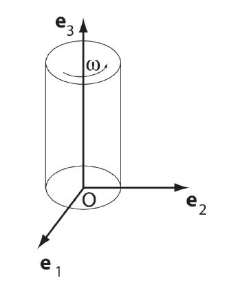{width=44%}

### Question 1.1.1（原题 2.1）

*Donner les descriptions lagrangienne et eulérienne de ce mouvement (déjà abordé dans le TD1).* 给出拉格朗日描述和欧拉描述。

::: rep
Lagrangienne : les relations données. Eulérienne : $\vec V=\dot{\vec x}$ à $\vec X$ fixé puis $\vec X=\mathbb Q^{\mathsf T}\vec x$ : $\vec V=\omega(-x_2\vec e_1+x_1\vec e_2)$, $\vec\gamma=-\omega^2(x_1\vec e_1+x_2\vec e_2)$.
:::

**Détail · 推导**

- 拉格朗日速度对 $\vec X$ 固定求导：$\dot x_1=\omega(-X_1\sin\theta-X_2\cos\theta)=-\omega x_2$，$\dot x_2=\omega(X_1\cos\theta-X_2\sin\theta)=\omega x_1$，$\dot x_3=0$。由于转动矩阵 $\mathbb Q$ 正交，直接用 $\vec X=\mathbb Q^{\mathsf T}\vec x$ 即可反解（不必写开三角恒等式就能识别出上式）。
- 欧拉加速度用物质导数计算：$\partial_t\vec V=\vec0$（定常），$\overrightarrow{\operatorname{grad}}\vec V=\begin{pmatrix}0&-\omega&0\\\omega&0&0\\0&0&0\end{pmatrix}$，对流项 $\overrightarrow{\operatorname{grad}}\vec V\cdot\vec V=-\omega^2(x_1\vec e_1+x_2\vec e_2)$。加速度始终指向转轴（向心加速度），大小 $\omega^2 r$（$r=\sqrt{x_1^2+x_2^2}$）。

### Question 1.1.2（原题 2.2）

*Calculer le tenseur gradient de la transformation $\mathbb F$, puis le tenseur des déformations de Green-Lagrange $\mathbb E$. Commenter le résultat obtenu.* 求 $\mathbb F$ 和 $\mathbb E$，并评论。

::: rep
$\mathbb F=\mathbb Q=\begin{pmatrix}\cos\theta&-\sin\theta&0\\\sin\theta&\cos\theta&0\\0&0&1\end{pmatrix}$ ; $\mathbb E=\frac12(\mathbb Q^{\mathsf T}\mathbb Q-\mathbb I)=\mathbb O$ : aucune déformation, quel que soit $\theta$ ; $\mathbb E$ est insensible aux rotations de corps rigide.
:::

**Détail · 推导**

$\mathbb Q$ 正交，$\mathbb Q^{\mathsf T}\mathbb Q=\mathbb I$，所以 $\mathbb E=\mathbb O$。有限应变正确地识别出"刚体运动没有变形"，即使转角很大。

### Question 1.1.3（原题 2.3）

*En faisant l'hypothèse des petites perturbations, donner le tenseur des déformations linéarisé $\boldsymbol\varepsilon$.* 在小扰动假设下给出线性化应变 $\boldsymbol\varepsilon$。

::: rep
$\vec u=\vec x-\vec X=(\mathbb Q-\mathbb I)\vec X$, $\overrightarrow{\operatorname{grad}}\vec u=\mathbb F-\mathbb I$, $\boldsymbol\varepsilon=\frac12(\overrightarrow{\operatorname{grad}}\vec u+\overrightarrow{\operatorname{grad}}^{\mathsf T}\vec u)=\operatorname{diag}(\cos\theta-1,\ \cos\theta-1,\ 0)$ : non nul alors qu'il n'y a pas de déformation.
:::

**Détail · 推导**

$\overrightarrow{\operatorname{grad}}\vec u=\mathbb Q-\mathbb I=\begin{pmatrix}\cos\theta-1&-\sin\theta&0\\\sin\theta&\cos\theta-1&0\\0&0&0\end{pmatrix}$。对称化后，反对称部分（$\pm\sin\theta$）互相抵消，只剩下对角元 $\cos\theta-1$。这说明线性化应变对有限刚体转动会给出“虚假的压缩应变”。

### Question 1.1.4（原题 2.4）

*Quelle est l'hypothèse à formuler sur $\theta$ pour que l'hypothèse HPP soit effectivement vérifiée ?* $\theta$ 满足什么条件时 HPP 成立？

::: rep
HPP : $\|\overrightarrow{\operatorname{grad}}\vec u\|=\|\mathbb Q-\mathbb I\|\ll1$ et $\|\vec u\|\ll L$ (domaine borné), soit $|\theta|\ll1$ ; alors $\cos\theta-1\approx-\frac{\theta^2}2$ est du second ordre et $\boldsymbol\varepsilon\approx\mathbb O$ au premier ordre.
:::

**Détail · 推导**

小扰动假设（HPP）要求位移梯度和无量纲位移都足够小：当 $|\theta|\ll 1$ 时，$\sin\theta\approx\theta$ 为一阶小量，而 $\cos\theta-1\approx-\theta^2/2$ 为二阶小量，在一次线性化中可以略去，从而 $\boldsymbol\varepsilon\approx\mathbb O$ 与无变形一致；当转角很大时，必须使用有限应变 $\mathbb E$。

## Exercice 1.2 · CC2 2025 ex. 2 — Cinématique d'un milieu continu déformable · 可变形介质运动学

[**Source :** CC2 du 12/11/2025, exercice 2 · **出处：** 2025 年 CC2 练习 2 · **Thèmes :** figure transformée, $\mathbb F$, $\mathbb E$, $\vec u$, $\boldsymbol\varepsilon$, type de mouvement, Euler, $\mathbb D$, $\boldsymbol\Omega$, caractéristiques]{.src}

### Énoncé · 题面

Soit $(O,\vec e_1,\vec e_2,\vec e_3)$ le référentiel cartésien orthonormé d'étude. On s'intéresse au mouvement d'un milieu continu, pour $t\geqslant0$, représenté par les équations de trajectoires suivantes : 运动由拉格朗日轨迹方程给出：

$$x_1(t,X_1,X_2,X_3)=X_1,\qquad x_2(t,X_1,X_2,X_3)=X_2\exp(\alpha t),\qquad x_3(t,X_1,X_2,X_3)=X_3,$$
où $\alpha$ est une constante positive donnée, $t$ est la variable temporelle, $(x_1,x_2,x_3)$ les coordonnées d'une particule dans la configuration actuelle (ou déformée) et $(X_1,X_2,X_3)$ ses coordonnées dans la configuration initiale, c'est-à-dire à $t=0$.

$$x_1=X_1,\qquad x_2=X_2e^{\alpha t},\qquad x_3=X_3,\qquad \alpha>0 .$$

### Question 1.2.1（原题 2.1）

*Soit le carré de côté $\eta$, défini à $t=0$ par $0\le X_1\le\eta$, $0\le X_2\le\eta$, $X_3=0$. Calculer les transformées des points correspondant à ses coins. Tracer ses configurations initiale $\Omega_0$ et courante $\Omega$ (à $t=1$ s).* 正方形四个角的像，画初始与当前构形（$t=1\,$s）

::: rep
À $t=1\ \mathrm s$ (avec $\alpha$ en $\mathrm s^{-1}$), dans le plan $x_3=0$ : $A=\vec0$, $B=\eta\vec e_1$, $C=\eta(\vec e_1+e^{\alpha\cdot 1\ \mathrm s}\vec e_2)$, $D=\eta e^{\alpha\cdot 1\ \mathrm s}\vec e_2$ : le carré devient un rectangle étiré selon $\vec e_2$.
:::

**Détail · 推导**

把四个角代入运动映射（$t=1\,\mathrm s$，此时指数 $\alpha t$ 在数值上等于 $\alpha$ 取 $\mathrm s^{-1}$ 时的数值，记作 $e^{\alpha}$），且 $x_3=X_3=0$ 保持共面：

| 初始点 | 坐标 $(X_1,X_2)$ | 当前点 |
|---|---|---|
| $A_0$ | $(0,0)$ | $A=(0,0)$ |
| $B_0$ | $(\eta,0)$ | $B=(\eta,0)$ |
| $C_0$ | $(\eta,\eta)$ | $C=(\eta,\eta e^{\alpha})$ |
| $D_0$ | $(0,\eta)$ | $D=(0,\eta e^{\alpha})$ |

正方形沿 $\vec e_2$ 拉长为 $\eta\times\eta e^{\alpha}$ 的矩形，$\vec e_1$ 方向尺寸不变，直角保持为直角。

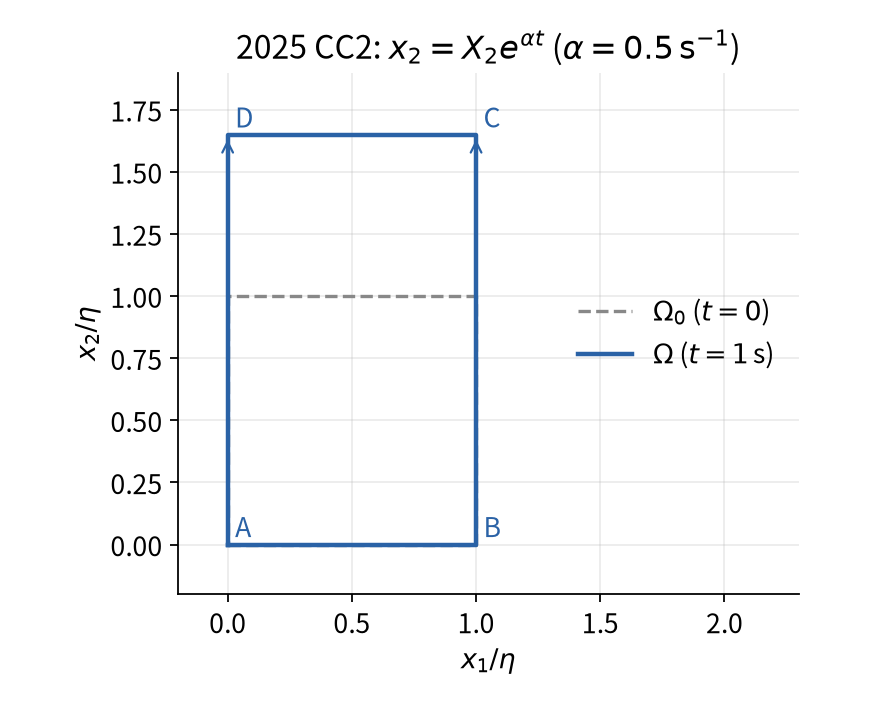

### Question 1.2.2（原题 2.2）

*Calculer le tenseur gradient de transformation $\mathbf F$, puis le tenseur des déformations de Green–Lagrange $\mathbf E$.* 求 $\mathbb F$ 与 Green–Lagrange 应变 $\mathbb E$

::: rep

$$\mathbb F=\frac{\partial\vec x}{\partial\vec X}=\operatorname{diag}(1,e^{\alpha t},1),\qquad
\mathbb E=\tfrac12(\mathbb F^{\mathsf T}\mathbb F-\mathbb I)=\frac{e^{2\alpha t}-1}{2}\begin{pmatrix}0&0&0\\0&1&0\\0&0&0\end{pmatrix}.$$
:::

**Détail · 推导**

$\mathbb F$ 的第 $i$ 行第 $j$ 列是 $\partial x_i/\partial X_j$。只有 $\partial x_2/\partial X_2=e^{\alpha t}$ 不是 1。$\mathbb F$ 对角，所以 $\mathbb F^{\mathsf T}\mathbb F=\operatorname{diag}(1,e^{2\alpha t},1)$，减去 $\mathbb I$ 再除以 2 即得 $\mathbb E$。两者都无量纲。$E_{22}$ 与伸长比 $\lambda_2=e^{\alpha t}$ 的关系是 $E_{22}=(\lambda_2^2-1)/2$。

### Question 1.2.3（原题 2.3）

*Calculer le vecteur déplacement $\mathbf u$ et son gradient.* 求位移向量 $\vec u$ 及其梯度

::: rep

$$\vec u=\overrightarrow{OM}-\overrightarrow{OM_0}=X_2\,(e^{\alpha t}-1)\,\vec e_2,\qquad
\overrightarrow{\operatorname{grad}}_X\vec u=\frac{\partial\vec u}{\partial\vec X}=(e^{\alpha t}-1)\begin{pmatrix}0&0&0\\0&1&0\\0&0&0\end{pmatrix}=\mathbb F-\mathbb I .$$
:::

**Détail · 推导**

位移是"当前位置减初始位置"，用拉格朗日变量写出；对 $\vec X$ 求导得到拉格朗日位移梯度，恒有 $\overrightarrow{\operatorname{grad}}_X\vec u=\mathbb F-\mathbb I$，可用来检查。

### Question 1.2.4（原题 2.4）

*Calculer le tenseur des déformations linéarisées $\boldsymbol\varepsilon$ puis préciser dans quelles conditions ce dernier est valide.* 线性化应变 $\boldsymbol\varepsilon$ 及其适用条件

::: rep
$\boldsymbol\varepsilon=\frac12(\overrightarrow{\operatorname{grad}}\vec u+\overrightarrow{\operatorname{grad}}^{\mathsf T}\vec u)=(e^{\alpha t}-1)\,\vec e_2\otimes\vec e_2\approx\alpha t\,\vec e_2\otimes\vec e_2$. Valable sous l’HPP : $\|\overrightarrow{\operatorname{grad}}\vec u\|\ll1$ et $\|\vec u\|\ll L$ (domaine borné), soit $|e^{\alpha t}-1|\ll1$, i.e. $\alpha t\ll1$ ($t\ll1/\alpha$).
:::

**Détail · 推导**

$$\boldsymbol\varepsilon=(e^{\alpha t}-1)\begin{pmatrix}0&0&0\\0&1&0\\0&0&0\end{pmatrix}\approx\alpha t\begin{pmatrix}0&0&0\\0&1&0\\0&0&0\end{pmatrix}.$$

条件是小扰动（HPP）：一方面要求位移梯度小（$\|\overrightarrow{\operatorname{grad}}\vec u\|\ll1\iff |e^{\alpha t}-1|\ll1$），另一方面要求有界域上位移远小于特征尺度 $L$（$|e^{\alpha t}-1|\,|X_2|\ll L$，对尺寸为 $L$ 的物体同样归结为 $|e^{\alpha t}-1|\ll1$）。因为 $e^{\alpha t}-1\approx\alpha t$，所以等价于 $\alpha t\ll1$，即 $t\ll1/\alpha$。此时 $E_{22}=\frac{e^{2\alpha t}-1}{2}\approx\alpha t\approx\varepsilon_{22}$，两种应变一致。

### Question 1.2.5（原题 2.5）

*De quel type de mouvement s’agit-il ? Quelle est l’unité de $\alpha$ ?* 运动类型和 $\alpha$ 的单位

::: rep
Il s’agit d’une dilatation (extension) d’un facteur $\exp(\alpha t)$ selon $\vec e_2$. L’exposant est sans dimension, donc $\alpha$ s’exprime en $\mathrm s^{-1}$.
:::

**Détail · 推导**

沿 $\vec e_2$ 的单轴伸长（extension / dilatation），伸长比 $e^{\alpha t}$；指数必须无量纲，故 $[\alpha]=\mathrm s^{-1}$。

### Question 1.2.6（原题 2.6）

*Déterminer la description eulérienne de ce mouvement.* 欧拉描述

::: rep
$V_2=\dot x_2=\alpha X_2e^{\alpha t}=\alpha x_2$, donc $\vec V(t,M)=\alpha x_2\,\vec e_2$.
:::

**Détail · 推导**

先对时间求导得拉格朗日速度 $\dot x_1=0$、$\dot x_2=\alpha X_2e^{\alpha t}$、$\dot x_3=0$，再用 $X_2=x_2e^{-\alpha t}$ 反解消去初始坐标：

$$\vec V(t,M)=\alpha x_2\,\vec e_2 .$$

这是"拉格朗日 → 欧拉"方向的标准做法：**先求导、后反解**。与 2024 CC2 练习 2（题库 1.8）相反，那里是"欧拉 → 拉格朗日"，要**解常微分方程**。

### Question 1.2.7（原题 2.7）

*Calculer le tenseur des taux de déformation $\mathbf D$ et de rotation $\boldsymbol\Omega$. Commenter.* 变形率 $\mathbb D$ 与旋转率 $\boldsymbol\Omega$

::: rep
$\overrightarrow{\operatorname{grad}}\vec V=\alpha\,\vec e_2\otimes\vec e_2$ est symétrique : $\mathbb D=\alpha\,\vec e_2\otimes\vec e_2$ et $\boldsymbol\Omega=\mathbb O$. Le milieu se déforme sans rotation.
:::

**Détail · 推导**

$$\overrightarrow{\operatorname{grad}}\vec V=\alpha\begin{pmatrix}0&0&0\\0&1&0\\0&0&0\end{pmatrix},\qquad \mathbb D=\overrightarrow{\operatorname{grad}}\vec V,\qquad \boldsymbol\Omega=\mathbb O .$$

速度梯度本身对称，所以对称部分就是它自己，反对称部分为零：介质有变形、无旋转。$\mathbb D$ 的单位是 $\mathrm s^{-1}$。

### Question 1.2.8（原题 2.8）

*Préciser les caractéristiques de ce mouvement (incompressible, stationnaire, irrotationnel).* 运动特征（不可压缩？稳态？无旋？）

::: rep
- $\operatorname{div}\vec V=\alpha\ne0$ : pas incompressible ;
- $\vec V$ ne dépend pas de $t$ en eulérien : stationnaire ;
- $\overrightarrow{\operatorname{rot}}\vec V=\vec0$ : irrotationnel.
:::

**Détail · 推导**

可压缩（体积按 $J=e^{\alpha t}$ 增大）、**稳态**（欧拉速度场不显含 $t$，虽然每个粒子的速度 $\alpha X_2e^{\alpha t}$ 在变）、无旋。"稳态"一定要用欧拉场判断。

## Exercice 1.3 · TD2 ex. 4 — Méthode des grilles · 网格法

[**Source :** TD2, exercice 4 (2026–2027) · **出处：** TD2 练习 4 · **Thèmes :** sens géométrique de $\mathbb E$ (longueurs, angles)]{.src}

### Énoncé · 题面

On mesure les déformations d'un lopin d'acier par la méthode des grilles. La figure 4.1 montre la configuration déformée de l'éprouvette, ainsi que le carré au voisinage de $M_0$ avant et après déformation (côtés initiaux $\delta a_0$, $\delta b_0$ ; côtés déformés $\delta a$, $\delta b$ ; angle $\alpha=57^\circ$ entre les côtés déformés). 用网格法测钢坯的变形。图 4.1 给出试件变形后的样子，以及 $M_0$ 附近小正方形变形前后的形状：初始边长 $\delta a_0,\delta b_0$，变形后 $\delta a,\delta b$，变形后两边夹角 $\alpha=57^\circ$。

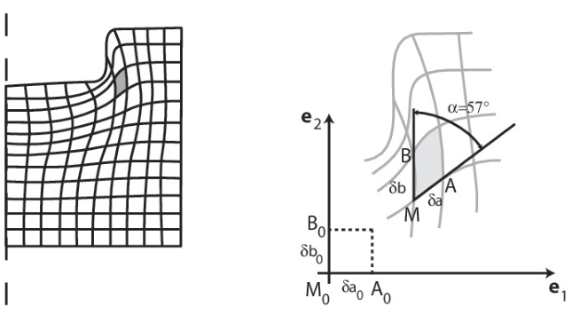{.wide}

### Question 1.3.1（原题 4.1）

*À partir des mesures de longueurs et d'angles, calculer les composantes de l'opérateur des déformations de Green-Lagrange $\mathbb E$, relatif au point $M_0$ dans la base $(\vec e_1,\vec e_2)$.* 由长度和角度的测量值计算 $M_0$ 处 Green–Lagrange 应变的分量。

::: rep
Avec $\lambda_a=\frac{\delta a}{\delta a_0}$, $\lambda_b=\frac{\delta b}{\delta b_0}$ : $E_{11}=\frac12(\lambda_a^2-1)$, $E_{22}=\frac12(\lambda_b^2-1)$, $E_{12}=E_{21}=\frac12\lambda_a\lambda_b\cos\alpha$ ($\alpha=57^\circ$).
:::

**Détail · 推导**

从有限应变的几何定义出发（$\mathrm d\vec x_1\cdot\mathrm d\vec x_2-\mathrm d\vec X_1\cdot\mathrm d\vec X_2=2\,\mathrm d\vec X_1\cdot\mathbb E\,\mathrm d\vec X_2$），其中 $\mathbb C=\mathbb F^{\mathsf T}\mathbb F$ 是右 Cauchy–Green 变形张量。初始正方形沿坐标轴取两条微元边 $\mathrm d\vec a_0=\delta a_0\vec e_1$、$\mathrm d\vec b_0=\delta b_0\vec e_2$，变形后成为 $\mathrm d\vec a=\mathbb F\mathrm d\vec a_0$（长度 $\delta a$）与 $\mathrm d\vec b=\mathbb F\mathrm d\vec b_0$（长度 $\delta b$），夹角为 $\alpha=57^\circ$：
- 长度平方：$C_{11}=\|\mathbb F\vec e_1\|^2=(\delta a/\delta a_0)^2=\lambda_a^2$，同理 $C_{22}=\lambda_b^2$；
- 夹角点积：$C_{12}=\mathbb F\vec e_1\cdot\mathbb F\vec e_2=\lambda_a\lambda_b\cos\alpha$（初始正交点积为 $0$，变形后不再正交，出现剪切分量）。

再由 $\mathbb E=\frac12(\mathbb C-\mathbb I)$ 得上述三分量（数值上 $\cos57^\circ\approx0.545$，边长比 $\lambda_a,\lambda_b$ 需在原题图上用尺量取）。注意面内网格法同样只给出面内分量 $(E_{11},E_{22},E_{12})$。

## Exercice 1.4 · TD2 ex. 3 — Mesure des déformations à l'aide de jauges · 应变计测量

[**Source :** TD2, exercice 3 (2026–2027) · **出处：** TD2 练习 3 · **Thèmes :** rosette, composantes de $\boldsymbol\varepsilon$, direction principale]{.src}

### Énoncé · 题面

L'extensométrie est la technique permettant de déterminer les composantes du tenseur des déformations par mesure en un point quelconque de la surface libre. Ceci est réalisé à l'aide de jauges de déformation (fil de résistance proportionnelle à sa longueur). Les composantes de l'opérateur des contraintes sont ensuite déduites en utilisant la relation de comportement. 应变测量：在自由表面上某点用应变计测出应变张量的分量，再由本构求应力。

Trois jauges de déformation (I, II et III) disposées en rosette autour du point $O$ de la surface d'un solide mesurent les trois allongements unitaires suivant trois directions à $120^\circ$ ($\alpha=0^\circ$ ; $\beta=120^\circ$ ; $\gamma=120^\circ$). Les mesures obtenues donnent : 三片应变计 I、II、III 在表面点 $O$ 周围组成应变花，相邻方向间隔 $120^\circ$（$\beta,\gamma$ 是相邻夹角，三个方向相对 $x$ 轴为 $0^\circ,120^\circ,240^\circ$），读数如下。

$$\varepsilon_I=0{,}5\times10^{-4},\qquad\varepsilon_{II}=2\times10^{-4},\qquad\varepsilon_{III}=2\times10^{-4}.$$

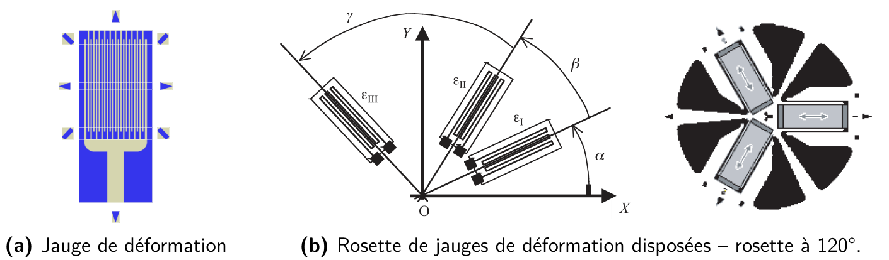

### Question 1.4.1（原题 3.1）

*Calculer les composantes du tenseur des déformations $\boldsymbol\varepsilon$ au point $O$, dans le repère $(O,\vec e_x,\vec e_y)$. Déterminer la direction du plan pour laquelle le taux d'allongement unitaire est maximal. Donner sa valeur.* 求 $O$ 点的应变分量；求伸长率最大的方向及其值。

::: rep
$\varepsilon(\phi)=\varepsilon_{xx}\cos^2\phi+2\varepsilon_{xy}\sin\phi\cos\phi+\varepsilon_{yy}\sin^2\phi$ pour $\phi=0^\circ,120^\circ,240^\circ$ : $\varepsilon_{xx}=\varepsilon_I=0{,}5\times10^{-4}$, $\varepsilon_{xy}=\frac{\varepsilon_{III}-\varepsilon_{II}}{\sqrt3}=0$, $\varepsilon_{yy}=\frac{2(\varepsilon_{II}+\varepsilon_{III})-\varepsilon_I}3=2{,}5\times10^{-4}$, soit dans le plan $(O,\vec e_x,\vec e_y)$ :

$$\boldsymbol\varepsilon_{\text{plan}}=\begin{pmatrix}0{,}5&0\\0&2{,}5\end{pmatrix}\times10^{-4}\quad(\text{les mesures en surface ne donnent pas }\varepsilon_{zz}).$$
$\boldsymbol\varepsilon_{\text{plan}}$ est diagonal : l'allongement unitaire maximal vaut $2{,}5\times10^{-4}$ dans la direction $\vec e_y$.
:::

**Détail · 推导**

- 关键审题：题中 $\alpha=0^\circ$ 是第 I 片与 $x$ 轴夹角，而 $\beta=120^\circ$、$\gamma=120^\circ$ 是**相邻两片的夹角**（见图 3.1b），所以三片的绝对方向角依次为 $0^\circ$、$120^\circ$、$240^\circ$。
- 依次代入单向线应变公式 $\varepsilon(\phi)=\vec n\cdot\boldsymbol\varepsilon\vec n=\varepsilon_{xx}\cos^2\phi+2\varepsilon_{xy}\sin\phi\cos\phi+\varepsilon_{yy}\sin^2\phi$：
  - $\phi=0^\circ$：$\cos0^\circ=1,\ \sin0^\circ=0\implies \varepsilon_I=\varepsilon_{xx}$；
  - $\phi=120^\circ$：$\cos120^\circ=-\frac12,\ \sin120^\circ=\frac{\sqrt3}2\implies \varepsilon_{II}=\frac14\varepsilon_{xx}-\frac{\sqrt3}2\varepsilon_{xy}+\frac34\varepsilon_{yy}$；
  - $\phi=240^\circ$：$\cos240^\circ=-\frac12,\ \sin240^\circ=-\frac{\sqrt3}2\implies \varepsilon_{III}=\frac14\varepsilon_{xx}+\frac{\sqrt3}2\varepsilon_{xy}+\frac34\varepsilon_{yy}$。
- 后两式相减消去 $\varepsilon_{xx},\varepsilon_{yy}$ 得 $\varepsilon_{xy}=0$，相加再代入 $\varepsilon_{xx}$ 得 $\varepsilon_{yy}=2.5\times10^{-4}$。面内应变矩阵已对角化，$\vec e_x,\vec e_y$ 就是主方向，最大正应变沿 $\vec e_y$。表面测量只得到面内三个分量，$\varepsilon_{zz}$ 需借助平面应力本构才能求出（见 1.5.3）。

### Question 1.4.2（原题 3.2）

*Que mesurerait-on si les jauges étaient disposées avec un angle de $45^\circ$ entre elles ($\alpha=0^\circ$ ; $\beta=45^\circ$ ; $\gamma=45^\circ$) ?* 若相邻夹角改为 $45^\circ$，会测得什么？

::: rep
Directions $0^\circ$, $45^\circ$, $90^\circ$ : $\varepsilon_{0}=0{,}5\times10^{-4}$, $\varepsilon_{45}=\frac{\varepsilon_{xx}+\varepsilon_{yy}}2+\varepsilon_{xy}=1{,}5\times10^{-4}$, $\varepsilon_{90}=2{,}5\times10^{-4}$.
:::

**Détail · 推导**

$45^\circ$ 方向：$\cos^2=\sin^2=\frac12$，$2\sin\cos=1$，所以 $\varepsilon_{45}=\frac{\varepsilon_{xx}+\varepsilon_{yy}}2+\varepsilon_{xy}$。

## Exercice 1.5 · Variante — Rosette à 60° · 60° 应变花

[**Source :** variante d'entraînement (TD2 ex. 3) · **出处：** 变式题（自编） · **Thèmes :** rosette, composantes, déformations et directions principales]{.src}

### Énoncé · 题面

Une rosette de trois jauges orientées à $0^\circ$, $60^\circ$ et $120^\circ$ de l'axe $x$, collée sur la surface libre d'un solide, donne : 贴在自由表面上的应变花，三片方向分别与 $x$ 轴成 $0^\circ$、$60^\circ$、$120^\circ$，读数如下。

$$\varepsilon_{0}=3\times10^{-4},\qquad\varepsilon_{60}=1\times10^{-4},\qquad\varepsilon_{120}=-1\times10^{-4}.$$

### Question 1.5.1

*Calculer $\varepsilon_{xx}$, $\varepsilon_{yy}$ et $\varepsilon_{xy}$.* 求面内三个应变分量。

::: rep
$\varepsilon_{xx}=\varepsilon_0=3\times10^{-4}$ ; $\varepsilon_{60}+\varepsilon_{120}=\frac12\varepsilon_{xx}+\frac32\varepsilon_{yy}$ ⇒ $\varepsilon_{yy}=-1\times10^{-4}$ ; $\varepsilon_{60}-\varepsilon_{120}=\sqrt3\,\varepsilon_{xy}$ ⇒ $\varepsilon_{xy}=\frac2{\sqrt3}\times10^{-4}\approx1{,}15\times10^{-4}$.
:::

**Détail · 推导**

$\varepsilon(60^\circ)=\frac14\varepsilon_{xx}+\frac{\sqrt3}2\varepsilon_{xy}+\frac34\varepsilon_{yy}$，$\varepsilon(120^\circ)=\frac14\varepsilon_{xx}-\frac{\sqrt3}2\varepsilon_{xy}+\frac34\varepsilon_{yy}$；相加、相减分别求出 $\varepsilon_{yy}$、$\varepsilon_{xy}$。

### Question 1.5.2

*Déterminer les déformations principales dans le plan et leurs directions.* 求面内主应变及其方向。

::: rep
$\varepsilon_{1,2}=\frac{\varepsilon_{xx}+\varepsilon_{yy}}2\pm\sqrt{\Bigl(\frac{\varepsilon_{xx}-\varepsilon_{yy}}2\Bigr)^2+\varepsilon_{xy}^2}=\Bigl(1\pm\frac4{\sqrt3}\Bigr)\times10^{-4}$, soit $3{,}31\times10^{-4}$ et $-1{,}31\times10^{-4}$. $\tan2\theta=\frac{2\varepsilon_{xy}}{\varepsilon_{xx}-\varepsilon_{yy}}=\frac1{\sqrt3}$ ⇒ $\theta=15^\circ$ pour $\varepsilon_1$ ($\vec n_1=\cos15^\circ\vec e_x+\sin15^\circ\vec e_y$) et $\theta=105^\circ$ pour $\varepsilon_2$ ($\vec n_2=-\sin15^\circ\vec e_x+\cos15^\circ\vec e_y$).
:::

**Détail · 推导**

- 用 Mohr 圆 / $2\times 2$ 对称矩阵特征值公式：中心（平均值）$\frac{\varepsilon_{xx}+\varepsilon_{yy}}2=1\times10^{-4}$，半径 $\sqrt{\bigl(\frac{3-(-1)}2\bigr)^2+\bigl(\frac2{\sqrt3}\bigr)^2}=\sqrt{4+\frac43}=\frac4{\sqrt3}\approx2.31$（单位 $10^{-4}$）。
- 由 $\tan2\theta=\frac1{\sqrt3}$ 得 $2\theta=30^\circ$ 或 $210^\circ$，即 $\theta=15^\circ$ 或 $105^\circ$。判断哪个角对应 $\varepsilon_1$：因为 $\varepsilon_{xx}>\varepsilon_{yy}$ 且 $\varepsilon_{xy}>0$，直接代回 $\varepsilon(15^\circ)=1+2\cos30^\circ+\frac2{\sqrt3}\sin30^\circ=1+\sqrt3+\frac1{\sqrt3}=1+\frac4{\sqrt3}=\varepsilon_1$，所以最大主方向与 $x$ 轴成 $15^\circ$（第一象限）。

### Question 1.5.3

*Peut-on déterminer $\varepsilon_{zz}$ avec ces mesures ?* 能否由这些测量求出 $\varepsilon_{zz}$？

::: rep
Non, pas sans loi de comportement : les jauges ne mesurent que dans le plan. Avec un matériau élastique isotrope en contraintes planes ($\sigma_{zz}=0$) : $\varepsilon_{zz}=-\frac\nu{1-\nu}(\varepsilon_{xx}+\varepsilon_{yy})=-\frac{2\nu}{1-\nu}\times10^{-4}$.
:::

**Détail · 推导**

自由表面法向无载荷，故 $\sigma_{zz}=0$；代入线弹性各向同性 Hooke 定律 $\sigma_{zz}=\lambda(\varepsilon_{xx}+\varepsilon_{yy}+\varepsilon_{zz})+2\mu\varepsilon_{zz}=0$，解出 $\varepsilon_{zz}=-\frac{\lambda}{\lambda+2\mu}(\varepsilon_{xx}+\varepsilon_{yy})$。利用 Lamé 常数换算关系 $\frac{\lambda}{\lambda+2\mu}=\frac{\nu}{1-\nu}$ 及本题 $\varepsilon_{xx}+\varepsilon_{yy}=2\times10^{-4}$，即得上式。

## Exercice 1.6 · TD2 ex. 1 — Mouvement de glissement simple · 简单剪切运动

[**Source :** TD2, exercice 1 (2026–2027) · **出处：** TD2 练习 1 · **Thèmes :** trajectoires, transformée d'une figure, $\mathbb F$, $\mathbb E$, déformations principales, longueurs, volume, rotation rigide]{.src}

### Énoncé · 题面

Soit $(O,\vec e_1,\vec e_2,\vec e_3)$ un repère orthonormé où le point $O$ est considéré comme fixe. Soit un milieu continu ayant un mouvement défini par le champ de vitesses :

$$\vec V(M)=\alpha\,\vec e_1\,\bigl(\vec e_2\cdot\overrightarrow{OM}\bigr)=\alpha x_2\,\vec e_1,$$
où $\alpha$ est une constante positive donnée. $O$ 为固定点的正交坐标系中，连续介质的速度场为 $\vec V=\alpha x_2\vec e_1$，$\alpha$ 为给定正常数（简单剪切流）。

### Question 1.6.1（原题 1.1）

*Quelles sont les trajectoires et lignes de courant de ce mouvement ?* 这个运动的轨迹和流线是什么？

::: rep
Le mouvement est stationnaire : trajectoires et lignes de courant sont confondues. $\dot x_1=\alpha x_2$, $\dot x_2=\dot x_3=0$ ⇒ $x_1=X_1+\alpha tX_2$, $x_2=X_2$, $x_3=X_3$ : droites parallèles à $\vec e_1$ ; les points de $x_2=0$ sont immobiles.
:::

**Détail · 推导**

速度场不显含 $t$，稳态，所以轨迹、流线（和脉线）重合。积分：$x_2$、$x_3$ 不变，$x_1$ 以速度 $\alpha X_2$ 匀速运动。离 $x_2=0$ 越远，粒子走得越快。

### Question 1.6.2（原题 1.2）

*On considère à l'instant $t=0$ le carré $OA_0B_0C_0$, de côté $\eta$, avec $\overrightarrow{OA_0}=\eta\vec e_1$, $\overrightarrow{OB_0}=\eta\vec e_2$. Quelle est la transformée de ce carré à l'instant $t$ ?* $t=0$ 时边长 $\eta$ 的正方形 $OA_0B_0C_0$ 在时刻 $t$ 变成什么？

::: rep
$O\to O$, $A=\eta\vec e_1$, $B=\eta(\alpha t\,\vec e_1+\vec e_2)$, $C=\eta\bigl((1+\alpha t)\vec e_1+\vec e_2\bigr)$ : un parallélogramme de même base $\eta$ et de même hauteur $\eta$, donc de même aire $\eta^2$.
:::

**Détail · 推导**

注意题设顶点顺序：$\overrightarrow{OA_0}=\eta\vec e_1$、$\overrightarrow{OB_0}=\eta\vec e_2$，因此对角顶点是 $C_0=\eta(\vec e_1+\vec e_2)$（绕边界顺序实为 $O\to A_0\to C_0\to B_0$）。将四个顶点代入映射 $x_1=X_1+\alpha tX_2,\ x_2=X_2$：底边 $OA$ 不动，上边 $B_0C_0$ 整体沿 $\vec e_1$ 平移 $\alpha t\eta$，正方形变成底和高原仍为 $\eta$ 的平行四边形，面积 $\eta^2$ 不变。

### Question 1.6.3（原题 1.3）

*On considère à l'instant $t=0$ un cube dont une face correspond au carré $OA_0B_0C_0$. Quelle est la transformée de ce cube à l'instant $t$ ?* 以该正方形为一个面的立方体在时刻 $t$ 变成什么？

::: rep
Les sommets $X_3=\eta$ se transforment de la même manière ($x_3=X_3$) : le cube devient un parallélépipède oblique de même volume $\eta^3$.
:::

**Détail · 推导**

第三方向不受影响，每个水平截面都做同样的剪切，体积不变（见题库 1.6.7）。

### Question 1.6.4（原题 1.4）

*Rappeler la définition du tenseur de transformation et donner son expression.* 复述变换梯度的定义并给出表达式。

::: rep
$\mathrm d\vec x=\mathbb F\,\mathrm d\vec X$, $\mathbb F=\frac{\partial\vec x}{\partial\vec X}=\overrightarrow{\operatorname{grad}}_X\vec\phi$ ; ici $\mathbb F=\begin{pmatrix}1&\alpha t&0\\0&1&0\\0&0&1\end{pmatrix}=\mathbb I+\alpha t\,\vec e_1\otimes\vec e_2$.
:::

**Détail · 推导**

$F_{ij}=\partial x_i/\partial X_j$：第 $i$ 行是 $x_i$ 对 $X_1,X_2,X_3$ 的偏导。只有 $\partial x_1/\partial X_2=\alpha t$ 非平凡。

### Question 1.6.5（原题 1.5）

*Rappeler la définition du tenseur de déformation de Green-Lagrange et calculer son expression. Déterminer les déformations principales et les directions principales de déformation.* 复述 Green–Lagrange 应变的定义并计算；求主应变和主方向。

::: rep
$\mathbb E=\frac12(\mathbb F^{\mathsf T}\mathbb F-\mathbb I)=\frac12\begin{pmatrix}0&\alpha t&0\\\alpha t&(\alpha t)^2&0\\0&0&0\end{pmatrix}$, avec $\mathrm dl^2-\mathrm dl_0^2=2\,\mathrm d\vec X\cdot\mathbb E\,\mathrm d\vec X$.
Valeurs propres : $E_1=0$ (direction $\vec e_3$), $E_{2,3}=\frac{\alpha t}4\bigl(\alpha t\mp\sqrt{(\alpha t)^2+4}\bigr)$ ; pour $t>0$, directions principales $\propto\bigl(2,\ \alpha t\mp\sqrt{(\alpha t)^2+4},\ 0\bigr)$ (à $t=0$, $\mathbb E=\mathbb O$ et toute direction est principale).
:::

**Détail · 推导**

- $\mathbb C=\mathbb F^{\mathsf T}\mathbb F=\begin{pmatrix}1&\alpha t&0\\\alpha t&1+(\alpha t)^2&0\\0&0&1\end{pmatrix}$。对角元管长度变化，非对角元管角度变化。
- $\vec e_3$ 那一行一列只有 0，直接是主方向，主值 0。
- 记 $k=\alpha t\ge 0$，其余 $2\times2$ 块 $\frac12\begin{pmatrix}0&k\\k&k^2\end{pmatrix}$ 的特征方程为 $(-\lambda)(\frac{k^2}2-\lambda)-\frac{k^2}4=0$，即 $4\lambda^2-2k^2\lambda-k^2=0$，解得 $\lambda=\frac k4\bigl(k\pm\sqrt{k^2+4}\bigr)$；两根一正一负，和为 $k^2/2$（迹），积为 $-k^2/4$（行列式）。
- 当 $t>0$（$k>0$）时，将特征值 $\lambda_\pm=\frac k4\bigl(k\pm\sqrt{k^2+4}\bigr)$ 代入特征方程第一行 $-\lambda n_1+\frac k2n_2=0$，得 $n_2=\frac{2\lambda_\pm}{k}n_1=\frac{k\pm\sqrt{k^2+4}}2n_1$；取 $n_1=2$ 即得与 $\lambda_\pm$ 一一对应的两正交主方向 $\vec n_\pm\propto\bigl(2,\ k\pm\sqrt{k^2+4},\ 0\bigr)$（小 $k$ 时趋近与 $\vec e_1$ 成 $\pm45^\circ$）。$t=0$ 时 $\mathbb E=\mathbb O$，任意方向都是主方向。

### Question 1.6.6（原题 1.6）

*Calculer l'accroissement du carré de la longueur de $\mathrm d\vec M_0=\mathrm dl_0\,\vec\tau$, où $\vec\tau$ est un vecteur unitaire du plan $(\vec e_1,\vec e_2)$ tel que $\varphi=(\vec e_1,\vec\tau)$.* 求方向角 $\varphi$ 的线元长度平方的增量。

::: rep
$\mathrm dl^2-\mathrm dl_0^2=2\,\mathrm dl_0^2\,\vec\tau\cdot\mathbb E\vec\tau=\mathrm dl_0^2\,\alpha t\,(\sin2\varphi+\alpha t\sin^2\varphi)$.
:::

**Détail · 推导**

$\vec\tau=(\cos\varphi,\sin\varphi,0)$，$\vec\tau\cdot\mathbb E\vec\tau=E_{11}\cos^2\varphi+2E_{12}\sin\varphi\cos\varphi+E_{22}\sin^2\varphi=\frac{\alpha t}2\bigl(2\sin\varphi\cos\varphi+\alpha t\sin^2\varphi\bigr)$。$\varphi=0$（沿 $\vec e_1$）长度不变；$\varphi=\pi/2$ 时 $\mathrm dl^2=\mathrm dl_0^2(1+(\alpha t)^2)$，竖直线元被拉斜变长。

### Question 1.6.7（原题 1.7）

*Soit un cube élémentaire de côtés $\mathrm d\vec a_0$, $\mathrm d\vec b_0$ et $\mathrm d\vec c_0$ ; déterminer la variation de volume entre l'état non déformé et l'état déformé.* 求微元立方体变形前后的体积变化。

::: rep
$\mathrm dV=(\mathbb F\mathrm d\vec a_0,\mathbb F\mathrm d\vec b_0,\mathbb F\mathrm d\vec c_0)=\det\mathbb F\,\mathrm dV_0=\mathrm dV_0$, soit $\mathrm dV-\mathrm dV_0=0$ : pas de variation de volume ($J=1$, isochore).
:::

**Détail · 推导**

体积是三条边的混合积，变形后每条边乘以 $\mathbb F$，所以体积乘以 $\det\mathbb F$。上三角矩阵行列式为对角元之积，等于 1。

### Question 1.6.8（原题 1.8）

*Décrire le mouvement d'un milieu continu dont le champ de vitesses est $\vec V=\alpha\,\vec e_1(\vec e_2\cdot\overrightarrow{OM})-\alpha\,\vec e_2(\vec e_1\cdot\overrightarrow{OM})$.* 描述速度场为 $\alpha x_2\vec e_1-\alpha x_1\vec e_2$ 的运动。

::: rep
$\vec V=\alpha x_2\vec e_1-\alpha x_1\vec e_2$ : $\overrightarrow{\operatorname{grad}}\vec V=\begin{pmatrix}0&\alpha&0\\-\alpha&0&0\\0&0&0\end{pmatrix}$ antisymétrique, $\mathbb D=\mathbb O$ : rotation de corps rigide autour de $O\vec e_3$, de vitesse angulaire $-\alpha\vec e_3$ ; trajectoires circulaires.
:::

**Détail · 推导**

速度梯度反对称 ⇒ $\mathbb D=\mathbb O$ ⇒ 变形率为零，属于刚体运动（$\mathbb E=\mathbb O$，且定常、不可压缩）。由 $\boldsymbol\Omega\vec e_1=-\alpha\vec e_2=(-\alpha\vec e_3)\wedge\vec e_1$ 或 $\frac12\overrightarrow{\operatorname{rot}}\vec V=\frac12(-\alpha-\alpha)\vec e_3=-\alpha\vec e_3$，可知绕 $O\vec e_3$ 顺时针匀速转动，粒子沿以 $O\vec e_3$ 为轴的圆周运动。对照题库 1.6.1，简单剪切 $\vec V_s=\alpha x_2\vec e_1$ 的局部角速度是 $-\frac{\alpha}{2}\vec e_3$，其速度梯度的反对称部分正好等于本问刚体转动速度梯度的一半。

## Exercice 1.7 · Variante — Glissement simple non stationnaire · 非定常简单剪切

[**Source :** variante d'entraînement · **出处：** 变式题（自编） · **Thèmes :** unités, $\mathbb F$, $\mathbb E$, Euler, $\mathbb D$, $\boldsymbol\Omega$, HPP, lien $\boldsymbol\varepsilon$–$\mathbb D$]{.src}

### Énoncé · 题面

On considère le mouvement défini en description lagrangienne par

$$x_1=X_1+\alpha t^2X_2,\qquad x_2=X_2,\qquad x_3=X_3,$$
où $\alpha$ est une constante positive. 拉格朗日描述如上，$\alpha$ 为正常数。

### Question 1.7.1

*Quelle est l'unité de $\alpha$ ?* $\alpha$ 的单位？

::: rep
$\alpha t^2X_2$ est une longueur et $X_2$ aussi : $\alpha t^2$ est sans dimension, $[\alpha]=\mathrm s^{-2}$.
:::

**Détail · 推导**

乘在 $X_2$ 前的因子必须无量纲。注意这里是 $t^2$，单位是 $\mathrm s^{-2}$ 而不是 $\mathrm s^{-1}$。

### Question 1.7.2

*Calculer $\mathbb F$, $J$ et $\mathbb E$.* 求 $\mathbb F$、$J$、$\mathbb E$。

::: rep
$\mathbb F=\mathbb I+\alpha t^2\,\vec e_1\otimes\vec e_2$, $J=1$ (isochore), $\mathbb E=\frac12\begin{pmatrix}0&\alpha t^2&0\\\alpha t^2&\alpha^2t^4&0\\0&0&0\end{pmatrix}$.
:::

**Détail · 推导**

与 TD2 练习 1 相同，只是剪切量 $k=\alpha t^2$ 随时间二次增长。三角矩阵行列式为 1。

### Question 1.7.3

*Donner la description eulérienne des vitesses.* 给出欧拉速度场。

::: rep
$\vec V=\frac{\partial\vec x}{\partial t}\Big|_{\vec X}=2\alpha tX_2\,\vec e_1$ ; comme $X_2=x_2$ : $\vec V(\vec x,t)=2\alpha t\,x_2\,\vec e_1$.
:::

**Détail · 推导**

求导后反解：$x_2=X_2$，直接替换。

### Question 1.7.4

*Calculer $\mathbb D$ et $\boldsymbol\Omega$. Le mouvement est-il stationnaire, incompressible, irrotationnel ?* 求 $\mathbb D$、$\boldsymbol\Omega$；判断运动特征。

::: rep
$\overrightarrow{\operatorname{grad}}\vec V=2\alpha t\,\vec e_1\otimes\vec e_2$ : $\mathbb D=\alpha t(\vec e_1\otimes\vec e_2+\vec e_2\otimes\vec e_1)$, $\boldsymbol\Omega=\alpha t(\vec e_1\otimes\vec e_2-\vec e_2\otimes\vec e_1)$, en $\mathrm s^{-1}$. Non stationnaire ($t$ explicite), incompressible ($\operatorname{tr}\mathbb D=0$), rotationnel ($\boldsymbol\Omega\neq\mathbb O$).
:::

**Détail · 推导**

速度梯度只有 $(1,2)$ 元 $2\alpha t$，对称部分和反对称部分各占一半。

### Question 1.7.5

*Sous l'HPP, donner $\boldsymbol\varepsilon$ et la condition de validité. Comparer $\frac{\partial\boldsymbol\varepsilon}{\partial t}$ et $\mathbb D$.* HPP 下求 $\boldsymbol\varepsilon$ 及适用条件；比较 $\partial\boldsymbol\varepsilon/\partial t$ 与 $\mathbb D$。

::: rep
$\vec u=\alpha t^2X_2\vec e_1$, $\boldsymbol\varepsilon=\frac{\alpha t^2}2(\vec e_1\otimes\vec e_2+\vec e_2\otimes\vec e_1)$, valable sous l'HPP si $\|\overrightarrow{\operatorname{grad}}\vec u\|\ll1$ et $\|\vec u\|\ll L$ (domaine borné), soit $\alpha t^2\ll1$ ($t\ll1/\sqrt\alpha$). $\frac{\partial\boldsymbol\varepsilon}{\partial t}=\alpha t(\vec e_1\otimes\vec e_2+\vec e_2\otimes\vec e_1)=\mathbb D$.
:::

**Détail · 推导**

由 $\overrightarrow{\operatorname{grad}}_X\vec u=\alpha t^2\vec e_1\otimes\vec e_2$，要求有界域上位移小且梯度小，均给出 $\alpha t^2\ll1$。一般情形下由链式法则有 $\dot{\mathbb F}=\mathbb L\mathbb F$（其中 $\mathbb L=\overrightarrow{\operatorname{grad}}_x\vec V$），从而 $\partial\boldsymbol\varepsilon/\partial t=\operatorname{sym}(\dot{\mathbb F})=\operatorname{sym}(\mathbb L\mathbb F)$，通常只在 HPP（$\mathbb F\approx\mathbb I$）下近似等于 $\mathbb D=\operatorname{sym}(\mathbb L)$（对照 1.10.10：即使 $\mathbb D$ 在时空上均为常量，只要 $\mathbb L\mathbb F\neq\mathbb L$，两者仍不严格相等）。本题由于 $x_2=X_2$ 且 $\vec V$ 仅沿 $\vec e_1$ 并只依赖 $x_2$（即 $\mathbb L(\mathbb F-\mathbb I)=\mathbb O$），使得 $\dot{\mathbb F}=\mathbb L$ 对一切 $t$ 恒成立，因而 $\partial\boldsymbol\varepsilon/\partial t=\mathbb D$ 严格成立。$\mathbb E$ 比 $\boldsymbol\varepsilon$ 多了 $E_{22}=\frac{\alpha^2t^4}2$，在 $\alpha t^2\ll1$ 时是二阶小量。

## Exercice 1.8 · CC2 2024 ex. 2 — Cinématique d'un milieu continu · 连续介质运动学 ★

[**Source :** CC2 du 13/11/2024, exercice 2 · ★ **Même champ de vitesses · 同一速度场：** 2026-10-21 CC1 练习 2 的原问 2.1–2.7 对应题库 1.8.2–1.8.8，画图问的表述略有变化 · **Thèmes :** unités, tracé, $\mathbb D$, Lagrange, trajectoire, $\mathbb F$, $\mathbb E$, volume, HPP, caractéristiques]{.src}

### Énoncé · 题面

Soit $(O,\vec e_1,\vec e_2,\vec e_3)$ le référentiel cartésien orthonormé d'étude. On s'intéresse au mouvement d'un milieu continu, représenté par le champ eulérien des vitesses $\vec V(M,t)$ suivant :

$$\vec V(M,t)=-\frac{vt}\tau\,\vec e_1-\frac{x_1}\tau\,\vec e_2,$$
où $v$ et $\tau$ sont des constantes positives données (dont les unités ne sont pas précisées), $t$ est la variable temporelle, et $M$ est un point de coordonnées $(x_1,x_2,x_3)$ dans la configuration actuelle (ou déformée). 研究由上述欧拉速度场描述的连续介质运动，$v$、$\tau$ 为给定正常数（未给单位），$M$ 是当前构形中坐标为 $(x_1,x_2,x_3)$ 的点。

### Question 1.8.1（原题 2.1）

*En quelle(s) unité(s) s'expriment les constantes $v$ et $\tau$ ?* 常数 $v$、$\tau$ 的单位是什么？

::: rep
$\frac{x_1}\tau$ est une vitesse : $[\tau]=\frac{\mathrm m}{\mathrm{m\,s^{-1}}}=\mathrm s$ ; $\frac{vt}\tau$ est une vitesse et $\frac t\tau$ est sans dimension : $[v]=\mathrm{m\,s^{-1}}$.
:::

**Détail · 推导**

速度的每一项都是 $\mathrm{m\,s^{-1}}$。第二项是长度除以 $\tau$，所以 $\tau$ 是时间；第一项中 $t/\tau$ 无量纲，所以 $v$ 是速度。

### Question 1.8.2（原题 2.2）

*Tracer, dans le plan $(O, \mathbf e_1, \mathbf e_2)$, la forme du champ des vitesses à $t = 0$ et à $t = \tau$. À $t = 0$, type de mouvement observe-t-on ?* 画 $t=0$ 与 $t=\tau$ 时的速度场

::: rep
$\vec V(M,0)=-\frac{x_1}{\tau}\vec e_2$ (glissement simple : vitesse selon $\vec e_2$ proportionnelle à $x_1$) ; $\vec V(M,\tau)=-v\vec e_1-\frac{x_1}{\tau}\vec e_2$ (même glissement simple plus une translation uniforme selon $-\vec e_1$).
:::

**Détail · 推导**

$t=0$ 时速度只有 $\vec e_2$ 分量，大小正比于 $x_1$：$x_1<0$ 向上、$x_1>0$ 向下、$x_1=0$ 静止，是简单剪切流（glissement simple）。$t=\tau$ 时再叠加一个均匀的 $-v\vec e_1$ 平移。

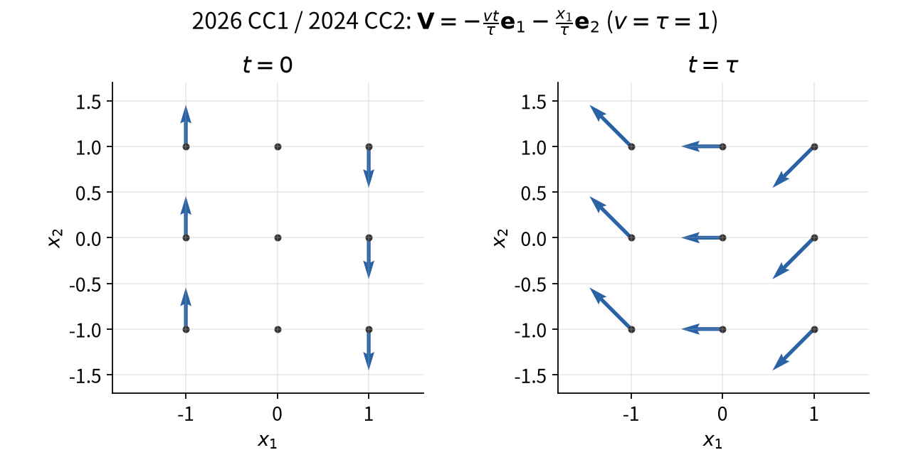

### Question 1.8.3（原题 2.3）

*Calculer le tenseur du taux de déformation D. Quelles sont les unités de ses composantes ?* 变形率 $\mathbb D$ 及其单位

::: rep
$\overrightarrow{\operatorname{grad}}\vec V=-\frac1\tau\,\vec e_2\otimes\vec e_1$, donc $\mathbb D=-\dfrac{1}{2\tau}\begin{pmatrix}0&1&0\\1&0&0\\0&0&0\end{pmatrix}$, en $\mathrm s^{-1}$.
:::

**Détail · 推导**

唯一非零的导数是 $\partial V_2/\partial x_1=-1/\tau$（$-vt/\tau$ 不含空间坐标，对梯度没有贡献）。$\overrightarrow{\operatorname{grad}}\vec V$ 只有 $(2,1)$ 元；对称化后 $\mathbb D$ 的 $(1,2)$、$(2,1)$ 元都是 $-1/(2\tau)$。单位 $\mathrm s^{-1}$。

### Question 1.8.4（原题 2.4）

*Déterminer la représentation lagrangienne $x_i=f_i(X_1,X_2,X_3,t)$, où les $X_i$ sont les coordonnées initiales à $t=0$.* 拉格朗日描述

::: rep

$$x_1=X_1-\frac{vt^2}{2\tau},\qquad x_2=X_2-\frac{X_1t}{\tau}+\frac{vt^3}{6\tau^2},\qquad x_3=X_3 .$$
:::

**Détail · 推导**

速度场就是轨迹的时间导数，得到常微分方程组

$$\dot x_1=-\frac{vt}{\tau},\qquad \dot x_2=-\frac{x_1}{\tau},\qquad \dot x_3=0,\qquad x_i(0)=X_i .$$

**按依赖关系的顺序积分：** 先解只含 $t$ 的 $x_1$：$x_1=X_1-\frac{vt^2}{2\tau}$；把它代入 $x_2$ 的方程：$\dot x_2=-\frac{X_1}{\tau}+\frac{vt^2}{2\tau^2}$，再积分并用 $x_2(0)=X_2$ 定常数，得上式。

### Question 1.8.5（原题 2.5）

*En déduire l’expression, et tracer, la trajectoire du point initialement à l’origine O du repère.* 原点处粒子的轨迹

::: rep
$x_1(O,t)=-\frac{vt^2}{2\tau}$, $x_2(O,t)=\frac{vt^3}{6\tau^2}$, $x_3=0$ ($t\ge0$). En éliminant $t=\sqrt{-\frac{2\tau x_1}{v}}$ ($x_1\le0$), on obtient la parabole semi-cubique :

$$x_2=\frac{\sqrt{2}}{3\sqrt{v\tau}}(-x_1)^{3/2}\qquad(x_1\le0,\ x_3=0).$$
:::

**Détail · 推导**

令 $X_1=X_2=X_3=0$ 得参数方程；将 $x_2$ 与 $x_1$ 相比，得到的是原点到粒子当前位置的**连线（割线）斜率** $x_2/x_1=-\frac{t}{3\tau}$（仍含时间 $t$，并非曲线的笛卡尔方程；而轨迹在该点的**切线斜率**为 $\mathrm dx_2/\mathrm dx_1=\dot x_2/\dot x_1=-\frac{t}{2\tau}$）。真正消去 $t$ 要用 $t=\sqrt{-2\tau x_1/v}$（$x_1\le0$），代入 $x_2$ 得 $x_2=\frac{v}{6\tau^2}\bigl(-\frac{2\tau x_1}{v}\bigr)^{3/2}=\frac{\sqrt{2}}{3\sqrt{v\tau}}(-x_1)^{3/2}$，无量纲化即图题所示的 $\frac{x_2}{v\tau}=\frac{\sqrt{2}}{3}\bigl(-\frac{x_1}{v\tau}\bigr)^{3/2}$，是一条半立方抛物线，粒子向左上方运动。

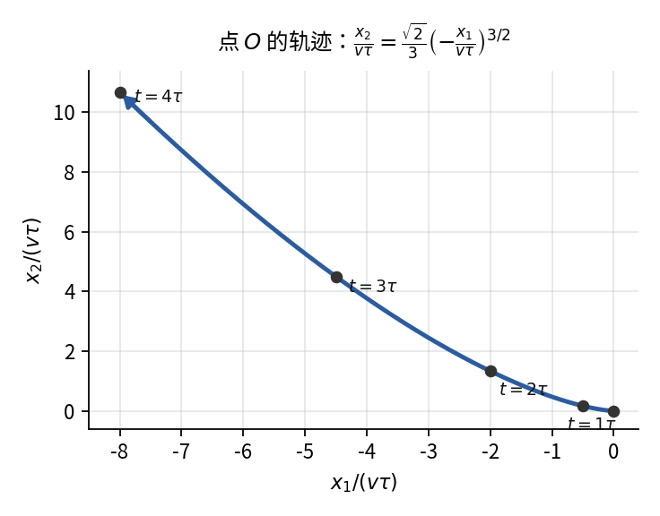

### Question 1.8.6（原题 2.6）

*Calculer l’opérateur gradient de la transformation F, ainsi que l’opérateur des déformations de Green-Lagrange E. Quelles sont les unités des composantes de ces deux tenseurs ?* 变换梯度 $\mathbb F$ 与 Green–Lagrange 应变 $\mathbb E$，及其单位

::: rep

$$\mathbb F=\begin{pmatrix}1&0&0\\-\frac t\tau&1&0\\0&0&1\end{pmatrix},\qquad
\mathbb E=\frac12(\mathbb F^{\mathsf T}\mathbb F-\mathbb I)=\frac{t}{2\tau}\begin{pmatrix}\frac t\tau&-1&0\\-1&0&0\\0&0&0\end{pmatrix},$$

tous deux sans dimension.
:::

**Détail · 推导**

对拉格朗日描述求 $\partial x_i/\partial X_j$，只有 $\partial x_2/\partial X_1=-t/\tau$ 不平凡。$\mathbb F^{\mathsf T}\mathbb F$ 的 $(1,1)$ 元为 $1+(t/\tau)^2$，$(1,2)$、$(2,1)$ 元为 $-t/\tau$。这是剪切量 $\gamma=-t/\tau$ 的简单剪切。

### Question 1.8.7（原题 2.7）

*Déterminer la variation relative de volume du milieu continu au cours du temps.* 体积相对变化

::: rep
$\dfrac{\mathrm dV}{\mathrm dV_0}=\det\mathbb F=1$, donc $\dfrac{\mathrm dV-\mathrm dV_0}{\mathrm dV_0}=0$ : mouvement isochore.
:::

**Détail · 推导**

$\mathbb F$ 是下三角矩阵，行列式等于对角元之积 $=1$，体积不变（isochore）。与 $\operatorname{div}\vec V=\operatorname{tr}\mathbb D=0$ 一致。

### Question 1.8.8（原题 2.8）

*Sous l’HPP, calculer le tenseur des déformations linéarisées $\boldsymbol\varepsilon$. À quelles conditions cette hypothèse est-elle valable ici ?* HPP 下的线性化应变及适用条件

::: rep

$$\vec u=-\frac t\tau\begin{pmatrix}\frac{vt}{2}\\X_1-\frac{vt^2}{6\tau}\\0\end{pmatrix},\quad
\overrightarrow{\operatorname{grad}}_X\vec u=-\frac t\tau\,\vec e_2\otimes\vec e_1,\quad
\boldsymbol\varepsilon=-\frac{t}{2\tau}\begin{pmatrix}0&1&0\\1&0&0\\0&0&0\end{pmatrix}.$$

HPP : $\|\overrightarrow{\operatorname{grad}}\vec u\|\ll1\Rightarrow t\ll\tau$ (transformations infinitésimales) et $\|\vec u\|\ll L$ sur $\Omega_0$ (petits déplacements, dépend de $v$ et de la taille $L$ du domaine).
:::

**Détail · 推导**

位移 $\vec u=\vec x-\vec X$，其中 $u_2=-\frac{X_1t}{\tau}+\frac{vt^3}{6\tau^2}=-\frac t\tau\bigl(X_1-\frac{vt^2}{6\tau}\bigr)$。用积分得到的轨迹检查位移。展开后的 $t^3$ 项为正，提出 $-t/\tau$ 后括号内两项都具有长度量纲。$t^3$ 项对 $\vec X$ 的导数为零，因此 $\overrightarrow{\operatorname{grad}}_X\vec u$ 只保留剪切项。

HPP 包含两个条件，考场作答需写全：

1. **小变换**：$\|\overrightarrow{\operatorname{grad}}\vec u\|\ll1\iff|t/\tau|\ll1\iff t\ll\tau$。也可以表述为 $\mathbb E$ 中的二阶项 $\frac12\overrightarrow{\operatorname{grad}}^{\mathsf T}\vec u\cdot\overrightarrow{\operatorname{grad}}\vec u$（量级 $t^2/\tau^2$）远小于一阶项（量级 $t/\tau$），结论同为 $t\ll\tau$。
2. **小位移**：$\|\vec u\|\ll L$（相对物体特征尺寸 $L$ 很小），这取决于 $v$ 和区域 $\Omega_0$ 的大小。

此时 $\mathbb E\approx\boldsymbol\varepsilon$：$\mathbb E$ 中的 $t^2/(2\tau^2)$ 项可以略去。

### Question 1.8.9（原题 2.9）

*Quelles sont les caractéristiques de ce mouvement ?* 这个运动有哪些特征？

::: rep
Non stationnaire : $\frac{\partial\vec V}{\partial t}=-\frac v\tau\vec e_1\neq\vec0$ ; incompressible : $\operatorname{div}\vec V=0$ ($J=1$) ; rotationnel : $\overrightarrow{\operatorname{rot}}\vec V=-\frac1\tau\vec e_3\neq\vec0$ ; avec déformation ($\mathbb D\neq\mathbb O$) : ce n'est pas un mouvement rigide.
:::

**Détail · 推导**

全部用欧拉速度判断：显含 $t$ ⇒ 非稳态；$\partial_1V_1+\partial_2V_2=0$ ⇒ 不可压缩，与题库 1.8.7 的 $\det\mathbb F=1$ 一致；旋度第三分量 $\partial_1V_2-\partial_2V_1=-\frac1\tau$ ⇒ 有旋；$\mathbb D\ne\mathbb O$ ⇒ 有变形。它是简单剪切叠加一个随时间加速的平移。

## Exercice 1.9 · CC1 2025 ex. 2 — Mouvement de glissement pur · 纯剪切式伸缩运动

[**Source :** CC1 du 15/10/2025, exercice 2 · **出处：** 2025 年 CC1 练习 2 · **Thèmes :** unités, trajectoires, $\mathbb F$, $\mathbb E$, principales, HPP, Euler, $\mathbb D$, $\boldsymbol\Omega$, tracé, caractéristiques, comparaison]{.src}

### Énoncé · 题面

On considère le mouvement plan d'un milieu continu défini par la représentation suivante en description lagrangienne, dans la base cartésienne $(\vec e_1,\vec e_2,\vec e_3)$ : 运动映射为

$$x_1(t)=(1+\alpha t)X_1,\qquad x_2(t)=\frac{X_2}{1+\alpha t},\qquad x_3(t)=X_3,$$
où $\alpha$ est une constante strictement positive. On désigne par $(x_1,x_2,x_3)$ les composantes du vecteur position $\overrightarrow{OM}(t)$ d'une particule à l'instant $t$, et par $(X_1,X_2,X_3)$ les composantes du vecteur position $\overrightarrow{OM_0}$ de cette même particule à l'instant initial $t_0=0$. Pour les exemples et tracés, on prendra $t=1$ s et $\alpha=1/2$ (on ne précise pas l'unité de $\alpha$ !). 初始时刻为 $t=0$；作图取 $t=1\ \mathrm s$、$\alpha=1/2$。下文记 $a=1+\alpha t$。

$$x_1=(1+\alpha t)X_1,\quad x_2=\frac{X_2}{1+\alpha t},\quad x_3=X_3,\qquad\alpha>0.$$

### Question 1.9.1（原题 2.1）

*En quelle unité s’exprime la constante $\alpha$ ?* $\alpha$ 的单位

::: rep
$x_1/X_1=1+\alpha t$ est sans dimension, donc $\alpha t$ aussi : $[\alpha]=\mathrm s^{-1}$, soit $\alpha=0{,}5\ \mathrm s^{-1}$ ; à $t=1$ s, $a=1+\alpha t=3/2$.
:::

**Détail · 推导**

$x_1$ 和 $X_1$ 都是长度，因此比例 $x_1/X_1=1+\alpha t$ 必须无量纲。常数 1 无量纲，能与它相加的 $\alpha t$ 也必须无量纲：

$$[\alpha t]=1
\quad\Longrightarrow\quad [\alpha]=\mathrm{s^{-1}}.$$

所以题给的数值应完整写为 $\alpha=0.5\,\mathrm{s^{-1}}$。在 $t=1\,\mathrm s$ 时，

$$a=1+\alpha t=1+\frac12=\frac32,$$

表示第一方向的长度放大到初始的 $3/2$，第二方向缩为初始的 $2/3$。$a$ 是无量纲伸长比，不是一个长度。

### Question 1.9.2（原题 2.2）

*Tracer sur le même graphe l’allure des trajectoires des particules initialement en $O=(0,0,0)$, $A_0=(1,0,0)$, $B_0=(0,1,0)$ et $C_0=(1,1,0)$.* 画四个初始点的轨迹

::: rep
$O$ reste fixe ; $A$ : $(a,0,0)$, s'éloigne sur l'axe $x_1$ ; $B$ : $(0,1/a,0)$, se rapproche de $O$ sur l'axe $x_2$ ; $C$ : $(a,1/a,0)$, décrit l'hyperbole $x_1x_2=1$.
:::

**Détail · 推导**

轨迹由“固定同一个初始位置 $\vec X$，让时间变化”得到。把四个初始点依次代入映射：

| 粒子 | 任意时刻的位置 | $t=1\,\mathrm s,\ \alpha=0.5\,\mathrm{s^{-1}}$ 时 |
|---|---|---|
| $O$ | $(0,0,0)$，一直静止 | $(0,0,0)$ |
| $A$ | $(a,0,0)$，沿正 $x_1$ 轴向外 | $(3/2,0,0)$ |
| $B$ | $(0,a^{-1},0)$，沿正 $x_2$ 轴向原点 | $(0,2/3,0)$ |
| $C$ | $(a,a^{-1},0)$，向右下方运动 | $(3/2,2/3,0)$ |

对 $C$ 消去时间，有 $x_1x_2=a\,a^{-1}=1$，所以轨迹是双曲线 $x_2=1/x_1$。对 $t\ge0$，$a\ge1$，只沿从 $(1,1)$ 开始、向右下方的分支前进。

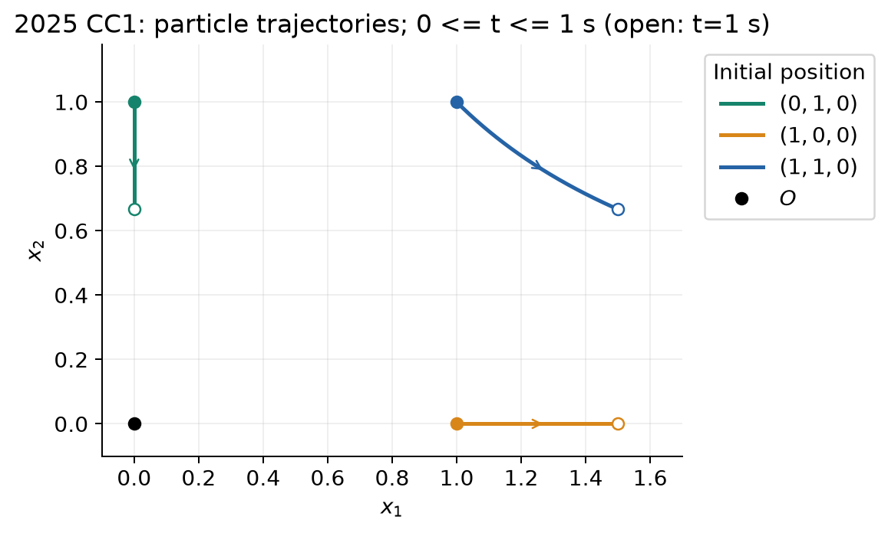

图取 $0\le t\le1\,\mathrm s$；实心点为初始位置，空心点为题目指定的 $t=1\,\mathrm s$ 位置。画轨迹时应标出方向和起点，不要把它画成“同一时刻各位置的速度箭头”。

### Question 1.9.3（原题 2.3）

*Déterminer l’expression du tenseur gradient de transformation $\mathbf F$ et son déterminant. Que peut-on en déduire sur la variation de volume d’une particule ?* 求 $\mathbf F$ 与行列式，并解释体积

::: rep
$\mathbb F=\operatorname{diag}(a,a^{-1},1)$, $J=\det\mathbb F=1$ : le volume de chaque particule est conservé (transformation isochore).
:::

**Détail · 推导**

变换梯度把初始线元映射成当前线元，按参考坐标求导：

$$F_{ij}=\frac{\partial x_i}{\partial X_j}.$$

求这个导数时 $t$ 固定，所以 $a=1+\alpha t$ 对 $\vec X$ 来说是常数。由 $x_1=aX_1$、$x_2=X_2/a$、$x_3=X_3$ 得

$$\mathbb F=
\begin{pmatrix}
\partial_{X_1}x_1&\partial_{X_2}x_1&\partial_{X_3}x_1\\
\partial_{X_1}x_2&\partial_{X_2}x_2&\partial_{X_3}x_2\\
\partial_{X_1}x_3&\partial_{X_2}x_3&\partial_{X_3}x_3
\end{pmatrix}
=\begin{pmatrix}a&0&0\\0&a^{-1}&0\\0&0&1\end{pmatrix}.$$

对角矩阵的行列式为对角元乘积：

$$J=\det\mathbb F=a\times a^{-1}\times1=1.$$

因此 $\mathrm dv=J\,\mathrm dV_0=\mathrm dV_0$，每个物质微元的体积严格保持不变。第一方向拉长，第二方向恰好按相反比例缩短，第三方向不变。**保持体积并不表示 $\mathbb F=\mathbb I$，也不表示形状没有改变。**

### Question 1.9.4（原题 2.4）

*Déterminer l’expression du tenseur de déformation de Green–Lagrange $\mathbf E$.* 求 Green–Lagrange 应变

::: rep
$\mathbb E=\frac12(\mathbb F^{\mathsf T}\mathbb F-\mathbb I)=\frac12\operatorname{diag}(a^2-1,\ a^{-2}-1,\ 0)$, avec $a=1+\alpha t$.
:::

**Détail · 推导**

Green–Lagrange 应变由参考构形与当前构形的线元长度变化定义。计算时依次做“转置、相乘、减单位阵、除以 2”：

$$\mathbb C=\mathbb F^{\mathsf T}\mathbb F
=\begin{pmatrix}a^2&0&0\\0&a^{-2}&0\\0&0&1\end{pmatrix},$$

$$\boxed{\mathbb E=\frac12(\mathbb C-\mathbb I)
=\frac12\begin{pmatrix}
a^2-1&0&0\\
0&a^{-2}-1&0\\
0&0&0
\end{pmatrix}.}$$

例如原先沿 $\vec e_1$ 的单位长度线元，变形后长度为 $a$，长度平方从 1 变成 $a^2$，所以 $E_{11}=(a^2-1)/2$；第二方向同理。

在 $t=0$ 时 $a=1$，应有 $\mathbb E=\mathbb O$。在指定的 $t=1\,\mathrm s$ 时，$a=3/2$，可检查

$$\mathbb E=\operatorname{diag}\left(\frac58,-\frac5{18},0\right).$$

一个方向为正、另一个为负，符合第一方向伸长、第二方向收缩的几何图像。这里求的是有限应变，不能直接用 $\mathbb F-\mathbb I$ 代替。

### Question 1.9.5（原题 2.5）

*Déterminer les expressions des déformations principales et les directions associées.* 求主应变与方向

::: rep
$\mathbb E$ est diagonal : $E_1=\frac{a^2-1}2>0$ selon $\vec e_1$, $E_2=\frac{a^{-2}-1}2<0$ selon $\vec e_2$, $E_3=0$ selon $\vec e_3$ (pour $t>0$) ; à $t=0$ toutes sont nulles et toute direction est principale.
:::

**Détail · 推导**

主应变是应变张量的特征值，方向满足 $\mathbb E\vec n=E_{\mathrm{pr}}\vec n$。上一问的矩阵已经对角化，因此不必再解特征多项式：每条坐标轴就是一个主方向，对角元就是对应主应变。

将 $a=1+\alpha t$ 展开：

$$\begin{aligned}
E_1&=\frac{a^2-1}{2}
=\frac{\alpha t(2+\alpha t)}2
&&\leftrightarrow\ \vec e_1,\\
E_2&=\frac{a^{-2}-1}{2}
=\frac{1-(1+\alpha t)^2}{2(1+\alpha t)^2}
=-\frac{\alpha t(2+\alpha t)}{2(1+\alpha t)^2}
&&\leftrightarrow\ \vec e_2,\\
E_3&=0
&&\leftrightarrow\ \vec e_3.
\end{aligned}$$

对 $t>0$，有 $E_1>0$、$E_2<0$、$E_3=0$，分别对应伸长、收缩、长度不变。这里下标按坐标方向命名，并未按特征值从大到小排序。

### Question 1.9.6（原题 2.6）

*Quel est le domaine de validité de l’Hypothèse des Petites Perturbations ? Calculer le tenseur des déformations linéarisées $\boldsymbol\varepsilon$, ainsi que sa trace. Commenter.* 小扰动有效范围、线性化应变及其迹

::: rep
HPP si $\|\overrightarrow{\operatorname{grad}}\vec u\|\ll1$ et $\|\vec u\|\ll L$ (domaine borné), soit $\alpha t\ll1$ ($t\ll1/\alpha$). $\vec u=\bigl(\alpha tX_1,\ -\frac{\alpha t}{1+\alpha t}X_2,\ 0\bigr)$, d'où :

$$\boldsymbol\varepsilon=\operatorname{diag}\Bigl(\alpha t,\ -\frac{\alpha t}{1+\alpha t},\ 0\Bigr)\approx\alpha t\operatorname{diag}(1,-1,0) ;$$
la trace vaut $\operatorname{tr}\boldsymbol\varepsilon=\frac{(\alpha t)^2}{1+\alpha t}\approx0$ au premier ordre, cohérent avec l'incompressibilité ($J=1$).
:::

**Détail · 推导**

**先求位移，再检查能否忽略二阶项。** 位移是当前位置减初始位置。记无量纲小参数 $q=\alpha t$，于是 $a=1+q$，有

$$\vec u=\vec x-\vec X
=\left(qX_1,\ -\frac q{1+q}X_2,\ 0\right),$$

$$\mathbb H=\overrightarrow{\operatorname{grad}}_X\vec u
=\operatorname{diag}\left(q,-\frac q{1+q},0\right).$$

精确有限应变与位移梯度的关系为

$$\mathbb E=\frac12\left(\mathbb H+\mathbb H^{\mathsf T}
+\mathbb H^{\mathsf T}\mathbb H\right).$$

小扰动假设（HPP）要求位移梯度足够小（$\|\mathbb H\|\ll1$，从而略去二次项）且有界域上位移远小于特征尺度 $L$（$\|\vec u\|\ll L$）。对本题 $t\ge0$，第一项大小为 $q$，另一项的绝对值不超过 $q$，在有界域上条件即归结为

$$\boxed{\alpha t\ll1,\qquad t\ll1/\alpha.}$$

**线性化应变的定义**是去掉上述二次项后，取

$$\boldsymbol\varepsilon=\frac12(\mathbb H+\mathbb H^{\mathsf T})
=\operatorname{diag}\left(q,-\frac q{1+q},0\right).$$

若将精确位移直接代入这一定义，迹为

$$\operatorname{tr}\boldsymbol\varepsilon
=q-\frac q{1+q}=\frac{q^2}{1+q}.$$

这个数并非严格为零，但它是二阶小量。既然正在保留一阶近似，还可以一致地展开 $(1+q)^{-1}\simeq1-q$，从而

$$\boxed{\boldsymbol\varepsilon
\simeq q\,\operatorname{diag}(1,-1,0),\qquad
\operatorname{tr}\boldsymbol\varepsilon\simeq0.}$$

因此，**“把精确位移代入线性化应变定义”与“将结果进一步截断到 $q$ 的一阶”是两个步骤**：直接写 $\operatorname{tr}\boldsymbol\varepsilon=0$ 是在一阶截断意义下成立的，不能把它理解成对任意时间的精确等式。

一阶小应变的迹近似表示相对体积变化，因而零迹与本题等体积相符；有限变形下判断体积仍应使用 $\det\mathbb F$。此外，题目给作图用的 $\alpha t=1/2$ 不属于明确的 $\alpha t\ll1$ 范围，作图参数本身不意味着 HPP 成立。

### Question 1.9.7（原题 2.7）

*Montrer que le champ eulérien des vitesses (c’est-à-dire la représentation eulérienne de ce mouvement) s’écrit :* 证明欧拉速度场等于下式。

$$\mathbf V^E(t,\mathbf x)=\frac{\alpha}{1+\alpha t}(x_1\mathbf e_1-x_2\mathbf e_2).$$

::: rep
À $\vec X$ fixé : $\vec V=\alpha X_1\vec e_1-\frac{\alpha X_2}{a^2}\vec e_2$ ; avec $X_1=x_1/a$, $X_2=ax_2$ : $\vec V^E(t,\vec x)=\frac\alpha{1+\alpha t}(x_1\vec e_1-x_2\vec e_2)$.
:::

**Détail · 推导**

欧拉速度要回答“当前位于 $\vec x$ 处的粒子，速度是多少”。转换分两步。

**第一步，固定粒子标签 $\vec X$，对位置求时间导数。** 因为 $\dot a=\alpha$，

$$\begin{aligned}
V_1^{L}(t,\vec X)&=\frac{\mathrm d}{\mathrm dt}(aX_1)=\alpha X_1,\\
V_2^{L}(t,\vec X)&=\frac{\mathrm d}{\mathrm dt}(X_2/a)=-\frac{\alpha X_2}{a^2},\\
V_3^{L}(t,\vec X)&=0.
\end{aligned}$$

此时结果仍按初始粒子 $\vec X$ 表示，是拉格朗日速度。

**第二步，用逆映射消去 $\vec X$。** 由 $x_1=aX_1$、$x_2=X_2/a$，反解得

$$X_1=\frac{x_1}{a},\qquad X_2=ax_2,\qquad X_3=x_3.$$

代回速度：

$$\boxed{\vec V^{E}(t,\vec x)
=\begin{pmatrix}\alpha x_1/a\\-\alpha x_2/a\\0\end{pmatrix}
=\frac{\alpha}{1+\alpha t}(x_1\vec e_1-x_2\vec e_2).}$$

这一步只是换了标记同一物理场的方式，粒子实际速度并没有改变。求第一步的时间导数时必须固定 $\vec X$；若直接把当前坐标当成固定粒子坐标，第二个分量中的 $a^{-2}$ 就容易求错。

### Question 1.9.8（原题 2.8）

*Déterminer les tenseurs taux de déformation $\mathbf D$ et taux de rotation $\boldsymbol\Omega$. Préciser leur unité.* 求变形率与旋转率及其单位

::: rep
$\overrightarrow{\operatorname{grad}}\vec V=\frac\alpha a\operatorname{diag}(1,-1,0)$ est symétrique : $\mathbb D=\frac\alpha{1+\alpha t}\operatorname{diag}(1,-1,0)$, $\boldsymbol\Omega=\mathbb O$, en $\mathrm s^{-1}$.
:::

**Détail · 推导**

先对欧拉速度按**当前坐标**求梯度：

$$\mathbb L=\overrightarrow{\operatorname{grad}}_x\vec V
=\begin{pmatrix}
\alpha/a&0&0\\
0&-\alpha/a&0\\
0&0&0
\end{pmatrix}.$$

求空间导数时 $t$ 固定，所以 $\alpha/a$ 是空间常数。例如 $\partial_{x_1}V_1=\alpha/a$，$\partial_{x_2}V_1=0$。

再分别取对称与反对称部分：

$$\boxed{\mathbb D=\frac12(\mathbb L+\mathbb L^{\mathsf T})
=\frac\alpha a\operatorname{diag}(1,-1,0),\qquad
\boldsymbol\Omega=\frac12(\mathbb L-\mathbb L^{\mathsf T})=\mathbb O.}$$

$\mathbb L$ 已对称，因此全部速度梯度都属于变形率，没有局部刚体旋转率。第一方向伸长、第二方向收缩的瞬时速率分别为 $\alpha/a$ 和 $-\alpha/a$，二者随着时间变化。

$a$ 无量纲、$[\alpha]=\mathrm{s^{-1}}$，所以两种“率”的单位均为 $\mathrm{s^{-1}}$。即使本题 $\boldsymbol\Omega=\mathbb O$，它所代表的物理量仍有旋转率的单位；数值为零并不会改变物理量的单位。

### Question 1.9.9（原题 2.9）

*Tracer le champ de vitesse sur $0\le x_1\le1$, $0\le x_2\le1$, $x_3=0$, sur une grille de $3\times3$ points. Quelle forme aura le champ pour les $x_1$ négatifs ?* 在 $3\times3$ 网格画速度，负 $x_1$ 区域如何？

::: rep
À $t=1$ s : $\vec V=(x_1/3)\vec e_1-(x_2/3)\vec e_2$ ; les flèches s'éloignent de l'axe $x_2$ et se rapprochent de l'axe $x_1$ ; pour $x_1<0$ la composante horizontale change de signe (champ symétrique par rapport à l'axe $x_2$).
:::

**Détail · 推导**

先把题给的时刻和参数代入，而不是把整条粒子轨迹画出来：

$$t=1\,\mathrm s,\qquad \alpha=0.5\,\mathrm{s^{-1}},
\qquad a=\frac32,\qquad \frac\alpha a=\frac13\,\mathrm{s^{-1}}.$$

在九个当前网格点 $x_1,x_2\in\{0,1/2,1\}$，逐点代入

$$\vec V=(x_1/3,-x_2/3,0).$$

下表列出面内速度分量 $(V_1,V_2)$；坐标按米取值时，速度单位为 $\mathrm{m/s}$。

| $x_2\backslash x_1$ | $0$ | $1/2$ | $1$ |
|---|---|---|---|
| $1$ | $(0,-1/3)$ | $(1/6,-1/3)$ | $(1/3,-1/3)$ |
| $1/2$ | $(0,-1/6)$ | $(1/6,-1/6)$ | $(1/3,-1/6)$ |
| $0$ | $(0,0)$ | $(1/6,0)$ | $(1/3,0)$ |

在每个点以该点为箭头起点，按表中的方向和相对长度画箭头；原点速度为零。整幅图必须使用同一个箭头缩放比例。

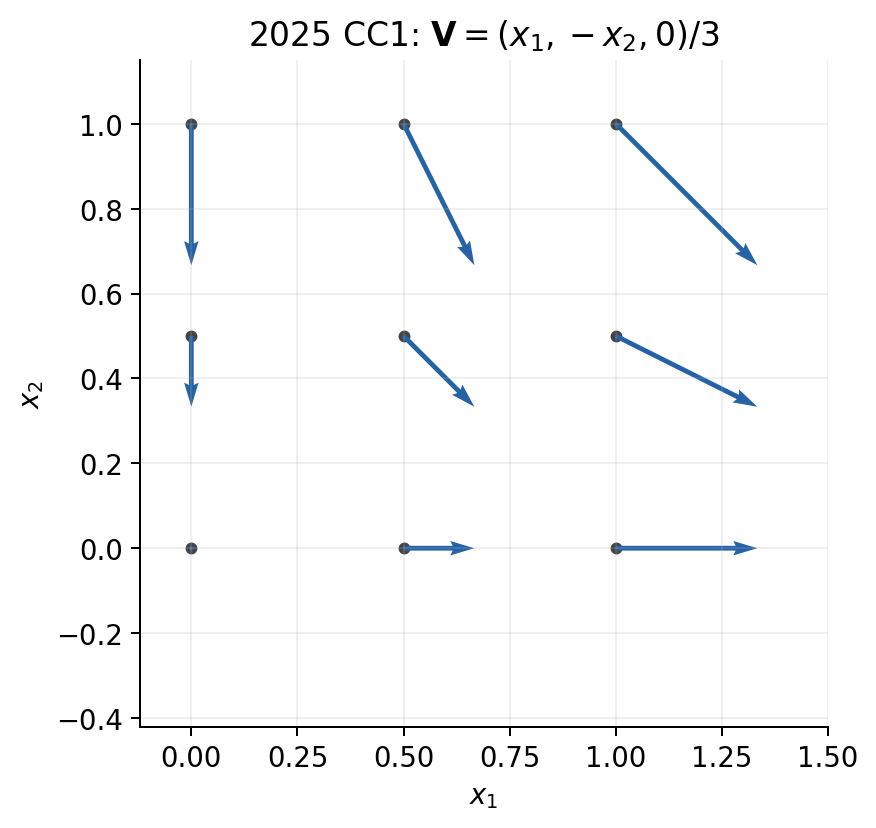

当 $x_1<0$ 时，$V_1<0$，水平分量转向左；$V_2=-x_2/3$ 不因 $x_1$ 改变。因此把右半平面的速度图关于竖轴作相应的镜像即可。图中的箭头是瞬时速度，不表示经过一秒后粒子一定到达箭头终点。

### Question 1.9.10（原题 2.10）

*Que peut-on conclure sur les caractéristiques du mouvement : incompressibilité, rotationnel, stationnarité ?* 是否不可压缩、无旋、稳态？

::: rep
$\operatorname{div}\vec V=0$ : incompressible ; $\overrightarrow{\operatorname{rot}}\vec V=\vec0$ : irrotationnel ; $\partial_t\vec V\neq\vec0$ (facteur $\frac\alpha{1+\alpha t}$) : non stationnaire.
:::

**Détail · 推导**

三种性质分别用三个运算检查，不能相互代替。

**不可压缩：** 散度是速度梯度的迹，

$$\operatorname{div}\vec V
=\frac{\partial V_1}{\partial x_1}
+\frac{\partial V_2}{\partial x_2}
+\frac{\partial V_3}{\partial x_3}
=\frac\alpha a-\frac\alpha a=0.$$

所以运动不可压缩，与题库 1.9.3 的 $J=1$ 相符。

**无旋：** $V_1$ 只依赖 $x_1$，$V_2$ 只依赖 $x_2$，所有参与旋度的交叉偏导均为零，因此 $\overrightarrow{\operatorname{rot}}\vec V=\vec0$。这也与上一问 $\boldsymbol\Omega=\mathbb O$ 一致。

**非稳态：** 稳态要求固定当前位置 $\vec x$ 时，速度不随时间变化。但

$$\partial_t\left(\frac{\alpha}{1+\alpha t}\right)
=-\frac{\alpha^2}{(1+\alpha t)^2},$$

所以

$$\frac{\partial\vec V}{\partial t}
=-\frac{\alpha^2}{a^2}(x_1\vec e_1-x_2\vec e_2)
\not\equiv\vec0.$$

结论是：**不可压缩、无旋、非稳态，并且有变形。** 固定位置处的速度箭头会随时间缩短，所以不是稳态；这里判断的是整个速度场，不能因为原点一直静止就把运动判为稳态。这个时间偏导也不是粒子的完整加速度，后者还包含对流项。

### Question 1.9.11（原题 2.11）

*Quelles similarités et différences observe-t-on par rapport à un glissement simple ?* 与简单剪切有何相同与不同？

::: rep
Similitudes : mouvements plans, isochores ($\det\mathbb F=1$), avec déformation. Différences : ici $\boldsymbol\Omega=\mathbb O$ et directions principales fixes ($\vec e_1$, $\vec e_2$), trajectoires hyperboliques ; le glissement simple est rotationnel, ses directions principales tournent et ses trajectoires sont des droites parallèles.
:::

**Détail · 推导**

先写出简单剪切的一个标准例子，便于与本题比较：

$$x_1=X_1+k(t)X_2,\qquad x_2=X_2,\qquad x_3=X_3,$$

$$\mathbb F_s=
\begin{pmatrix}1&k&0\\0&1&0\\0&0&1\end{pmatrix},\qquad
\mathbb L_s=
\begin{pmatrix}0&\dot k&0\\0&0&0\\0&0&0\end{pmatrix}.$$

| 比较项 | 本题纯伸缩式剪切 | 上述简单剪切 |
|---|---|---|
| 物质方块的形状 | 沿坐标轴拉长、压窄，仍为矩形 | 相邻层错动，变成平行四边形 |
| 体积 | $a\times a^{-1}=1$，保持体积 | $\det\mathbb F_s=1$，也保持体积 |
| 变形率 | $\mathbb D$ 为对角矩阵，非零 | $\mathbb D_s=(\mathbb L_s+\mathbb L_s^{\mathsf T})/2$，有非对角项 |
| 局部旋转率 | $\boldsymbol\Omega=\mathbb O$ | $\dot k\ne0$ 时 $\boldsymbol\Omega_s\ne\mathbb O$ |
| 有限主应变方向 | 固定为坐标轴方向 | 一般随剪切量 $k$ 改变 |

简单剪切中的速度梯度既有对称部分，也有反对称部分；所以它同时包含局部变形和局部转动。本题速度梯度完全对称，只有沿固定方向的伸缩率。

这里最后一行说的是**有限应变张量的主方向**，不要与瞬时变形率 $\mathbb D_s$ 的主方向混淆。两种运动都能改变形状而保持体积，但几何过程和旋转率不同。

## Exercice 1.10 · CC1 2024 ex. 2 — Descriptions eulérienne et lagrangienne · 欧拉与拉格朗日描述

[**Source :** CC1 du 23/10/2024, exercice 2 · **出处：** 2024 年 CC1 练习 2 · **Thèmes :** unités, tracé, divergence, $\mathbb D$, Lagrange, trajectoires, $\mathbb F$, masse volumique, $\mathbb E$, principales, HPP, comparaison $\mathbb D$–$\boldsymbol\varepsilon$, rotationnel]{.src}

### Énoncé · 题面

On considère le mouvement plan d'un milieu continu défini par la représentation suivante du champ des vitesses en description eulérienne : 给定平面速度场

$$\vec V(M)=\alpha(x_1\vec e_1-x_2\vec e_2),$$
exprimé dans la base cartésienne $(\vec e_1,\vec e_2,\vec e_3)$, $\alpha$ étant un scalaire constant, supposé positif. On désigne par $(x_1,x_2,x_3)$ les composantes du vecteur position $\vec x$ d'une particule à l'instant $t$, et par $(X_1,X_2,X_3)$ les composantes du vecteur position $\vec X$ de cette même particule à l'instant initial $t=0$. Le milieu continu occupe à l'instant $t$ le domaine $\Omega(t)$ défini par $x_1>0$, $x_2>0$ et $x_3$ quelconque. 初始坐标为 $(X_1,X_2,X_3)$，当前坐标为 $(x_1,x_2,x_3)$，参考时刻 $t=0$。介质区域为 $x_1>0,x_2>0$，$x_3$ 任意。下方原题也要求画坐标轴上的示例点，可把它们理解为该运动映射延拓到区域边界后的轨迹。

$$\vec V(M)=\alpha(x_1\vec e_1-x_2\vec e_2)
=\begin{pmatrix}\alpha x_1\\-\alpha x_2\\0\end{pmatrix},\qquad\alpha>0.$$

### Question 1.10.1（原题 2.1）

*Quelle est l’unité de la constante $\alpha$ ? Quelles quantités s’expriment dans cette unité ?* $\alpha$ 的单位是什么？哪些物理量有相同单位？

::: rep
$[\alpha]=\frac{[V]}{[x]}=\mathrm s^{-1}$ : même unité qu'une fréquence ou qu'un taux de déformation ($\mathbb D$, $\boldsymbol\Omega$, $\operatorname{div}\vec V$).
:::

**Détail · 推导**

从 $V_1=\alpha x_1$ 出发，先写量纲：

$$[\alpha]=\frac{[V_1]}{[x_1]}
=\frac{\mathrm{m/s}}{\mathrm m}=\mathrm{s^{-1}}.$$

因此 $\alpha$ 不是一个长度或应变，而是一个**每单位时间的变化尺度**；频率、应变率、角速度都可具有这一单位。

本题后面会出现 $e^{\alpha t}$。指数必须无量纲，$[\alpha t]=1$，这也能反过来检查单位是否正确。

### Question 1.10.2（原题 2.2）

*Tracer, dans le plan $(O,\mathbf e_1,\mathbf e_2)$, la forme du champ des vitesses à l’instant $t$. À quel type de mouvement ou phénomène cela peut-il correspondre ?* 画速度场，说明可能对应哪类运动或现象

::: rep
Vitesses qui s'éloignent de l'axe $x_2$ selon $\vec e_1$ et se rapprochent de l'axe $x_1$ selon $\vec e_2$ ; lignes de courant $x_1x_2=$ cste (hyperboles) : écoulement au voisinage d'un point d'arrêt (fluide arrivant sur une paroi).
:::

**Détail · 推导**

速度场作图是在同一时刻，对多个**当前空间位置**画速度箭头。先分别看两个分量：

$$V_1=\alpha x_1,\qquad V_2=-\alpha x_2.$$

因为 $\alpha>0$，第一象限内的箭头向右、向下。在 $x_1$ 轴上只有水平分量，远离原点；在 $x_2$ 轴上只有竖直分量，朝向原点。在全平面延拓后，左右两侧沿第一方向分开，上下两侧沿第二方向靠拢。

例如取 $\alpha=1\,\mathrm{s^{-1}}$，在 $(1,0)$、$(0,1)$、$(1,1)$ 处依次画 $(1,0)$、$(0,-1)$、$(1,-1)$ 的箭头，再按坐标的符号和大小补全其他位置。

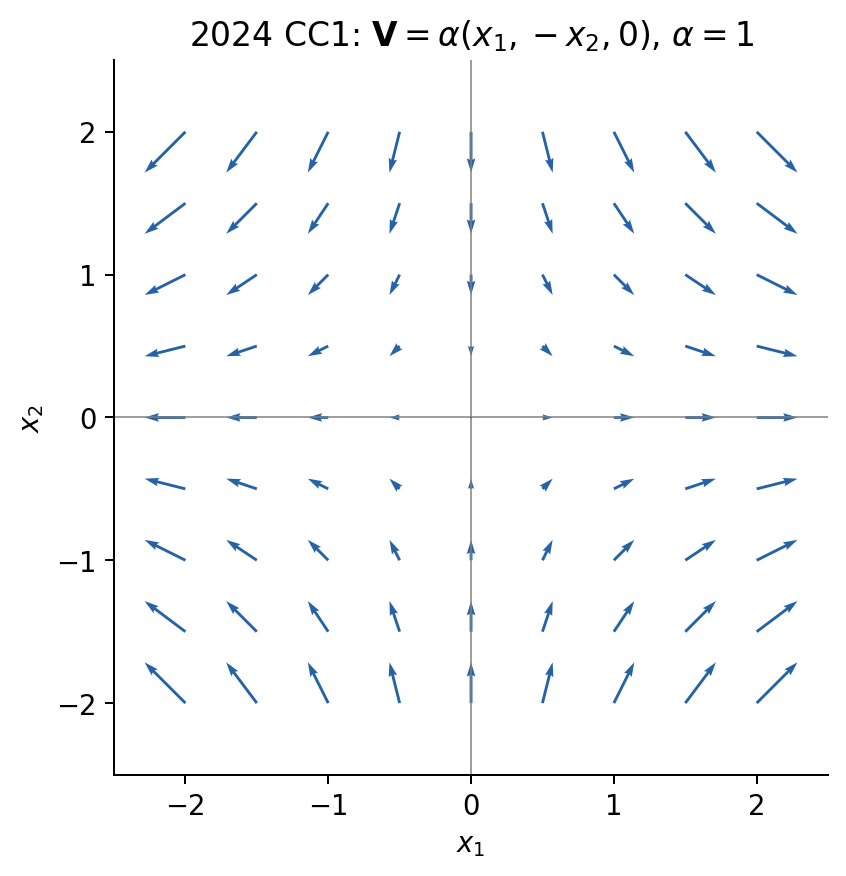

这对应第一方向伸长、第二方向收缩的平面伸缩流，也称纯伸缩式剪切。它可示意拉伸流或停滞点附近的鞍形流动。图中的箭头表示速度，不是粒子已经走过的轨迹；粒子轨迹要由题库 1.10.5、1.10.6 确定。

### Question 1.10.3（原题 2.3）

*Calculer $\operatorname{div}\mathbf V$. Que peut-on en déduire concernant la variation de volume d’un domaine matériel $\omega(t)$ contenu dans $\Omega(t)$ entre les instants $0$ et $t$ ?* 求散度，并判断物质域从 0 到 $t$ 的体积变化

::: rep
$\operatorname{div}\vec V=\alpha-\alpha=0$ ; $\frac{\mathrm d}{\mathrm dt}(\mathrm dv)=\operatorname{div}\vec V\,\mathrm dv=0$ : le volume de $\omega(t)$ reste constant entre $0$ et $t$.
:::

**Détail · 推导**

散度取的是“第 $i$ 个速度分量对第 $i$ 个空间坐标的导数”之和：

$$\operatorname{div}\vec V
=\frac{\partial(\alpha x_1)}{\partial x_1}
+\frac{\partial(-\alpha x_2)}{\partial x_2}
+\frac{\partial 0}{\partial x_3}
=\alpha-\alpha=0.$$

第一方向在拉开，第二方向在压缩，二者的局部体积变化率正好抵消。要从这个**瞬时结论**得到“从 $0$ 到 $t$ 体积不变”，可用物质微元的关系

$$\frac{\mathrm d(\mathrm dv)}{\mathrm dt}=(\operatorname{div}\vec V)\,\mathrm dv=0.$$

所以每个随粒子运动的微小体积始终保持初始值，任意有限随体区域的体积也不变。等价地，

$$\dot J=J\,\operatorname{div}\vec V=0,\qquad J(0)=1
\quad\Longrightarrow\quad J(t)=1.$$

这里 $J=\mathrm dv/\mathrm dV_0$ 是当前体积与初始体积之比。结论是**运动不可压缩、变换等体积，但允许形状改变**。

### Question 1.10.4（原题 2.4）

*Calculer le taux de déformation $\mathbf D$. Quelles sont les unités de ses composantes ?* 求变形率 $\mathbb D$，其分量单位是什么？

::: rep
$\overrightarrow{\operatorname{grad}}\vec V=\alpha\operatorname{diag}(1,-1,0)$ est symétrique, donc $\mathbb D=\alpha\operatorname{diag}(1,-1,0)$, composantes en $\mathrm s^{-1}$.
:::

**Détail · 推导**

变形率 $\mathbb D$ 描述的是“现在每单位时间发生多少局部伸缩或剪切”。从欧拉速度求它，要先算对当前坐标的梯度：

$$L_{ij}=\frac{\partial V_i}{\partial x_j},\qquad
\mathbb L=
\begin{pmatrix}
\alpha&0&0\\
0&-\alpha&0\\
0&0&0
\end{pmatrix}.$$

例如 $L_{11}=\partial_{x_1}(\alpha x_1)=\alpha$，$L_{12}=\partial_{x_2}(\alpha x_1)=0$，其他项同理。

再取对称部分：

$$\mathbb D=\frac12(\mathbb L+\mathbb L^{\mathsf T})
=\alpha\operatorname{diag}(1,-1,0).$$

由于 $\mathbb L$ 已经对称，这一步不改变矩阵。$D_{11}>0$ 表示第一方向的瞬时伸长率，$D_{22}<0$ 表示第二方向的瞬时收缩率，第三方向不变。其单位是速度除以长度，即 $\mathrm{s^{-1}}$。

反对称部分 $\boldsymbol\Omega=(\mathbb L-\mathbb L^{\mathsf T})/2=\mathbb O$，说明没有局部刚体旋转率；这不妨碍 $\mathbb D$ 非零。

### Question 1.10.5（原题 2.5）

*Déterminer la représentation lagrangienne du mouvement, c’est-à-dire les fonctions $f_i$ telles que $x_i=f_i(X_1,X_2,X_3,t)$.* 求拉格朗日运动映射 $x_i=f_i(\vec X,t)$

::: rep
$\dot x_1=\alpha x_1$, $\dot x_2=-\alpha x_2$, $\dot x_3=0$ avec $\vec x(0)=\vec X$ : $x_1=X_1e^{\alpha t}$, $x_2=X_2e^{-\alpha t}$, $x_3=X_3$.
:::

**Détail · 推导**

要得到拉格朗日描述，就要跟踪**同一个粒子**，把它在初始时刻的位置 $\vec X$ 当作固定标签。它的当前位置满足“位置对时间的导数等于该处的速度”：

$$\dot x_1=\alpha x_1,\qquad
\dot x_2=-\alpha x_2,\qquad
\dot x_3=0,\qquad \vec x(0)=\vec X.$$

第一式可分离变量：$\mathrm dx_1/x_1=\alpha\,\mathrm dt$，积分后 $x_1=C_1e^{\alpha t}$。代入 $x_1(0)=X_1$ 得 $C_1=X_1$。第二式同理，只是指数符号相反；第三式说明第三坐标保持初值。因此

$$\boxed{x_1=X_1e^{\alpha t},\qquad
x_2=X_2e^{-\alpha t},\qquad x_3=X_3.}$$

这是整个运动映射，不是某一个点的特殊轨迹；代入不同的 $\vec X$，就得到不同粒子的轨迹。坐标轴上的 $X_1=0$ 或 $X_2=0$ 也可直接代入这个结果，不需要对零取对数。

最后做两个检查：令 $t=0$ 应恢复 $\vec x=\vec X$；固定 $\vec X$ 求时间导数，应恢复题给速度场。

### Question 1.10.6（原题 2.6）

*Tracer la trajectoire des points initialement situés en $(0,1,0)$, $(1,0,0)$ et $(1,1,0)$.* 画初始点 $(0,1,0),(1,0,0),(1,1,0)$ 的轨迹

::: rep
$(0,1,0)$ : descend sur l'axe $x_2$ vers $O$ ; $(1,0,0)$ : s'éloigne sur l'axe $x_1$ ; $(1,1,0)$ : branche d'hyperbole $x_1x_2=1$.
:::

**Détail · 推导**

把三个初始位置分别代入上一问的映射：

| 初始点 | 参数轨迹 $(x_1(t),x_2(t),x_3(t))$ | 从 $t=0$ 开始的运动方向 |
|---|---|---|
| $(0,1,0)$ | $(0,e^{-\alpha t},0)$ | 沿正 $x_2$ 轴接近原点，有限时间内不到原点 |
| $(1,0,0)$ | $(e^{\alpha t},0,0)$ | 沿正 $x_1$ 轴远离原点 |
| $(1,1,0)$ | $(e^{\alpha t},e^{-\alpha t},0)$ | 向右下方运动 |

第三个粒子的参数 $t$ 可以消去：

$$x_1x_2=e^{\alpha t}e^{-\alpha t}=1,
\qquad x_2=\frac1{x_1}.$$

因此它走的是双曲线；对 $t\ge0$，只走从 $(1,1)$ 出发、$x_1\ge1$ 的那一段。作图时应标起点和方向，不能只画完整双曲线而不指出走哪一段。

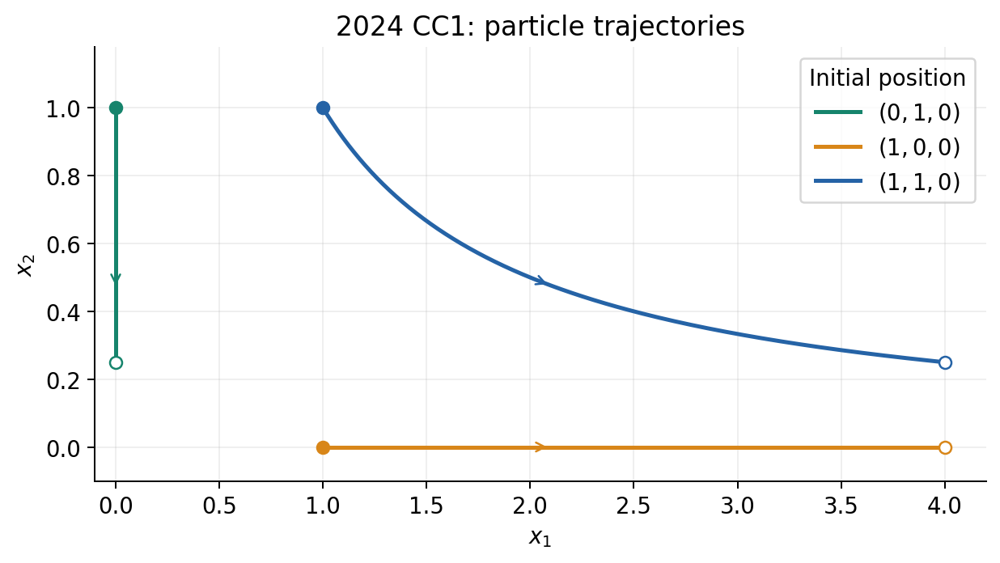

图取 $\alpha=1\,\mathrm{s^{-1}}$、$0\le t\le\ln4\,\mathrm s$。实心点是起点，空心点是该绘图时间段的终点，不是粒子最终停止的位置。

### Question 1.10.7（原题 2.7）

*Déterminer le tenseur gradient de la transformation $\mathbf F$. En déduire que la masse volumique d’une particule reste constante au cours du temps.* 求变换梯度 $\mathbb F$，据此证明粒子密度不随时间改变

::: rep
$\mathbb F=\operatorname{diag}(e^{\alpha t},e^{-\alpha t},1)$, $J=1$ ; la conservation de la masse $\rho J=\rho_0$ donne $\rho=\rho_0$ : la masse volumique de chaque particule reste constante.
:::

**Détail · 推导**

变换梯度对的是**参考坐标** $\vec X$，不是当前坐标：

$$F_{ij}=\frac{\partial x_i}{\partial X_j},\qquad
\mathbb F=
\begin{pmatrix}
e^{\alpha t}&0&0\\
0&e^{-\alpha t}&0\\
0&0&1
\end{pmatrix}.$$

每个 $x_i$ 只依赖相应的 $X_i$，所以非对角项为零。对角矩阵的行列式是对角元的乘积：

$$J=e^{\alpha t}e^{-\alpha t}\times1=1.$$

要由体积联系到密度，必须再使用质量守恒。对同一物质微元，

$$\underbrace{\rho_0(\vec X)\,\mathrm dV_0}_{\text{初始质量}}
=\underbrace{\rho(t,\vec x(t,\vec X))\,\mathrm dv}_{\text{当前质量}},
\qquad \mathrm dv=J\,\mathrm dV_0.$$

消去 $\mathrm dV_0$，得到 $\rho J=\rho_0$；由于本题 $J=1$，

$$\rho(t,\vec x(t,\vec X))=\rho_0(\vec X).$$

因此**同一个粒子的密度随时间保持不变**。这不要求不同粒子的密度相等：若初始密度分布不均匀，各粒子只是各自保持原来的密度。

### Question 1.10.8（原题 2.8）

*Calculer le tenseur des déformations de Green–Lagrange $\mathbf E$. Quelles sont les unités des composantes de $\mathbf F$ et $\mathbf E$ ?* 求 Green–Lagrange 应变，说明 $\mathbb F,\mathbb E$ 的单位

::: rep
$\mathbb E=\frac12\operatorname{diag}(e^{2\alpha t}-1,\ e^{-2\alpha t}-1,\ 0)$ ; $\mathbb F$ et $\mathbb E$ sont sans dimension.
:::

**Détail · 推导**

从定义开始：

$$\mathbb C=\mathbb F^{\mathsf T}\mathbb F,\qquad
\mathbb E=\frac12(\mathbb C-\mathbb I).$$

$\mathbb F$ 已经是对角矩阵，转置后不变，相乘只需把各对角元平方：

$$\mathbb C=\operatorname{diag}(e^{2\alpha t},e^{-2\alpha t},1).$$

再逐个对角元减去 1、除以 2：

$$\boxed{\mathbb E=\frac12
\begin{pmatrix}
e^{2\alpha t}-1&0&0\\
0&e^{-2\alpha t}-1&0\\
0&0&0
\end{pmatrix}.}$$

对 $t>0$，第一方向伸长，故 $E_{11}>0$；第二方向收缩，故 $E_{22}<0$；第三方向不变，故 $E_{33}=0$。令 $t=0$，三个应变都应为零，这也是检查式子是否漏了“减 1”的办法。

$F_{ij}$ 是长度对长度的导数，单位为 $\mathrm m/\mathrm m=1$；$\mathbb E$ 由它相乘、减单位阵得到，因此 $\mathbb F$、$\mathbb E$ 均无量纲。

### Question 1.10.9（原题 2.9）

*Donner, sans passer par des calculs, une déformation principale et une direction principale de déformation.* 不作计算，给出一个主应变和主方向

::: rep
$\mathbb E\vec e_3=\vec0$ : $\vec e_3$ est direction principale, de déformation principale nulle.
:::

**Détail · 推导**

主应变的定义是 $\mathbb E\vec n=E_{\mathrm{pr}}\vec n$：沿主方向 $\vec n$ 的线元，在应变算子的作用下不混入其他方向。

本题不必求特征多项式。由运动映射 $x_3=X_3$，第三方向既不伸缩，也不和第一、第二方向耦合。因此

$$\mathbb E\vec e_3=\vec0=0\,\vec e_3,$$

可直接给出：**主方向为 $\vec e_3$，对应主应变为 0。**

上一问的矩阵已经对角化，所以其余两条坐标轴也都是主方向，对应主应变就是另外两个对角元。$t=0$ 时 $\mathbb E=\mathbb O$，任意方向都可作为主方向。

### Question 1.10.10（原题 2.10）

*Pour quelles valeurs de $t$ peut-on utiliser la forme linéarisée du tenseur des déformations ? En déduire $\boldsymbol\varepsilon$ avec ces simplifications. Comparer les expressions de $\mathbf D$ et de $\boldsymbol\varepsilon$.* 何时可以线性化应变？求线性化应变并比较 $\mathbb D,\boldsymbol\varepsilon$

::: rep
HPP si $\|\overrightarrow{\operatorname{grad}}\vec u\|\ll1$ et $\|\vec u\|\ll L$ (sur un sous-domaine borné), soit $0\le t\ll\frac1\alpha$ (ou $|t|\ll\frac1\alpha$) :

$$\boldsymbol\varepsilon=\operatorname{diag}(e^{\alpha t}-1,\ e^{-\alpha t}-1,\ 0)\approx\alpha t\operatorname{diag}(1,-1,0)=t\,\mathbb D.$$
Au premier ordre $\boldsymbol\varepsilon\approx t\,\mathbb D$ (mêmes directions principales, $\boldsymbol\varepsilon$ sans dimension et $\mathbb D$ en $\mathrm s^{-1}$).
:::

**Détail · 推导**

先区分两个步骤：**用位移梯度写线性化应变**，以及**把本题位移中的指数函数对小时间展开**。

位移是“当前位置减初始位置”：

$$\vec u=\vec x-\vec X
=\bigl((e^{\alpha t}-1)X_1,\ (e^{-\alpha t}-1)X_2,\ 0\bigr).$$

所以

$$\mathbb H=\overrightarrow{\operatorname{grad}}_X\vec u=\mathbb F-\mathbb I
=\operatorname{diag}(e^{\alpha t}-1,e^{-\alpha t}-1,0).$$

小扰动假设（HPP）要求位移梯度的各项足够小，且在有界子域上位移远小于区域特征尺寸 $L$（因原域 $\Omega(t)$ 无界，需限定在有界区域内），故时间条件为 $|\alpha t|\ll1$，即 $|t|\ll1/\alpha$（对于 $t\ge0$ 即 $0\le t\ll1/\alpha$）。此时

$$e^{\alpha t}\simeq1+\alpha t,\qquad
e^{-\alpha t}\simeq1-\alpha t.$$

保留一阶项，得到

$$\boldsymbol\varepsilon
=\frac12(\mathbb H+\mathbb H^{\mathsf T})
\simeq \alpha t\,\operatorname{diag}(1,-1,0).$$

它与题库 1.10.4 的 $\mathbb D=\alpha\operatorname{diag}(1,-1,0)$ 相比，多了一个时间因子：

$$\boxed{\boldsymbol\varepsilon\simeq t\,\mathbb D,\qquad
\dot{\boldsymbol\varepsilon}\simeq\mathbb D.}$$

这对应“累计伸长量”和“每秒伸长多少”的区别。$\boldsymbol\varepsilon$ 无量纲，$\mathbb D$ 的单位是 $\mathrm{s^{-1}}$，不能把两者直接写成相等。上述简单关系用到了本题 $\mathbb D$ 为常量和小扰动近似。

若暂不对指数展开，则 $\operatorname{sym}\mathbb H$ 的对角元仍是 $e^{\pm\alpha t}-1$；只有进入小参数近似后，才得到上面的 $\pm\alpha t$。实际判断时间上限时，$t\ll 1/\alpha$ 表示远小于特征时间尺度 $1/\alpha$（例如有的参考解答会拿 $\ln 2/\alpha$ 举例，仅作同量级示意，并非统一界限）。

### Question 1.10.11（原题 2.11）

*Calculer le rotationnel du champ de vitesse eulérien $\mathbf V(M)$ et donner toutes les caractéristiques de ce mouvement.* 求速度场旋度，列出运动性质

::: rep
$\overrightarrow{\operatorname{rot}}\vec V=\vec0$ : irrotationnel ; de plus incompressible, stationnaire, plan, avec déformation (pas un mouvement rigide).
:::

**Détail · 推导**

旋度要用交叉偏导，而散度用对角偏导。对本题，

$$\overrightarrow{\operatorname{rot}}\vec V=
\begin{pmatrix}
\partial_{x_2}V_3-\partial_{x_3}V_2\\
\partial_{x_3}V_1-\partial_{x_1}V_3\\
\partial_{x_1}V_2-\partial_{x_2}V_1
\end{pmatrix}
=\begin{pmatrix}0\\0\\0\end{pmatrix}.$$

原因是 $V_1$ 只依赖 $x_1$、$V_2$ 只依赖 $x_2$，所有交叉偏导均为零。将已有结果并列：

| 结果 | 对应性质 |
|---|---|
| $\partial_t\vec V=\vec0$，固定 $\vec x$ 求导 | 稳态 |
| $\operatorname{div}\vec V=0$ | 不可压缩 |
| $\overrightarrow{\operatorname{rot}}\vec V=\vec0$ | 无旋 |
| $\mathbb D=\alpha\operatorname{diag}(1,-1,0)\ne\mathbb O$ | 有变形，不是刚体运动 |

因此**无旋只排除了局部旋转，并没有排除伸长和收缩**。同样，稳态也没有排除粒子随时间移动、材料不断变形。

## Exercice 1.11 · Variante — Cisaillement pur à 45° · 斜 45° 的纯剪切流

[**Source :** variante d'entraînement · **出处：** 变式题（自编） · **Thèmes :** $\mathbb D$, $\boldsymbol\Omega$, Lagrange par changement de variables, trajectoires, $\mathbb E$ principales, comparaison avec le glissement simple]{.src}

### Énoncé · 题面

On considère le champ eulérien des vitesses

$$\vec V=\alpha\,(x_2\,\vec e_1+x_1\,\vec e_2),$$
où $\alpha$ est une constante positive. 欧拉速度场如上，$\alpha$ 为正常数。

### Question 1.11.1

*Calculer $\mathbb D$ et $\boldsymbol\Omega$ ; préciser les caractéristiques du mouvement.* 求 $\mathbb D$、$\boldsymbol\Omega$；判断运动特征。

::: rep
$\overrightarrow{\operatorname{grad}}\vec V=\alpha(\vec e_1\otimes\vec e_2+\vec e_2\otimes\vec e_1)$ symétrique : $\mathbb D=\alpha(\vec e_1\otimes\vec e_2+\vec e_2\otimes\vec e_1)$, $\boldsymbol\Omega=\mathbb O$. Stationnaire, incompressible ($\operatorname{tr}\mathbb D=0$), irrotationnel.
:::

**Détail · 推导**

速度梯度 $\overrightarrow{\operatorname{grad}}\vec V=\begin{pmatrix}0&\alpha&0\\\alpha&0&0\\0&0&0\end{pmatrix}$ 本身对称，所以 $\mathbb D=\overrightarrow{\operatorname{grad}}\vec V$、$\boldsymbol\Omega=\mathbb O$（纯变形、无局部转动，单位 $\mathrm s^{-1}$）。由不显含 $t$ 知稳态，由 $\operatorname{tr}\mathbb D=\operatorname{div}\vec V=0$ 知不可压缩，由 $\boldsymbol\Omega=\mathbb O$（即 $\overrightarrow{\operatorname{rot}}\vec V=\vec0$）知无旋。

### Question 1.11.2

*Déterminer la description lagrangienne. (Indication : poser $s=x_1+x_2$ et $d=x_1-x_2$.)* 求拉格朗日描述（提示：令 $s=x_1+x_2$，$d=x_1-x_2$）。

::: rep
$\dot s=\alpha s$, $\dot d=-\alpha d$ ⇒ $s=(X_1+X_2)e^{\alpha t}$, $d=(X_1-X_2)e^{-\alpha t}$, d'où

$$x_1=X_1\cosh\alpha t+X_2\sinh\alpha t,\qquad x_2=X_1\sinh\alpha t+X_2\cosh\alpha t,\qquad x_3=X_3.$$
:::

**Détail · 推导**

两个方程 $\dot x_1=\alpha x_2$、$\dot x_2=\alpha x_1$ 互相耦合，相加、相减后分别得到 $\dot s=\alpha s$、$\dot d=-\alpha d$，立即解耦并积分（初值 $s(0)=X_1+X_2,\ d(0)=X_1-X_2$）。再由 $x_1=\frac{s+d}2$、$x_2=\frac{s-d}2$ 和 $\frac{e^{\alpha t}\pm e^{-\alpha t}}2=\cosh/\sinh(\alpha t)$ 写回原坐标。几何上相当于在 $\mathbb D$ 的主轴（与坐标轴成 $\pm45^\circ$）上分别做指数伸长和指数压缩。

### Question 1.11.3

*Déterminer les trajectoires.* 求轨迹。

::: rep
$x_1^2-x_2^2=sd=X_1^2-X_2^2$. Pour $X_1^2\ne X_2^2$, les trajectoires sont des branches d’hyperboles d’asymptotes $x_2=\pm x_1$. Sur les diagonales, elles sont rectilignes. L’origine est un point fixe.
:::

**Détail · 推导**

$s\cdot d$ 不随时间变化。一般粒子沿双曲线运动，随着时间增长趋向 $x_2=x_1$ 的方向。若初始点在 $x_2=x_1$ 上，粒子沿该直线远离原点。若初始点在 $x_2=-x_1$ 上，粒子沿该直线趋近原点。

### Question 1.11.4

*Calculer $\mathbb F$, $J$, $\mathbb E$ et les déformations principales.* 求 $\mathbb F$、$J$、$\mathbb E$ 及主应变。

::: rep
$\mathbb F=\begin{pmatrix}\cosh\alpha t&\sinh\alpha t&0\\\sinh\alpha t&\cosh\alpha t&0\\0&0&1\end{pmatrix}$, $J=\cosh^2-\sinh^2=1$, $\mathbb E=\begin{pmatrix}\sinh^2\alpha t&\frac12\sinh2\alpha t&0\\\frac12\sinh2\alpha t&\sinh^2\alpha t&0\\0&0&0\end{pmatrix}$. Directions principales $\frac{\vec e_1\pm\vec e_2}{\sqrt2}$ (et $\vec e_3$), déformations $\frac{e^{\pm2\alpha t}-1}2$ (et 0).
:::

**Détail · 推导**

$\mathbb F$ 对称，$\mathbb F^{\mathsf T}\mathbb F=\mathbb F^2$。$2\times2$ 块形如 $\begin{pmatrix}p&q\\q&p\end{pmatrix}$，特征值 $p\pm q$、特征向量 $(1,\pm1)$：$\sinh^2\alpha t\pm\frac12\sinh2\alpha t=\frac{e^{\pm2\alpha t}-1}2$。主方向固定在 $45^\circ$ 方向，不随时间转动。

### Question 1.11.5

*Comparer avec le glissement simple $\vec V'=2\alpha x_2\vec e_1$.* 与简单剪切 $\vec V'=2\alpha x_2\vec e_1$ 比较。

::: rep
Même $\mathbb D$ : $\mathbb D'=\alpha(\vec e_1\otimes\vec e_2+\vec e_2\otimes\vec e_1)$ ; mais $\boldsymbol\Omega'=\alpha(\vec e_1\otimes\vec e_2-\vec e_2\otimes\vec e_1)\neq\mathbb O$ (rotation $-\alpha\vec e_3$). Le glissement simple = ce cisaillement pur + une rotation de corps rigide ; trajectoires droites au lieu d'hyperboles.
:::

**Détail · 推导**

两者的瞬时变形率张量 $\mathbb D$ 相同，主方向也相同。差别出现在旋转率和累积变形上。纯剪切的有限主应变方向固定，简单剪切的有限主应变方向随剪切量改变。

## Exercice 1.12 · Variante — Rotation et dilatation (spirale) · 转动加膨胀（螺旋运动）

[**Source :** variante d'entraînement · **出处：** 变式题（自编） · **Thèmes :** décomposition $\mathbb D+\boldsymbol\Omega$, Lagrange, trajectoires, $\mathbb E$ insensible à la rotation, masse volumique, HPP]{.src}

### Énoncé · 题面

On considère le champ eulérien des vitesses

$$\vec V=(ax_1-\omega x_2)\,\vec e_1+(\omega x_1+ax_2)\,\vec e_2,$$
où $a$ et $\omega$ sont des constantes positives. 欧拉速度场如上，$a$、$\omega$ 为正常数。

### Question 1.12.1

*Calculer $\mathbb D$ et $\boldsymbol\Omega$ ; interpréter. Le mouvement est-il incompressible ?* 求 $\mathbb D$、$\boldsymbol\Omega$ 并解释；是否不可压缩？

::: rep
$\mathbb D=a(\vec e_1\otimes\vec e_1+\vec e_2\otimes\vec e_2)$ : dilatation isotrope dans le plan ; $\boldsymbol\Omega=\omega(\vec e_2\otimes\vec e_1-\vec e_1\otimes\vec e_2)$ : rotation de vitesse angulaire $\omega\vec e_3$. $\operatorname{div}\vec V=2a\neq0$ : compressible ; stationnaire.
:::

**Détail · 推导**

速度梯度 $\overrightarrow{\operatorname{grad}}\vec V=\begin{pmatrix}a&-\omega&0\\\omega&a&0\\0&0&0\end{pmatrix}$：对称部分 $\mathbb D=a(\vec e_1\otimes\vec e_1+\vec e_2\otimes\vec e_2)$ 是各向同性的面内膨胀，反对称部分 $\boldsymbol\Omega=\begin{pmatrix}0&-\omega&0\\\omega&0&0\\0&0&0\end{pmatrix}$ 满足 $\boldsymbol\Omega\vec e_1=\omega\vec e_2=(\omega\vec e_3)\wedge\vec e_1$，对应绕 $\vec e_3$ 正向（角速度 $\omega\vec e_3$）的局部刚体转动。

### Question 1.12.2

*Déterminer la description lagrangienne et les trajectoires.* 求拉格朗日描述和轨迹。

::: rep
$x_1=e^{at}(X_1\cos\omega t-X_2\sin\omega t)$, $x_2=e^{at}(X_1\sin\omega t+X_2\cos\omega t)$, $x_3=X_3$ : en polaire $r=r_0e^{at}$, $\theta=\theta_0+\omega t$, soit $r=r_0\,e^{\frac a\omega(\theta-\theta_0)}$ : spirales logarithmiques (l'origine reste fixe).
:::

**Détail · 推导**

利用复变量 $z=x_1+\mathrm ix_2$，原方程组 $\dot x_1=ax_1-\omega x_2,\ \dot x_2=\omega x_1+ax_2$ 合并为 $\dot z=(a+\mathrm i\omega)z$，立即积分得 $z=(X_1+\mathrm iX_2)e^{at}(\cos\omega t+\mathrm i\sin\omega t)$；分别取实部、虚部即得 $x_1,x_2$。在极坐标下，模 $r=r_0e^{at}$ 指数增长，辐角 $\theta=\theta_0+\omega t$ 匀速增加，消去 $t$ 即得对数螺线。

### Question 1.12.3

*Calculer $\mathbb F$, $J$ et $\mathbb E$. Commenter. En déduire la masse volumique.* 求 $\mathbb F$、$J$、$\mathbb E$ 并评论；求密度。

::: rep
$\mathbb F=e^{at}\begin{pmatrix}\cos\omega t&-\sin\omega t&0\\\sin\omega t&\cos\omega t&0\\0&0&e^{-at}\end{pmatrix}$, $J=e^{2at}$, $\mathbb E=\frac{e^{2at}-1}2(\vec e_1\otimes\vec e_1+\vec e_2\otimes\vec e_2)$ : la rotation n'apparaît pas dans $\mathbb E$. $\rho J=\rho_0$ ⇒ $\rho=\rho_0e^{-2at}$.
:::

**Détail · 推导**

面内 $2\times2$ 块满足 $\mathbb F_{2\times2}=e^{at}\mathbb Q(\omega t)$，其中 $\mathbb Q^{\mathsf T}\mathbb Q=\mathbb I_2$，因此 $\mathbb F^{\mathsf T}\mathbb F=\operatorname{diag}(e^{2at},e^{2at},1)$，转动角 $\omega t$ 在 $\mathbb E$ 中完全消失（再次印证 $\mathbb E$ 对刚体转动不敏感）。体积按 $J=\det\mathbb F=e^{2at}$ 指数增大，由质量守恒 $\rho J=\rho_0$ 得密度按 $e^{-2at}$ 衰减。

### Question 1.12.4

*À quelles conditions l'HPP est-elle valable ?* HPP 在什么条件下成立？

::: rep
HPP : $\|\overrightarrow{\operatorname{grad}}\vec u\|=\|\mathbb F-\mathbb I\|\ll1$ et $\|\vec u\|\ll L$ (domaine borné) : il faut $at\ll1$ **et** $\omega t\ll1$ (petite rotation), bien que la rotation ne déforme pas.
:::

**Détail · 推导**

小扰动假设要求有界域上位移小且**整个位移梯度矩阵** $\mathbb F-\mathbb I$ 小（包含转动引起的非对角项 $e^{at}\sin\omega t$）。若 $\omega t$ 不小，即使膨胀量 $at$ 很小，$\boldsymbol\varepsilon$ 也会因 $\cos\omega t-1$ 给出由转动产生的虚假压缩应变（与题库 1.1.3–1.1.4 同理）。

## Exercice 1.13 · TD1 ex. 1 — Tourbillon atmosphérique · 大气涡旋

[**Source :** TD1, exercice 1 (2024–2025) · **出处：** TD1 练习 1 · **Thèmes :** descriptions, lignes de courant, trajectoires, accélération, caractéristiques]{.src}

### Énoncé · 题面

On étudie le mouvement d'un tourbillon atmosphérique défini par le champ de vitesse suivant dans un repère cartésien $(O,\vec e_1,\vec e_2)$ en un point $M(x_1,x_2)$ à l'instant $t$ :

$$V_1=\omega x_2,\qquad V_2=-\omega x_1+a\omega^2t,$$
où $a$ et $\omega$ sont des constantes ($\omega\neq0$). 研究大气涡旋的运动，在直角坐标系 $(O,\vec e_1,\vec e_2)$ 中，时刻 $t$ 点 $M(x_1,x_2)$ 的速度场如上，$a$、$\omega$ 为常数（$\omega\ne0$）。
NB : on utilisera la notation ${}^E\bullet$ pour désigner les grandeurs eulériennes et $\frac{\mathrm d\bullet}{\mathrm dt}$ la dérivée particulaire. 记号：${}^E\bullet$ 表示欧拉量，$\frac{\mathrm d\bullet}{\mathrm dt}$ 表示物质导数。

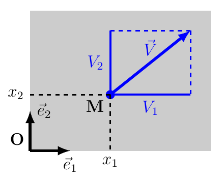

### Question 1.13.1（原题 1.1）

*Rappeler les définitions des descriptions eulérienne et lagrangienne et la démarche permettant de passer de l'une à l'autre.* 复述欧拉描述和拉格朗日描述的定义，以及两者互换的方法。

::: rep
Description lagrangienne : on suit chaque particule, repérée par sa position initiale $\vec X$ : $\vec x=\vec\phi(\vec X,t)$, grandeurs $f(\vec X,t)$. Description eulérienne : on observe en un point fixe $\vec x$ de l'espace : $f(\vec x,t)$.
Lagrange → Euler : dériver $\vec\phi$ par rapport à $t$ à $\vec X$ fixé, puis remplacer $\vec X=\vec\phi^{-1}(\vec x,t)$. Euler → Lagrange : intégrer $\dot{\vec x}=\vec V(\vec x,t)$ avec $\vec x(0)=\vec X$.
:::

**Détail · 推导**

拉格朗日描述跟着粒子走，自变量是初始位置 $\vec X$ 和时间；欧拉描述盯住空间中的固定点，自变量是当前位置 $\vec x$ 和时间。两种描述描述的是同一个运动，互换的桥梁是运动映射 $\vec x=\vec\phi(\vec X,t)$：已知映射，求导得速度再反解；已知速度场，解常微分方程得映射。

### Question 1.13.2（原题 1.2）

*Donner la description eulérienne de ce mouvement.* 给出这个运动的欧拉描述。

::: rep
Le champ donné est déjà eulérien : ${}^E\vec V(\vec x,t)=\omega x_2\,\vec e_1+(-\omega x_1+a\omega^2t)\,\vec e_2$.
:::

**Détail · 推导**

速度写成当前坐标 $x_1,x_2$ 和 $t$ 的函数，本身就是欧拉描述，不需要再算。

### Question 1.13.3（原题 1.3）

*Donner la description lagrangienne de ce mouvement.* 给出这个运动的拉格朗日描述。

::: rep
$\dot x_1=\omega x_2$, $\dot x_2=-\omega x_1+a\omega^2t$, $x_i(0)=X_i$. En dérivant la seconde et en reportant la première : $\ddot x_2+\omega^2x_2=a\omega^2$. Avec $c=\cos\omega t$, $s=\sin\omega t$ :

$$x_1=X_1c+(X_2-a)s+a\omega t,\qquad x_2=-X_1s+(X_2-a)c+a .$$
:::

**Détail · 推导**

1. 两个方程耦合，对第二式再求一次导：$\ddot x_2=-\omega\dot x_1+a\omega^2=-\omega^2x_2+a\omega^2$。
2. 齐次解 $A\cos\omega t+B\sin\omega t$，常数特解 $a$：$x_2=A\cos\omega t+B\sin\omega t+a$。
3. 初始条件：$x_2(0)=X_2$ 给 $A=X_2-a$；$\dot x_2(0)=-\omega X_1$（由原方程在 $t=0$）给 $B=-X_1$。
4. 由 $\dot x_1=\omega x_2$ 积分（或由第二个原方程反解 $x_1$），得 $x_1$。
5. 检查：$t=0$ 时回到 $X_i$；对 $t$ 求导换回 $x_i$ 得到题给速度。

### Question 1.13.4（原题 1.4）

*Donner et tracer les lignes de courant et les trajectoires.* 给出并画出流线和轨迹。

::: rep
Lignes de courant (à $t$ fixé) : $\frac{\mathrm dx_1}{V_1}=\frac{\mathrm dx_2}{V_2}$ ⇒ $(x_1-a\omega t)^2+x_2^2=C$ : cercles de centre $(a\omega t,0)$. Trajectoires : $(x_1-a\omega t)^2+(x_2-a)^2=X_1^2+(X_2-a)^2$ : mouvement circulaire autour d'un centre qui se translate à la vitesse $a\omega\,\vec e_1$ (trochoïdes). Pour $a\neq0$ trajectoires et lignes de courant sont distinctes.
:::

**Détail · 推导**

- **流线：** 固定 $t$，$\frac{\mathrm dx_2}{\mathrm dx_1}=\frac{-\omega x_1+a\omega^2t}{\omega x_2}$，分离变量 $x_2\,\mathrm dx_2=-(x_1-a\omega t)\,\mathrm dx_1$，积分得圆族，圆心 $(a\omega t,0)$ 随时间 $t$ 沿 $\vec e_1$ 移动。
- **轨迹：** 由上一问 $x_1-a\omega t=X_1c+(X_2-a)s$，$x_2-a=-X_1s+(X_2-a)c$，平方相加得半径 $R=\sqrt{X_1^2+(X_2-a)^2}$ 不变的圆，但圆心 $(a\omega t,a)$ 以速度 $a\omega$ 沿 $\vec e_1$ 平移，所以实际轨迹是摆线类曲线（trochoïde）。特例：初始位于 $(0,a)$ 的粒子半径 $R=0$，轨迹退化为水平直线 $x_1=a\omega t,\ x_2=a$。
- 非稳态（$a\ne0$）时轨迹与流线不重合：流线是某一时刻的"速度方向图"，轨迹是一个粒子走过的路径。

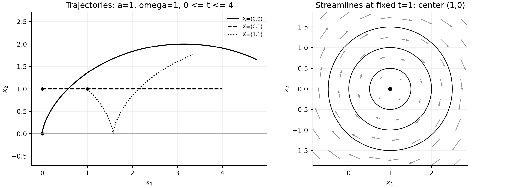{.wide}

### Question 1.13.5（原题 1.5）

*Rappeler et calculer l'expression des accélérations eulérienne et lagrangienne.* 复述并计算欧拉加速度和拉格朗日加速度。

::: rep
Eulérienne : ${}^E\vec\gamma=\frac{\partial\vec V}{\partial t}+\overrightarrow{\operatorname{grad}}\vec V\cdot\vec V=(-\omega^2x_1+a\omega^3t)\,\vec e_1+(-\omega^2x_2+a\omega^2)\,\vec e_2$.
Lagrangienne : $\vec\gamma=\frac{\partial^2\vec x}{\partial t^2}\Big|_{\vec X}=-\omega^2[X_1c+(X_2-a)s]\,\vec e_1+\omega^2[X_1s-(X_2-a)c]\,\vec e_2$ ; les deux coïncident via $\vec x=\vec\phi(\vec X,t)$.
:::

**Détail · 推导**

- 局部项 $\partial_t\vec V=a\omega^2\vec e_2$；对流项 $\overrightarrow{\operatorname{grad}}\vec V\cdot\vec V=\begin{pmatrix}0&\omega\\-\omega&0\end{pmatrix}\begin{pmatrix}V_1\\V_2\end{pmatrix}=(\omega V_2)\vec e_1+(-\omega V_1)\vec e_2=(-\omega^2x_1+a\omega^3t)\vec e_1-\omega^2x_2\vec e_2$。两项相加。
- 拉格朗日：对映射求两次导。检查：$-\omega^2(x_1-a\omega t)=-\omega^2x_1+a\omega^3t$，$-\omega^2(x_2-a)=-\omega^2x_2+a\omega^2$，与欧拉结果一致。

### Question 1.13.6（原题 1.6）

*Le mouvement est-il stationnaire ? Rotationnel ? Incompressible ?* 运动是否稳态？有旋？不可压缩？

::: rep
$\frac{\partial\vec V}{\partial t}=a\omega^2\vec e_2\neq\vec0$ : non stationnaire (sauf si $a=0$). $\overrightarrow{\operatorname{rot}}\vec V=(\partial_1V_2-\partial_2V_1)\vec e_3=-2\omega\vec e_3\neq\vec0$ : rotationnel. $\operatorname{div}\vec V=\partial_1V_1+\partial_2V_2=0$ : incompressible. (De plus $\mathbb D=\mathbb O$ : mouvement de corps rigide instantané.)
:::

**Détail · 推导**

三项检查全部用欧拉场：是否显含 $t$；旋度；散度。旋度为 $-2\omega\vec e_3$，对应局部转动角速度 $\frac12\overrightarrow{\operatorname{rot}}\vec V=-\omega\vec e_3$（顺时针）。此外 $\overrightarrow{\operatorname{grad}}\vec V$ 反对称，变形率 $\mathbb D=\mathbb O$，因此这是一个整体平移叠加刚体旋转的刚体运动。

## Exercice 1.14 · TD2 ex. 5 — Compatibilité des déformations · 应变协调

[**Source :** TD2, exercice 5 (2026–2027) · **出处：** TD2 练习 5 · **Thèmes :** intégration d'un champ de déformation, compatibilité, mouvement rigide]{.src}

### Énoncé · 题面

Pour les déformations suivantes, y a-t-il un champ de déplacement associé ? Si oui, le(s) calculer : 对下面两个应变场，是否存在对应的位移场？若存在，求出来。

$$\boldsymbol\varepsilon_1=\begin{pmatrix}ax_1^2&0&0\\0&0&0\\0&0&0\end{pmatrix}\qquad\text{et}\qquad\boldsymbol\varepsilon_2=\begin{pmatrix}0&0&0\\0&ax_1^2&0\\0&0&0\end{pmatrix}.$$

### Question 1.14.1（原题 5.1）

*Donner la démarche permettant de déterminer un champ de déplacement associé à un état de déformation. À quelle(s) condition(s) cette démarche peut-elle être menée à terme ? Pour les déformations données, y a-t-il un champ de déplacement associé ? Si oui, le(s) calculer.* 给出由应变求位移的方法和条件；判断两个场并求位移。

::: rep
Démarche : intégrer $\varepsilon_{ij}=\frac12(u_{i,j}+u_{j,i})$ (termes diagonaux, puis extra-diagonaux) ; possible si le domaine est **simplement connexe** et si les conditions de compatibilité de Saint-Venant sont vérifiées (par exemple dans le plan : $\varepsilon_{11,22}+\varepsilon_{22,11}=2\varepsilon_{12,12}$) ; le déplacement est défini à un mouvement de corps rigide infinitésimal près ($\vec c+\vec\omega_0\wedge\overrightarrow{OM}$, où $\vec c,\vec\omega_0$ sont des vecteurs constants).
$\boldsymbol\varepsilon_1$ : compatible, $\vec u=\frac{ax_1^3}3\vec e_1+\vec c+\vec\omega_0\wedge\overrightarrow{OM}$. $\boldsymbol\varepsilon_2$ ($a\neq0$) : $\varepsilon_{22,11}=2a\neq2\varepsilon_{12,12}=0$, incompatible : pas de déplacement associé.
:::

**Détail · 推导**

- **一般条件（Saint-Venant 协调方程）：** $\varepsilon_{ij,kl}+\varepsilon_{kl,ij}-\varepsilon_{ik,jl}-\varepsilon_{jl,ik}=0$（必要条件；当区域**单连通**时也是充分条件，三维共 6 个独立方程，二维面内化为 1 个方程 $\varepsilon_{11,22}+\varepsilon_{22,11}=2\varepsilon_{12,12}$）。
- **第一个场 $\boldsymbol\varepsilon_1$：** 对角元 $u_{1,1}=ax_1^2\implies u_1=\frac{ax_1^3}3+f(x_2,x_3)$，$u_{2,2}=0\implies u_2=g(x_1,x_3)$，$u_{3,3}=0\implies u_3=h(x_1,x_2)$。由于所有非对角应变为零，取特解 $f=g=h=0$（即 $\vec u_{\mathrm{part}}=\frac{ax_1^3}3\vec e_1$），其余齐次解满足 $\boldsymbol\varepsilon(\vec u_{\mathrm{hom}})=\mathbb O$，即 HPP 下的无穷小刚体位移 $\vec c+\vec\omega_0\wedge\overrightarrow{OM}$。由 $\varepsilon_{11}$ 无量纲得 $[a]=\mathrm m^{-2}$。
- **第二个场 $\boldsymbol\varepsilon_2$（假设 $a\neq0$）：** 由 $u_{2,2}=ax_1^2$ 积分得 $u_2=ax_1^2x_2+g(x_1,x_3)$；再由 $\varepsilon_{12}=\frac12(u_{1,2}+u_{2,1})=0$ 得 $u_{1,2}=-u_{2,1}=-2ax_1x_2-g_{,1}(x_1,x_3)$。对 $x_1$ 求偏导得 $u_{1,21}=-2ax_2-g_{,11}(x_1,x_3)$；另一方面 $u_{1,1}=0\implies u_{1,12}=0$。由 Schwarz 定理 $u_{1,12}=u_{1,21}$ 要求 $g_{,11}(x_1,x_3)=-2ax_2$，但左侧只依赖 $(x_1,x_3)$ 而右侧显含 $x_2$，故矛盾。直接代入面内协调方程亦可立刻判别：左边 $\varepsilon_{11,22}+\varepsilon_{22,11}=0+2a=2a$，右边 $2\varepsilon_{12,12}=0$，不相等。

