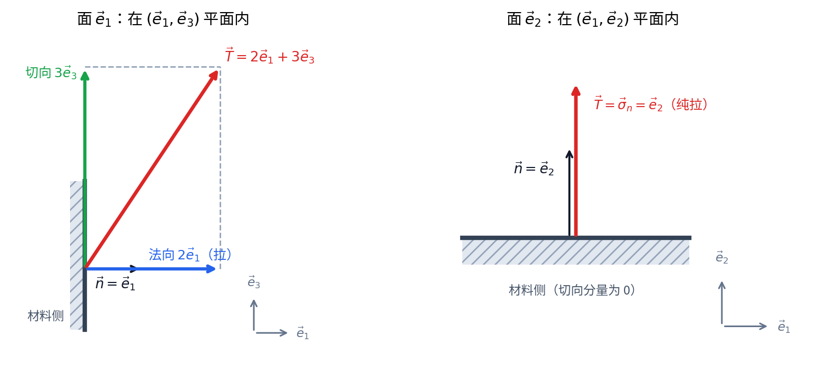
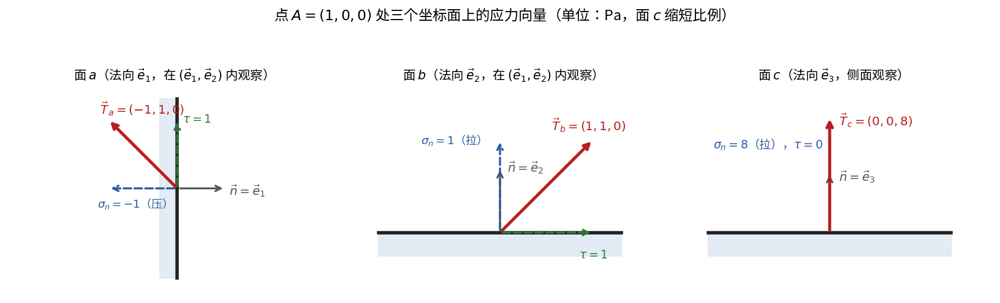
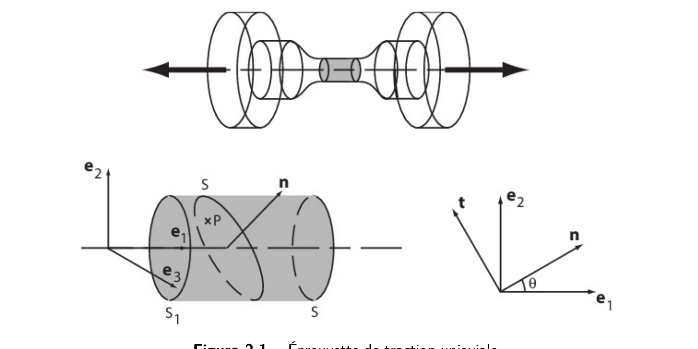
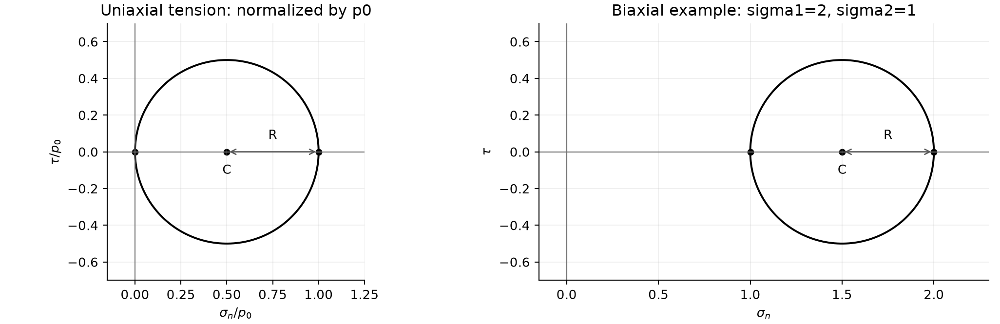
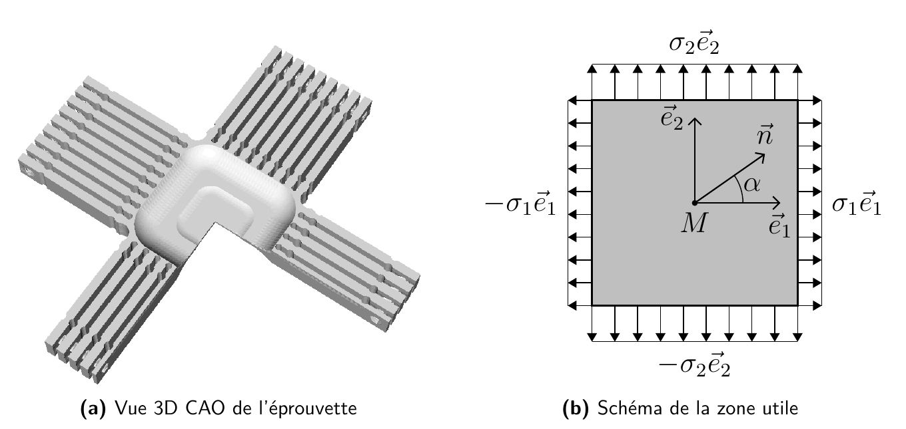
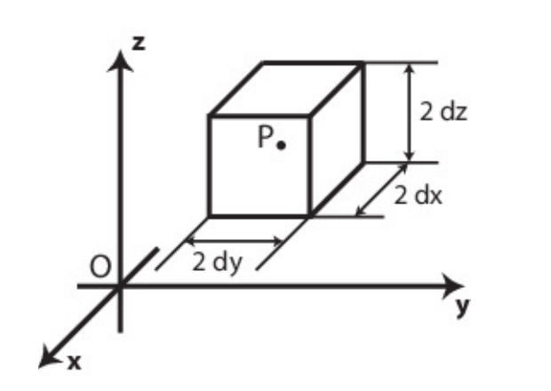
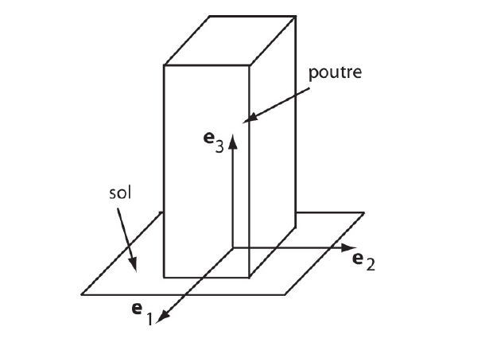
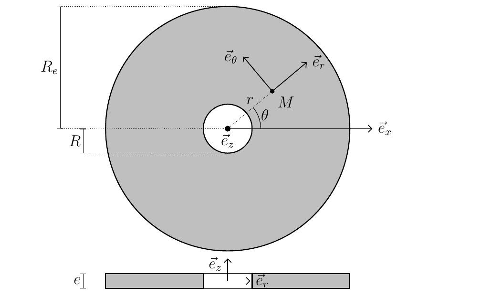
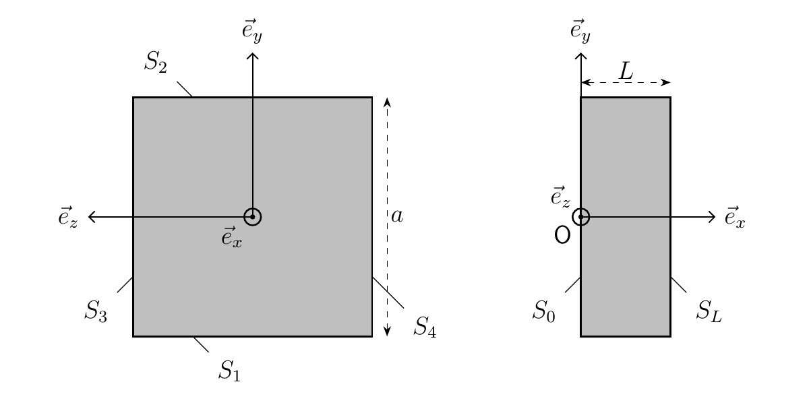

# 2　Contraintes et équilibre · 应力与平衡（题库）

## CC2 · 第 3 题读题：从应力张量读出物体怎样受力

**两年的共同任务**是把物体内部的应力 $\boldsymbol\sigma$ 和表面受力联系起来。读第一遍时，在图上标出题目点名的面和它的外法向 $\vec n$，再看张量里哪些分量已经给出、哪些还要求。

| 题面中的物体 | 已经给了什么 | 第一笔写什么，后面求什么 |
|---|---|---|
| **2024 · 圆轴**（2.14）。*arbre* 是机械轴，*surface latérale* 是圆柱侧面，*bases* 是两端面。 | 给应力场，问它对应什么载荷。第一小问问 *forces volumiques*（体力）。 | 静力下先写 $\vec f_d=-\operatorname{div}\boldsymbol\sigma$。问到某个面时才写 $\vec T=\boldsymbol\sigma\vec n$。两端面分别积分求合力和力矩，由此识别扭转，最后用 Tresca 求允许扭矩。 |
| **2025 · 受剪方块**（2.17）。*plot* 指块体，*faces libres d’effort* 指自由面。 | 给平面应力张量的形式、部分未知分量和各面载荷。第一小问先验两个自由面。 | 在 $z=\pm a/2$ 写 $\vec n=\pm\vec e_z$，取张量第三列并带上符号。再用其余各面的条件求常数，用体内平衡补全应力，最后求端面力旋量。 |

**小问里的几个词决定你要交什么。**

- *Vérifier les conditions aux limites sur une face* 验证某面的边界条件。可起笔写 *Sur cette face, la normale sortante est …, donc le vecteur contrainte vaut …* 算出 $\boldsymbol\sigma\vec n$ 后与题给面力比较；自由面应得到零向量。
- *Densité d’efforts surfaciques* 求面力密度，答案是向量，单位 Pa。*Résultante* 求整个面的合力，写 $\vec R=\int_S\vec T\,\mathrm dS$，单位 N。
- *Éléments de réduction du torseur en $O$* 求以 $O$ 为参考点的合力和合力矩。除 $\vec R$ 外还要写 $\vec M_O=\int_S\overrightarrow{OM}\times\vec T(M)\,\mathrm dS$。即使合力为零，也要算力矩。
- *En quels points … maximale ? Couple à ne pas dépasser ?* 先找等效应力最大的**位置**，再把该处的等效应力与屈服极限比较，反求允许的扭矩。

**椭圆柱的外法向**　两个底面的外法向沿轴线，侧面的外法向由椭圆边界确定。

## Méthode · 应力与平衡大题的解题步骤

### ① Compléter le tenseur ; unités des constantes · 补全应力张量、常数的单位

[*Compléter la forme du tenseur $\boldsymbol\sigma$ ; dans quelle unité s'exprime la constante $A$ ?* 补全张量 $\boldsymbol\sigma$ 的形式；常数 $A$ 用什么单位表示？]{.ask}

- Symétrie (équilibre des moments) : $\sigma_{ji}=\sigma_{ij}$. 对称性（来自力矩平衡）：$\sigma_{ji}=\sigma_{ij}$。
- $\boldsymbol\sigma$ est en Pa : $\sigma=Ax$ ⇒ $[A]=\mathrm{Pa\,m^{-1}}$ ; $\sigma=Ar^2$ ⇒ $\mathrm{Pa\,m^{-2}}=\mathrm{N\,m^{-4}}$ ; $\sigma=A/r^2$ ⇒ $\mathrm{Pa\,m^2}=\mathrm N$. $\boldsymbol\sigma$ 的单位是 Pa：$\sigma=Ax$ ⇒ $[A]=\mathrm{Pa\,m^{-1}}$；$\sigma=Ar^2$ ⇒ $\mathrm{Pa\,m^{-2}}=\mathrm{N\,m^{-4}}$；$\sigma=A/r^2$ ⇒ $\mathrm{Pa\,m^2}=\mathrm N$。
- Autres unités : force volumique $\mathrm{N\,m^{-3}}$ ; vecteur contrainte Pa ; résultante N ; moment $\mathrm{N\,m}=\mathrm J=\mathrm{Pa\,m^3}$. 其他单位：体力 $\mathrm{N\,m^{-3}}$；应力向量 Pa；合力 N；力矩 $\mathrm{N\,m}=\mathrm J=\mathrm{Pa\,m^3}$。

::: fr
Le tenseur des contraintes est symétrique (équilibre des moments) : $\sigma_{ji}=\sigma_{ij}$. 应力张量是对称的（力矩平衡）：$\sigma_{ji}=\sigma_{ij}$。

Les contraintes s'expriment en Pa, donc $A$ s'exprime en $\mathrm{Pa\cdot m^{-2}}=\mathrm{N\cdot m^{-4}}$. 应力的单位是 Pa，所以 $A$ 的单位是 $\mathrm{Pa\cdot m^{-2}}=\mathrm{N\cdot m^{-4}}$。

:::

### ② Équilibre local : force volumique, composantes inconnues · 局部平衡：体力、未知分量

[*Calculer la densité d'effort volumique en équilibre avec ce champ (statique) ; appliquer l'équation d'équilibre local, en déduire $\sigma_{xx}$*]{.ask}

1. $\overrightarrow{\operatorname{div}}\boldsymbol\sigma$ : composante $i$ = somme des dérivées de la **ligne** $i$ par rapport à $x_1,x_2,x_3$. En cylindrique, utiliser la table C (ne pas oublier $\frac{\sigma_{rr}-\sigma_{\theta\theta}}r$…). 散度第 $i$ 分量 = 第 $i$ 行逐项求导相加；柱坐标用查表 C，别漏附加项。
2. Statique : $\overrightarrow{\operatorname{div}}\boldsymbol\sigma+\vec f=\vec0$ ⇒ $\vec f=-\overrightarrow{\operatorname{div}}\boldsymbol\sigma$ ($\mathrm{N\,m^{-3}}$). Sans force volumique : $\overrightarrow{\operatorname{div}}\boldsymbol\sigma=\vec0$ donne des relations entre constantes. 静力：体力 = 负的散度；无体力时散度为零给出常数之间的关系。
3. Composante inconnue : intégrer la ligne correspondante, par exemple $\partial_x\sigma_{xx}=-\partial_y\sigma_{xy}$ ⇒ $\sigma_{xx}=-\int\partial_y\sigma_{xy}\,\mathrm dx+C(y)$ ; la « constante » est une fonction des autres variables, fixée par les conditions aux limites (étape ⑤). 积分求未知分量；积分"常数"是其余变量的函数，由边界条件定。
4. Commenter : $\vec f=\vec0$ → seulement des efforts de surface ; $\vec f$ constant → comme la pesanteur ; composantes constantes → $\overrightarrow{\operatorname{div}}\boldsymbol\sigma=\vec0$ d'office. 评论：体力为零只有面力；常数体力类似重力；常数应力场散度一定为零。
5. Vérification globale (PFS) : sur tout le solide ou un tronçon, résultante et moment des efforts extérieurs nuls. 整体验证：外力合力、合力矩为零。

::: fr
L'équilibre local s'écrit $\overrightarrow{\operatorname{div}}\boldsymbol\sigma+\vec f_v=\vec0$ (statique), d'où $\vec f_v=-\overrightarrow{\operatorname{div}}\boldsymbol\sigma=\dots$ (en $\mathrm{N\cdot m^{-3}}$).
Les composantes étant constantes, $\overrightarrow{\operatorname{div}}\boldsymbol\sigma=\vec0$ : aucune force volumique n'est nécessaire à l'équilibre.
La projection sur $\vec e_x$ donne $\partial_x\sigma_{xx}=-\partial_y\sigma_{xy}$, que l'on intègre en $x$ ; la fonction d'intégration est fixée par les conditions aux limites. 局部平衡求体力；常数场无需体力；投影后积分，积分函数由边界条件定。

:::

### ③ Vecteur contrainte sur une facette · 某面上的应力向量

[*Calculer le vecteur contrainte pour les facettes de normales $\vec e_1$, $\vec e_2$, $\vec e_3$ ; ses composantes normale et tangentielle*]{.ask}

1. Normale unitaire $\vec n$ (diviser par la norme pour une facette inclinée) ; sur la frontière, $\vec n$ est la normale **sortante**. 单位法向；边界上取外法向。
2. $\vec T=\boldsymbol\sigma\vec n$ ; pour $\vec n=\vec e_j$ c'est la **colonne** $j$. Si $\boldsymbol\sigma$ dépend du point, remplacer d'abord les coordonnées. $\vec T=\boldsymbol\sigma\vec n$，法向是 $\vec e_j$ 时就是第 $j$ 列；先代入点的坐标。
3. Contrainte normale $\sigma_n=\vec T\cdot\vec n$ ($=\sigma_{jj}$ pour $\vec n=\vec e_j$) ; $\sigma_n>0$ traction, $<0$ compression. 法向应力；正为拉，负为压。
4. Vecteur cisaillement $\vec T_t=\vec T-\sigma_n\vec n$, contrainte tangentielle $\tau=\|\vec T_t\|=\sqrt{\|\vec T\|^2-\sigma_n^2}$. 切向向量与切应力大小。
5. Tracé : dessiner $\vec T$ sur la facette avec ses composantes normale et tangentielle. 画图：在面上画出 $\vec T$ 及其法向、切向分量。

::: fr
Le vecteur contrainte sur la facette de normale $\vec e_1$ est la première colonne de $\boldsymbol\sigma$ : $\vec T(\vec e_1)=\dots$ ; sa composante normale vaut $\sigma_n=\vec T\cdot\vec e_1=\dots$ et sa composante tangentielle $\vec T-\sigma_n\vec e_1=\dots$ 法向 $\vec e_1$ 面上的应力向量是第一列；法向分量、切向分量。

:::

### ④ Contraintes et directions principales · 主应力、主方向

[*Calculer les contraintes principales et les directions principales ; à quoi correspondent-elles physiquement ?*]{.ask}

1. Une ligne et une colonne ne contenant que le terme diagonal : direction principale immédiate, de valeur ce terme. 只剩对角元的方向直接是主方向。
2. Bloc $2\times2$ $\begin{pmatrix}a&b\\b&c\end{pmatrix}$ : $\sigma_\pm=\frac{a+c}2\pm\sqrt{(\frac{a-c}2)^2+b^2}$, $\vec n_\pm\propto(b,\ \sigma_\pm-a)$. 2×2 块的公式。
3. Cas général : développer $\det(\boldsymbol\sigma-s\mathbb I)=0$ selon une ligne contenant des zéros ; directions : résoudre $(\boldsymbol\sigma-\sigma_i\mathbb I)\vec n=\vec0$ avec deux lignes, puis normer. 一般情形：按含零的行展开特征行列式；主方向解齐次方程再归一化。
4. Contrôles : $\sum\sigma_i=\operatorname{tr}\boldsymbol\sigma$, $\prod\sigma_i=\det\boldsymbol\sigma$, directions orthogonales, $\boldsymbol\sigma\vec n=\sigma_i\vec n$. 自查：迹、行列式、正交、代回。
5. Sens physique : facettes sans cisaillement, la contrainte normale y est extrémale. 物理意义：这些面上没有切应力，正应力取极值。
6. Partie sphérique et déviateur : $\boldsymbol\sigma=\frac13\operatorname{tr}\boldsymbol\sigma\,\mathbb I+\boldsymbol\sigma^D$, $\operatorname{tr}\boldsymbol\sigma^D=0$ (le déviateur **n'est pas** $\boldsymbol\sigma$ avec une diagonale nulle). 球量 + 偏量；偏量不是把对角元换成 0。
7. Mohr (plan, $\vec n$ à l'angle $\alpha$ de la direction 1) : $\sigma_n=\frac{\sigma_1+\sigma_2}2+\frac{\sigma_1-\sigma_2}2\cos2\alpha$, $\tau=\frac{\sigma_2-\sigma_1}2\sin2\alpha$ ; cercle de centre $\frac{\sigma_1+\sigma_2}2$ et de rayon $\frac{|\sigma_1-\sigma_2|}2$ ; cisaillement maximal à $45^\circ$. Quand la facette fait un tour ($\alpha$ de 0 à $2\pi$), le point parcourt le cercle deux fois. Mohr 圆：圆心、半径；最大切应力在 45°；法向转一周，点在圆上走两圈。

::: fr
$\det(\boldsymbol\sigma-\lambda\mathbb I)=(8-\lambda)(\lambda^2-2)=0$, d'où $\sigma_1=-\sqrt2$, $\sigma_2=\sqrt2$, $\sigma_3=8$. Les directions principales sont les normales des facettes sur lesquelles le vecteur contrainte est purement normal (pas de cisaillement). 示例：特征方程分解得主应力；主方向是只有正应力、没有切应力的面的法向。

:::

### ⑤ Conditions aux limites sur chaque face · 逐面边界条件

[*Écrire (vérifier) les conditions aux limites sur les différentes faces ; en déduire les constantes*]{.ask}

1. Dessiner le domaine, indiquer la **normale sortante** de chaque face (table B). 画图，每个面标外法向。
2. Sur chaque face : $\boldsymbol\sigma\vec n$ (± une colonne si $\vec n$ est un vecteur de base), évalué sur la face (par exemple $y=a/2$). 每个面算 $\boldsymbol\sigma\vec n$，代入该面的坐标。
3. Égaler à la donnée : face libre $\vec0$ ; pression $-p\vec n$ ; effort imposé $\vec T_d$. Une équation par composante. 令其等于给定值：自由面零、压力 $-p\vec n$、给定面力；每个分量一个方程。
4. Surface courbe ($r=R$) : la condition doit être vérifiée **en tout point** ; un polynôme nul ⇒ tous ses coefficients nuls. 曲面上要处处成立，多项式各系数为零。
5. Deux faces opposées ($y=\pm a/2$) : additionner et soustraire les deux conditions sépare les termes pairs et impairs. 相对两面的条件相加、相减。
6. « Vérifier » : montrer que la substitution donne bien la valeur imposée. "验证"题：代入后说明成立。

**Justifier l'état de contraintes planes · 论证平面应力 :** ① le solide est mince dans la direction $\vec e_3$ ; ② ses faces $\pm\vec e_3$ sont libres : $\boldsymbol\sigma\vec e_3=\vec0$, soit $\sigma_{13}=\sigma_{23}=\sigma_{33}=0$ ; ③ l'épaisseur étant faible, ces composantes restent négligeables dans tout le solide, le chargement étant parallèle au plan moyen. 三句话：薄；上下面自由；厚度小，这些分量处处近似为零，载荷平行于中面。

::: fr
Sur la face $y=a/2$, de normale sortante $\vec e_y$, la condition de surface libre s'écrit $\boldsymbol\sigma\vec e_y=\vec0$, soit $\sigma_{xy}(x,a/2)=0$ et $\sigma_{yy}(x,a/2)=0$.
Sur la surface latérale $r=R$ ($\vec n=\vec e_r$), $\boldsymbol\sigma\vec n=\vec0$ doit être vérifié pour tout $\theta$ et tout $z$ : les coefficients du polynôme sont nuls.
Le solide est mince et ses faces $z=\pm e/2$ sont libres : $\sigma_{rz}=\sigma_{\theta z}=\sigma_{zz}=0$ (contraintes planes). 自由面条件；侧面条件要对所有 θ、z 成立；薄板上下面自由 ⇒ 平面应力。

:::

### ⑥ Torseur des efforts : résultante et moment · 合力与合力矩（力旋量）

[*Calculer la résultante et le moment des efforts sur les bases ; montrer que la résultante est nulle*]{.ask}

$$\vec R=\int_S\boldsymbol\sigma\vec n\,\mathrm dS,\qquad\vec M_P=\int_S\overrightarrow{PM}\wedge(\boldsymbol\sigma\vec n)\,\mathrm dS .$$

1. Écrire $\overrightarrow{PM}$ pour un point de la face (centre de la face : seulement les coordonnées dans le plan). 写面上点相对参考点的位置。
2. Calculer $\vec T=\boldsymbol\sigma\vec n$ puis $\overrightarrow{PM}\wedge\vec T$. 先算 $\vec T$，再算叉积。
3. **Parité :** sur une section symétrique par rapport au centre, $\int x\,\mathrm dS=\int y\,\mathrm dS=\int xy\,\mathrm dS=0$. 用奇偶性消项。
4. Disque : $\mathrm dS=r\,\mathrm dr\,\mathrm d\theta$ ; $\int_0^{2\pi}\cos\theta\,\mathrm d\theta=0$, $\int_0^{2\pi}\cos^2\theta\,\mathrm d\theta=\pi$. Intégrales usuelles : table B. 圆截面用极坐标；常用积分见查表 B。
5. Changement de point : $\vec M_Q=\vec M_P+\overrightarrow{QP}\wedge\vec R$ ; si $\vec R=\vec0$, le moment ne dépend pas du point (couple). 换点公式；合力为零时是力偶。
6. Contrôle global : la somme des torseurs de toutes les faces (et des forces volumiques) est nulle. 整体自检：所有面的力旋量之和为零。

::: fr
La résultante des efforts sur $\Sigma_0$ vaut $\vec R=\int_{\Sigma_0}\boldsymbol\sigma\cdot(-\vec e_3)\,\mathrm dS=\vec0$ par parité ; le moment en $O$ vaut $\vec M_O=\int_{\Sigma_0}\overrightarrow{OM}\wedge\vec T\,\mathrm dS=A\int_{\Sigma_0}r^2\,\mathrm dS\,\vec e_3=\frac{A\pi R^4}2\vec e_3$. 由奇偶性合力为零；对 O 的力矩用极坐标积分。

:::

### ⑦ Interpréter le chargement · 判断载荷类型

[*Interpréter le type de chargement ; quelle est la particularité de ce champ de contraintes ?*]{.ask}

| Torseur sur les extrémités · 端面力旋量 | Chargement · 载荷 |
|---|---|
| $\vec R$ selon l'axe, $\vec M=\vec0$ | traction / compression · 拉伸 / 压缩 |
| $\vec R=\vec0$, $\vec M$ selon l'axe (opposés aux deux bouts) | torsion · 扭转 |
| $\vec R=\vec0$, $\vec M$ perpendiculaire à l'axe | flexion pure · 纯弯曲 |
| $\vec R$ perpendiculaire à l'axe, $\vec M$ variable | flexion simple (cisaillement + flexion) · 剪切 + 弯曲 |
| tout est nul (faces libres, $\vec f=\vec0$) mais $\boldsymbol\sigma\ne\mathbb O$ | autocontraintes · 自应力 |
| surface latérale $\boldsymbol\sigma\vec n=-p\vec n$ | pression · 受压 |
| base $\vec u=\vec0$, sommet $\vec T_d=Ar\vec e_\theta$ | torsion · 扭转 |

::: fr
Les résultantes sont nulles et les moments sont axiaux et opposés sur les deux bases : l'arbre est sollicité en torsion pure.
Aucun effort extérieur (volumique ou surfacique) n'est appliqué alors que les contraintes ne sont pas nulles : c'est un champ d'autocontraintes (contraintes résiduelles). 合力为零、两端轴向力矩相反：纯扭转；没有外力而应力不为零：自应力（残余应力）。

:::

### ⑧ Contrainte équivalente, vérification · 等效应力与校核

[*Appliquer le critère de von Mises (Tresca) au point $A$ : le matériau reste-t-il élastique ? Où la contrainte équivalente est-elle maximale ?*]{.ask}

1. Contraintes principales (étape ④) ; tenseur déjà diagonal ⇒ termes diagonaux. **État plan : ne pas oublier la troisième contrainte principale 0.** 先求主应力；平面状态别忘了第三个主应力 0。
2. Tresca : $\sigma_{Tr}=\sigma_{\max}-\sigma_{\min}$. Von Mises : $\sigma_{VM}=\sqrt{\frac12[(\sigma_1-\sigma_2)^2+(\sigma_2-\sigma_3)^2+(\sigma_3-\sigma_1)^2]}$, ou la forme en composantes (table A). Tresca 与 von Mises 公式。
3. Comparer à $\sigma_e$ : sans calculatrice, comparer les carrés ($\sigma_{VM}^2$ et $\sigma_e^2$) ; les termes croisés en racine se compensent souvent. 与屈服极限比较：两边平方比较，交叉项常相消。
4. Point le plus sollicité : écrire $\sigma_{eq}$ en fonction de la position ; fonction monotone → extrémité (surface $r=R$ ou centre $r=0$) ; sinon dériver. 写成位置的函数；单调取端点，否则求导。

::: fr
$\sigma_{VM}=\sqrt{\frac{(\sigma_1-\sigma_2)^2+(\sigma_2-\sigma_3)^2+(\sigma_3-\sigma_1)^2}2}=\sqrt{70}$ ; comme $70<100$, $\sigma_{VM}<\sigma_0$ : le matériau reste élastique.
$\sigma_{Tr}=\max_{i,j}|\sigma_i-\sigma_j|=8+\sqrt2<10$ : élastique, avec moins de marge qu'avec von Mises (Tresca est plus conservatif). 示例：比较平方得出弹性；Tresca 余量更小，更保守。

:::

### ⑨ Charge maximale, dimensionnement · 极限载荷、尺寸设计

[*Calculer la valeur maximale du couple à ne pas dépasser ; règle de dimensionnement*]{.ask}

1. Relier le paramètre de chargement (couple $C$, force $F$, pression $p$, vitesse $\omega$) au coefficient des contraintes par l'intégrale de l'étape ⑥. 由合力 / 合力矩积分把载荷与应力系数联系起来。
2. Écrire $\max_M\sigma_{eq}\le\sigma_e/k_s$ ($k_s\ge1$ coefficient de sécurité) et résoudre pour la charge maximale ou la dimension minimale. 令最大等效应力 ≤ 屈服极限 / 安全系数，解出极限载荷或最小尺寸。
3. Tresca donne une charge admissible plus faible (plus conservatif). Tresca 给出的允许载荷更小。

| Cas · 情形 | Contraintes · 应力 | Résultat · 结果 |
|---|---|---|
| arbre plein en torsion, couple $C$, rayon $R$ · 实心轴扭转 | $\tau=\frac{2C}{\pi R^4}r$, maximum en $r=R$ | Tresca : $C_{\max}=\frac{\pi R^3\sigma_e}4$ ; von Mises : $C_{\max}=\frac{\pi R^3\sigma_e}{2\sqrt3}$ |
| traction simple $\sigma=F/S$ · 单轴拉伸 | $(\sigma,0,0)$ | les deux critères : $\lvert\sigma\rvert\le\sigma_e$ |
| traction $\sigma$ + torsion $\tau$ (tube mince) · 拉扭 | $(\sigma,\tau)$ | Tresca $\sqrt{\sigma^2+4\tau^2}$ ; von Mises $\sqrt{\sigma^2+3\tau^2}$ |

::: fr
La contrainte de Tresca vaut $\sigma_{Tr}=2Ar$, maximale sur la surface extérieure $r=R$. Avec $C=\frac{A\pi R^4}2$, la condition $2AR\le\sigma_e$ donne $C_{\max}=\frac{\pi R^3\sigma_e}4$. Tresca 等效应力在外表面最大；由扭矩与 A 的关系得最大允许扭矩。

:::

### Table A　États de contrainte particuliers et critères · 特殊应力状态与准则

| État · 状态 | Forme · 形式 | Contraintes principales · 主应力 | Remarque · 特征 |
|---|---|---|---|
| sphérique · 球形 | $\sigma_0\mathbb I=-p\mathbb I$ | $(\sigma_0,\sigma_0,\sigma_0)$ | toute direction principale ; déviateur nul ; pas de plasticité · 任何方向都是主方向，偏量为零，不屈服 |
| uniaxial (traction pure) · 单轴 | $\sigma\,\vec e_1\otimes\vec e_1$ | $(\sigma,0,0)$ | une seule non nulle · 只有一个非零 |
| biaxial · 双轴 | deux non nulles · 两个非零 | $(\sigma_1,\sigma_2,0)$ | $\det\boldsymbol\sigma=0$, non uniaxial |
| plan · 平面 | $\sigma_{i3}=0$ (ligne et colonne 3 nulles) | $(\sigma_1,\sigma_2,0)$ | $\boldsymbol\sigma\vec e_3=\vec0$ ; plaque mince à faces libres |
| antiplan · 反平面 | seulement $\sigma_{12}$, $\sigma_{13}$ | $(s,0,-s)$, $s=\sqrt{\sigma_{12}^2+\sigma_{13}^2}$ | contraintes normales nulles |
| cisaillement pur · 纯剪切 | $\tau(\vec e_1\otimes\vec e_2+\vec e_2\otimes\vec e_1)$ | $(\tau,0,-\tau)$ | $\operatorname{tr}=0$ et $\det=0$ ; directions à $45^\circ$ |
| torsion pure · 纯扭转 | $\tau(\vec e_\theta\otimes\vec e_z+\vec e_z\otimes\vec e_\theta)$ | $(\tau,0,-\tau)$ | arbre circulaire |
| déviatorique · 偏量 | $\operatorname{tr}\boldsymbol\sigma=0$ | — | |
| autocontraintes · 自应力 | $\overrightarrow{\operatorname{div}}\boldsymbol\sigma=\vec0$, $\boldsymbol\sigma\vec n=\vec0$, $\boldsymbol\sigma\ne\mathbb O$ | — | contraintes résiduelles, thermiques |

| | von Mises | Tresca |
|---|---|---|
| contrainte équivalente · 等效应力 | $\sqrt{\frac32\boldsymbol\sigma^D:\boldsymbol\sigma^D}=\sqrt{\frac12[(\sigma_1-\sigma_2)^2+(\sigma_2-\sigma_3)^2+(\sigma_3-\sigma_1)^2]}$ | $\max_{i,j}\lvert\sigma_i-\sigma_j\rvert$ |
| composantes · 分量式 | $\sqrt{\frac12[(\sigma_{11}-\sigma_{22})^2+(\sigma_{22}-\sigma_{33})^2+(\sigma_{33}-\sigma_{11})^2]+3(\sigma_{12}^2+\sigma_{23}^2+\sigma_{13}^2)}$ | contraintes principales d'abord · 先求主应力 |
| état plan · 平面应力 | $\sqrt{\sigma_{11}^2+\sigma_{22}^2-\sigma_{11}\sigma_{22}+3\sigma_{12}^2}$ | $\max(\lvert\sigma_1-\sigma_2\rvert,\lvert\sigma_1\rvert,\lvert\sigma_2\rvert)$ |
| cisaillement pur $\tau$ · 纯剪 | $\sqrt3\lvert\tau\rvert$ | $2\lvert\tau\rvert$ (plus conservatif · 更保守) |
| pression hydrostatique · 静水 | 0 | 0 |

$\sigma_{VM}\le\sigma_{Tr}\le\frac2{\sqrt3}\sigma_{VM}$ ; élastique si $\sigma_{eq}<\sigma_e$ ; coefficient de sécurité $k_s=\sigma_e/\max\sigma_{eq}$. 两准则的关系；弹性条件；安全系数。

### Table B　Normales sortantes, intégrales usuelles · 外法向、常用积分

| Domaine · 区域 | Face · 面 | Normale sortante · 外法向 |
|---|---|---|
| parallélépipède · 长方体 | $x=L$ / $x=0$ | $+\vec e_x$ / $-\vec e_x$ |
| cylindre plein (rayon $R$, hauteur $h$) · 实心圆柱 | latérale $r=R$ / sommet $z=h$ / base $z=0$ | $\vec e_r$ / $+\vec e_z$ / $-\vec e_z$ |
| tube ou sphère creuse $a\le r\le b$ · 空心 | intérieure $r=a$ / extérieure $r=b$ | $-\vec e_r$ / $+\vec e_r$ |
| surface $g(\vec x)=0$ · 曲面 | — | $\overrightarrow{\operatorname{grad}}g/\|\overrightarrow{\operatorname{grad}}g\|$ |
| couche fluide $0\le y\le h$ · 流体层 | fond $y=0$ / surface $y=h$ | $-\vec e_y$ / $+\vec e_y$ |

| Intégrale (section centrée) · 积分 | Valeur · 值 |
|---|---|
| disque $R$ : $\int\mathrm dS$ / $\int r^2\mathrm dS$ / $\int x^2\mathrm dS$ | $\pi R^2$ / $\frac{\pi R^4}2$ / $\frac{\pi R^4}4$ |
| disque : $\int r\,\mathrm dS$ / $\int r^3\mathrm dS$ | $\frac{2\pi R^3}3$ / $\frac{2\pi R^5}5$ |
| couronne $a\le r\le b$ : $\int r^2\mathrm dS$ | $\frac\pi2(b^4-a^4)$ |
| carré de côté $a$ : $\int y^2\mathrm dS$ ; $\int_{-a/2}^{a/2}y^2\mathrm dy$ | $\frac{a^4}{12}$ ; $\frac{a^3}{12}$ |
| rectangle $b\times h$ : $\int y^2\mathrm dS$ | $\frac{bh^3}{12}$ |
| ellipse $a,b$ : $\int x^2\mathrm dS$ / $\int y^2\mathrm dS$ | $\frac{\pi a^3b}4$ / $\frac{\pi ab^3}4$ |
| $\int_{-a/2}^{a/2}\bigl(\frac{a^2}4-y^2\bigr)\mathrm dy$ | $\frac{a^3}6$ |

### Table C　Équations d'équilibre et de conservation · 平衡方程与守恒律

Mouvement : $\overrightarrow{\operatorname{div}}\boldsymbol\sigma+\vec f=\rho\vec\gamma$ ; statique : $\overrightarrow{\operatorname{div}}\boldsymbol\sigma+\vec f=\vec0$ ; $\boldsymbol\sigma$ symétrique (moments). 动量方程；静力平衡；应力对称来自力矩平衡。

**Cartésien · 直角：**
$$\begin{cases}
\partial_x\sigma_{xx}+\partial_y\sigma_{xy}+\partial_z\sigma_{xz}+f_x=\rho\gamma_x\\
\partial_x\sigma_{xy}+\partial_y\sigma_{yy}+\partial_z\sigma_{yz}+f_y=\rho\gamma_y\\
\partial_x\sigma_{xz}+\partial_y\sigma_{yz}+\partial_z\sigma_{zz}+f_z=\rho\gamma_z
\end{cases}$$

**Cylindrique · 柱坐标：**
$$\begin{cases}
\partial_r\sigma_{rr}+\frac1r\partial_\theta\sigma_{r\theta}+\partial_z\sigma_{rz}+\dfrac{\sigma_{rr}-\sigma_{\theta\theta}}r+f_r=\rho\gamma_r\\
\partial_r\sigma_{r\theta}+\frac1r\partial_\theta\sigma_{\theta\theta}+\partial_z\sigma_{\theta z}+\dfrac{2\sigma_{r\theta}}r+f_\theta=\rho\gamma_\theta\\
\partial_r\sigma_{rz}+\frac1r\partial_\theta\sigma_{\theta z}+\partial_z\sigma_{zz}+\dfrac{\sigma_{rz}}r+f_z=\rho\gamma_z
\end{cases}$$

**Symétrie sphérique · 球对称**（$\sigma_{\theta\theta}=\sigma_{\varphi\varphi}$, dépend de $r$ seul）: $\dfrac{\mathrm d\sigma_{rr}}{\mathrm dr}+\dfrac{2(\sigma_{rr}-\sigma_{\theta\theta})}r+f_r=0$.

**Conservation de la masse · 质量守恒 :** lagrangien $\rho J=\rho_0$ ; eulérien $\dfrac{\partial\rho}{\partial t}+\operatorname{div}(\rho\vec V)=0\iff\dfrac{\mathrm d\rho}{\mathrm dt}+\rho\operatorname{div}\vec V=0$. 拉格朗日形式与两种等价的欧拉形式。

**Énergie cinétique · 动能定理 :** $\dfrac{\mathrm dE_c}{\mathrm dt}=P_e+P_i$, $P_i=-\int_\Omega\boldsymbol\sigma:\mathbb D\,\mathrm dV$ ; régime permanent : $P_e+P_i=0$. 动能定理；定常时外力功率与内力功率之和为零。

## Exercice 2.1 · TD3 ex. 1 — Calculs simples sur les contraintes · 简单应力计算

[**Source :** TD3, exercice 1 (2026–2027) · **出处：** TD3 练习 1 · **Thèmes :** symétrie, vecteur contrainte, composantes normale et tangentielle, contraintes principales, von Mises]{.src}

### Énoncé · 题面

Soit $(\vec e_1,\vec e_2,\vec e_3)$ une base orthonormée. Dans cette base, le tenseur des contraintes $\boldsymbol\sigma$ est donné en un point $A$ d'un milieu déformable par :
$$\boldsymbol\sigma(A)=\begin{pmatrix}2&0&3\\-&1&0\\-&-&0\end{pmatrix}_{(\vec e_1,\vec e_2,\vec e_3)}.$$
Il représente l'état des contraintes (en MPa) au point $A$. 在正交基下，变形体中点 $A$ 的应力张量如上（单位 MPa），下三角部分未给出。

### Question 2.1.1（原题 1.1）

*Compléter l'expression du tenseur des contraintes.* 补全应力张量。

::: rep
$\boldsymbol\sigma$ est symétrique (équilibre des moments) : $\boldsymbol\sigma(A)=\begin{pmatrix}2&0&3\\0&1&0\\3&0&0\end{pmatrix}$ MPa.
:::

**Détail · 推导**

角动量守恒（力矩平衡）给出 $\sigma_{ij}=\sigma_{ji}$，下三角照上三角对称填入。

### Question 2.1.2（原题 1.2）

*Calculer le vecteur contrainte $\vec T$ dans la base $(\vec e_1,\vec e_2,\vec e_3)$ pour les facettes centrées en $A$ de normales $\vec e_1$, $-\vec e_1$ et $\vec e_2$.* 求法向为 $\vec e_1$、$-\vec e_1$、$\vec e_2$ 的面上的应力向量。

::: rep
$\vec T(\vec e_1)=\boldsymbol\sigma\vec e_1=2\vec e_1+3\vec e_3$ ; $\vec T(-\vec e_1)=-2\vec e_1-3\vec e_3$ ; $\vec T(\vec e_2)=\vec e_2$ (MPa).
:::

**Détail · 推导**

$\vec T=\boldsymbol\sigma\vec n$，法向为 $\vec e_j$ 时就是第 $j$ 列。反向的面上应力向量反号（作用与反作用）。

### Question 2.1.3（原题 1.3）

*Représenter graphiquement les composantes du vecteur contrainte pour la facette de normale $\vec e_1$ et celle de normale $\vec e_2$.* 画出两个面上应力向量的分量。

::: rep
Facette $\vec e_1$ : composante normale $2\vec e_1$ (traction), composante tangentielle $3\vec e_3$. Facette $\vec e_2$ : composante normale $\vec e_2$ (traction), composante tangentielle nulle.
:::

**Détail · 推导**

法向分量 $\sigma_n=\vec T\cdot\vec n$（正为拉），切向分量 $\vec T-\sigma_n\vec n$。$\vec e_2$ 面上没有切应力，说明 $\vec e_2$ 是主方向。下图分别在 $(\vec e_1,\vec e_3)$ 与 $(\vec e_1,\vec e_2)$ 平面内画出两个面上的 $\vec T$ 及其法向、切向分量。

{width=88%}

### Question 2.1.4（原题 1.4）

*Calculer les contraintes principales de $\boldsymbol\sigma$ en $A$, et donner le tenseur des contraintes dans la base principale.* 求主应力，写出主轴基下的应力张量。

::: rep
$\vec e_2$ est principale (valeur 1). Bloc $(\vec e_1,\vec e_3)$ : $s^2-2s-9=0$ ⇒ $s=1\pm\sqrt{10}$, directions $\propto(s,0,3)$. Dans la base principale : $\boldsymbol\sigma=\operatorname{diag}(1+\sqrt{10},\ 1,\ 1-\sqrt{10})\approx\operatorname{diag}(4{,}16;\ 1;\ -2{,}16)$ MPa.
:::

**Détail · 推导**

$\vec e_2$ 的行和列只有对角元，直接是主方向（对应主应力 $1$）。剩下 $2\times2$ 块 $\begin{pmatrix}2&3\\3&0\end{pmatrix}$：特征方程 $(2-s)(-s)-9=0\implies s^2-2s-9=0$，解得 $s=1\pm\sqrt{10}$。由特征方程组第二行 $3n_1-sn_3=0$ 可直接读出主方向 $(s,0,3)$（与第一行 $(2-s)n_1+3n_3=0$ 给出的 $(3,0,s-2)$ 成比例，因 $(2-s)s+9=-s^2+2s+9=0$）。检查：主应力之和 $1+(1+\sqrt{10})+(1-\sqrt{10})=3=\operatorname{tr}\boldsymbol\sigma$。

### Question 2.1.5（原题 1.5）

*Déterminer au point $A$ la contrainte équivalente de von Mises $\sigma_{VM}=\sqrt{\frac32\operatorname{tr}(\boldsymbol\sigma^D\boldsymbol\sigma^D)}$.* 求 $A$ 点的 von Mises 等效应力。

::: rep
$\operatorname{tr}\boldsymbol\sigma=3$, $\boldsymbol\sigma^D=\boldsymbol\sigma-\mathbb I=\begin{pmatrix}1&0&3\\0&0&0\\3&0&-1\end{pmatrix}$, $\boldsymbol\sigma^D:\boldsymbol\sigma^D=20$, $\sigma_{VM}=\sqrt{30}\approx5{,}48$ MPa.
:::

**Détail · 推导**

偏量 = 应力减去平均正应力（$\operatorname{tr}\boldsymbol\sigma/3=1$）。平方和 $1+1+2\times9=20$。用主应力检验：差值的平方 $10,10,40$，和 60，除以 2 得 30。Tresca 等效应力为 $2\sqrt{10}\approx6{,}32$ MPa，比 von Mises 大。

## Exercice 2.2 · Variante — Analyse complète en un point · 一点应力的完整分析

[**Source :** variante d'entraînement · **出处：** 变式题（自编） · **Thèmes :** vecteur contrainte sur une facette oblique, contraintes principales, von Mises, Tresca, coefficient de sécurité]{.src}

### Énoncé · 题面

En un point $M$ d'une pièce, le tenseur des contraintes vaut (en MPa)
$$\boldsymbol\sigma=\begin{pmatrix}4&2&0\\2&1&0\\0&0&-3\end{pmatrix}_{(\vec e_1,\vec e_2,\vec e_3)}.$$
La limite élastique du matériau est $\sigma_e=10$ MPa. 构件中一点的应力张量如上（MPa），材料屈服极限 $\sigma_e=10$ MPa。

### Question 2.2.1

*Calculer le vecteur contrainte sur la facette de normale $\vec n=\frac1{\sqrt3}(1,1,1)$, ainsi que ses composantes normale et tangentielle.* 求法向 $(1,1,1)/\sqrt3$ 的斜面上的应力向量及其法向、切向分量。

::: rep
$\vec T=\boldsymbol\sigma\vec n=\frac1{\sqrt3}(6,\ 3,\ -3)$ ; $\sigma_n=\vec T\cdot\vec n=\frac{6+3-3}3=2$ MPa ; $\|\vec T\|^2=18$, $\tau=\sqrt{18-4}=\sqrt{14}\approx3{,}74$ MPa.
:::

**Détail · 推导**

斜面先把法向归一化。切应力大小用勾股：$\tau=\sqrt{\|\vec T\|^2-\sigma_n^2}$。

### Question 2.2.2

*Déterminer les contraintes et directions principales.* 求主应力和主方向。

::: rep
$\vec e_3$ principale : $-3$. Bloc $\begin{pmatrix}4&2\\2&1\end{pmatrix}$ : $s=\frac52\pm\sqrt{\frac94+4}=\frac52\pm\frac52$, soit $5$ (direction $\frac{(2,1,0)}{\sqrt5}$) et $0$ (direction $\frac{(1,-2,0)}{\sqrt5}$). Contraintes principales : $5$, $0$, $-3$ MPa.
:::

**Détail · 推导**

$2\times2$ 块的行列式为 0，所以一个主值是 0。检查：和 $5+0-3=2=\operatorname{tr}\boldsymbol\sigma$；两方向正交。

### Question 2.2.3

*Calculer les contraintes équivalentes de von Mises et de Tresca, et les coefficients de sécurité correspondants.* 求 von Mises、Tresca 等效应力和安全系数。

::: rep
$\sigma_{VM}=\sqrt{\frac12\bigl[(5-0)^2+(0+3)^2+(-3-5)^2\bigr]}=\sqrt{49}=7$ MPa, $k_s=\frac{10}7\approx1{,}43$ ; $\sigma_{Tr}=5-(-3)=8$ MPa, $k_s=1{,}25$. Le matériau reste élastique ; Tresca est plus conservatif.
:::

**Détail · 推导**

$\frac12(25+9+64)=49$，开方得整数，适合手算。Tresca 取最大与最小主应力之差，注意 0 和负值都要参与比较。

## Exercice 2.3 · CC1 2026 ex. 3 — Étude des contraintes dans un milieu continu · 连续介质中的应力

[**Source :** CC1 du 21/10/2026, exercice 3 · **出处：** 2026 年 CC1 练习 3 · **Thèmes :** force volumique, vecteurs contrainte, contraintes principales, von Mises, Tresca]{.src}

### Énoncé · 题面

Soit $\boldsymbol\sigma$ le tenseur des contraintes exprimé en chaque point $M$ d'un milieu continu, de coordonnées $(x_1,x_2,x_3)$, dans un système de coordonnées cartésiennes $(\vec e_1,\vec e_2,\vec e_3)$, par :
$$\boldsymbol\sigma(M)=\begin{pmatrix}-1&x_1&2x_3\\x_1&1&x_2\\2x_3&x_2&8\end{pmatrix}_{(\vec e_1,\vec e_2,\vec e_3)}\quad(\text{en Pa}).$$

$$\boldsymbol\sigma(M)=\begin{pmatrix}-1&x_1&2x_3\\x_1&1&x_2\\2x_3&x_2&8\end{pmatrix}_{(\vec e_1,\vec e_2,\vec e_3)}$$

（数值，单位按 Pa 理解。）

### Question 2.3.1（原题 3.1）

*Calculer la densité d’effort volumique $\mathbf f_v$ en équilibre avec ce champ de contrainte, pour un problème de statique.* 静力问题中与该应力场平衡的体力

::: rep
$\overrightarrow{\operatorname{div}}\boldsymbol\sigma+\vec f_v=\vec0\Rightarrow\vec f_v=-\overrightarrow{\operatorname{div}}\boldsymbol\sigma=-(2\vec e_1+\vec e_2+\vec e_3)\ \mathrm{Pa\cdot m^{-1}}$ ($\mathrm{N\cdot m^{-3}}$).
:::

**Détail · 推导**

按行求散度（第 $i$ 个分量是第 $i$ 行对相应坐标求导之和）：

$$\overrightarrow{\operatorname{div}}\boldsymbol\sigma=\begin{pmatrix}\partial_1(-1)+\partial_2x_1+\partial_3(2x_3)\\\partial_1x_1+\partial_2(1)+\partial_3x_2\\\partial_1(2x_3)+\partial_2x_2+\partial_3(8)\end{pmatrix}=\begin{pmatrix}0+0+2\\1+0+0\\0+1+0\end{pmatrix},\qquad
\vec f_v=-\begin{pmatrix}2\\1\\1\end{pmatrix}\ \mathrm{N\cdot m^{-3}}.$$

### Question 2.3.2（原题 3.2）

*Calculer et tracer le vecteur contrainte au point $A=(1,0,0)$, pour les facettes $a$, $b$, $c$ de normales $\mathbf e_1$, $\mathbf e_2$, $\mathbf e_3$. Dans chacun des trois cas, déterminer les composantes normale et tangentielle du vecteur contrainte.* 点 $A=(1,0,0)$ 处三个面上的应力向量及其法向、切向分量

::: rep
$\boldsymbol\sigma(A)=\begin{pmatrix}-1&1&0\\1&1&0\\0&0&8\end{pmatrix}$ Pa ; $\vec T_a=-\vec e_1+\vec e_2$ : $\sigma_n=-1$, $\tau=1$ ; $\vec T_b=\vec e_1+\vec e_2$ : $\sigma_n=1$, $\tau=1$ ; $\vec T_c=8\vec e_3$ : $\sigma_n=8$, $\tau=0$ (en Pa).
:::

**Détail · 推导**

先代入 $x_1=1$、$x_2=x_3=0$。$\vec T=\boldsymbol\sigma\vec n$ 就是第 $j$ 列；法向分量 $\sigma_n=\vec n\cdot\vec T$，切向向量 $\vec T_t=\vec T-\sigma_n\vec n$，其模为切向应力（单位 Pa）：

| 面 | $\vec n$ | $\vec T$ | $\sigma_n$ | $\vec T_t$ | $\tau$ |
|---|---|---|---|---|---|
| a | $\vec e_1$ | $(-1,1,0)$ | $-1$（压） | $(0,1,0)$ | 1 |
| b | $\vec e_2$ | $(1,1,0)$ | $1$（拉） | $(1,0,0)$ | 1 |
| c | $\vec e_3$ | $(0,0,8)$ | $8$（拉） | $\vec0$ | 0 |

面 c 上没有切应力，所以 $\vec e_3$ 是一个主方向，8 Pa 是一个主应力。作图时在三个微元面上分别画出外法向、应力向量 $\vec T$ 及其法向/切向分解：

{.wide}

### Question 2.3.3（原题 3.3）

*Calculer les contraintes principales et les directions principales au point $A$. À quoi correspondent physiquement ces directions ?* 点 $A$ 处的主应力与主方向及其物理意义

::: rep
$\det(\boldsymbol\sigma-\lambda\mathbb I)=(8-\lambda)(\lambda^2-2)=0$, d’où $\sigma_1=-\sqrt2$, $\sigma_2=\sqrt2$, $\sigma_3=8$ Pa, avec $\vec N_1\propto(1,\,1-\sqrt2,\,0)$, $\vec N_2\propto(1,\,1+\sqrt2,\,0)$, $\vec N_3=\vec e_3$. Ce sont les directions pour lesquelles le vecteur contrainte est purement normal (contrainte tangentielle nulle) ; la contrainte normale y est stationnaire.
:::

**Détail · 推导**

矩阵分块：$\vec e_3$ 已经独立出来（$\sigma_3=8$），只需对左上角 $2\times2$ 块求特征值：

$$\begin{vmatrix}-1-\lambda&1\\1&1-\lambda\end{vmatrix}=(\lambda+1)(\lambda-1)-1=\lambda^2-2=0\ \Rightarrow\ \lambda=\pm\sqrt2 .$$

主方向：解 $(\boldsymbol\sigma-\lambda\mathbb I)\vec N=\vec0$ 的第一行 $(-1-\lambda)N_1+N_2=0$，即 $N_2=(1+\lambda)N_1$：

- $\lambda=-\sqrt2$：$\vec N_1=(1,\,1-\sqrt2,\,0)$；
- $\lambda=\sqrt2$：$\vec N_2=(1,\,1+\sqrt2,\,0)$。

自查：$\vec N_1\cdot\vec N_2=1+(1-\sqrt2)(1+\sqrt2)=1-1=0$，正交，符合对称矩阵的性质。注意不要把主方向符号配错（如把 $\vec N_1$ 误配成 $(1,1+\sqrt2,0)$，可代回 $\boldsymbol\sigma\vec N=\lambda\vec N$ 验证）。

物理意义：在主方向的面上，应力向量与法向平行（没有切应力），法向应力 $\sigma_n(\vec n)$ 在该方向取驻值（三维下最小主应力 $-\sqrt2\text{ Pa}$ 与最大主应力 $8\text{ Pa}$ 分别为极小和极大值，中间主应力 $+\sqrt2\text{ Pa}$ 为鞍点：朝 $\vec N_3$ 转动时升高，朝 $\vec N_1$ 转动时降低）。

### Question 2.3.4（原题 3.4）

*On considère un matériau élastoplastique de limite élastique $\sigma_0=10$ Pa. Appliquer le critère de von Mises au point $A$. Le matériau reste-t-il dans son domaine d’élasticité ?* 在 $A$ 点用 von Mises 准则校核（$\sigma_0=10\ \mathrm{Pa}$）

::: rep
$\sigma_{VM}=\sqrt{\frac{(\sigma_1-\sigma_2)^2+(\sigma_2-\sigma_3)^2+(\sigma_1-\sigma_3)^2}{2}}=\sqrt{\frac{8+(66-16\sqrt2)+(66+16\sqrt2)}{2}}=\sqrt{70}$. Comme $70<100$, $\sigma_{VM}<\sigma_0$ : le matériau reste élastique.
:::

**Détail · 推导**

不用计算器的技巧：交叉项 $\pm16\sqrt2$ 正好抵消，和为 140，除以 2 得 70。比较时两边平方：$\sigma_{VM}^2=70<\sigma_0^2=100$，弹性（$\sqrt{70}\approx8{,}37$）。

### Question 2.3.5（原题 3.5）

*Appliquer le critère de Tresca au point $A$. Le matériau reste-t-il dans son domaine d’élasticité selon ce critère ?* 在 $A$ 点用 Tresca 准则校核

::: rep
$\sigma_{Tr}=\max_{i,j}|\sigma_i-\sigma_j|=8+\sqrt2\approx9{,}41<10$ : élastique, avec moins de marge qu’avec von Mises (Tresca est plus conservatif).
:::

**Détail · 推导**

最大主应力差在最大和最小之间：$8-(-\sqrt2)=8+\sqrt2\approx9{,}41<10$，仍在弹性范围，但余量比 von Mises 小。一般总有 $\sigma_{VM}\le\sigma_{Tr}\le\frac{2}{\sqrt3}\sigma_{VM}$，所以 Tresca 更保守。

## Exercice 2.4 · TD3 ex. 2 — Éprouvette de traction uniaxiale · 单轴拉伸试样

[**Source :** TD3, exercice 2 (2026–2027) · **出处：** TD3 练习 2 · **Thèmes :** vecteur contrainte sur une facette quelconque, cercle de Mohr, cisaillement maximal, changement de base, conditions aux limites]{.src}

### Énoncé · 题面

On considère une éprouvette d'essai de traction dont la géométrie est décrite sur la figure 2.1. Pour étudier sa zone utile, on suppose une répartition uniforme des contraintes au sein de cette zone. Le chargement extérieur à l'éprouvette est alors équivalent à une densité d'efforts sur la zone utile : $-p_0\vec e_1$ sur $S_0$ et $p_0\vec e_1$ sur $S_1$. 拉伸试样的几何见图 2.1。研究其有效段时，假设应力在有效段内均匀分布。外载等效为有效段两端的面力：$S_0$ 上 $-p_0\vec e_1$，$S_1$ 上 $p_0\vec e_1$；侧面自由。

{.wide}

### Question 2.4.1（原题 2.1）

*Soit $P$ un point d'une section $S$ quelconque de normale $\vec n$. Calculer le vecteur contrainte en $P$ relatif à la direction $\vec n$.* 求任意截面（法向 $\vec n$）上点 $P$ 的应力向量。

::: rep
Contraintes uniformes compatibles avec les CL : $\boldsymbol\sigma=p_0\,\vec e_1\otimes\vec e_1$. Pour toute normale unitaire $\vec n$, $\vec T(P,\vec n)=\boldsymbol\sigma\vec n=p_0(\vec n\cdot\vec e_1)\vec e_1=p_0\cos\theta\,\vec e_1$ (où $\theta=(\vec e_1,\vec n)$) ; en particulier dans le plan $(\vec e_1,\vec e_2)$, $\vec n=\cos\theta\,\vec e_1+\sin\theta\,\vec e_2$.
:::

**Détail · 推导**

两端面力只有 $\vec e_1$ 分量、侧面自由，均匀应力场只能是 $p_0\vec e_1\otimes\vec e_1$。应力向量永远平行于 $\vec e_1$，大小随截面倾角变化。

### Question 2.4.2（原题 2.2）

*Tracer la contrainte tangentielle de cisaillement en fonction de la contrainte normale.* 画出切应力随正应力变化的关系。

::: rep
$\sigma_n=\vec T\cdot\vec n=p_0\cos^2\theta$, $\tau=\vec T\cdot\vec t=-p_0\sin\theta\cos\theta$ (avec $\vec t=-\sin\theta\,\vec e_1+\cos\theta\,\vec e_2$) : $\bigl(\sigma_n-\frac{p_0}2\bigr)^2+\tau^2=\bigl(\frac{p_0}2\bigr)^2$, cercle de Mohr de centre $(p_0/2,0)$ et de rayon $p_0/2$.
:::

{.wide}

**Détail · 推导**

用倍角公式：$\sigma_n=\frac{p_0}2(1+\cos2\theta)$，$\tau=-\frac{p_0}2\sin2\theta$，消去 $\theta$ 得圆。纵轴若只画大小 $|\tau|$，就是上半圆。

### Question 2.4.3（原题 2.3）

*On se place à la limite d'élasticité en traction $\sigma_e$. Que vaut alors la contrainte de cisaillement ?* 拉到屈服极限 $\sigma_e$ 时切应力是多少？

::: rep
$p_0=\sigma_e$ : $\tau=-\sigma_e\sin\theta\cos\theta$, de valeur absolue maximale $\frac{\sigma_e}2$ sur les facettes à $45^\circ$ de l'axe.
:::

**Détail · 推导**

最大切应力 = Mohr 圆半径。这正是 Tresca 准则的出发点：单轴拉伸屈服时最大切应力为 $\sigma_e/2$。

### Question 2.4.4（原题 2.4）

*Écrire l'opérateur des contraintes dans la base $(\vec e_1,\vec e_2,\vec e_3)$ puis dans la base $(\vec n,\vec t,\vec e_3)$.* 分别在两组基下写出应力矩阵。

::: rep
$[\boldsymbol\sigma]_{(\vec e_i)}=\operatorname{diag}(p_0,0,0)$ ; $[\boldsymbol\sigma]_{(\vec n,\vec t,\vec e_3)}=\mathbb Q^{\mathsf T}[\boldsymbol\sigma]\mathbb Q=p_0\begin{pmatrix}\cos^2\theta&-\sin\theta\cos\theta&0\\-\sin\theta\cos\theta&\sin^2\theta&0\\0&0&0\end{pmatrix}$.
:::

**Détail · 推导**

$\mathbb Q$ 的列是新基向量在旧基下的坐标。也可以直接算 $\sigma_{nn}=\vec n\cdot\boldsymbol\sigma\vec n$、$\sigma_{nt}=\vec n\cdot\boldsymbol\sigma\vec t$、$\sigma_{tt}=\vec t\cdot\boldsymbol\sigma\vec t$。

### Question 2.4.5（原题 2.5）

*Vérifier que les conditions aux limites imposées sur toute la surface de la zone utile sont vérifiées.* 验证有效段全部表面的边界条件。

::: rep
$S_1$ ($\vec n=\vec e_1$) : $\boldsymbol\sigma\vec e_1=p_0\vec e_1$ ✓ ; $S_0$ ($\vec n=-\vec e_1$) : $-p_0\vec e_1$ ✓ ; surface latérale ($n_1=0$) : $\boldsymbol\sigma\vec n=p_0n_1\vec e_1=\vec0$ ✓ (libre).
:::

**Détail · 推导**

每个面取外法向乘应力张量，与给定面力比较。侧面法向垂直于 $\vec e_1$，所以面力为零，侧面自由。

## Exercice 2.5 · TD3 ex. 3 — Éprouvette de traction biaxiale · 双轴拉伸试样

[**Source :** TD3, exercice 3 (2026–2027) · **出处：** TD3 练习 3 · **Thèmes :** vecteur contrainte, cercle de Mohr parcouru deux fois]{.src}

### Énoncé · 题面

L'éprouvette de traction biaxiale (figure 3.1a) a été conçue pour présenter au niveau de la zone utile (figure 3.1b) un état de contrainte plan diagonal tel que :
$$\boldsymbol\sigma=\begin{pmatrix}\sigma_1&0&0\\0&\sigma_2&0\\0&0&0\end{pmatrix}_{(\vec e_1,\vec e_2,\vec e_3)}$$
où $(\vec e_1,\vec e_2,\vec e_3)$ est le repère cartésien. 十字形双轴拉伸试样（图 3.1a）在有效区（图 3.1b）产生平面对角应力状态。

{.wide}

### Question 2.5.1（原题 3.1）

*Soit une facette de normale $\vec n$ du plan $(\vec e_1,\vec e_2)$ et $M$ un point de cette facette ; exprimer le vecteur contrainte $\vec T(M,\vec n)$.* 求面内法向 $\vec n$ 的面上的应力向量。

::: rep
$\vec n=\cos\alpha\,\vec e_1+\sin\alpha\,\vec e_2$ : $\vec T(M,\vec n)=\sigma_1\cos\alpha\,\vec e_1+\sigma_2\sin\alpha\,\vec e_2$.
:::

**Détail · 推导**

对角矩阵乘向量，各分量分别乘对应主应力。

### Question 2.5.2（原题 3.2）

*Soit $\alpha$ l'angle $(\vec e_1,\vec n)$. Tracer le lieu des contraintes $\vec T(M,\vec n)$ lorsque la facette réalise un tour complet autour de $M$ ($\alpha$ de $0$ à $2\pi$), dans un repère où les axes horizontal et vertical représentent respectivement l'amplitude de la contrainte normale et l'amplitude de la contrainte tangentielle.* 法向转一整圈时，在 $(\sigma_n,\tau)$ 平面上画出应力点的轨迹。

::: rep
$\sigma_n=\frac{\sigma_1+\sigma_2}2+\frac{\sigma_1-\sigma_2}2\cos2\alpha$, $\tau=-\frac{\sigma_1-\sigma_2}2\sin2\alpha$ : cercle de Mohr de centre $\bigl(\frac{\sigma_1+\sigma_2}2,0\bigr)$ et de rayon $\frac{|\sigma_1-\sigma_2|}2$, parcouru deux fois quand $\alpha$ va de $0$ à $2\pi$.
:::

**Détail · 推导**

$\sigma_n=\vec T\cdot\vec n=\sigma_1\cos^2\alpha+\sigma_2\sin^2\alpha$，$\tau=\vec T\cdot\vec t$，$\vec t=(-\sin\alpha,\cos\alpha)$。参数是 $2\alpha$，所以法向在 $(\vec e_1,\vec e_2)$ 平面内转一圈，点在圆上走两圈。几何上即 2.4.2 的 Mohr 圆右图（只是将主方向记为 $\vec e_1,\vec e_2$），因为本题的法向始终局限在 $(\vec e_1,\vec e_2)$ 平面内，所求最大切应力 $\frac{|\sigma_1-\sigma_2|}2$ 正对应这一面内转动范围的圆半径（在与主方向成 $45^\circ$ 的面上达到）。

## Exercice 2.6 · TD4 ex. 4 — Équations de l'équilibre local · 推导局部平衡方程

[**Source :** TD4, exercice 4 (2026–2027) · **出处：** TD4 练习 4 · **Thèmes :** PFS sur un volume élémentaire, symétrie de $\boldsymbol\sigma$]{.src}

### Énoncé · 题面

Autour du point $P$, de coordonnées cartésiennes $(x,y,z)$, d'un milieu continu soumis à une densité volumique de force $\vec f$, on engendre un volume élémentaire en faisant varier indépendamment chaque coordonnée d'une quantité infinitésimale $\pm\mathrm dx$, $\pm\mathrm dy$, $\pm\mathrm dz$. Le domaine obtenu est un parallélépipède rectangle de volume $\mathrm dV=8\,\mathrm dx\,\mathrm dy\,\mathrm dz$ (figure 4.1). On admet que le vecteur contrainte en tout point d'une facette est très peu différent de la valeur qu'il prend au centre de cette facette. 在连续介质中点 $P$ 周围取边长 $2\mathrm dx\times2\mathrm dy\times2\mathrm dz$ 的小长方体（体积 $8\,\mathrm dx\,\mathrm dy\,\mathrm dz$），介质受体力 $\vec f$。认为每个面上的应力向量近似等于面中心处的值。

### Question 2.6.1（原题 4.1）

*Montrer que l'équilibre global de ce volume (PFS) en résultante permet de retrouver l'équation d'équilibre local $\overrightarrow{\operatorname{div}}\boldsymbol\sigma+\vec f=\vec0$.* 证明合力平衡给出局部平衡方程。

::: rep
Faces $x\pm\mathrm dx$ (normales $\pm\vec e_x$, aire $4\,\mathrm dy\,\mathrm dz$) : $\bigl[\boldsymbol\sigma(x+\mathrm dx)-\boldsymbol\sigma(x-\mathrm dx)\bigr]\vec e_x\,4\,\mathrm dy\,\mathrm dz\approx\frac{\partial\boldsymbol\sigma}{\partial x}\vec e_x\,8\,\mathrm dx\,\mathrm dy\,\mathrm dz$ ; de même en $y$, $z$. Avec $\vec f\,\mathrm dV$ : $\Bigl(\frac{\partial\boldsymbol\sigma}{\partial x}\vec e_x+\frac{\partial\boldsymbol\sigma}{\partial y}\vec e_y+\frac{\partial\boldsymbol\sigma}{\partial z}\vec e_z+\vec f\Bigr)\mathrm dV=\vec0$, soit $\sigma_{ij,j}+f_i=0$.
:::

**Détail · 推导**

一对相对面上的应力向量方向相反、位置相差 $2\mathrm dx$，一阶泰勒展开后只剩导数项。三对面相加就是散度（按行求导）。

### Question 2.6.2（原题 4.2）

*Montrer que l'équilibre global de ce volume en moment induit que le tenseur $\boldsymbol\sigma$ est symétrique.* 证明力矩平衡推出应力对称。

::: rep
Moment en $P$ : les faces $\pm\mathrm dx$ donnent $2\,\mathrm dx\,\vec e_x\wedge\boldsymbol\sigma\vec e_x\,4\,\mathrm dy\,\mathrm dz$, etc. ; les termes en dérivées et la force volumique sont d'ordre supérieur. Il reste $\bigl(\vec e_x\wedge\boldsymbol\sigma\vec e_x+\vec e_y\wedge\boldsymbol\sigma\vec e_y+\vec e_z\wedge\boldsymbol\sigma\vec e_z\bigr)\mathrm dV=\vec0$, soit $\sigma_{yz}=\sigma_{zy}$, $\sigma_{zx}=\sigma_{xz}$, $\sigma_{xy}=\sigma_{yx}$.
:::

**Détail · 推导**

$\vec e_j\wedge\sigma_{ij}\vec e_i$ 的第 $k$ 个分量是 $\epsilon_{kji}\sigma_{ij}$，它为零等价于 $\boldsymbol\sigma$ 的反对称部分为零（如 $k=3$ 时 $\sigma_{21}-\sigma_{12}=0$）。从阶次上看，面力偶矩本身与微元体积 $\mathrm dV=8\,\mathrm dx\,\mathrm dy\,\mathrm dz$ 同为三阶小量，而表面应力展开的导数项以及体力的力矩（体积力 $\sim O(\mathrm dx^3)$ 再乘力臂 $\sim O(\mathrm dx)$）均为四阶小量，因此在除以 $\mathrm dV$ 并令微元趋于零时全部消失。

## Exercice 2.7 · TD4 ex. 1 — Poutre pesante · 受自重的梁

[**Source :** TD4, exercice 1 (2026–2027) · **出处：** TD4 练习 1 · **Thèmes :** équilibre local, PFS, conditions aux limites, pression de contact]{.src}

### Énoncé · 题面

Soit une poutre soumise à son poids propre et reposant sur le sol (figure 1.1). La poutre a une hauteur $h$ et une section carrée $S$. Le matériau est homogène de masse volumique $\rho$. Le repère de travail est $(O,\vec e_1,\vec e_2,\vec e_3)$ où $O$ est un point de l'axe de la poutre en contact avec le sol. La direction verticale est définie par le vecteur $\vec e_3$. Un point $M$ de la poutre est repéré par $\overrightarrow{OM}=x_1\vec e_1+x_2\vec e_2+x_3\vec e_3$. 立在地面上的梁受自重，高 $h$，正方形截面面积 $S$，均质，密度 $\rho$。$O$ 在梁轴与地面的交点，$\vec e_3$ 竖直向上。

Le poids propre est modélisé par une force élémentaire volumique $\vec f=-\rho g\vec e_3$ où $g$ est l'accélération de la pesanteur. On suppose que les contraintes en tout point $M$ sont décrites par le tenseur :
$$\boldsymbol\sigma=\begin{pmatrix}0&0&0\\0&0&0\\0&0&a+bx_3\end{pmatrix}_{(\vec e_1,\vec e_2,\vec e_3)},$$
où $a$ et $b$ sont des constantes. 体力 $\vec f=-\rho g\vec e_3$，应力张量形式如上，$a$、$b$ 为常数。

### Question 2.7.1（原题 1.1）

*En utilisant l'équation d'équilibre local, déterminer la condition sur $b$ pour que le solide soit en équilibre statique. Retrouver ce résultat à partir du Principe Fondamental de la Statique (PFS).* 用局部平衡求 $b$；再用整体静力学（PFS）验证。

::: rep
$\overrightarrow{\operatorname{div}}\boldsymbol\sigma+\vec f=\vec0$ : $\partial_3\sigma_{33}-\rho g=0$ ⇒ $b=\rho g$. PFS sur la partie située au-dessus de la cote $x_3$ : poids $-\rho gS(h-x_3)\vec e_3$, effort sur la section ($\vec n=-\vec e_3$) $-\sigma_{33}S\vec e_3$, sommet libre : $\sigma_{33}=-\rho g(h-x_3)$, donc $b=\rho g$.
:::

**Détail · 推导**

散度只有第三分量 $\partial_3(a+bx_3)=b$。整体验证：取截面以上的一段，它受自重和截面上的内力，合力为零，截面上的压应力恰好托住上面的重量。

### Question 2.7.2（原题 1.2）

*Écrire les conditions aux limites sur les différentes faces de la poutre.* 写出梁各个面上的边界条件。

::: rep
Faces latérales ($\vec n=\pm\vec e_1,\pm\vec e_2$) : libres, $\boldsymbol\sigma\vec n=\vec0$ (vérifié). Sommet $x_3=h$ ($\vec n=\vec e_3$) : libre, $\boldsymbol\sigma\vec e_3=(a+bh)\vec e_3=\vec0$. Base $x_3=0$ ($\vec n=-\vec e_3$) : pression de contact $p$ : $\boldsymbol\sigma(-\vec e_3)=-p(-\vec e_3)$, soit $-a=p$.
:::

**Détail · 推导**

侧面法向的第一、二列全为零，自动自由。顶面自由给出 $a+bh=0$。底面受地面压力 $p$，外法向 $-\vec e_3$，压力条件 $\boldsymbol\sigma\vec n=-p\vec n$。

### Question 2.7.3（原题 1.3）

*En déduire les expressions de $a$ et de la pression de contact $p$ entre le sol et la poutre.* 求 $a$ 和地面接触压力 $p$。

::: rep
$a=-bh=-\rho gh$, $\sigma_{33}=-\rho g(h-x_3)$ (compression) ; $p=-a=\rho gh$, soit une force totale $\rho ghS$ égale au poids de la poutre.
:::

**Détail · 推导**

接触压力乘面积 = 梁的总重量，整体平衡自洽。压应力绝对值在顶面为零、底面最大（带符号的 $\sigma_{33}$ 在顶面为 $0$、底面最小），沿高度线性分布。

## Exercice 2.8 · Variante — Massif de sol pesant · 自重作用下的土层

[**Source :** variante d'entraînement (TD4 ex. 1) · **出处：** 变式题（自编） · **Thèmes :** équilibre avec pesanteur, surface libre, facette inclinée, Tresca]{.src}

### Énoncé · 题面

Un massif de sol occupe le demi-espace $z\ge0$, l'axe $\vec e_z$ étant dirigé vers le bas ; la surface $z=0$ est libre. La masse volumique est $\rho$, la pesanteur $\vec g=g\vec e_z$. On propose $\boldsymbol\sigma=-\rho gz\operatorname{diag}(K_0,K_0,1)$, où $0<K_0<1$ est un coefficient donné. 土体占半空间 $z\ge0$，$\vec e_z$ 竖直向下，地表 $z=0$ 自由。密度 $\rho$，重力 $g\vec e_z$。给定应力 $-\rho gz\operatorname{diag}(K_0,K_0,1)$，$0<K_0<1$ 为已知系数。

### Question 2.8.1

*Vérifier l'équilibre local et la condition à la surface.* 验证局部平衡和地表条件。

::: rep
$\overrightarrow{\operatorname{div}}\boldsymbol\sigma+\rho\vec g=(-\rho g+\rho g)\vec e_z=\vec0$ ; en $z=0$ ($\vec n=-\vec e_z$) : $\boldsymbol\sigma\vec n=\vec0$ car $\boldsymbol\sigma(z=0)=\mathbb O$.
:::

**Détail · 推导**

三个对角应力分量均随 $z$ 变化，但 $\sigma_{xx}$ 和 $\sigma_{yy}$ 在散度 $\overrightarrow{\operatorname{div}}\boldsymbol\sigma$ 中分别对 $x$ 和 $y$ 求偏导（均为零），因此只有 $\partial_z\sigma_{zz}=-\rho g$ 进入散度方程并与体力 $\rho g\vec e_z$ 抵消。

### Question 2.8.2

*Calculer les composantes normale et tangentielle sur une facette de normale $\vec n=\frac{\vec e_x+\vec e_z}{\sqrt2}$.* 求法向 $(\vec e_x+\vec e_z)/\sqrt2$ 的面上的法向、切向应力。

::: rep
$\vec T=-\frac{\rho gz}{\sqrt2}(K_0,0,1)$ ; $\sigma_n=-\rho gz\frac{1+K_0}2$ (compression) ; $\tau=\rho gz\frac{1-K_0}2$.
:::

**Détail · 推导**

45° 面上正应力是两主应力的平均，切应力是两主应力差的一半，正好是 Mohr 圆的最高点。

### Question 2.8.3

*Déterminer la contrainte de Tresca en fonction de la profondeur. Le sol plastifie lorsque le cisaillement maximal atteint une cohésion $c$ : à quelle profondeur ?* 求 Tresca 等效应力随深度的变化；最大切应力达到黏聚力 $c$ 时在什么深度？

::: rep
Principales $-K_0\rho gz$ (double) et $-\rho gz$ : $\sigma_{Tr}=\rho gz(1-K_0)$, $\tau_{\max}=\frac{\rho gz(1-K_0)}2$ ; $\tau_{\max}=c$ pour $z=\frac{2c}{\rho g(1-K_0)}$.
:::

**Détail · 推导**

应力已对角，对角元就是主应力；最大差是 $\rho gz(1-K_0)$。剪应力随深度线性增长，所以深处先达到黏聚力。

## Exercice 2.9 · TD4 ex. 2 — Conditions aux limites d'une sphère creuse · 空心球的边界条件

[**Source :** TD4, exercice 2 (2026–2027) · **出处：** TD4 练习 2 · **Thèmes :** conditions de pression, normales sortantes]{.src}

### Énoncé · 题面

Une sphère creuse (rayon intérieur $r_1$, rayon extérieur $r_2$) est soumise à une pression intérieure $p_1$ et une pression extérieure $p_2$. Le tenseur des contraintes, dont la forme est supposée connue, est caractérisé, dans la base locale associée aux coordonnées sphériques $(r,\theta,\varphi)$, par la matrice $\boldsymbol\sigma=\operatorname{diag}(\sigma_r,\sigma_\theta,\sigma_\varphi)$ avec 空心球（内半径 $r_1$，外半径 $r_2$）受内压 $p_1$、外压 $p_2$。
$$\sigma_r=A-\frac{2B}{r^3},\qquad\sigma_\theta=\sigma_\varphi=A+\frac B{r^3},\qquad A,\ B\ \text{constantes}.$$

球坐标局部基下应力张量为对角形式，各分量如上，$A$、$B$ 为常数。

### Question 2.9.1（原题 2.1）

*Déterminer les valeurs des constantes $A$ et $B$ qui satisfont aux conditions aux limites.* 求满足边界条件的常数 $A$、$B$。

::: rep
En $r=r_1$ ($\vec n=-\vec e_r$) et en $r=r_2$ ($\vec n=\vec e_r$), $\boldsymbol\sigma\vec n=-p\vec n$ donne $\sigma_r(r_1)=-p_1$ et $\sigma_r(r_2)=-p_2$ :
$$B=\frac{(p_1-p_2)\,r_1^3r_2^3}{2(r_2^3-r_1^3)},\qquad A=\frac{p_1r_1^3-p_2r_2^3}{r_2^3-r_1^3}.$$
:::

**Détail · 推导**

内壁外法向指向球心（$-\vec e_r$），但压力条件 $\boldsymbol\sigma\vec n=-p_1\vec n$ 两边都含 $\vec n$，最后仍是 $\sigma_r=-p_1$。两式相减：$2B\bigl(\frac1{r_1^3}-\frac1{r_2^3}\bigr)=p_1-p_2$；再回代求 $A$。检查：$p_1=p_2=p$ 时 $B=0$、$A=-p$，即均匀静水压。

## Exercice 2.10 · Variante — Tube épais sous pression intérieure · 内压厚壁圆筒

[**Source :** variante d'entraînement (TD4 ex. 2 en cylindrique) · **出处：** 变式题（自编） · **Thèmes :** équilibre en cylindrique, conditions de pression, Tresca]{.src}

### Énoncé · 题面

Un tube de rayons $a<b$, à extrémités libres (contraintes planes, $\sigma_{zz}=0$), est soumis à une pression intérieure $p$ ; la surface extérieure est libre. On propose, dans la base cylindrique, $\boldsymbol\sigma=\operatorname{diag}(\sigma_{rr},\sigma_{\theta\theta},0)$ avec 内外半径 $a<b$ 的圆筒，两端自由（平面应力，$\sigma_{zz}=0$），受内压 $p$，外表面自由。
$$\sigma_{rr}=A-\frac B{r^2},\qquad\sigma_{\theta\theta}=A+\frac B{r^2}.$$

柱坐标下应力形式如上。

### Question 2.10.1

*Vérifier l'équilibre local sans force volumique.* 验证无体力的局部平衡。

::: rep
Composante radiale : $\frac{\mathrm d\sigma_{rr}}{\mathrm dr}+\frac{\sigma_{rr}-\sigma_{\theta\theta}}r=\frac{2B}{r^3}-\frac{2B}{r^3}=0$ ; les autres composantes sont identiquement nulles.
:::

**Détail · 推导**

柱坐标散度的径向分量多出 $\frac{\sigma_{rr}-\sigma_{\theta\theta}}r$ 项，不能漏。

### Question 2.10.2

*Déterminer $A$ et $B$.* 求 $A$、$B$。

::: rep
$\sigma_{rr}(a)=-p$, $\sigma_{rr}(b)=0$ ⇒ $A=\frac{pa^2}{b^2-a^2}$, $B=\frac{pa^2b^2}{b^2-a^2}$.
:::

**Détail · 推导**

内壁外法向 $-\vec e_r$，压力条件仍化为 $\sigma_{rr}=-p$；外壁自由 $\sigma_{rr}=0$。

### Question 2.10.3

*Déterminer la contrainte de Tresca maximale et sa position ; en déduire une condition sur $p$.* 求 Tresca 等效应力最大值及位置，推出 $p$ 的条件。

::: rep
Contraintes principales $\sigma_{\theta\theta}>0$, $0$, $\sigma_{rr}\le0$ : $\sigma_{Tr}=\sigma_{\theta\theta}-\sigma_{rr}=\frac{2B}{r^2}$, maximale à la paroi intérieure : $\sigma_{Tr}(a)=\frac{2pb^2}{b^2-a^2}\le\sigma_e$ ⇒ $p\le\frac{\sigma_e}2\Bigl(1-\frac{a^2}{b^2}\Bigr)$.
:::

**Détail · 推导**

三个主应力中 $\sigma_{\theta\theta}$ 最大、$\sigma_{rr}$ 最小，二者之差大于 $\sigma_{\theta\theta}$ 与 0 的差。与 TD4 练习 2 的空心球对照：球坐标下是 $B/r^3$，这里是 $B/r^2$。

## Exercice 2.11 · CC1 2025 ex. 3 — État de contrainte dans un disque troué · 带孔圆盘中的应力

[**Source :** CC1 du 15/10/2025, exercice 3 · **出处：** 2025 年 CC1 练习 3 · **Thèmes :** contraintes planes, conditions aux limites, équilibre en cylindrique, Tresca, concentration de contrainte]{.src}

### Énoncé · 题面

Nous considérons un disque de rayon $R_e$ et d'épaisseur $e$ très inférieure aux autres dimensions, percé en son centre d'un trou circulaire de rayon $R$ et de centre $O$ (cf. figure 3.1). Nous associons à ce disque un repère cylindrique dont la base orthonormée est notée $(\vec e_r,\vec e_\theta,\vec e_z)$ et le centre $O$ ; $\vec e_z$ indique le vecteur orthogonal au plan du disque. Le problème est statique et l'effet des forces volumiques est négligé. Dans le repère cylindrique, le tenseur des contraintes le plus général s'exprime selon 圆盘外半径 $R_e$、中心孔半径 $R$，厚度 $e$ 远小于其他尺度。采用柱坐标 $(r,\theta,z)$；静态、忽略体积力。
$$\boldsymbol\sigma=\begin{pmatrix}\sigma_{rr}&\sigma_{r\theta}&\sigma_{rz}\\\sigma_{r\theta}&\sigma_{\theta\theta}&\sigma_{\theta z}\\\sigma_{rz}&\sigma_{\theta z}&\sigma_{zz}\end{pmatrix}_{(\vec e_r,\vec e_\theta,\vec e_z)}.$$
Le disque est soumis en $r=R_e$ à des forces surfaciques radiales uniformes de densité $\vec T_1=\frac F2\vec e_r$. (À partir de la question 3.2 : $\sigma_{rr}=\frac F2\bigl[1-\bigl(\frac Rr\bigr)^2\bigr]$ et $\sigma_{r\theta}=0$.) 外缘施加径向均布牵引 $(F/2)\vec e_r$，孔壁自由。这里 $F$ 是应力尺度，量纲为 Pa，而非单位为 N 的集中力。

### Question 2.11.1（原题 3.1）

*Pour quelles raisons peut-on considérer un état de contrainte plane, avec $\sigma_{rz}=\sigma_{\theta z}=\sigma_{zz}=0$ ? Cette hypothèse est conservée pour la suite.* 为何可用平面应力？

::: rep
Disque d'épaisseur $e$ très faible devant les autres dimensions ; faces $z=\pm e/2$ libres : $\boldsymbol\sigma(\pm\vec e_z)=\vec0$, donc $\sigma_{rz}=\sigma_{\theta z}=\sigma_{zz}=0$ sur ces faces ; l'épaisseur étant faible et le chargement contenu dans le plan, ces composantes restent négligeables dans tout le disque : état de contraintes planes.
:::

**Détail · 推导**

先看圆盘的两个大表面：上、下表面没有施加载荷，法向分别为 $\vec e_z$ 与 $-\vec e_z$。自由表面条件是

$$\boldsymbol\sigma(\pm\vec e_z)=\vec0.$$

矩阵乘 $\vec e_z$ 就是取第三列，因此在这两个表面上，

$$\sigma_{rz}=\sigma_{\theta z}=\sigma_{zz}=0.$$

圆盘很薄，载荷在盘面内作用，薄板近似中忽略这些分量沿厚度的变化，就把上述条件用于整个厚度：

$$\boldsymbol\sigma\simeq
\begin{pmatrix}
\sigma_{rr}&\sigma_{r\theta}&0\\
\sigma_{r\theta}&\sigma_{\theta\theta}&0\\
0&0&0
\end{pmatrix}_{(\vec e_r,\vec e_\theta,\vec e_z)}.$$

这称为**平面应力**。其依据是“薄 + 上下表面自由 + 薄板近似”，不是仅由厚度小就无条件得到精确三维结论。

另外，平面应力允许 $\sigma_{rr}$、$\sigma_{\theta\theta}$、$\sigma_{r\theta}$ 非零；它也不等于平面应变。到第 3.4 问计算屈服时，第三个主应力仍是明确的 **0**，不能把这一主应力删掉。

### Question 2.11.2（原题 3.2）

*Montrer que le champ donné par les expressions de $\sigma_{rr}$ et $\sigma_{r\theta}$ ci-dessous satisfait les conditions aux limites si $R\ll R_e$.* 验证给定应力满足边界条件

::: rep
Trou ($r=R$, $\vec n=-\vec e_r$) : $\boldsymbol\sigma\vec n=-(\sigma_{rr},\sigma_{r\theta},0)=\vec0$ car $\sigma_{rr}(R)=0$ et $\sigma_{r\theta}=0$ : vérifié exactement. Bord extérieur ($r=R_e$, $\vec n=\vec e_r$) : $\boldsymbol\sigma\vec e_r=\frac F2\bigl(1-\frac{R^2}{R_e^2}\bigr)\vec e_r\approx\frac F2\vec e_r=\vec T_1$ si $R\ll R_e$.
:::

**Détail · 推导**

给定的是径向正应力和面内剪应力：

$$\sigma_{rr}(r)=\frac F2\left(1-\frac{R^2}{r^2}\right),
\qquad \sigma_{r\theta}=0.$$

这里标量 $F$ 是载荷的应力尺度（单位 Pa），不要与运动学中的变换梯度 $\mathbb F$ 混淆。边界条件比较的是牵引向量 $\boldsymbol\sigma\vec n$，需要分别检查内、外圆周。

**内孔 $r=R$：** 材料位于孔的外侧，材料的外法向指向孔内，因此 $\vec n=-\vec e_r$。于是

$$\vec T(R)=\boldsymbol\sigma(-\vec e_r)
=-\sigma_{rr}(R)\vec e_r-\sigma_{r\theta}(R)\vec e_\theta.$$

代入 $\sigma_{rr}(R)=\frac F2(1-1)=0$ 和 $\sigma_{r\theta}=0$，得到 $\vec T(R)=\vec0$，内孔自由条件**严格满足**。即使后面求出的环向应力 $\sigma_{\theta\theta}(R)$ 非零，也不会改变这个径向法向面上的零牵引。

**外圆周 $r=R_e$：** 此处外法向为 $\vec e_r$，所以

$$\vec T(R_e)
=\frac F2\left(1-\frac{R^2}{R_e^2}\right)\vec e_r.$$

题目要求的外载荷是 $\vec T_1=(F/2)\vec e_r$。二者差

$$\vec T(R_e)-\vec T_1
=-\frac F2\left(\frac R{R_e}\right)^2\vec e_r.$$

其相对误差为 $(R/R_e)^2$；当 $R\ll R_e$ 时可忽略，所以外边界条件**近似满足**。例如 $R/R_e=1/10$ 时，这一相对误差为 $1\%$。

因此答案必须保留小孔近似 $R\ll R_e$。上下表面的自由条件已由上一问的平面应力近似处理。

### Question 2.11.3（原题 3.3）

*Appliquer l’équation d’équilibre, en déduire $\sigma_{\theta\theta}$ puis le champ de contrainte complet, noté $\boldsymbol\sigma_1$.* 用平衡求环向应力与完整张量

::: rep
Équilibre radial (sans force volumique, $\sigma_{r\theta}=0$, rien ne dépend de $\theta$) : $\frac{\mathrm d\sigma_{rr}}{\mathrm dr}+\frac{\sigma_{rr}-\sigma_{\theta\theta}}r=0$, d'où $\sigma_{\theta\theta}=\sigma_{rr}+r\sigma_{rr}'=\frac F2\bigl(1+\frac{R^2}{r^2}\bigr)$ et $\boldsymbol\sigma_1=\frac F2\operatorname{diag}\bigl(1-\frac{R^2}{r^2},\ 1+\frac{R^2}{r^2},\ 0\bigr)$ dans $(\vec e_r,\vec e_\theta,\vec e_z)$.
:::

**Détail · 推导**

本题静态、无体积力，因此 $\overrightarrow{\operatorname{div}}\boldsymbol\sigma=\vec0$。又由于场轴对称、仅依赖 $r$、剪应力为零，柱坐标平衡方程只剩径向一式：

$$\frac{\mathrm d\sigma_{rr}}{\mathrm dr}
+\frac{\sigma_{rr}-\sigma_{\theta\theta}}r=0.$$

第二项来自柱坐标方向随位置改变的几何效应，不能像直角坐标那样只令 $\mathrm d\sigma_{rr}/\mathrm dr=0$。

**先求导。** 将 $R$ 和 $F$ 视为常量：

$$\frac{\mathrm d\sigma_{rr}}{\mathrm dr}
=\frac F2\frac{\mathrm d}{\mathrm dr}(1-R^2r^{-2})
=\frac F2(2R^2r^{-3})
=\frac{FR^2}{r^3}.$$

**再整理平衡方程。** 两边乘 $r$ 后解出未知的环向应力：

$$r\sigma_{rr}'+\sigma_{rr}-\sigma_{\theta\theta}=0
\quad\Longrightarrow\quad
\sigma_{\theta\theta}=\sigma_{rr}+r\sigma_{rr}'.$$

代入：

$$\begin{aligned}
\sigma_{\theta\theta}
&=\frac F2\left(1-\frac{R^2}{r^2}\right)
+\frac{FR^2}{r^2}\\
&=\frac F2\left(1+\frac{R^2}{r^2}\right).
\end{aligned}$$

所以在局部正交柱坐标基底中，完整张量为

$$\boxed{\boldsymbol\sigma_1=
\begin{pmatrix}
\frac F2(1-R^2/r^2)&0&0\\
0&\frac F2(1+R^2/r^2)&0\\
0&0&0
\end{pmatrix}_{(\vec e_r,\vec e_\theta,\vec e_z)}.}$$

可在孔边检查：$r=R$ 时 $\sigma_{rr}=0$、$\sigma_{\theta\theta}=F$、$\sigma_{zz}=0$。这表示孔壁没有外界牵引，但材料仍有环向内应力。再代回径向平衡，两个非零项分别是 $FR^2/r^3$ 与 $-FR^2/r^3$，正好抵消。

### Question 2.11.4（原题 3.4）

*Déterminer la contrainte équivalente de Tresca. Où atteint-elle son maximum ? Que vaut ce maximum ?* Tresca 等效应力、最大值及其位置

::: rep
Contraintes principales $\sigma_{rr}$, $\sigma_{\theta\theta}$, $0$ : $\sigma_{Tr}=\max\bigl(|\sigma_{\theta\theta}-\sigma_{rr}|,|\sigma_{\theta\theta}|,|\sigma_{rr}|\bigr)=\frac{|F|}2\bigl(1+\frac{R^2}{r^2}\bigr)$, maximale au bord du trou $r=R$ où elle vaut $|F|$ (concentration de contrainte d'un facteur 2 par rapport à $F/2$).
:::

**Détail · 推导**

**先确认三个主应力，再比较差值。** 上一问矩阵已经对角化，所以主应力就是

$$\sigma_{rr}=\frac F2(1-q),\qquad
\sigma_{\theta\theta}=\frac F2(1+q),\qquad
\sigma_{zz}=0,\qquad q=\frac{R^2}{r^2}.$$

先讨论拉伸载荷 $F>0$。材料中 $r\ge R$，所以 $0<q\le1$，从而

$$\sigma_{\theta\theta}\ge\sigma_{rr}\ge0=\sigma_{zz}.$$

按本课程的 Tresca 等效应力定义，取三个主应力之间的最大差，也就是最大主应力减最小主应力：

$$\sigma_{\mathrm{Tr}}
=\max_{i,j}|\sigma_i-\sigma_j|
=\sigma_{\max}-\sigma_{\min}.$$

这里最大的是环向应力，最小的是厚度方向的零应力，因此

$$\boxed{\sigma_{\mathrm{Tr}}(r)
=\sigma_{\theta\theta}-0
=\frac F2\left(1+\frac{R^2}{r^2}\right).}$$

若逐项检查，三个差值分别为 $Fq$、$F(1-q)/2$、$F(1+q)/2$；最后一个最大。最大切应力则为 $\tau_{\max}=\sigma_{\mathrm{Tr}}/2$，别把它与这里定义的等效应力混为一个量。

**再找空间最大值。** 对半径求导：

$$\frac{\mathrm d\sigma_{\mathrm{Tr}}}{\mathrm dr}
=-\frac{FR^2}{r^3}<0.$$

所以离孔越远，等效应力越小；最大值在最小半径 $r=R$ 的孔边，且

$$\boxed{\sigma_{\mathrm{Tr,max}}=F.}$$

若 $F<0$，主应力排序反过来，等效应力依然非负，通式为
$\sigma_{\mathrm{Tr}}=|F|(1+R^2/r^2)/2$，最大值为 $|F|$。

## Exercice 2.12 · CC1 2024 ex. 3 — Champ d'autocontraintes dans un cylindre · 圆柱中的自应力场

[**Source :** CC1 du 23/10/2024, exercice 3 · **出处：** 2024 年 CC1 练习 3 · **Thèmes :** symétrie, unités, force volumique, efforts sur les frontières, autocontraintes]{.src}

### Énoncé · 题面

On considère un solide dont la configuration d'équilibre statique est un cylindre droit de révolution $\Omega$ de hauteur $h$ et de rayon $R$. L'axe du cylindre étant l'axe $O\vec e_z$, on suppose que les composantes du tenseur des contraintes sont, dans le repère cartésien : 直圆柱半径 $R$、高度 $h$，轴线为 $O\vec e_z$，处于静力平衡。直角坐标下给定应力上三角部分：
$$\boldsymbol\sigma=\begin{pmatrix}A(R^2-x^2-3y^2)&2Axy&0\\ &A(R^2-3x^2-y^2)&0\\ & &0\end{pmatrix}_{(\vec e_x,\vec e_y,\vec e_z)}.$$

$$\boldsymbol\sigma=\begin{pmatrix}
A(R^2-x^2-3y^2)&2Axy&0\\
\text{待补}&A(R^2-3x^2-y^2)&0\\
\text{待补}&\text{待补}&0
\end{pmatrix}.$$

### Question 2.12.1（原题 3.1）

*Compléter la forme du tenseur $\boldsymbol\sigma$.* 补全应力张量

::: rep
$\boldsymbol\sigma$ est symétrique : $\boldsymbol\sigma=A\begin{pmatrix}R^2-x^2-3y^2&2xy&0\\2xy&R^2-3x^2-y^2&0\\0&0&0\end{pmatrix}$.
:::

**Détail · 推导**

普通 Cauchy 连续介质在没有独立内偶力的假设下，角动量平衡要求

$$\sigma_{ij}=\sigma_{ji}.$$

所以关于主对角线对称的位置必须相等：$\sigma_{yx}=\sigma_{xy}=2Axy$，$\sigma_{zx}=\sigma_{xz}=0$，$\sigma_{zy}=\sigma_{yz}=0$。补全为

$$\boldsymbol\sigma=A
\begin{pmatrix}
R^2-x^2-3y^2&2xy&0\\
2xy&R^2-3x^2-y^2&0\\
0&0&0
\end{pmatrix}.$$

“应力张量对称”不代表它已对角化；本题的 $\sigma_{xy}=\sigma_{yx}$ 一般非零。第三行、第三列为零则表示这是相对于 $z$ 方向的平面应力场。

### Question 2.12.2（原题 3.2）

*Dans quelle unité s’exprime la constante $A$ ?* 常数 $A$ 的单位

::: rep
$A(R^2-x^2-3y^2)$ est une contrainte : $[A]=\mathrm{Pa\cdot m^{-2}}=\mathrm{N\cdot m^{-4}}$.
:::

**Détail · 推导**

例如从 $\sigma_{xx}=A(R^2-x^2-3y^2)$ 检查。括号中各项都是长度平方，能相加，单位为 $\mathrm{m^2}$；而 $\sigma_{xx}$ 是应力，单位为 Pa。因此

$$[A]=\frac{\mathrm{Pa}}{\mathrm{m^2}}
=\frac{\mathrm{N/m^2}}{\mathrm{m^2}}
=\mathrm{N/m^4}.$$

同样检查非对角分量 $2Axy$，其中 $xy$ 也是长度平方，结果一致。参数 $A$ 本身不是应力；需要乘上长度平方才成为应力。

### Question 2.12.3（原题 3.3）

*Calculer la densité volumique de force $\mathbf f_v$ s’appliquant sur le solide $\Omega$. Commenter.* 求作用在圆柱上的体积力密度并说明

::: rep
$\vec f_v=-\overrightarrow{\operatorname{div}}\boldsymbol\sigma=-(-2Ax+2Ax,\ 2Ay-2Ay,\ 0)=\vec0$ : aucune force volumique n'est nécessaire.
:::

**Détail · 推导**

“体积力密度”$\vec f_v$ 指每单位体积受到的外力，单位为 $\mathrm{N/m^3}$。本题静止，动量平衡简化为

$$\overrightarrow{\operatorname{div}}\boldsymbol\sigma+\vec f_v=\vec0,
\qquad \vec f_v=-\overrightarrow{\operatorname{div}}\boldsymbol\sigma.$$

对直角坐标下的张量，按行求散度：

$$\begin{aligned}
(\overrightarrow{\operatorname{div}}\boldsymbol\sigma)_x
&=\partial_x\sigma_{xx}+\partial_y\sigma_{xy}+\partial_z\sigma_{xz}\\
&=\partial_x[A(R^2-x^2-3y^2)]+\partial_y(2Axy)+0\\
&=-2Ax+2Ax=0,\\
(\overrightarrow{\operatorname{div}}\boldsymbol\sigma)_y
&=\partial_x\sigma_{yx}+\partial_y\sigma_{yy}+\partial_z\sigma_{yz}\\
&=\partial_x(2Axy)+\partial_y[A(R^2-3x^2-y^2)]+0\\
&=2Ay-2Ay=0,\\
(\overrightarrow{\operatorname{div}}\boldsymbol\sigma)_z&=0.
\end{aligned}$$

因此 $\boxed{\vec f_v=\vec0}$：这个应力场不需要额外体积力就能满足局部静力平衡。虽然每个应力分量会随位置变化，但它们造成的局部合力恰好抵消；“散度为零”并不等于“应力分量是常量或全为零”。展开分量求非零体积力时注意不要漏掉 $\vec f_v=-\overrightarrow{\operatorname{div}}\boldsymbol\sigma$ 中的整体负号。

### Question 2.12.4（原题 3.4）

*Calculer la densité surfacique de force $\mathbf T$ s’appliquant sur les différentes frontières du solide $\Omega$. Commenter.* 求不同边界上的面力密度并说明

::: rep
Bases ($\vec n=\pm\vec e_z$) : troisième colonne nulle, $\vec T=\vec0$. Surface latérale ($\vec n=\frac{x\vec e_x+y\vec e_y}R$) : $\boldsymbol\sigma\vec n=\frac AR\bigl(x(R^2-x^2-y^2),\ y(R^2-x^2-y^2),\ 0\bigr)=\vec0$ sur $x^2+y^2=R^2$. Aucun effort extérieur n'est appliqué.
:::

**Détail · 推导**

面力密度即单位面积的边界牵引，单位为 Pa。它由 $\vec T=\boldsymbol\sigma\vec n$ 给出，**不同边界必须使用各自的外法向**。

**底面和顶面。** 底面 $z=0$ 的外法向为 $-\vec e_z$，顶面 $z=h$ 的外法向为 $\vec e_z$。矩阵乘 $\pm\vec e_z$ 就是取第三列并加相应符号；本题第三列全零，所以

$$\vec T_{z=0}=\vec T_{z=h}=\vec0.$$

**圆柱侧面。** 侧面满足 $x^2+y^2=R^2$，外法向是从轴线向外的单位径向量：

$$\vec n=\frac{x\vec e_x+y\vec e_y}{R}
=\begin{pmatrix}x/R\\y/R\\0\end{pmatrix}.$$

相乘后，先合并同类项，再使用侧面方程：

$$\begin{aligned}
T_x&=\sigma_{xx}\frac xR+\sigma_{xy}\frac yR
=\frac{Ax}{R}(R^2-x^2-3y^2+2y^2)\\
&=\frac{Ax}{R}(R^2-x^2-y^2)=0,\\
T_y&=\sigma_{yx}\frac xR+\sigma_{yy}\frac yR
=\frac{Ay}{R}(2x^2+R^2-3x^2-y^2)\\
&=\frac{Ay}{R}(R^2-x^2-y^2)=0,\qquad T_z=0.
\end{aligned}$$

所以圆柱**全部外表面都没有牵引力**。注意，$x^2+y^2=R^2$ 只在侧面成立，不能先把它代入整个体内应力场再去求空间导数。

边界上牵引为零也不表示该点的所有应力分量为零。例如侧面点 $(R,0,z)$ 上，$\sigma_{yy}=-2AR^2$ 可以非零，但外法向为 $\vec e_x$，应力第一列为零，故该面的牵引仍为零。

### Question 2.12.5（原题 3.5）

*Quelle est la particularité du champ de contraintes au sein de ce solide ?* 这个应力场有什么特殊之处？

::: rep
Efforts extérieurs volumiques et surfaciques nuls, mais $\boldsymbol\sigma\neq\mathbb O$ (au centre $\boldsymbol\sigma=\operatorname{diag}(AR^2,AR^2,0)$) : c'est un champ d'autocontraintes (contraintes résiduelles).
:::

**Détail · 推导**

把前两问合起来看：体内 $\vec f_v=\vec0$，外边界 $\boldsymbol\sigma\vec n=\vec0$，但当 $A\ne0$ 时，体内 $\boldsymbol\sigma$ 并不为零。例如圆柱轴线上 $x=y=0$，有

$$\boldsymbol\sigma=\operatorname{diag}(AR^2,AR^2,0)\ne\mathbb O.$$

因此这是**自应力场（champ d’autocontraintes）**：没有外加体积力和表面牵引，内部应力仍可相互平衡。材料经过不均匀塑性变形、焊接或热处理后留下的残余应力，是理解这种现象的常见例子。

“没有外载荷”约束的是外界作用，并不直接要求每一处内部应力为零。本题验证了这个场在静力学上能自平衡；若还要说明具体材料为何具有该应力，需结合本构、初始应变或加工历史。考试作答的核心是指出“**外力为零而内部应力非零**”并命名为自应力场。

## Exercice 2.13 · TD4 ex. 3 — Efforts sur les bords d'un cylindre elliptique · 椭圆柱边界上的力

[**Source :** TD4, exercice 3 (2026–2027) · **出处：** TD4 练习 3 · **Thèmes :** surface latérale libre, torseur sur les bases, torsion, contraintes principales]{.src}

### Énoncé · 题面

Un cylindre de section elliptique $\Omega$ est soumis à un système de charges tel que son tenseur des contraintes, dont la forme est supposée connue, est caractérisé, dans la base associée aux coordonnées cartésiennes $(x,y,z)$, par la matrice :
$$\boldsymbol\sigma=\begin{pmatrix}0&0&-\frac{Ky}{b^2}\\0&0&\frac{Kx}{a^2}\\-\frac{Ky}{b^2}&\frac{Kx}{a^2}&0\end{pmatrix},\qquad K=\text{cste},\quad\Omega=\Bigl\{(x,y,z)\ /\ 0\le z\le h\ ;\ \frac{x^2}{a^2}+\frac{y^2}{b^2}\le1\Bigr\}.$$

椭圆截面柱体（半轴 $a$、$b$，高 $h$）的应力张量如上，$K$ 为常数。

### Question 2.13.1（原题 3.1）

*Déterminer les efforts extérieurs auxquels est soumise la surface latérale.* 求侧表面受到的外力。

::: rep
Surface latérale $\frac{x^2}{a^2}+\frac{y^2}{b^2}=1$, normale $\vec n\propto\bigl(\frac x{a^2},\frac y{b^2},0\bigr)$ : $\boldsymbol\sigma\vec n\propto\Bigl(0,\ 0,\ -\frac{Ky}{b^2}\frac x{a^2}+\frac{Kx}{a^2}\frac y{b^2}\Bigr)=\vec0$ : la surface latérale est libre.
:::

**Détail · 推导**

曲面 $g=\frac{x^2}{a^2}+\frac{y^2}{b^2}-1=0$ 的外法向沿 $\overrightarrow{\operatorname{grad}}g$（第三分量为零）。应力张量前两列的前两行为零，第三行分别为 $-Ky/b^2$ 与 $Kx/a^2$，所以 $\boldsymbol\sigma\vec n$ 只有第三分量，代入椭圆法向后两项恰好抵消。

### Question 2.13.2（原题 3.2）

*Déterminer le torseur des efforts extérieurs exercé sur les deux bases du cylindre.* 求两个底面上外力的力旋量。

::: rep
Base $z=h$ ($\vec n=\vec e_z$) : $\vec T=K\bigl(-\frac y{b^2},\frac x{a^2},0\bigr)$ ; résultante nulle (intégrandes impairs) ; moment au centre $\vec M=\int(x\vec e_x+y\vec e_y)\wedge\vec T\,\mathrm dS=K\int\Bigl(\frac{x^2}{a^2}+\frac{y^2}{b^2}\Bigr)\mathrm dS\,\vec e_z=\frac{K\pi ab}2\vec e_z$. Base $z=0$ : torseur opposé. Le cylindre est en torsion pure.
:::

**Détail · 推导**

按极坐标变换 $x=ar\cos\theta,\ y=br\sin\theta$（雅可比行列式 $abr$）：$\int x^2\,\mathrm dS=a^3b\int_0^1 r^3\,\mathrm dr\int_0^{2\pi}\cos^2\theta\,\mathrm d\theta=\frac{\pi a^3b}4$，同理 $\int y^2\,\mathrm dS=\frac{\pi ab^3}4$，所以 $\int\bigl(\frac{x^2}{a^2}+\frac{y^2}{b^2}\bigr)\mathrm dS=\frac{\pi ab}4+\frac{\pi ab}4=\frac{\pi ab}2$。底面 $z=0$ 外法向为 $-\vec e_z$，面力反号，力矩相反：两端是一对反向轴向力偶，即纯扭转。

### Question 2.13.3（原题 3.3）

*Dans le cas particulier où $a=b$, déterminer les contraintes et les directions principales associées à ce tenseur.* $a=b$ 时求主应力和主方向。

::: rep
En cylindrique : $\boldsymbol\sigma=\frac{Kr}{a^2}(\vec e_\theta\otimes\vec e_z+\vec e_z\otimes\vec e_\theta)$ (cisaillement pur). Contraintes principales $\frac{Kr}{a^2}$, $0$, $-\frac{Kr}{a^2}$, de directions $\frac{\vec e_\theta+\vec e_z}{\sqrt2}$, $\vec e_r$, $\frac{\vec e_\theta-\vec e_z}{\sqrt2}$.
:::

**Détail · 推导**

$a=b$ 时 $(-y,x)/a^2=\frac r{a^2}\vec e_\theta$，只有 $\sigma_{\theta z}$。形如 $\begin{pmatrix}0&\tau\\\tau&0\end{pmatrix}$ 的块特征值 $\pm\tau$，特征向量 $(1,\pm1)/\sqrt2$。

## Exercice 2.14 · CC2 2024 ex. 3 — État de contrainte dans un arbre · 圆轴中的应力状态

[**Source :** CC2 du 13/11/2024, exercice 3 · **出处：** 2024 年 CC2 练习 3 · **Thèmes :** forces volumiques, surface latérale, torseurs sur les bases, contraintes principales, Tresca, couple maximal]{.src}

### Énoncé · 题面

Un arbre cylindrique, de génératrices parallèles à l'axe $\vec e_3$ et de hauteur $h$, a pour section droite un cercle $\mathcal C$ de centre $O$ et de rayon $R$. L'arbre est limité par deux bases : $\Sigma_0$ située dans le plan $x_3=0$ et $\Sigma_h$ située dans le plan $x_3=h$. On désigne par $\Sigma_{lat}$ la surface latérale de la pièce. L'arbre, supposé en équilibre, est soumis au champ de tenseur des contraintes suivant : 圆柱轴（母线平行于 $\vec e_3$，高 $h$，截面是圆心 $O$、半径 $R$ 的圆）。两个底面：$\Sigma_0$（$x_3=0$）和 $\Sigma_h$（$x_3=h$），侧面 $\Sigma_{lat}$。
$$\boldsymbol\sigma(x_1,x_2,x_3)=\begin{pmatrix}0&0&Ax_2\\0&0&-Ax_1\\Ax_2&-Ax_1&0\end{pmatrix}_{(\vec e_1,\vec e_2,\vec e_3)},$$
où $A$ est un scalaire constant positif et $(\vec e_1,\vec e_2,\vec e_3)$ est le repère cartésien. 轴处于平衡，应力场如上，$A$ 为正常数。

### Question 2.14.1（原题 3.1）

*Que peut-on dire des forces volumiques extérieures appliquées à la pièce ?* 关于作用在构件上的外体力能说什么？

::: rep
Statique : $\overrightarrow{\operatorname{div}}\boldsymbol\sigma+\vec f_v=\vec0$. Ici $\overrightarrow{\operatorname{div}}\boldsymbol\sigma=(\partial_3(Ax_2),\ \partial_3(-Ax_1),\ \partial_1(Ax_2)+\partial_2(-Ax_1))=\vec0$, donc $\vec f_v=\vec0$ : aucune force volumique.
:::

**Détail · 推导**

按行求散度，每一项都是某个分量对一个它不依赖的坐标求导，全部为零。

### Question 2.14.2（原题 3.2）

*Calculer la densité d'efforts surfaciques exercés sur $\Sigma_{lat}$.* 求侧面上的面力密度。

::: rep
$\vec n=\frac{x_1\vec e_1+x_2\vec e_2}R$ : $\vec T_{lat}=\boldsymbol\sigma\vec n=\frac AR\bigl(0,\ 0,\ x_2x_1-x_1x_2\bigr)=\vec0$ : la surface latérale est libre.
:::

**Détail · 推导**

前两列的前两行都是零，所以 $\boldsymbol\sigma\vec n$ 只有第三分量 $\sigma_{31}n_1+\sigma_{32}n_2$，恰好抵消。

### Question 2.14.3（原题 3.3）

*Quelles sont les densités d'efforts surfaciques s'exerçant sur les bases $\Sigma_0$ et $\Sigma_h$ ? Montrer que les résultantes des efforts s'exerçant sur les bases $\Sigma_0$ et $\Sigma_h$ sont nulles.* 求两个底面上的面力密度；证明合力为零。

::: rep
$\Sigma_0$ ($\vec n=-\vec e_3$) : $\vec T_0=A(-x_2,\ x_1,\ 0)$ ; $\Sigma_h$ ($\vec n=\vec e_3$) : $\vec T_h=A(x_2,\ -x_1,\ 0)$. Résultantes : $\int_{\Sigma}x_1\,\mathrm dS=\int_\Sigma x_2\,\mathrm dS=0$ (centre $O$ de la section), donc $\vec R_0=\vec R_h=\vec0$.
:::

**Détail · 推导**

面力是 $\pm$ 第三列。圆截面关于中心对称，一次项积分为零。

### Question 2.14.4（原题 3.4）

*Calculer, respectivement aux points $O$ et $O'$ (centres des bases $\Sigma_0$ et $\Sigma_h$), les moments des torseurs des efforts s'exerçant respectivement sur les bases $\Sigma_0$ et $\Sigma_h$. Les exprimer en fonction des caractéristiques géométriques de l'arbre et du paramètre $A$. Interpréter la nature des actions mécaniques extérieures agissant sur l'arbre.* 分别求两个底面的力对各自中心的力矩，并解释外载的性质。

::: rep
$\vec M_O(\Sigma_0)=\int_{\Sigma_0}\overrightarrow{OM}\wedge\vec T_0\,\mathrm dS=A\int(x_1^2+x_2^2)\,\mathrm dS\,\vec e_3=\frac{A\pi R^4}2\vec e_3$ ; $\vec M_{O'}(\Sigma_h)=-\frac{A\pi R^4}2\vec e_3$. Résultantes nulles, moments axiaux opposés : l'arbre est sollicité en torsion pure, de couple $C=\frac{A\pi R^4}2$.
:::

**Détail · 推导**

$(x_1,x_2,0)\wedge(-x_2,x_1,0)=(0,0,x_1^2+x_2^2)$。$\int r^2\,\mathrm dS=\int_0^R r^2\,2\pi r\,\mathrm dr=\frac{\pi R^4}2$（极惯性矩）。两端合力为零、力矩沿轴且相反，即一对扭转力偶。

### Question 2.14.5（原题 3.5）

*Déterminer en tous points de la pièce les contraintes principales. Déterminer l'expression de la contrainte équivalente de Tresca. En quels points de l'arbre prend-elle sa valeur la plus grande ?* 求各点的主应力和 Tresca 等效应力；最大值在哪里？

::: rep
$\det(\boldsymbol\sigma-\lambda\mathbb I)=-\lambda\bigl(\lambda^2-A^2(x_1^2+x_2^2)\bigr)=0$ : $\sigma_1=-Ar$, $\sigma_2=0$, $\sigma_3=Ar$ ($r=\sqrt{x_1^2+x_2^2}$). $\sigma_{Tr}=\sigma_3-\sigma_1=2Ar$, maximale sur la surface extérieure $r=R$ : $2AR$.
:::

**Détail · 推导**

在柱坐标下 $\boldsymbol\sigma=-Ar(\vec e_\theta\otimes\vec e_3+\vec e_3\otimes\vec e_\theta)$，是纯剪切（纯扭转），主应力 $\pm Ar$ 和 0。等效应力随半径线性增长，外表面最危险。

### Question 2.14.6（原题 3.6）

*Sachant que la limite élastique du matériau de l'arbre est notée $\sigma_e$, calculer la valeur maximale du couple à ne pas dépasser.* 已知屈服极限 $\sigma_e$，求允许的最大扭矩。

::: rep
Tresca : $2AR\le\sigma_e$ ⇒ $A\le\frac{\sigma_e}{2R}$ ; avec $C=\frac{A\pi R^4}2$ : $C_{\max}=\frac{\pi R^3\sigma_e}4$. (Avec von Mises, $\sigma_{VM}=\sqrt3Ar$ donnerait $C_{\max}=\frac{\pi R^3\sigma_e}{2\sqrt3}$.)
:::

**Détail · 推导**

把屈服条件写在最危险点 $r=R$：Tresca 给出 $2AR\le\sigma_e\implies A\le\frac{\sigma_e}{2R}$，代入 2.14.4 的扭矩公式 $C=\frac{A\pi R^4}2$ 即得 $C_{\max}=\frac{\pi R^3\sigma_e}4$。若用 von Mises：$\sigma_{VM}=\sqrt{\frac12[(Ar-0)^2+(0+Ar)^2+(2Ar)^2]}=\sqrt3 Ar\le\sigma_e\implies A\le\frac{\sigma_e}{\sqrt3 R}$，得 $C_{\max}=\frac{\pi R^3\sigma_e}{2\sqrt3}$。可见 Tresca 给出的允许扭矩更小（更保守）。

## Exercice 2.15 · Variante — Poutre en flexion pure · 纯弯曲梁

[**Source :** variante d'entraînement · **出处：** 变式题（自编） · **Thèmes :** équilibre, faces libres, torseur sur une section, nature du chargement, dimensionnement]{.src}

### Énoncé · 题面

Une poutre occupe le domaine $0\le x\le L$, $-\frac h2\le y\le\frac h2$, $-\frac b2\le z\le\frac b2$. On propose le champ de contraintes $\boldsymbol\sigma=-ky\,\vec e_x\otimes\vec e_x$, où $k$ est une constante positive ; les forces volumiques sont négligées. 梁占据长方体区域如上，给定应力场 $\boldsymbol\sigma=-ky\,\vec e_x\otimes\vec e_x$（$k>0$），忽略体力。

### Question 2.15.1

*Préciser l'unité de $k$ et vérifier l'équilibre local.* 说明 $k$ 的单位并验证局部平衡。

::: rep
$[k]=\mathrm{Pa\cdot m^{-1}}$ ; $\overrightarrow{\operatorname{div}}\boldsymbol\sigma=\partial_x(-ky)\,\vec e_x=\vec0$ : équilibre sans force volumique.
:::

**Détail · 推导**

$\sigma_{xx}$ 只依赖 $y$，对 $x$ 求导为零。

### Question 2.15.2

*Vérifier que les faces $y=\pm\frac h2$ et $z=\pm\frac b2$ sont libres.* 验证上下、前后四个面自由。

::: rep
Normales $\pm\vec e_y$ et $\pm\vec e_z$ : $\boldsymbol\sigma\vec n=-ky\,(\vec e_x\cdot\vec n)\,\vec e_x=\vec0$ : faces libres.
:::

**Détail · 推导**

只有第一列非零，法向不是 $\vec e_x$ 的面上面力都为零。

### Question 2.15.3

*Calculer le torseur des efforts sur l'extrémité $x=L$ (au centre de la section) et interpréter.* 求端面 $x=L$ 上的力旋量（对截面中心），并解释载荷。

::: rep
$\vec n=\vec e_x$, $\vec T=-ky\,\vec e_x$. Résultante $\int-ky\,\mathrm dS=0$. Moment $\int(y\vec e_y+z\vec e_z)\wedge(-ky\vec e_x)\,\mathrm dS=\int(ky^2\vec e_z-kyz\,\vec e_y)\,\mathrm dS=\frac{kbh^3}{12}\vec e_z$. Sur $x=0$ : torseur opposé. Résultantes nulles, moments perpendiculaires à l'axe : flexion pure, $M=\frac{kbh^3}{12}$.
:::

**Détail · 推导**

$\int y^2\,\mathrm dS=\frac{bh^3}{12}$（矩形截面惯性矩），$\int yz\,\mathrm dS=0$。合力为零、力矩垂直于轴：纯弯曲。

### Question 2.15.4

*Le matériau a une limite élastique $\sigma_e$. Quel moment maximal peut-on appliquer ?* 屈服极限为 $\sigma_e$，最大允许弯矩是多少？

::: rep
État uniaxial : $\sigma_{Tr}=\sigma_{VM}=|ky|$, maximal en $y=\pm\frac h2$ : $\frac{kh}2\le\sigma_e$ ⇒ $M_{\max}=\frac{bh^3}{12}\cdot\frac{2\sigma_e}h=\frac{\sigma_ebh^2}6$.
:::

**Détail · 推导**

单轴应力下两种准则相同。最大应力在离中性轴最远的上下表面。

## Exercice 2.16 · TD4 ex. 5 — Équilibre et efforts sur les bords · 圆柱的平衡与端面载荷

[**Source :** TD4, exercice 5 (2026–2027) · **出处：** TD4 练习 5 · **Thèmes :** dimensions, équilibre local, surface latérale libre, torseur imposé, efforts transmis]{.src}

### Énoncé · 题面

On considère un solide qui occupe le domaine $\Omega$ cylindrique d'axe $(O,\vec e_3)$, de section circulaire de rayon $R$, délimité par les bases $x_3=0$ et $x_3=L$. Ce solide est soumis au champ de tenseur des contraintes suivant :
$$\boldsymbol\sigma=\begin{pmatrix}0&0&Ax_1^2+Bx_2^2+C\\0&0&Dx_1x_2\\Ax_1^2+Bx_2^2+C&Dx_1x_2&Ex_1-2(1+\nu)(A+B)x_1x_3\end{pmatrix},$$
où le coefficient de Poisson du matériau $\nu$ est un nombre donné sans dimension ($0<\nu<0{,}5$) et $(A,B,C,D,E)$ des constantes à déterminer. Le cylindre est en équilibre uniquement sous l'action d'efforts exercés sur les bases $x_3=0$ et $x_3=L$, les efforts volumiques ainsi que les efforts surfaciques sur la surface latérale étant supposés nuls. 圆柱（轴 $(O,\vec e_3)$，半径 $R$，两底面 $x_3=0$、$x_3=L$）的应力张量如上，$\nu$ 为泊松比，$A$–$E$ 待定。圆柱只在两个底面上受力，体力为零，侧面不受力。

### Question 2.16.1（原题 5.1）

*Préciser les dimensions des constantes $(A,B,C,D,E)$.* 说明常数 $A$–$E$ 的量纲。

::: rep
$[A]=[B]=[D]=\mathrm{Pa\cdot m^{-2}}$, $[C]=\mathrm{Pa}$, $[E]=\mathrm{Pa\cdot m^{-1}}$.
:::

**Détail · 推导**

每一项都是应力（Pa）：$Ax_1^2$ 中 $x_1^2$ 是 $\mathrm m^2$；$Ex_1$ 中 $x_1$ 是 m；$(A+B)x_1x_3$ 与 $A$ 同量纲。

### Question 2.16.2（原题 5.2）

*Établir les relations que doivent vérifier ces constantes pour que le cylindre soit en équilibre et que la surface latérale soit libre d'efforts.* 写出平衡与侧面自由所要求的常数关系。

::: rep
Équilibre ($\vec f=\vec0$) : les deux premières lignes sont vérifiées ; troisième ligne : $2Ax_1+Dx_1-2(1+\nu)(A+B)x_1=0$, soit $D=2\nu A+2(1+\nu)B$. Surface latérale ($\vec n=\frac{x_1\vec e_1+x_2\vec e_2}R$) : $\boldsymbol\sigma\vec n=\frac{x_1}R\bigl(Ax_1^2+(B+D)x_2^2+C\bigr)\vec e_3=\vec0$ sur tout le cercle : $A=B+D$ et $C=-AR^2$.
:::

**Détail · 推导**

- 第三行散度：$\partial_1(Ax_1^2+Bx_2^2+C)+\partial_2(Dx_1x_2)+\partial_3\sigma_{33}=2Ax_1+Dx_1-2(1+\nu)(A+B)x_1$。
- 侧面：$\sigma_{31}x_1+\sigma_{32}x_2=x_1(Ax_1^2+Bx_2^2+C+Dx_2^2)$。在圆周上用 $x_2^2=R^2-x_1^2$ 代入，得 $x_1\bigl[(A-B-D)x_1^2+(B+D)R^2+C\bigr]=0$ 对所有 $x_1$ 成立，系数全为零。

### Question 2.16.3（原题 5.3）

*Quelles relations doivent satisfaire les constantes pour que les efforts surfaciques extérieurs appliqués sur la face $x_3=L$ forment un torseur résultant équivalent à une force donnée $P\vec e_1$ passant par le centre de la base ?* 顶面面力合成为过中心的力 $P\vec e_1$，常数应满足什么关系？

::: rep
Sur $x_3=L$ ($\vec n=\vec e_3$) : $\vec T=(Ax_1^2+Bx_2^2+C,\ Dx_1x_2,\ Ex_1-2(1+\nu)(A+B)Lx_1)$. Résultante : $\int T_1\,\mathrm dS=(A+B)\frac{\pi R^4}4+C\pi R^2=P$, $\int T_2=\int T_3=0$ (parité). Moment au centre : seule $M_2=-\int x_1T_3\,\mathrm dS=-\bigl(E-2(1+\nu)(A+B)L\bigr)\frac{\pi R^4}4$ peut être non nulle ; il faut $E=2(1+\nu)(A+B)L$.
:::

**Détail · 推导**

$\int x_1^2\,\mathrm dS=\int x_2^2\,\mathrm dS=\frac{\pi R^4}4$，$\int x_1x_2\,\mathrm dS=0$。记顶面中心为 $O_L=(0,0,L)$，面内位矢为 $\overrightarrow{O_LM}=(x_1,x_2,0)$，对 $O_L$ 计算力矩 $\overrightarrow{O_LM}\wedge\vec T$：含奇函数的积分为零，只剩与 $x_1T_3$ 有关的项，得到对 $O_L$ 的力矩为 $\vec0$；而合力 $P\vec e_1$ 过 $O_L$，换算到底面中心 $O=(0,0,0)$ 的力矩为 $\overrightarrow{OO_L}\wedge(P\vec e_1)=PL\vec e_2$。

### Question 2.16.4（原题 5.4）

*Calculer les constantes et donner l'expression du tenseur des contraintes.* 求常数，写出应力张量。

::: rep
Avec $q=\frac P{\pi R^4}$ : $A=-\frac{3+2\nu}{2(1+\nu)}q$, $B=-\frac{1-2\nu}{2(1+\nu)}q$, $C=\frac{3+2\nu}{2(1+\nu)}qR^2$, $D=-\frac{1+2\nu}{1+\nu}q$, $E=-4qL$ ; d'où $\sigma_{13}=\frac q{2(1+\nu)}\bigl[(3+2\nu)(R^2-x_1^2)-(1-2\nu)x_2^2\bigr]$, $\sigma_{23}=-\frac{1+2\nu}{1+\nu}qx_1x_2$, $\sigma_{33}=4qx_1(x_3-L)$, les autres nulles.
:::

**Détail · 推导**

五个方程：$D=2\nu A+2(1+\nu)B$，$A=B+D$，$C=-AR^2$，$(A+B)\frac{\pi R^4}4+C\pi R^2=P$，$E=2(1+\nu)(A+B)L$。
1. 由前两式消去 $D$：$A-B=2\nu A+2(1+\nu)B\implies (1-2\nu)A=(3+2\nu)B$。令 $A=(3+2\nu)k$、$B=(1-2\nu)k$，则 $A+B=4k$、$C=-(3+2\nu)kR^2$。
2. 代入合力条件：$4k\frac{\pi R^4}4-(3+2\nu)k\pi R^4=-2(1+\nu)k\pi R^4=P\implies k=-\frac{P}{2(1+\nu)\pi R^4}=-\frac q{2(1+\nu)}$。
3. 回代即得 $A,B,C$，再由 $D=A-B$ 与 $E=8(1+\nu)kL$ 求出 $D,E$。其中 $\sigma_{33}=4qx_1(x_3-L)$ 沿 $x_1$ 线性变化，是悬臂梁弯曲正应力；$\sigma_{13},\sigma_{23}$ 是横力弯曲剪应力。

### Question 2.16.5（原题 5.5）

*Quels sont les efforts transmis par le cylindre à la base $x_3=0$ ?* 圆柱传给底面 $x_3=0$ 的力是什么？

::: rep
Sur $x_3=0$ ($\vec n=-\vec e_3$) l'appui exerce $-\boldsymbol\sigma\vec e_3$ sur le cylindre ; le cylindre exerce donc $\boldsymbol\sigma\vec e_3|_{x_3=0}$ sur l'appui : résultante $P\vec e_1$ et moment au centre de la base $PL\,\vec e_2$ (encastrement d'une poutre console).
:::

**Détail · 推导**

整体平衡：顶面 $x_3=L$ 所受合力 $P\vec e_1$ 对底面中心 $O$ 的力矩为 $L\vec e_3\wedge P\vec e_1=+PL\vec e_2$，因此底面支座对圆柱必须施加相反的反力 $-P\vec e_1$ 和反力矩 $-PL\vec e_2$；反过来，圆柱传给支座的作用力旋量就是 $+P\vec e_1$ 与 $+PL\vec e_2$（也可以直接对 $\boldsymbol\sigma\vec e_3|_{x_3=0}=(\sigma_{13},\sigma_{23},-4qLx_1)$ 积分验证：$\int x_1(-4qLx_1)(-\vec e_2)\,\mathrm dS=4qL\frac{\pi R^4}4\vec e_2=PL\vec e_2$）。要分清“谁对谁”。

## Exercice 2.17 · CC2 2025 ex. 3 — Cisaillement d'un plot · 方块的剪切

[**Source :** CC2 du 12/11/2025, exercice 3 · **出处：** 2025 年 CC2 练习 3 · **Thèmes :** contraintes planes, conditions aux limites, équilibre local, torseur]{.src}

### Énoncé · 题面

Considérons un plot parallélépipédique rectangle de longueur $L$ et de section droite à base carrée de côté $a$ telle que $L<a$, illustré en figure 3.1. On associe à ce solide un repère cartésien $(O,\vec e_x,\vec e_y,\vec e_z)$, où $O$ est le centre de la face notée $S_0$ et dont les axes sont parallèles aux arêtes. La surface en $x=L$ est notée $S_L$. Les 4 autres surfaces sont notées de $S_1$ à $S_4$. L'ensemble de ces surfaces délimite le plot. On considère par ailleurs les éléments suivants : 方块沿 $x$ 长 $L$，截面是边长 $a$ 的正方形，静止。

- le plot est statique ;
- la surface $S_L$ est soumise à une densité surfacique de force $\vec f_s=f(y)\vec e_y$, où $f(y)$ est une fonction que l'on cherchera à calculer ; $x=L$ 的面 $S_L$ 上作用沿 $\vec e_y$ 的面力 $f(y)$；
- on réduit à un torseur $\mathcal T_0=\{\vec R_0,\ \vec M_{0/O}\}_O$ l'action des densités de forces s'exerçant sur la surface $S_0$ ; $x=0$ 的面 $S_0$ 上的作用力合成为一个力旋量；
- les surfaces $S_1$, $S_2$, $S_3$ et $S_4$ sont libres d'effort. On négligera par ailleurs la pression atmosphérique dans tout le problème ; 其余四个面自由；
- l'effet des forces volumiques est négligeable comparé aux autres efforts. 忽略体力和大气压。

Compte tenu du chargement, le tenseur des contraintes $\boldsymbol\sigma$ solution est plan, donné par
$$\boldsymbol\sigma=\begin{pmatrix}\sigma_{xx}&\sigma_{xy}&0\\\sigma_{xy}&\sigma_{yy}&0\\0&0&0\end{pmatrix},$$
avec chaque composante indépendante de la coordonnée $z$. On choisit ensuite (à partir de la question 3.2) la forme $\sigma_{xy}=K(A+By+y^2)$, avec $K>0$ supposé connu, pour tout le volume. 应力为上面的平面形式，且与 $z$ 无关。

$$\boldsymbol\sigma=\begin{pmatrix}\sigma_{xx}&\sigma_{xy}&0\\\sigma_{xy}&\sigma_{yy}&0\\0&0&0\end{pmatrix},\quad\text{composantes indépendantes de }z.$$

{.wide}

### Question 2.17.1（原题 3.1）

*Montrer que le tenseur des contraintes vérifie les conditions aux limites sur les surfaces $S_3$ et $S_4$.* 验证 $S_3$、$S_4$ 上的边界条件

::: rep
Sur $z=\pm a/2$, $\vec n=\pm\vec e_z$ et $\boldsymbol\sigma\vec e_z=\vec0$ (troisième colonne nulle) : les faces sont bien libres.
:::

**Détail · 推导**

$S_3,S_4$ 的外法向为 $\pm\vec e_z$，$\boldsymbol\sigma\vec n=\pm(\sigma_{xz},\sigma_{yz},\sigma_{zz})=\vec0$，因为第三列全为零。所以这两个面自动满足"自由面"条件，这正是平面应力形式的意义。

### Question 2.17.2（原题 3.2）

*On choisit $\sigma_{xy}=K(A+By+y^2)$, avec $K>0$ connu, dans tout le volume. Exprimer les équations issues de la vérification des conditions aux limites sur $S_1$, $S_2$ et $S_L$.* 写出 $S_1$、$S_2$、$S_L$ 上的边界条件方程

::: rep
- $S_2$ ($y=a/2$, $\vec n=\vec e_y$) : $\sigma_{xy}(a/2)=0\Rightarrow A+B\frac a2+\frac{a^2}4=0$, et $\sigma_{yy}(a/2)=0$ ;
- $S_1$ ($y=-a/2$, $\vec n=-\vec e_y$) : $A-B\frac a2+\frac{a^2}4=0$, et $\sigma_{yy}(-a/2)=0$ ;
- $S_L$ ($x=L$, $\vec n=\vec e_x$) : $\sigma_{xx}(L,y)=0$ et $K(A+By+y^2)=f(y)$.
:::

**Détail · 推导**

逐面写 $\boldsymbol\sigma\vec n=\vec T_d$：

| 面 | 外法向 | $\boldsymbol\sigma\vec n$ | 条件 |
|---|---|---|---|
| $S_2$：$y=a/2$ | $\vec e_y$ | $(\sigma_{xy},\sigma_{yy},0)$ | $\sigma_{xy}(a/2)=0$，$\sigma_{yy}(a/2)=0$ |
| $S_1$：$y=-a/2$ | $-\vec e_y$ | $-(\sigma_{xy},\sigma_{yy},0)$ | $\sigma_{xy}(-a/2)=0$，$\sigma_{yy}(-a/2)=0$ |
| $S_L$：$x=L$ | $\vec e_x$ | $(\sigma_{xx},\sigma_{xy},0)$ | $\sigma_{xx}(L,y)=0$，$\sigma_{xy}(L,y)=f(y)$ |

代入 $\sigma_{xy}$ 的形式即得上面三组方程。

### Question 2.17.3（原题 3.3）

*En déduire l’expression de $A$, $B$ et $f(y)$.* 求 $A$、$B$ 与 $f(y)$

::: rep
En soustrayant et en ajoutant les deux conditions : $B=0$, $A=-a^2/4$, d’où $\sigma_{xy}=K\left(y^2-\frac{a^2}4\right)$ et $f(y)=K\left(y^2-\frac{a^2}4\right)$.
:::

**Détail · 推导**

两式相减得 $Ba=0\Rightarrow B=0$；两式相加得 $2A+a^2/2=0\Rightarrow A=-a^2/4$。于是

$$\sigma_{xy}=K\Bigl(y^2-\frac{a^2}{4}\Bigr),\qquad f(y)=K\Bigl(y^2-\frac{a^2}{4}\Bigr)\le0 .$$

剪应力在上下自由面为零、在中面 $y=0$ 达到最大绝对值 $Ka^2/4$，是抛物线分布（与梁理论中矩形截面的剪应力分布相同）。

### Question 2.17.4（原题 3.4）

*Appliquer l’équation d’équilibre local. En déduire $\sigma_{xx}$ et $\sigma_{yy}$.* 局部平衡，求 $\sigma_{xx}$ 与 $\sigma_{yy}$

::: rep
$\overrightarrow{\operatorname{div}}\boldsymbol\sigma=\vec0$ donne $\partial_x\sigma_{xx}=-\partial_y\sigma_{xy}=-2Ky$ et $\partial_y\sigma_{yy}=-\partial_x\sigma_{xy}=0$. Avec $\sigma_{xx}(L)=0$ et $\sigma_{yy}(\pm a/2)=0$ : $\sigma_{xx}=2Ky(L-x)$, $\sigma_{yy}=0$.
:::

**Détail · 推导**

无体力的静力平衡 $\overrightarrow{\operatorname{div}}\boldsymbol\sigma=\vec0$，按直角坐标展开（与 $z$ 无关、第三列为零）：

$$\begin{cases}\partial_x\sigma_{xx}+\partial_y\sigma_{xy}=0\\ \partial_x\sigma_{xy}+\partial_y\sigma_{yy}=0\end{cases}
\Rightarrow
\begin{cases}\partial_x\sigma_{xx}=-2Ky\ \Rightarrow\ \sigma_{xx}=-2Kxy+C_1(y)\\ \partial_y\sigma_{yy}=0\ \Rightarrow\ \sigma_{yy}=C_2(x)\end{cases}$$

用 $\sigma_{xx}(L,y)=0$ 得 $C_1(y)=2KLy$；用 $\sigma_{yy}(x,\pm a/2)=0$ 得 $C_2=0$。最终

$$\boldsymbol\sigma=K\begin{pmatrix}2y(L-x)&y^2-a^2/4&0\\y^2-a^2/4&0&0\\0&0&0\end{pmatrix}.$$

$|\sigma_{xx}|$ 关于 $y$ 线性增大、在 $x=0,\ |y|=a/2$ 处取到最大值，这就是悬臂梁的弯曲正应力。

### Question 2.17.5（原题 3.5）

*Déduire de ce résultat les éléments de réduction du torseur d’action $\mathcal T_0$.* $S_0$ 上力旋量的约化元素

::: rep
Sur $S_0$, $\vec n=-\vec e_x$ et $\vec T=-(\sigma_{xx},\sigma_{xy},0)|_{x=0}=\bigl(-2KLy,\ K(\frac{a^2}4-y^2),\ 0\bigr)$. D’où $\vec R_0=\frac{Ka^4}{6}\vec e_y$ et $\vec M_{0/O}=\frac{KLa^4}{6}\vec e_z$.
:::

**Détail · 推导**

$S_0$ 的外法向是 $-\vec e_x$，面上点 $\overrightarrow{OM}=(0,y,z)$。

合力：

$$\vec R_0=\int_{S_0}\boldsymbol\sigma\vec n\,\mathrm dS
=\int_{-a/2}^{a/2}\!\!\int_{-a/2}^{a/2}\begin{pmatrix}-2KLy\\K(a^2/4-y^2)\\0\end{pmatrix}\mathrm dy\,\mathrm dz
=aK\begin{pmatrix}0\\a^3/4-a^3/12\\0\end{pmatrix}=\frac{Ka^4}{6}\vec e_y .$$

$x$ 分量是 $y$ 的奇函数，积分为零。

力矩：

$$\overrightarrow{OM}\wedge\vec T=\begin{pmatrix}0\\y\\z\end{pmatrix}\wedge\begin{pmatrix}-2KLy\\K(a^2/4-y^2)\\0\end{pmatrix}
=\begin{pmatrix}-zK(a^2/4-y^2)\\-2KLyz\\2KLy^2\end{pmatrix},$$

前两项是 $z$ 的奇函数，积分为零；第三项

$$M_z=2KLa\int_{-a/2}^{a/2}y^2\,\mathrm dy=2KLa\cdot\frac{a^3}{12}=\frac{KLa^4}{6}.$$

**检查整体平衡：** $S_L$ 上的合力 $\int f\,\mathrm dS=-\frac{Ka^4}{6}\vec e_y$，与 $\vec R_0$ 抵消；$S_L$ 上的面力对 $O$ 的力矩 $L\vec e_x\wedge(-\frac{Ka^4}6\vec e_y)=-\frac{KLa^4}{6}\vec e_z$，与 $\vec M_{0/O}$ 抵消。这说明 $S_0$ 上的面力正好提供了维持整体平衡所需的剪力与弯矩。
