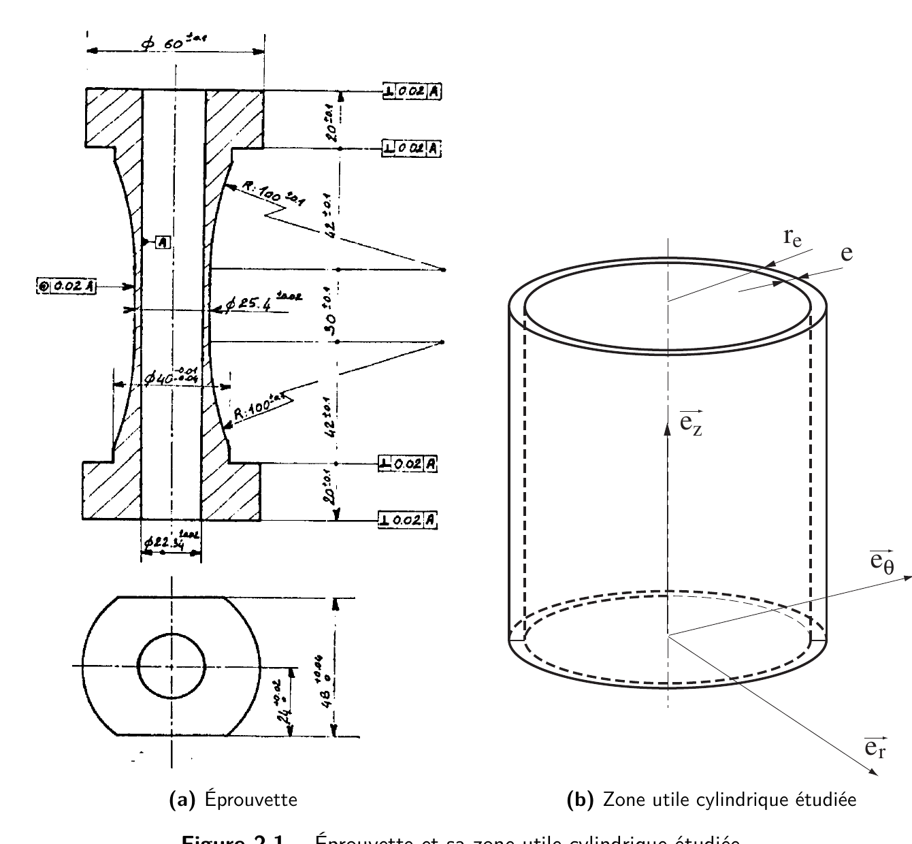
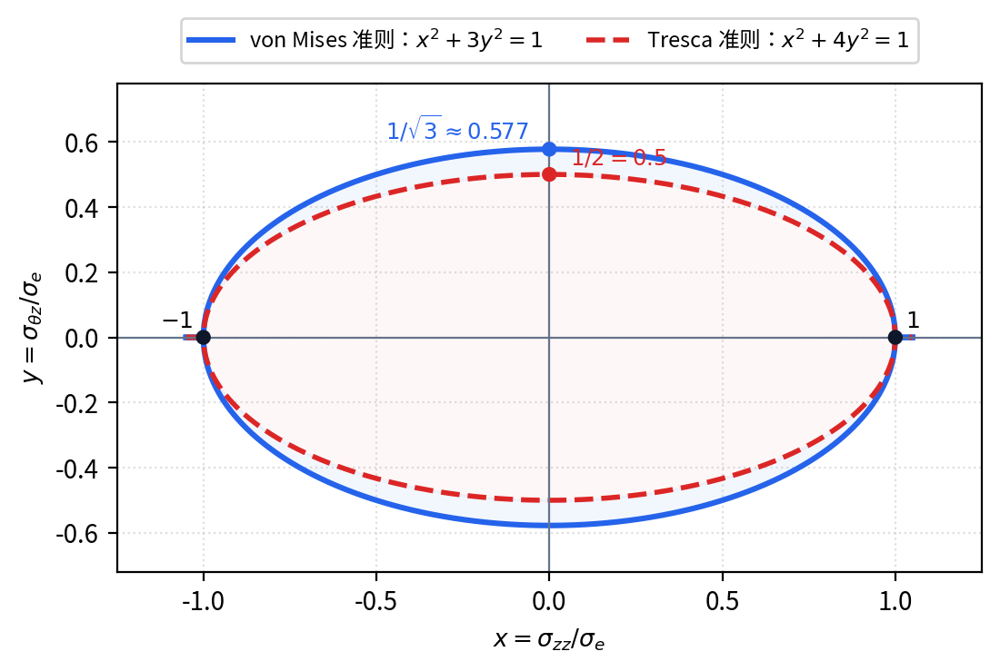
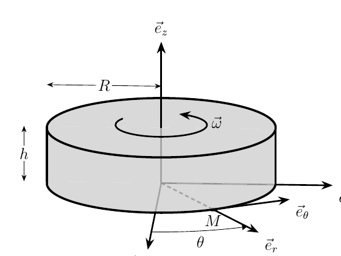

# 4　Élasticité · 弹性问题（题库）

## CC2 · 第 4 题读题：先列弹性问题，再看给的是哪个场

**两年第一小问都用 *poser le problème*。** 这里要把方程和边界条件列全。答题纸上可以先写三行：**CA** 放应变与位移的关系及给定的位移分量；**SA** 放体内平衡及给定的面力分量；**loi de comportement** 放材料本构。然后回到题面，把每个面的条件填到对应行。一张光滑支承面可以同时给出法向位移和切向面力。

| 题面中的物体 | 决定解法的一句法语 | 第一笔写什么，后面求什么 |
|---|---|---|
| **2024 · 受拉梁**（4.4）。*poutre en traction* 是受轴向拉力的梁，底面可滑动。 | *On cherche un champ de contraintes de la forme…* 给了候选**应力场**，唯一未知函数是 $g(z)$。 | 本题无体力且仅有 $\sigma_{zz}=g(z)$，体内平衡给 $g'(z)=0$。顶端均匀拉力确定应力，逆 Hooke 定律给应变，再检验候选位移能否产生这些应变。 |
| **2025 · 涡轮转子**（4.10）。*disque* 是圆盘，*repère attaché au disque* 是随盘转动的参考系。 | *Le champ de déplacement a la forme…* 给了径向**位移场** $\vec u=u_r(r)\vec e_r$。 | 柱坐标下先写 $\varepsilon_{rr}=u_r'$、$\varepsilon_{\theta\theta}=u_r/r$。用 Hooke 得应力，把题给离心体力代入径向平衡。用圆心有界和外缘自由定常数，最后做 Tresca 校核。 |

**几种容易读懂单词却答偏的问法。**

- *Le problème admet-il une solution unique ?* 分别回答应力、应变和位移。检验位移时，把刚体位移 $\vec c+\vec\omega\times\overrightarrow{OM}$ 代入齐次位移边界条件。受拉梁底面的 $u_z=0$ 仍允许面内平移和绕 $z$ 轴转动。
- *Le champ proposé est-il solution ? Justifier.* 要检验给出的场。对候选位移求对称梯度，逐个比较所需应变，再检查位移边界。受拉梁有泊松收缩，纯轴向位移给不出所需的横向应变。
- *Exprimer … en fonction de $u_r$* 只要求用 $u_r$ 及其导数表示。*Déterminer les constantes à l’aide des conditions aux limites* 才要求把条件代入通解，写出常数方程。
- *Dimensionner le rayon … à vitesse de rotation fixée* 角速度已固定，待求的是半径。先写 $\max_{\Omega}\sigma_{\mathrm{Tr}}\leq\sigma_e$，再说明最大值在哪里、尺寸如何进入不等式。

**受压厚壁管**同样有径向位移。管内有孔，区域不含 $r=0$，通解中的 $1/r$ 项可以保留；内外壁的压力条件用来定两个常数。

## Lois de comportement · 本构的写法

### ① Écrire la loi de comportement · 写本构关系

[*Rappeler les relations de comportement directe $\boldsymbol\sigma=f_1(\boldsymbol\varepsilon)$ et inverse $\boldsymbol\varepsilon=f_2(\boldsymbol\sigma)$*]{.ask}

Élasticité linéaire isotrope homogène (HPP) · 线弹性、各向同性、均质：

$$\boldsymbol\sigma=\lambda\operatorname{tr}(\boldsymbol\varepsilon)\,\mathbb I+2\mu\,\boldsymbol\varepsilon,\qquad
\boldsymbol\varepsilon=\frac{1+\nu}E\,\boldsymbol\sigma-\frac\nu E\operatorname{tr}(\boldsymbol\sigma)\,\mathbb I .$$

- Forme directe avec $E,\nu$ : $\boldsymbol\sigma=\dfrac E{1+\nu}\boldsymbol\varepsilon+\dfrac{E\nu}{(1+\nu)(1-2\nu)}\operatorname{tr}(\boldsymbol\varepsilon)\,\mathbb I$. 用 $E,\nu$ 写的正关系。
- Composantes (inverse) : $\varepsilon_{11}=\frac1E\bigl[\sigma_{11}-\nu(\sigma_{22}+\sigma_{33})\bigr]$, $\varepsilon_{12}=\frac{1+\nu}E\sigma_{12}=\frac{\sigma_{12}}{2\mu}$. 逆关系的分量式。
- Partie sphérique / déviatorique : $\operatorname{tr}\boldsymbol\sigma=3K\operatorname{tr}\boldsymbol\varepsilon$, $\boldsymbol\sigma^D=2\mu\,\boldsymbol\varepsilon^D$. 球量与偏量分开：体积模量与剪切模量。
- Démonstration du lien entre coefficients : prendre la trace de la loi directe, $\operatorname{tr}\boldsymbol\sigma=(3\lambda+2\mu)\operatorname{tr}\boldsymbol\varepsilon$, puis inverser et identifier avec la loi inverse. 证明常数关系：对正关系取迹，反解后与逆关系比较。
- L'opérateur de Hooke $\mathbb K$ est linéaire, symétrique, défini positif ; cas général anisotrope : 21 coefficients indépendants ; isotrope : 2 ($\lambda,\mu$ ou $E,\nu$). Hooke 算子线性、对称、正定；各向异性 21 个独立系数，各向同性 2 个。

::: fr
Le matériau est élastique linéaire isotrope homogène : $\boldsymbol\sigma=\lambda\operatorname{tr}(\boldsymbol\varepsilon)\mathbb I+2\mu\boldsymbol\varepsilon$, soit de manière équivalente $\boldsymbol\varepsilon=\frac{1+\nu}E\boldsymbol\sigma-\frac\nu E\operatorname{tr}(\boldsymbol\sigma)\mathbb I$. 材料是线弹性、各向同性、均质的；正关系与逆关系等价。

:::

### ② Des contraintes aux déformations · 由应力求应变（逆关系）

[*Appliquer la relation de comportement pour en déduire le champ des déformations*]{.ask}

1. Calculer $\operatorname{tr}\boldsymbol\sigma$. 先算迹。
2. $\boldsymbol\varepsilon=\frac{1+\nu}E\boldsymbol\sigma-\frac\nu E\operatorname{tr}(\boldsymbol\sigma)\mathbb I$, composante par composante. 逐分量代入。
3. Traction simple $\boldsymbol\sigma=\sigma\,\vec e_z\otimes\vec e_z$ : $\boldsymbol\varepsilon=\frac\sigma E\operatorname{diag}(-\nu,-\nu,1)$ (contraction latérale = effet Poisson) ; variation de volume $\operatorname{tr}\boldsymbol\varepsilon=\frac{(1-2\nu)\sigma}E$. 单轴拉伸：横向收缩（泊松效应）；体积变化。
4. Pression hydrostatique $\boldsymbol\sigma=-p\,\mathbb I$ : $\boldsymbol\varepsilon=-\frac{(1-2\nu)p}E\mathbb I=-\frac p{3K}\mathbb I$, $\operatorname{tr}\boldsymbol\varepsilon=-\frac pK$ (variation relative de volume) ; aucun cisaillement sur aucune facette ($\boldsymbol\sigma$ sphérique). 静水压：迹 = 体积相对变化 = $-p/K$；球形张量任何面上无切应力。

::: fr
En appliquant la relation de comportement inverse : $\boldsymbol\varepsilon=\frac{1+\nu}E\boldsymbol\sigma-\frac\nu E\operatorname{tr}(\boldsymbol\sigma)\mathbb I=\frac F{ES}\operatorname{diag}(-\nu,-\nu,1)$ : allongement selon l'axe et contraction latérale (effet Poisson). 用逆本构得到应变：沿轴伸长、横向收缩。

:::

### ③ Des déplacements aux contraintes · 由位移求应力（正关系）

[*Calculer la forme du tenseur des contraintes en fonction du déplacement*]{.ask}

1. $\boldsymbol\varepsilon(\vec u)$ (题库第 1 部分解题步骤 ⑨ ; en cylindrique : 解题步骤表 A). 先算应变。
2. $\operatorname{tr}\boldsymbol\varepsilon=\operatorname{div}\vec u$.
3. $\sigma_{ii}=\lambda\operatorname{tr}\boldsymbol\varepsilon+2\mu\varepsilon_{ii}$ (diagonal), $\sigma_{ij}=2\mu\varepsilon_{ij}$ (hors diagonale). 对角元有 $\lambda\operatorname{tr}\boldsymbol\varepsilon$，非对角元是 $2\mu\varepsilon_{ij}$。
4. Cisaillement : $\tau=\mu\gamma=2\mu\varepsilon_{12}$ ($\mu$ = module de cisaillement, différent de $E$). 剪切：$\tau=\mu\gamma$。

### ④ Constantes, application numérique · 常数换算与数值

[*Exprimer $\lambda$ et $\mu$ en fonction de $E$ et $\nu$ ; application numérique*]{.ask}

- Formules : 本构表 A. Unités : $E,\lambda,\mu,K$ en Pa (souvent GPa) ; $\nu$ sans dimension, $-1<\nu<\frac12$ (souvent 0,25–0,35). 常数单位 Pa；泊松比无量纲，范围 $-1<\nu<\frac12$。
- Sans calculatrice, $E=200$ GPa, $\nu=0{,}3$ : $\mu=\frac{200}{2{,}6}\approx76{,}9$ GPa ; $\lambda=\frac{200\times0{,}3}{1{,}3\times0{,}4}=\frac{60}{0{,}52}\approx115{,}4$ GPa ; $K=\frac{200}{1{,}2}\approx166{,}7$ GPa. On constate $\mu<E/2$. 手算示例；可见 $\mu$ 小于 $E/2$。
- Incompressible : $\operatorname{tr}\boldsymbol\varepsilon=0$ ⇒ $K\to\infty$, $\nu\to\frac12$ ; la pression devient une réaction (ne pas remplacer $\nu=\frac12$ dans $1-2\nu$ au dénominateur). 不可压缩：$K\to\infty$，$\nu\to\frac12$；不能把 ½ 代进分母。
- Déformation plastique isochore : $\operatorname{tr}\boldsymbol\varepsilon^p=0$ ⇒ 5 composantes indépendantes en 3D. 塑性等体积：3D 中 5 个独立分量。

### ⑤ Thermoélasticité · 热弹性

[*Écrire la relation de comportement anisotherme ; contraintes d'origine thermique*]{.ask}

$$\boldsymbol\sigma=\mathbb K:(\boldsymbol\varepsilon-\boldsymbol\varepsilon^{th}),\quad\boldsymbol\varepsilon^{th}=\alpha\,\delta T\,\mathbb I=\frac{\alpha_v}3\delta T\,\mathbb I,\quad
\boldsymbol\sigma=\lambda\operatorname{tr}(\boldsymbol\varepsilon)\mathbb I+2\mu\boldsymbol\varepsilon-K\alpha_v\,\delta T\,\mathbb I,$$
$$\boldsymbol\varepsilon=\frac{1+\nu}E\boldsymbol\sigma-\frac\nu E\operatorname{tr}(\boldsymbol\sigma)\mathbb I+\alpha\,\delta T\,\mathbb I .$$

- $\alpha$ dilatation linéique ($\mathrm K^{-1}$), $\alpha_v=3\alpha$ dilatation volumique ; coefficient du terme thermique : $K\alpha_v=3K\alpha=(3\lambda+2\mu)\alpha=\dfrac{E\alpha}{1-2\nu}$ ($E\alpha$ seulement pour une barre à surface latérale libre). 线膨胀系数与体膨胀系数；热项系数是 $3K\alpha$，只有侧面自由的杆才是 $E\alpha$。
- La contrainte ne dépend que de la déformation **élastique** ; la dilatation thermique est sphérique (pas de glissement). 应力只与弹性应变有关；热应变是各向同性的，不产生剪应变。
- Sans effort extérieur, des contraintes peuvent exister : température non uniforme ou dilatation empêchée (本构表 B). 没有外力也可能有应力：温度不均匀或膨胀受阻。

::: fr
La relation de comportement anisotherme s'écrit $\boldsymbol\sigma=2\mu\boldsymbol\varepsilon+\lambda\operatorname{tr}(\boldsymbol\varepsilon)\mathbb I-K\alpha_v\,\delta T\,\mathbb I$ : seule la déformation élastique $\boldsymbol\varepsilon-\boldsymbol\varepsilon^{th}$ crée des contraintes.
Un champ de température non uniforme peut créer des contraintes même en l'absence de tout effort extérieur et de tout déplacement imposé. 非等温本构：只有弹性应变产生应力；不均匀温度场在没有任何外载时也能产生应力。

:::

### ⑥ Solide ou fluide ? · 固体还是流体

[*Quelle(s) relation(s) de comportement correspondent à des milieux fluides (à un fluide newtonien) ?*]{.ask}

| Loi · 本构 | Milieu · 介质 |
|---|---|
| $\boldsymbol\sigma=\lambda\operatorname{tr}(\boldsymbol\varepsilon)\mathbb I+2\mu\boldsymbol\varepsilon$ ; $\boldsymbol\varepsilon=\frac{1+\nu}E\boldsymbol\sigma-\frac\nu E\operatorname{tr}(\boldsymbol\sigma)\mathbb I$ | solide élastique (même loi, directe / inverse) · 线弹性固体（同一本构的正、逆形式） |
| $\boldsymbol\sigma=-p\,\mathbb I$ | fluide parfait · 理想流体 |
| $\boldsymbol\sigma=-p\,\mathbb I+2\mu_v\mathbb D$ ($+\lambda_v\operatorname{tr}\mathbb D\,\mathbb I$ si compressible) | fluide newtonien · 牛顿流体 |

Règle : $\boldsymbol\varepsilon$, $E$, $\nu$, $\lambda$, $\mu$ → solide ; $p$, $\mathbb D$, $\mu_v$ → fluide. « Fluide » : cocher parfait **et** newtonien ; « fluide newtonien » : seulement la loi avec $\mathbb D$. $\mu$ solide (module de cisaillement, Pa) ≠ $\mu_v$ fluide (viscosité, Pa·s). 判别口诀：含 ε、E、ν、λ、μ 的是固体；含 p、D、μ_v 的是流体。问"流体"两个都选，问"牛顿流体"只选含 D 的；固体的 μ（Pa）与流体的黏度（Pa·s）量纲不同。

### Table A　Conversion des constantes · 本构表 A：常数换算

| | à partir de $E,\nu$ · 由 $E,\nu$ | à partir de $\lambda,\mu$ · 由 $\lambda,\mu$ |
|---|---|---|
| $\mu$ ($=G$) | $\dfrac E{2(1+\nu)}$ | — |
| $\lambda$ | $\dfrac{E\nu}{(1+\nu)(1-2\nu)}$ | — |
| $K$ | $\dfrac E{3(1-2\nu)}$ | $\lambda+\dfrac23\mu$ |
| $E$ | — | $\dfrac{\mu(3\lambda+2\mu)}{\lambda+\mu}$ |
| $\nu$ | — | $\dfrac\lambda{2(\lambda+\mu)}$ |

Combinaisons utiles · 常用组合 : $\lambda+2\mu=\dfrac{E(1-\nu)}{(1+\nu)(1-2\nu)}$ ; $3\lambda+2\mu=3K=\dfrac E{1-2\nu}$ ; $\dfrac\lambda{\lambda+2\mu}=\dfrac\nu{1-\nu}$ ; $\dfrac\mu{\lambda+\mu}=1-2\nu$ ; $\dfrac{\lambda+\mu}{\lambda+2\mu}=\dfrac1{2(1-\nu)}$ ; $\dfrac{3\lambda+2\mu}{\lambda+2\mu}=\dfrac{1+\nu}{1-\nu}$.

### Table B　Cas thermiques (élévation uniforme $\delta T=T_0$) · 本构表 B：均匀温升的典型情形

| Cas · 情形 | Déplacement · 位移 | Déformation · 应变 | Contrainte · 应力 |
|---|---|---|---|
| structure libre · 自由结构 | $\vec u=\alpha T_0\,\overrightarrow{OM}$ (+ rigide) | $\alpha T_0\,\mathbb I$ | $\mathbb O$ |
| totalement bloquée ($\vec u=\vec0$ sur tout le bord) · 完全约束 | $\vec0$ | $\mathbb O$ | $-3K\alpha T_0\,\mathbb I$ (compression · 受热被压) |
| barre encastrée aux deux bouts, latérale libre · 两端固定的杆 | $u_x=0$ | $\varepsilon_{xx}=0$ | $\sigma_{xx}=-E\alpha T_0$ |
| plaque mince bloquée dans son plan · 面内全约束的薄板 | nul dans le plan | nul dans le plan | $\sigma_{11}=\sigma_{22}=-\dfrac{E\alpha T_0}{1-\nu}$ |

## Méthode · 弹性问题大题的解题步骤

### ① Poser le problème (CA, SA, comportement) · 建立问题

[*Poser le problème en écrivant les équations et conditions aux limites, en précisant si elles portent sur l'admissibilité cinématique ou statique*]{.ask}

1. Domaine (ex. $r\in[R_1,R_2]$, $\theta\in[0,2\pi]$, $z\in[0,h]$) et hypothèses : statique, HPP, élastique linéaire isotrope homogène, forces volumiques prises en compte ou négligées. 写区域和假设：静力、HPP、线弹性各向同性均质、体力是否忽略。
2. **CA** (cinématique) : $\boldsymbol\varepsilon(\vec u)=\frac12(\overrightarrow{\operatorname{grad}}\vec u+\overrightarrow{\operatorname{grad}}^{\mathsf T}\vec u)$, $\vec u$ continu et régulier ; conditions en déplacement face par face (encastrement $\vec u=\vec0$ ; contact glissant $\vec u\cdot\vec n=0$ ; $u_\theta(L)$ imposé…). 运动学可容：HPP 应变定义、位移连续正则；逐面写位移条件。
3. **SA** (statique) : $\overrightarrow{\operatorname{div}}\boldsymbol\sigma+\vec f_d=\vec0$ dans $\Omega$ ; conditions en effort face par face (libre, pression, effort imposé, torseur imposé ; contact glissant : effort tangentiel nul). 静力学可容：局部平衡；逐面写力条件（滑动面的切向面力为零）。
4. **Relation de comportement** : Hooke (directe si on donne $\lambda,\mu$ ; inverse si on donne $E,\nu$) ; anisotherme : soustraire la dilatation thermique (解题步骤 ⑬ ; 本构 ⑤). 本构：Hooke；非等温时减去热应变。
5. Présenter en liste, chaque équation étiquetée CA / SA / RdC. La solution est un couple ($\vec u$ CA, $\boldsymbol\sigma$ SA) relié par la loi de comportement. 分条列出并标注类别；解 = 一个 CA 位移场与一个 SA 应力场，由本构联系。

| Frontière · 边界 | CA (déplacement · 位移) | SA (effort · 力) |
|---|---|---|
| effort imposé · 给定面力 | — | $\boldsymbol\sigma\vec n=\vec T_d$ |
| libre · 自由面 | — | $\boldsymbol\sigma\vec n=\vec0$ |
| pression $p$ · 压力 | — | $\boldsymbol\sigma\vec n=-p\vec n$ |
| torseur imposé (forme faible) · 给定合力旋量 | — | $\int\boldsymbol\sigma\vec n\,\mathrm dS=\vec R$, $\int\overrightarrow{AM}\wedge\boldsymbol\sigma\vec n\,\mathrm dS=\vec M_A$ |
| encastrement · 固定 | $\vec u=\vec0$ (ou $\vec u_d$) | — |
| contact glissant / plan de symétrie · 滑动接触、对称面 | $\vec u\cdot\vec n=0$ | $(\boldsymbol\sigma\vec n)\cdot\vec t=0$ pour tout $\vec t$ tangent |
| interface collée · 粘结界面 | $\llbracket\vec u\rrbracket=\vec0$ | $\llbracket\boldsymbol\sigma\rrbracket\vec n=\vec0$ |

En chaque point du bord et pour chaque direction : on impose **soit** le déplacement **soit** l'effort, jamais les deux, jamais aucun. 边界上每点每个方向：要么给位移，要么给力；不能两者都给，也不能都不给。

::: fr
Admissibilité cinématique (CA) : $\boldsymbol\varepsilon=\frac12(\overrightarrow{\operatorname{grad}}\vec u+\overrightarrow{\operatorname{grad}}^{\mathsf T}\vec u)$ dans $\Omega$ (HPP), $\vec u$ continu ; $u_z=0$ sur les bases $z=0$ et $z=h$.
Admissibilité statique (SA) : $\overrightarrow{\operatorname{div}}\boldsymbol\sigma+\vec f=\vec0$ dans $\Omega$ ; $\boldsymbol\sigma\vec n=-p_1\vec n$ en $r=R_1$ ($\vec n=-\vec e_r$), $\boldsymbol\sigma\vec n=-p_2\vec n$ en $r=R_2$ ($\vec n=\vec e_r$) ; efforts tangentiels nuls sur les bases.
Relation de comportement : $\boldsymbol\sigma=\lambda\operatorname{tr}(\boldsymbol\varepsilon)\mathbb I+2\mu\boldsymbol\varepsilon$ dans $\Omega$. CA：HPP 应变、位移连续、两底面轴向位移为零；SA：局部平衡、内外壁压力、底面切向面力为零；本构：Hooke。

:::

### ② Justifier la forme du champ · 论证场的形式

[*Justifier la forme du champ de déplacement $\vec u=u(r)\,\vec e_r$ (du champ de contrainte proposé)*]{.ask}

Éliminer composantes et variables une par une à l'aide de la **géométrie** et du **chargement** : 逐条用几何和载荷的性质消去分量和变量：

| Propriété · 性质 | Conséquence · 结论 |
|---|---|
| axisymétrie (géométrie et chargement) · 轴对称 | $\partial_\theta(\cdot)=0$ |
| chargement purement radial · 载荷纯径向 | $u_\theta=0$ |
| déplacement axial bloqué / pas de charge axiale · 轴向被挡 | $u_z=0$ |
| solide long ou conditions identiques aux deux bouts · 很长 | $\partial_z(\cdot)=0$ (déformations planes) |
| symétrie sphérique · 球对称 | $\vec u=u_r(r)\vec e_r$, $\sigma_{\theta\theta}=\sigma_{\varphi\varphi}$ |
| invariance selon $x$, $y$, symétries $(Oxz)$, $(Oyz)$ | $\partial_x=\partial_y=0$ |
| charge axiale seule, surface latérale libre · 只有轴向载荷、侧面自由 | seul $\sigma_{zz}\ne0$ |
| torsion (rotation des extrémités, pas d'effort axial) · 扭转 | $\vec u=u_\theta(r,z)\,\vec e_\theta$ |

Conclure en vérifiant que la forme obtenue est compatible avec les conditions aux limites. 最后说明这个形式与边界条件相容。

::: fr
La géométrie et le chargement sont axisymétriques : les champs ne dépendent pas de $\theta$ et $u_\theta=0$ (chargement purement radial). Le déplacement axial étant bloqué et le solide long, $u_z=0$ et rien ne dépend de $z$. D'où $\vec u=u(r)\,\vec e_r$. 几何与载荷轴对称 ⇒ 与 θ 无关、$u_\theta=0$；轴向被挡且很长 ⇒ $u_z=0$、与 z 无关；所以 $\vec u=u(r)\vec e_r$。

:::

### ③ Unicité, mouvements de corps rigide · 唯一性、刚体模态

[*Le problème admet-il une solution unique ? Pourquoi ?*]{.ask}

1. Problème bien posé ⇒ déformations et contraintes **uniques** ; le déplacement est unique à un mouvement de corps rigide près $\vec\lambda_0+\vec\omega_0\wedge\overrightarrow{OM}$. 良定 ⇒ 应变、应力唯一；位移差一个刚体运动。
2. Lister les 6 mouvements rigides (3 translations, 3 rotations) bloqués par les conditions en déplacement (table C) ; écrire la composante concernée du déplacement rigide et l'annuler en tout point de la face. 列出 6 个刚体运动中哪些被位移条件挡住（查表 C）：把刚体位移在该面上的对应分量令为零。
3. Existence quand seuls des efforts sont imposés : les efforts extérieurs doivent être en équilibre (résultante et moment nuls). 只给力时，解存在的条件是外力自身平衡。

::: fr
Le problème est bien posé : la solution est unique en contraintes et en déformations. Le déplacement est défini à un mouvement de corps rigide près : la condition $u_z=0$ sur la base bloque la translation selon $\vec e_z$ et les rotations autour de $O\vec e_x$ et $O\vec e_y$ ; restent les translations selon $\vec e_x$, $\vec e_y$ et la rotation autour de $\vec e_z$. 问题良定，应力、应变唯一；位移差一个刚体运动：底面 $u_z=0$ 挡住沿 $\vec e_z$ 平移和绕 $\vec e_x$、$\vec e_y$ 的转动，剩下沿 $\vec e_x$、$\vec e_y$ 平移和绕 $\vec e_z$ 转动。

:::

### ④ Choisir la méthode · 选位移法还是应力法

| | Approche en déplacement (Navier) · 位移法 | Approche en contrainte · 应力法 |
|---|---|---|
| quand · 何时用 | déplacements imposés, symétrie radiale, forces volumiques | efforts imposés, champ de contrainte simple (traction) |
| démarche · 步骤 | forme CA de $\vec u$ → $\boldsymbol\varepsilon$ → $\boldsymbol\sigma$ → équilibre (Navier) → **CL en effort** | forme SA de $\boldsymbol\sigma$ → $\boldsymbol\varepsilon$ (loi inverse) → intégrer $\vec u$ (**compatibilité**) → **CL en déplacement** |
| à vérifier · 要检查 | conditions en effort (l'équilibre est déjà dans Navier) | compatibilité et conditions en déplacement |

位移法：设 CA 位移 → 应变 → 应力 → 平衡（Navier）→ 用力边界条件定常数。应力法：设 SA 应力 → 逆本构求应变 → 积分位移（检查协调）→ 检查位移边界条件。

### ⑤ $\boldsymbol\varepsilon$ et $\boldsymbol\sigma$ en fonction de $u_r$ · 由 $u_r$ 求应变与应力

[*Calculer la forme des tenseurs de déformation et de contrainte en fonction de $u_r$*]{.ask}

Gradient en cylindrique · 柱坐标位移梯度：
$$\overrightarrow{\operatorname{grad}}\vec u=\begin{pmatrix}\partial_ru_r&\frac1r(\partial_\theta u_r-u_\theta)&\partial_zu_r\\\partial_ru_\theta&\frac1r(\partial_\theta u_\theta+u_r)&\partial_zu_\theta\\\partial_ru_z&\frac1r\partial_\theta u_z&\partial_zu_z\end{pmatrix}$$

- $\vec u=u(r)\vec e_r$, $u_z=0$ : $\boldsymbol\varepsilon=\operatorname{diag}\bigl(u',\ \frac ur,\ 0\bigr)$, $\operatorname{tr}\boldsymbol\varepsilon=u'+\frac ur=\frac1r(ru)'$. 柱坐标径向位移的应变；别漏 $\varepsilon_{\theta\theta}=u/r$。
- $\sigma_{rr}=(\lambda+2\mu)u'+\lambda\frac ur$, $\sigma_{\theta\theta}=\lambda u'+(\lambda+2\mu)\frac ur$, $\sigma_{zz}=\lambda\bigl(u'+\frac ur\bigr)$ : diagonal dans $(\vec e_r,\vec e_\theta,\vec e_z)$. 应力已对角；$\varepsilon_{zz}=0$ 但 $\sigma_{zz}\ne0$。
- Sphère : table A. 球坐标见查表 A。

::: fr
Seuls $\partial_ru_r=u_r'$ et $u_r/r$ sont non nuls : $\boldsymbol\varepsilon=\operatorname{diag}(u_r',u_r/r,0)$ dans $(\vec e_r,\vec e_\theta,\vec e_z)$. Avec $\operatorname{tr}\boldsymbol\varepsilon=u_r'+u_r/r$, la loi de Hooke donne $\sigma_{rr}=(\lambda+2\mu)u_r'+\lambda\frac{u_r}r$, $\sigma_{\theta\theta}=\lambda u_r'+(\lambda+2\mu)\frac{u_r}r$, $\sigma_{zz}=\lambda\operatorname{tr}\boldsymbol\varepsilon\neq0$ : le blocage axial crée une contrainte axiale. 只有两项非零；代入 Hooke；轴向被挡产生轴向应力。

:::

### ⑥ Équation de Navier, intégration · Navier 方程与积分

[*Montrer à l'aide de l'équation de Navier que $u(r)=K_1/r+K_2r$ (ou $C_1r^3+C_2r+C_3/r$)*]{.ask}

$$\mu\Delta\vec u+(\lambda+\mu)\overrightarrow{\operatorname{grad}}(\operatorname{div}\vec u)+\vec f=\rho\vec\gamma
\iff(\lambda+2\mu)\overrightarrow{\operatorname{grad}}(\operatorname{div}\vec u)-\mu\,\overrightarrow{\operatorname{rot}}\,\overrightarrow{\operatorname{rot}}\vec u+\vec f=\rho\vec\gamma .$$

1. Navier = équilibre + Hooke + HPP (pas les conditions aux limites). Champ radial ⇒ $\overrightarrow{\operatorname{rot}}\vec u=\vec0$ ⇒ $(\lambda+2\mu)\overrightarrow{\operatorname{grad}}(\operatorname{div}\vec u)+\vec f=\vec0$. Navier = 平衡 + 本构 + HPP，不含边界条件；径向场无旋，方程化简。
2. Cylindre : $(\lambda+2\mu)\dfrac{\mathrm d}{\mathrm dr}\Bigl[\dfrac1r\dfrac{\mathrm d}{\mathrm dr}(ru)\Bigr]+f_r=0$ ; sphère : $(\lambda+2\mu)\dfrac{\mathrm d}{\mathrm dr}\Bigl[\dfrac1{r^2}\dfrac{\mathrm d}{\mathrm dr}(r^2u)\Bigr]+f_r=0$. Équivalent : $u''+\frac{u'}r-\frac u{r^2}=\frac{\mathrm d}{\mathrm dr}\bigl[\frac1r(ru)'\bigr]$. 柱、球的径向方程；左边可以写成逐次求导的形式。
3. Intégrer deux fois : solution homogène (cylindre $Ar+\frac Br$, sphère $Ar+\frac B{r^2}$) + solution particulière (table A). 积分两次：齐次解 + 特解（查表 A）。
4. Forces volumiques : rotation à $\omega$ (repère tournant) $f_r=+\rho\omega^2r$ ; autogravitation d'une sphère $f_r=-\rho g\,r/R$ ; pesanteur $-\rho g\vec e_z$ (non radiale). 体力：随动系中的离心力；球的自引力；竖直重力。

::: fr
Le champ étant radial, $\overrightarrow{\operatorname{rot}}\vec u=\vec0$ et l'équation de Navier se réduit à $(\lambda+2\mu)\frac{\mathrm d}{\mathrm dr}\bigl[\frac1r\frac{\mathrm d}{\mathrm dr}(ru)\bigr]+f_r=0$. En intégrant deux fois : $u(r)=\frac{K_1}r+K_2r$ (sans force volumique). 径向场无旋，Navier 化为常微分方程；积分两次得通解。

:::

### ⑦ Constantes par les conditions aux limites · 用边界条件定常数

[*En utilisant les conditions aux limites, calculer les constantes ; en déduire $\vec u$ et $\boldsymbol\sigma$*]{.ask}

1. Domaine contenant $r=0$ (plein) : $B/r$ ou $B/r^2$ infini au centre ⇒ $B=0$. Domaine creux : garder deux constantes. 实心体中心有界 ⇒ 去掉奇异项；空心体保留两个常数。
2. Conditions en effort : surface libre $\sigma_{rr}(R)=0$ ; pression $\sigma_{rr}=-p$ (paroi intérieure : $\vec n=-\vec e_r$, on obtient quand même $\sigma_{rr}(R_1)=-p_1$). 力边界：自由面 $\sigma_{rr}=0$；压力 $\sigma_{rr}=-p$（内壁两个负号抵消）。
3. Écrire $\vec u$ et $\boldsymbol\sigma$ ; vérifier les CL et l'homogénéité (contraintes de l'ordre de $p$, $\rho\omega^2R^2$, $\rho gR$). 写出结果，检查边界条件和量纲。

::: fr
Le point $r=0$ appartient au domaine : le terme en $1/r$ doit être nul pour que le déplacement reste fini. La surface extérieure est libre : $\boldsymbol\sigma\vec e_r=\vec0$ en $r=R$, soit $\sigma_{rr}(R)=0$, ce qui fixe la dernière constante. 中心在区域内 ⇒ $1/r$ 项为零；外表面自由 ⇒ $\sigma_{rr}(R)=0$ 定出最后一个常数。

:::

### ⑧ Approche en contrainte (traction, $\sigma_{zz}=g(z)$) · 应力法

[*Justifier la forme de ce champ, puis utiliser l'admissibilité statique pour déterminer $g(z)$ ; appliquer la loi de comportement*]{.ask}

1. Forme : symétries, invariance transverse, charge axiale seule, surface latérale libre ⇒ seul $\sigma_{zz}=g(z)$. 论证只有 $\sigma_{zz}=g(z)$。
2. SA : $\partial_zg+f_z=0$ ⇒ $g$ constant sans force volumique ; extrémité : $g=F/S$ (ou $\int g\,\mathrm dS=F$) ; faces latérales $\boldsymbol\sigma\vec n=\vec0$ automatiquement. 平衡 ⇒ g 为常数；端面合力 ⇒ $g=F/S$；侧面自动自由。
3. Loi inverse : $\boldsymbol\varepsilon=\frac F{ES}\operatorname{diag}(-\nu,-\nu,1)$. 逆本构求应变。
4. Intégrer : $u_x=-\nu\frac F{ES}x$, $u_y=-\nu\frac F{ES}y$, $u_z=\frac F{ES}z$, + mouvement rigide ; les CL en déplacement fixent une partie des constantes. 积分位移，加刚体运动，由位移边界条件定部分常数。
5. Barre pesante : $\sigma_{zz}=a+bz$, l'équilibre donne $b$ (= $\rho g$ si $\vec f=-\rho g\vec e_z$), l'extrémité libre donne $a$. 自重杆：平衡定 b，自由端定 a。

::: fr
L'équilibre local donne $g'(z)=0$ (pas de force volumique), et la condition sur la face $z=L$ donne $g=F/S$. Les faces latérales sont libres d'office. La loi de comportement inverse donne $\boldsymbol\varepsilon=\frac F{ES}\operatorname{diag}(-\nu,-\nu,1)$. 局部平衡 ⇒ $g$ 为常数；端面 ⇒ $g=F/S$；侧面自动自由；逆本构得应变。

:::

### ⑨ Torsion (approche en déplacement) · 扭转（位移法）

[*On propose $\vec u=f(r)g(z)\,\vec e_\theta$ ; justifier ; déterminer $\boldsymbol\varepsilon$, $\boldsymbol\sigma$, le couple*]{.ask}

1. Axisymétrie, la torsion ne crée qu'un déplacement orthoradial ; $u_\theta(0)=0$ et $u_\theta(L)=\alpha Lr$ ⇒ $g(z)=z$, $f(r)=\alpha r$ : $\vec u=\alpha rz\,\vec e_\theta$. 端面条件给出 $\vec u=\alpha rz\,\vec e_\theta$。
2. $\varepsilon_{\theta z}=\frac12\partial_zu_\theta=\frac{\alpha r}2$ (seul terme non nul), $\sigma_{\theta z}=2\mu\varepsilon_{\theta z}=\mu\alpha r$ ; équilibre et surface latérale libre vérifiés. 只有 $\varepsilon_{\theta z}$；$\sigma_{\theta z}=\mu\alpha r$；平衡与侧面自由自动满足。
3. Couple $C=\int_Sr\,\sigma_{\theta z}\,\mathrm dS=\mu\alpha I_0$, $I_0=\frac{\pi R^4}2$ (plein), $\frac\pi2(r_e^4-r_i^4)$ (tube) ; donc $\sigma_{\theta z}=\frac{Cr}{I_0}$, maximum sur la surface extérieure. 扭矩 = $\mu\alpha I_0$；应力在外表面最大。
4. Tube mince ($e\ll r$) : $\sigma_{\theta z}\approx\mu\alpha r_m$ quasi uniforme dans l'épaisseur. 薄壁：剪应力在壁厚内近似均匀。

### ⑩ Superposition, chargement combiné · 叠加与组合载荷

[*Trouver la solution du problème de départ ; contrainte de von Mises en fonction de $N$ et $\alpha$*]{.ask}

1. Équations linéaires : solution (traction) + solution (torsion) = solution (traction + torsion), à géométrie et partition du bord identiques. 线性：两个问题的解相加。
2. $\boldsymbol\sigma=\sigma\,\vec e_z\otimes\vec e_z+\tau(\vec e_\theta\otimes\vec e_z+\vec e_z\otimes\vec e_\theta)$, $\sigma=N/S$, $\tau=\mu\alpha r$ ; principales $\frac\sigma2\pm\sqrt{\frac{\sigma^2}4+\tau^2}$ et 0. 组合应力及主应力。
3. $\sigma_{VM}=\sqrt{\sigma^2+3\tau^2}$, $\sigma_{Tr}=\sqrt{\sigma^2+4\tau^2}$ ; limite élastique dans le plan $(\sigma_{zz},\sigma_{\theta z})$ : ellipse $\sigma^2+3\tau^2=\sigma_e^2$. VM 系数 3、Tresca 系数 4；屈服边界是椭圆。

::: fr
Le problème étant linéaire, la solution du chargement combiné est la somme des solutions de traction et de torsion (principe de superposition). On obtient $\sigma_{VM}=\sqrt{(N/S)^2+3(\mu\alpha r)^2}$, maximale en $r=r_e$. 线性问题，组合载荷的解是两解之和（叠加原理）；VM 等效应力在外半径处最大。

:::

### ⑪ Vérifier un champ donné · 检验给定场是不是解

[*Le champ de déplacement $\vec u=\dots$ est-il solution du problème ? Sous quelles conditions ?*]{.ask}

1. Continu, régulier ? Conditions en déplacement satisfaites ? 连续正则？满足位移边界条件？
2. Calculer son $\boldsymbol\varepsilon$ et le comparer **composante par composante** à la déformation imposée par la loi de comportement (déformations uniques), y compris les termes latéraux $-\nu\sigma/E$ et les glissements. 算出它的应变，与本构要求的（唯一的）应变逐分量比较，包括横向收缩和剪应变。
3. Ou bien : en déduire $\boldsymbol\sigma$ et vérifier équilibre et conditions en effort. 或者：算应力，检查平衡和力边界条件。
4. Une seule condition non vérifiée ⇒ ce n'est pas la solution. On peut toujours ajouter un mouvement rigide non bloqué. 任一条不满足就不是解；可再叠加未被挡住的刚体运动。

::: fr
Ce champ donne $\varepsilon_{xx}=\varepsilon_{yy}=0$ alors que la loi de comportement impose $\varepsilon_{xx}=\varepsilon_{yy}=-\nu\frac F{ES}\neq0$ (effet Poisson) : ce n'est pas la solution. 这个场给出横向应变为零，而本构要求横向收缩：不是解。

:::

### ⑫ Contrainte de Tresca, dimensionnement · Tresca 校核与尺寸设计

[*Déterminer la contrainte équivalente de Tresca et en déduire une règle de dimensionnement*]{.ask}

1. Tenseur diagonal dans $(\vec e_r,\vec e_\theta,\vec e_z)$ : les termes diagonaux sont les contraintes principales. 对角元就是主应力。
2. Comparer $|\sigma_{rr}-\sigma_{\theta\theta}|$, $|\sigma_{\theta\theta}-\sigma_{zz}|$, $|\sigma_{rr}-\sigma_{zz}|$ (signe des constantes, valeur de $\frac{\lambda+\mu}\mu$, domaine de $r$). 比较三个差的大小。
3. Localiser le maximum (paroi intérieure, extérieure, centre) ; écrire $\max\sigma_{Tr}\le\sigma_e/k_s$ et résoudre. 找最大值位置；令其 ≤ 屈服极限 / 安全系数，解出尺寸。
4. Paroi mince : développement $\sqrt{\frac1{1-x}}\approx1+\frac x2$ pour $x\ll1$. 薄壁时一阶展开。

::: fr
Le tenseur des contraintes est diagonal dans la base cylindrique : ses termes diagonaux sont les contraintes principales. $\sigma_{Tr}=\max_{i,j}|\sigma_i-\sigma_j|$ est maximale sur la paroi intérieure ; la condition $\sigma_{Tr}(R_1)\le\sigma_e$ donne l'épaisseur minimale $e\ge R_1\bigl(\sqrt{\frac{\sigma_e}{\sigma_e-2p_1}}-1\bigr)$. 应力在柱坐标基下对角；Tresca 在内壁最大；由 $\sigma_{Tr}(R_1)\le\sigma_e$ 得最小壁厚。

:::

### ⑬ Contraintes planes, déformations planes, thermique · 平面问题、热应力

[*Pourquoi peut-on considérer un état de contraintes (déformations) planes ? Contraintes d'origine thermique*]{.ask}

| | Contraintes planes · 平面应力 | Déformations planes · 平面应变 |
|---|---|---|
| hypothèse · 假设 | $\sigma_{13}=\sigma_{23}=\sigma_{33}=0$ | $u_3=0$, indépendant de $x_3$ ⇒ $\varepsilon_{i3}=0$ |
| typique · 典型 | plaque mince à faces libres, charge dans le plan | solide long, ou déplacement axial bloqué |
| 3e direction · 第三方向 | $\varepsilon_{33}=-\frac\nu E(\sigma_{11}+\sigma_{22})\ne0$ | $\sigma_{33}=\lambda(\varepsilon_{11}+\varepsilon_{22})=\nu(\sigma_{11}+\sigma_{22})\ne0$ |

- Justification (3 phrases) : contraintes planes — mince, faces $\pm\vec e_3$ libres, chargement dans le plan ; déformations planes — long (ou bloqué), invariance selon $\vec e_3$, $u_3=0$. 论证三句话：平面应力——薄、上下面自由、载荷在面内；平面应变——长（或被挡）、沿轴不变、$u_3=0$。
- Thermique : $\boldsymbol\sigma=2\mu\boldsymbol\varepsilon+\lambda\operatorname{tr}\boldsymbol\varepsilon\,\mathbb I-K\alpha_v\,\delta T\,\mathbb I$ ; Navier anisotherme : ajouter $-K\alpha_v\overrightarrow{\operatorname{grad}}T$. Radial : $(\lambda+2\mu)\frac{\mathrm d}{\mathrm dr}(\operatorname{div}\vec u)=K\alpha_v\frac{\mathrm dT}{\mathrm dr}$, à intégrer (table A). 热应力：非等温本构与 Navier；径向问题积分一次得散度，再积分（查表 A）。
- Sans effort ni déplacement imposé, des contraintes peuvent exister (température non uniforme, dilatation empêchée, autocontraintes). 没有外载也可能有应力。

### ⑭ Théorèmes énergétiques · 能量定理

- Énergie potentielle (champ CA) : $E_p(\vec u)=\frac12\int_\Omega\boldsymbol\varepsilon:\mathbb K:\boldsymbol\varepsilon\,\mathrm dV-\int_\Omega\vec f\cdot\vec u\,\mathrm dV-\int_{\partial\Omega_T}\vec T_d\cdot\vec u\,\mathrm dS$ ; la solution exacte la **minimise** parmi les champs CA. 势能：精确解在所有 CA 场中使势能最小。
- Énergie complémentaire (champ SA) : $E_c(\boldsymbol\sigma)=\frac12\int_\Omega\boldsymbol\sigma:\mathbb K^{-1}:\boldsymbol\sigma\,\mathrm dV-\int_{\partial\Omega_u}(\boldsymbol\sigma\vec n)\cdot\vec u_d\,\mathrm dS$ ; minimale pour la solution exacte parmi les champs SA. 补能：精确解在所有 SA 场中使补能最小。
- Encadrement : $-E_c(\boldsymbol\sigma_{SA})\le-E_c(\boldsymbol\sigma_{ex})=E_p(\vec u_{ex})\le E_p(\vec u_{CA})$. 上下界。
- Sans effort volumique ni surfacique : $E_p$ = énergie de déformation $\ge0$ (« positive »), minimale à la solution exacte (nulle si aucun déplacement imposé). 无体力无面力：势能 = 应变能 ≥ 0，在精确解处最小（无给定位移时为零）。
- $E_p(\vec u_{CA})=0$ : l'énergie de déformation (écrite en déplacement) est compensée par le travail des efforts extérieurs ; cela ne prouve pas que c'est la solution exacte. CA 场势能为零：应变能被外力功抵消，不能推出是精确解。
- Méthode de Ritz : champ CA à paramètres $\vec u=\sum q_i\vec\phi_i$, minimiser $E_p$ ⇒ $\mathbb K\vec q=\vec F$. Exemple : barre en traction, $u=q\,x/L$ ⇒ $q=\frac{FL}{ES}$ (exact). Ritz 近似：试探场代入势能求极小，得刚度方程；拉杆示例给出精确解。

### Table A　Solutions radiales · 径向问题公式

| | Cylindre $\vec u=u(r)\vec e_r$ ($u_z=0$) · 柱 | Sphère $\vec u=u(r)\vec e_r$ · 球 |
|---|---|---|
| déformations · 应变 | $\varepsilon_{rr}=u'$, $\varepsilon_{\theta\theta}=\frac ur$, $\varepsilon_{zz}=0$ | $\varepsilon_{rr}=u'$, $\varepsilon_{\theta\theta}=\varepsilon_{\varphi\varphi}=\frac ur$ |
| $\operatorname{div}\vec u$ | $u'+\frac ur=\frac1r(ru)'$ | $u'+\frac{2u}r=\frac1{r^2}(r^2u)'$ |
| $\sigma_{rr}$ | $(\lambda+2\mu)u'+\lambda\frac ur$ | $(\lambda+2\mu)u'+2\lambda\frac ur$ |
| $\sigma_{\theta\theta}$ | $\lambda u'+(\lambda+2\mu)\frac ur$ | $\lambda u'+2(\lambda+\mu)\frac ur$ ($=\sigma_{\varphi\varphi}$) |
| $\sigma_{zz}$ | $\lambda(u'+\frac ur)$ | — |
| équilibre radial · 径向平衡 | $\sigma_{rr}'+\frac{\sigma_{rr}-\sigma_{\theta\theta}}r+f_r=0$ | $\sigma_{rr}'+\frac{2(\sigma_{rr}-\sigma_{\theta\theta})}r+f_r=0$ |
| Navier | $(\lambda+2\mu)\bigl[\frac1r(ru)'\bigr]'+f_r=0$ | $(\lambda+2\mu)\bigl[\frac1{r^2}(r^2u)'\bigr]'+f_r=0$ |
| solution homogène · 齐次解 | $Ar+\frac Br$ | $Ar+\frac B{r^2}$ |
| particulière $f_r=kr$ · 特解 | $-\frac{kr^3}{8(\lambda+2\mu)}$ | $-\frac{kr^3}{10(\lambda+2\mu)}$ |
| particulière $f_r=k$ (constant) | $-\frac{kr^2}{3(\lambda+2\mu)}$ | $-\frac{kr^2}{4(\lambda+2\mu)}$ |
| contraintes de la solution homogène · 齐次解的应力 | $\sigma_{rr}=2(\lambda+\mu)A-2\mu\frac B{r^2}$, $\sigma_{\theta\theta}=2(\lambda+\mu)A+2\mu\frac B{r^2}$, $\sigma_{zz}=2\lambda A$ | $\sigma_{rr}=(3\lambda+2\mu)A-4\mu\frac B{r^3}$, $\sigma_{\theta\theta}=(3\lambda+2\mu)A+2\mu\frac B{r^3}$ |
| thermique $\delta T(r)$ · 热 | $u=\frac{K\alpha_v}{\lambda+2\mu}\frac1r\int r\,\delta T\,\mathrm dr+Ar+\frac Br$ | $u=\frac{K\alpha_v}{\lambda+2\mu}\frac1{r^2}\int r^2\delta T\,\mathrm dr+Ar+\frac B{r^2}$ |

### Table B　Solutions classiques (cours et TD) · 标准解（课件、TD）

| Problème · 问题 | Résultat · 结果 |
|---|---|
| sphère pleine sous pression extérieure $p$ · 实心球受外压 | $\vec u=-\frac{pr}{3\lambda+2\mu}\vec e_r$, $\boldsymbol\sigma=-p\,\mathbb I$ |
| sphère creuse, $p_1$ en $r_1$, $p_2$ en $r_2$ · 空心球内外压 | $\sigma_{rr}=A'-\frac{2B'}{r^3}$, $\sigma_{\theta\theta}=\sigma_{\varphi\varphi}=A'+\frac{B'}{r^3}$, $A'=\frac{p_1r_1^3-p_2r_2^3}{r_2^3-r_1^3}$, $B'=\frac{(p_1-p_2)r_1^3r_2^3}{2(r_2^3-r_1^3)}$ |
| tube épais, $p_1$ en $R_1$, $p_2$ en $R_2$, $u_z=0$ · 厚壁管 | $u=\frac{K_1}r+K_2r$, $K_1=\frac{p_1-p_2}{2\mu}\frac{R_1^2R_2^2}{R_2^2-R_1^2}$, $K_2=\frac1{2(\lambda+\mu)}\frac{p_1R_1^2-p_2R_2^2}{R_2^2-R_1^2}$ ; $\sigma_{rr}=2\bigl[-\mu\frac{K_1}{r^2}+(\lambda+\mu)K_2\bigr]$, $\sigma_{\theta\theta}=2\bigl[\mu\frac{K_1}{r^2}+(\lambda+\mu)K_2\bigr]$, $\sigma_{zz}=2\lambda K_2$ |
| même tube, $p_2=0$, $2\lambda\simeq3\mu$ · 只有内压 | $\sigma_{Tr}=\frac{2p_1R_1^2R_2^2}{r^2(R_2^2-R_1^2)}$, max en $R_1$ : $\frac{2p_1R_2^2}{R_2^2-R_1^2}\le\sigma_e$ ⇒ $e\ge R_1\Bigl(\sqrt{\frac{\sigma_e}{\sigma_e-2p_1}}-1\Bigr)\approx R_1\frac{p_1}{\sigma_e}$ |
| rotation à $\omega$ (repère tournant, $f_r=\rho\omega^2r$, $u_z=0$) · 匀速旋转 | $u=-\frac{\rho\omega^2r^3}{8(\lambda+2\mu)}+Ar+\frac Br$ ; plein : $B=0$, $A$ par $\sigma_{rr}(R)=0$ ; $\sigma_{zz}=\lambda\operatorname{tr}\boldsymbol\varepsilon$ |
| planète autogravitante ($f_r=-\rho g\,r/R$), surface libre · 行星自引力 | $u=ar+br^3$, $b=\frac{\rho g}{10R(\lambda+2\mu)}$ ; $\sigma_{rr}=\frac{(3-\nu)\rho g}{10(1-\nu)R}(r^2-R^2)$, $\sigma_{\theta\theta}=\frac{(1+3\nu)r^2-(3-\nu)R^2}{10(1-\nu)}\frac{\rho g}R$ ; pression au centre $\frac{(3-\nu)\rho gR}{10(1-\nu)}$ ; cisaillement max $\frac{(1-2\nu)\rho gR}{10(1-\nu)}$ en $r=R$ ; $\operatorname{tr}\boldsymbol\varepsilon<0$ partout |
| croûte $R_i\le r\le R$, $T(r)=\frac{R_iT_0}{R-R_i}(\frac Rr-1)$, faces libres · 地壳热应力 | $u=\frac{C_0}2+C_1r+\frac{C_2}{r^2}$, $C_0=\frac{K\alpha_vT_0RR_i}{(\lambda+2\mu)(R-R_i)}$, $C_2=-\frac{K\alpha_vT_0(RR_i)^3}{2(\lambda+2\mu)(R^3-R_i^3)}$ ; cisaillement max en $r=R_i$ |
| traction pure (bloc, extrémités $\pm f_s\vec e_1$) · 纯拉伸 | $\boldsymbol\sigma=f_s\vec e_1\otimes\vec e_1$, $\boldsymbol\varepsilon=\frac{f_s}E\operatorname{diag}(1,-\nu,-\nu)$, $\vec u=\frac{f_s}E(x_1,-\nu x_2,-\nu x_3)$ + rigide |
| torsion (angle par unité de longueur $\alpha$) · 扭转 | $\vec u=\alpha rz\,\vec e_\theta$, $\sigma_{\theta z}=\mu\alpha r$, $C=\mu\alpha I_0$ |
| traction + torsion · 拉扭 | $\sigma_{VM}=\sqrt{(N/S)^2+3(\mu\alpha r)^2}$, $\sigma_{Tr}=\sqrt{(N/S)^2+4(\mu\alpha r)^2}$ |

**Saint-Venant :** remplacer une répartition d'efforts par une autre de même torseur ne change la solution que près de la zone chargée (à 1–3 fois la dimension transversale). **Superposition :** pour une même géométrie et une même partition du bord, la somme des données donne la somme des solutions. Saint-Venant 原理：同一力旋量的不同分布只影响加载区附近；叠加原理：数据相加，解也相加。

### Table C　Mouvements de corps rigide bloqués · 刚体模态

Déplacement rigide $\vec\lambda_0+\vec\omega_0\wedge\overrightarrow{OM}$ (3 translations + 3 rotations). 刚体位移 = 3 个平移 + 3 个转动。

| Conditions en déplacement · 位移条件 | Bloqués · 挡住 | Restants · 剩下 |
|---|---|---|
| $\vec u=\vec0$ sur une face (encastrement) · 固定一个面 | les 6 · 全部 | aucun : $\vec u$ unique · 无，位移唯一 |
| $u_z=0$ sur le plan $z=0$ (contact glissant) · 滑动支撑 | translation $\vec e_z$, rotations autour de $\vec e_x$, $\vec e_y$ | translations $\vec e_x$, $\vec e_y$, rotation autour de $\vec e_z$ |
| $u_z=0$ sur $z=0$ et $z=h$ | idem · 同上 | idem · 同上 |
| efforts seulement · 只给力 | aucun · 无 | les 6 · 全部 |
| $u_r=0$ sur la surface latérale $r=R$ · 侧面 $u_r=0$ | translations $\vec e_x$, $\vec e_y$, rotations autour de $\vec e_x$, $\vec e_y$ | translation $\vec e_z$, rotation autour de $\vec e_z$ |

## Exercice 4.1 · TD5 ex. 1 — Relations de comportement directe et inverse · 正逆本构关系

[**Source :** TD5, exercice 1 (2026–2027) · **出处：** TD5 练习 1 · **Thèmes :** loi de Hooke, relations entre coefficients, incompressibilité, déformation plastique isochore]{.src}

### Énoncé · 题面

On s'intéresse à un matériau solide à comportement élastique linéaire isotrope, sous l'Hypothèse des Petites Perturbations (HPP). Ce dernier est caractérisé par les paramètres matériaux suivants : $\lambda$, 1er coefficient de Lamé (Pa) ; $\mu$, module de cisaillement ou second coefficient de Lamé, parfois noté $G$ (Pa) ; $E$, module de Young (Pa) ; $\nu$, coefficient de Poisson (sans unité) ; $K$, module d'élasticité isostatique ou module de compressibilité (Pa), qui relie la trace du tenseur des contraintes à celle du tenseur des déformations. 小扰动下的线弹性、各向同性固体，材料参数：第一 Lamé 常数 $\lambda$、剪切模量 $\mu$（即 $G$）、杨氏模量 $E$、泊松比 $\nu$（无量纲）、体积模量 $K$（联系应力的迹与应变的迹）。

Lorsque le matériau est chargé au-delà de sa limite élastique, il peut apparaître de la déformation plastique $\boldsymbol\varepsilon^{pl}$, qui vient s'ajouter à la déformation élastique $\boldsymbol\varepsilon^{el}$ pour constituer la déformation totale $\boldsymbol\varepsilon(\vec u)$. La déformation plastique est considérée comme une transformation isochore dans les métaux et alliages. 超过弹性极限后会出现塑性应变 $\boldsymbol\varepsilon^{pl}$，与弹性应变相加得到总应变；在金属中塑性变形被视为等体积变换。

### Question 4.1.1（原题 1.1）

*Rappeler les deux expressions des relations de comportement donnant $\boldsymbol\sigma=f_1(\boldsymbol\varepsilon)$ et $\boldsymbol\varepsilon=f_2(\boldsymbol\sigma)$ en fonction des coefficients matériaux ($\lambda$, $\nu$, $\mu$ et $E$). Démontrer les relations liant ces coefficients matériaux.* 写出正、逆本构关系，并证明各常数之间的关系。

::: rep
$\boldsymbol\sigma=\lambda\operatorname{tr}(\boldsymbol\varepsilon)\mathbb I+2\mu\boldsymbol\varepsilon$ et $\boldsymbol\varepsilon=\frac{1+\nu}E\boldsymbol\sigma-\frac\nu E\operatorname{tr}(\boldsymbol\sigma)\mathbb I$. En prenant la trace : $\operatorname{tr}\boldsymbol\sigma=(3\lambda+2\mu)\operatorname{tr}\boldsymbol\varepsilon$, d'où $\boldsymbol\varepsilon=\frac1{2\mu}\boldsymbol\sigma-\frac\lambda{2\mu(3\lambda+2\mu)}\operatorname{tr}(\boldsymbol\sigma)\mathbb I$. Par identification : $E=\frac{\mu(3\lambda+2\mu)}{\lambda+\mu}$, $\nu=\frac\lambda{2(\lambda+\mu)}$ ; inversement $\mu=\frac E{2(1+\nu)}$, $\lambda=\frac{E\nu}{(1+\nu)(1-2\nu)}$, et $K=\lambda+\frac23\mu=\frac E{3(1-2\nu)}$.
:::

**Détail · 推导**

1. 对正关系取迹：$\operatorname{tr}\boldsymbol\sigma=3\lambda\operatorname{tr}\boldsymbol\varepsilon+2\mu\operatorname{tr}\boldsymbol\varepsilon$。
2. 反解：$\boldsymbol\varepsilon=\frac1{2\mu}\bigl(\boldsymbol\sigma-\lambda\operatorname{tr}\boldsymbol\varepsilon\,\mathbb I\bigr)$，把 $\operatorname{tr}\boldsymbol\varepsilon=\frac{\operatorname{tr}\boldsymbol\sigma}{3\lambda+2\mu}$ 代入。
3. 与逆关系逐项比较：$\frac{1+\nu}E=\frac1{2\mu}$，$\frac\nu E=\frac\lambda{2\mu(3\lambda+2\mu)}$。两式相除得 $\frac\nu{1+\nu}=\frac\lambda{3\lambda+2\mu}$，解出 $\nu$，再由第一式得 $E$。
4. 体积模量：$\operatorname{tr}\boldsymbol\sigma=3K\operatorname{tr}\boldsymbol\varepsilon$，所以 $3K=3\lambda+2\mu$。

### Question 4.1.2（原题 1.2）

*Rappeler la condition d'incompressibilité pour un matériau solide. Quelles en sont les conséquences sur le module $K$ pour un tel matériau ?* 固体不可压缩的条件是什么？对 $K$ 有什么影响？

::: rep
Incompressible : $J=\det\mathbb F=1$, soit sous l'HPP $\operatorname{tr}\boldsymbol\varepsilon=0$ quel que soit le chargement. Comme $\operatorname{tr}\boldsymbol\sigma=3K\operatorname{tr}\boldsymbol\varepsilon$ avec $\operatorname{tr}\boldsymbol\sigma$ quelconque, il faut $K\to+\infty$, c'est-à-dire $\nu\to\frac12$.
:::

**Détail · 推导**

无论加多大的静水压，体积都不变，等价于体积模量无穷大。由 $K=\frac E{3(1-2\nu)}$ 得 $\nu\to\frac12$。此时压力不再由本构确定，而成为约束反力。

### Question 4.1.3（原题 1.3）

*En déduire le nombre de composantes indépendantes dans le tenseur de déformation plastique dans ce cas précis (en 3D).* 塑性应变等体积时，三维中有几个独立分量？

::: rep
$\boldsymbol\varepsilon^{pl}$ symétrique : 6 composantes ; la condition isochore $\operatorname{tr}\boldsymbol\varepsilon^{pl}=0$ en supprime une : 5 composantes indépendantes (le tenseur de déformation plastique est déviatorique).
:::

**Détail · 推导**

对称二阶张量有 6 个独立分量，迹为零给出一个约束。

## Exercice 4.2 · TD5 ex. 2 — Cas de l'élasticité linéaire · 线弹性数值应用

[**Source :** TD5, exercice 2 (2026–2027) · **出处：** TD5 练习 2 · **Thèmes :** loi de Hooke avec $E$, $\nu$ et $\lambda$, $\mu$, application numérique, cisaillement pur, pression hydrostatique]{.src}

### Énoncé · 题面

On considère un matériau élastique, linéaire et isotrope dont on connaît les constantes élastiques : le module d'élasticité (module d'Young) est $E=200$ GPa ; le coefficient de Poisson est $\nu=0{,}3$. 线弹性、各向同性材料，$E=200$ GPa，$\nu=0{,}3$。

### Question 4.2.1（原题 2.1）

*Écrire la relation de comportement qui donne le tenseur des contraintes $\boldsymbol\sigma$ en fonction de celui des déformations linéarisé $\boldsymbol\varepsilon$ à l'aide de $E$ et $\nu$.* 用 $E$、$\nu$ 写出由应变求应力的本构关系。

::: rep
$\boldsymbol\sigma=\frac E{1+\nu}\boldsymbol\varepsilon+\frac{E\nu}{(1+\nu)(1-2\nu)}\operatorname{tr}(\boldsymbol\varepsilon)\,\mathbb I$.
:::

**Détail · 推导**

即 $2\mu=\frac E{1+\nu}$、$\lambda=\frac{E\nu}{(1+\nu)(1-2\nu)}$ 代入正关系。

### Question 4.2.2（原题 2.2）

*Écrire cette relation en fonction des coefficients de Lamé $\lambda$ et $\mu$, et donner l'expression de $\lambda$ et $\mu$ en fonction de $E$ et $\nu$. Faire l'application numérique. Que constate-t-on pour $\mu$ ?* 用 Lamé 常数写出本构，给出 $\lambda$、$\mu$ 的表达式并代入数值；$\mu$ 有什么特点？

::: rep
$\boldsymbol\sigma=\lambda\operatorname{tr}(\boldsymbol\varepsilon)\mathbb I+2\mu\boldsymbol\varepsilon$, $\mu=\frac E{2(1+\nu)}=\frac{200}{2{,}6}\approx76{,}9$ GPa, $\lambda=\frac{E\nu}{(1+\nu)(1-2\nu)}=\frac{60}{0{,}52}\approx115{,}4$ GPa ($K\approx166{,}7$ GPa). On constate $\mu<\frac E2$ (ici $\mu\approx0{,}38\,E$).
:::

**Détail · 推导**

手算：$1+\nu=1{,}3$，$1-2\nu=0{,}4$。$\nu$ 在 $0$ 到 $\frac12$ 之间时，$\mu=\frac E{2(1+\nu)}$ 介于 $\frac E3$ 与 $\frac E2$ 之间。

### Question 4.2.3（原题 2.3）

*En cisaillement pur, le tenseur des déformations linéarisé est $\boldsymbol\varepsilon=\frac\gamma2(\vec e_1\otimes\vec e_2+\vec e_2\otimes\vec e_1)$. En déduire le tenseur des contraintes correspondant.* 纯剪切应变下求应力张量。

::: rep
$\operatorname{tr}\boldsymbol\varepsilon=0$ : $\boldsymbol\sigma=2\mu\boldsymbol\varepsilon=\mu\gamma(\vec e_1\otimes\vec e_2+\vec e_2\otimes\vec e_1)$, soit $\sigma_{12}=\mu\gamma\approx76{,}9\,\gamma$ GPa.
:::

**Détail · 推导**

迹为零，$\lambda$ 项消失；剪应力 $\tau=\mu\gamma$，这就是剪切模量的物理意义（$\gamma$ 是工程剪应变，等于 $2\varepsilon_{12}$）。

### Question 4.2.4（原题 2.4）

*Écrire la relation de comportement qui donne le tenseur des déformations linéarisé $\boldsymbol\varepsilon$ en fonction de celui des contraintes $\boldsymbol\sigma$ à l'aide de $E$ et $\nu$.* 用 $E$、$\nu$ 写出由应力求应变的本构关系。

::: rep
$\boldsymbol\varepsilon=\frac{1+\nu}E\boldsymbol\sigma-\frac\nu E\operatorname{tr}(\boldsymbol\sigma)\,\mathbb I$, soit $\varepsilon_{11}=\frac1E\bigl[\sigma_{11}-\nu(\sigma_{22}+\sigma_{33})\bigr]$, $\varepsilon_{12}=\frac{1+\nu}E\sigma_{12}$.
:::

**Détail · 推导**

分量式便于手算：对角元减去另外两个方向应力的泊松效应；非对角元是 $\frac{\sigma_{12}}{2\mu}$。

### Question 4.2.5（原题 2.5）

*En présence d'une pression hydrostatique pure, $\boldsymbol\sigma=-p\mathbb I$. En déduire le tenseur des déformations $\boldsymbol\varepsilon$ correspondant. Calculer la trace de $\boldsymbol\varepsilon$. Que représente cette quantité ? Pourquoi n'y a-t-il pas de contrainte de cisaillement quelle que soit l'orientation de la facette ?* 静水压下求应变及其迹；迹代表什么？为什么任何面上都没有切应力？

::: rep
$\boldsymbol\varepsilon=\frac{1+\nu}E(-p\mathbb I)-\frac\nu E(-3p)\mathbb I=-\frac{(1-2\nu)p}E\mathbb I=-\frac p{3K}\mathbb I$ ; $\operatorname{tr}\boldsymbol\varepsilon=-\frac{3(1-2\nu)p}E=-\frac pK$ : variation relative de volume (diminution). $\boldsymbol\sigma$ sphérique : $\boldsymbol\sigma\vec n=-p\vec n$ pour tout $\vec n$, toute direction est principale, donc aucune contrainte tangentielle.
:::

**Détail · 推导**

各向同性受压，各方向等量收缩，没有形状变化。数值：$\frac{1-2\nu}E=\frac{0{,}4}{200}$ GPa$^{-1}$，即每 1 GPa 压力体积减少 $0{,}6\,\%$。

## Exercice 4.3 · Variante — Bloc comprimé entre deux parois lisses · 两光滑壁之间受压的块体

[**Source :** variante d'entraînement (TD5, cours ch. 6) · **出处：** 变式题（自编） · **Thèmes :** loi inverse avec une déformation bloquée, conditions de contact glissant, mouvements rigides, Tresca et von Mises]{.src}

### Énoncé · 题面

Un bloc parallélépipédique $-\frac a2\le x\le\frac a2$, $-\frac b2\le y\le\frac b2$, $0\le z\le c$, élastique linéaire isotrope ($E$, $\nu$), est posé sur un plan rigide lisse en $z=0$ et serré entre deux parois rigides lisses en $x=\pm\frac a2$. On applique une pression uniforme $p$ sur la face $z=c$ ; les faces $y=\pm\frac b2$ sont libres. Forces volumiques négligées. On cherche une solution à contraintes uniformes $\boldsymbol\sigma=\operatorname{diag}(\sigma_{xx},0,-p)$. 线弹性块体（设 $0\le\nu<\frac12$）放在 $z=0$ 的光滑刚性平面上，又夹在 $x=\pm a/2$ 两块光滑刚性壁之间；顶面 $z=c$ 受均匀压力 $p>0$，$y=\pm b/2$ 两面自由，忽略体力。设应力均匀，形如 $\operatorname{diag}(\sigma_{xx},0,-p)$。

### Question 4.3.1

*Écrire les conditions aux limites en les classant en CA et SA.* 写出边界条件，并按 CA / SA 分类。

::: rep
$x=\pm\frac a2$ (contact glissant) : CA $u_x=0$ ; SA $\sigma_{yx}=\sigma_{zx}=0$. $z=0$ (contact glissant) : CA $u_z=0$ ; SA $\sigma_{xz}=\sigma_{yz}=0$. $y=\pm\frac b2$ (libres) : SA $\boldsymbol\sigma\vec e_y=\vec0$. $z=c$ : SA $\boldsymbol\sigma\vec e_z=-p\vec e_z$.
:::

**Détail · 推导**

光滑接触面：法向位移为零（运动学），切向面力为零（静力学），法向应力是未知的反力。

### Question 4.3.2

*Déterminer $\sigma_{xx}$ et le tenseur des déformations.* 求 $\sigma_{xx}$ 和应变张量。

::: rep
$u_x=0$ sur les deux parois et déformation uniforme ⇒ $\varepsilon_{xx}=0$ : $\frac1E\bigl(\sigma_{xx}-\nu(0-p)\bigr)=0$ ⇒ $\sigma_{xx}=-\nu p$. Puis $\varepsilon_{zz}=-\frac{(1-\nu^2)p}E$, $\varepsilon_{yy}=\frac{\nu(1+\nu)p}E$, glissements nuls.
:::

**Détail · 推导**

被挡住的方向应变为零，用逆本构反求出该方向的约束反力（压应力 $\nu p$）。$y$ 方向自由，所以受压后横向膨胀：$\varepsilon_{yy}=-\frac\nu E(\sigma_{xx}+\sigma_{zz})=\frac{\nu(1+\nu)p}E$。

### Question 4.3.3

*Donner le champ de déplacement. Est-il unique ?* 求位移场；它唯一吗？

::: rep
$\vec u=\varepsilon_{yy}\,y\,\vec e_y+\varepsilon_{zz}\,z\,\vec e_z+$ mouvement rigide compatible : $u_x=0$ sur $x=\pm\frac a2$ et $u_z=0$ en $z=0$ bloquent les translations selon $\vec e_x$, $\vec e_z$ et les trois rotations ; il reste la translation selon $\vec e_y$. Contraintes uniques, déplacement unique à une translation $c\,\vec e_y$ près.
:::

**Détail · 推导**

积分各正应变并利用零剪应变条件得特解 $\vec u_{\text{part}}=\varepsilon_{yy}\,y\,\vec e_y+\varepsilon_{zz}\,z\,\vec e_z$，加上一般小刚体位移 $\vec\lambda_0+\vec\omega_0\wedge\overrightarrow{OM}$：
- 由 $x=\pm\frac a2$ 上 $u_x=\lambda_{0x}+\omega_{0y}z-\omega_{0z}y=0$（对所有 $y,z$ 成立），得 $\lambda_{0x}=\omega_{0y}=\omega_{0z}=0$；
- 由 $z=0$ 上 $u_z=\lambda_{0z}+\omega_{0x}y-\omega_{0y}x=0$（对所有 $x,y$ 成立），得 $\lambda_{0z}=\omega_{0x}=0$。

只有沿 $\vec e_y$ 的平移 $\lambda_{0y}=c$ 不受任何位移边界约束，因此应力应变唯一，位移唯一到沿 $\vec e_y$ 的刚体平移。

### Question 4.3.4

*Calculer les contraintes équivalentes de Tresca et de von Mises.* 求 Tresca 与 von Mises 等效应力。

::: rep
Contraintes principales $0$, $-\nu p$, $-p$ : $\sigma_{Tr}=p$, $\sigma_{VM}=p\sqrt{1-\nu+\nu^2}$ ($\approx0{,}89\,p$ pour $\nu=0{,}3$).
:::

**Détail · 推导**

$\frac12\bigl[(\nu p)^2+(1-\nu)^2p^2+p^2\bigr]=p^2(1-\nu+\nu^2)$。注意在 $0\le\nu<\frac12$ 下有 $\sigma_{xx}=-\nu p\le0$（刚性侧壁单边受压接触成立，不会脱开），且 $-p<\sigma_{xx}\le0$：侧向约束提供的压应力降低了 von Mises 等效应力，但不改变 Tresca（最大与最小主应力仍是 $0$ 和 $-p$）。

## Exercice 4.4 · CC2 2024 ex. 4 — Poutre en traction · 受拉梁

[**Source :** CC2 du 13/11/2024, exercice 4 · **出处：** 2024 年 CC2 练习 4 · **Thèmes :** poser le problème, unicité, approche en contrainte, loi inverse, vérification de champs de déplacement]{.src}

### Énoncé · 题面

On considère une poutre parallélépipédique, de longueur $L$, orientée selon l'axe $\vec e_z$ du repère cartésien $(O,\vec e_x,\vec e_y,\vec e_z)$, à section carrée de côté $a$, elle-même centrée sur l'axe $\vec e_z$. L'origine du repère se situe au centre de la base $z=0$. Elle est constituée d'un matériau homogène élastique linéaire isotrope, caractérisé par le module d'Young $E$ et le coefficient de Poisson $\nu=0{,}3$. Cette poutre est en équilibre statique et on néglige les forces volumiques. 沿 $\vec e_z$ 的方截面梁（长 $L$，边长 $a$），原点在底面中心。材料均质线弹性各向同性，$E$，$\nu=0{,}3$。静力平衡，忽略体力。

La surface ($z=0$) est en contact avec un plan rigide fixe et avec glissement libre dans le plan, ce qui implique l'absence de contrainte tangentielle dans ce plan. Les densités surfaciques d'effort sont supposées uniformes sur chacune des faces du parallélépipède. Chacune des surfaces latérales est considérée comme libre d'effort, alors que le torseur résultant des efforts surfaciques sur la surface ($z=L$) s'exprime au centre $O'$ de cette surface comme suit : $\mathcal T_L=\{F\vec e_z,\ \vec0\}_{O'}$. 底面 $z=0$ 与固定刚性平面接触，可在面内自由滑动（无切应力）。各面面力均匀；侧面自由；顶面 $z=L$ 的合力在中心 $O'$ 处为 $F\vec e_z$，力矩为零。

(À partir de la question 4.3, on cherche un champ de contraintes de la forme $\boldsymbol\sigma=g(z)\,\vec e_z\otimes\vec e_z$.) 从 4.3 问起设应力形如 $g(z)\vec e_z\otimes\vec e_z$。

### Question 4.4.1（原题 4.1）

*Poser le problème complet (équations, conditions aux limites, relation de comportement) en catégorisant les admissibilités statique et cinématique.* 完整地建立问题（方程、边界条件、本构），区分静力学和运动学可容。

::: rep
Domaine $x,y\in[-\frac a2,\frac a2]$, $z\in[0,L]$.
CA : $\boldsymbol\varepsilon=\frac12(\overrightarrow{\operatorname{grad}}\vec u+\overrightarrow{\operatorname{grad}}^{\mathsf T}\vec u)$, $\vec u$ continu ; $u_z(z=0)=0$.
SA : $\overrightarrow{\operatorname{div}}\boldsymbol\sigma=\vec0$ dans $\Omega$ ; faces latérales $\boldsymbol\sigma\vec n=\vec0$ ; en $z=0$, $(\boldsymbol\sigma\vec e_z)\cdot\vec e_x=(\boldsymbol\sigma\vec e_z)\cdot\vec e_y=0$ ; en $z=L$, $\boldsymbol\sigma\vec e_z=\frac F{a^2}\vec e_z$ (uniforme), de torseur $\{F\vec e_z,\vec0\}_{O'}$.
Comportement : $\boldsymbol\varepsilon=\frac{1+\nu}E\boldsymbol\sigma-\frac\nu E\operatorname{tr}(\boldsymbol\sigma)\mathbb I$.
:::

**Détail · 推导**

滑动接触的底面给出一条运动学条件（法向位移为零）和两条静力学条件（切向面力为零）；法向应力是未知反力。题设已给出各面面力分布均匀，因此顶面的旋量 $\mathcal T_L=\{F\vec e_z,\vec0\}_{O'}$ 等价于局部均匀面力 $\vec T=\frac F{a^2}\vec e_z$（若未假定均匀，则该旋量条件属于弱形式 / 圣维南意义下的整体边界条件）。

### Question 4.4.2（原题 4.2）

*Le problème admet-il une solution unique ? Pourquoi ?* 问题有唯一解吗？为什么？

::: rep
Problème bien posé : solution unique en contraintes et déformations. Le déplacement est défini à un mouvement de corps rigide près : $u_z=0$ en $z=0$ bloque la translation selon $\vec e_z$ et les rotations autour de $O\vec e_x$ et $O\vec e_y$ ; restent les translations selon $\vec e_x$, $\vec e_y$ et la rotation autour de $\vec e_z$.
:::

**Détail · 推导**

把刚体位移的 $z$ 分量 $\lambda_z+\omega_xy-\omega_yx$ 在底面上令为零（对所有 $x,y$），得 $\lambda_z=\omega_x=\omega_y=0$；其余三个不受影响。

### Question 4.4.3（原题 4.3）

*Justifier la forme de ce champ, puis utiliser l'admissibilité statique pour déterminer l'expression de la fonction $g(z)$.* 说明应力场形式的合理性，并用静力学可容求 $g(z)$。

::: rep
Symétries par rapport aux plans $(Oxz)$, $(Oyz)$, chargement uniforme et axial, faces latérales libres : on adopte la forme candidate $\boldsymbol\sigma=g(z)\,\vec e_z\otimes\vec e_z$ compatible avec ces hypothèses. $\overrightarrow{\operatorname{div}}\boldsymbol\sigma=g'(z)\vec e_z=\vec0$ ⇒ $g=$ cste ; en $z=L$ : $g\,a^2=F$ ⇒ $g=\frac F{a^2}=\frac FS$. Les faces latérales et la condition tangentielle en $z=0$ sont bien vérifiées.
:::

**Détail · 推导**

侧面法向 $\pm\vec e_x$、$\pm\vec e_y$，$\boldsymbol\sigma\vec n$ 取第一或第二列，全为零，自动自由；底面切向面力 $\sigma_{xz}=\sigma_{yz}=0$ 也自动满足。

### Question 4.4.4（原题 4.4）

*Appliquer la relation de comportement pour en déduire le champ des déformations $\boldsymbol\varepsilon$.* 用本构关系求应变场。

::: rep
$\boldsymbol\varepsilon=\frac{1+\nu}E\boldsymbol\sigma-\frac\nu E\frac FS\mathbb I=\frac F{ES}\operatorname{diag}(-\nu,\ -\nu,\ 1)$ : allongement axial et contraction latérale (effet Poisson).
:::

**Détail · 推导**

单轴应力下 $\varepsilon_{zz}=\sigma/E$，横向 $\varepsilon_{xx}=\varepsilon_{yy}=-\nu\sigma/E$，无剪应变。

### Question 4.4.5（原题 4.5）

*Le champ de déplacement $\vec u=(Cz+D)\vec e_z$ ($C$ et $D$ constantes) est-il solution du problème ? Justifier.* 位移场 $(Cz+D)\vec e_z$ 是本问题的解吗？

::: rep
Non : il donne $\varepsilon_{xx}=\varepsilon_{yy}=0$, alors que la solution (unique en déformations) impose $\varepsilon_{xx}=\varepsilon_{yy}=-\nu\frac F{ES}\neq0$ : il manque la contraction latérale due à l'effet Poisson.
:::

**Détail · 推导**

应变是唯一的，任何候选位移场都必须给出 4.4 问的应变；只要有一个分量对不上就不是解。

### Question 4.4.6（原题 4.6）

*Sous quelle(s) condition(s) le champ de déplacement $\vec u^\star=u(x)\vec e_x+v(y)\vec e_y+w(z)\vec e_z$ est-il solution du problème ?* 位移场 $u(x)\vec e_x+v(y)\vec e_y+w(z)\vec e_z$ 在什么条件下是解？

::: rep
Il faut $u'(x)=-\nu\frac F{ES}$, $v'(y)=-\nu\frac F{ES}$, $w'(z)=\frac F{ES}$ (les glissements sont alors nuls) et $w(0)=0$ : $u=-\nu\frac F{ES}x+c_1$, $v=-\nu\frac F{ES}y+c_2$, $w=\frac F{ES}z$, avec $c_1$, $c_2$ constantes quelconques (translations non bloquées).
:::

**Détail · 推导**

这种形式的剪应变 $\frac12(u_{,y}+v_{,x})$ 等自动为零，正好符合 4.4 问。剩下的平移 $c_1$、$c_2$ 对应 4.2 问里未被挡住的刚体平移（这种分量形式里不能含绕 $\vec e_z$ 的转动）。

## Exercice 4.5 · TD6 ex. 2 — Éprouvette de traction-torsion · 拉扭试样

[**Source :** TD6, exercice 2 (2025–2026) · **出处：** TD6 练习 2 · **Thèmes :** approche en contrainte (traction), approche en déplacement (torsion), superposition, von Mises]{.src}

### Énoncé · 题面

On considère la zone utile d'une éprouvette de traction-torsion (figure 2.1a). Ce type d'éprouvette est utilisé pour déterminer expérimentalement l'allure du domaine d'élasticité d'un matériau (de type acier). Cette zone utile est modélisée par un cylindre mince (figure 2.1b) de rayon intérieur $r_i$, de rayon extérieur $r_e$ tels que $r_e=r_i+e$ et de longueur $L$. L'épaisseur $e$ du tube est considérée faible devant $r_i$ et $r_e$. On étudiera le cylindre en statique sous l'hypothèse des petites perturbations. Les forces volumiques seront supposées nulles. Le matériau obéit à une relation de comportement élastique linéaire isotrope. On utilisera les coordonnées cylindriques $(r,\theta,z)$. 拉扭试样的有效段模型化为薄壁圆筒（内半径 $r_i$，外半径 $r_e=r_i+e$，长 $L$，$e\ll r_i$），静力、HPP、无体力、线弹性各向同性，用柱坐标。

Le cylindre est soumis à des forces réparties de manière uniforme sur les extrémités. La résultante projetée sur $\vec e_z$ a pour valeur $N$ en $z=L$, et $-N$ en $z=0$. Ces forces réparties sont nulles en projection sur $\vec e_r$. La torsion du tube est obtenue par déplacement imposé aux extrémités : en $z=0$, on a $u_\theta=0$ et en $z=L$, on a $u_\theta=\alpha Lr$ (où $\alpha$ est un scalaire donné appelé angle de torsion, $L$ la longueur de la zone utile et $r$ le rayon courant). 两端受均匀分布力：$z=L$ 处沿 $\vec e_z$ 的合力为 $N$，$z=0$ 处为 $-N$，径向分量为零。扭转通过端面位移施加：$z=0$ 处 $u_\theta=0$，$z=L$ 处 $u_\theta=\alpha Lr$（$\alpha$ 为单位长度扭转角，总转角 $\alpha L$）。

*Traction simple, résolution en contrainte (questions 2.1–2.3) : $\alpha=0$. Torsion, résolution en déplacement (questions 2.4–2.10) : $N=0$. Superposition (questions 2.11–2.12).* 先做纯拉伸（$\alpha=0$，应力法），再做纯扭转（$N=0$，位移法），最后叠加。

### Question 4.5.1（原题 2.1）

*Écrire les équations du problème en distinguant conditions aux limites, équations d'équilibre et relation de comportement (exprimée en fonction de $E$ et $\nu$).* 写出纯拉伸问题的方程，区分边界条件、平衡方程和本构关系。

::: rep
CA : $\boldsymbol\varepsilon=\frac12(\overrightarrow{\operatorname{grad}}\vec u+\overrightarrow{\operatorname{grad}}^{\mathsf T}\vec u)$ ; $u_\theta=0$ en $z=0$ et $z=L$ ($\alpha=0$).
SA : $\overrightarrow{\operatorname{div}}\boldsymbol\sigma=\vec0$ ; surfaces $r=r_i$, $r=r_e$ libres ($\boldsymbol\sigma\vec e_r=\vec0$) ; extrémités à efforts uniformément répartis ($S=\pi(r_e^2-r_i^2)$) : en $z=L$ ($\vec n=\vec e_z$), $\sigma_{rz}=0$ et $\sigma_{zz}=\frac NS$ (soit $\int_S(\boldsymbol\sigma\vec e_z)\cdot\vec e_z\,\mathrm dS=N$) ; en $z=0$ ($\vec n=-\vec e_z$), $\sigma_{rz}=0$ et $-\sigma_{zz}=-\frac NS$ (soit $\int_S(\boldsymbol\sigma(-\vec e_z))\cdot\vec e_z\,\mathrm dS=-N$, donc $\sigma_{zz}=\frac NS$ aux deux bouts).
Comportement : $\boldsymbol\varepsilon=\frac{1+\nu}E\boldsymbol\sigma-\frac\nu E\operatorname{tr}(\boldsymbol\sigma)\mathbb I$.
:::

**Détail · 推导**

端面受力均匀分布，因此合力条件直接给出逐点正应力条件：$z=L$ 端（外法向 $+\vec e_z$）上 $(\boldsymbol\sigma\vec e_z)\cdot\vec e_z=\sigma_{zz}=N/S$；$z=0$ 端（外法向 $-\vec e_z$）上 $(\boldsymbol\sigma(-\vec e_z))\cdot\vec e_z=-\sigma_{zz}=-N/S$，同样得 $\sigma_{zz}=+N/S$（两端的合力都是向外拉的轴力），且两面均有 $\sigma_{rz}=0$。

### Question 4.5.2（原题 2.2）

*Résoudre le problème.* 求解纯拉伸问题。

::: rep
$\boldsymbol\sigma=\frac NS\,\vec e_z\otimes\vec e_z$, $S=\pi(r_e^2-r_i^2)$ : équilibre et CL vérifiés. $\boldsymbol\varepsilon=\frac N{ES}\operatorname{diag}(-\nu,-\nu,1)$ dans $(\vec e_r,\vec e_\theta,\vec e_z)$ ; $\vec u=-\nu\frac N{ES}r\,\vec e_r+\frac N{ES}z\,\vec e_z$ (à un mouvement rigide près).
:::

**Détail · 推导**

假设均匀轴向应力，平衡和侧面自由自动满足。积分：$\varepsilon_{rr}=u_r'=-\nu\frac N{ES}$、$\varepsilon_{\theta\theta}=\frac{u_r}r=-\nu\frac N{ES}$ 都由 $u_r=-\nu\frac N{ES}r$ 满足；$u_z=\frac N{ES}z$。

### Question 4.5.3（原题 2.3）

*La solution est-elle unique ? Préciser.* 解唯一吗？

::: rep
Unique en contraintes et déformations ; le déplacement est défini à un mouvement rigide près compatible avec $u_\theta=0$ aux deux extrémités, c'est-à-dire à une translation selon $\vec e_z$ près.
:::

**Détail · 推导**

两端 $u_\theta=0$ 挡住了绕轴转动和横向平移（它们会产生非零 $u_\theta$），也挡住了绕横轴的转动（在 $z=L$ 端产生 $u_\theta$）；轴向平移不产生 $u_\theta$，所以保留。

### Question 4.5.4（原题 2.4）

*Rappeler brièvement la démarche de résolution en déplacement.* 简述位移法的步骤。

::: rep
Choisir un champ $\vec u$ cinématiquement admissible (forme justifiée par les symétries) → calculer $\boldsymbol\varepsilon(\vec u)$ → $\boldsymbol\sigma$ par la loi de comportement → écrire l'équilibre (équations de Navier) → imposer les conditions aux limites en effort pour fixer les constantes.
:::

**Détail · 推导**

位移法先保证运动学可容，平衡（Navier）和力边界条件最后检查。

### Question 4.5.5（原题 2.5）

*Poser le problème (écrire les équations du problème).* 写出纯扭转问题的方程。

::: rep
CA : $u_\theta(z=0)=0$, $u_\theta(z=L)=\alpha Lr$, $\boldsymbol\varepsilon=\frac12(\overrightarrow{\operatorname{grad}}\vec u+\overrightarrow{\operatorname{grad}}^{\mathsf T}\vec u)$. SA : $\overrightarrow{\operatorname{div}}\boldsymbol\sigma=\vec0$ ; $r=r_i,r_e$ libres ; extrémités : efforts nuls selon $\vec e_r$ et $\vec e_z$ ($N=0$). Comportement : $\boldsymbol\sigma=\lambda\operatorname{tr}(\boldsymbol\varepsilon)\mathbb I+2\mu\boldsymbol\varepsilon$.
:::

**Détail · 推导**

扭转由位移施加，所以端面环向是运动学条件；轴向和径向面力为零是静力学条件。

### Question 4.5.6（原题 2.6）

*On propose $\vec u=f(r)g(z)\vec e_\theta$. Justifier ce choix. À quelle condition le champ vérifie-t-il les équations de liaison ? Montrer que $f(r)=Cr$ et déterminer la constante $C$.* 论证 $\vec u=f(r)g(z)\vec e_\theta$；它满足约束方程的条件；证明 $f=Cr$ 并求 $C$。

::: rep
Axisymétrie et torsion pure : déplacement orthoradial, indépendant de $\theta$. Liaisons : $f(r)g(0)=0$ et $f(r)g(L)=\alpha Lr$ pour tout $r$ ⇒ $g(0)=0$ et $f(r)=Cr$ avec $Cg(L)=\alpha L$. L'équilibre (Navier, composante $\theta$) donne $g''=0$, donc $g(z)=z$ (normalisation) et $C=\alpha$ : $\vec u=\alpha rz\,\vec e_\theta$.
:::

**Détail · 推导**

$z=L$ 的条件对所有 $r$ 成立，所以 $f$ 正比于 $r$。Navier 的 $\theta$ 分量 $\mu\bigl(\Delta u_\theta-\frac{u_\theta}{r^2}\bigr)=0$：对 $f=Cr$，径向部分自动为零，剩下 $Crg''=0$。每个截面整体转过角度 $\alpha z$。

### Question 4.5.7（原题 2.7）

*Déterminer $\boldsymbol\varepsilon(\vec u)$ puis $\boldsymbol\sigma$, en fonction du déplacement et des coefficients de Lamé $\lambda$, $\mu$.* 求应变和应力。

::: rep
$\varepsilon_{\theta z}=\frac12\frac{\partial u_\theta}{\partial z}=\frac{\alpha r}2$, $\varepsilon_{r\theta}=\frac12\bigl(f'-\frac fr\bigr)g=0$, autres nuls ; $\operatorname{tr}\boldsymbol\varepsilon=0$ ⇒ $\boldsymbol\sigma=2\mu\boldsymbol\varepsilon=\mu\alpha r(\vec e_\theta\otimes\vec e_z+\vec e_z\otimes\vec e_\theta)$.
:::

**Détail · 推导**

柱坐标应变：$\varepsilon_{\theta z}=\frac12\bigl(\partial_zu_\theta+\frac1r\partial_\theta u_z\bigr)$。注意系数 $\frac12$，$\sigma_{\theta z}=2\mu\varepsilon_{\theta z}=\mu\alpha r$。

### Question 4.5.8（原题 2.8）

*Déterminer la solution $(\vec u,\boldsymbol\sigma)$ du problème.* 给出问题的解。

::: rep
$\vec u=\alpha rz\,\vec e_\theta$, $\boldsymbol\sigma=\mu\alpha r(\vec e_\theta\otimes\vec e_z+\vec e_z\otimes\vec e_\theta)$. Vérifications : $\overrightarrow{\operatorname{div}}\boldsymbol\sigma=\vec0$ ; $\boldsymbol\sigma\vec e_r=\vec0$ en $r=r_i,r_e$ ; aux extrémités $\boldsymbol\sigma\vec e_z=\mu\alpha r\,\vec e_\theta$ en $z=L$ et $\boldsymbol\sigma(-\vec e_z)=-\mu\alpha r\,\vec e_\theta$ en $z=0$ : purement orthoradial (pas d'effort selon $\vec e_r$, $\vec e_z$).
:::

**Détail · 推导**

位移法已满足平衡，只需检查力边界条件。端面面力只有环向分量，合力为零，形成扭矩。

### Question 4.5.9（原题 2.9）

*Expliquer la conséquence de l'hypothèse de tube mince sur la composante de cisaillement $\sigma_{\theta z}$.* 薄壁假设对 $\sigma_{\theta z}$ 有什么影响？

::: rep
$e\ll r_i$ : $r$ varie peu dans l'épaisseur, $\sigma_{\theta z}=\mu\alpha r\approx\mu\alpha r_m$ est quasi uniforme ; l'état de contrainte est le même en tout point de la zone utile.
:::

**Détail · 推导**

均匀的应力状态让一次试验对应一个确定的 $(\sigma_{zz},\sigma_{\theta z})$ 点，才能用来描出屈服面。

### Question 4.5.10（原题 2.10）

*Calculer le couple de torsion que doit appliquer la machine d'essais pour obtenir l'angle de torsion indiqué, paramétré par $\alpha$.* 求得到给定扭转角所需的扭矩。

::: rep
$C=\int_Sr\,\sigma_{\theta z}\,\mathrm dS=\mu\alpha\int_{r_i}^{r_e}r^2\,2\pi r\,\mathrm dr=\frac{\mu\alpha\pi}2(r_e^4-r_i^4)$.
:::

**Détail · 推导**

力臂 $r$ × 剪应力 × 面积元 $2\pi r\,\mathrm dr$，被积函数是 $r^3$。薄壁时约为 $2\pi r_m^3e\,\mu\alpha$。

### Question 4.5.11（原题 2.11）

*Trouver la solution du problème de départ.* 求原问题（拉伸 + 扭转）的解。

::: rep
Problème linéaire, même géométrie et mêmes types de CL : superposition. $\vec u=-\nu\frac N{ES}r\,\vec e_r+\alpha rz\,\vec e_\theta+\frac N{ES}z\,\vec e_z$, $\boldsymbol\sigma=\frac NS\vec e_z\otimes\vec e_z+\mu\alpha r(\vec e_\theta\otimes\vec e_z+\vec e_z\otimes\vec e_\theta)$.
:::

**Détail · 推导**

两个子问题的数据相加正好是原问题的数据，所以解也相加。

### Question 4.5.12（原题 2.12）

*Déterminer la contrainte équivalente de von Mises en fonction de $N$ et $\alpha$. Tracer la limite d'élasticité dans le diagramme $(\sigma_{zz},\sigma_{\theta z})$, pour lequel $\sigma_{VM}\le\sigma_e$.* 求 von Mises 等效应力，并在 $(\sigma_{zz},\sigma_{\theta z})$ 平面画出弹性极限。

::: rep
$\sigma_{VM}=\sqrt{\sigma_{zz}^2+3\sigma_{\theta z}^2}=\sqrt{\bigl(\frac NS\bigr)^2+3(\mu\alpha r)^2}$, maximale en $r=r_e$. Limite : ellipse $\sigma_{zz}^2+3\sigma_{\theta z}^2=\sigma_e^2$, de demi-axes $\sigma_e$ (selon $\sigma_{zz}$) et $\frac{\sigma_e}{\sqrt3}$ (selon $\sigma_{\theta z}$).
:::

**Détail · 推导**

在 $(\vec e_r,\vec e_\theta,\vec e_z)$ 基下 $\boldsymbol\sigma=\begin{pmatrix}0&0&0\\0&0&\sigma_{\theta z}\\0&\sigma_{\theta z}&\sigma_{zz}\end{pmatrix}$：
- **von Mises：** 偏量 $\boldsymbol\sigma^D=\boldsymbol\sigma-\frac{\sigma_{zz}}3\mathbb I=\operatorname{diag}\bigl(-\frac{\sigma_{zz}}3,-\frac{\sigma_{zz}}3,\frac{2\sigma_{zz}}3\bigr)+\sigma_{\theta z}(\vec e_\theta\otimes\vec e_z+\vec e_z\otimes\vec e_\theta)$，于是 $\frac32\boldsymbol\sigma^D:\boldsymbol\sigma^D=\frac32\bigl(\frac{6}{9}\sigma_{zz}^2+2\sigma_{\theta z}^2\bigr)=\sigma_{zz}^2+3\sigma_{\theta z}^2$。
- **Tresca（对照）：** 主应力为 $0$ 与 $\frac{\sigma_{zz}}2\pm\sqrt{\frac{\sigma_{zz}^2}4+\sigma_{\theta z}^2}$（两非零特征值异号或一为零，总有 $\sigma_{\max}\ge0\ge\sigma_{\min}$），故 $\sigma_{Tr}=\sigma_{\max}-\sigma_{\min}=\sqrt{\sigma_{zz}^2+4\sigma_{\theta z}^2}$，对应的椭圆 $\sigma_{zz}^2+4\sigma_{\theta z}^2=\sigma_e^2$ 落在 von Mises 椭圆内侧。

{width=58%}

## Exercice 4.6 · Variante — Arbre plein en torsion · 实心轴扭转与尺寸设计

[**Source :** variante d'entraînement (TD6 ex. 2) · **出处：** 变式题（自编） · **Thèmes :** approche en déplacement, couple, contrainte maximale, dimensionnement Tresca / von Mises]{.src}

### Énoncé · 题面

Un arbre cylindrique plein de rayon $R$ et de longueur $L$, élastique ($\mu$), transmet un couple $C$ ; la section $z=0$ est fixe et la section $z=L$ tourne de l'angle $\alpha L$ ; la surface latérale est libre. On cherche $\vec u=\alpha rz\,\vec e_\theta$. 实心圆轴（半径 $R$，长 $L$，剪切模量 $\mu$）传递扭矩 $C$；$z=0$ 截面固定，$z=L$ 截面转过 $\alpha L$；侧面自由。设位移 $\vec u=\alpha rz\,\vec e_\theta$。

### Question 4.6.1

*Calculer $\boldsymbol\sigma$ et vérifier l'équilibre et la surface latérale libre.* 求应力，验证平衡和侧面自由。

::: rep
$\sigma_{\theta z}=\mu\alpha r$, autres nuls. Équilibre : composante $\theta$ $\partial_z\sigma_{\theta z}=0$, composante $z$ $\frac1r\partial_\theta\sigma_{\theta z}=0$ ✓. $\boldsymbol\sigma\vec e_r=\vec0$ en $r=R$ ✓.
:::

**Détail · 推导**

与 TD6 拉扭试样的扭转部分相同，只是截面是实心圆。

### Question 4.6.2

*Relier $\alpha$ au couple $C$ ; exprimer $\sigma_{\theta z}$ en fonction de $C$.* 用扭矩 $C$ 表示 $\alpha$ 和剪应力。

::: rep
$C=\int_0^R\mu\alpha r\cdot r\cdot2\pi r\,\mathrm dr=\mu\alpha\frac{\pi R^4}2=\mu\alpha I_0$ ; $\sigma_{\theta z}=\frac{Cr}{I_0}=\frac{2Cr}{\pi R^4}$, maximale en $r=R$ : $\tau_{\max}=\frac{2C}{\pi R^3}$.
:::

**Détail · 推导**

$I_0=\frac{\pi R^4}2$ 是极惯性矩。剪应力沿半径线性分布，轴心为零、表面最大。

### Question 4.6.3

*Dimensionner le rayon $R$ avec Tresca puis avec von Mises (limite élastique $\sigma_e$).* 分别用 Tresca 和 von Mises 设计半径 $R$。

::: rep
Cisaillement pur : $\sigma_{Tr}=2\tau_{\max}=\frac{4C}{\pi R^3}\le\sigma_e$ ⇒ $R\ge\Bigl(\frac{4C}{\pi\sigma_e}\Bigr)^{1/3}$ ; $\sigma_{VM}=\sqrt3\tau_{\max}$ ⇒ $R\ge\Bigl(\frac{2\sqrt3C}{\pi\sigma_e}\Bigr)^{1/3}$ : Tresca donne un rayon plus grand (plus conservatif).
:::

**Détail · 推导**

纯剪切主应力 $\pm\tau$、0：Tresca $2\tau$，von Mises $\sqrt3\tau$。$4>2\sqrt3\approx3{,}46$，所以 Tresca 要求的半径更大。

## Exercice 4.7 · Variante — Barre chauffée entre deux parois · 两端固定、受热的杆

[**Source :** variante d'entraînement (cours ch. 6, thermoélasticité) · **出处：** 变式题（自编） · **Thèmes :** thermoélasticité, déformation bloquée, contrainte thermique, comparaison avec la barre libre]{.src}

### Énoncé · 题面

Une barre $0\le x\le L$, de section $S$, élastique ($E$, $\nu$, dilatation linéique $\alpha$), est placée entre deux parois rigides : $u_x(0)=u_x(L)=0$ (contact sans frottement) ; sa surface latérale est libre. On l'échauffe uniformément de $\delta T>0$. On cherche $\boldsymbol\sigma=\sigma\,\vec e_x\otimes\vec e_x$ uniforme. 杆（长 $L$，截面 $S$，$E$、$\nu$、线膨胀系数 $\alpha$）两端顶在刚性壁上（$u_x(0)=u_x(L)=0$，无摩擦），侧面自由，均匀升温 $\delta T>0$。设应力为均匀的 $\sigma\,\vec e_x\otimes\vec e_x$。

### Question 4.7.1

*Écrire la loi de comportement thermoélastique et déterminer $\sigma$.* 写出热弹性本构，求 $\sigma$。

::: rep
$\boldsymbol\varepsilon=\frac{1+\nu}E\boldsymbol\sigma-\frac\nu E\operatorname{tr}(\boldsymbol\sigma)\mathbb I+\alpha\,\delta T\,\mathbb I$. Déformation uniforme et $u_x(0)=u_x(L)=0$ ⇒ $\varepsilon_{xx}=0=\frac\sigma E+\alpha\,\delta T$ ⇒ $\sigma=-E\alpha\,\delta T$ (compression).
:::

**Détail · 推导**

杆想伸长 $\alpha\delta TL$，被壁挡住，弹性应变必须抵消热应变，产生压应力。系数是 $E\alpha$（侧面自由的单轴情形）。

### Question 4.7.2

*Calculer les déformations transversales et la force exercée sur les parois.* 求横向应变和杆对壁的作用力。

::: rep
$\varepsilon_{yy}=\varepsilon_{zz}=-\frac\nu E\sigma+\alpha\,\delta T=(1+\nu)\alpha\,\delta T$ ; force sur chaque paroi : $|\sigma|S=E\alpha\,\delta T\,S$.
:::

**Détail · 推导**

横向既有自由热膨胀，又有压应力引起的泊松膨胀，两者相加。

### Question 4.7.3

*Comparer avec une barre libre aux deux extrémités.* 与两端自由的杆比较。

::: rep
Barre libre : $\boldsymbol\sigma=\mathbb O$, $\boldsymbol\varepsilon=\alpha\,\delta T\,\mathbb I$, $\vec u=\alpha\,\delta T\,\overrightarrow{OM}$ + rigide : une élévation uniforme de température sans liaison ne crée aucune contrainte. Les contraintes thermiques viennent des liaisons (ou d'un champ de température non uniforme).
:::

**Détail · 推导**

QCM 常考：没有体力、面力、给定位移时也可能有应力，条件是温度不均匀或膨胀受阻；均匀升温的自由体没有应力。

## Exercice 4.8 · TD6 ex. 1 — Méthode de Navier : tube épais sous pression · Navier 方法：受压厚壁管

[**Source :** TD6, exercice 1 (2025–2026) · **出处：** TD6 练习 1 · **Thèmes :** poser le problème, forme du champ, Navier, constantes, Tresca, dimensionnement]{.src}

### Énoncé · 题面

On étudie certaines déformations d'un tube cylindrique de hauteur $h$, de rayon intérieur $R_1$ et de rayon extérieur $R_2$. La paroi interne est soumise à une pression $p_1$ et la paroi externe à une pression $p_2$. Les extrémités sont bloquées de manière à ce que le tube ne s'allonge pas. On se place dans le cadre des petites perturbations, on néglige les forces de volume et le milieu est considéré homogène, isotrope et élastique (de coefficients de Lamé $\lambda$ et $\mu$). Dans ces conditions, on cherche les solutions telles que le déplacement en tout point du tube n'ait qu'une composante radiale $u(r)$. 厚壁管（高 $h$，内半径 $R_1$，外半径 $R_2$），内壁受压 $p_1$、外壁受压 $p_2$，两端被挡住不能伸长。HPP，忽略体力，均质各向同性线弹性（Lamé 常数 $\lambda$、$\mu$）。寻找位移只有径向分量 $u(r)$ 的解。

(À partir de la question 1.4, on se place dans le cas particulier où $p_2\ll p_1$ (soit $p_2=0$) ; $2p_1<\sigma_e$ ; $e=R_2-R_1\ll R_1$ ; le matériau est l'acier, pour lequel $2\lambda\approx3\mu$.) 从 1.4 问起取 $p_2=0$、$2p_1<\sigma_e$、壁薄、钢材 $2\lambda\approx3\mu$。

### Question 4.8.1（原题 1.1）

*Poser le problème, c'est-à-dire la géométrie, les équations et les conditions aux limites, en précisant si elles portent sur la cinématique ou la statique.* 建立问题：几何、方程和边界条件，说明属于运动学还是静力学。

::: rep
$\Omega$ : $R_1\le r\le R_2$, $0\le\theta<2\pi$, $0\le z\le h$. CA : $\boldsymbol\varepsilon=\frac12(\overrightarrow{\operatorname{grad}}\vec u+\overrightarrow{\operatorname{grad}}^{\mathsf T}\vec u)$ ; $u_z=0$ en $z=0$ et $z=h$. SA : $\overrightarrow{\operatorname{div}}\boldsymbol\sigma=\vec0$ ; $\boldsymbol\sigma\vec n=-p_1\vec n$ en $r=R_1$ ($\vec n=-\vec e_r$) ; $\boldsymbol\sigma\vec n=-p_2\vec n$ en $r=R_2$ ($\vec n=\vec e_r$) ; efforts tangentiels nuls sur les extrémités. Comportement : $\boldsymbol\sigma=\lambda\operatorname{tr}(\boldsymbol\varepsilon)\mathbb I+2\mu\boldsymbol\varepsilon$.
:::

**Détail · 推导**

端面被挡住轴向位移（运动学），切向面力为零（静力学）；内外壁是压力条件（静力学）。

### Question 4.8.2（原题 1.2）

*Justifier la forme du champ de déplacement recherché $\vec u(M)=u(r)\vec e_r$.* 论证 $\vec u=u(r)\vec e_r$ 的形式。

::: rep
Géométrie et chargement axisymétriques : pas de dépendance en $\theta$ ; chargement purement radial : $u_\theta=0$ ; allongement bloqué et invariance selon $z$ (déformations planes) : $u_z=0$ et pas de dépendance en $z$. D'où $\vec u=u(r)\vec e_r$, compatible avec $u_z=0$ aux extrémités.
:::

**Détail · 推导**

逐条用对称性和载荷消去分量和变量，最后说明与边界条件相容。

### Question 4.8.3（原题 1.3）

*Montrer que le champ de déplacement s'écrit $u(r)=\frac{K_1}r+K_2r$, avec $K_1$, $K_2$ constants.* 证明 $u(r)=K_1/r+K_2r$。

::: rep
$\overrightarrow{\operatorname{rot}}\vec u=\vec0$, Navier se réduit à $(\lambda+2\mu)\overrightarrow{\operatorname{grad}}(\operatorname{div}\vec u)=\vec0$ : $\operatorname{div}\vec u=\frac1r(ru)'=2K_2$ (constante), d'où $ru=K_2r^2+K_1$, soit $u=\frac{K_1}r+K_2r$.
:::

**Détail · 推导**

- 由 $\overrightarrow{\operatorname{grad}}\vec u$ 的柱坐标公式（或直接由 $\boldsymbol\varepsilon=\operatorname{diag}(u',\frac ur,0)$）：$\operatorname{tr}\boldsymbol\varepsilon=u'+\frac ur=\frac1r(ru)'$。
- 法一（Navier 方程）：因 $\vec u=u(r)\vec e_r$ 无旋（$\overrightarrow{\operatorname{rot}}\vec u=\vec0$），Navier 方程 $(\lambda+2\mu)\overrightarrow{\operatorname{grad}}(\operatorname{div}\vec u)-\mu\overrightarrow{\operatorname{rot}}\overrightarrow{\operatorname{rot}}\vec u=\vec0$ 退化为 $\frac{\mathrm d}{\mathrm dr}\bigl[\frac1r(ru)'\bigr]=0$，积分两次得 $\frac1r(ru)'=2K_2\implies ru=K_2r^2+K_1$，即 $u(r)=\frac{K_1}r+K_2r$。
- 法二（直接代平衡）：由 $\sigma_{rr}=(\lambda+2\mu)u'+\lambda\frac ur$、$\sigma_{\theta\theta}=\lambda u'+(\lambda+2\mu)\frac ur$ 代入径向平衡 $\sigma_{rr}'+\frac{\sigma_{rr}-\sigma_{\theta\theta}}r=0$，化简后同样得 $(\lambda+2\mu)\bigl[\frac1r(ru)'\bigr]'=0$。

### Question 4.8.4（原题 1.4）

*En utilisant les conditions aux limites, calculer $K_1$ et $K_2$.* 用边界条件求 $K_1$、$K_2$。

::: rep
$\sigma_{rr}=2\bigl[(\lambda+\mu)K_2-\mu\frac{K_1}{r^2}\bigr]$, $\sigma_{\theta\theta}=2\bigl[(\lambda+\mu)K_2+\mu\frac{K_1}{r^2}\bigr]$, $\sigma_{zz}=2\lambda K_2$. $\sigma_{rr}(R_1)=-p_1$, $\sigma_{rr}(R_2)=-p_2$ :
$$K_1=\frac{p_1-p_2}{2\mu}\frac{R_1^2R_2^2}{R_2^2-R_1^2},\qquad K_2=\frac1{2(\lambda+\mu)}\frac{p_1R_1^2-p_2R_2^2}{R_2^2-R_1^2}.$$
:::

**Détail · 推导**

$u'=K_2-\frac{K_1}{r^2}$，$\frac ur=K_2+\frac{K_1}{r^2}$，$\operatorname{tr}\boldsymbol\varepsilon=2K_2$。两个压力条件相减消去 $K_2$，求 $K_1$；再回代。注意轴向被挡住（平面应变），一般情形 $\sigma_{zz}=\lambda\operatorname{tr}\boldsymbol\varepsilon=2\lambda K_2$（仅当 $p_1R_1^2=p_2R_2^2$ 时为零；当 $p_2=0$ 时非零，为维持轴向零应变所需反力）。

### Question 4.8.5（原题 1.5）

*Déterminer la contrainte équivalente de Tresca et en déduire une règle de dimensionnement sur l'épaisseur $e$ du tube.* 求 Tresca 等效应力，推出壁厚 $e$ 的设计准则。

::: rep
Avec $p_2=0$, $2\lambda=3\mu$ : $\sigma_{rr}\le\sigma_{zz}\le\sigma_{\theta\theta}$, donc $\sigma_{Tr}=\sigma_{\theta\theta}-\sigma_{rr}=\frac{4\mu K_1}{r^2}=\frac{2p_1R_1^2R_2^2}{r^2(R_2^2-R_1^2)}$, maximale à la paroi intérieure : $\frac{2p_1R_2^2}{R_2^2-R_1^2}\le\sigma_e$ ⇒ $e\ge R_1\Bigl(\sqrt{\frac{\sigma_e}{\sigma_e-2p_1}}-1\Bigr)\approx R_1\frac{p_1}{\sigma_e}$.
:::

**Détail · 推导**

- 应力已在柱坐标基下对角，对角元就是主应力。当 $p_2=0$ 时，$K_1=\frac{p_1}{2\mu}\frac{R_1^2R_2^2}{R_2^2-R_1^2}>0$、$K_2=\frac{p_1}{2(\lambda+\mu)}\frac{R_1^2}{R_2^2-R_1^2}>0$。计算各主应力差：
  $$\sigma_{\theta\theta}-\sigma_{zz}=2\mu\Bigl(K_2+\frac{K_1}{r^2}\Bigr)>0,\qquad \sigma_{zz}-\sigma_{rr}=2\mu\Bigl(\frac{K_1}{r^2}-K_2\Bigr).$$
  因 $\frac{K_1/r^2}{K_2}=\frac{\lambda+\mu}\mu\frac{R_2^2}{r^2}\ge\frac{\lambda+\mu}\mu>1$（代入 $2\lambda=3\mu$ 即 $\ge2.5>1$），故处处有 $\sigma_{rr}<\sigma_{zz}<\sigma_{\theta\theta}$，因此 $\sigma_{Tr}=\sigma_{\theta\theta}-\sigma_{rr}=\frac{4\mu K_1}{r^2}$。
- 最大值在内壁 $r=R_1$：$\frac{2p_1R_2^2}{R_2^2-R_1^2}\le\sigma_e$。由于 $\frac{R_2^2}{R_2^2-R_1^2}>1$，该式**有解的前提是 $\sigma_e>2p_1$**（若 $2p_1\ge\sigma_e$，内壁主应力差至少为 $2p_1$，无论加多厚都会在内壁先屈服）。在 $\sigma_e>2p_1$ 下整理得 $R_2^2(\sigma_e-2p_1)\ge\sigma_eR_1^2$，开方并减去 $R_1$ 得精确下界 $e=R_2-R_1\ge R_1\bigl(\sqrt{\frac{\sigma_e}{\sigma_e-2p_1}}-1\bigr)$。在薄壁低压极限 $2p_1\ll\sigma_e$ 下，用 $(1-x)^{-1/2}\approx1+\frac x2$（$x=\frac{2p_1}{\sigma_e}$）即得工程薄壁估计 $e\ge R_1\frac{p_1}{\sigma_e}$。

## Exercice 4.9 · Variante — Sphère creuse sous pression intérieure · 内压空心球（位移法）

[**Source :** variante d'entraînement (cours 6.3, TD4 ex. 2) · **出处：** 变式题（自编） · **Thèmes :** Navier en sphérique, constantes, Tresca]{.src}

### Énoncé · 题面

Une sphère creuse de rayons $a<b$, élastique ($\lambda$, $\mu$), est soumise à une pression $p$ sur sa surface intérieure ; la surface extérieure est libre ; forces volumiques négligées. On cherche $\vec u=u(r)\vec e_r$. 空心球（内外半径 $a<b$，Lamé 常数 $\lambda,\mu$）内表面受压 $p$，外表面自由，忽略体力。设 $\vec u=u(r)\vec e_r$。

### Question 4.9.1

*Montrer que $u=Ar+\frac B{r^2}$ et exprimer $\sigma_{rr}$, $\sigma_{\theta\theta}$.* 证明 $u=Ar+B/r^2$，写出 $\sigma_{rr}$、$\sigma_{\theta\theta}$。

::: rep
Navier (champ radial irrotationnel) : $\frac{\mathrm d}{\mathrm dr}\Bigl[\frac1{r^2}\frac{\mathrm d}{\mathrm dr}(r^2u)\Bigr]=0$ ⇒ $u=Ar+\frac B{r^2}$. $\sigma_{rr}=(3\lambda+2\mu)A-\frac{4\mu B}{r^3}$, $\sigma_{\theta\theta}=\sigma_{\varphi\varphi}=(3\lambda+2\mu)A+\frac{2\mu B}{r^3}$.
:::

**Détail · 推导**

球坐标下纯径向场 $\vec u=u(r)\vec e_r$ 无旋（$\overrightarrow{\operatorname{rot}}\vec u=\vec0$），Navier 方程退化为 $\bigl[\frac1{r^2}(r^2u)'\bigr]'=0$。积分一次得 $\frac1{r^2}(r^2u)'=3A$，再积分得 $r^2u=Ar^3+B\implies u(r)=Ar+\frac B{r^2}$。应变：$\varepsilon_{rr}=u'=A-\frac{2B}{r^3}$，$\varepsilon_{\theta\theta}=\varepsilon_{\varphi\varphi}=\frac ur=A+\frac B{r^3}$，$\operatorname{tr}\boldsymbol\varepsilon=3A$；代入本构 $\sigma_{ii}=\lambda\operatorname{tr}\boldsymbol\varepsilon+2\mu\varepsilon_{ii}$ 即得 $\sigma_{rr}$ 和 $\sigma_{\theta\theta}$。

### Question 4.9.2

*Déterminer $A$ et $B$.* 求 $A$、$B$。

::: rep
$\sigma_{rr}(a)=-p$, $\sigma_{rr}(b)=0$ ⇒ $(3\lambda+2\mu)A=\frac{pa^3}{b^3-a^3}$, $4\mu B=\frac{pa^3b^3}{b^3-a^3}$ ; d'où $\sigma_{rr}=\frac{pa^3}{b^3-a^3}\Bigl(1-\frac{b^3}{r^3}\Bigr)$, $\sigma_{\theta\theta}=\frac{pa^3}{b^3-a^3}\Bigl(1+\frac{b^3}{2r^3}\Bigr)$.
:::

**Détail · 推导**

与 TD4 练习 2 的应力形式一致（那里 $A'=(3\lambda+2\mu)A$，$2B'=4\mu B$）。检查：$p\to$ 外部也加 $p$ 时应退化为 $-p\mathbb I$。

### Question 4.9.3

*Calculer la contrainte de Tresca maximale.* 求 Tresca 等效应力的最大值。

::: rep
$\sigma_{Tr}=\sigma_{\theta\theta}-\sigma_{rr}=\frac{3pa^3b^3}{2(b^3-a^3)r^3}$, maximale en $r=a$ : $\frac{3pb^3}{2(b^3-a^3)}$.
:::

**Détail · 推导**

$\sigma_{\theta\theta}>0\ge\sigma_{rr}$，两个环向主应力相等，最大差就是 $\sigma_{\theta\theta}-\sigma_{rr}$，随 $r^{-3}$ 衰减，内壁最大。与厚壁管（$r^{-2}$）对照。

## Exercice 4.10 · CC2 2025 ex. 4 — Rotor de turbine · 涡轮转子

[**Source :** CC2 du 12/11/2025, exercice 4 · **出处：** 2025 年 CC2 练习 4 · **Thèmes :** CA / SA, forme du champ, $\boldsymbol\varepsilon$ et $\boldsymbol\sigma$ en cylindrique, Navier avec force volumique, constantes, Tresca, dimensionnement]{.src}

### Énoncé · 题面

On s'intéresse à un rotor de turbine en régime permanent, tournant à vitesse angulaire constante. Le rotor, représenté en figure 4.1, correspond à un disque qui peut être modélisé par un cylindre d'axe $\vec e_z$, de rayon $R$ et d'épaisseur $h$ (très faible devant $R$). Le matériau constituant le rotor est considéré homogène élastique linéaire et isotrope, caractérisé par un module de cisaillement $\mu$ et un 1er coefficient de Lamé $\lambda$, avec une masse volumique $\rho$ constante. 圆盘半径 $R$、厚度 $h\ll R$，均匀各向同性线弹性（Lamé 常数 $\lambda,\mu$，密度 $\rho$），以角速度 $\omega$ 匀速旋转。

La surface latérale ($r=R$) est considérée libre de contrainte, alors que le déplacement axial des bases inférieure et supérieure est considéré comme négligeable. Le disque tourne autour de son axe $O\vec e_z$ à vitesse angulaire constante $\omega$. En se plaçant dans le repère attaché au disque, on peut considérer le problème comme statique en considérant en tout point $M(r,\theta,z)$ une densité volumique de forces $\vec f_d(M)=\rho\omega^2r\,\vec e_r$, correspondant aux effets d'inertie. On fait l'hypothèse que le champ de déplacement a la forme $\vec u(r,\theta,z)=u_r(r)\,\vec e_r$, où la fonction $u_r$ est inconnue. 随盘一起转的参考系里，惯性力表现为离心体力 $\vec f_d=\rho\omega^2r\,\vec e_r$，问题变成静力问题。侧面 $r=R$ 自由；上下底面轴向位移可忽略。假设 $\vec u=u_r(r)\vec e_r$。

### Question 4.10.1（原题 4.1）

*Poser le problème en écrivant les équations et conditions aux limites en précisant si elles portent sur l’admissibilité cinématique ou statique.* 建立问题（区分 CA 与 SA）

::: rep
Sur $\Omega=\{r\in[0,R],\theta\in[0,2\pi],z\in[0,h]\}$ :
- **CA** : $\boldsymbol\varepsilon(\vec u)=\frac12(\overrightarrow{\operatorname{grad}}\vec u+\overrightarrow{\operatorname{grad}}^{\mathsf T}\vec u)$, $\vec u$ continu et régulier ; $\vec u\cdot\vec e_z=0$ en $z=0$ et $z=h$.
- **SA** : $\overrightarrow{\operatorname{div}}\boldsymbol\sigma+\rho\omega^2r\,\vec e_r=\vec0$ dans $\Omega$ ; $\boldsymbol\sigma\vec n=\vec0$ en $r=R$ ; $(\boldsymbol\sigma\vec n)\cdot\vec e_r=(\boldsymbol\sigma\vec n)\cdot\vec e_\theta=0$ en $z=0,h$.
- **Comportement** : $\boldsymbol\sigma=2\mu\boldsymbol\varepsilon+\lambda\operatorname{tr}(\boldsymbol\varepsilon)\mathbb I$.
:::

**Détail · 推导**

按"三类方程"写：

| 类别 | 方程 | 本题 |
|---|---|---|
| CA：应变–位移（HPP） | $\boldsymbol\varepsilon=\frac12(\overrightarrow{\operatorname{grad}}\vec u+\overrightarrow{\operatorname{grad}}^{\mathsf T}\vec u)$，$\vec u$ 连续、正则 | 区域内处处成立 |
| CA：位移边界 | $\vec u=\vec u_d$ 于 $\partial\Omega_u$ | $z=0$ 和 $z=h$：$u_z=0$ |
| SA：局部平衡 | $\overrightarrow{\operatorname{div}}\boldsymbol\sigma+\vec f_d=\vec0$ | $\vec f_d=\rho\omega^2r\vec e_r$ |
| SA：力边界 | $\boldsymbol\sigma\vec n=\vec T_d$ 于 $\partial\Omega_T$ | $r=R$：$\boldsymbol\sigma\vec e_r=\vec0$；$z=0,h$：两个切向分量为零（可自由滑动） |
| 本构 | Hooke | $\boldsymbol\sigma=2\mu\boldsymbol\varepsilon+\lambda\operatorname{tr}\boldsymbol\varepsilon\,\mathbb I$ |

上下底面是**滑动接触**：法向位移给定（CA），切向面力为零（SA）。

### Question 4.10.2（原题 4.2）

*Justifier la forme du champ de déplacement $\vec u$ proposé.* 解释位移场的形式

::: rep
Géométrie, matériau et chargement axisymétriques : $\partial_\theta(\cdot)=0$ et $u_\theta=0$ (pas de torsion). Les bases étant en contact glissant entre deux plans fixes rigides ($u_z=0$ aux deux bases), on adopte la cinématique plane symétrique $u_z=0$ et $\partial_z(\cdot)=0$ dans tout le disque. Donc $\vec u=u_r(r)\,\vec e_r$.
:::

**Détail · 推导**

四条理由说明题目所采用的简化模型 $\vec u=u_r(r)\vec e_r$ 的合理性：

1. 几何、材料和离心体积力都轴对称 ⇒ 各分量与 $\theta$ 无关。
2. 载荷只有径向分量，没有扭转耦合 ⇒ $u_\theta=0$。
3. 上下底面在固定刚性面间滑动接触（$u_z=0$）⇒ 在整个圆盘厚度内采用平面应变假设 $u_z=0$。
4. 边界条件与离心力均不依赖 $z$，与前面 $u_z=0$ 的对称平面运动学假设相容 ⇒ $u_r$ 仅依赖 $r$。

所以 $\vec u=u_r(r,\theta,z)\vec e_r+u_\theta\vec e_\theta+u_z\vec e_z$ 化为 $u_r(r)\vec e_r$。

### Question 4.10.3（原题 4.3）

*Calculer la forme du tenseur de déformation $\boldsymbol\varepsilon$ en fonction de $u_r$.* $\boldsymbol\varepsilon$ 用 $u_r$ 表示

::: rep
$\boldsymbol\varepsilon=\operatorname{diag}\left(u_r',\ \frac{u_r}{r},\ 0\right)_{(\vec e_r,\vec e_\theta,\vec e_z)}$.
:::

**Détail · 推导**

用柱坐标位移梯度公式：$\overrightarrow{\operatorname{grad}}\vec u$ 中只有 $\partial u_r/\partial r=u_r'$ 和 $(\partial_\theta u_\theta+u_r)/r=u_r/r$ 两项非零，已经对称，故

$$\boldsymbol\varepsilon=\begin{pmatrix}u_r'&0&0\\0&u_r/r&0\\0&0&0\end{pmatrix}.$$

$u_r/r$ 是环向应变：半径为 $r$ 的圆周长从 $2\pi r$ 变成 $2\pi(r+u_r)$，相对伸长就是 $u_r/r$。

### Question 4.10.4（原题 4.4）

*Calculer la forme du tenseur de contraintes $\boldsymbol\sigma$ en fonction de $u_r$.* $\boldsymbol\sigma$ 用 $u_r$ 表示

::: rep
Avec $\operatorname{tr}\boldsymbol\varepsilon=u_r'+u_r/r$ :

$$\boldsymbol\sigma=\begin{pmatrix}(2\mu+\lambda)u_r'+\lambda\frac{u_r}{r}&0&0\\0&\lambda u_r'+(2\mu+\lambda)\frac{u_r}{r}&0\\0&0&\lambda\left(u_r'+\frac{u_r}{r}\right)\end{pmatrix}.$$
:::

**Détail · 推导**

直接代入 $\boldsymbol\sigma=2\mu\boldsymbol\varepsilon+\lambda\operatorname{tr}\boldsymbol\varepsilon\,\mathbb I$。注意 $\varepsilon_{zz}=0$ 但 $\sigma_{zz}=\lambda\operatorname{tr}\boldsymbol\varepsilon\ne0$：轴向位移被挡住，所以出现轴向应力。这是**平面应变**的特征（见第 6 章：平面应变 $\varepsilon_{33}=0$ 时 $\sigma_{33}$ 一般不为零）。

### Question 4.10.5（原题 4.5）

*Montrer que la solution peut se mettre sous la forme $u_r(r)=C_1r^3+C_2r+\frac{C_3}{r}$. Préciser la forme de $C_1$.* 证明 $u_r=C_1r^3+C_2r+C_3/r$，并给出 $C_1$

::: rep
La projection radiale de $\overrightarrow{\operatorname{div}}\boldsymbol\sigma+\rho\omega^2r\vec e_r=\vec0$ donne

$$(2\mu+\lambda)\left(u_r''+\frac{u_r'}{r}-\frac{u_r}{r^2}\right)=-\rho\omega^2r
\iff\frac{\mathrm d}{\mathrm dr}\left[\frac1r\frac{\mathrm d}{\mathrm dr}(ru_r)\right]=-\frac{\rho\omega^2}{2\mu+\lambda}r .$$

En intégrant deux fois : $u_r=C_1r^3+C_2r+\frac{C_3}{r}$ avec $C_1=-\dfrac{\rho\omega^2}{8(2\mu+\lambda)}$.
:::

**Détail · 推导**

柱坐标散度的径向分量（$\sigma_{r\theta}=\sigma_{rz}=0$，与 $\theta,z$ 无关）：

$$\frac{\mathrm d\sigma_{rr}}{\mathrm dr}+\frac{\sigma_{rr}-\sigma_{\theta\theta}}{r}+\rho\omega^2r=0 .$$

代入上一问，$\sigma_{rr}-\sigma_{\theta\theta}=2\mu(u_r'-u_r/r)$，整理得

$$(2\mu+\lambda)\Bigl(u_r''+\frac{u_r'}{r}-\frac{u_r}{r^2}\Bigr)=-\rho\omega^2r .$$

**关键技巧：** 左边括号可以写成 $\dfrac{\mathrm d}{\mathrm dr}\Bigl[\dfrac1r\dfrac{\mathrm d}{\mathrm dr}(ru_r)\Bigr]$，于是能逐次积分。令 $K_1=-\rho\omega^2/(2\mu+\lambda)$：

$$\frac1r(ru_r)'=\frac{K_1}{2}r^2+K_2\ \Rightarrow\ ru_r=\frac{K_1}{8}r^4+\frac{K_2}{2}r^2+K_3\ \Rightarrow\ u_r=\frac{K_1}{8}r^3+\frac{K_2}{2}r+\frac{K_3}{r}.$$

所以 $C_1=K_1/8=-\dfrac{\rho\omega^2}{8(2\mu+\lambda)}$。齐次部分 $C_2r+C_3/r$ 与受压厚壁管（4.8）的 $K_2r+K_1/r$ 完全相同；离心力只多出一个特解 $C_1r^3$。也可直接由 Navier 方程 $(\lambda+2\mu)\overrightarrow{\operatorname{grad}}(\operatorname{div}\vec u)-\mu\overrightarrow{\operatorname{rot}}\overrightarrow{\operatorname{rot}}\vec u+\vec f_d=\vec0$ 出发（这里 $\overrightarrow{\operatorname{rot}}\vec u=\vec0$），一步到位。

### Question 4.10.6（原题 4.6）

*Déterminer l’expression complète des constantes $C_2$ et $C_3$, en utilisant (notamment) les conditions aux limites. En déduire la forme complète des champs $\vec u$ et $\boldsymbol\sigma$.* 用边界条件定 $C_2$、$C_3$，写出完整的 $\vec u$ 与 $\boldsymbol\sigma$

::: rep
Le centre $r=0$ appartient au domaine : $C_3=0$ (sinon $u_r\to\infty$). Puis $\sigma_{rr}(R)=0$ donne $(6\mu+4\lambda)C_1R^2+(2\mu+2\lambda)C_2=0$, d’où $C_2=\frac{(3\mu+2\lambda)\rho\omega^2R^2}{8(\mu+\lambda)(2\mu+\lambda)}$ et :
$$\vec u=\frac{\rho\omega^2}{8(2\mu+\lambda)}\Bigl(\frac{3\mu+2\lambda}{\mu+\lambda}R^2r-r^3\Bigr)\vec e_r,$$
$$\sigma_{rr}=\frac{(3\mu+2\lambda)\rho\omega^2}{4(2\mu+\lambda)}(R^2-r^2),\quad \sigma_{\theta\theta}=\frac{(3\mu+2\lambda)\rho\omega^2}{4(2\mu+\lambda)}\Bigl(R^2-\frac{\mu+2\lambda}{3\mu+2\lambda}r^2\Bigr),\quad \sigma_{zz}=\frac{\lambda\rho\omega^2}{4(2\mu+\lambda)}\Bigl(\frac{3\mu+2\lambda}{\mu+\lambda}R^2-2r^2\Bigr)$$
(composantes hors diagonale nulles).
:::

**Détail · 推导**

1. **有界性：** 圆盘是实心的，$r=0$ 在区域内，$C_3/r$ 在中心发散，必须 $C_3=0$。（空心圆盘才保留 $C_3$，用内外两个边界条件定 $C_2,C_3$。）
2. **侧面自由：** $\boldsymbol\sigma\vec e_r=\vec0\Rightarrow\sigma_{rr}(R)=0$。由 $u_r'=3C_1r^2+C_2$、$u_r/r=C_1r^2+C_2$：

$$\sigma_{rr}=(2\mu+\lambda)(3C_1r^2+C_2)+\lambda(C_1r^2+C_2)=2\bigl[(3\mu+2\lambda)C_1r^2+(\mu+\lambda)C_2\bigr],$$

令 $r=R$ 时为零即得 $C_2$。

最终结果：

$$\vec u=\frac{\rho\omega^2}{8(2\mu+\lambda)}\Bigl(\frac{3\mu+2\lambda}{\mu+\lambda}R^2r-r^3\Bigr)\vec e_r,$$

$$\sigma_{rr}=\frac{(3\mu+2\lambda)\rho\omega^2}{4(2\mu+\lambda)}(R^2-r^2),\qquad
\sigma_{\theta\theta}=\frac{(3\mu+2\lambda)\rho\omega^2}{4(2\mu+\lambda)}\Bigl(R^2-\frac{\mu+2\lambda}{3\mu+2\lambda}r^2\Bigr),$$

$$\sigma_{zz}=\lambda\operatorname{tr}\boldsymbol\varepsilon=\frac{\lambda\rho\omega^2}{4(2\mu+\lambda)}\Bigl(\frac{3\mu+2\lambda}{\mu+\lambda}R^2-2r^2\Bigr),\qquad\text{其余分量为零。}$$

### Question 4.10.7（原题 4.7）

*Donner l’expression générale de la contrainte équivalente de Tresca $\sigma_{Tr}$, les étapes de calcul. Détailler ensuite la méthode pour dimensionner le rayon du rotor vis-à-vis de ce critère, pour une vitesse de rotation fixée, sachant que le matériau a une limite élastique en traction notée $\sigma_e$.* Tresca 等效应力与尺寸设计方法

::: rep
$\sigma_{Tr}=\max_{i,j}|\sigma_i-\sigma_j|$. Le tenseur est déjà diagonal dans $(\vec e_r,\vec e_\theta,\vec e_z)$ : ses composantes diagonales sont les contraintes principales. On cherche le point où $\sigma_{Tr}$ est maximal (ici au centre $r=0$, où $\sigma_{Tr,\max}=\frac{\mu(3\mu+2\lambda)\rho\omega^2R^2}{4(\mu+\lambda)(2\mu+\lambda)}$), puis le rayon maximal $R_0$ tel que $\max_r\sigma_{Tr}=\sigma_e/k_s$ ($k_s\ge1$ coefficient de sécurité), soit $R_0=\sqrt{\frac{4(\mu+\lambda)(2\mu+\lambda)\,\sigma_e}{k_s\,\mu(3\mu+2\lambda)\,\rho\,\omega^2}}$.
:::

**Détail · 推导**

1. 求主应力：这里 $\boldsymbol\sigma$ 在柱坐标基下已经对角，主应力就是 $\sigma_{rr},\sigma_{\theta\theta},\sigma_{zz}$。
2. 写出 $\sigma_{Tr}(r)=\max|\sigma_i-\sigma_j|$。
3. 找出 $\sigma_{Tr}$ 在圆盘中取得最大值的点。
4. 令 $\max_r\sigma_{Tr}=\sigma_e/k_s$（$k_s\ge1$ 为安全系数），解出允许的最大半径 $R_0$。

**具体最大值与半径公式推导：** 先比较三个主应力之差：

$$\sigma_{\theta\theta}-\sigma_{rr}=\frac{\mu\rho\omega^2r^2}{2(2\mu+\lambda)}\ge0,\qquad
\sigma_{\theta\theta}-\sigma_{zz}=\frac{\mu\rho\omega^2}{4(\mu+\lambda)(2\mu+\lambda)}\bigl[(3\mu+2\lambda)R^2-(\mu+\lambda)r^2\bigr]>0 .$$

可见 $\sigma_{\theta\theta}$ 处处不小于 $\sigma_{rr}$ 与 $\sigma_{zz}$，因此 $\sigma_{Tr}(r)=\max\bigl(\sigma_{\theta\theta}(r)-\sigma_{rr}(r),\ \sigma_{\theta\theta}(r)-\sigma_{zz}(r)\bigr)$：
- 第一项 $\sigma_{\theta\theta}(r)-\sigma_{rr}(r)$ 随 $r$ 单调递增，其最大值在边缘 $r=R$ 取得：$\frac{\mu\rho\omega^2R^2}{2(2\mu+\lambda)}$；
- 第二项 $\sigma_{\theta\theta}(r)-\sigma_{zz}(r)$ 随 $r$ 单调递减（注意 $\mu>0,\ \mu+\lambda>0$），其最大值在中心 $r=0$ 取得：$\frac{\mu(3\mu+2\lambda)\rho\omega^2R^2}{4(\mu+\lambda)(2\mu+\lambda)}$。

两者相比，中心值与边缘值之比为 $\frac{3\mu+2\lambda}{2(\mu+\lambda)}=1+\frac{\mu}{2(\mu+\lambda)}>1$（无需对 $\lambda$ 的正负另作限制，只需物理稳定性 $\mu>0,\ \mu+\lambda>0$），所以**最大值在圆心 $r=0$**：

$$\max_r\sigma_{Tr}=\sigma_{Tr}(0)=\frac{\mu(3\mu+2\lambda)\rho\omega^2R^2}{4(\mu+\lambda)(2\mu+\lambda)} .$$

令其等于 $\sigma_e/k_s$ 解出允许的最大半径：

$$R_0=\sqrt{\frac{4(\mu+\lambda)(2\mu+\lambda)\,\sigma_e}{k_s\,\mu(3\mu+2\lambda)\,\rho\,\omega^2}}\quad\Bigl(R_0\propto\frac1\omega\Bigr).$$

转速加倍，允许半径减半。

## Exercice 4.11 · TD6 ex. 3 — Planète : champ de gravitation et champ de température · 行星：引力场与温度场

[**Source :** TD6, exercice 3 (2025–2026) · **出处：** TD6 练习 3 · **Thèmes :** Navier en sphérique avec force volumique, pression au centre, cisaillement maximal, variation de volume ; thermoélasticité dans une coque sphérique]{.src}

### Énoncé · 题面

On rappelle que, dans l'espace, loin de toute influence gravitationnelle, une planète de rayon $R$, de masse volumique $\rho$, exerce sur elle-même un champ de gravitation propre tel qu'en chacun de ses points la densité volumique des forces s'écrit $\vec f(r)=-\rho g\frac rR\,\vec e_r$. L'isotropie du solide à comportement linéaire élastique ($E$, $\nu$) et la nature des charges justifient la recherche d'un champ des déplacements de matière de la forme $\vec u=u(r)\vec e_r$. 远离外部引力的均质行星（半径 $R$，密度 $\rho$），自身引力对应的体力为 $-\rho g\frac rR\vec e_r$；材料线弹性（$E$、$\nu$），设 $\vec u=u(r)\vec e_r$。

En réalité, seule la croûte est solide et a une tenue mécanique. Elle est soumise à un flux continu de chaleur provenant du cœur de la planète. Le manteau visqueux à haute température ne participe pas, en première approximation, à l'état mécanique de la croûte. On modélise maintenant la planète comme une sphère creuse de rayons intérieur $R_i$ et extérieur $R$. La croûte est supposée homogène et isotrope de module d'Young $E$, de coefficient de Poisson $\nu$, de module de compressibilité isotherme $K$ et de coefficient de dilatation volumique $\alpha_v$. On désigne par $T_0$ la température constante à la surface intérieure de la croûte, et on suppose que la température à la surface de la planète est nulle. La température dans la croûte à la distance $r$ du centre est régie par la loi
$$T(r)=\frac{R_i}{R-R_i}\,T_0\Bigl(\frac Rr-1\Bigr).$$
Par raison de symétrie, le champ des déplacements est purement radial : $\vec u=u(r)\vec e_r$ (questions 3.7–3.11). 第二部分：只有地壳是固体，把行星看成空心球 $R_i\le r\le R$，地壳的 $E$、$\nu$、$K$、体膨胀系数 $\alpha_v$ 已知；内表面温度 $T_0$，外表面温度为 0，温度分布如上，位移仍为径向。

### Question 4.11.1（原题 3.1）

*Poser le problème.* 建立问题（第一部分：自重）。

::: rep
$\Omega$ : $r\le R$. CA : $\boldsymbol\varepsilon=\frac12(\overrightarrow{\operatorname{grad}}\vec u+\overrightarrow{\operatorname{grad}}^{\mathsf T}\vec u)$, $\vec u$ fini (nul) au centre. SA : $\overrightarrow{\operatorname{div}}\boldsymbol\sigma-\rho g\frac rR\vec e_r=\vec0$ ; surface libre $\boldsymbol\sigma\vec e_r=\vec0$ en $r=R$. Comportement : $\boldsymbol\sigma=\lambda\operatorname{tr}(\boldsymbol\varepsilon)\mathbb I+2\mu\boldsymbol\varepsilon$.
:::

**Détail · 推导**

没有位移边界条件，只有中心的有界性；表面自由。

### Question 4.11.2（原题 3.2）

*Montrer à l'aide de l'équation de Navier que $u(r)=ar+br^3$, où $a$, $b$ sont des constantes à déterminer.* 用 Navier 方程证明 $u=ar+br^3$。

::: rep
$(\lambda+2\mu)\frac{\mathrm d}{\mathrm dr}\Bigl[\frac1{r^2}\frac{\mathrm d}{\mathrm dr}(r^2u)\Bigr]=\rho g\frac rR$ ⇒ $u=ar+\frac c{r^2}+br^3$ avec $b=\frac{\rho g}{10R(\lambda+2\mu)}$ ; $u$ fini au centre ⇒ $c=0$.
:::

**Détail · 推导**

特解代入 $u=br^3$：$\frac1{r^2}(r^2\cdot br^3)'=5br^2$，再求导 $10br$。齐次解 $ar+\frac c{r^2}$。

### Question 4.11.3（原题 3.3）

*Donner les expressions de l'opérateur des déformations et de l'opérateur des contraintes en fonction des constantes $a$ et $b$.* 用 $a$、$b$ 表示应变和应力。

::: rep
$\boldsymbol\varepsilon=\operatorname{diag}(a+3br^2,\ a+br^2,\ a+br^2)$, $\operatorname{tr}\boldsymbol\varepsilon=3a+5br^2$ ; $\sigma_{rr}=(3\lambda+2\mu)a+(5\lambda+6\mu)br^2$, $\sigma_{\theta\theta}=\sigma_{\varphi\varphi}=(3\lambda+2\mu)a+(5\lambda+2\mu)br^2$.
:::

**Détail · 推导**

$\varepsilon_{rr}=u'$，$\varepsilon_{\theta\theta}=\varepsilon_{\varphi\varphi}=\frac ur$；$\sigma_{ii}=\lambda\operatorname{tr}\boldsymbol\varepsilon+2\mu\varepsilon_{ii}$。

### Question 4.11.4（原题 3.4）

*Écrire la condition aux limites et en déduire la valeur de la constante $a$. Préciser alors la valeur des composantes du tenseur des contraintes en fonction de $r$, $R$ et $\nu$.* 写出边界条件求 $a$，并用 $r$、$R$、$\nu$ 表示应力。

::: rep
$\sigma_{rr}(R)=0$ ⇒ $a=-\frac{(5\lambda+6\mu)bR^2}{3\lambda+2\mu}$ ; d'où $\sigma_{rr}=\frac{(3-\nu)\rho g}{10(1-\nu)R}(r^2-R^2)$, $\sigma_{\theta\theta}=\sigma_{\varphi\varphi}=\frac{\rho g}{10(1-\nu)R}\bigl[(1+3\nu)r^2-(3-\nu)R^2\bigr]$.
:::

**Détail · 推导**

由 $\sigma_{rr}(R)=0$ 解出 $a=-\frac{5\lambda+6\mu}{3\lambda+2\mu}bR^2$，回代应力公式并提取 $b=\frac{\rho g}{10R(\lambda+2\mu)}$：
$$\sigma_{rr}=\frac{5\lambda+6\mu}{\lambda+2\mu}\frac{\rho g}{10R}(r^2-R^2),\qquad \sigma_{\theta\theta}=\frac{\rho g}{10R}\Bigl(\frac{5\lambda+2\mu}{\lambda+2\mu}r^2-\frac{5\lambda+6\mu}{\lambda+2\mu}R^2\Bigr).$$
利用 $\lambda=\frac{2\mu\nu}{1-2\nu}$ 将系数化为 $\nu$：$\frac{5\lambda+6\mu}{\lambda+2\mu}=\frac{10\nu+6(1-2\nu)}{2\nu+2(1-2\nu)}=\frac{3-\nu}{1-\nu}$，$\frac{5\lambda+2\mu}{\lambda+2\mu}=\frac{10\nu+2(1-2\nu)}{2-2\nu}=\frac{1+3\nu}{1-\nu}$。

### Question 4.11.5（原题 3.5）

*Quelle est la pression au centre de la sphère ? Quelle est la valeur maximale des contraintes de cisaillement ? En quels points est-elle atteinte ?* 中心压力是多少？最大剪应力是多少，在哪里？

::: rep
Au centre $\boldsymbol\sigma=\sigma_{rr}(0)\mathbb I$ : $p(0)=\frac{(3-\nu)\rho gR}{10(1-\nu)}$. $\tau_{\max}=\frac{|\sigma_{\theta\theta}-\sigma_{rr}|}2=\frac{(1-2\nu)\rho g\,r^2}{10(1-\nu)R}$, maximale à la surface $r=R$ : $\frac{(1-2\nu)\rho gR}{10(1-\nu)}$.
:::

**Détail · 推导**

中心处三个主应力相等，是纯静水压。剪应力随 $r^2$ 增长，在整个表面上达到最大。

### Question 4.11.6（原题 3.6）

*Donner l'expression de la variation de volume $\operatorname{tr}\boldsymbol\varepsilon$. Étudier son signe et déterminer le rayon de la sphère à l'intérieur de laquelle les points restent en « contraction ».* 求体积变化 $\operatorname{tr}\boldsymbol\varepsilon$，分析符号，求收缩区的半径。

::: rep
$\operatorname{tr}\boldsymbol\varepsilon=3a+5br^2=b\Bigl(5r^2-3\frac{5\lambda+6\mu}{3\lambda+2\mu}R^2\Bigr)$, nulle en $R_0=\sqrt{\frac{15\lambda+18\mu}{15\lambda+10\mu}}\,R>R$ : $\operatorname{tr}\boldsymbol\varepsilon<0$ partout, toute la planète est en contraction.
:::

**Détail · 推导**

$15\lambda+18\mu>15\lambda+10\mu$，零点在球外。中心 $\operatorname{tr}\boldsymbol\varepsilon(0)=3a<0$，符号在整个球内不变。

### Question 4.11.7（原题 3.7）

*Donner les équations du problème (croûte thermique).* 写出地壳热问题的方程。

::: rep
$\Omega$ : $R_i\le r\le R$. Équilibre : $\overrightarrow{\operatorname{div}}\boldsymbol\sigma=\vec0$ (on néglige ici la gravité). Comportement thermoélastique : $\boldsymbol\sigma=2\mu\boldsymbol\varepsilon+\lambda\operatorname{tr}(\boldsymbol\varepsilon)\mathbb I-K\alpha_v\,\delta T\,\mathbb I$, $\delta T=T-T_0$. CL : surfaces libres $\sigma_{rr}(R_i)=\sigma_{rr}(R)=0$.
:::

**Détail · 推导**

两个表面都自由，没有位移条件；外力为零，整体平衡自动满足。这里以 $T_0$ 作为无应力参考温度，因此温度变化写为 $\delta T(r)=T(r)-T_0$（注意对自由边界的均匀热弹性球壳，若把参考温度改变常数 $\Delta T_0$，只会使均匀体积应变平移 $\Delta C_1=\alpha_v\Delta T_0/3$，而内部应力 $\boldsymbol\sigma$ 完全不变）。

### Question 4.11.8（原题 3.8）

*À l'aide de l'équation d'équilibre (anisotherme), déterminer l'expression de $u(r)$.* 用非等温平衡方程求 $u(r)$。

::: rep
$(\lambda+2\mu)\overrightarrow{\operatorname{grad}}(\operatorname{div}\vec u)=K\alpha_v\overrightarrow{\operatorname{grad}}T$ ⇒ $\frac{\mathrm d}{\mathrm dr}\Bigl[\frac1{r^2}\frac{\mathrm d}{\mathrm dr}(r^2u)\Bigr]=-\frac{C_0}{r^2}$, $C_0=\frac{K\alpha_vT_0RR_i}{(\lambda+2\mu)(R-R_i)}>0$ ; en intégrant deux fois : $u(r)=\frac{C_0}2+C_1r+\frac{C_2}{r^2}$.
:::

**Détail · 推导**

由球坐标散度和无旋条件 $\overrightarrow{\operatorname{rot}}\vec u=\vec0$，$\overrightarrow{\operatorname{div}}(2\mu\boldsymbol\varepsilon+\lambda\operatorname{tr}\boldsymbol\varepsilon\,\mathbb I)=(\lambda+2\mu)\overrightarrow{\operatorname{grad}}(\operatorname{div}\vec u)$；代入 $T'(r)=-\frac{R_iRT_0}{(R-R_i)r^2}$ 即得 $\frac{\mathrm d}{\mathrm dr}\bigl[\frac1{r^2}(r^2u)'\bigr]=-\frac{C_0}{r^2}$。第一次积分 $\frac1{r^2}(r^2u)'=\frac{C_0}r+3C_1$（把常数写为 $3C_1$ 便于下一步配整），乘以 $r^2$ 后再积分得 $r^2u=\frac{C_0}2r^2+C_1r^3+C_2$。

### Question 4.11.9（原题 3.9）

*Déterminer le tenseur des déformations et des contraintes.* 求应变和应力张量。

::: rep
$\varepsilon_{rr}=C_1-\frac{2C_2}{r^3}$, $\varepsilon_{\theta\theta}=\varepsilon_{\varphi\varphi}=\frac{C_0}{2r}+C_1+\frac{C_2}{r^3}$ ; $\sigma_{rr}=\lambda\frac{C_0}r+(3\lambda+2\mu)C_1-\frac{4\mu C_2}{r^3}-K\alpha_v\delta T$, $\sigma_{\theta\theta}=\sigma_{\varphi\varphi}=(\lambda+\mu)\frac{C_0}r+(3\lambda+2\mu)C_1+\frac{2\mu C_2}{r^3}-K\alpha_v\delta T$.
:::

**Détail · 推导**

$\operatorname{tr}\boldsymbol\varepsilon=\frac{C_0}r+3C_1$，代入非等温本构 $\sigma_{ii}=\lambda\operatorname{tr}\boldsymbol\varepsilon+2\mu\varepsilon_{ii}-K\alpha_v\delta T$ 即得。

### Question 4.11.10（原题 3.10）

*Déterminer complètement ces tenseurs à partir des conditions limites.* 由边界条件确定常数。

::: rep
$\delta T(R_i)=0$, $\delta T(R)=-T_0$ ; $\sigma_{rr}(R_i)=\sigma_{rr}(R)=0$ donnent
$$C_2=-\frac{K\alpha_vT_0(RR_i)^3}{2(\lambda+2\mu)(R^3-R_i^3)}<0,\qquad C_1=-\frac{K\alpha_vT_0}{(\lambda+2\mu)(3\lambda+2\mu)}\Bigl[\frac{2\mu R^3}{R^3-R_i^3}+\frac{\lambda R}{R-R_i}\Bigr]<0.$$
:::

**Détail · 推导**

1. 由 $\sigma_{rr}(R_i)=0$ 和 $\sigma_{rr}(R)=0$ 分别写出：
   $$\lambda\frac{C_0}{R_i}+(3\lambda+2\mu)C_1-\frac{4\mu C_2}{R_i^3}=0,\qquad \lambda\frac{C_0}R+(3\lambda+2\mu)C_1-\frac{4\mu C_2}{R^3}+K\alpha_vT_0=0.$$
2. 两式相减消去 $C_1$：$\lambda C_0\frac{R-R_i}{RR_i}-4\mu C_2\frac{R^3-R_i^3}{R^3R_i^3}=K\alpha_vT_0$。因 $\lambda C_0\frac{R-R_i}{RR_i}=\frac{\lambda K\alpha_vT_0}{\lambda+2\mu}$，移项得 $-4\mu C_2\frac{R^3-R_i^3}{R^3R_i^3}=\frac{2\mu K\alpha_vT_0}{\lambda+2\mu}$，解出 $C_2$。
3. 回代 $\sigma_{rr}(R_i)=0$：$(3\lambda+2\mu)C_1=-\lambda\frac{C_0}{R_i}+\frac{4\mu C_2}{R_i^3}=-\frac{K\alpha_vT_0}{\lambda+2\mu}\bigl(\frac{\lambda R}{R-R_i}+\frac{2\mu R^3}{R^3-R_i^3}\bigr)$，两边同除 $3\lambda+2\mu$ 即得 $C_1$。

### Question 4.11.11（原题 3.11）

*Déterminer le cisaillement maximal et la position radiale où la limite d'élasticité en cisaillement est atteinte en premier.* 求最大剪应力，以及剪切屈服最先发生的位置。

::: rep
$\tau_{\max}(r)=\frac{|\sigma_{rr}-\sigma_{\theta\theta}|}2=\frac\mu{2}\Bigl|-\frac{C_0}r-\frac{6C_2}{r^3}\Bigr|$ ($C_0>0$, $C_2<0$). Bien que $\sigma_{rr}-\sigma_{\theta\theta}$ change de signe dans $]R_i,R[$, son module atteint son maximum global à la paroi intérieure $r=R_i$ :
$$\max_{r\in[R_i,R]}\tau_{\max}(r)=\tau_{\max}(R_i)=\frac{\mu K\alpha_vT_0}{2(\lambda+2\mu)}\frac{R(2R+R_i)}{R_i^2+R_iR+R^2} ;$$
la limite élastique en cisaillement y est donc atteinte en premier.
:::

**Détail · 推导**

由上一问，各向同性热项 $-K\alpha_v\delta T\,\mathbb I$ 在主应力差中相消：

$$\sigma_{rr}-\sigma_{\theta\theta}=\mu\Bigl(-\frac{C_0}r-\frac{6C_2}{r^3}\Bigr)=:\mu\,g(r).$$

**注意不要直接去掉绝对值号，也不要误判 $g(r)$ 全程同号或 $|\tau_{\max}|$ 单调递减：**
- **两端点比较：** 代入 $C_0,C_2$ 并消去公因子 $R-R_i$（利用 $R^3-R_i^3=(R-R_i)(R^2+RR_i+R_i^2)$）：
  $$g(R_i)=\frac{K\alpha_vT_0}{\lambda+2\mu}\frac{R(2R+R_i)}{R_i^2+R_iR+R^2}>0,\qquad g(R)=-\frac{K\alpha_vT_0}{\lambda+2\mu}\frac{R_i(R+2R_i)}{R_i^2+R_iR+R^2}<0.$$
  可见 $g(r)$ 在壳内必有零点 $r_0=\sqrt{-6C_2/C_0}$：在 $[R_i,r_0]$ 上 $g\ge0$，在 $(r_0,R]$ 上 $g<0$。且因 $R>R_i>0$，显然 $R(2R+R_i)>R_i(R+2R_i)$，即 $g(R_i)>|g(R)|$。
- **内部极值检查：** 求导 $g'(r)=\frac{C_0}{r^2}+\frac{18C_2}{r^4}$。若 $g'(r_c)=0$，则 $r_c^2=-\frac{18C_2}{C_0}=3r_0^2=\frac{9R_i^2R^2}{R^2+RR_i+R_i^2}$。
  1. 在 $[R_i,r_0]$ 上 $r<r_c$，故 $g'(r)<0$，$g$ 单调递减，所以 $|g(r)|\le g(R_i)$。
  2. 在 $(r_0,R]$ 上 $g(r)<0$：若 $r_c\ge R$，则 $g$ 在整个 $[R_i,R]$ 单调递减，从而 $|g(r)|\le |g(R)|<g(R_i)$；若 $r_c<R$（即 $x:=R_i/R<\frac{1+\sqrt{33}}{16}\approx0.422<\frac12$），则在 $r_c$ 处取负向极小值 $g(r_c)=\frac{12C_2}{r_c^3}=-\frac{2C_0}{3r_c}$，此时有 $|g(r_c)|=\frac{2C_0\sqrt{R^2+RR_i+R_i^2}}{9RR_i}<\frac{2\sqrt3}{9}\frac{C_0}{R_i}\approx0.385\frac{C_0}{R_i}$，而因 $x<\frac12$，得 $g(R_i)=\frac{C_0}{R_i}\frac{2-x-x^2}{1+x+x^2}>\frac57\frac{C_0}{R_i}\approx0.714\frac{C_0}{R_i}>|g(r_c)|$。

综上，对一切 $0<R_i<R$，全局最大值始终在内表面 $r=R_i$ 达到，数值为 $\tau_{\max}(R_i)=\frac\mu2 g(R_i)$，剪切屈服最先在内表面发生。
