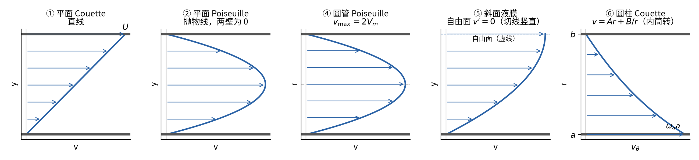
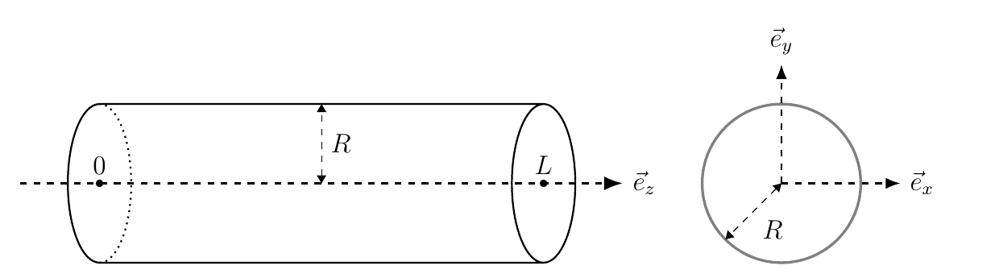
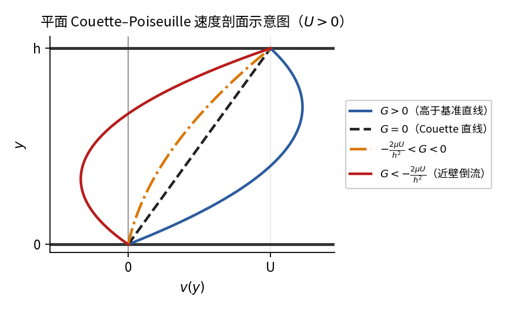
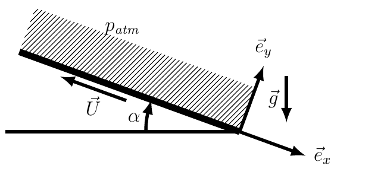
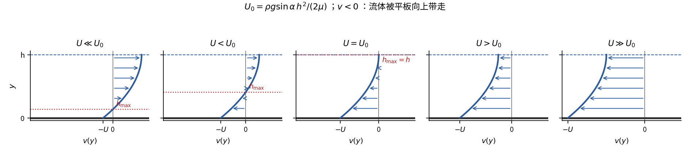
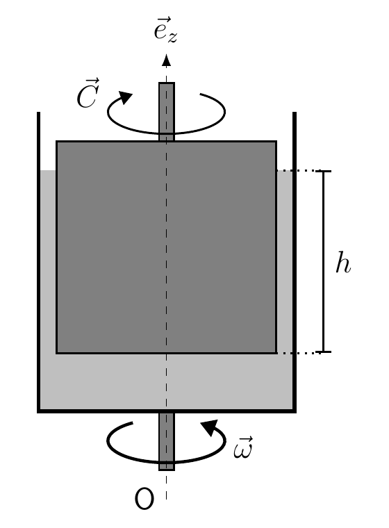
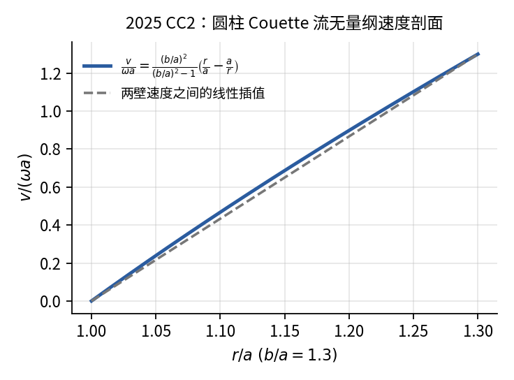

# 5　Fluides · 流体（题库）

## CC2 · 第 5 题读题：先画壁面和速度方向

**两年第一问都要求写假设、方程和边界条件。** 第一次读题优先找三个信息：流体夹在哪里，哪个表面在动，流体沿哪个方向流。把它们画在草图上，接着写速度场。到这一步，才能决定 Navier–Stokes 方程要保留哪些分量。

| 题面中的装置 | 图上要画什么 | 第一笔写什么，后面求什么 |
|---|---|---|
| **2024 · 运动斜面上的液膜**（5.4）。*plan incliné* 是斜板，*couche d’épaisseur constante* 是等厚液层，*surface libre* 是自由面。 | $x$ 沿坡向下，板以 $-U\vec e_x$ 向上运动，重力沿坡分量向下。 | 壁面无滑移给 $v(0)=-U$。在单向平行流、自由面仅受恒定大气压的模型下，液面给 $v'(h)=0$、$p(h)=p_{\rm atm}$。投影动量方程求速度和压力，再由速度的符号判断哪一层被板带走。 |
| **2025 · 旋转黏度计**（5.7）。*cylindres coaxiaux* 是同轴圆筒，*cylindre extérieur entraîné* 表示外筒由电机带动。 | 在半径 $a,b$ 的两壁画切向速度，内筒静止，外筒以 $\omega$ 转动。 | 写 $\vec V=v_\theta(r)\vec e_\theta$、$v_\theta(a)=0$、$v_\theta(b)=\omega b$。环向动量方程给速度，径向和竖向给压力。由壁面剪应力求扭矩，再从扭矩和转速反求黏度。 |

**法语动词相近，要求交出的东西不同。**

- *Énoncer les hypothèses puis écrire les équations scalaires* 列假设，再按坐标方向写方程。可起笔写 *L’écoulement est stationnaire, donc la dérivée locale par rapport au temps est nulle.* 定常只消去局部时间导数，环向流仍保留向心加速度 $-v_\theta^2/r$。
- *Justifier la forme des champs* 说明速度和压力为什么只依赖某个坐标。*Déterminer les distributions* 则要积分，并用边界条件定常数。斜面液膜可从连续性推出 $\partial_xv=0$；同轴环向流则有 $\partial_r p=\rho v_\theta^2/r$。
- *Épaisseur que peut transporter le plan* 求被板带走的**厚度**。在液层内找 $v(y)=0$ 的位置并检查两侧流向；若整层均沿板运动，厚度直接取 $h$。*Puissance à fournir* 接着用板所受驱动力与板速度点乘。
- *Moment selon l’axe / couple de maintien* 求轴向力矩。先标明谁作用在谁上，积分“力臂 × 切向面力 × 面积元”。*En déduire la viscosité* 才是利用所得扭矩关系反解 $\mu$；若给每分钟转数 $N$，用 $\omega=2\pi N/60$。

**压差驱动的圆管流**沿管轴流动，速度是 $v_z(r)\vec e_z$。决定速度分量的是流向；“圆柱形”本身只帮你选坐标。

## Méthode · 流体大题的解题步骤

### ① Schéma et repère · 读题、画图、选坐标

- Dessiner la section ; repérer les **parois** (fixes ou mobiles, à quelle vitesse), la **surface libre**, le **moteur** de l'écoulement (gradient de pression, pesanteur, paroi mobile, cylindre en rotation). 画截面，标出壁面（静止还是运动、速度多少）、自由面、驱动（压差、重力、运动壁面、转动圆柱）。
- Repère : cartésien pour un plan ou un plan incliné ($x$ selon l'écoulement, $y$ normal à la paroi) ; cylindrique pour un tube ou des cylindres coaxiaux ($z$ selon l'axe). 平板、斜面用直角坐标；圆管、同轴圆柱用柱坐标。
- Projeter la pesanteur après l'avoir dessinée. Plan incliné ($x$ vers le bas de la pente, $y$ normal au plan) : $\vec g=g(\sin\alpha\,\vec e_x-\cos\alpha\,\vec e_y)$. 重力先画再投影。
- Reconnaître l'écoulement classique correspondant (table A) : on connaît alors le résultat attendu. 对一下是查表 A 里的哪种流动，心里先有答案。

### ② Hypothèses · 写假设

[*Énoncer (préciser) les hypothèses qui régissent l'écoulement* 列出（明确）控制流动的假设。]{.ask}

Ne citer que les hypothèses utiles, numérotées H1, H2… et les invoquer ensuite dans les calculs. 只写用得上的，编号 H1、H2…，后面推导时引用编号。

| Hypothèse | 中文 | Conséquence · 推出 |
|---|---|---|
| écoulement stationnaire (permanent) | 定常 | $\partial_t(\cdot)=0$ |
| fluide incompressible et homogène | 不可压缩、均质 | $\rho=$ cste，$\operatorname{div}\vec V=0$ |
| fluide newtonien de viscosité dynamique $\mu$ | 牛顿流体 | $\boldsymbol\sigma=-p\,\mathbb I+2\mu\,\mathbb D$ |
| fluide pesant / pesanteur négligée | 有重力 / 忽略重力 | $\vec f=\rho\vec g$ / $\vec f=\vec0$ |
| écoulement plan | 平面流 | $V_z=0$，$\partial_z=0$ |
| écoulement laminaire unidirectionnel | 单向层流 | $\vec V=v\,\vec e_x$（ou $\vec e_z$, $\vec e_\theta$） |
| écoulement axisymétrique | 轴对称 | $\partial_\theta=0$ |
| conduite infiniment longue, effets de bord négligés | 无限长、忽略端部 | invariance selon l'écoulement · 沿流向不变 |
| surface libre plane, épaisseur $h$ constante | 自由面平、厚度不变 | surface libre en $y=h$ |

::: fr
Hypothèses : (H1) écoulement stationnaire ; (H2) fluide incompressible et homogène, $\rho=$ cste ; (H3) fluide newtonien de viscosité dynamique $\mu$ ; (H4) fluide pesant, $\vec f=\rho\vec g$ ; (H5) écoulement laminaire unidirectionnel, $\vec V=v\,\vec e_x$ ; (H6) effets de bord négligés. 假设：定常；不可压缩且均质；牛顿流体；有重力；单向层流；忽略端部效应。

:::

### ③ Équations · 写方程

[*Écrire les équations (scalaires) déduites des lois de conservation* 写出由守恒律得到的（标量）方程。]{.ask}

1. Conservation de la masse : $\partial_t\rho+\operatorname{div}(\rho\vec V)=0$, donc $\operatorname{div}\vec V=0$ d'après H2. 质量守恒；由 H2 得 $\operatorname{div}\vec V=0$。
2. Quantité de mouvement : $\overrightarrow{\operatorname{div}}\boldsymbol\sigma+\vec f=\rho\vec\gamma$, avec $\vec\gamma=\partial_t\vec V+\overrightarrow{\operatorname{grad}}\vec V\cdot\vec V$. 动量守恒，加速度含对流项。
3. Loi de comportement : $\boldsymbol\sigma=-p\,\mathbb I+2\mu\,\mathbb D$, $\mathbb D=\frac12(\overrightarrow{\operatorname{grad}}\vec V+\overrightarrow{\operatorname{grad}}^{\mathsf T}\vec V)$. 本构关系。
4. En injectant 3 dans 2 : équation de **Navier–Stokes** (fluide incompressible) 把 3 代入 2，得 Navier–Stokes 方程：

$$\mu\,\Delta\vec V-\overrightarrow{\operatorname{grad}}\,p+\vec f=\rho\Bigl(\frac{\partial\vec V}{\partial t}+\overrightarrow{\operatorname{grad}}\vec V\cdot\vec V\Bigr)$$
   En cartésien : $\rho(\partial_tV_x+V_x\partial_xV_x+V_y\partial_yV_x+V_z\partial_zV_x)=-\partial_xp+\mu\Delta V_x+f_x$ (idem en $y$, $z$). En cylindrique : table B. 直角坐标分量如上，$y$、$z$ 同理；柱坐标见查表 B。

5. Bilan : 4 inconnues ($\vec V$, $p$) et 4 équations (Navier–Stokes et continuité). 数一数：4 个未知量，4 个方程。

Simplifications usuelles · 常见速度形式代进去：

| Champ de vitesse · 速度形式 | $\Delta\vec V$ | $\overrightarrow{\operatorname{grad}}\vec V\cdot\vec V$ |
|---|---|---|
| $v(y)\,\vec e_x$ (cartésien · 直角) | $v''\,\vec e_x$ | $\vec0$ |
| $v(r)\,\vec e_z$ (tube, axial · 圆管轴向) | $\frac1r(rv')'\,\vec e_z$ | $\vec0$ |
| $v(r)\,\vec e_\theta$ (cylindres coaxiaux · 同轴环向) | $\bigl[\frac1r(rv)'\bigr]'\,\vec e_\theta$ | $-\frac{v^2}r\,\vec e_r$ (centripète · 向心) |

::: fr
La conservation de la masse $\frac{\partial\rho}{\partial t}+\operatorname{div}(\rho\vec V)=0$ se réduit, d'après (H2), à $\operatorname{div}\vec V=0$.
En injectant la loi de comportement $\boldsymbol\sigma=-p\,\mathbb I+2\mu\,\mathbb D$ dans l'équation du mouvement $\overrightarrow{\operatorname{div}}\boldsymbol\sigma+\vec f=\rho\vec\gamma$, on obtient l'équation de Navier–Stokes : $\mu\Delta\vec V-\overrightarrow{\operatorname{grad}}\,p+\rho\vec g=\rho\bigl(\partial_t\vec V+\overrightarrow{\operatorname{grad}}\vec V\cdot\vec V\bigr)$.
On dispose de 4 équations scalaires (Navier–Stokes et continuité) pour 4 inconnues ($\vec V$ et $p$). 质量守恒化为 div V = 0；本构代入运动方程得 NS；4 个方程对 4 个未知量。

:::

### ④ Conditions aux limites · 边界条件

[*Écrire les conditions aux limites* 写出边界条件。]{.ask}

| Frontière · 位置 | Condition · 条件 | Rédaction |
|---|---|---|
| paroi fixe (fluide visqueux) · 静止壁面 | $\vec V=\vec0$ | adhérence à la paroi fixe |
| paroi mobile · 运动壁面 | $\vec V=\vec V_{\text{paroi}}$ | le fluide adhère à la paroi mobile |
| cylindre $r=a$ tournant à $\omega$ · 转动圆柱 | $\vec V=\omega a\,\vec e_\theta$ | adhérence au cylindre en rotation |
| surface libre (atmosphère) · 自由面 | $\boldsymbol\sigma\vec n=-p_{\text{atm}}\vec n$ : $\mu v'=0$ et $p=p_{\text{atm}}$ | contrainte tangentielle nulle, pression atmosphérique |
| entrée / sortie · 入口、出口 | $p(z=0)=P_0$，$p(z=L)=P_L$ | pressions imposées |
| interface entre deux fluides · 两流体界面 | $\vec V_A=\vec V_B$，$\boldsymbol\sigma_A\vec n=\boldsymbol\sigma_B\vec n$ | continuité de la vitesse et du vecteur contrainte |
| axe $r=0$ · 轴 | vitesse finie · 速度有界 | la vitesse reste finie sur l'axe |
| paroi, fluide parfait · 理想流体壁面 | $\vec V\cdot\vec n=\vec V_{\text{paroi}}\cdot\vec n$ seulement | seule la composante normale est imposée |

### ⑤ Forme des champs de vitesse et de pression · 论证场的形式

[*Justifier les formes $\vec V=v(y)\,\vec e_x$ et $p=p(y)$* 说明速度场和压力场采用上述形式的理由。]{.ask}

**Cartésien (plan, plan incliné) · 直角：**

1. D'après H5, $\vec V=v(x,y)\,\vec e_x$. 由假设 H5。
2. Continuité : $\operatorname{div}\vec V=\partial_xv=0$, donc $v=v(y)$. 连续性 ⇒ $v$ 只依赖 $y$。
3. Terme convectif : $v\,\partial_xv\,\vec e_x=\vec0$, l'accélération est nulle. 对流项为零，加速度为零。
4. Projection de NS sur $\vec e_y$ : $0=-\partial_yp+f_y$ ; on intègre en $y$, la « constante » est une fonction de $x$. 投影到 $\vec e_y$：静水压分布；积分"常数"是 $x$ 的函数。
5. Projection sur $\vec e_x$ : $\mu v''(y)=\partial_xp-f_x$. Le membre de gauche ne dépend que de $y$, celui de droite que de $x$ : ils sont égaux à une même constante. Sans gradient de pression moteur (film, Couette), $\partial_xp=0$ et $p=p(y)$. 投影到 $\vec e_x$：左边只依赖 $y$，右边只依赖 $x$，两边等于同一常数；无压差驱动时 $p=p(y)$。

**Tube $\vec V=v(r)\,\vec e_z$ · 圆管：** continuité ⇒ $\partial_zv=0$ ; composantes $r$, $\theta$ ⇒ $p=p(z)$ (pesanteur négligée) ; composante $z$ ⇒ $\frac\mu r(rv')'=p'(z)=$ cste $=-\frac{\Delta P}L$. 连续性 ⇒ 与 $z$ 无关；$r$、$\theta$ 分量 ⇒ $p=p(z)$；$z$ 分量 ⇒ 常数压降。

**Cylindres coaxiaux $\vec V=v(r)\,\vec e_\theta$ · 同轴圆柱：** continuité vérifiée d'office ; composante $\theta$ ⇒ $\bigl[\frac1r(rv)'\bigr]'=0$ ; composante $r$ ⇒ $\partial_rp=\rho\frac{v^2}r$ ; composante $z$ ⇒ $\partial_zp=-\rho g$. 连续性自动满足；$\theta$ 分量给速度方程；$r$ 分量给径向压力梯度；$z$ 分量给静水压。

::: fr
La conservation de la masse donne $\operatorname{div}\vec V=\frac{\partial v}{\partial x}=0$ : la vitesse ne dépend que de $y$.
La projection de l'équation de Navier–Stokes sur $\vec e_y$ donne $\frac{\partial p}{\partial y}=-\rho g\cos\alpha$, d'où $p(x,y)=-\rho g\cos\alpha\,y+k(x)$.
Le premier membre ne dépend que de $y$, le second que de $x$ : ils sont égaux à une même constante. 连续性 ⇒ $v=v(y)$；$y$ 分量 ⇒ 静水压；分离变量 ⇒ 两边等于同一常数。

:::

### ⑥ Intégration et constantes · 积分、定常数

[*Déterminer le champ de vitesse* 求速度场。]{.ask}

| Cas · 情形 | Équation · 方程 | Solution générale · 通解 |
|---|---|---|
| cartésien · 直角 | $\mu v''=-G-f_x$（$G=-\partial_xp$） | $v=-\frac{G+f_x}{2\mu}y^2+C_1y+C_2$ |
| tube · 圆管 | $\frac\mu r(rv')'=-G$（$G=-\mathrm dp/\mathrm dz$） | $v=-\frac G{4\mu}r^2+C_1\ln r+C_2$ |
| orthoradial · 同轴环向 | $\bigl[\frac1r(rv)'\bigr]'=0$ | $v=Ar+\frac Br$ |

- Constantes : une condition en vitesse (adhérence) et une condition en contrainte (surface libre $v'=0$), ou deux conditions d'adhérence. Tube : vitesse finie sur l'axe ⇒ $C_1=0$. 定常数：一个速度条件 + 一个应力条件，或两个速度条件；圆管轴上有界 ⇒ 去掉 $\ln r$。
- Vérifier toutes les conditions aux limites et l'homogénéité ($\rho gh^2/\mu$ est une vitesse). 代回检查所有边界条件和量纲。

::: fr
En intégrant deux fois : $v(y)=-\frac{\rho g\sin\alpha}{2\mu}y^2+C_1y+C_2$. L'adhérence en $y=0$ donne $C_2=\dots$, la condition de surface libre $v'(h)=0$ donne $C_1=\dots$
La vitesse doit rester finie sur l'axe $r=0$, donc le coefficient de $\ln r$ est nul. 积分两次；贴壁条件和自由面条件定常数；轴上有界 ⇒ $\ln r$ 的系数为零。

:::

### ⑦ Champ de pression · 压力分布

[*Déterminer le champ de pression* 求压力场。]{.ask}

- Intégrer la projection transverse (étape ⑤) ; la constante est fixée par $p=p_{\text{atm}}$ sur la surface libre ou par la pression d'entrée. 由第 ⑤ 步的横向分量积分，用自由面或入口压力定常数。
- Film sur plan incliné · 斜面液膜 : $p=p_{\text{atm}}+\rho g\cos\alpha\,(h-y)$.
- Cylindres coaxiaux · 同轴圆柱 : $\partial_rp=\rho v^2/r>0$, la pression croît vers l'extérieur ; ajouter $-\rho gz$. 压力向外增大；再加静水压项。
- Rotation d'ensemble $v=\omega r$ · 整体刚性转动 : $p=p_0+\frac12\rho\omega^2r^2-\rho gz$, surface libre parabolique. 自由面是抛物面。

### ⑧ Profil des vitesses · 画速度剖面

[*Tracer le profil des vitesses* 画出速度剖面。]{.ask}

- Indiquer les valeurs aux parois ; le maximum est là où $v'=0$. 标出壁面值；最大值在 $v'=0$ 处。
- Surface libre $v'=0$ : la tangente au profil y est parallèle à l'axe $y$. 自由面处剖面切线与 $y$ 轴平行。
- Forme : droite (Couette), parabole (Poiseuille, film), $Ar+B/r$ (cylindres coaxiaux) ; voir les profils de la table A. 形状：直线、抛物线、$Ar+B/r$；见查表 A 的图。
- Paroi mobile en sens opposé à la pesanteur (ou au gradient de pression) : le profil peut **changer de signe** ; résoudre $v(y^*)=0$ et garder la racine dans $[0,h]$. « Toute la couche est entraînée » ⇔ $v$ ne change pas de signe sur $[0,h]$ ; le sens du transport net est celui du débit $q$. 壁面运动与重力相反时剖面可能换向：解 $v(y^*)=0$；"整层被带走"要求不变号；净输运看流量符号。

### ⑨ Débit et vitesse moyenne · 流量、平均速度

[*Calculer le débit volumique (massique) et la vitesse moyenne* 求体积流量（质量流量）和平均速度。]{.ask}

$$Q=\int_S\vec V\cdot\vec n\,\mathrm dS,\qquad V_m=\frac QS,\qquad Q_m=\rho\,Q$$

- Problème plan : débit par unité de largeur $q=\int_0^hv\,\mathrm dy$ ($\mathrm{m^2\,s^{-1}}$). Tube : $Q=\int_0^Rv\,2\pi r\,\mathrm dr$ ($\mathrm{m^3\,s^{-1}}$). 平面问题算单位宽度流量；圆管按环形面积积分。

::: fr
Le débit volumique vaut $Q=\int_S\vec V\cdot\vec n\,\mathrm dS=\dots$ et la vitesse moyenne $V_m=Q/S=\dots$ ; le débit massique est $Q_m=\rho Q$. 体积流量、平均速度、质量流量。

:::

### ⑩ Contraintes, contrainte pariétale, efforts, couple · 应力、壁面应力、力、力矩

[*Calculer le tenseur des contraintes (visqueuses), la contrainte pariétale, l'effort exercé sur la paroi, le couple* 求（黏性）应力张量、壁面应力、作用在壁面上的力和力矩。]{.ask}

1. Calculer $\mathbb D$, puis $\boldsymbol\sigma=-p\,\mathbb I+2\mu\,\mathbb D$ : 先算 $\mathbb D$，再算应力：

| Vitesse · 速度 | $\mathbb D$ (composantes non nulles · 非零分量) | Cisaillement · 剪应力 |
|---|---|---|
| $v(y)\,\vec e_x$ | $D_{xy}=\frac12v'$ | $\sigma_{xy}=\mu v'$ |
| $v(r)\,\vec e_z$ | $D_{rz}=\frac12v'$ | $\sigma_{rz}=\mu v'$ |
| $v(r)\,\vec e_\theta$ | $D_{r\theta}=\frac r2\bigl(\frac vr\bigr)'$ | $\sigma_{r\theta}=\mu r\bigl(\frac vr\bigr)'$ ; $=-\frac{2\mu B}{r^2}$ si $v=Ar+\frac Br$ |

2. Vecteur contrainte $\vec T=\boldsymbol\sigma\vec n$. Préciser **qui agit sur qui** : avec $\vec n$ normale sortante du fluide, $\vec T$ est l'action de la paroi sur le fluide ; le fluide exerce $-\vec T$ sur la paroi. 先说清谁对谁：$\vec n$ 为流体外法向时 $\vec T$ 是壁面对流体的力，流体对壁面是 $-\vec T$。
3. Résultante $\vec F=\int_S\vec T\,\mathrm dS$. 合力。
4. Moment axial sur un cylindre de rayon $r$ et de hauteur $h$ : $M_z=\underbrace{r}_{\text{bras de levier}}\cdot\underbrace{\sigma_{r\theta}}_{\text{contrainte}}\cdot\underbrace{2\pi rh}_{\text{aire}}=2\pi r^2h\,\sigma_{r\theta}$. Cylindres coaxiaux : $|M|=4\pi\mu h|B|$, indépendant de $r$. 力矩 = 力臂 × 应力 × 面积；同轴圆柱的力矩与 $r$ 无关。
5. Contrôle global : tube $\pi R^2\Delta P=2\pi RL\,\tau_p$ ; film incliné : cisaillement pariétal par unité de surface = poids de la couche projeté sur la pente, $\rho gh\sin\alpha$. 整体检查：圆管、液膜的受力平衡。

::: fr
Le tenseur des contraintes s'écrit $\boldsymbol\sigma=-p\,\mathbb I+2\mu\,\mathbb D$, soit $\sigma_{xy}=\mu\,\frac{\mathrm dv}{\mathrm dy}$.
La contrainte pariétale vaut $\tau_p=\mu\,\frac{\mathrm dv}{\mathrm dr}\big|_{r=R}=\dots$ ; on retrouve ce résultat par l'équilibre global d'un tronçon de fluide.
Le couple transmis vaut $|M|=4\pi\mu h\,\frac{a^2b^2}{b^2-a^2}\,|\omega_b-\omega_a|$ ; il ne dépend pas du rayon de la surface considérée. 应力张量；壁面剪应力（可用整体平衡验证）；传递的力矩与所取圆柱面半径无关。

:::

### ⑪ Puissance · 功率

[*Calculer la puissance à fournir / dissipée* 求所需输入功率或耗散功率。]{.ask}

- Puissance motrice $P=\int_S\vec T_{\text{paroi}\to\text{fluide}}\cdot\vec V_{\text{paroi}}\,\mathrm dS$ ; paroi en translation $P=FU$ ; en rotation $P=M\omega$. 驱动功率；平移 $FU$，转动 $M\omega$。
- En régime permanent l'énergie cinétique est constante : puissance des efforts extérieurs = dissipation visqueuse $\int_\Omega2\mu\,\mathbb D:\mathbb D\,\mathrm dV$. Écoulement unidirectionnel : $2\mu\,\mathbb D:\mathbb D=\mu v'^2$ ; orthoradial : $\frac{4\mu B^2}{r^4}$. 定常时外力功率 = 黏性耗散；单向流、环向流的被积函数。
- Inversement, la dissipation donne le couple sans intégrer les contraintes. 反过来可用耗散求力矩。

::: fr
En régime permanent l'énergie cinétique est constante : le théorème de l'énergie cinétique donne $P_e+P_i=0$, donc la puissance fournie est entièrement dissipée par viscosité, $P_e=\int_\Omega2\mu\,\mathbb D:\mathbb D\,\mathrm dV$. 定常时动能不变，外力功率全部被黏性耗散。

:::

### ⑫ Application numérique (sans calculatrice) · 数值计算（无计算器）

[*Application numérique* 代入数值计算。]{.ask}

- Écrire un rapport pour éliminer les grandeurs géométriques communes : si $\mu\propto\frac M\omega$, alors $\frac{\mu_2}{\mu_1}=\frac{M_2}{M_1}\cdot\frac{\omega_1}{\omega_2}$. 先写比例式，消去相同的几何量。
- Vitesse de rotation : $\omega=\frac{2\pi N}{60}$ ($N$ en tr/min). 转速换算。
- 2 à 3 chiffres significatifs : $\pi\approx3{,}14$, $\sqrt2\approx1{,}41$, $\sqrt3\approx1{,}73$, $g\approx9{,}81\approx10$. 保留 2–3 位有效数字。
- Ordres de grandeur de $\mu$ à 20 °C : eau $10^{-3}$, air $1{,}8\times10^{-5}$, huile $10^{-1}$–$1$, glycérine $\approx1{,}4$ Pa·s. 与常见黏度量级对比：水、空气、油、甘油。

### Table A　Écoulements classiques · 标准流动（stationnaire, incompressible, newtonien, laminaire）

{.wide}

$G=-\mathrm dp/\mathrm dx>0$ : gradient de pression moteur · 驱动压力梯度。

| Écoulement · 流动 | Conditions · 边界条件 | Vitesse · 速度 | Résultats · 关键结果 |
|---|---|---|---|
| ① Couette plan · 平面 Couette | $v(0)=0$，$v(h)=U$，$G=0$ | $v=U\frac yh$ | $\tau=\mu\frac Uh$ uniforme · 处处相同 |
| ② Poiseuille plan · 平面 Poiseuille | $v(0)=v(h)=0$ | $v=\frac G{2\mu}y(h-y)$ | $v_{\max}=\frac{Gh^2}{8\mu}$；$q=\frac{Gh^3}{12\mu}$；$V_m=\frac23v_{\max}$；$\tau_p=\frac{Gh}2=\frac{6\mu V_m}h$ |
| ③ Couette + Poiseuille | $v(0)=0$，$v(h)=U$ | $v=U\frac yh+\frac G{2\mu}y(h-y)$ | superposition de ① et ② · 线性叠加 |
| ④ Poiseuille en tube · 圆管 | $v(R)=0$, vitesse finie sur l'axe | $v=\frac G{4\mu}(R^2-r^2)$ | $Q=\frac{\pi R^4G}{8\mu}$；$V_m=\frac{GR^2}{8\mu}=\frac{v_{\max}}2$；$\tau_p=\frac{GR}2=\frac{4\mu V_m}R$；$\Delta P=\frac{8\mu LQ}{\pi R^4}$ |
| ⑤ Film sur plan incliné · 斜面液膜（pente $\alpha$, épaisseur $h$, paroi à $V_p$ selon $\vec e_x$） | $v(0)=V_p$；$v'(h)=0$，$p(h)=p_{\text{atm}}$ | $v=\frac{\rho g\sin\alpha}{2\mu}y(2h-y)+V_p$ | $p=p_{\text{atm}}+\rho g\cos\alpha(h-y)$；$q=\frac{\rho g\sin\alpha\,h^3}{3\mu}+V_ph$；cisaillement pariétal $\rho gh\sin\alpha$ |
| ⑥ Couette cylindrique · 圆柱 Couette（$r=a$ à $\omega_a$, $r=b$ à $\omega_b$） | $v(a)=\omega_aa$，$v(b)=\omega_bb$ | $v=Ar+\frac Br$ | $A=\frac{\omega_bb^2-\omega_aa^2}{b^2-a^2}$，$B=\frac{(\omega_a-\omega_b)a^2b^2}{b^2-a^2}$；$\sigma_{r\theta}=-\frac{2\mu B}{r^2}$；$|M|=4\pi\mu h|B|$ |
| ⑦ Rotation d'ensemble · 整体刚性转动 | récipient tournant à $\omega$ | $v=\omega r$ | $\mathbb D=\mathbb O$, pas de contrainte visqueuse · 无黏性应力；$p=p_0+\frac12\rho\omega^2r^2-\rho gz$ |

- ⑥ : $Ar$ est une rotation de corps rigide (pas de contrainte) ; seul $B/r$ cisaille. Entrefer mince ($b-a\ll a$) : profil quasi linéaire, on retrouve ①. $Ar$ 是刚体转动，只有 $B/r$ 产生剪切；窄间隙时退化为 ①。
- Couette plan : cisaillement uniforme ; Poiseuille : nul au centre, maximal à la paroi. Débit : $\propto R^4$ (tube), $\propto h^3$ (canal plan). Couette 剪应力均匀；Poiseuille 中心为零、壁面最大；流量与 $R^4$、$h^3$ 成正比。

### Table B　Formulaire cylindrique (incompressible) · 柱坐标公式

$\frac{\mathrm D}{\mathrm Dt}=\partial_t+V_r\partial_r+\frac{V_\theta}r\partial_\theta+V_z\partial_z$，$\Delta f=\frac1r\partial_r(r\partial_rf)+\frac1{r^2}\partial_\theta^2f+\partial_z^2f$。

$$\begin{aligned}
\rho\Bigl(\tfrac{\mathrm DV_r}{\mathrm Dt}-\tfrac{V_\theta^2}r\Bigr)&=-\partial_rp+\mu\Bigl(\Delta V_r-\tfrac{V_r}{r^2}-\tfrac2{r^2}\partial_\theta V_\theta\Bigr)+f_r\\
\rho\Bigl(\tfrac{\mathrm DV_\theta}{\mathrm Dt}+\tfrac{V_rV_\theta}r\Bigr)&=-\tfrac1r\partial_\theta p+\mu\Bigl(\Delta V_\theta-\tfrac{V_\theta}{r^2}+\tfrac2{r^2}\partial_\theta V_r\Bigr)+f_\theta\\
\rho\tfrac{\mathrm DV_z}{\mathrm Dt}&=-\partial_zp+\mu\Delta V_z+f_z
\end{aligned}$$

Continuité · 连续性 : $\frac1r\partial_r(rV_r)+\frac1r\partial_\theta V_\theta+\partial_zV_z=0$.

Taux de déformation · 变形率 : $D_{rr}=\partial_rV_r$，$D_{\theta\theta}=\frac1r\partial_\theta V_\theta+\frac{V_r}r$，$D_{zz}=\partial_zV_z$，$D_{r\theta}=\frac12\bigl(r\partial_r\frac{V_\theta}r+\frac1r\partial_\theta V_r\bigr)$，$D_{rz}=\frac12(\partial_zV_r+\partial_rV_z)$，$D_{\theta z}=\frac12\bigl(\partial_zV_\theta+\frac1r\partial_\theta V_z\bigr)$。

### Table C　Lois de comportement des fluides · 流体本构

| Fluide · 流体 | Loi · 本构 | Remarque · 说明 |
|---|---|---|
| fluide parfait · 理想流体 | $\boldsymbol\sigma=-p\,\mathbb I$ | pas de viscosité, aucune contrainte tangentielle · 无黏性，任何面上无切应力 |
| newtonien compressible · 可压缩牛顿流体 | $\boldsymbol\sigma=-p\,\mathbb I+\lambda_v\operatorname{tr}(\mathbb D)\,\mathbb I+2\mu_v\mathbb D$ | $\lambda_v,\mu_v$ en Pa·s ; NS contient en plus $(\lambda_v+\mu_v)\overrightarrow{\operatorname{grad}}(\operatorname{div}\vec V)$ |
| newtonien incompressible · 不可压缩牛顿流体 | $\boldsymbol\sigma=-p\,\mathbb I+2\mu\,\mathbb D$，$\operatorname{div}\vec V=0$ | $p$ est une inconnue, déterminée par les équations et les CL · $p$ 由方程和边界条件解出 |

Sens de la viscosité : en cisaillement simple $\vec V=a\,x_2\vec e_1$, $\sigma_{12}=\mu a$, soit $\tau=\mu\,\frac{\mathrm dV_1}{\mathrm dx_2}$ (frottement interne entre couches). Viscosité cinématique $\nu=\mu/\rho$ ($\mathrm{m^2\,s^{-1}}$). 黏度的意义：简单剪切中 $\sigma_{12}=\mu a$，是流层间的内摩擦；运动黏度 $\nu=\mu/\rho$。

## Exercice 5.1 · TD7 ex. 1 — Écoulement de Poiseuille cylindrique · 圆管 Poiseuille 流

[**Source :** TD7, exercice 1 (2025–2026) · **出处：** TD7 练习 1 · **Thèmes :** hypothèses, équations, vitesse, pression, débit, contrainte pariétale]{.src}

### Énoncé · 题面

On considère l'écoulement permanent d'un fluide homogène newtonien incompressible, de masse volumique $\rho$, de viscosité dynamique $\mu$ et volumique $\lambda$ dans un tube de section circulaire (rayon $R$) d'axe $O\vec e_z$ horizontal comme indiqué en figure 1.1. 考虑一种均质、牛顿、不可压缩流体（密度 $\rho$，动力黏度 $\mu$，体积黏度 $\lambda$）在圆截面管（半径 $R$）中的定常流动，管轴 $O\vec e_z$ 水平，见图 1.1。

On supposera l'écoulement unidirectionnel. On ne tiendra pas compte de l'action de la gravité. La pression sur la section $S_0$ (resp. $S_L$) vaut $P_0$ (resp. $P_L$) ($\Delta P=P_0-P_L>0$). 假设流动是单向的，不考虑重力。截面 $S_0$ 上的压力为 $P_0$，$S_L$ 上为 $P_L$，$\Delta P=P_0-P_L>0$。

L'objectif est de déterminer : le profil des vitesses, la contrainte de cisaillement à la paroi et le coefficient de pertes de charges régulières. 目标：求速度剖面、壁面剪应力和沿程压力损失系数。

{.wide}

### Question 5.1.1（原题 1.1）

*En tenant compte des hypothèses, écrire les équations et conditions limites du problème.* 考虑题设假设，写出问题的方程和边界条件。

::: rep
(H1) écoulement permanent : $\partial_t(\cdot)=0$ ; (H2) axisymétrique : $\partial_\theta(\cdot)=0$ ; (H3) unidirectionnel : $\vec V=v(r,z)\vec e_z$ ; (H4) incompressible et (H5) homogène : $\rho=$ cste ⇒ $\operatorname{div}\vec V=0$ ; (H6) pas de force volumique : $\vec f_d=\vec0$ ; (H7) fluide visqueux newtonien ($\boldsymbol\sigma=2\mu\mathbb D-p\mathbb I$).
Équations simplifiées : $\operatorname{div}\vec V=0$ ; $\mu\Delta\vec V-\overrightarrow{\operatorname{grad}}p=\rho\,\overrightarrow{\operatorname{grad}}\vec V\cdot\vec V$.
Conditions aux limites : adhérence à la paroi immobile $\vec V(r=R)=\vec0$, régularité sur l'axe ($v$ fini en $r=0$) ; $p(z=0)=P_0$, $p(z=L)=P_L$.
:::

**Détail · 推导**

- 七条假设各自给出一个简化：定常去掉 $\partial_t$；轴对称去掉 $\partial_\theta$；单向使速度只有 $z$ 分量；不可压缩结合均质（$\rho$ 为常数）由质量守恒得 $\operatorname{div}\vec V=0$；不计重力使体力为零；牛顿流体给出本构 $\boldsymbol\sigma=2\mu\mathbb D+(\lambda\operatorname{tr}\mathbb D-p)\mathbb I=2\mu\mathbb D-p\mathbb I$。
- 三个基本方程（质量守恒、动量守恒、本构）合并并代入上述假设，即得到简化后的连续性方程和 Navier–Stokes 方程。
- 边界条件：壁面不可穿透且黏性流体无滑移，故 $r=R$ 上速度为零；管轴 $r=0$ 处物理量必须有限；进出口给定压力。
- 求解逻辑：由连续性先得 $\partial_z v=0$，再由 $r,\theta$ 向动量方程限制压力只依赖 $z$，最后由 $z$ 向方程与边界条件联立定出 $p(z)$ 和 $v(r)$。

### Question 5.1.2（原题 1.2）

*En déduire les champs de vitesse et de pression. Calculer la vitesse moyenne $V_m$. Exprimer la distribution de vitesse en fonction de $V_m$.* 求速度场和压力场；计算平均速度 $V_m$；用 $V_m$ 表示速度分布。

::: rep
$\operatorname{div}\vec V=\partial_zv=0$ ⇒ $v=v(r)$ ; $\overrightarrow{\operatorname{grad}}\vec V\cdot\vec V=\vec0$, donc $\mu\Delta v\,\vec e_z=\overrightarrow{\operatorname{grad}}p$ : $\partial_rp=\partial_\theta p=0$ et $\frac{\mathrm dp}{\mathrm dz}=\mu\Delta v=$ cste. Avec les pressions imposées : $p(z)=P_0-\frac{\Delta P}Lz$.
$\frac\mu r\frac{\mathrm d}{\mathrm dr}\bigl(r\frac{\mathrm dv}{\mathrm dr}\bigr)=-\frac{\Delta P}L$ ⇒ $v=-\frac{\Delta P}{4\mu L}r^2+C\ln(r/r_\ast)+D$ ; $v$ fini en $r=0$ ⇒ $C=0$ ; $v(R)=0$ ⇒ $v(r)=\frac{\Delta PR^2}{4\mu L}\Bigl(1-\frac{r^2}{R^2}\Bigr)$.
$V_m=\frac1{\pi R^2}\int_Sv\,\mathrm dS=\frac{\Delta PR^2}{8\mu L}$, d'où $v(r)=2V_m\Bigl(1-\frac{r^2}{R^2}\Bigr)$.
:::

**Détail · 推导**

1. **连续性：** $\operatorname{div}\vec V=\partial v/\partial z=0$，所以 $v$ 只依赖 $r$（沿管轴不变）。
2. **对流项：** 柱坐标速度梯度只有 $(z,r)$ 位置一个元素 $v'(r)$，乘以 $\vec V=(0,0,v)$ 得零向量，所以加速度为零。
3. **NS 化简：** 定常、不可压缩、无体力，NS 变成 $\mu\Delta\vec V=\overrightarrow{\operatorname{grad}}p$，其中 $\Delta\vec V=\Delta v\,\vec e_z$。分量：$\partial_rp=0$，$\partial_\theta p=0$，所以 $p=p(z)$；$\frac{\mathrm dp}{\mathrm dz}=\mu\Delta v$。
4. **分离变量：** 左边只依赖 $z$，右边只依赖 $r$，两边等于同一个常数 $A$。由 $p(0)=P_0$、$p(L)=P_L$ 得 $A=-\Delta P/L$，$p(z)=P_0-\frac{\Delta P}Lz$，压力沿管线性下降。
5. **积分速度：** $\frac1r(rv')'=-\frac{\Delta P}{\mu L}$ ⇒ $rv'=-\frac{\Delta P}{2\mu L}r^2+C$ ⇒ $v=-\frac{\Delta P}{4\mu L}r^2+C\ln(r/r_\ast)+D$（取任意参考长度 $r_\ast>0$ 使对数自变量无量纲）。轴上 $r=0$ 速度必须有限，所以 $C=0$；$v(R)=0$ 给出 $D=\frac{\Delta PR^2}{4\mu L}$。速度剖面是抛物面，轴上最大。
6. **平均速度：** $\int_0^R\bigl(1-\frac{r^2}{R^2}\bigr)2\pi r\,\mathrm dr=\frac{\pi R^2}2$，所以 $V_m=\frac{\Delta PR^2}{4\mu L}\cdot\frac12=\frac{\Delta PR^2}{8\mu L}$；最大速度 $v(0)=2V_m$。

### Question 5.1.3（原题 1.3）

*Calculer le débit volumique et le débit massique.* 计算体积流量和质量流量。

::: rep
$Q_v=\int_S\vec V\cdot\vec n\,\mathrm dS=V_mS=\frac{\pi R^4\Delta P}{8\mu L}$ ; fluide homogène incompressible : $Q_m=\int_S\rho\vec V\cdot\vec n\,\mathrm dS=\rho Q_v$.
:::

**Détail · 推导**

截面 $S$ 的法向是 $\vec e_z$，$\vec V\cdot\vec n=v(r)$。由平均速度的定义直接得 $Q_v=V_m\pi R^2$。流量与 $R^4$ 成正比（Hagen–Poiseuille 定律）：半径减半，流量变为 1/16。$\rho$ 是常数，可以提出积分号。

### Question 5.1.4（原题 1.4）

*Évaluer la contrainte de cisaillement à la paroi $\tau_p$.* 求壁面剪应力 $\tau_p$。

::: rep
Méthode locale : $\mathbb D=-\frac{2V_mr}{R^2}(\vec e_r\otimes\vec e_z+\vec e_z\otimes\vec e_r)$, $\boldsymbol\sigma=-p\mathbb I+2\mu\mathbb D$ ; en $r=R$, $\vec n=\vec e_r$, $\vec t=\vec e_z$ : $\tau_p=(\boldsymbol\sigma\vec n)\cdot\vec t=-\frac{4\mu V_m}R=-\frac{R}{2}\frac{\Delta P}L$.
Méthode globale : équilibre d'un tronçon de rayon $R$ et de longueur $\mathrm dz$ : $p\pi R^2-(p+\mathrm dp)\pi R^2+\tau_p2\pi R\,\mathrm dz=0$ ⇒ $\tau_p=\frac R2\frac{\mathrm dp}{\mathrm dz}=-\frac R2\frac{\Delta P}L$.
:::

**Détail · 推导**

- **局部法：** $v'(r)=-\frac{4V_mr}{R^2}$；速度梯度只有 $(z,r)$ 元素，对称化后 $D_{rz}=D_{zr}=\frac12v'=-\frac{2V_mr}{R^2}$。应力 $\boldsymbol\sigma=-p\mathbb I+2\mu\mathbb D$（$\operatorname{tr}\mathbb D=0$，体积黏度项消失）。壁面上流体的外法向为 $\vec e_r$，切向为 $\vec e_z$：$\tau_p=\sigma_{zr}(R)=2\mu D_{rz}(R)=-\frac{4\mu V_m}R$。负号表示壁面对流体的切向力沿 $-\vec e_z$，即阻碍流动；流体对壁面的力沿 $+\vec e_z$。
- **整体法：** 取半径 $R$、长 $\mathrm dz$ 的流体圆柱，沿 $\vec e_z$ 的受力：两端压力差 $-\mathrm dp\,\pi R^2$，壁面对流体的侧面剪力 $\tau_p\,2\pi R\,\mathrm dz$，合力为零（加速度为零）。得 $\tau_p=\frac R2\frac{\mathrm dp}{\mathrm dz}$，与局部法一致。
- 两种方法互相验证，考试时写一种、用另一种检查。
- **延伸（回应题面目标的沿程损失系数）：** 按 Darcy–Weisbach 定义 $\Delta P=f_D\frac{L}{2R}\frac12\rho V_m^2$，代入 $V_m=\frac{\Delta PR^2}{8\mu L}$ 并引入管径雷诺数 $\mathrm{Re}_D=\frac{\rho V_m(2R)}{\mu}$，即得层流圆管经典结果 $f_D=\frac{64}{\mathrm{Re}_D}$（这里记作 $f_D$ 以免与题面体积黏度 $\lambda$ 混淆）。

## Exercice 5.2 · Variante — Poiseuille annulaire · 环形管 Poiseuille 流

[**Source :** variante d'entraînement (TD7) · **出处：** 变式题（自编） · **Thèmes :** NS cylindrique, terme en $\ln r$, débit, équilibre global, cas limite]{.src}

### Énoncé · 题面

Un fluide newtonien incompressible ($\rho$, $\mu$) s'écoule dans l'espace annulaire compris entre deux cylindres coaxiaux fixes de rayons $a$ et $b$ ($a<b$), d'axe $O\vec e_z$ horizontal et de longueur $L$. La pression vaut $P_0$ en $z=0$ et $P_L$ en $z=L$, avec $\Delta P=P_0-P_L>0$. On néglige la pesanteur. L'écoulement est permanent, unidirectionnel et axisymétrique : $\vec V=v(r)\vec e_z$. 不可压缩牛顿流体在两根固定同轴圆柱（半径 $a<b$）之间的环形空间中流动，轴 $O\vec e_z$ 水平，长 $L$。$z=0$ 处压力 $P_0$，$z=L$ 处 $P_L$，$\Delta P=P_0-P_L>0$。忽略重力。流动定常、单向、轴对称：$\vec V=v(r)\vec e_z$。

### Question 5.2.1

*Écrire les équations et les conditions aux limites ; montrer que $p=P_0-\frac{\Delta P}Lz$.* 写出方程和边界条件；证明压力沿轴线性下降。

::: rep
$\operatorname{div}\vec V=0$ vérifié ; $\overrightarrow{\operatorname{grad}}\vec V\cdot\vec V=\vec0$ ; Navier–Stokes : $\partial_rp=\partial_\theta p=0$, $\frac{\mathrm dp}{\mathrm dz}=\frac\mu r(rv')'=$ cste. CL : $v(a)=v(b)=0$, $p(0)=P_0$, $p(L)=P_L$, donc $p=P_0-\frac{\Delta P}Lz$.
:::

**Détail · 推导**

和 TD7 完全相同的推理：左边只依赖 $z$，右边只依赖 $r$，两边等于同一常数 $-\Delta P/L$。唯一的区别是边界：现在有内外两个壁面，都要贴壁。

### Question 5.2.2

*Déterminer $v(r)$. Pourquoi conserve-t-on ici le terme en $\ln r$, contrairement au tube plein ?* 求 $v(r)$。为什么这里保留 $\ln r$ 项，而普通圆管（区域含轴线）里要去掉？

::: rep
$v=-\frac{\Delta P}{4\mu L}r^2+C_1\ln(r/r_\ast)+C_2$ (avec $r_\ast>0$ arbitraire). Le domaine $a\le r\le b$ ne contient pas l'axe : $\ln(r/r_\ast)$ reste fini, on garde les deux constantes et on impose $v(a)=v(b)=0$ :
$$v(r)=\frac{\Delta P}{4\mu L}\Bigl[b^2-r^2-(b^2-a^2)\frac{\ln(b/r)}{\ln(b/a)}\Bigr].$$
:::

**Détail · 推导**

普通圆管的流体区域包含轴线 $r=0$，$\ln(r/r_\ast)\to-\infty$ 会使速度发散，所以必须取 $C_1=0$。环形区域不含轴线，没有这个奇点限制，两个常数由内外两个贴壁条件确定。代入检查：$r=b$ 时方括号为 $0-0$；$r=a$ 时为 $(b^2-a^2)-(b^2-a^2)=0$。

### Question 5.2.3

*Calculer le débit volumique $Q$.* 求体积流量 $Q$。

::: rep
$$Q=\int_a^bv\,2\pi r\,\mathrm dr=\frac{\pi\Delta P}{8\mu L}\Bigl[b^4-a^4-\frac{(b^2-a^2)^2}{\ln(b/a)}\Bigr].$$
:::

**Détail · 推导**

逐项积分：$\int_a^b(b^2-r^2)r\,\mathrm dr=\frac{(b^2-a^2)^2}4$；分部积分得 $\int_a^br\ln\frac br\,\mathrm dr=\bigl[\frac{r^2}2\ln\frac br\bigr]_a^b+\int_a^b\frac r2\,\mathrm dr=\frac{b^2-a^2}4-\frac{a^2}2\ln\frac ba$。代入 $Q=\frac{\pi\Delta P}{2\mu L}\bigl[\frac{(b^2-a^2)^2}4-\frac{b^2-a^2}{\ln(b/a)}\bigl(\frac{b^2-a^2}4-\frac{a^2}2\ln\frac ba\bigr)\bigr]$，利用 $(b^2-a^2)^2+2a^2(b^2-a^2)=b^4-a^4$ 整理即得上式。

### Question 5.2.4

*Calculer les contraintes tangentielles exercées par le fluide sur les deux cylindres et vérifier l'équilibre global du fluide contenu entre $z=0$ et $z=L$.* 求流体作用在两圆柱上的切应力；验证 $0\le z\le L$ 段流体的整体平衡。

::: rep
$\sigma_{rz}=\mu v'$, avec $v'(r)=\frac{\Delta P}{4\mu L}\Bigl[-2r+\frac{b^2-a^2}{r\ln(b/a)}\Bigr]$. Sur le cylindre intérieur : $\tau_a=\mu v'(a)>0$ ; sur le cylindre extérieur : $\tau_b=-\mu v'(b)>0$ (les deux sont entraînés selon $+\vec e_z$). Équilibre : $\Delta P\,\pi(b^2-a^2)=L\,(2\pi a\,\tau_a+2\pi b\,\tau_b)$, vérifié.
:::

**Détail · 推导**

- 内圆柱在 $r<a$ 一侧，流体在 $+\vec e_r$ 一侧：流体对内柱的面力是 $\boldsymbol\sigma\vec e_r$，切向分量 $\sigma_{rz}(a)=\mu v'(a)$。外圆柱在 $r>b$ 一侧，流体在 $-\vec e_r$ 一侧：面力 $\boldsymbol\sigma(-\vec e_r)$，切向分量 $-\mu v'(b)$。
- 整体平衡（带符号的轴向平衡）：两端压力差沿 $+\vec e_z$ 推动流体的合力为 $\Delta P\,\pi(b^2-a^2)$；本题定义 $\tau_a,\tau_b>0$ 为**流体对圆柱**的切应力，由作用与反作用，两壁对流体施加沿 $-\vec e_z$ 的摩擦合力为 $-(2\pi a\,\tau_a+2\pi b\,\tau_b)L$（对比 5.1.4 的 $\tau_p<0$ 为壁面对流体的力）。轴向平衡 $\Delta P\,\pi(b^2-a^2)-L(2\pi a\,\tau_a+2\pi b\,\tau_b)=0$，而 $2\pi a\tau_a+2\pi b\tau_b=\frac{\pi\Delta P}{2L}\bigl[-2a^2+\frac{b^2-a^2}{\ln(b/a)}+2b^2-\frac{b^2-a^2}{\ln(b/a)}\bigr]=\frac{\pi\Delta P(b^2-a^2)}{L}$，含 $\ln$ 的项正好抵消，恒成立。

### Question 5.2.5

*Retrouver l'écoulement de Poiseuille dans un tube plein lorsque $a\to0$.* $a\to0$ 时退化为普通圆管的 Poiseuille 流。

::: rep
Quand $a\to0$, $\frac{b^2-a^2}{\ln(b/a)}\to0$ : $v\to\frac{\Delta P}{4\mu L}(b^2-r^2)$ et $Q\to\frac{\pi b^4\Delta P}{8\mu L}$, résultats du TD7.
:::

**Détail · 推导**

$\ln(b/a)\to+\infty$，所以含 $\ln$ 的修正项趋于零（对固定的 $r>0$）。另一个极限：间隙很窄（$b-a=e\ll a$）时，剖面退化为两平板之间的平面 Poiseuille 流。

## Exercice 5.3 · Variante — Écoulement de Couette–Poiseuille plan · 平面 Couette–Poiseuille 流

[**Source :** variante d'entraînement (cours ch. 7, TD7) · **出处：** 变式题（自编） · **Thèmes :** paroi mobile et gradient de pression, débit, contrainte pariétale, puissance]{.src}

### Énoncé · 题面

Un fluide newtonien incompressible ($\rho$, $\mu$) est contenu entre deux plaques planes horizontales, parallèles et infinies, distantes de $h$. La plaque inférieure ($y=0$) est fixe ; la plaque supérieure ($y=h$) se translate à la vitesse constante $U\vec e_x$. Un gradient de pression constant est imposé dans la direction de l'écoulement : $\frac{\partial p}{\partial x}=-G$ ($G$ constante de signe quelconque). La pesanteur est $\vec g=-g\vec e_y$. L'écoulement est stationnaire, laminaire et plan : $\vec V=v(y)\vec e_x$. 不可压缩牛顿流体（$\rho,\mu$）位于两块相距 $h$ 的水平无限大平行平板之间。下板（$y=0$）固定，上板（$y=h$）以恒定速度 $U\vec e_x$ 平移。沿流动方向施加恒定压力梯度 $\partial p/\partial x=-G$（$G$ 正负均可）。重力 $\vec g=-g\vec e_y$。流动定常、层流、平面：$\vec V=v(y)\vec e_x$。

### Question 5.3.1

*Écrire les équations et les conditions aux limites. Montrer que $p(x,y)=p_0-Gx-\rho gy$.* 写出方程和边界条件，证明压力为 $p_0-Gx-\rho gy$。

::: rep
$\operatorname{div}\vec V=\partial_xv=0$ (vérifié) ; $\overrightarrow{\operatorname{grad}}\vec V\cdot\vec V=\vec0$ ; Navier–Stokes : $\mu v''-\partial_xp=0$ (selon $\vec e_x$), $-\partial_yp-\rho g=0$ (selon $\vec e_y$). CL : $v(0)=0$, $v(h)=U$. Avec $\partial_xp=-G$ : $p=p_0-Gx-\rho gy$.
:::

**Détail · 推导**

速度沿 $x$ 方向且只依赖 $y$，所以连续性方程自动满足，对流项也为零。$y$ 方向方程给出静水压 $-\rho gy$，$x$ 方向给定梯度 $-G$，两者相加得压力；积分常数 $p_0$ 是原点处的压力。两板都是黏性贴壁条件。

### Question 5.3.2

*Déterminer $v(y)$. Tracer l'allure du profil pour $G=0$, $G>0$ et $G<0$.* 求 $v(y)$；画出 $G=0$、$G>0$、$G<0$ 时的剖面形状。

::: rep
$\mu v''=-G$ ⇒ $v=-\frac G{2\mu}y^2+C_1y+C_2$ ; $v(0)=0$, $v(h)=U$ :
$$v(y)=U\frac yh+\frac G{2\mu}y(h-y).$$
Pour $U>0$ : $G=0$ ⇒ droite reliant $(0,0)$ à $(h,U)$ ; $G>0$ ⇒ courbe au-dessus de cette droite (accélération par le gradient de pression) ; $G<0$ ⇒ courbe au-dessous de la droite, avec contre-écoulement ($v<0$) près de $y=0$ dès que $G<-\frac{2\mu U}{h^2}$.
:::

**Détail · 推导**

解是 Couette（线性）和 Poiseuille（抛物线）的叠加，这正是方程线性的结果。三条剖面共用端点 $v(0)=0,\ v(h)=U$：以 $G=0$ 的直线为基准，$G>0$ 时板间速度处处高于该直线；$G<0$ 时逆压梯度使板间速度低于该直线，且当 $G<-\frac{2\mu U}{h^2}$（对 $U>0$）时下板附近 $v'(0)<0$，出现局部倒流。

### Question 5.3.3

*Calculer le débit volumique $q$ par unité de largeur. Pour quelle valeur de $G$ le débit est-il nul ?* 求单位宽度体积流量 $q$；$G$ 取何值时流量为零？

::: rep
$q=\int_0^hv\,\mathrm dy=\frac{Uh}2+\frac{Gh^3}{12\mu}$ ; $q=0$ pour $G=-\frac{6\mu U}{h^2}$.
:::

**Détail · 推导**

$\int_0^hy\,\mathrm dy=\frac{h^2}2$，$\int_0^hy(h-y)\,\mathrm dy=\frac{h^3}6$。当 $q=0$（对 $U>0$，即 $G=-\frac{6\mu U}{h^2}$）时，代回速度得 $v(y)=U\frac yh\bigl(\frac{3y}h-2\bigr)$：下方三分之二区域（$0<y<\frac{2h}3$）倒流，上方三分之一区域（$\frac{2h}3<y\le h$）顺流，两者流量正负抵消，净输运为零（例如封闭的润滑槽）。

### Question 5.3.4

*Calculer la contrainte tangentielle exercée par le fluide sur la plaque inférieure. Pour quelle valeur de $G$ est-elle nulle ?* 求流体作用在下板上的切应力；$G$ 取何值时它为零？

::: rep
Sur la plaque inférieure, le fluide est du côté $+\vec e_y$ : $\vec T=\boldsymbol\sigma\vec e_y$, composante tangentielle $\tau_0=\mu v'(0)=\frac{\mu U}h+\frac{Gh}2$ ; nulle pour $G=-\frac{2\mu U}{h^2}$.
:::

**Détail · 推导**

$\boldsymbol\sigma\vec e_y$ 是法向 $+\vec e_y$ 一侧（流体）作用在另一侧（下板）上的面力。$v'(y)=\frac Uh+\frac G{2\mu}(h-2y)$。切应力为零意味着剖面在 $y=0$ 处切线竖直（$v'(0)=0$），这是**近壁倒流刚要出现的临界条件**；$G$ 再减小（对 $U>0$），下板附近就会出现倒流。

### Question 5.3.5

*Quelle force par unité de surface faut-il appliquer à la plaque supérieure pour la maintenir en mouvement ? Vérifier le bilan de puissance $FU+Gq=\int_0^h\mu v'^2\,\mathrm dy$.* 需要对上板施加多大的单位面积力才能保持其运动？验证功率平衡。

::: rep
Le fluide exerce sur la plaque supérieure $\boldsymbol\sigma(-\vec e_y)$, de composante tangentielle $-\mu v'(h)$ ; il faut donc appliquer la force algébrique $F=\mu v'(h)=\frac{\mu U}h-\frac{Gh}2$ (selon $\vec e_x$). Pour $U>0$ et $G>\frac{2\mu U}{h^2}$, on a $F<0$ : l'écoulement entraîne la plaque et il faut la retenir selon $-\vec e_x$ (d'où $FU<0$). Bilan (par unité de surface) : $FU+Gq=\int_0^h\mu v'^2\,\mathrm dy=\frac{\mu U^2}h+\frac{G^2h^3}{12\mu}$, vérifié identiquement.
:::

**Détail · 推导**

- 上板在 $y=h$，流体在它下方（$-\vec e_y$ 一侧），流体对上板的面力是 $\boldsymbol\sigma(-\vec e_y)=(-\mu v'(h),\ p)$。匀速运动要求外力与之平衡，故有符号的切向力为 $F=\mu v'(h)$。当 $U>0$ 且顺压梯度大到 $G>\frac{2\mu U}{h^2}$ 时，压力流拖着上板向前，外力需沿 $-\vec e_x$ 制动（$F<0$，此时外力功率 $FU<0$，而压力功率与外力功率之和仍等于正的黏性耗散）。
- 功率平衡：取长 $L$、单位宽度的一段，定常时动能不变，外力功率 = 内力耗散。外力有两部分：上板的力 $FUL$，两端压力差做功 $(p_{in}-p_{out})q=GLq$；耗散 $L\int_0^h2\mu\mathbb D:\mathbb D\,\mathrm dy=L\int_0^h\mu v'^2\,\mathrm dy$。除以 $L$ 即得：左边 $FU+Gq=\bigl(\frac{\mu U}h-\frac{Gh}2\bigr)U+G\bigl(\frac{Uh}2+\frac{Gh^3}{12\mu}\bigr)=\frac{\mu U^2}h+\frac{G^2h^3}{12\mu}$；右边用 $\int_0^h(h-2y)\,\mathrm dy=0$ 与 $\int_0^h(h-2y)^2\,\mathrm dy=\frac{h^3}3$ 积分得完全相同的结果。

## Exercice 5.4 · CC2 2024 ex. 5 — Fluide sur un plan incliné · 运动斜面上的液膜

[**Source :** CC2 du 13/11/2024, exercice 5 · **出处：** 2024 年 CC2 练习 5 · **Thèmes :** hypothèses, NS cartésien, surface libre, profil, épaisseur transportée, effort, puissance]{.src}

### Énoncé · 题面

Un plan solide $(\Pi)$ formant un angle $\alpha$ avec l'horizontale est animé d'un mouvement de translation uniforme de vitesse $\vec U=-U\vec e_x$. Ce plan est destiné à transporter un fluide visqueux newtonien incompressible et pesant, de masse volumique $\rho$ et de viscosité dynamique $\mu$. Les forces de volume sont prises en compte et le champ de gravité est noté $\vec g$. On suppose que l'écoulement est stationnaire, laminaire et plan. 一个与水平面成 $\alpha$ 角的固体平面 $(\Pi)$ 以匀速 $\vec U=-U\vec e_x$ 平移（沿斜面向上），用来输运一种黏性、牛顿、不可压缩、有重量的流体（密度 $\rho$，动力黏度 $\mu$）。考虑体力，重力场记为 $\vec g$。假设流动定常、层流、平面。

On considère que la couche fluide, d'épaisseur constante $h$, est en contact par sa surface supérieure avec une atmosphère considérée comme un fluide parfait à pression atmosphérique constante $p_{atm}$. 厚度恒为 $h$ 的流体层上表面与大气接触，大气视为压力恒为 $p_{atm}$ 的理想流体。$x$ 轴沿斜面向下，$y$ 轴垂直于斜面。

### Question 5.4.1（原题 5.1）

*Donner les hypothèses du problème puis écrire les équations et conditions aux limites qui régissent l'écoulement.* 给出问题的假设，写出控制流动的方程和边界条件。

::: rep
(H1) fluide visqueux newtonien de viscosité $\mu$ ; (H2) incompressible : $\rho=$ cste ⇒ $\operatorname{div}\vec V=0$ ; (H3) fluide pesant : $\vec f_d=\rho\vec g$ ; (H4) stationnaire : $\partial_t(\cdot)=0$ ; (H5) plan : $\vec V=v(x,y)\vec e_x+w(x,y)\vec e_y$ ; (H6) laminaire et modélisé comme un écoulement parallèle à épaisseur constante $h$ : $\vec V=v(x,y)\vec e_x$ ; (H7) plan animé de la vitesse $-U\vec e_x$.
Équations simplifiées : $\operatorname{div}\vec V=0$ ; $\boldsymbol\sigma=2\mu\mathbb D-p\mathbb I$, d'où Navier–Stokes : $\mu\Delta\vec V-\overrightarrow{\operatorname{grad}}p+\rho\vec g=\rho\,\overrightarrow{\operatorname{grad}}\vec V\cdot\vec V$.
Conditions aux limites : en $y=0$, adhérence $\vec V(y=0)=-U\vec e_x$ ; en $y=h$, $\boldsymbol\sigma(y=h)\cdot\vec e_y=-p_{atm}\vec e_y$ (soit $\sigma_{xy}(h)=0$ et $p(h)=p_{atm}$).
:::

**Détail · 推导**

- 由 H5 及建模假设 H6（取沿斜面的平行流，厚度 $h$ 恒定），速度只有 $x$ 分量：$\vec V=v(x,y)\vec e_x$；注意仅靠“层流且 $h$ 恒定”本身还不能推出法向速度处处为零，需要平行流假设（之后 5.4.2 再由连续性方程推出 $v=v(y)$）。
- 本构：$\boldsymbol\sigma=2\mu\mathbb D+(\lambda_v\operatorname{tr}\mathbb D-p)\mathbb I$，不可压缩时 $\operatorname{tr}\mathbb D=0$，化为 $2\mu\mathbb D-p\mathbb I$。结合定常条件代入动量方程得简化后的 NS 方程。
- $y=0$：固体壁面不可穿透，黏性流体贴壁，壁面以 $-U\vec e_x$ 运动，所以流体速度也等于 $-U\vec e_x$。
- $y=h$：上表面外法向 $\vec e_y$，大气是理想流体，只施加压力：$\boldsymbol\sigma\vec e_y=-p_{atm}\vec e_y$，即切应力为零、法向应力为 $-p_{atm}$（等价于 $p(h)=p_{atm}$）。

### Question 5.4.2（原题 5.2）

*Justifier les formes supposées pour les champs de vitesse et de pression de l'écoulement : $\vec V(x,y)=v(y)\vec e_x$ et $p(x,y)=p(y)$. (On cherche ensuite $v(y)=C_1y^2+C_2y+C_3$ et $p(y)=C_4y+C_5$.)* 说明速度场和压力场为什么可以取 $v(y)\vec e_x$ 和 $p(y)$。

::: rep
Conservation de la masse : $\operatorname{div}\vec V=\frac{\partial v}{\partial x}=0$ ⇒ $\vec V=v(y)\vec e_x$. Pression : la projection de Navier–Stokes sur $\vec e_y$ donne $\partial_yp=-\rho g\cos\alpha$, d'où $p=-\rho g\cos\alpha\,y+k(x)$ ; la condition $p(x,h)=p_{atm}$ pour tout $x$ (épaisseur $h$ constante) impose $k=$ cste, donc $p=p(y)$.
:::

**Détail · 推导**

连续性：$\vec V=v(x,y)\vec e_x$ 的散度就是 $\partial v/\partial x$，令其为零得 $v$ 只依赖 $y$。压力：在厚度 $h$ 恒定的前提下，由 $y$ 方向的方程积分得 $p(x,y)=-\rho g\cos\alpha\,y+k(x)$，再代入自由面条件 $p(x,h)=p_{atm}$ 对所有 $x$ 成立，直接推出 $k(x)=p_{atm}+\rho g h\cos\alpha$ 为常数，从而 $p$ 只依赖 $y$（不必额外把 $p=p(y)$ 当作独立假设）。

### Question 5.4.3（原题 5.3）

*Montrer que l'on peut obtenir la forme de ces champs de vitesse et pression à partir des équations.* 证明可以由方程得到上述速度和压力的形式。

::: rep
$\overrightarrow{\operatorname{grad}}\vec V=\begin{pmatrix}0&v'\\0&0\end{pmatrix}$, $\overrightarrow{\operatorname{grad}}\vec V\cdot\vec V=\vec0$. Avec $\vec g=g(\sin\alpha\,\vec e_x-\cos\alpha\,\vec e_y)$, Navier–Stokes donne $\mu v''=-\rho g\sin\alpha$ et $\partial_yp=-\rho g\cos\alpha$, d'où $v=C_1y^2+C_2y+C_3$ avec $C_1=-\frac{\rho g\sin\alpha}{2\mu}$, et $p=C_4y+C_5$ avec $C_4=-\rho g\cos\alpha$.
:::

**Détail · 推导**

对流项：速度梯度只有 $(x,y)$ 元素 $v'$，乘以 $\vec V=(v,0)$ 得零。NS 化为 $\mu\Delta\vec V-\overrightarrow{\operatorname{grad}}p+\rho\vec g=\vec0$，其中 $\Delta\vec V=v''\vec e_x$。重力投影：$x$ 沿坡向下，所以 $g_x=g\sin\alpha>0$，$g_y=-g\cos\alpha$。两个分量各积分，得到二次的速度和线性的压力。

### Question 5.4.4（原题 5.4）

*Déterminer complètement les champs de vitesse et de pression en tout point du fluide à l'aide des conditions aux limites.* 用边界条件完全确定速度场和压力场。

::: rep
$v(0)=-U$ ⇒ $C_3=-U$. $\boldsymbol\sigma=2\mu\mathbb D-p\mathbb I=\begin{pmatrix}-p&\mu v'\\\mu v'&-p\end{pmatrix}$ ; en $y=h$ : $\boldsymbol\sigma\vec e_y=-p_{atm}\vec e_y$ ⇒ $\mu v'(h)=0$ et $p(h)=p_{atm}$, soit $C_2=\frac{\rho gh\sin\alpha}\mu$, $C_5=p_{atm}+\rho gh\cos\alpha$.
$$v(y)=\frac{\rho g\sin\alpha}{2\mu}(2h-y)y-U,\qquad p(y)=\rho g\cos\alpha\,(h-y)+p_{atm}.$$
:::

**Détail · 推导**

- 速度条件 $y=0$ 定 $C_3$。
- 应力条件 $y=h$：$\mathbb D=\frac{v'}2(\vec e_x\otimes\vec e_y+\vec e_y\otimes\vec e_x)$，$\boldsymbol\sigma\vec e_y=(\mu v',\,-p)$。令其等于 $(0,-p_{atm})$：切向给 $v'(h)=2C_1h+C_2=0$，即 $C_2=\frac{\rho gh\sin\alpha}\mu$；法向给 $C_5=p_{atm}+\rho gh\cos\alpha$。
- 检查：$y=0$ 时 $v=-U$；$y=h$ 时 $v'=0$，自由面切线竖直；压力在自由面等于大气压，向下线性增加（静水压沿法向的分量）。

### Question 5.4.5（原题 5.5）

*Tracer le profil des vitesses et calculer l'épaisseur $h_{max}$ de la couche fluide que peut transporter le plan en fonction de $\mu$, $h$, $U$, $\rho$, $g$ et $\alpha$.* 画速度剖面；求平板能带走的流体层厚度 $h_{max}$。

::: rep
En $h_{max}$ la vitesse s'annule (elle passe de négative à positive) : $\frac{\rho g\sin\alpha}{2\mu}(2h-h_{max})h_{max}-U=0$ ⇔ $h_{max}^2-2hh_{max}+\frac{2\mu U}{\rho g\sin\alpha}=0$. Solutions réelles si $U\le U_0=\frac{\rho gh^2\sin\alpha}{2\mu}$ (soit $h^2\geq\frac{2\mu U}{\rho g\sin\alpha}$) ; on garde la racine dans $[0,h]$ :
$$h_{max}=h-\sqrt{h^2-\frac{2\mu U}{\rho g\sin\alpha}}.$$
Pour $U=U_0$, le zéro atteint la surface libre ($h_{max}=h$) ; pour $U\ge U_0$, la vitesse reste $\le0$ dans toute la couche et toute l'épaisseur $h$ est entraînée ($h_{max}=h$).
:::

{.wide}

**Détail · 推导**

- 记 $U_0=\frac{\rho g\sin\alpha\,h^2}{2\mu}$（静止斜面上液膜自由面的速度）。$v(y)=U_0\bigl(2\frac yh-\frac{y^2}{h^2}\bigr)-U$：壁面处为 $-U$，自由面处为 $U_0-U$，切线竖直。
- $v<0$ 表示流体沿 $-\vec e_x$（斜面向上）运动，即被平板带走；$v>0$ 表示在重力作用下向下流。$U<U_0$ 时零速点在液膜内部，其高度就是 $h_{max}$；$U=U_0$ 时零速点恰好到达自由面；$U>U_0$ 时整层都向上走，直接取 $h_{max}=h$。
- 解二次方程，两个根之和为 $2h$，只有较小的根在 $[0,h]$ 内。判别式非负的条件就是 $U\le U_0$。

### Question 5.4.6（原题 5.6）

*Calculer la densité d'efforts qu'il faut appliquer pour maintenir le plan en mouvement. En déduire la puissance qu'il faut fournir pour transporter l'épaisseur maximale de fluide.* 求维持平板运动所需施加的力密度；推出输运最大厚度流体所需的功率。

::: rep
$\vec T(y=0)=\boldsymbol\sigma(y=0)\cdot(-\vec e_y)=\begin{pmatrix}-\mu v'(0)\\p(0)\end{pmatrix}=\begin{pmatrix}-\rho gh\sin\alpha\\\rho gh\cos\alpha+p_{atm}\end{pmatrix}$ : efforts du plan sur le fluide, égaux à la densité d'efforts à appliquer au plan pour maintenir son mouvement uniforme (la composante selon $\vec e_x$ est négative, le plan « remonte » le fluide).
$P=\int_S\vec T(y=0)\cdot\vec V(y=0)\,\mathrm dS=\rho gh\sin\alpha\,US$ (à $U$ fixé, $P$ est indépendante de $\mu$). Toute la couche ($h_{max}=h$) est transportée dès que $U\ge U_0=\frac{\rho gh^2\sin\alpha}{2\mu}$ ; la puissance minimale (critique) pour transporter toute la couche correspond à $U=U_0$ :
$$P_{\min}=P(U_0)=\frac{(\rho gh\sin\alpha)^2hS}{2\mu}.$$
:::

**Détail · 推导**

- 底面 $y=0$ 上流体的外法向是 $-\vec e_y$，$\vec T=\boldsymbol\sigma(-\vec e_y)$ 是平板作用在流体上的面力。$v'(0)=C_2=\frac{\rho gh\sin\alpha}\mu$，$p(0)=\rho gh\cos\alpha+p_{atm}$。
- 切向分量 $-\rho gh\sin\alpha$ 恰好等于单位面积上液层重力沿坡向上的平衡力（整体平衡检查）。由作用与反作用，流体作用在平板上的面力为 $-\vec T$，因此驱动装置须对平板施加 $+\vec T$ 才能保持匀速。
- 功率 $=$ 面力 · 平板速度 $\times$ 面积，得 $P(U)=\rho gh\sin\alpha\,US$：**给定板速 $U$ 时**功率与黏度 $\mu$ 无关；但**给定输运整层（$h_{max}=h$）的目标时**，需要板速满足 $U\ge U_0=\frac{\rho gh^2\sin\alpha}{2\mu}$，因此临界速度 $U_0$ 和临界（最小）功率 $P_{\min}=P(U_0)$ 都反比于 $\mu$（黏度越小，流体越容易向下流，所需板速和功率反而越大）。

## Exercice 5.5 · Variante — Deux couches sur un plan incliné · 斜面上的两层流体

[**Source :** variante d'entraînement (cours ch. 7 : conditions d'interface) · **出处：** 变式题（自编） · **Thèmes :** conditions d'interface entre deux fluides, surface libre, pression]{.src}

### Énoncé · 题面

Deux liquides newtoniens incompressibles non miscibles s'écoulent sur un plan incliné fixe faisant l'angle $\alpha$ avec l'horizontale. Le liquide 1 ($\rho_1$, $\mu_1$) occupe $0\le y\le h_1$ ; le liquide 2 ($\rho_2<\rho_1$, $\mu_2$) occupe $h_1\le y\le H=h_1+h_2$, sa surface libre est en contact avec l'atmosphère (pression $p_{atm}$). L'axe $x$ suit la ligne de plus grande pente vers le bas, l'axe $y$ est normal au plan. L'écoulement est stationnaire, laminaire et plan, les épaisseurs sont constantes : $\vec V_i=v_i(y)\vec e_x$. 两种互不相溶的不可压缩牛顿液体在固定斜面（倾角 $\alpha$）上流动。液体 1（$\rho_1,\mu_1$）占 $0\le y\le h_1$；液体 2（$\rho_2<\rho_1$，$\mu_2$）占 $h_1\le y\le H=h_1+h_2$，其自由面与大气接触（压力 $p_{atm}$）。$x$ 沿最大坡度向下，$y$ 垂直于斜面。流动定常、层流、平面，厚度不变：$\vec V_i=v_i(y)\vec e_x$。

### Question 5.5.1

*Écrire les conditions aux limites en $y=0$, à l'interface $y=h_1$ et en $y=H$.* 写出 $y=0$、界面 $y=h_1$ 和 $y=H$ 处的边界条件。

::: rep
$y=0$ : $v_1(0)=0$ (adhérence). $y=h_1$ : continuité de la vitesse $v_1(h_1)=v_2(h_1)$ et du vecteur contrainte $\boldsymbol\sigma_1\vec e_y=\boldsymbol\sigma_2\vec e_y$, soit $\mu_1v_1'(h_1)=\mu_2v_2'(h_1)$ et $p_1(h_1)=p_2(h_1)$. $y=H$ : $\boldsymbol\sigma_2\vec e_y=-p_{atm}\vec e_y$, soit $v_2'(H)=0$ et $p_2(H)=p_{atm}$.
:::

**Détail · 推导**

界面上：在无滑移且无相变的界面模型下，两层黏性流体在法向互不穿透、在切向速度连续（$v_1(h_1)=v_2(h_1)$）；在不计表面张力等额外界面力且界面平直的模型下，界面局部动量平衡给出应力向量 $\boldsymbol\sigma\vec n$ 连续（法向和切向分量都连续）。注意连续的是**剪应力** $\mu v'$，不是速度梯度 $v'$：两种流体黏度不同，界面两侧速度梯度会跳。

### Question 5.5.2

*Déterminer $v_1(y)$ et $v_2(y)$.* 求两层的速度。

::: rep
Par les conditions en $y=H$ et $y=h_1$, $p_i$ ne dépend pas de $x$ ($\partial_xp_i=0$), donc dans chaque couche $\mu_iv_i''=-\rho_ig\sin\alpha$. Couche 2 avec $v_2'(H)=0$ : $\mu_2v_2'=\rho_2g\sin\alpha(H-y)$. Interface : $\mu_1v_1'(h_1)=\rho_2g\sin\alpha\,h_2$, d'où $\mu_1v_1'=\rho_1g\sin\alpha(h_1-y)+\rho_2g\sin\alpha\,h_2$. Avec $v_1(0)=0$ et $v_2(h_1)=v_1(h_1)$ :
$$v_1=\frac{g\sin\alpha}{\mu_1}\Bigl[\rho_1\Bigl(h_1y-\frac{y^2}2\Bigr)+\rho_2h_2y\Bigr],\qquad v_2=v_1(h_1)+\frac{\rho_2g\sin\alpha}{\mu_2}\Bigl[H(y-h_1)-\frac{y^2-h_1^2}2\Bigr].$$
:::

**Détail · 推导**

与 5.4.2 同理，由 $\partial_yp_i=-\rho_ig\cos\alpha$、自由面 $p_2(x,H)=p_{atm}$ 及界面压力连续 $p_1(x,h_1)=p_2(x,h_1)$ 可知两层中均有 $\partial_xp_i=0$，于是 $x$ 向动量方程只剩黏性项与重力项。从自由面往下积分最方便：每一层的剪应力 $\mu v'$ 等于它上方流体重力沿坡分量（单位面积），所以上层是 $\rho_2g\sin\alpha(H-y)$，下层再加上整个上层的重量 $\rho_2g\sin\alpha\,h_2$。剪应力在界面处连续，速度梯度跳变。再由贴壁和界面速度连续积分一次。

### Question 5.5.3

*Déterminer la pression dans les deux couches.* 求两层中的压力。

::: rep
$\partial_yp_i=-\rho_ig\cos\alpha$ : $p_2=p_{atm}+\rho_2g\cos\alpha(H-y)$ ; $p_1=p_{atm}+\rho_2g\cos\alpha\,h_2+\rho_1g\cos\alpha(h_1-y)$ ; continuité en $y=h_1$ vérifiée ($\sigma_{yy}=-p$ continu).
:::

**Détail · 推导**

每层都是沿法向的静水压，从自由面往下累加。由于 $D_{yy}=0$，法向应力就是 $-p$，所以界面上法向应力连续等价于压力连续。

### Question 5.5.4

*Calculer la vitesse de la surface libre. Que retrouve-t-on si les deux fluides sont identiques ?* 求自由面速度；两种流体相同时得到什么？

::: rep
$$v_2(H)=\frac{g\sin\alpha}{2\mu_1\mu_2}\bigl(\mu_2\rho_1h_1^2+2\mu_2\rho_2h_1h_2+\mu_1\rho_2h_2^2\bigr).$$
Si $\rho_1=\rho_2=\rho$ et $\mu_1=\mu_2=\mu$ : $v(H)=\frac{\rho g\sin\alpha\,H^2}{2\mu}$, vitesse de surface d'un film unique d'épaisseur $H$.
:::

**Détail · 推导**

两种流体相同时，界面"消失"，回到单层液膜的结果（题库 5.4 中 $U=0$ 的情形，自由面速度 $U_0$）。这是检查计算的好方法。

## Exercice 5.6 · Variante — Rotation d'ensemble dans un récipient · 容器中的整体刚性转动

[**Source :** variante d'entraînement (cours ch. 7) · **出处：** 变式题（自编） · **Thèmes :** solution de NS en rotation, $\mathbb D=\mathbb O$, pression, surface libre, rôle de la viscosité]{.src}

### Énoncé · 题面

Un récipient cylindrique de rayon $R$, d'axe vertical $O\vec e_z$, contient un liquide newtonien incompressible ($\rho$, $\mu$) et tourne à la vitesse angulaire constante $\omega$. En régime permanent, on cherche une solution de la forme $\vec V=v(r)\vec e_\theta$. La pesanteur est $\vec g=-g\vec e_z$ ; la surface libre est en contact avec l'atmosphère ($p_{atm}$) et on note $z_0$ sa cote sur l'axe. 半径 $R$、轴竖直的圆柱容器装有不可压缩牛顿液体（$\rho,\mu$），以恒定角速度 $\omega$ 转动。定常状态下设 $\vec V=v(r)\vec e_\theta$。重力 $-g\vec e_z$；自由面接触大气（$p_{atm}$），轴上自由面高度记为 $z_0$。

### Question 5.6.1

*Montrer que $v(r)=\omega r$.* 证明 $v(r)=\omega r$。

::: rep
Composante $\theta$ de Navier–Stokes : $\frac{\mathrm d}{\mathrm dr}\bigl[\frac1r\frac{\mathrm d}{\mathrm dr}(rv)\bigr]=0$ ⇒ $v=Ar+\frac Br$ ; vitesse finie sur l'axe ⇒ $B=0$ ; adhérence en $r=R$ : $v(R)=\omega R$ ⇒ $A=\omega$. Donc $v=\omega r$ : rotation de corps rigide.
:::

**Détail · 推导**

与黏度计同一个方程，但区域包含轴 $r=0$，$B/r$ 发散，必须去掉。底面上流体也以 $\omega r$ 转动，与容器底的速度一致，贴壁条件同样满足。

### Question 5.6.2

*Calculer $\mathbb D$ et les contraintes visqueuses. Commenter.* 求变形率和黏性应力，并评论。

::: rep
$D_{r\theta}=\frac r2\frac{\mathrm d}{\mathrm dr}\bigl(\frac vr\bigr)=0$ : $\mathbb D=\mathbb O$, contraintes visqueuses nulles, $\boldsymbol\sigma=-p\mathbb I$. Le fluide tourne comme un solide, sans déformation.
:::

**Détail · 推导**

刚体运动没有变形，所以没有黏性应力，流体内部像理想流体一样只受压力。

### Question 5.6.3

*Déterminer le champ de pression et la forme de la surface libre.* 求压力场和自由面形状。

::: rep
$\partial_rp=\rho\omega^2r$, $\partial_zp=-\rho g$ ⇒ $p=p_{atm}+\frac12\rho\omega^2r^2-\rho g(z-z_0)$. Surface libre ($p=p_{atm}$) : $z=z_0+\frac{\omega^2r^2}{2g}$, paraboloïde de révolution.
:::

**Détail · 推导**

$r$ 方向：压力沿径向向外增大（$\partial_rp=\rho\omega^2r>0$），因此压力力 $-\partial_rp\,\vec e_r$ 指向转轴，提供向心加速度 $-\omega^2r\,\vec e_r$；$z$ 方向：静水压。自由面是等压面，中心低、边缘高；高度差 $\frac{\omega^2R^2}{2g}$。

### Question 5.6.4

*La viscosité intervient-elle dans le résultat ? Quel couple faut-il fournir en régime permanent ?* 结果与黏度有关吗？定常时需要提供多大的力矩？

::: rep
Non : $\mu$ n'apparaît pas ($\mathbb D=\mathbb O$). Les contraintes visqueuses étant nulles, aucun couple n'est transmis au fluide : le couple à fournir pour entretenir la rotation d'ensemble du liquide en régime permanent est nul (la viscosité ne joue que pendant la mise en rotation).
:::

**Détail · 推导**

黏度只在"起转"的非定常阶段起作用：把转动从壁面传到液体内部。达到刚体转动后没有剪切、没有耗散，因此**维持液体整体转动所需的稳态力矩为零**（与实际装置中的轴承等机械阻力区分开）。QCM 里常考：刚体转动的流体内力功率为零。

## Exercice 5.7 · CC2 2025 ex. 5 — Viscosimètre rotatif · 旋转黏度计

[**Source :** CC2 du 12/11/2025, exercice 5 · **出处：** 2025 年 CC2 练习 5 · **Thèmes :** Couette cylindrique, pression, taux de déformation, couple, viscosité, application numérique]{.src}

### Énoncé · 题面

On se propose de mesurer la viscosité d'un liquide à l'aide d'un dispositif à cylindres coaxiaux (figure 5.1). Le cylindre extérieur de rayon $b$, entraîné par un moteur, tourne autour de son axe $O\vec e_z$, à une vitesse de rotation constante $\omega$. Le cylindre intérieur, de rayon $a$, est maintenu fixe par l'application d'un couple $\vec C=C\vec e_z$. Le liquide, incompressible, de masse volumique $\rho$, de viscosité $\mu$, se met en mouvement qu'on suppose de symétrie axiale. Le couple transmis par les contraintes visqueuses au cylindre intérieur s'exerce sur la surface verticale et sur la base inférieure du cylindre intérieur. 用同轴圆柱装置测量液体的黏度（图 5.1）。外圆柱半径 $b$，由电机带动绕轴 $O\vec e_z$ 以恒定角速度 $\omega$ 转动；内圆柱半径 $a$，靠施加的力偶 $\vec C=C\vec e_z$ 保持不动。液体不可压缩，密度 $\rho$，黏度 $\mu$，其运动假设为轴对称。黏性应力传给内圆柱的力矩作用在内圆柱的竖直侧面和底面上。

La hauteur de fluide en contact avec la base inférieure étant très supérieure à l'épaisseur de fluide entre les deux cylindres, on considérera négligeable le couple transmis à la surface inférieure. Dans la zone de hauteur $h$ comprise entre les deux surfaces verticales, on admet que la vitesse est azimutale et ne dépend que de $r$ : $\vec V=v(r)\,\vec e_\theta$. 由于内圆柱底面下方的液层厚度远大于两圆柱间的间隙，忽略传到底面上的力矩。在两竖直面之间高度为 $h$ 的区域内，认为速度是环向的且只依赖 $r$：$\vec V=v(r)\vec e_\theta$。

{width=32%}

### Question 5.7.1（原题 5.1）

*Énoncer les hypothèses qui régissent l'écoulement puis écrire les équations scalaires déduites des lois de conservation et des conditions aux limites.* 列出流动的假设，写出由守恒律得到的标量方程和边界条件。

::: rep
(H1) rotation constante en régime permanent établi (transitoire de démarrage dissipé) : $\partial_t(\cdot)=0$ ; (H2) fluide incompressible : $\operatorname{div}\vec V=0$ ; (H3) fluide pesant : $\vec f_d=-\rho g\vec e_z$ ; (H4) fluide newtonien : $\boldsymbol\sigma=2\mu\mathbb D-p\mathbb I$ ; (H5) symétrie axiale : $\partial_\theta(\cdot)=0$ ; (H6) $\vec V=v(r)\vec e_\theta$ ; (H7) couple transmis par la surface latérale seulement ; (H8) surface libre supposée plane à la cote approchée $z\approx h$.
Équations scalaires : continuité $\frac1r\partial_\theta v=0$ (vérifiée) ; projections de Navier–Stokes en cylindriques : $\partial_rp=\rho\frac{v^2}r$ (selon $\vec e_r$), $\frac{\mathrm d}{\mathrm dr}\bigl[\frac1r\frac{\mathrm d}{\mathrm dr}(rv)\bigr]=0$ (selon $\vec e_\theta$), $\partial_zp=-\rho g$ (selon $\vec e_z$).
Conditions aux limites : $\vec V(r=a)=\vec0$, $\vec V(r=b)=\omega b\,\vec e_\theta$ (adhérence) ; pression de référence prise sur le bord intérieur de la surface libre : $p(a,h)=P_a$ (le modèle à surface plane $z=h$ étant incompatible avec $\partial_rp>0$ sur toute la surface).
:::

**Détail · 推导**

| 编号 | 假设 | 推出 |
|---|---|---|
| H1 | 外筒匀速转动且已进入稳态 | 定常，$\partial_t=0$（启动暂态已消失） |
| H2 | 不可压缩 | $\operatorname{div}\vec V=0$ |
| H3 | 有重量 | $\vec f_d=-\rho g\vec e_z$ |
| H4 | 牛顿黏性流体 | $\boldsymbol\sigma=2\mu\mathbb D-p\mathbb I$ |
| H5 | 轴对称 | $\partial_\theta=0$ |
| H6 | 速度形式 | $\vec V=v(r)\vec e_\theta$，$z\in[0,h]$ |
| H7 | 只有侧面传递力矩 | 底面力矩忽略 |
| H8 | 自由面近似视为平面 | 液面高度近似 $z\approx h$ |

方程：由质量守恒、动量守恒与本构 H4 合并得定常不可压缩 Navier–Stokes 方程 $\mu\Delta\vec V-\overrightarrow{\operatorname{grad}}p+\vec f_d=\rho\,\overrightarrow{\operatorname{grad}}\vec V\cdot\vec V$，再按柱坐标投影为三条标量方程（推导见 5.7.2）。边界条件：内壁静止，外壁速度 $\omega b$（黏性贴壁）。压力条件需要注意：因为径向方程给出 $\partial_rp=\rho v^2/r>0$，同一水平面 $z=h$ 上压力随 $r$ 增大，无法在整张平面 $z=h$ 上都等于 $P_a$，因此求压力分布时取内壁处 $p(a,h)=P_a$ 作参考点（与 H8 的平液面近似相协调）。

### Question 5.7.2（原题 5.2）

*Déterminer les distributions de vitesse et de pression.* 求速度分布和压力分布。

::: rep
Projection sur $\vec e_\theta$ : $\frac{\mathrm d}{\mathrm dr}\Bigl[\frac1r\frac{\mathrm d}{\mathrm dr}(rv)\Bigr]=0$ ⇒ $v=Ar+\frac Br$ ; avec $v(a)=0$, $v(b)=\omega b$ :
$$v(r)=\frac{b^2\omega}{b^2-a^2}\Bigl(r-\frac{a^2}r\Bigr).$$
Intégration de $\partial_zp=-\rho g$ et $\partial_rp=\rho\frac{v^2}r$ avec la référence $p(a,h)=P_a$ (et $A=\frac{b^2\omega}{b^2-a^2}$) :
$$p(r,z)=P_a+\rho g(h-z)+\rho A^2\Bigl(\frac{r^2-a^2}2-2a^2\ln\frac ra-\frac{a^4}2\Bigl(\frac1{r^2}-\frac1{a^2}\Bigr)\Bigr).$$
:::

**Détail · 推导**

1. **连续性：** $\operatorname{div}\vec V=\frac1r\partial_\theta v=0$，自动满足。
2. **两个预备量：** $\Delta\vec V=\bigl(\Delta v-\frac v{r^2}\bigr)\vec e_\theta=\frac{\mathrm d}{\mathrm dr}\bigl[\frac1r\frac{\mathrm d}{\mathrm dr}(rv)\bigr]\vec e_\theta$；$\overrightarrow{\operatorname{grad}}\vec V\cdot\vec V=-\frac{v^2}r\vec e_r$（向心加速度）。
3. **NS 三个分量：** $\vec e_r$：$\partial_rp=\rho\frac{v^2}r$；$\vec e_\theta$：$\frac{\mathrm d}{\mathrm dr}\bigl[\frac1r(rv)'\bigr]=0$；$\vec e_z$：$\partial_zp=-\rho g$。
4. **速度：** 积分 $\vec e_\theta$ 方程：$\frac1r(rv)'=2A$ ⇒ $rv=Ar^2+B$ ⇒ $v=Ar+\frac Br$。代入 $v(a)=0$、$v(b)=\omega b$：$A=\frac{b^2\omega}{b^2-a^2}$，$B=-\frac{a^2b^2\omega}{b^2-a^2}=-Aa^2$。$Ar$ 是刚体转动，$B/r$ 产生剪切。间隙很窄时剖面接近直线，退化为平面 Couette 流。
5. **压力：** 由 $\vec e_z$ 方程积分得 $p(r,z)=f(r)+\rho g(h-z)$；再将 $\frac{v^2}r=A^2\bigl(r-\frac{2a^2}r+\frac{a^4}{r^3}\bigr)$ 代入 $\vec e_r$ 方程积分，并用内壁液面参考条件 $p(a,h)=P_a$ 定出常数（注意 $\frac{r^2-a^2}2-\frac{a^4}2(\frac1{r^2}-\frac1{a^2})=\frac{r^2}2-\frac{a^4}{2r^2}$）：$p(r,z)=P_a+\rho g(h-z)+\rho A^2\bigl[\frac{r^2}2-2a^2\ln\frac ra-\frac{a^4}{2r^2}\bigr]$。严格说压力随 $r$ 增大与"自由面是平面"（H8）存在微弱冲突（实际自由面会向外壁略微爬升），但在忽略液面微弱弯曲的模型下，该压力场满足控制方程。

{width=44%}

### Question 5.7.3（原题 5.3）

*Donner les expressions des opérateurs des taux de déformation et des contraintes visqueuses. En déduire le moment selon $O\vec e_z$ des contraintes exercées par le fluide sur le cylindre intérieur.* 写出变形率张量和黏性应力；求流体作用在内圆柱上的应力对 $O\vec e_z$ 的力矩。

::: rep
$$\mathbb D=-\frac B{r^2}\begin{pmatrix}0&1&0\\1&0&0\\0&0&0\end{pmatrix},\qquad\boldsymbol\tau=2\mu\mathbb D=-\frac{2\mu B}{r^2}\begin{pmatrix}0&1&0\\1&0&0\\0&0&0\end{pmatrix}\ \text{dans }(\vec e_r,\vec e_\theta,\vec e_z),$$
Moment des contraintes exercées par le fluide sur le cylindre intérieur :
$$M_z=4\pi h\mu\frac{a^2b^2}{b^2-a^2}\,\omega\quad(\text{d'où le couple de maintien algébrique } C=-M_z,\ |C|=M_z).$$
:::

**Détail · 推导**

- **变形率：** 柱坐标速度梯度中非零的是 $\partial_rv=A-\frac B{r^2}$ 和 $-\frac vr=-(A+\frac B{r^2})$；对称化后 $D_{r\theta}=\frac12\bigl(v'-\frac vr\bigr)=\frac r2\bigl(\frac vr\bigr)'=-\frac B{r^2}$。刚体转动部分 $Ar$ 对 $\mathbb D$ 没有贡献。
- **方法一（直接积分）：** 内壁 $r=a$ 上内柱受流体面力的外法向为 $+\vec e_r$，切应力 $\tau_{r\theta}(a)=-\frac{2\mu B}{a^2}=+\frac{2\mu b^2\omega}{b^2-a^2}$（当 $\omega>0$ 时沿 $+\vec e_\theta$ 拖着内柱转动）。力臂 $a$，面积 $2\pi ah$：$M_z=a\cdot\tau_{r\theta}(a)\cdot2\pi ah=-4\pi h\mu B=4\pi h\mu\frac{a^2b^2}{b^2-a^2}\omega$。维持内柱不动的制动偶矩 $\vec C=C\vec e_z$ 与之平衡，故有符号的力偶 $C=-M_z$（读数大小 $|C|=M_z$）。
- **方法二（功率平衡）：** 取定常流体为系统，其轴向角动量平衡要求内、外壁对流体的总力矩之和为零：内壁对流体施力矩为 $-M_z\vec e_z=+C\vec e_z$，故外壁对流体施力矩必为 $-C\vec e_z=M_z\vec e_z$。内柱不动功率为零，外柱输入功率 $P_e=(-C)\omega$。内力功率 $P_i=-\int2\mu\mathbb D:\mathbb D\,\mathrm dV=-\int_a^b\frac{4\mu B^2}{r^4}\,2\pi rh\,\mathrm dr=-8\pi h\mu B^2\bigl[-\frac1{2r^2}\bigr]_a^b=-4\pi h\mu\frac{a^2b^2}{b^2-a^2}\omega^2$。由 $P_e+P_i=0$ 得 $-C\omega-4\pi h\mu\frac{a^2b^2}{b^2-a^2}\omega^2=0$，即 $C=-4\pi h\mu\frac{a^2b^2}{b^2-a^2}\omega$，$M_z=-C=4\pi h\mu\frac{a^2b^2}{b^2-a^2}\omega$，与方法一完全一致。

### Question 5.7.4（原题 5.4）

*Déterminer la viscosité $\mu$ en fonction des paramètres $a$, $b$, $h$, du nombre $N$ de tours/minute du moteur et du couple $C$.* 用 $a$、$b$、$h$、电机每分钟转数 $N$ 和力偶 $C$ 表示 $\mu$。

::: rep
$\omega=\frac{2\pi N}{60}$, donc $\mu=\frac{|C|(b^2-a^2)}{4\pi\omega ha^2b^2}=\frac{|C|}N\,K$ avec $K=\frac{15}{2\pi^2h}\frac{b^2-a^2}{a^2b^2}$ (constante de l'appareil).
:::

**Détail · 推导**

由上一问反解 $\mu$（注意题目给的力偶数值通常为读数大小 $|C|$），再把每分钟转数换成角速度 $\omega=2\pi N/60$。$K$ 只与仪器几何有关，用一种已知黏度的液体标定一次即可。

### Question 5.7.5（原题 5.5）

*Déterminer la viscosité d'une huile pour laquelle $C=6000\ \mathrm{N\cdot m}$ et $N=120$, sachant que pour l'eau : $\mu=1{,}14\times10^{-3}\ \mathrm{Pa\cdot s}$, $C=30\ \mathrm{N\cdot m}$ et $N=720$.* 已知水的数据，求一种油的黏度。

::: rep
Les valeurs données pour $C$ sont les modules $|C|$ : $K=\frac{\mu_{eau}N_{eau}}{|C_{eau}|}=\frac{1{,}14\times10^{-3}\times720}{30}=2{,}736\times10^{-2}$, puis $\mu_{huile}=\frac{|C_{huile}|}{N_{huile}}K=\frac{6000}{120}\times2{,}736\times10^{-2}=1{,}368\ \mathrm{Pa\cdot s}$.
:::

**Détail · 推导**

不用计算器的做法：写比例，不必算出 $K$。$\frac{\mu_{huile}}{\mu_{eau}}=\frac{|C_{huile}|}{|C_{eau}|}\cdot\frac{N_{eau}}{N_{huile}}=\frac{6000}{30}\cdot\frac{720}{120}=200\times6=1200$，所以 $\mu_{huile}=1200\times1{,}14\times10^{-3}=1{,}368$ Pa·s，约为甘油的黏度。
